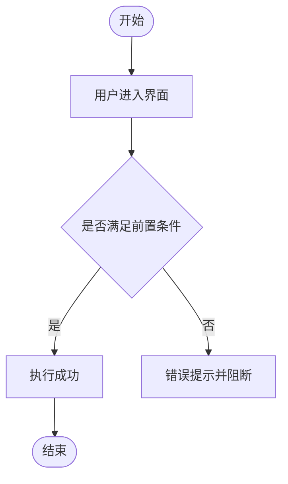

# Write PRD Skill (产品需求文档编写专家)

本 Skill 用于生成结构严谨、可验证且具备落地指导意义的**产品需求文档 (PRD)**。
PRD 的核心聚焦于：**功能需求、用户旅程 (User Flows)、UI/UX 交互说明、用户画像及业务约束**。
⚠️ **特别强调**：技术架构、库与框架选型、数据库表结构 (DDL)、底层实现模式及测试策略**严禁写入 PRD** —— 它们属于后续技术设计阶段的文档（如 ADR 或技术方案）。

---

## 核心执行流程 (Process)

### 第一步：获取初始产品诉求 (Gather Initial Description)
若用户尚未提供详细背景，先引导用户提供核心描述：
1. **解决什么问题？**（痛点背景）
2. **目标受众是谁？**（目标用户与角色）
3. **预期如何运作？**（已有设想、核心流程或业务限制）

### 第二步：识别业务场景模式并进行预调研 (Choose Workflow & Explore)
根据实际场景判断属于以下哪种模式，并在提问前主动阅读代码库或相关资料：

| 业务场景 | 场景特征 | 处理重心 |
|---|---|---|
| **绿地项目 (Greenfield)** | 全新创意、原型或项目立项 | 关注核心价值验证与 MVP 最小闭环 |
| **存量系统增量功能 (Feature in Existing App)** | 在现有成熟系统中新增或改造某一局部功能 | 关注与现有模块的交互兼容与状态继承 |
| **存量应用逆向梳理 (Existing App As-Is)** | 基于现有源码或运行系统，反向整理当前实际功能 | 描述“现状表现”而非“预期规划”，为重构或文档补全奠定基础 |
| **纯黑盒梳理 (Black-Box)** | 无源码，仅基于界面与交互体验梳理（如测试人员编写用例） | 梳理可见界面的操作流与边界表现 |

### 第三步：深入澄清提问 (Ask Clarifying Questions — 强制要求至少 5 问)
在动笔编写 PRD 前，**必须向用户提出至少 5 个针对性的澄清问题**。在用户回复确认前，严禁直接生成文档。若用户初始描述已包含某项，需针对业务深水区追问，避免重复已知信息。

**核心问题覆盖面（至少包含以下维度）：**
1. **用户与角色边界**：目标用户是谁？是否存在特殊角色（如管理员/代课/家长）或极端边缘用户？
2. **主流程后置状态 (After Happy Path)**：主成功操作完成后（如表单提交、支付完成、系统自动判定后），数据和用户的下一步是什么？
3. **本期明确不做的范围 (Out of Scope)**：本次 MVP / PoC 明确**不做**哪些功能？
4. **异常与边界分支**：输入错误、网络中断、余额不足、重复提交或条件模糊时系统如何提示和兜底？
5. **外部硬性约束**：是否存在法规政策、第三方平台限制、API 配额、文件体积/格式等硬性红线？
6. **交互与线框层级**：关键页面在结构上包含哪些模块？交互顺序如何？
7. **若涉及 AI / 智能体**：AI 无法做出明确判断时如何处理？系统**绝对不允许** AI 做什么？

> 💡 影响主干流程的决策必须在动笔前澄清；非阻塞性的假设或未决事项，应记录在 PRD 的【待定事项】中，严禁凭空捏造。

### 第四步：外部事实核查 (Research External Facts，若需要)
若产品涉及外部第三方 API（如微信支付、阿里云短信、S3/R2 存储限制）、特定文件格式约束或合规政策，必须先核查真实参数，严禁在 PRD 中编造未经验证的数据指标。

### 第五步：生成 PRD
按照文末的【PRD 标准模板】生成文档，默认保存至 `docs/PRD.md`（若是现有系统增量功能，保存至 `docs/prd-{feature-name}.md`）。

### 第六步：主动停步并交接技术设计 (Stop & Handover)
PRD 保存后立即停步。**严禁在同一次交互中直接开始编写代码或技术架构文档**。
询问用户是否需要调用 `technical-design-doc-creator` 技能根据本 PRD 生成技术设计方案，由用户决定后续节奏。

---

## 写作红线与准则 (Rules)

- **语言规范**：使用清晰、专业、结构化的中文撰写。
- **杜绝营销套话 (No Fluff / No Marketing)**：严禁出现“极致体验”、“让用户感到愉悦”、“颠覆性创新”等空话。每句话都必须对研发人员或 AI 编码 Agent 具有实际指导价值。
- **严禁技术细节侵入 (No Technical Implementation Details)**：严禁在 PRD 中提及前端框架（Vue/React）、状态库（Pinia/Redux）、数据库表名、SQL 语句、ORM 模型或具体代码文件路径。只定义**业务与功能行为**。
- **严禁测试策略侵入 (No Testing Strategy)**：测试方案与测试框架选型归属于 ADR/技术设计阶段。
- **验收标准必须量化可测 (Measurable Acceptance Criteria)**：
  - ❌ 错误示例：“文件上传功能工作正常。”
  - ✅ 正确示例：“当上传文件大于 10MB 时，系统不予保存并弹出 Toast 提示：'文件大小不能超过 10MB' (AC-03)。”
- **【范围外 (Out of Scope)】为强制必填项**：清晰列出本期“不做”什么，与“做什么”同等重要，是防范需求无序蔓延的核心防线。

---

## PRD 标准模板 (PRD Template)

````markdown
# 产品需求文档 (PRD) — [产品 / 功能名称]

---

## 1. 概述与执行摘要 (Executive Summary)
用 2-3 句话概括：正在构建什么、为谁构建、解决什么核心痛点。明确标注当前阶段（PoC / MVP / 正式功能迭代）。

---

## 2. 问题定义与背景 (Problem Statement)
- 当前存在什么痛点与现状？
- 为什么必须解决这个问题？
- 在该功能上线前，用户目前是如何低效或替代处理的？
（⚠️ 此处只阐述问题，不涉及解决方案）。

---

## 3. 目标用户与角色画像 (Users & Personas)
定义 2-3 个核心角色/画像，每个角色包含：
- **角色定位**：他是谁？
- **核心诉求**：他希望通过本功能完成什么？
- **预期成果**：他期望达到的最终业务状态。

---

## 4. 核心业务流程 (Main Flows)
每个核心场景一个子章节（包含主干成功流 + 关键分支/异常流）。采用编号步骤详细描述：
- 包含**用户操作**与**系统反馈/行为**。
- 步骤需具备闭环性。

---

## 5. 用户故事 (User Stories)
统一格式：`作为一个 [角色]，我想要 [功能]，以便于 [业务价值]。`
至少包含 4 个用户故事，覆盖：
- 正常主流程 (Happy Path)
- 异常与校验分支 (输入非法、服务不可用、结果存在分歧等)
- 状态与权限场景 (未登录、不同角色视图)

---

## 6. 验收标准清单 (Acceptance Criteria)
按功能模块分组（如：表单输入、状态流转、权限隔离、消息通知等）。
- 每条标准统一以 `AC-XX` 为编号。
- 必须是单一、明确、可验证、可测试的陈述句。
- 严禁包含模糊词汇。

---

## 7. 本期范围外清单 (Out of Scope)
强制必填！以加粗标题清晰列出本次**明确不实现**的内容，防止需求膨胀：
- 例如：暂不支持移动端 App、暂不支持多币种结算、暂不接入自动退款审批流等。

---

## 8. 约束条件 (Constraints)

### 8.1 业务与合规约束
政策法规、财务记账准则、业务合规红线等。

### 8.2 功能与规格限制
明确具体的业务数字上限：文件体积上限、数量上限、支持的文件格式、并发限制、保留天数等。

### 8.3 外部文档与参照依据 (可选)
引用的外部文件（业务白皮书、平台规范文档等）：
| 文档名称 | 存放路径 / 链接 | 使用场景说明 |
|---|---|---|

---

## 9. UI/UX 界面线框说明 (Wireframe Level)
按页面/弹窗逐一描述，**不包含视觉样式（色彩、圆角、字体），专注于信息架构与交互逻辑**：
- **界面结构与布局**：页面包含哪些主要区块。
- **交互元素与行为**：按钮点击、下拉选择后的即时反馈。
- **空状态 (Empty State)**：首次无数据时的展示。
- **加载态 (Loading State)**：异步请求时的交互。
- **错误态 (Error State)**：字段校验失败或网络中断时的提示。

---

## 10. 用户流程图 (User Flow Diagram)
使用 Mermaid flowchart 梳理 Section 4 的主干与分支流转（包含条件分支与异常结束点）：



---

## 11. 智能体/系统决策行为规范 (如涉及 AI / 自动化决策)
若包含 AI Agent、LLM 或规则引擎判定，须明确：
- 智能体的角色与权限边界；
- **允许执行**与**绝对禁止 (Strictly Forbidden)** 的操作；
- 置信度不足或无法判定时的退避与人工兜底逻辑；
- 法律免责声明或固定提示语规范。

---

## 12. 待定事项与补充说明 (Further Notes)
记录本期暂未敲定的开放性问题、业务假设或留待后续版本澄清的技术债。
````
