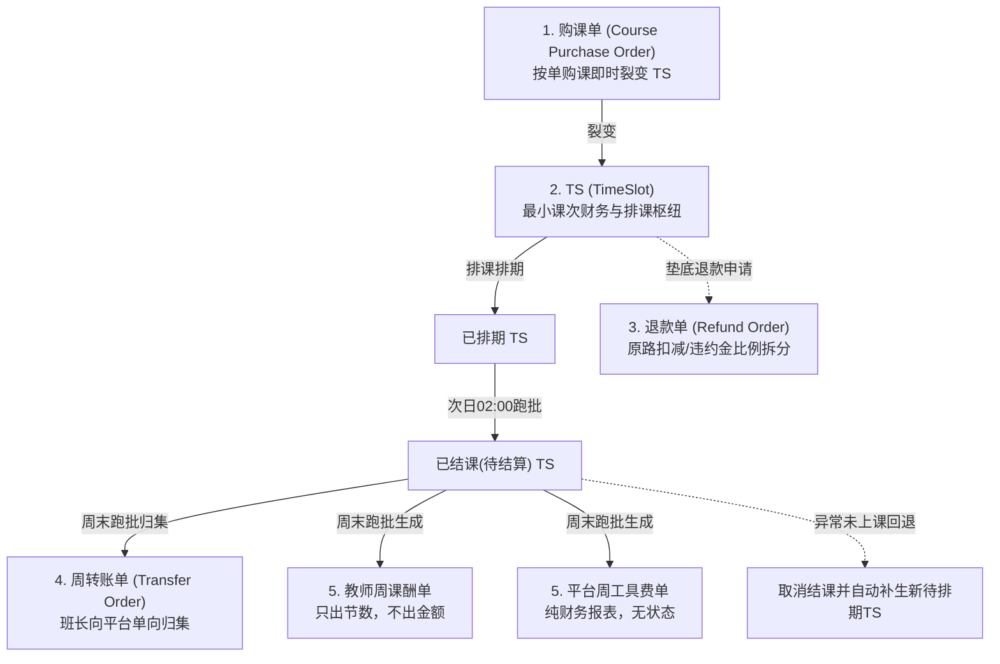

/** (c) 2024-2026 Topee (https://topee.top). All rights reserved. Proprietary and confidential. */

# Dream 核心业务规则与财务分账规约 (Business Rules & Settlement Conventions)

本文档是 Dream (教务排班与分账管理系统) 核心业务生命周期、单据流转、分账核算公式及调度规则的**唯一业务真相源**。所有需求实现（PRD/TDD/Code）必须严格遵循本文档规定的业务规则。

---

## 1. 业务哲学与核心红线 (Core Principles)

### 1.1 工作台物理隔离 (Physical Workspace Isolation)
- **多角色工作台隔离**：系统划分为**管理员后台**、**班长工作台**、**家长工作台**、**教师课表**四大独立空间。各工作台在顶部导航、主题视觉、功能边界与权限控制上实施严格物理隔离，杜绝一人身兼多职（如既是家长又是班长）时的跨角色错位操作。
- **多孩档案全局切换器 (Profile Switcher)**：家长工作台顶部常驻全局档案切换器，切换选中学生档案后，课表、待排期课时、请假记录、留言板联动下钻隔离刷新。

### 1.2 资金持有人锁定铁律 (Funds Holder Lock)
- **定义**：TS (TimeSlot) 课次的“资金持有方”（收款方）**永久锁定最初收款的班长或平台**。
- **流转不转移**：无论该课次后续排课给哪个学生、中途发生同师挪位、由哪位老师临时代课、抑或转让给其他家庭，TS 的 `holder_id` 始终不变，直至周末生成周转账单并完成平台归集。

### 1.3 财课分离与转让规则 (Finance & Schedule Decoupling)
- **财课解耦**：购课单与费用归属方永远保持最初付款家长账号不变，财务流水不可篡改。
- **排课生效**：发生课程转让（同家庭内多孩直转或跨家庭转让）时，原购课单资金归属完全不变，系统仅将 TS 的 `actual_student_profile_id` 变更为受让学生档案，权益立即在受让方课表呈现，不涉及退费重购。

### 1.4 纵深防御与越权 (IDOR) 绝对红线
- 查询、更新或操作任何属于用户/家长的实体（学生档案、购课单、TS 课次、请假、留言）时，在 Service 层鉴权的基础上，**Mapper/SQL 层必须物理强制包含 `account_id` 或 `student_profile_id` 过滤条件**，严禁仅凭单据 ID 越权操作。

---

## 2. 账号与档案解耦模型 (Account vs. Profile)

### 2.1 自然人账号 (Account - topee-auth)
- 自然人账号代表法律与财务操作主体，统一由 `@topeetop/auth-core` 承载，以唯一 **Email** 注册登录。
- 账号承载多角色权限标签：`[admin, monitor, teacher, user]`。
- 账号是官方通知 Email 的唯一载体，接收购课确认、排课提醒、请假变动与周结单等全量通知。

### 2.2 学生档案 (Student Profile)
- 学生档案代表实际上课、出勤统计与课时消耗的教学实体。
- 1 个家长账号可创建并挂载 N 个学生档案（支持二胎/多孩共管）。
- **学生昵称规范 (Nickname Standard)**：创建档案时强制遵循 **`英文名+姓首字母+年龄`**（例如 `AliceZ12`, `BobZ10`），用于多孩视觉区分及跨家长转让时的精准身份匹配。

---

## 3. 五大核心财务与调度单据体系

### 3.1 购课单 (Course Purchase Order)
- **等价原则**：**1 元 = 1 积分**。系统不设虚拟充值资金池，按单购课，即买即裂变待排期 TS。
- **课次防呆与约束**：
  - 固定位：系统校验课次数是否为 4 的倍数（前端弱提醒，允许特殊情况提交）。
  - 临时课：单次购课上限限制为不超过 20 节。
- **防呆金额公式强校验**：
  $$\text{预期总积分} = \text{课次数} \times (\text{教师级别标准单节课酬} + \text{平台工具费 (2积分)} + \text{额外备课费 (若勾选 +10积分)})$$
  - 录入金额不一致时，接口返回 `400 PRICE_CALCULATION_MISMATCH` 与标准算式，前端弹窗强提醒。
  - 管理员/班长确认后，提交时携带 `force_submit: true` 允许特批强行落盘。
- **尾差吸收算法 (Penny Rounding Absorption)**：
  - 当总金额由于特殊折扣导致均摊至每节 TS 出现非整除微小尾差时，前 $N-1$ 节 TS 实付积分取向下整除数，**最后一节 TS 吸收全部尾差**，确保所有裂变 TS 的 `total_points` 之和严格等于购课单总金额。
- **请假配额初始锁定**：
  - 创建购课单时，即刻计算并锁定当期可请假上限：
    $$\text{请假配额} = \lfloor \text{周期总课时} \times 0.125 \rfloor \quad (\text{向下取整})$$

### 3.2 TS (TimeSlot - 最小课次流转枢纽)
- **原子财务快照设计 (不可篡改)**：
  - TS 表中必须冗余固化生成时刻的财务快照字段：`total_points`（实付总积分）、`teacher_salary_points`（教师课酬）、`extra_prep_fee_points`（额外备课费）、`tool_fee_points`（平台工具费）。杜绝后续教师定级调整或全局费率变更破坏历史账目。
  - 冗余记录代课双追踪字段：`original_teacher_id`（原教师，用于课表呈现被代课状态）与 `current_teacher_id`（实际授课教师，用于周课酬单归集）。
- **生命周期状态机**：
  $$\text{待排期} \xrightarrow{\text{预约排课}} \text{已排期} \xrightarrow{\text{次日02:00}} \text{已结课(待结算)} \xrightarrow{\text{周末归集}} \text{已结算}$$
  $$\text{待排期/已排期} \xrightarrow{\text{退款/作废}} \text{已取消}$$
- **异常未上课回退补生机制 (关键财务兜底)**：
  - 若授课教师实际未上课，但跨过次日凌晨已被系统跑批自动变更为 `已结课(待结算)`：
  - 班长或管理员在后台将该 TS 手动标记为 `已取消`；
  - 系统强制向 `audit_logs` 写入审计日志；
  - 系统在原购课单下**自动补生 1 节全新的【待排期 TS】**，同时在课酬核算统计中物理剔除原 TS，保障家长权益与财务合规。

### 3.3 退款单 (Refund Order)
- **业务优先级**：优先引导同师挪位或群内转让；垫底退费必须提前 24 小时提交申请。
- **退款生效与审计**：管理员审核通过后，退款单直接生效并自动触发邮件审计通告。
- **违约金拆分**：若扣减违约金，违约金按原 TS 的教师课酬与平台工具费比例进行精准等比例拆分。

### 3.4 周转账单 (Transfer Order - 班长向平台单向归集)
- **业务铁律**：班长只向平台单向转账归集，**严禁班长之间跨账互转**。
- **1v1 课次核算口径**：
  - 已结课的 1v1 TS，实付总积分（`total_points`）全额计入应转账金额。
- **小班课自负盈亏与班长预留盈余核算机制**：
  - 小班课由班长自负盈亏独立核算：
    $$\text{单节固定工具费} = \text{最大学生数 (Max)} \times 6\text{ 积分}$$
    $$\text{单节净盈余} = \text{单节总实收} - \text{教师单节课酬} - \text{单节固定工具费}$$
  - **盈余分成**（若 $\text{单节净盈余} > 0$）：
    $$\text{平台抽佣} = \text{单节净盈余} \times \text{平台抽佣比例 } R\%$$
    $$\text{班长自留盈余} = \text{单节净盈余} - \text{平台抽佣}$$
  - **亏损兜底**（若 $\text{单节净盈余} \le 0$）：
    $$\text{平台抽佣} = 0, \quad \text{差额由小班班长全额自负贴补}$$
  - **系统预留扣除**：系统生成转账单时，**自动预留扣除班长自留盈余**，班长仅需向上转账：
    $$\text{转账上交金额} = \text{教师单节课酬} + \text{单节固定工具费} + \text{平台抽佣}$$
- **离职一键移交**：
  - 离职班长支持一键将名下所有未结 TS（`待排期` 及未结 `已排期`）全额移交平台，课次 `holder_id` 批量变更为平台。

### 3.5 双周度结算单据 (Weekly Settlement Reports)
- **教师周课酬单**：
  - 维度：每周每师 1 单，彻底解绑班长。代课课酬严格计入实际代课教师。
  - 特征：**只出授课节数（含额外备课费标识），不出金额**。由管理员线下核算打款后在后台标记 `已打款`。
- **平台周工具费单**：
  - 维度：全平台每周 1 张纯财务核算报表，**无状态流转字段，不与家长挂钩**。
  - 汇总内容：1v1 平台工具费（2积分/节）、小班课固定工具费（Max × 6积分）及小班课平台盈余抽佣。

---

## 4. 排课、改期、请假与固定位生命周期

### 4.1 12.5% 请假配额与时限熔断矩阵

| 课程类型 | 距上课时间 $\ge$ 24h | 距上课时间 3h ~ 24h | 距上课时间 < 3h |
| :--- | :--- | :--- | :--- |
| **固定位 (🟠)** | **仅限同师挪位** （不消耗请假配额，不可退回待排期池） | **仅限转让** （同家庭多孩或跨家庭转让） | **熔断锁死** （不可改不可退，正常划扣课时） |
| **临时课 (🟡)** | **未超配额**：直接请假退回待排期 **已超配额**：强制同师改期或转让 | **强制改期或转让** （不可退回待排期池） | **熔断锁死** （不可改不可退，正常划扣课时） |

- **配额消耗口径**：请假配额仅在 1v1 临时课「请假退回待排期」时扣减 1 次；固定位与临时课的同师挪位均不消耗请假配额。
- **时限熔断**：距离开课小于 3 小时，系统强行锁定修改入口，防止教师空等备课损失。

### 4.2 固定位到期前 72h 续费预占 (HOLD) 机制
- **自动触发**：当固定位周期剩余课次不足且距到期课次 72 小时时，系统自动在后续周期同一时段生成续费虚线预占卡片（`HOLD` 状态）。
- **抢位保护**：该时段对外锁定，优先保障原学员续费。
- **超时自动释放**：若家长在 24 小时内未完成续费购课确认，系统自动释放该虚线预占卡片，时段重新回退为绿色空闲（`FREE`）状态，开放给全员预约。

### 4.3 教师请假与代课流转
- **批量请假与不可抗力报备**：教师端支持单节或批量勾选 **1 ~ 12 节课（累计最长 6 小时）** 发起请假，必填不可抗力分类（如家庭突发停电/断网、突发急病就医等）。
- **受影响多学员应急调度与零扣减铁律**：
  - 空闲时段原子置为 🔴【已请假】阻断新约；已排课时段聚合生成【班长应急调度待办包】；
  - 班长可对受影响学员课次执行【指派代课】、【退回待排期】或【固定位同师同轮平移】；
  - **零扣减保护铁律**：因教师原因导致的所有课程退回或平移，全平台 **100% 物理强制豁免扣减学生 12.5% 请假配额**，且不计入学生挪位次数指标。
  - 批量请假时段若包含小班课，自动触发整班停课退回待排期并群发全班停课邮件。
- **开课前 $<3\text{h}$ 突发停电绿色通道与 15min 自动熔断兜底**：
  - 针对突发停电不可抗力，教师端豁免 $<3\text{h}$ 锁死阻断；
  - 若截至开课前 15 分钟班长仍未完成代课指派，后台 Worker 自动触发安全熔断：将课次转为【已取消并退回待排期 TS】，免扣配额并紧急通知家长，严防空堂。
- **双视角课表呈现**：
  - 原任课教师日历：该课次变更为**蓝色被代课 (🟠/🟡 $\rightarrow$ 🔵 `SUBBED_OUT`)**；
  - 实际代课教师日历：该课次呈现为**紫色代上课 (🟣 `SUBBED_IN`)**；
- **课酬归属**：实际结课后，课酬 100% 结算归属于实际代课教师（`current_teacher_id`）。

---

## 5. 后台批处理调度体系 (`dream-worker` 边界)

为保障高并发与强一致性，所有批量计算、跨天状态流转及延迟任务必须且只能由 `dream-worker` 独立后台服务调度，**严禁在前端 HTTP 请求线程中同步执行**。

| 调度任务 | 执行频率 / 触发时机 | 业务动作与处理边界 |
| :--- | :--- | :--- |
| **每日自动结课跑批** | 每日凌晨 02:00 | 扫描前一日所有授课完成的 `已排期` TS，批量流转为 `已结课(待结算)`。 |
| **周度单据自动生成** | 每周日夜间 23:59 | 汇总当周已结课 TS，自动生成**教师周课酬单**、**平台周工具费单**与**班长周转账单**。 |
| **站内信超时兜底邮件** | 每 5 分钟轮询扫描 | 扫描超过 30 分钟未读的二级必达通知，通过 Brevo/SMTP 自动向家长账号补发 Email。 |
| **续费预占超时释放** | 每 10 分钟轮询扫描 | 扫描超过 24 小时未确认续费的 `HOLD` 虚线预占位，批量置回 `FREE` 空闲。 |
| **突发断电开课前 15min 自动熔断** | 每 1 分钟轮询扫描 | 扫描距开课不足 15 分钟且处于教师突发不可抗力未指派代课的课次，自动取消并退回待排期 TS，紧急短信/邮件通知家长防空堂。 |

---

## 6. 三级消息分发矩阵与留言板隐私控制

### 6.1 三级消息分发矩阵

| 通知等级 | 典型业务场景 | 分发渠道与策略 | 接收对象 |
| :--- | :--- | :--- | :--- |
| **一级：常规通知** | 1. 课表生成与变动 2. 教师周课酬单生成 3. 学生档案留言板新公开回复 | **仅站内信 (In-App)** | 教师、家长 |
| **二级：必达通知** | 1. 购课单确认生成待排期 TS 2. 新排课成功 3. 距开课 24h 之外常规请假/同师挪位 | **站内信 + 30min 超时兜底 Email**： 先发站内信，若 30 分钟未读，由 `dream-worker` 自动补发邮件。 | 家长账号、教师 |
| **三级：紧急通知** | 1. 距开课 24h 之内紧急改期/挪位 2. 课程转让成功（学生档案变更） 3. 小班课整班停课请假 4. 教师紧急请假与临时代课指派 5. 退款单生成与生效 | **站内信与 Email 并发即时推送**： 零等待，立即通过 Email 网关与站内信同时向相关各方全量推送。 | 授课教师、代课教师、转出家长、受让家长、小班全班家长 |

### 6.2 简易留言板双权限隐私控制
挂载于学生档案下的简易留言板与通知系统深度联动，严格执行双权限隔离：
- 🔓 **【师生公开】模式**：
  - 留言产生后触发一级常规通知推送；
  - 家长、任课教师、代课教师、班长、管理员全员可见。
- 🔒 **【仅内部教学可见】模式**：
  - **对家长端/学生端 100% 物理屏蔽与隐藏**；
  - **严禁向家长账号发送任何形式的站内信或邮件提醒**；
  - 仅任课教师、代课教师、班长、管理员内部可见与接收站内提醒。
