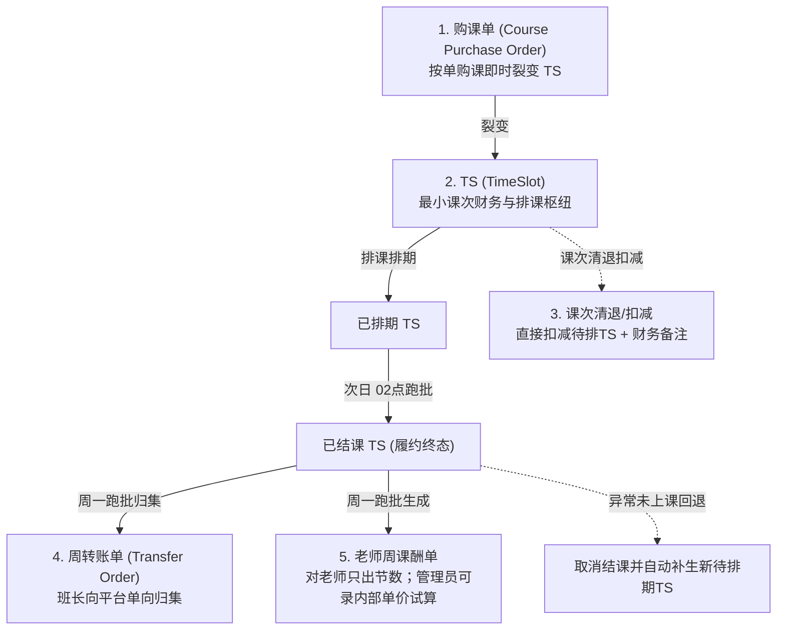
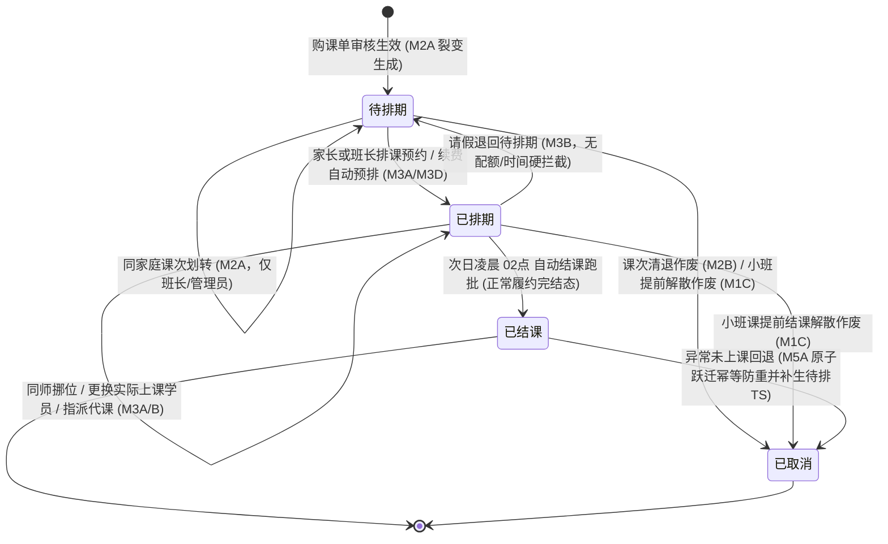

/** (c) 2024-2026 Topee (https://topee.top). All rights reserved. Proprietary and confidential. */

# Dream 核心业务规则与财务分账规约 (Business Rules & Settlement Conventions)

本文档是 Dream (教务排课与分账管理系统) 核心业务生命周期、单据流转、分账核算公式及调度规则的**唯一业务真相源**。所有需求实现（PRD/TDD/Code）必须严格遵循本文档规定的业务规则。

---

## 1. 业务哲学与核心红线 (Core Principles)

### 1.1 工作台物理隔离 (Physical Workspace Isolation)
- **多角色工作台隔离**：系统划分为**管理员后台**、**班长工作台**、**家长工作台**、**老师课表**四大独立空间。各工作台在顶部导航、主题视觉、功能边界与权限控制上实施严格物理隔离，杜绝一人身兼多职（如既是家长又是班长）时的跨角色错位操作。
- **多孩档案全局切换器 (Profile Switcher)**：家长工作台顶部常驻全局档案切换器，切换选中学生档案后，课表、待排期课次、在学课件进度与备忘录联动下钻隔离刷新。

### 1.2 资金持有人锁定铁律 (Funds Holder Lock)
- **定义**：TS (TimeSlot) 课次的“资金持有方”（收款方）**永久锁定最初收款的在职班长，或唯一「永久主管理员」（代表平台固定持有「平台直收」与离职移交接管资产，其账号主体永久固定不变）**。
- **流转不转移**：无论该课次后续排课给哪个学员、中途发生同师挪位、由哪位老师临时代课、抑或更换实际上课学员，TS 的资金持有方（`holder_id`）始终不变，直至周末生成周转账单并完成平台归集核销。**唯一例外**：班长离职移交确认收款后，名下未结 TS 资金持有方批量改绑为唯一「永久主管理员（代表平台托管）」（见 §3.4 离职一键移交）。

### 1.3 财课分离、更换实际上课学员与同家庭课次划转规则 (Finance & Schedule Decoupling)
- **财课解耦**：购课单与费用归属方永远保持最初付款家长账号不变，财务流水不可篡改。
- **直接换人（替代原独立转让单）**：在日历课格或课次明细上，班长可直接点击**【更换实际上课学员】**，下拉选择另一位学员即可（无需校验是否同一家庭）。原购课单资金归属完全不变，系统仅将 TS 的实际上课学员（`actual_student_profile_id`）变更为新学员档案，课表即时生效；线下家长如何结算由线下自闭环，系统不介入。
- **同家庭课次划转（仅限班长 / 管理员操作待排 1v1 TS）**：当同一家长账号名下有多个「正式在读」孩子时，**仅限该待排课次的资金持有人班长（当前班长即为该课次 `holder_id`）或平台管理员**可执行【课次划转】，将某位在读孩子名下处于「待排期」的 1v1 待排课次划转给同家长名下另一位在读孩子（家长端与老师端不开放此操作）。划转不改变原购课单出资人、单节积分快照、价位档位与资金持有人（`holder_id`），详细业务规则与防线统一由 [m2a_course_orders.md](./prd/m2a_course_orders.md) 管辖。
- **学员动态关联与履约按师归口铁律（按师履约 + 动态关联）**：
  - **正式学员不强绑唯一班长**：「未认领试课」档案保留建档班长归属隔离；「正式在读」学员不再强行绑定唯一负责班长，班长端的【所辖学员】列表及档案查看权限按“名下未认领试课生 / 本人负责老师（或小班）近 90 天及未来有课学员 / 本人收款托管尚有未结课次或待处理订单学员”三条真实业务关系动态聚合关联。
  - **1v1 临时约课放开，1v1 固定位与履约按师归口（含 `< 3h` 跨班长紧急驰援豁免与 M5A 异常回退例外）**：班长保留全域 **1v1 临时课** 约课（1～7 天）、小班建班委任与全平台指派代课权限；**1v1 4 周固定位批量排课仅限授课老师所属负责班长（或平台管理员）执行**（本人主理小班仅限本人小班及已委任主讲老师）；课次一旦排入某位老师课表，**请假（含代学员请假/代老师请假）、同师挪位、考勤/旷课/迟到早退标记、恢复出勤与更换实际上课学员**，原则上严格仅限该课次授课老师所属负责班长（或平台管理员）执行，禁止跨班长操作其他班长负责老师的 `>= 3h` 已排课次（跨班长代课时仍由原任课老师所属负责班长主责协调）。**已结课课次之 [M5A](./prd/m5a_transfer_collection.md) 异常未上课回退例外**：仅限**该 TS 原资金持有人班长、该课授课老师所属负责班长或平台管理员**操作（当资金持有人班长与老师负责班长非同一人时，任一方回退均向另一方发 M4 中性知会；第三方无关班长严禁操作）。**唯一紧急驰援豁免（`< 3h` 窗口）**：当任意 1v1 或 1vN 小班未结课课次处于**距开课 `< 3 小时`**（含临近开课或刚过开课时间待应急处置）时，为保障按时履约、防止空堂与白等，全平台任一在职班长均可在教务中心浅红紧急待办、M3A 课表或日调度中跨组执行该节急救处置（指派/撤销代课、`<3h` 退回待排期/暂停待排、`<3h` 同师挪位、急救考勤），不转移原 TS 资金持有人与老师人事归属，系统向原负责班长/主理人发送站内协同知会并记入操作人经办记录；**1v1 4 周固定位批量排课、更换实际上课学员、小班解散、已结课课次跨组异常回退及一切 `>= 3h` 常规操作仍严格禁止第三方跨班长越权**。

### 1.4 纵深防御与越权 (IDOR) 绝对红线
- 查询、更新或操作任何属于用户/家长的实体（学员档案、购课单、TS 课次、备忘录）时，在 Service 层鉴权的基础上，**Mapper/SQL 层必须物理强制包含 `account_id` 或 `student_profile_id` 过滤条件**，严禁仅凭单据 ID 越权操作。

### 1.5 实体生命周期 SSOT 管辖铁律 (Entity Lifecycle SSOT Matrix)
- **唯一定义源**：本文档统领系统宏观业务哲学、财课隔离与 TS 课次全局运转中枢（见 3.2 节）。除 TS 全局中枢外，**全系统所有业务实体的完整生命周期状态机、触发事件、前置守卫与资产流转规则，统一且唯一收敛归属于各业务模块专属 PRD 文档**。
- **后续修改归口铁律**：**后续任何关于实体生命周期、状态跃迁或流转约束的修改，统一且必须直接修改对应模块专属 PRD 文档**，严禁在其他子模块中越界复读或私自篡改定义。跨模块业务协同必须采用“单向指针 (Pointer Reference)”引用对应归口 PRD。

| 业务实体对象 | 所属业务域 | 专属归口 PRD 文档 | 唯一真相源章节 |
| :--- | :--- | :--- | :--- |
| **学员档案 (`StudentProfile`)** | M1A 学员管理 | [`docs/prd/m1a_student_profile.md`](./prd/m1a_student_profile.md) | Section 4.6 学员档案全生命周期与资产安全流转 |
| **老师/班长档案 (`TeacherProfile` / `MonitorProfile`)** | M1B 师资管理 | [`docs/prd/m1b_teacher_profile.md`](./prd/m1b_teacher_profile.md) | Section 4.7 老师与班长档案全生命周期与离职交接 |
| **小班实体 (`GroupClass`)** | M1C 小班管理 | [`docs/prd/m1c_classes.md`](./prd/m1c_classes.md) | Section 4.2 小班全生命周期与提前结课解散规则 |
| **课件与在学配置 (`Courseware`)** | M1E 课件库 | [`docs/prd/m1e_courseware.md`](./prd/m1e_courseware.md) | Section 4.3 课件生命周期与学员绑定升阶规则 |
| **购课单 (`CoursePurchaseOrder`)** | M2A 购课单据 | [`docs/prd/m2a_course_orders.md`](./prd/m2a_course_orders.md) | Section 4.5 购课单全生命周期状态机与 TS 裂变规则 |
| **课次清退记录 (`CreditDeduction`)** | M2B 课次清退 | [`docs/prd/m2b_refund_orders.md`](./prd/m2b_refund_orders.md) | Section 4.2 课次清退/扣减规则与财务备注留痕 |
| **统一时段覆盖 (`SlotOverride`)** | M3A 日历排课 | [`docs/prd/m3a_calendar_grid.md`](./prd/m3a_calendar_grid.md) | Section 4.10 临时加开 / 锁定 / 请假 / 续费预占 |
| **代课工单 / 老师请假 / 学员与老师异常记录 / 经办流水** | M3B 考勤与代课 | [`docs/prd/m3b_attendance_substitution.md`](./prd/m3b_attendance_substitution.md) | Section 4.8–4.10 考勤与代课四大实体状态机、修改规则与留存归口 |
| **排课工作台调度事务 (`ScheduleBatchTask`)** | M3D 排课工作台 | [`docs/prd/m3d_course_scheduling.md`](./prd/m3d_course_scheduling.md) | Section 4.3 & Section 4.7 排课批量事务、调度流水留痕与续费 HOLD 预占联动 |
| **站内提醒 (`Notification`)** | M4 通知提醒 | [`docs/prd/m4_notification.md`](./prd/m4_notification.md) | Section 4.4 站内提醒生命周期、字段只读与 90/180 天清理规则（邮件投递交由平台既有通道托管） |
| **周转账单 (`TransferOrder`)** | M5A 转账归集 | [`docs/prd/m5a_transfer_collection.md`](./prd/m5a_transfer_collection.md) | Section 4.6 周转账单四支柱生命周期、字段锁定、留痕与永久只读留存策略（附跨实体联动清单） |
| **老师周课酬单 (`TeacherSalaryReport`)** | M5B 周度结算 | [`docs/prd/m5b_weekly_settlement.md`](./prd/m5b_weekly_settlement.md) | Section 4.6 老师周课酬单四支柱生命周期、字段锁定、留痕与永久只读留存策略（附跨实体联动清单） |
| **TS (TimeSlot - 最小课次流转枢纽)** | 全域流转枢纽 | [`docs/BUSINESS_RULES.md`](./BUSINESS_RULES.md) | Section 3.2 TS 全局生命周期状态机 (全系统统领封板) |

---

## 2. 账号与档案解耦模型 (Account vs. Profile)

### 2.1 自然人账号 (Account - topee-auth)
- 自然人账号代表法律与财务操作主体，统一由 `@topeetop/auth-core` 承载，以唯一 **Email** 注册登录。
- 账号承载多角色权限标签：`[admin, monitor, teacher, user]`。
- 账号是官方通知 Email 的唯一载体，接收购课确认、排课提醒、请假变动与课酬单等全量通知。

### 2.2 学员档案 (Student Profile)
- 学员档案代表实际上课、出勤统计与课次消耗的教学实体。
- 1 个家长账号可创建并挂载 N 个学员档案（支持二胎/多孩共管）。
- **规范英文名唯一锚定与私域小名隔离铁律 (Canonical English Name & Privacy Separation)**：创建档案时强制生成全平台大小写不敏感唯一的 **`规范英文名`（又称规范昵称，格式为 `英文名+姓首字母+[可选微调字母]+年龄`，例如 `AliceZ12`、`BobZ10`、`MarkL10`）**。一般老师与班长在全系统日常业务流（课表、约课、购课单、清退单、周转账单、周课酬单、考勤代课/授课历史、消息通知、审计日志与在学课件 `Process Note`）中**仅展示与检索「规范英文名」**，严禁因裸英文名或中文小名重名产生歧义；**中文姓名/小名与其余辅助个人资料**仅向**家长本人（自家私域）**以及进入 **[M1A 学员档案卡片/详情](./prd/m1a_student_profile.md)** 具备查看权限的班长/管理员按权限开放展示（对老师端与跨业务流水 100% 物理隐藏）。

---

## 3. 五大核心财务与调度单据体系

### 3.1 购课单 (Course Purchase Order) 统一裂变 TS 体系
- **等价与纯积分原则**：系统底层沿用 **1 元 = 1 积分** 换算认知（仅作基准定价概念定义；全系统所有业务单据、对账报表、退费备注及界面展示**统一且仅以「积分」计量，严禁出现“人民币”、“元”或 `¥` 货币符号**）。
- **统一 TS 资产模型**：
  - **每次购课必生成 TS**：所有购课单（`1v1 课次`、含「未认领试课」单、`小班课`）在确认收款后，**100% 原子裂变生成 $N$ 节「待排期」TS**（或在 M3A 约课抽屉同步录单时直接生成「已排期」TS），并固化单节实付总积分快照（`total_points`）、所购价位档位快照（`price_tier_points`）及资金持有人（`holder_id`）。
  - **1v1 待排 TS 统一资产池（购买不分固定与临时，排课时才定性）**：
    1. **1v1 课次统一购课**：支持在同一张购课单内添加 **1～N 条价位明细**（每条含 `价位档位 + 节数`，如 `18积分×1节 + 21积分×1节`，或单条 `16积分×8节`），可选填意向老师与勾选额外备课费（`+10积分`）。确认收款后逐行裂变出对应节数的 **「待排期」1v1 TS**（无固定/临时区分，仅固化价位档位、资金持有人与实付积分快照，排课形态标记 `schedule_kind` 为空）。因为每节 TS 独立锁定资金持有人，**不同班长可随时各自向同一家长售卖 1v1 TS，零跨班长持有冲突**。
    2. **排课时才定性（固定位 🟠 vs 临时课 🟡）与严格单价位匹配**：
       - **1v1 固定位（`schedule_kind` = 固定位，🟠）**：仅当在 M3D 批量锁定 4 周固定位或自动续费单确认收款时，该批 TS 才标记为固定位，并由 `dream-worker` 周一 08:30 自动续费扫描识别；**M3D 固定位排课只能选一个价位**（严格要求 `老师在排课日期的生效价位 == TS 购课价位快照`，禁止跨价位混扣；且**禁止跨老师待生效调价日连续排班**）。
       - **1v1 临时课（`schedule_kind` = 临时课，🟡）**：家长在 M3A 未来 1～7 天用待排 1v1 TS 自助约课时，**严格匹配目标上课日期当天的老师生效价位（`老师在该上课日期的生效价位 == TS 购课价位快照`，不向下兼容、不跨档折算，同价位内按先购先扣 FIFO 扣减）**；班长/管理员在后台代约不受此限制。
       - **请假/撤排退回重置**：任意 1v1「已排期」TS（无论固定位或临时课）在请假或撤排退回「待排期」后，一律清空排课形态标记（`schedule_kind` 重置为空），回到统一的 1v1 待排池（保留原资金持有人与原价位档位）。
    3. **老师预约定时调价规约（单一待生效槽位 · 下轮首日生效）**：
       - **单一待生效与轮次首日锁定**：每位老师同一时间最多只能存在 **1 个**待生效的新价位计划（立即改价落盘时自动作废原待生效计划）；生效日**严格限定为未来某全局 4 周轮次的第一天（周一 `00:00:00` 北京时间 `UTC+8`）**，且系统强制校验设置时间必须**早于该轮次对应的自动续费跑批时间（即前一周周一 `08:30:00` 之前，距生效日约 `6 天 15.5 小时`）**。
       - **已购未排期 TS 处理**：已购买但尚未排期的「待排期」TS 保持原价位档位与实付积分快照不变。调价生效日前的课程仍按原价位匹配；调价生效日及之后按新价位校验匹配（原价位待排 TS 仍可约其他同价位老师，或由班长按 M2B 课次清退 + M2A 补差重开单处理）。已排定未来课次执行“同师挪位”跨越调价日时直接平移，不补差、不阻断。
       - **自动续费单取价**：周一 `08:30` 跑批生成的自动续费单，统一取**该续费单覆盖新轮次首日**的老师生效价位计价；已生成的待付款单据不二次改价。小班课独立定价，不受老师 1v1 调价影响。
- **课次防呆与约束**：
  - 「正式在读」学员 1v1 购课单：不限 20 节上限；若总课次数非 4 的倍数，前端给出弱提醒（允许正常提交）。
  - 「未认领试课」档案购课单：单次购课严格限制 **1～20 节**正整数（多价位明细之和），严格按所选价位计价、**禁止特批改价或强行提交**。
- **防呆总积分公式强校验**：
  - **教师档案“价位”语义铁律**：教师档案中的【价位】（如 `16积分` / `18积分` / `21积分`）表示**家长每节课需支付的积分数**，**并非老师的课酬单价**。额外备课费（`+10积分/节`）为**整单级**单一勾选，作用于该 1v1 订单全部明细行；系统已彻底取消工具费，不再计算平台工具费：
  $$\text{1v1 预期总积分} = \sum_i \text{明细节数}_i \times (\text{明细价位}_i + \text{整单额外备课费 (若勾选 +10积分)})$$
  - 「正式在读」学员 **1v1 购课单**录入实收总积分与预期不一致时，系统校验阻断并弹窗展示标准算式强提醒；管理员/班长确认后，必须填写特批改价原因（1–200 字）方可特批强行落盘（**「未认领试课」单禁止特批改价**；**小班课购课单不设期望总积分**，录入多少待上交正整数即按多少上交，不触发改价阻断）。
- **多价位独立快照与尾差吸收算法 (Line-Independent Snapshot & Penny Rounding)**：
  - **正常无强提改价（1v1 实收 = 期望）**：按各价位明细行独立裂变固化（`明细价位 + 整单备课费〔仅勾选时〕`），天然整数无尾差，严禁将多价位组合（如 `18+21`）跨行均摊破坏原价位快照；
  - **强提改价折扣或小班整单录入**：当实收总积分需按节分摊出现非整除微小尾差时（多价位强提先按各明细行期望总积分占比向下取整分摊各行总额、余数入末行），前 $N-1$ 节 TS 实付积分取向下整除数，**最后一节 TS 吸收全部尾差**，确保所有裂变 TS 的 `total_points` 之和严格等于购课单实收总积分。

### 3.2 TS (TimeSlot - 最小课次流转枢纽)
- **原子财务快照设计 (不可篡改)**：
  - 每次生成 TS 必须冗余固化生成时刻的不可篡改财务快照字段：`total_points`（实付总积分 / 小班单节待上交积分）、`price_tier_points`（下单价位快照，仅 1v1）、`extra_prep_fee_points`（额外备课费，仅 1v1）。杜绝后续老师调价或费率变更破坏历史账目。*(小班 TS 不再写入老师单节课酬快照，老师课酬统一于 M5B 发薪看板试算)*
  - 冗余记录代课双追踪字段：`original_teacher_id`（原老师，用于课表呈现被代课状态）与 `current_teacher_id`（实际授课老师，用于周课酬单归集）。
- **TS 全局生命周期状态机 (The Central Pivot State Machine · 履约与结算解耦模型)**：
  TS 是全系统教务履约与排课运转的最小原子中枢。系统确立**“教务履约与财务结算严格解耦”**铁律：TS 状态机纯粹聚焦于教学履约周期，次日凌晨跑批结课落盘「已结课」即为**正常履约完结态**（除受双重财务冻结保护的「异常未上课回退 → 已取消」单向纠偏外，不再承接其余状态流转）；后续周转账单归集与老师周结发薪完全由下游财务单据独立管辖，严禁将财务过程态污染至 TS 实体：

- **TS 核心状态与转移规则矩阵 (State Transition Matrix)**：

| 当前状态 | 目标状态 | 触发事件 / 动作 | 操作人 | 前置守卫条件与温和提示 | 伴随副作用与资产流转 |
| :--- | :--- | :--- | :--- | :--- | :--- |
| **`[*]`** | **待排期** | 购课单支付并审核通过 | 班长 / 管理员 | 购课单流转为「已付款」 | 系统原子裂变生成 $N$ 个待排 TS；固化财务快照与资金持有方（`holder_id`）。 |
| **待排期** | **待排期** | 同家庭课次划转 | 班长 / 管理员 | 划出与接收方须为同一家长账号下「正式在读」孩子；仅限 1v1 待排 TS；填写 1–200 字备注 | 单事务按价位先购先扣（FIFO）将选定 TS 归属切换至接收孩子；价位、积分快照、原购课单与资金持有方不变；写入状态流转历史与经办记录并通知家长。 |
| **待排期** | **已排期** | 选定空闲网格排课预约 | 家长 / 班长 / 管理员 | 目标老师网格为 🟢 空闲态；**1v1 临时课班长可全局选师**；**1v1 4 周固定位仅限目标老师所属负责班长或平台管理员**；小班课需本人主理且已委任老师连续双格 | 占用日历网格；写入授课日期、排课时段与实际上课学员。 |
| **待排期** | **已取消** | 办理课次清退/扣减 或 小班提前结课解散 | 班长 / 主理人 / 管理员 | 清退需输入节数与财务备注；小班提前解散须填写原因、流向与 1–200 字备注 | 待排 TS 原子作废；扣减/清零剩余待排课时，解散时须写入作废 TS 明细、节数与积分快照日志。 |
| **已排期** | **已取消** | 小班课提前结课解散 | 小班主理人 / 管理员 | 仅限小班未来未开课「已排期」TS（存在已过开课时间未结课 TS 时前置拦截）；须选原因、流向并填 1–200 字备注 | 未来已排 TS 原子置为「已取消」并释放日历双格（保留老师自身请假态）；取消未完成代课待办；写入解散残值日志（明细、节数与精确积分快照），绝不进入周转账单。 |
| **已排期** | **待排期** | 请假退回待排 | 家长（$\ge 24\text{h}$）/ 班长（不限） | 取消配额拦截；**家长端距开课 $< 24\text{h}$ 禁止自助请假**；**班长/管理员不锁**（$< 3\text{h}$ 弹出温和确认提示后放行） | 释放日历网格变回 🟢；TS 重置为待排期，课次资产全额保留；若为 `<3h` 临期变更，在 M5B 出勤流水中标记。 |
| **已排期** | **已排期** | 同师同格平移挪位 | 家长（$\ge 3\text{h}$）/ 班长（不限） | 目标为同一老师空闲时段；**家长端距开课 $< 3\text{h}$ 禁止自助挪位**；**班长/管理员不锁**（$< 3\text{h}$ 弹出温和确认提示后放行） | 原网格释放，新网格锁定；如属 `<3h` 临期变更则在 M5B 出勤流水中标记。 |
| **已排期** | **已排期** | 更换实际上课学员 | 班长 / 管理员 | 仅限 1v1 课次（按师归属，不纳入 `<3h` 跨组驰援）；无需校验同家庭，**若属跨家庭换人则强制填 `1–200 字` 协调备注并确认已沟通双方家长**；若距开课 $< 3\text{h}$，弹出温和确认提示后放行 | 切换实际上课学员（`actual_student_profile_id`）；原购课单出资人与资金持有方保持不变；写 TS 流转与经办记录，**跨家庭时同步向原出资家长与新学员家长（非待认领试课）各发 1 条 M4 站内中性卡知会**。 |
| **已排期** | **已排期** | 指派临时代课 | 班长 / 主理人 | 代课老师有时段资质且目标格空闲；若距开课 $< 3\text{h}$，弹出温和确认提示后放行 | 原老师（`original_teacher_id`）锁定，实际授课老师（`current_teacher_id`）指向代课老师；代课双视角日历染色。 |
| **已排期** | **已结课**（完结态） | 每日自动结课跑批 | `dream-worker` | 每日服务器时间 02:00；排课日期为前一日且未请假挂起/未取消 | 批量流转为正常履约完结态「已结课」；写入结课跑批流水日志；除受冻结保护的异常回退外不再承接其他流转。 |
| **已结课** | **已取消** | 异常未上课回退补生 | 原资金持有人班长 / 师负责班长·主理人 / 管理员 | 该 TS **尚未被包含在状态为「已完成入账」的周转账单中，且尚未被纳入状态为「已打款」的老师周课酬单中**（若关联「待平台确认」在途转账单，须先由永久主管理员驳回退回草稿后再操作）；强制输入 1-200 字异常原因及责任类型（`平台故障`仅平台管理员可选） | 以 `已结课 → 已取消` 原子条件跃迁防并发双补生；关联草稿转账单同步剔除重算（归零作废）；「老师责任」从 M5B 未打款单剔除计数并记实际授课老师《出勤异常记录》（代课态同步取消代课工单）；「平台故障」不记录老师或学员任何出勤异常、从 M5B 未打款单剔除计数且老师不发薪（代课态同步取消代课工单）；两分支均原单补生 `1` 节同原时长全新待排 TS 退给学员/小班待排池（不二次收费）。 |

- **多状态实体状态流转历史留痕铁律 (State Transition History)**：
  - 凡具备多状态生命周期的核心单据与业务实体（TS 课次、购课单、周转账单、教师周课酬单、小班课、学员/教师/班长档案、老师请假与代课工单），每次发生状态跃迁必须在同一事务内追加写入一条**只读不可篡改的状态流转历史**（记录实体类型、实体编号、原状态、目标状态、操作人/系统、流转时间与变更原因）。
  - **同状态自流转兜底**：对于不改变状态枚举但改变核心排期/归属的同状态流转（如 TS 的「待排期 → 待排期」同家庭课次划转，以及「已排期 → 已排期」同师挪位、更换实际上课学员、指派代课，包括家长自助挪位），同样必须追加写入状态流转历史，并在上下文备注中记录变更前后的时段、学员或老师，杜绝追踪盲区。
  - **四类留痕严格分工**：① **状态流转历史**专职沉淀 `原状态 → 目标状态`（含同状态自流转）变迁，服务各单据详情页时间轴与财务追溯；② **【经办记录】**（`M3B §4.10`）专职记录班长/管理员人工排班约课与考勤调度动作；③ **《出勤异常记录》**（`M3B §4.9`）专职核算异常出勤次数与课酬透出；④ **通用字段审计日志**专职沉淀所有档案与主数据的字段级修改快照（含学员/教师/班长档案全部业务字段与备注修改、在学课件变更、小班关键字段修改、全局配置字典变更、以及自动续费单确认收款前的编辑修改，仅在字段值实际发生改变时写入）。

- **教务履约与财务结算解耦铁律 (Decoupled Schedule & Settlement Model)**：
  1. **TS 终态收敛于教务履约**：TS 作为最小排课与授课单元，次日凌晨 02点 结课落盘为「已结课」即告教务履约圆满达成，不再承载任何下游财务流转状态；
  2. **周转账单防重归口关联全局唯一归属约束**：周一生成转账单草稿时，通过「周转账单-课次关联明细」单课次全局唯一归属约束拦截重复打包（同一节已结课 TS 同一时间至多归属于 1 张未作废周转账单），彻底摒弃在 TS 主表改状态的旧模式；若转账单驳回或作废，只需解除明细关联，TS 主表保持「已结课」不变；
  3. **资金归集与发薪闭环在财务单据**：周二平台确认资金归集由 `周转账单 = 已完成入账` 表征；周三平台发薪完成由 `老师周课酬单 = 已打款` 表征并对其包含的已结课课次叠加不可逆发薪只读冻结（禁止清退、回退、挪位与更换上课学员），无需回写 TS 主状态。

- **关键业务修饰标记与状态属性 (Flags & Attributes)**：
  - `schedule_kind`（1v1 排课形态标记）：「待排期」时恒为空（购课单不区分固定/临时）；排入 4 周固定位或自动续费单确认时标记为「固定位」（🟠，参与周一 08:30 自动续费扫描）；排入 1～7 天单次/连约时标记为「临时课」（🟡）；请假或撤排退回「待排期」时清空重置；
  - `is_hold` (续费预占锁)：固定位与活跃小班到期前 7 天自动续费预排时开启预占（1v1 按 `min(次轮最早预占开课前 24h, 新轮首日周一 01:00 UTC+8)`、小班按 `次轮最早预占开课前 24h` 触发未传凭证逾期作废释放，1v1 `已传凭证待核` 豁免）；仅经 M2A 确认收款后解除预占转为正式排课（M3D 待排池重排不可免扣转正，将先释放原 HOLD 并作废未传凭证续费单）；
  - `is_group` (小班课标识)：连续双网格（50分钟）课次，绑定所属小班（`class_id`），绝对不维护个人学员档案（`student_profile_id`）。

- **数据清理与归档治理边界 (Data Retention & Cleanup Policy)**：
  1. **定期物理清理（防膨胀临时数据）**：① **历史过期时段覆盖 (`SlotOverride`)**：早于 **90 天** 的历史日期记录（临时加开 / 锁定 / 请假 / 续费预占）定期物理清理；② **过期站内提醒 (`Notification`)**：已读消息满 **90 天**、全部消息满 **180 天** 后定期物理清理；
  2. **按年转冷存 / 归档（不可删，脱离热查询）**：高频流水与审计数据（【经办记录】、通用字段审计日志、单据状态流转历史、《出勤异常记录》）留存满 **1~2 年** 后按自然年归档至低成本冷存；
  3. **按既有 PRD 只读留存（不转冷库、不物理删除）**：已归档学员档案（含试课超时/手工归档与正式离场归档，满足条件可手工激活）、已离职教师/班长档案、已结案归档/已提前解散小班、已停用课件保留只读标识，维持原样不转冷库；
  4. **永久只读不可删除（财务与合规红线）**：购课单、`TS / TimeSlot`、周转账单、老师周课酬单、课次清退扣减记录及打款凭证永久只读留痕，严禁物理删除。

### 3.3 课次清退与财务备注 (Credit Deduction - 原退款单)
- **极简定位**：少儿教务退费由班长/校长在线下（微信/支付宝）直接向家长转账退还，系统不再维护电商级退款审批流或 10% 违约金自动公式。
- **操作方式**：在学员档案资产卡上提供 **【课次清退/扣减】** 操作：输入清退节数（扣减或清零剩余待排期 TS）并填写财务备注（如“线下退费微信转账 600 积分”），系统原子将对应待排 TS 置为「已取消」并记录操作日志。
- **结算脱钩**：周度转账单仅按实际「已结课」TS 核算应上交总积分，退费不参与线上周转账冲抵或违约金追缴。

### 3.4 周转账单 (Transfer Order - 班长向平台单向归集)
- **业务铁律**：班长（含小班主理人）只向平台单向转账归集，**严禁班长之间跨账互转**。
- **应转总额与课次核算口径（纯结课 TS 归集）**：
  - **1v1 结课 TS**：已结课的 1v1 TS，实付总积分（`total_points`）全额计入应转账总积分。
  - **小班课结课 TS**：已结课的小班课 TS，按单节待上交积分全额计入应转账总积分。
    $$\text{班长周度应转账总积分} = \sum \text{1v1已结课TS待上交积分} + \sum \text{小班已结课TS待上交积分}$$
- **小班课独立核算与分成机制（小班主理人承包制）**：
  - **小班主理人角色与全平台选师规约**：
    - **主理人身份定义**：全面采用**“小班主理人”**（简称**“主理人”**）术语，取代原“小班课班长/小班负责人”表述。谁持有资金谁创建小班并作为小班主理人；主理人本质赋予班长角色权限（在新建班长时创建即自动拥有班长权限），名下可以绑定管辖具体老师，也可以完全不绑定老师（专职运营小班）。
    - **建班绑定与前置拦截**：创建小班课次显式记录【主理人】字段；支持在创建时直接委任具体老师，也支持暂不绑定老师（待委任状态）。但**在未绑定具体委任老师前，系统同时物理禁止开具 M2A 小班购课单与执行 M3A 日历排课**，必须先完成老师委任后方可录单收款与排课。
    - **全平台直接委任与 1v1 约排分级权限（临时约课放开 · 固定位与履约按师归口 · `<3h` 紧急驰援）**：主理人委任小班主讲老师或指派代课老师时，**可选范围放开为全平台全体在职老师**（无需前置审批，选定即委任）；**班长同时具备全域 1v1 临时约课权（1～7 天）**，可直接为学员选择任意在职老师的空闲时段代约临时课；而 **1v1 4 周固定位批量排课严格仅限该授课老师所属负责班长（或平台管理员）执行**（小班排课仅限本人主理小班及当前委任主讲老师）。小班不再关联老师的人事绑定班长（无跨班长只读共享或协同通知），老师日历本身已展示全部排课以防撞课；1v1 课次一旦排定落盘，后续的 `>= 3h` 请假、挪位、考勤、更换实际上课学员及异常处理严格只由该授课老师所属负责班长（或管理员）执行（`距开课 < 3 小时` 紧急救火适用 §1.3「`< 3h` 跨班长紧急驰援豁免」）。
    - **费用线下闭环与可选正式学员轻量绑定**：系统内完全不开放小班家长购课单、线上退费或单名学员线上请假/考勤（费用与个人请假仍由主理人在线下微信群自闭环）；新建小班默认容量上限 $Max = 3$。但允许主理人或管理员将最多 $Max$ 名**「正式在读」学员档案**（禁止绑定「待认领试课」）轻量绑定至小班成员列表，仅用于：① 自绑定起将未来已排 `[G]` 双格投影至该生个人周课表（与 1v1 发生任意重叠时整节隐藏、仅显 1v1；反向预约/挪位 1v1 时视同已有课禁选）；② 家长端只读查看小班在学课件与 2000 字 `Process Note`；③ 小班发生整班停课/解散释放、暂停待排、临时代课或改期补排时向已绑定家长发送只读日程通知（全过程对家长绝不透出同班同学、人数或费用积分）。
  - **小班课单节费用录入与极简上交铁律（主理人录多少交多少，停用工具费与分成）**：
    - **极简上交原则**：系统不再收取小班固定工具费，也不再过问主理人在私域微信群向家长收取的实际学费；主理人在系统录入多少待上交积分，周度转账单就精确向平台上交多少积分（**录入多少就上交多少**），单节录入需为正整数（建班时仅维护「单节待上交费用积分」，不再录入老师课酬）。
    - **彻底停用无用规则与字段**：全面停用并剔除原工具费（$Max \times 6$）、平台抽佣、主理人自留收益及建班老师单节课酬积分相关机制。
  - **周度转账上交口径**：周度转账单中，小班课 TS 上交总积分直接等于该 TS 录入的待上交积分，系统不再进行复杂的留存扣除或抽佣拆分：
    $$\text{转账上交总积分} = \sum \text{小班已结课 TS 待上交积分}$$
  - **小班课单任主讲老师强绑定与中途换师规约（提前结课解散 $\rightarrow$ 线下多退少补 $\rightarrow$ 委任新师新建小班）**：
    - **单任老师强绑定铁律**：小班课生命周期强绑定单任主讲老师，**严禁在原小班实体上中途直接更换主讲老师**（避免不同班型单节待上交积分变更、学费多退少补线上对账不平与历史排期穿透冲突）。
    - **提前结课解散流程**：若因主讲老师离职、当轮累计需代课/暂停待排 $\ge 3$ 节（系统轻提示建议；当轮剩余待上 $\le 4$ 节收尾阶段可继续代课不强制）或全班家长集体协商换师，主理人可在 M1C 对原小班执行【提前结课解散】；
    - **TS 资金清算与零坏账铁律**：
      - **开课已过未结课前置守卫**：若存在开课时间已过但尚未完成结课（或待考勤确认）的课次，系统前置拦截提示“请先完成考勤核销或待结课后再解散”，严禁误作废已授课次；
      - **已结课 TS**：保持原态不回退（含经由代课完结履约的课次），按原既定标准正常纳入当周 M5A 周度转账单归集（标记 `[已提前解散]`），课酬计入实际授课老师周课酬单；
      - **未结课 TS（未来「已排期」 + 待排池「待排期」）**：单事务内原子批量置为「已取消」并全量释放老师日历双单元格为 🟢【空闲可约】（若老师自身当日该时段仍在请假则保留请假 🔴 态），同时取消挂起的代课待办；未结课 TS 绝不产生任何上交义务；
      - **关联购课单与自动伴生 M2B 清退单 (`CreditDeduction`)**：已付款的「已付款」小班购课单主状态**保持不变**（购课单仅记录收款事实，不设解散态）；在途「待确认付款」单（含自动续费单）置为「已取消」并释放小班续费预占（G-HOLD）。主理人在弹窗强制录入解散原因、流向与 1–200 字备注（无需截图凭证）提交后，系统在同一事务内**自动伴生生成 1 笔 M2B 小班解散清退单**（归口到 M2B 财务台账，零审批流、零违约金、零周转账冲抵）与 M1C 解散日志，精准记录作废未上课 TS 明细、剩余总节数及按 TS 快照精确求和的剩余总积分数，作为线下退款或重开新班的依据；
      - **线下私域多退少补闭环**：主理人针对剩余课次学费在线下微信群向家长核算多退少补（愿意跟读新老师的学费直接结转至新班并多退少补差价，不愿换老师退班的由主理人微信原路退回剩余学费）；
    - **新建新小班承接排课**：
      - 主理人从全平台在职老师中点选新老师创建新小班，录入多退少补后的【单节待上交费用】；
      - 在 M2A 为新小班开具小班购课单（购买课次数录入剩余节数，实收积分录入多退少补后折算总额，表单备注关联原小班编号与结转说明）；
  - **单节临时代课的课酬结算规约（按实际代课师归集与试算）**：
    - 针对短期应急代课，**严禁解散小班**，主理人可直接从**全平台在职老师**中指派小班代课老师（若距开课 `< 3h`，弹窗温和提示后直接放行）；结课后在老师课酬单（M5B）中计入代课老师的小班代课授课节数（在永久主管理员发薪看板中，按实际代课老师本人当期手工录入的小班内部课酬单价试算）；
    - 主理人和平台的上交账目严格保持原样不变，无额外扣补。
- **周度结算节律（周一转账日、周二核算日、周三发薪日）**：
  - **周一 03:30 自动生成「待上交草稿转账单」**：系统按原排课授课日期扫描上周一至上周日营业期内（含周日营业期授课并于周一 02:00 结课的课次）各班长（跳过交接冻结中已建离职移交草稿者）及**唯一「永久主管理员（代表平台固定持有直收及离职移交接管资产）」**名下「待归集已结课」TS，自动按持有人预先计算生成待确认草稿单（其中前期已入平台池的离职移交/平台直收课次免重复上传打款截图；应交节数与积分均为 `0` 时智能跳过免打扰）；
  - **周一 08:00 定时催办提醒**：系统定时向有名下常规「周结上交」待转账草稿单的在职班长（含永久主管理员，不覆盖离职移交单）发送消息与高优先级邮件，催促于周一内完成线下打款或核销确认；
  - **周二核算日**：仅限唯一 **「永久主管理员」** 在后台集中审核、驳回或【确认收款】完成平台资金归集入账（普通管理员仅只读查验，绝不可自批确认收款）；
  - **周三发薪日（平台兜底发薪）**：平台根据老师周课酬单统一全额向老师发薪。若个别班长周二前未完成转账，平台先行垫付发薪保障老师履约信誉，对应逾期未入账原周转账单在管理端标红预警追缴（随原单确认入账消红，不另建冗余欠款实体）。
- **离职一键移交**：
  - 离职班长通过 M5A 离职移交转账单一键打包并上交名下全部尚未向平台归集的课次资金（含 `待排期`、未结 `已排期` 及「待归集已结课」TS，即已结课但尚未入已完成入账周转账单；原班长封禁时由普通管理员代交、唯一「永久主管理员」核验确认收款实现 Maker-Checker 制衡）；经唯一「永久主管理员」确认收款后，未结 TS 资金持有方批量改绑为 **唯一「永久主管理员（代表平台托管）」**（后续结课照常按周出单核销），并入的已结课 TS 完成归集核销。

### 3.5 周度课酬结算单据 (Weekly Settlement Report)
- **老师周课酬单**（**彻底取消平台周工具费单**）：
  - 维度：每周每师 1 单，彻底解绑班长。代课课酬严格计入实际代课老师。
  - 特征：**对老师只出授课次数（含额外备课费标识），严禁展示任何积分、单价或货币折算数值**；**仅限唯一「永久主管理员」在后台发薪看板中为每位老师当期手工选填“仅永久主管理员可见的老师内部课酬单价（分为「1v1 内部课酬单价」与「小班内部课酬单价」，不落老师档案持久字段，分别旁显最近一次历史已录入参考值）”、新增【差额调整项】、手动批量放行、线下核算打款并确认标记为 **`已打款`**，以及重跑批处理与导出含试算表格；其余普通在任管理员在 M5B 仅只读查验节数、课次明细、前置转账单编号穿透与异常快照（隐藏内部单价与试算参考总积分，且导出仅限纯节数表）**。试算规则：1v1 正课与 1v1 代课均按实际授课老师当期录入的 **1v1 内部课酬单价** 试算；小班正课及小班临时代课同样按**实际授课老师**当期录入的 **小班内部课酬单价** 试算（彻底去除 M1C 建班老师单节课酬录入与快照）；价位字典仅用于家长付费，绝不与老师课酬换算。**跨高档代课财务兜底铁律**：因代课老师当期内部单价与原购课单实付积分快照严格解耦（含 [M3A](./prd/m3a_calendar_grid.md) / [M3B](./prd/m3b_attendance_substitution.md) 触发 $\ge +2$ 档 `[跨高档代课]` 预警场景），M5A 班长应上交积分仍严格锁定原购课单单节实付积分快照不变，M5B 仍按实际代课老师本人当期手工录入的对应内部课酬单价全额核算发薪，因跨档代课产生的 M5A 实收与 M5B 实付正负差额统一由平台统筹教务盈余池兜底吸收，严禁因跨档代课在 M5B 克扣代课老师课酬。存在人工【差额调整项】时，严格分离「实际出勤总节数」与「本期发薪结算总节数」，绝不污染出勤事实；发薪后严禁破坏历史 `已打款` 冻结态，遗漏节数或人工争议调平统一由永久主管理员在下周未打款课酬单通过【差额调整项】处理。
  - **出勤明细与非常规请假透明透出**：在课酬单上同步挂载该老师当周《出勤异常记录》快照与近 30 天滚动统计（含正常结课、学员临期 `<3h` 变动备查，以及**老师侧非常规请假/非常规直接代课的次数与提前时间窗口分档** `<3h` / `3~24h` / `>=24h`）。当周存在 `<24h` 记录或老师近 30 天命中已排课请假/代课 `> 12.5%`（或 `>= 4 节`）时在管理员看板标红告警（仅作管理端软提示，不阻断老师请假）；**若老师当周实际结课 0 节但存在非常规请假/代课或旷课记录，仍生成 0 节课酬单**，便于管理员发薪时通过【差额调整项】与警告备注完成惩罚或警告（家长端完全不可见）。

---

## 4. 排课、改期、请假与固定位生命周期

### 4.1 家长端时段门槛（24h 请假 / 3h 挪位）与班长不锁弹性规则
- **取消学员请假配额拦截（保留参考额度软提示）与班长不锁**：彻底移除 `12.5%` 学员请假次数上限与超额阻断（[m2a_course_orders.md](./prd/m2a_course_orders.md) 购课单按 `0.125` 展示与随划转迁移的可用参考额度仅作非阻断提示），且**对班长与管理员不设时间硬锁**（无需急病特批通道），任何时候班长与管理员均可协助执行请假退期待排、同师挪位、更换实际上课学员与指派代课。
- **家长端自助时间门槛**：为保障老师备课与排期秩序，家长端自助操作受以下时间门槛约束：
  - **请假退期待排**：距开课 **$< 24\text{h}$** 时，家长端禁用自助请假按钮并提示联系班长处理；
  - **同师挪位**：距开课 **$< 3\text{h}$** 时，家长端禁用自助挪位按钮并提示联系班长处理。
- **请假本质 = 退期待排**：请假仅将已排期 TS 释放回「待排期」（日历格恢复为 🟢 空闲），不设配额扣减或超限拦截。
- **班长/管理员 `< 3h` 温和确认与学员临期处置（整节粒度）**：班长或管理员在距开课不足 3 小时操作请假、同师挪位、换人或代课时，系统弹出温和提示：**“距开课不足 3 小时，老师可能已进入备课状态，请确认已与老师沟通”**，点击确认即放行；**若系班长代学员操作 `<3h` 临期请假**，弹窗同时展示该学员近 30 天请假与临期次数，并允许班长在 **【通融退回（不扣课次、不发课酬）】** 与 **【按学员旷课扣 1 节（照常扣减学员课次并发放老师课酬）】** 之间二选一（坚持整节处置，不设半节或百分比违约金），同步记入《出勤异常记录》（学员侧异常严格隔离，绝不计入老师非常规次数）以便在 M5B 课酬单出勤流水中透明呈现。

### 4.2 固定位到期提前 7 天（最后一周周一 08:30）续费预排、阶梯提醒与续费预占 (HOLD) 机制
- **自动触发与出单（提前 7 天）**：系统在每周一上午 08:30 自动扫描处于固定位周期最后一周（第 4 周）的学员，自动生成下一轮（4 周周期）预排自动续费单（状态为「待确认付款」），向家长派发首封续费账单提醒邮件与消息，并在老师日历对应未来 4 周目标时段立即打上 **“🟠 续费预占”** 微虚线卡片。
- **抢位排他保护**：提前 7 天起，未来 4 周该时段全域排他锁定，阻断全平台其他学员提前 1-7 天抢约临时课或班长代约他人，全力保障老学员优先续费权。
- **临期二次提醒（1v1 对齐作废截点前 24h · 小班保持开课前 48h）**：距离对应单据自动作废释放截止时刻前 24 小时（即 **1v1 周一固定位约为开课前 48h、周二～周日及延后周固定位统一于周日 `01:00 UTC+8`**、`0/4` 全冲突于周六 `00:00 UTC+8`；**小班维持开课前 48h**），若单据仍未付款确认，系统向 1v1 家长追加派发【临期续费紧急提醒】（小班仅向主理人推送站内浅黄卡，严禁发家长），提示距离自动释放仅剩 24 小时，并在家长首页与班长列表高亮警示。
- **逾期超时自动作废与「已传凭证待核」豁免急核（1v1 新增新轮周一 `01:00` 清场 · 小班保持 `T-24h`）**：**1v1 自动续费单**取 **`min(下一轮最早一节已排预占课次开课前 24 小时, 新轮次首日周一 01:00 UTC+8)`**（`0/4` 全跳空按周日 `00:00 UTC+8`），**1vN 小班自动续费单**维持 **下一轮最早一节已排预占双格开课前 24 小时**（`0/4` 全跳空按周日 `00:00 UTC+8`）。截至各自截点若仍**尚未上传任何付款凭证**（含仅提交【申请调整】但未传凭证）且未确认收款，系统自动将单据置为终态「已取消 / 已作废」（1v1 周一 `01:00` 清场记 `新轮开启逾期未付自动作废`，其余记 `已逾期自动作废`）并原子解除未来 4 周 `HOLD`/`G-HOLD` 为 🟢【空闲可约】；**若该 1v1 自动续费单在到达截点时已处于 `已传凭证待核`（家长已上传付款凭证），无论 `T-24h` 还是 `周一 01:00` 一律豁免自动作废并保留未来未过点 `HOLD` 预占**，同步向资金持有人班长与唯一「永久主管理员」派发浅红紧急卡与 Email 督办核实（详细还原算法、过点周次入待排池与驳回规则以 [m2a_course_orders.md](./prd/m2a_course_orders.md) 为唯一归口）。

### 4.3 老师请假、非常规记录与代课流转
- **批量请假与不锁原则**：老师端支持单节或批量勾选 **1 ~ 12 节课（累计最长 6 小时）** 发起请假，填写请假原因即可（不限制次数，也不锁死临近请假）。
- **《出勤异常记录》埋点与防绕过铁律**：
  - 老师本人请假、**班长/管理员代老师请假**、以及**未先走请假单而直接指派的 `<24h`（或老师原因）非常规代课**，只要命中**已排期课次**，一律按原任老师归属逐节记录《出勤异常记录》，自动计算提交时刻距开课的小时数并归档为三档时间窗口：**`<3h`（临近开课）**、**`3h~24h`（当日临时）**、**`>=24h`（常规提前）**；仅关闭空闲绿格不计入。
  - 若老师及时销假且原课次未发生代课或退回待排，对应异常记录自动撤销（置为「已撤销」）；学员侧 `<3h` 变动仅作备查展示，不计入老师非常规频次；家长端对上述异常统计物理不可见。
- **受影响多学员应急调度**：
  - 空闲时段原子置为 🔴【已请假】阻断新约；已排课时段生成「老师请假待代课」待办（进入 Tab 3 全局待办流）；
  - 班长可对受影响学员课次执行【指派代课】、【退回待排期】或【同师平移】（无配额或时间硬拦截；若距开课 `< 3h`，弹出温和确认提示后直接放行）；
  - **小班课受老师请假影响时的权责分流**：
    - 当老师发起请假时，受影响的 1v1 课次待办派发给对应班长，受影响的小班课次待办精准派发给该小班的【小班主理人】处理；
    - 小班主理人可在待办处置中进入 M3A 选择**【指派全平台代课】**（可从全平台在职老师中选人，代课老师在小班 1 小时时段内必须连续 2 个单元格全为空闲 🟢，取消课程资质过滤，结课后按节计入代课老师本人 M5B 周课酬单并按其当期小班内部单价试算）或**【暂停待排】**（TS 退回小班待排池，并按 [m1c_classes.md](./prd/m1c_classes.md) / [m3b_attendance_substitution.md](./prd/m3b_attendance_substitution.md) 向已绑定「正式在读」学员家长发送日程变动站内提醒与 Email）；
- **双视角课表呈现**：
  - 原任课老师日历：该课次变更为**蓝色被代课 (🟠/🟡 $\rightarrow$ 🔵 被代课)**；
  - 实际代课老师日历：该课次呈现为**紫色代上课 (🟣 代上课)**（小班代课在代课老师日历中展示 `🟣 [班] 小班简称(代) (主理人: X)`）；
- **课酬归属**：实际结课后，课酬次数 100% 结算归属于实际代课老师（`current_teacher_id`）；1v1 代课按「代上课」计 1 节（管理端试算沿用代课老师本人内部课酬单价，M5A 上交仍锁定原 TS 家长价位快照不变）。

---

## 5. 后台批处理调度体系 (`dream-worker` 边界)

为保障高并发与强一致性，所有批量计算、跨天状态流转及延迟任务必须且只能由 `dream-worker` 独立后台服务调度，**严禁在前端 HTTP 请求线程中同步执行**。

| 调度任务 | 执行频率 / 触发时机 | 业务动作与处理边界 |
| :--- | :--- | :--- |
| **每日自动结课跑批** | 每日凌晨 02:00 | 扫描前一日 `06:00–24:00` 所有授课完成的 `已排期` TS，批量流转为终态 `已结课`（**TS 恒 4 态，不新增第 5 态；尚未入已完成转账单的已结课课次统称为「待归集已结课」资产**；**处于「老师已请假·待重排」挂起态的 TS 严格排除，绝不误结课**）。 |
| **老师请假超时未重排自动释放** | 每 10 分钟轮询扫描 | 扫描老师请假后处于“待重排”挂起态、且已过原定课程结束时间仍未被班长或家长处理（未指派代课也未退回/挪位）的 1v1 TS，自动释放退回为「待排期」给家长并发送站内提醒（不发邮件；原任老师亦不发邮件，原资金持有人与价位不变，不扣课不计老师课酬）。 |
| **周度课酬单自动生成** | 每周一凌晨 03:00 | 按原排课授课日期汇总上周一至上周日营业期内授课、当前状态为「已结课」且尚未关联任何有效（未作废）周课酬单的课次（含周日营业期授课并于周一 02:00 结课的课次），自动生成**老师周课酬单**（1v1 代课在管理端试算按代课老师本人当期手工录入单价；已取消平台工具费单；向老师推送站内中性卡且不发邮件）。 |
| **班长转账草稿自动生成** | 每周一凌晨 03:30 | 按原排课授课日期汇总上周一至上周日营业期内（含周日营业期授课并于周一 02:00 结课的课次）各班长（含小班主理人）收款托管的「待归集已结课」TS，自动生成**待上交草稿转账单**（应交总积分 $\le 0$ 自动跳过）。 |
| **周一转账催办定时提醒** | 每周一上午 08:00 | 向有名下待转账草稿单的班长（含主理人）发送站内浅黄提醒卡与高优先级 Email，催办完成转账与凭证上传。 |
| **固定位到期自动续费与首封提醒** | 每周一上午 08:30 (北京时间 `UTC+8`) | 扫描本周为最后一周（第 4 周）的有效固定位学员（按 4 周多数决 $\ge 2$ 周与回退算法还原常规时段）与正式开课（非已暂停）小班，**自动跳过资金持有人处于「交接冻结中」、跨老师离职日 `>= D` 及常规模板关闭为休息的日格并触发对应站内浅黄待办提醒**；符合条件者自动生成下一轮续费单草稿并在老师日历挂载未来 4 周预占；1v1 向家长推送站内浅黄卡与首封账单 Email，小班仅向主理人推送待办（不发家长），遇周冲突跳过时向对应托管班长/主理人/直管管理员发浅黄待办与补约 Email。 |
| **续费临期二次提醒** | 每 30 分钟轮询扫描 | 扫描距离自动作废截止时刻不足 24 小时（即 **1v1 周一课开课前 48h、周二～周日及延后周固定位于周日 `01:00 UTC+8`**、`0/4` 于周六 `00:00`；**小班维持最早预占开课前 48h**）且未付款的自动续费单：1v1 向家长推送临期紧急催办 Email 与站内浅黄卡；小班仅向主理人推送站内浅黄卡（不发邮件）。 |
| **续费逾期超时作废与凭证豁免急核** | 每 10 分钟轮询扫描（含周一 `01:00` 清场） | 按差异化截点扫描仍未确认收款的自动续费单（**1v1 取 `min(最早预占开课前 24h, 新轮首日周一 01:00 UTC+8)`、`0/4` 按周日 `00:00`；小班保持 `最早预占开课前 24h`**）：**未上传凭证**单据原子核验作废并解除未来 4 周预占释放为 🟢【空闲可约】（小班连续 2 轮逾期后按 M1C `AC-1C-06` 提醒并暂停后续空转出单）；**`已传凭证待核` 1v1 单据无论触发 `T-24h` 还是 `周一 01:00` 一律豁免作废、保留未来 `HOLD` 并向班长与唯一「永久主管理员」派发浅红紧急卡与 Email**。 |

---

## 6. 极简通知机制与自由备忘录 (Notes)

### 6.1 极简通知策略（能力底座 + 业务自治触发）
砍掉一二三级通知分级矩阵、30 分钟未读扫描补发邮件及防刷合并队列，收敛为**“端内小红点列表 + 关键触发邮件（Email）”**双通道能力：
- **职责分离与 SSOT 归口**：[m4_notification.md](./prd/m4_notification.md) 仅作为**能力底座与展示/合规规范**（定义双通道依赖与托管边界、端内三种语义卡面通用标准、已读降噪/`标为未读`、90/180 天清理、老师英文在前/零积分金额、小班家长零费用同班隐私）；**具体何种业务事件发送站内提醒、是否同步发送 Email、何时发、发给谁以及正文要点，全部唯一归口至各自业务模块子 PRD 定义**，严禁在总纲或 M4 重复枚举造成描述撕裂。
- **核心全局约束**：所有业务触发的邮件收件人唯一锚定 M0A 当前账号绑定 Email；老师侧所有邮件与端内卡片严禁含积分/金额；批量排课向老师发信按单次操作合并发送 `1` 封摘要邮件；小班向已绑定正式学员家长发信实行同家庭同班去重。

### 6.2 学员与老师备忘录 (Notes - 替代原 M1D 留言板)
- 彻底移除独立 `M1D` 留言板与双权限（公开/内部）流转，在学员档案与老师档案中提供纯文本**【备忘录 (Notes)】**字段（记录课件进度补充、孩子性格偏好、教学注意事项等），班长与老师可随时编辑保存。
