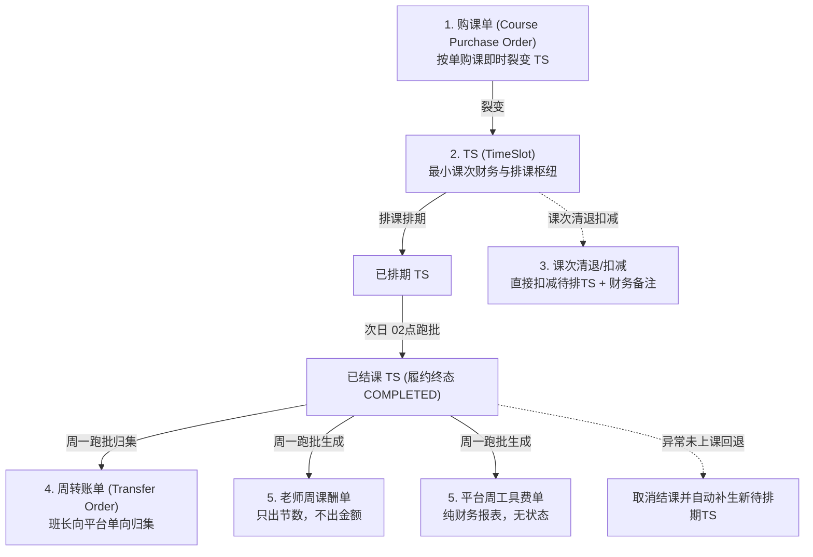
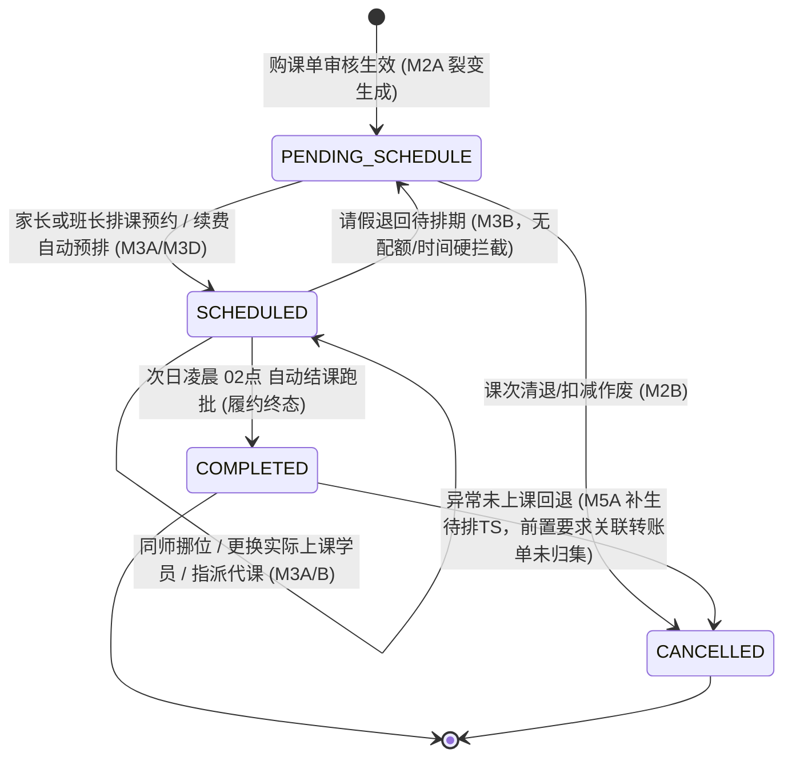

/** (c) 2024-2026 Topee (https://topee.top). All rights reserved. Proprietary and confidential. */

# Dream 核心业务规则与财务分账规约 (Business Rules & Settlement Conventions)

本文档是 Dream (教务排课与分账管理系统) 核心业务生命周期、单据流转、分账核算公式及调度规则的**唯一业务真相源**。所有需求实现（PRD/TDD/Code）必须严格遵循本文档规定的业务规则。

---

## 1. 业务哲学与核心红线 (Core Principles)

### 1.1 工作台物理隔离 (Physical Workspace Isolation)
- **多角色工作台隔离**：系统划分为**管理员后台**、**班长工作台**、**家长工作台**、**老师课表**四大独立空间。各工作台在顶部导航、主题视觉、功能边界与权限控制上实施严格物理隔离，杜绝一人身兼多职（如既是家长又是班长）时的跨角色错位操作。
- **多孩档案全局切换器 (Profile Switcher)**：家长工作台顶部常驻全局档案切换器，切换选中学生档案后，课表、待排期课次、在学课件进度与备忘录联动下钻隔离刷新。

### 1.2 资金持有人锁定铁律 (Funds Holder Lock)
- **定义**：TS (TimeSlot) 课次的“资金持有方”（收款方）**永久锁定最初收款的班长或平台**。
- **流转不转移**：无论该课次后续排课给哪个学员、中途发生同师挪位、由哪位老师临时代课、抑或更换实际上课学员，TS 的 `holder_id` 始终不变，直至周末生成周转账单并完成平台归集。

### 1.3 财课分离与更换实际上课学员规则 (Finance & Schedule Decoupling)
- **财课解耦**：购课单与费用归属方永远保持最初付款家长账号不变，财务流水不可篡改。
- **直接换人（替代原独立转让单）**：在日历课格或课次明细上，班长可直接点击**【更换实际上课学员】**，下拉选择另一位学员即可（无需校验是否同一家庭）。原购课单资金归属完全不变，系统仅将 TS 的 `actual_student_profile_id` 变更为新学员档案，课表即时生效；线下家长如何结算由线下自闭环，系统不介入。

### 1.4 纵深防御与越权 (IDOR) 绝对红线
- 查询、更新或操作任何属于用户/家长的实体（学员档案、购课单、TS 课次、备忘录）时，在 Service 层鉴权的基础上，**Mapper/SQL 层必须物理强制包含 `account_id` 或 `student_profile_id` 过滤条件**，严禁仅凭单据 ID 越权操作。

### 1.5 实体生命周期 SSOT 管辖铁律 (Entity Lifecycle SSOT Matrix)
- **唯一定义源**：本文档统领系统宏观业务哲学、财课隔离与 TS 课次全局运转中枢（见 3.2 节）。除 TS 全局中枢外，**全系统所有业务实体的完整生命周期状态机、触发事件、前置守卫与资产流转规则，统一且唯一收敛归属于各业务模块专属 PRD 文档**。
- **后续修改归口铁律**：**后续任何关于实体生命周期、状态跃迁或流转约束的修改，统一且必须直接修改对应模块专属 PRD 文档**，严禁在其他子模块中越界复读或私自篡改定义。跨模块业务协同必须采用“单向指针 (Pointer Reference)”引用对应归口 PRD。

| 业务实体对象 | 所属业务域 | 专属归口 PRD 文档 | 唯一真相源章节 |
| :--- | :--- | :--- | :--- |
| **学员档案 (`StudentProfile`)** | M1A 学员管理 | [`docs/prd/m1a_student_profile.md`](./prd/m1a_student_profile.md) | Section 4.6 学员档案全生命周期与资产安全流转 |
| **老师/班长档案 (`TeacherProfile` / `MonitorProfile`)** | M1B 师资管理 | [`docs/prd/m1b_teacher_profile.md`](./prd/m1b_teacher_profile.md) | Section 4.7 老师与班长档案全生命周期与离职交接 |
| **小班课小班 (`Class`)** | M1C 小班管理 | [`docs/prd/m1c_classes.md`](./prd/m1c_classes.md) | Section 4.2 小班全生命周期与提前结课解散规则 |
| **课件与在学配置 (`Courseware`)** | M1E 课件库 | [`docs/prd/m1e_courseware.md`](./prd/m1e_courseware.md) | Section 4.3 课件生命周期与学员绑定升阶规则 |
| **购课单 (`CoursePurchaseOrder`)** | M2A 购课单据 | [`docs/prd/m2a_course_orders.md`](./prd/m2a_course_orders.md) | Section 4.2 购课单生命周期与 TS 裂变规则 |
| **课次清退记录 (`CreditDeduction`)** | M2B 课次清退 | [`docs/prd/m2b_refund_orders.md`](./prd/m2b_refund_orders.md) | Section 4.2 课次清退/扣减规则与财务备注留痕 |
| **续费预占锁 (`RenewalHoldLease`)** | M3A 日历排课 | [`docs/prd/m3a_calendar_grid.md`](./prd/m3a_calendar_grid.md) | Section 4.10 72h续费预占锁 (HOLD) 全生命周期 |
| **代课工单 / 老师请假 / 学员请假 / 单节异常工单** | M3B 考勤与代课 | [`docs/prd/m3b_attendance_substitution.md`](./prd/m3b_attendance_substitution.md) | Section 4.10 考勤与代课四大实体状态机与流转矩阵 |
| **排课工作台调度事务 (`ScheduleBatchTask`)** | M3D 排课工作台 | [`docs/prd/m3d_course_scheduling.md`](./prd/m3d_course_scheduling.md) | Section 4.3 排课批量事务与 72h HOLD 预占联动 |
| **站内提醒 / 关键触发邮件 (`Notification` / `EmailDispatch`)** | M4 通知提醒 | [`docs/prd/m4_notification.md`](./prd/m4_notification.md) | Section 4.4 通知与关键邮件触发规则 |
| **周转账单 (`TransferOrder`)** | M5A 转账归集 | [`docs/prd/m5a_transfer_collection.md`](./prd/m5a_transfer_collection.md) | Section 4.2 周转账单生命周期与对账确认 |
| **老师周课酬单 (`TeacherSalaryReport`)** | M5B 周度结算 | [`docs/prd/m5b_weekly_settlement.md`](./prd/m5b_weekly_settlement.md) | Section 4.6 老师周课酬单生命周期与发薪归档 |
| **TS (TimeSlot - 最小课次流转枢纽)** | 全域流转枢纽 | [`docs/BUSINESS_RULES.md`](./BUSINESS_RULES.md) | Section 3.2 TS 全局生命周期状态机 (全系统统领封板) |

---

## 2. 账号与档案解耦模型 (Account vs. Profile)

### 2.1 自然人账号 (Account - topee-auth)
- 自然人账号代表法律与财务操作主体，统一由 `@topeetop/auth-core` 承载，以唯一 **Email** 注册登录。
- 账号承载多角色权限标签：`[admin, monitor, teacher, user]`。
- 账号是官方通知 Email 的唯一载体，接收购课确认、排课提醒、请假变动与课酬单等全量通知。

### 2.2 学员档案 (Student Profile)
- 学员档案代表实际上课、出勤统计与课次消耗的教学实体。
- 1 个家长账号可创建并挂载 N 个学员档案（支持二胎/多孩共管）。
- **学员昵称规范 (Nickname Standard)**：创建档案时强制遵循 **`英文名+姓首字母+年龄`**（例如 `AliceZ12`, `BobZ10`），用于多孩视觉区分及排课、更换实际上课学员时的精准身份匹配。

---

## 3. 五大核心财务与调度单据体系

### 3.1 购课单 (Course Purchase Order)
- **等价原则**：**1 元 = 1 积分**。系统不设虚拟充值资金池，按单购课，即买即裂变待排期 TS。
- **课次防呆与约束**：
  - 固定位：系统校验课次数是否为 4 的倍数（前端弱提醒，允许特殊情况提交）。
  - 临时课：单次购课上限限制为不超过 20 节。
- **防呆金额公式强校验**：
  $$\text{预期总积分} = \text{课次数} \times (\text{老师级别标准单节课酬} + \text{平台工具费 (2积分)} + \text{额外备课费 (若勾选 +10积分)})$$
  - 录入金额不一致时，接口返回 `400 PRICE_CALCULATION_MISMATCH` 与标准算式，前端弹窗强提醒。
  - 管理员/班长确认后，提交时携带 `force_submit: true` 允许特批强行落盘。
- **尾差吸收算法 (Penny Rounding Absorption)**：
  - 当总金额由于特殊折扣导致均摊至每节 TS 出现非整除微小尾差时，前 $N-1$ 节 TS 实付积分取向下整除数，**最后一节 TS 吸收全部尾差**，确保所有裂变 TS 的 `total_points` 之和严格等于购课单总金额。

### 3.2 TS (TimeSlot - 最小课次流转枢纽)
- **原子财务快照设计 (不可篡改)**：
  - TS 表中必须冗余固化生成时刻的财务快照字段：`total_points`（实付总积分）、`teacher_salary_points`（老师课酬）、`extra_prep_fee_points`（额外备课费）、`tool_fee_points`（平台工具费）。杜绝后续老师定级调整或全局费率变更破坏历史账目。
  - 冗余记录代课双追踪字段：`original_teacher_id`（原老师，用于课表呈现被代课状态）与 `current_teacher_id`（实际授课老师，用于周课酬单归集）。
- **TS 全局生命周期状态机 (The Central Pivot State Machine · 履约与结算解耦模型)**：
  TS 是全系统教务履约与排课运转的最小原子中枢。系统确立**“教务履约与财务结算严格解耦”**铁律：TS 状态机纯粹聚焦于教学履约周期，次日凌晨跑批结课落盘 `COMPLETED` 即为履约终态；后续周转账单归集与老师周结发薪完全由下游财务单据独立管辖，严禁将财务过程态污染至 TS 实体：

- **TS 核心状态枚举与转移规则矩阵 (State Transition Matrix)**：

| 当前状态 | 目标状态 | 触发事件 / 动作 | 操作人 | 前置守卫条件与温和提示 | 伴随副作用与资产流转 |
| :--- | :--- | :--- | :--- | :--- | :--- |
| **`[*]`** | `PENDING_SCHEDULE` (待排期) | 购课单支付并审核通过 | 班长 / 管理员 | 购课单流转为 `PAID` | 系统原子裂变生成 $N$ 个待排 TS；固化财务快照与资金持有方 `holder_id`。 |
| `PENDING_SCHEDULE` | `SCHEDULED` (已排期) | 选定空闲网格排课预约 | 家长 / 班长 | 目标老师网格为 🟢 空闲态；若小班课需委任老师连续双格；班长可全局选师 | 占用日历网格；写入 `lesson_date`、`time_slot` 与实际上课学员。 |
| `PENDING_SCHEDULE` | `CANCELLED` (已取消) | 办理课次清退/扣减 | 班长 / 管理员 | 输入清退节数与财务备注（如线下退费金额） | 待排 TS 原子作废；扣减剩余待排课时并记录财务备注。 |
| `SCHEDULED` | `PENDING_SCHEDULE` (待排期) | 请假退回待排 | 家长（$\ge 24\text{h}$）/ 班长（不限） | 取消配额拦截；**家长端距开课 $< 24\text{h}$ 禁止自助请假**；**班长/管理员不锁**（$< 3\text{h}$ 弹出温和确认提示后放行） | 释放日历网格变回 🟢；TS 重置为待排期，课次资产全额保留；若为 `<3h` 临期变更，在 M5B 出勤流水中标记。 |
| `SCHEDULED` | `SCHEDULED` (已排期) | 同师同格平移挪位 | 家长（$\ge 3\text{h}$）/ 班长（不限） | 目标为同一老师空闲时段；**家长端距开课 $< 3\text{h}$ 禁止自助挪位**；**班长/管理员不锁**（$< 3\text{h}$ 弹出温和确认提示后放行） | 原网格释放，新网格锁定；如属 `<3h` 临期变更则在 M5B 出勤流水中标记。 |
| `SCHEDULED` | `SCHEDULED` (已排期) | 更换实际上课学员 | 班长 / 管理员 | 仅限 1v1 课次；无需校验同家庭；若距开课 $< 3\text{h}$，弹出温和确认提示后放行 | 切换 `actual_student_profile_id`；原购课单出资人与 `holder_id` 保持不变。 |
| `SCHEDULED` | `SCHEDULED` (已排期) | 指派临时代课 | 班长 / 主理人 | 代课老师有时段资质且目标格空闲；若距开课 $< 3\text{h}$，弹出温和确认提示后放行 | 原老师 `original_teacher_id` 锁定，`current_teacher_id` 指向代课老师；代课双视角日历染色。 |
| `SCHEDULED` | `COMPLETED` (已结课 · 终态) | 每日自动结课跑批 | `dream-worker` | 每日服务器时间 02:00；排课日期为前一日且非取消态 | 批量流转为终态 `COMPLETED`；写入结课跑批流水日志；履约圆满达成。 |
| `COMPLETED` | `CANCELLED` (已取消) | 异常未上课回退补生 | 班长 / 管理员 | 该 TS 尚未被包含在状态为 `COMPLETED` 的转账单中；强制输入 1-200 字异常原因 | 原 TS 作废并从周课酬/工具费单中剔除；关联待办草稿转账单自动剔除重算： • **1v1 课次**：原单下为学员补生 1 节全新待排 TS； • **小班课次**：原单下向小班待排池 (`class_id`) 退回补生 1 节待排期，严禁关联学员档案。 |

- **教务履约与财务结算解耦铁律 (Decoupled Schedule & Settlement Model)**：
  1. **TS 终态收敛于教务履约**：TS 作为最小排课与授课单元，次日凌晨 02点 结课落盘为 `COMPLETED` 即告教务履约圆满达成，不再承载任何下游财务流转状态；
  2. **周转账单防重归口关联表物理约束**：周一生成转账单草稿时，通过关联表 `dream.transfer_order_items (transfer_order_id, ts_id)` 的 `UNIQUE (ts_id)` 数据库物理唯一约束拦截重复打包，彻底摒弃在 TS 主表改状态的旧模式；若转账单驳回或作废，只需删除关联项，TS 主表保持 `COMPLETED` 不变；
  3. **资金归集与发薪闭环在财务单据**：周二平台确认资金归集由 `TransferOrder.status = 'COMPLETED'` 表征；周三平台发薪完成由 `TeacherSalaryReport.status = 'SETTLED'` 表征并对其包含的 TS 执行物理只读冻结（禁止退款、挪位与转让），无需回写 TS 表。

- **关键业务修饰标记与布尔状态位 (Flags & Attributes)**：
  - `is_hold` (续费预占锁)：固定位到期前 7 天自动续费预排时为 `true`，触发 72h 倒计时；家长完成续费后置为 `false`；逾期未付自动释放；
  - `is_group` (小班课标识)：连续双网格（50分钟）课次，绑定 `class_id`，绝对不维护 `student_profile_id`。

### 3.3 课次清退与财务备注 (Credit Deduction - 原退款单)
- **极简定位**：少儿教务退费由班长/校长在线下（微信/支付宝）直接向家长转账退还，系统不再维护电商级退款审批流、10% 违约金自动公式或平台工具费沉淀。
- **操作方式**：在学员档案资产卡上提供 **【课次清退/扣减】** 操作：输入清退节数（扣减或清零剩余待排期 TS）并填写财务备注（如“线下退费微信转账 ¥600”），系统原子将对应待排 TS 置为 `CANCELLED` 并记录操作日志。
- **结算脱钩**：周度转账单仅按实际已结课（`COMPLETED`）TS 核算应上交金额，退费不参与线上周转账冲抵或违约金追缴。

### 3.4 周转账单 (Transfer Order - 班长向平台单向归集)
- **业务铁律**：班长（含小班主理人）只向平台单向转账归集，**严禁班长之间跨账互转**。
- **应转总额与课次核算口径（纯结课 TS 归集）**：
  - **1v1 结课 TS**：已结课的 1v1 TS，实付总积分（`total_points`）全额计入应转账金额。
  - **小班课结课 TS**：已结课的小班课 TS，按单节待上交费用全额计入应转账金额。
    $$\text{班长周度应转账总额} = \sum \text{1v1已结课TS待上交} + \sum \text{小班已结课TS待上交}$$
- **小班课独立核算与分成机制（小班主理人承包制）**：
  - **小班主理人角色与全平台选师规约**：
    - **主理人身份定义**：全面采用**“小班主理人”**（简称**“主理人”**）术语，取代原“小班课班长/小班负责人”表述。谁持有资金谁创建小班并作为小班主理人；主理人本质赋予系统 `monitor`（班长）角色（在新建班长时创建即自动拥有班长权限），名下可以绑定管辖具体老师，也可以完全不绑定老师（专职运营小班）。
    - **建班绑定与前置拦截（决策 2B）**：创建小班课次显式记录【主理人】字段；支持在创建时直接委任具体老师，也支持暂不绑定老师（待委任状态）。但**在未绑定具体委任老师前，系统同时物理禁止开具 M2A 小班购课单与执行 M3A 日历排课**，必须先完成老师委任后方可录单收款与排课。
    - **全平台直接委任与全域约课放开**：主理人委任小班主讲老师或指派代课老师时，**可选范围放开为全平台全体在职老师**（无需前置审批，选定即委任）；**班长同时具备全域 1v1 约课权**，可直接为学员选择任意在职老师的空闲时段排课（移除班长-老师排课隔离）。小班不再关联老师的人事绑定班长（无跨班长只读共享或协同通知），老师日历本身已展示全部排课以防撞课。
    - **免学员建档与私域闭环**：系统内完全不开放小班家长注册，不录入学员档案；由主理人以小班主体完成线下招生收款、购课录单、排课与每周向平台上交积分，家长沟通在线下微信群自闭环。容量上限 $Max$ 为单节固定工具费（$Max \times 6$ 积分）的唯一计算基准（新建小班时默认 $Max = 3$）。
  - **小班课单节费用拆解与底线覆盖铁律（主理人录多少交多少，停用分成与自留）**：
    - **极简上交原则**：系统不再过问主理人在私域微信群向家长收取的实际学费与其他盈余；主理人在系统录入多少，周度转账单就精确向平台上交多少积分（**录入多少就上交多少**）。
    - **单节固定工具费基准**：
      $$\text{单节固定工具费} = \text{最大学生数 (Max)} \times 6\text{ 积分} \quad (\text{默认 3 人班固定为 } 18 \text{ 积分})$$
    - **底线覆盖硬阻断**：主理人录入的单节待上交费用，**底线必须覆盖老师课酬与固定工具费**：
      $$\text{待上交单节费用} \ge \text{老师单节课酬} + \text{单节固定工具费}$$
      若录入费用不足以覆盖成本，系统前置校验报错并物理阻断提交，从源头杜绝平台垫资亏损。
    - **单节三元拆解与其他结余（页面统一文案，不可退）**：
      $$\text{待上交单节费用} = \text{老师单节课酬} + \text{单节固定工具费} + \text{其他结余}$$
      $$\text{其他结余} = \text{待上交单节费用} - \text{老师单节课酬} - \text{单节固定工具费} \ge 0$$
      主理人录入费用超出底线成本的部分，页面文案统一显示为**“其他结余”**（业务实质为事先与平台协商好的不可退留存款，随周转账单统一上交沉淀在平台；若刚好等于底线成本，则其他结余为 0）。
    - **彻底停用无用字段**：全面停用并剔除原 `commission_points`（平台抽佣）、`monitor_retained_points`（主理人自留收益）及 `platform_commission_rate`（抽佣比例），先不执行平台分成。
  - **周度转账上交口径**：周度转账单中，小班课 TS 上交金额直接等于该 TS 录入的待上交积分，系统不再进行复杂的留存扣除或抽佣拆分：
    $$\text{转账上交金额} = \sum \text{小班已结课 TS 待上交积分}$$
  - **小班课单任主讲老师强绑定与中途换师规约（方案 2：提前结课解散 $\rightarrow$ 线下多退少补 $\rightarrow$ 委任新师新建小班）**：
    - **单任老师强绑定铁律**：小班课生命周期强绑定单任主讲老师，**严禁在原小班实体上跨课酬中途直接更换主讲老师**（避免不同级别老师课酬混杂、学费多退少补线上对账不平与历史排期穿透冲突）。
    - **提前结课解散流程**：若因主讲老师离职、长期请假（$\ge 3$ 节）或全班家长集体协商换师，主理人必须在 M1C 对原小班执行【提前结课解散】；
    - **TS 资金清算与零坏账铁律**：
      - **已结课 TS（`COMPLETED` / `SUBSTITUTED`）**：按原既定标准正常纳入当周 M5A 周度转账单归集，课酬发给实际授课老师，平台固定工具费与其他结余正常扣缴；
      - **未结课 TS（`SCHEDULED`）**：单事务内原子批量置为 `CANCELLED` 并全量释放老师日历双单元格为 🟢【空闲可约】；未结课 TS **绝不产生任何平台固定工具费（$Max \times 6$ 积分）与其他结余义务**，系统内无平台负债与挂账退款单；
      - **线下私域多退少补闭环**：主理人针对剩余课次学费在线下微信群向家长核算多退少补（愿意跟读新老师的学费直接结转至新班并多退少补差价，不愿换老师退班的由主理人微信原路退回剩余学费）；
    - **新建新小班承接排课**：
      - 主理人从全平台在职老师中点选新老师创建新小班，录入新老师课酬标准与多退少补后的【单节待上交费用】；
      - 在 M2A 为新小班开具小班购课单（购买课次数录入剩余节数，实收积分录入多退少补后折算总额，表单备注关联原小班 ID 与结转说明）；
  - **单节临时代课的课酬结算规约（快照对平原则）**：
    - 针对短期应急代课，**严禁解散小班**，主理人可直接从**全平台在职老师**中指派小班代课老师（若距开课 `< 3h`，弹窗温和提示后直接放行）；不论代课老师自身级别定级高低，固定享受该小班既定的“单节老师课酬”（快照平移），结课后在老师课酬单（M5B）中计入代课老师节数单；
    - 主理人和平台的收益账目严格保持原样不变，无额外扣补。
- **周度结算节律（周一转账日、周二核算日、周三发薪日）**：
  - **周一 03:30 自动生成转账草稿单 (DRAFT)**：系统扫描上周（周一至周日）已结课 TS，自动按班长预先计算应转总额生成待确认草稿单（若应转金额 $\le 0$ 则智能跳过免打扰）；
  - **周一 08:00 定时催办提醒**：系统定时向有名下待转账草稿单的班长发送消息与高优先级邮件，催促于周一内完成线下打款并上传凭证一键确认；
  - **周二核算日**：平台管理员在后台集中审核确认转账单；
  - **周三发薪日（平台兜底发薪）**：平台根据老师周课酬单统一全额向老师发薪。若个别班长周二前未完成转账，平台先行垫付发薪保障老师履约信誉，未转资金在后台标红记为应收款项由财务跟进追缴。
- **离职一键移交**：
  - 离职班长支持一键将名下所有未结 TS（`待排期` 及未结 `已排期`）全额移交平台，课次 `holder_id` 批量变更为平台。

### 3.5 双周度结算单据 (Weekly Settlement Reports)
- **老师周课酬单**：
  - 维度：每周每师 1 单，彻底解绑班长。代课课酬严格计入实际代课老师。
  - 特征：**只出授课次数（含额外备课费标识），不出金额**。由管理员线下核算打款后在后台标记 `已打款`。
  - **出勤明细与异常透明透出**：在课酬单上同步挂载该老师当周出勤明细与异常标记（正常结课、学员请假释放次数、临期 `<3h` 变更标记、代课、异常未上），确保前端放宽拦截后账目与出勤依然清晰可对账。
- **平台周工具费单**：
  - 维度：全平台每周 1 张纯财务核算报表，**无状态流转字段，不与家长挂钩**。
  - 汇总内容：1v1 平台工具费（2积分/节）、小班课固定工具费（Max × 6积分）、小班课其他结余。

---

## 4. 排课、改期、请假与固定位生命周期

### 4.1 家长端时段门槛（24h 请假 / 3h 挪位）与班长不锁弹性规则
- **取消配额与班长硬锁（班长不锁）**：彻底移除 `12.5%` 请假配额限制，且**对班长与管理员不设时间硬锁**（无需急病特批通道），任何时候班长与管理员均可协助执行请假退期待排、同师挪位、更换实际上课学员与指派代课。
- **家长端自助时间门槛**：为保障老师备课与排期秩序，家长端自助操作受以下时间门槛约束：
  - **请假退期待排**：距开课 **$< 24\text{h}$** 时，家长端禁用自助请假按钮并提示联系班长处理；
  - **同师挪位**：距开课 **$< 3\text{h}$** 时，家长端禁用自助挪位按钮并提示联系班长处理。
- **请假本质 = 退期待排**：请假仅将已排期 TS 释放回 `PENDING_SCHEDULE`（日历格恢复为 🟢 空闲），不设配额扣减或超限拦截。
- **班长/管理员 `< 3h` 温和确认提示（替代锁死）**：班长或管理员在距开课不足 3 小时操作请假、同师挪位、换人或代课时，系统弹出温和提示：**“距开课不足 3 小时，老师可能已进入备课状态，请确认已与老师沟通”**，点击确认即放行，并记录临期变更标记以便在 M5B 课酬单出勤流水中透明呈现。

### 4.2 固定位到期提前 7 天（最后一周周一 08:30）续费预排、阶梯提醒与续费预占 (HOLD) 机制
- **自动触发与出单（提前 7 天）**：系统在每周一上午 08:30 自动扫描处于固定位周期最后一周（第 4 周）的学员，自动生成下一轮（4 周周期）预排购课单（`AUTO_RENEWAL`，状态为 `PENDING_PAYMENT`），向家长派发首封续费账单提醒邮件与消息，并在老师日历对应未来 4 周目标时段立即打上 **“🟠 续费预占（HOLD）”** 微虚线卡片。
- **抢位排他保护**：提前 7 天起，未来 4 周该时段全域排他锁定，阻断全平台其他学员提前 1-7 天抢约临时课或班长代约他人，全力保障老学员优先续费权。
- **开课前 48h 阶梯二次提醒**：距离下一轮首节开课前 48 小时，若单据仍未付款确认，系统向家长追加派发【临期续费紧急提醒】，提示距离自动释放仅剩 24 小时，并在家长首页与班长列表高亮警示。
- **开课前 24h 超时自动作废与释放**：截至下一轮首节开课前 24 小时整，若家长仍未付款且班长未确认收款，系统自动将续费单置为终态 `CANCELLED`（原因：`EXPIRED_OVERDUE` 已逾期自动作废），并原子解除未来 4 周日历预占，网格全额释放为 🟢【空闲可约】。

### 4.3 老师请假与代课流转
- **批量请假与报备**：老师端支持单节或批量勾选 **1 ~ 12 节课（累计最长 6 小时）** 发起请假，填写请假原因即可。
- **受影响多学员应急调度**：
  - 空闲时段原子置为 🔴【已请假】阻断新约；已排课时段聚合生成【班长应急调度待办包】；
  - 班长可对受影响学员课次执行【指派代课】、【退回待排期】或【同师平移】（无配额或时间硬拦截；若距开课 `< 3h`，弹出温和确认提示后直接放行）；
  - **小班课受老师请假影响时的权责分流**：
    - 当老师发起请假时，受影响的 1v1 课次待办派发给对应班长，受影响的小班课次待办精准派发给该小班的【小班主理人】处理；
    - 小班主理人可在待办包中选择**【指派全平台代课】**（可从全平台在职老师中选人，代课老师在小班 1 小时时段内必须连续 2 个单元格全为空闲 🟢 且具备课程资质，课酬按原小班既定单节课酬快照平移结算给代课老师）或**【暂停待排】**（TS 退回小班待排池，由主理人在微信群通知全班家长）；
- **双视角课表呈现**：
  - 原任课老师日历：该课次变更为**蓝色被代课 (🟠/🟡 $\rightarrow$ 🔵 `SUBBED_OUT`)**；
  - 实际代课老师日历：该课次呈现为**紫色代上课 (🟣 `SUBBED_IN`)**（小班代课在代课老师日历中展示 `🟣 [班] 小班简称(代) (主理人: X)`）；
- **课酬归属**：实际结课后，课酬 100% 结算归属于实际代课老师（`current_teacher_id`）。

---

## 5. 后台批处理调度体系 (`dream-worker` 边界)

为保障高并发与强一致性，所有批量计算、跨天状态流转及延迟任务必须且只能由 `dream-worker` 独立后台服务调度，**严禁在前端 HTTP 请求线程中同步执行**。

| 调度任务 | 执行频率 / 触发时机 | 业务动作与处理边界 |
| :--- | :--- | :--- |
| **每日自动结课跑批** | 每日凌晨 02:00 | 扫描前一日所有授课完成的 `已排期` TS，批量流转为 `已结课(待结算)`。 |
| **周度双单自动生成** | 每周一凌晨 03:00 | 汇总上周一至上周日已结课 TS，自动生成**老师周课酬单**与**平台周工具费单**。 |
| **班长转账草稿自动生成** | 每周一凌晨 03:30 | 汇总上周各班长（含小班主理人）收款已结课 TS，自动生成**待确认转账草稿单 (DRAFT)**（金额 $\le 0$ 自动跳过）。 |
| **周一转账催办定时提醒** | 每周一上午 08:00 | 向有名下待转账草稿单的班长（含主理人）发送站内提醒与邮件，催办完成转账与凭证上传。 |
| **固定位到期自动续费与首封提醒** | 每周一上午 08:30 | 扫描本周为最后一周（第 4 周）的固定位学员，自动生成下一轮续费单草稿、触发首封提醒邮件与站内提醒，并在老师日历上同步挂载未来 4 周 `HOLD` 预占卡片。 |
| **开课前 48h 临期续费二次提醒** | 每 30 分钟轮询扫描 | 扫描距下一轮首节开课不足 48 小时且未付款的自动续费单，向家长自动推送临期紧急催办邮件与站内提醒。 |
| **开课前 24h 续费超时作废与释放** | 每 10 分钟轮询扫描 | 扫描距下一轮首节开课不足 24 小时仍未确认收款的自动续费单，自动作废（`CANCELLED`）并原子解除未来 4 周 `HOLD` 网格全额释放为 `FREE` 空闲。 |

---

## 6. 极简通知机制与自由备忘录 (Notes)

### 6.1 极简通知策略（关键触发邮件 + 端内小红点）
砍掉一二三级通知分级矩阵、30 分钟未读扫描补发邮件及防刷合并队列，收敛为两类轻量机制：
- **关键触发邮件 (Email)**：仅对核心业务事件即时发送邮件——① 1v1 固定位自动续费账单与临期提醒发家长；② 新排课、被代课、课次时间变动通知发老师；③ 周一转账催办发班长。
- **极简端内提醒 (In-App 小红点)**：各角色工作台顶部仅保留一个轻量站内消息列表（未读红点），用于呈现最近排课/挪位/结单提示，不设复杂超时补发。

### 6.2 学员与老师备忘录 (Notes - 替代原 M1D 留言板)
- 彻底移除独立 `M1D` 留言板与双权限（公开/内部）流转，在学员档案与老师档案中提供纯文本**【备忘录 (Notes)】**字段（记录课件进度补充、孩子性格偏好、教学注意事项等），班长与老师可随时编辑保存。
