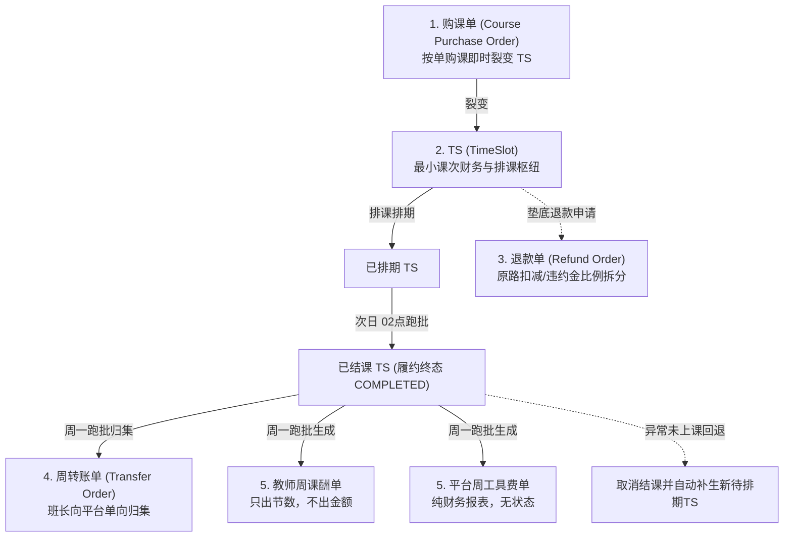
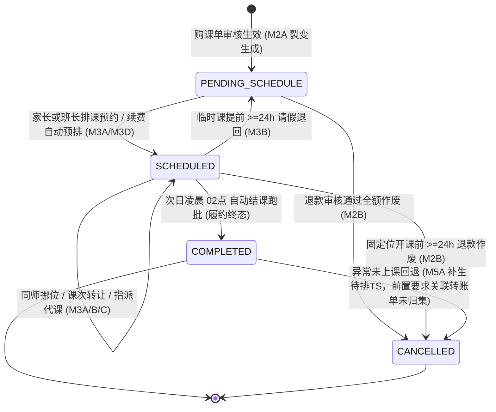

/** (c) 2024-2026 Topee (https://topee.top). All rights reserved. Proprietary and confidential. */

# Dream 核心业务规则与财务分账规约 (Business Rules & Settlement Conventions)

本文档是 Dream (教务排班与分账管理系统) 核心业务生命周期、单据流转、分账核算公式及调度规则的**唯一业务真相源**。所有需求实现（PRD/TDD/Code）必须严格遵循本文档规定的业务规则。

---

## 1. 业务哲学与核心红线 (Core Principles)

### 1.1 工作台物理隔离 (Physical Workspace Isolation)
- **多角色工作台隔离**：系统划分为**管理员后台**、**班长工作台**、**家长工作台**、**教师课表**四大独立空间。各工作台在顶部导航、主题视觉、功能边界与权限控制上实施严格物理隔离，杜绝一人身兼多职（如既是家长又是班长）时的跨角色错位操作。
- **多孩档案全局切换器 (Profile Switcher)**：家长工作台顶部常驻全局档案切换器，切换选中学生档案后，课表、待排期课时、请假记录、留言板联动下钻隔离刷新。

### 1.2 资金持有人锁定铁律 (Funds Holder Lock)
- **定义**：TS (TimeSlot) 课次的“资金持有方”（收款方）**永久锁定最初收款的班长或平台**。
- **流转不转移**：无论该课次后续排课给哪个学生、中途发生同师挪位、由哪位老师临时代课、抑或转让给其他家庭，TS 的 `holder_id` 始终不变，直至周末生成周转账单并完成平台归集。

### 1.3 财课分离与转让规则 (Finance & Schedule Decoupling)
- **财课解耦**：购课单与费用归属方永远保持最初付款家长账号不变，财务流水不可篡改。
- **排课生效**：发生课程转让（同家庭内多孩直转或跨家庭转让）时，原购课单资金归属完全不变，系统仅将 TS 的 `actual_student_profile_id` 变更为受让学生档案，权益立即在受让方课表呈现，不涉及退费重购。

### 1.4 纵深防御与越权 (IDOR) 绝对红线
- 查询、更新或操作任何属于用户/家长的实体（学生档案、购课单、TS 课次、请假、留言）时，在 Service 层鉴权的基础上，**Mapper/SQL 层必须物理强制包含 `account_id` 或 `student_profile_id` 过滤条件**，严禁仅凭单据 ID 越权操作。

### 1.5 实体生命周期 SSOT 管辖铁律 (Entity Lifecycle SSOT Matrix)
- **唯一定义源**：本文档统领系统宏观业务哲学、财课隔离与 TS 课次全局运转中枢（见 3.2 节）。除 TS 全局中枢外，**全系统所有业务实体的完整生命周期状态机、触发事件、前置守卫与资产流转规则，统一且唯一收敛归属于各业务模块专属 PRD 文档**。
- **后续修改归口铁律**：**后续任何关于实体生命周期、状态跃迁或流转约束的修改，统一且必须直接修改对应模块专属 PRD 文档**，严禁在其他子模块中越界复读或私自篡改定义。跨模块业务协同必须采用“单向指针 (Pointer Reference)”引用对应归口 PRD。

| 业务实体对象 | 所属业务域 | 专属归口 PRD 文档 | 唯一真相源章节 |
| :--- | :--- | :--- | :--- |
| **学生档案 (`StudentProfile`)** | M1A 学员管理 | [`docs/prd/m1a_student_profile.md`](./prd/m1a_student_profile.md) | Section 4.6 学员档案全生命周期与资产安全流转 |
| **教师/班长档案 (`TeacherProfile` / `MonitorProfile`)** | M1B 师资管理 | [`docs/prd/m1b_teacher_profile.md`](./prd/m1b_teacher_profile.md) | Section 4.7 教师与班长档案全生命周期与离职交接 |
| **小班课班级 (`Class`)** | M1C 班级管理 | [`docs/prd/m1c_classes.md`](./prd/m1c_classes.md) | Section 4.2 班级全生命周期与提前结课解散规则 |
| **家校留言 (`ProfileMessage`)** | M1D 留言板 | [`docs/prd/m1d_profile_messages.md`](./prd/m1d_profile_messages.md) | Section 4.4 留言生命周期状态机与永久撤回规则 |
| **课件与在学配置 (`Courseware`)** | M1E 课件库 | [`docs/prd/m1e_courseware.md`](./prd/m1e_courseware.md) | Section 4.3 课件生命周期与学员绑定升阶规则 |
| **购课单 (`CoursePurchaseOrder`)** | M2A 购课单据 | [`docs/prd/m2a_course_orders.md`](./prd/m2a_course_orders.md) | Section 4.2 购课单生命周期与 TS 裂变规则 |
| **退款单 (`RefundOrder`)** | M2B 退款管理 | [`docs/prd/m2b_refund_orders.md`](./prd/m2b_refund_orders.md) | Section 4.2 退款单生命周期与违约金拆分审核 |
| **续费预占锁 (`RenewalHoldLease`)** | M3A 日历排班 | [`docs/prd/m3a_calendar_grid.md`](./prd/m3a_calendar_grid.md) | Section 4.10 72h续费预占锁 (HOLD) 全生命周期 |
| **代课工单 / 教师请假 / 学员请假 / 单节异常工单** | M3B 考勤与代课 | [`docs/prd/m3b_attendance_substitution.md`](./prd/m3b_attendance_substitution.md) | Section 4.10 考勤与代课四大实体状态机与流转矩阵 |
| **课次转让单 (`CourseTransferRecord`)** | M3C 课程转让 | [`docs/prd/m3c_course_transfer.md`](./prd/m3c_course_transfer.md) | Section 4.5 课次转让单生命周期与防二次转让守卫 |
| **排课工作台调度事务 (`ScheduleBatchTask`)** | M3D 排课工作台 | [`docs/prd/m3d_course_scheduling.md`](./prd/m3d_course_scheduling.md) | Section 4.3 排课批量事务与 72h HOLD 预占联动 |
| **站内信 / 邮件投递任务 (`Notification` / `EmailDispatch`)** | M4 通知网络 | [`docs/prd/m4_notification.md`](./prd/m4_notification.md) | Section 4.4 通知与邮件任务生命周期状态机 |
| **周转账单 (`TransferOrder`)** | M5A 转账归集 | [`docs/prd/m5a_transfer_collection.md`](./prd/m5a_transfer_collection.md) | Section 4.2 周转账单生命周期与对账确认 |
| **教师周课酬单 (`TeacherSalaryReport`)** | M5B 周度结算 | [`docs/prd/m5b_weekly_settlement.md`](./prd/m5b_weekly_settlement.md) | Section 4.6 教师周课酬单生命周期与发薪归档 |
| **全域动态事件流 (`Activity`)** | 全域履约动态中枢 | [`docs/prd/m3b_attendance_substitution.md`](./prd/m3b_attendance_substitution.md) | Section 9.3d 全域动态事件字典与 14 类排班履约动态派发规则 |
| **TS (TimeSlot - 最小课次流转枢纽)** | 全域流转枢纽 | [`docs/BUSINESS_RULES.md`](./BUSINESS_RULES.md) | Section 3.2 TS 全局生命周期状态机 (全系统统领封板) |

---

## 2. 账号与档案解耦模型 (Account vs. Profile)

### 2.1 自然人账号 (Account - topee-auth)
- 自然人账号代表法律与财务操作主体，统一由 `@topeetop/auth-core` 承载，以唯一 **Email** 注册登录。
- 账号承载多角色权限标签：`[admin, monitor, teacher, user]`。
- 账号是官方通知 Email 的唯一载体，接收购课确认、排课提醒、请假变动与周结单等全量通知。

### 2.2 学生档案 (Student Profile)
- 学生档案代表实际上课、出勤统计与课时消耗的教学实体。
- 1 个家长账号可创建并挂载 N 个学生档案（支持二胎/多孩共管）。
- **学生昵称规范 (Nickname Standard)**：创建档案时强制遵循 **`英文名+姓首字母+年龄`**（例如 `AliceZ12`, `BobZ10`），用于多孩视觉区分及跨家长转让时的精准身份匹配。

---

## 3. 五大核心财务与调度单据体系

### 3.1 购课单 (Course Purchase Order)
- **等价原则**：**1 元 = 1 积分**。系统不设虚拟充值资金池，按单购课，即买即裂变待排期 TS。
- **课次防呆与约束**：
  - 固定位：系统校验课次数是否为 4 的倍数（前端弱提醒，允许特殊情况提交）。
  - 临时课：单次购课上限限制为不超过 20 节。
- **防呆金额公式强校验**：
  $$\text{预期总积分} = \text{课次数} \times (\text{教师级别标准单节课酬} + \text{平台工具费 (2积分)} + \text{额外备课费 (若勾选 +10积分)})$$
  - 录入金额不一致时，接口返回 `400 PRICE_CALCULATION_MISMATCH` 与标准算式，前端弹窗强提醒。
  - 管理员/班长确认后，提交时携带 `force_submit: true` 允许特批强行落盘。
- **尾差吸收算法 (Penny Rounding Absorption)**：
  - 当总金额由于特殊折扣导致均摊至每节 TS 出现非整除微小尾差时，前 $N-1$ 节 TS 实付积分取向下整除数，**最后一节 TS 吸收全部尾差**，确保所有裂变 TS 的 `total_points` 之和严格等于购课单总金额。
- **请假配额初始锁定**：
  - 创建购课单时，即刻计算并锁定当期可请假上限：
    $$\text{请假配额} = \lfloor \text{周期总课时} \times 0.125 \rfloor \quad (\text{向下取整})$$

### 3.2 TS (TimeSlot - 最小课次流转枢纽)
- **原子财务快照设计 (不可篡改)**：
  - TS 表中必须冗余固化生成时刻的财务快照字段：`total_points`（实付总积分）、`teacher_salary_points`（教师课酬）、`extra_prep_fee_points`（额外备课费）、`tool_fee_points`（平台工具费）。杜绝后续教师定级调整或全局费率变更破坏历史账目。
  - 冗余记录代课双追踪字段：`original_teacher_id`（原教师，用于课表呈现被代课状态）与 `current_teacher_id`（实际授课教师，用于周课酬单归集）。
- **TS 全局生命周期状态机 (The Central Pivot State Machine · 履约与结算解耦模型)**：
  TS 是全系统教务履约与排课运转的最小原子中枢。系统确立**“教务履约与财务结算严格解耦”**铁律：TS 状态机纯粹聚焦于教学履约周期，次日凌晨跑批结课落盘 `COMPLETED` 即为履约终态；后续周转账单归集与教师周结发薪完全由下游财务单据独立管辖，严禁将财务过程态污染至 TS 实体：

- **TS 核心状态枚举与转移规则矩阵 (State Transition Matrix)**：

| 当前状态 | 目标状态 | 触发事件 / 动作 | 操作人 | 前置守卫条件与时限熔断 | 伴随副作用与资产流转 |
| :--- | :--- | :--- | :--- | :--- | :--- |
| **`[*]`** | `PENDING_SCHEDULE` (待排期) | 购课单支付并审核通过 | 班长 / 管理员 | 购课单流转为 `PAID` | 系统原子裂变生成 $N$ 个待排 TS；固化财务快照与资金持有方 `holder_id`。 |
| `PENDING_SCHEDULE` | `SCHEDULED` (已排期) | 选定空闲网格排课预约 | 家长 / 班长 | 目标外教网格为 🟢 空闲态；若小班课需委任外教连续双格 | 占用日历网格；写入 `lesson_date`、`time_slot` 与实际上课学生。 |
| `PENDING_SCHEDULE` | `CANCELLED` (已取消) | 办理课时退款 | 管理员 | 购课单发起退费并通过 | TS 永久作废；触发资金扣减违约金后原路清退。 |
| `SCHEDULED` | `PENDING_SCHEDULE` (待排期) | 临时课自主请假 | 家长 | 距开课 $\ge 24\text{h}$；消耗 12.5% 请假配额 | 释放日历网格变回 🟢；TS 重置为待排期，课时资产全额保留。 |
| `SCHEDULED` | `SCHEDULED` (已排期) | 同师同格平移挪位 | 家长 / 班长 | 距开课 $\ge 3\text{h}$；目标为同一老师空闲时段 | 原网格释放，新网格锁定；受让课次限在原 4 周轮次内挪位。 |
| `SCHEDULED` | `SCHEDULED` (已排期) | 课次转让交割 | 转出家长 / 班长 | 距开课 $\ge 3\text{h}$；仅限 1v1 固定位与 TS 课时；`is_transferred == false` | 切换 `student_profile_id`；标记 `is_transferred = true`（绝对禁止二次转让）；原出资人不变。 |
| `SCHEDULED` | `SCHEDULED` (已排期) | 指派临时代课 | 班长 | 距开课 $\ge 3\text{h}$ (停电不可抗力豁免至 $\ge 15\text{m}$)；代课外教有时段资质 | 原教师 `original_teacher_id` 锁定，`current_teacher_id` 指向代课教师；代课双视角日历染色。 |
| `SCHEDULED` | `COMPLETED` (已结课 · 终态) | 每日自动结课跑批 | `dream-worker` | 每日服务器时间 02:00；排课日期为前一日且非取消态 | 批量流转为终态 `COMPLETED`；写入结课跑批流水日志；履约圆满达成。 |
| `COMPLETED` | `CANCELLED` (已取消) | 异常未上课回退补生 | 班长 / 管理员 | 该 TS 尚未被包含在状态为 `COMPLETED` 的转账单中；强制输入 1-200 字异常原因 | 原 TS 作废并从周课酬/工具费单中剔除；关联待办草稿转账单自动剔除重算： • **1v1 课次**：原单下为学生补生 1 节全新待排 TS； • **小班课次**：原单下向班级待排池 (`class_id`) 退回补生 1 节待排期，严禁关联学生档案。 |

- **教务履约与财务结算解耦铁律 (Decoupled Schedule & Settlement Model)**：
  1. **TS 终态收敛于教务履约**：TS 作为最小排课与授课单元，次日凌晨 02点 结课落盘为 `COMPLETED` 即告教务履约圆满达成，不再承载任何下游财务流转状态；
  2. **周转账单防重归口关联表物理约束**：周一生成转账单草稿时，通过关联表 `dream.transfer_order_items (transfer_order_id, ts_id)` 的 `UNIQUE (ts_id)` 数据库物理唯一约束拦截重复打包，彻底摒弃在 TS 主表改状态的旧模式；若转账单驳回或作废，只需删除关联项，TS 主表保持 `COMPLETED` 不变；
  3. **资金归集与发薪闭环在财务单据**：周二平台确认资金归集由 `TransferOrder.status = 'COMPLETED'` 表征；周三平台发薪完成由 `TeacherSalaryReport.status = 'SETTLED'` 表征并对其包含的 TS 执行物理只读冻结（禁止退款、挪位与转让），无需回写 TS 表。

- **关键业务修饰标记与布尔状态位 (Flags & Attributes)**：
  - `is_hold` (续费预占锁)：固定位到期前 7 天自动续费预排时为 `true`，触发 72h 倒计时；家长完成续费后置为 `false`；逾期未付自动释放；
  - `is_transferred` (转让锁定位)：发生过转让后永久置为 `true`，全系统物理拦截二次转让；
  - `is_group` (小班课标识)：连续双网格（50分钟）课次，绑定 `class_id`，绝对不维护 `student_profile_id`。

### 3.3 退款单 (Refund Order)
- **业务优先级**：优先引导同师挪位或群内转让；垫底退费必须提前 24 小时提交申请。
- **退款生效与审计**：管理员审核通过后，退款单直接生效并自动触发邮件审计通告。
- **违约金拆分与全链路闭环铁律（三单联动零坏账）**：
  - **按 TS 财务快照等比例双向拆分**：若扣减违约金，违约金按原 TS 的教师课酬与平台工具费比例拆分为“教师课酬补偿 ($P_{teacher}$)”与“平台工具费扣留 ($P_{tool}$)”。
  - **M5A 转账单自动归集上交**：若原购课单资金持有方为班长（`holder_id` 为班长），班长在线下向家长打款退费时已扣留该笔违约金；因此，系统在每周一生成 M5A 周度转账单时，**自动将该班长当周确认生效的退款单扣除违约金总额作为待上交项纳入转账单**，由班长向平台 100% 打款归集。
  - **M5B 教师周结单影子联动发薪**：平台周三发薪时，管理员后台发薪看板通过影子字段自动将当周归属于该外教的未结违约金补偿积分（$P_{teacher}$）合并计入参考发薪总额，随课酬一同向外教发放；外教端单据保持纯节数铁律不显示金额，但在单据底部备查区展示退课空置补偿记录。
  - **M5B 平台工具费周报表收益沉淀**：当周全平台退款单沉淀的平台工具费违约金总额（$\sum P_{tool}$）自动汇总记入平台周工具费报表，作为平台当期经营净收益沉淀。

### 3.4 周转账单 (Transfer Order - 班长向平台单向归集)
- **业务铁律**：班长（含小班课主理人）只向平台单向转账归集，**严禁班长之间跨账互转**。
- **应转总额与课次核算口径（完课 TS + 经办退款违约金）**：
  - **1v1 完课 TS**：已结课的 1v1 TS，实付总积分（`total_points`）全额计入应转账金额。
  - **小班课完课 TS**：已结课的小班课 TS，按单节待上交费用全额计入应转账金额。
  - **经办退款单扣除违约金（新增闭环）**：若当前班长在统计自然周内经办并确认了退款单（`holder_id = 当前班长`），线下扣留的退款违约金总额全额计入当周应转账金额：
    $$\text{班长周度应转账总额} = \sum \text{1v1已完课TS待上交} + \sum \text{小班已完课TS待上交} + \sum \text{经办退款单扣除违约金}$$
- **小班课独立核算与分成机制（小班课主理人承包制）**：
  - **小班课主理人角色与跨班长选师规约**：
    - **主理人身份定义**：全面采用**“小班课主理人”**（简称**“主理人”**）术语，取代原“小班课班长/小班负责人”表述。主理人本质赋予系统 `monitor`（班长）角色（在新建班长时创建即自动拥有班长权限）；主理人名下可以绑定管辖具体外教，也可以完全不绑定外教（专职运营小班）。
    - **建班绑定与前置拦截（决策 2B）**：创建小班课时显式记录【主理人】字段；支持在创建时直接委任具体老师，也支持暂不绑定老师（待委任状态）。但**在未绑定具体委任老师前，系统同时物理禁止开具 M2A 小班购课单与执行 M3A 日历排课**，必须先完成老师委任后方可录单收款与排课。
    - **全平台直接委任与绑定班长动态带出（决策 1-A / 3B / 4A）**：主理人委任小班主讲老师或指派代课老师时，**可选范围放开为全平台全体在职外教**（无需前置审批，选定即委任）；对主理人透明公开全平台外教日历排期详情（含 1v1 学生昵称与小班详情，但非本班长管辖外教严禁代约 1v1）。选定委任老师后，系统自动动态关联带出该外教的**【绑定班长】**字段，赋予该外教绑定班长对该小班课的信息与修改日志**只读查看权**（若外教在 M1B 被改绑给新班长，小班关联的绑定班长自动实时同步并记录日志）。
    - **免学生建档与私域闭环**：系统内完全不开放小班家长注册，不录入学生档案；由主理人以班级主体完成线下招生收款、购课录单、排课与每周向平台上交积分，家长沟通在线下微信群自闭环。容量上限 $Max$ 为单节固定工具费（$Max \times 6$ 积分）的唯一计算基准（新建班级时默认 $Max = 3$）。
  - **小班课单节费用拆解与底线覆盖铁律（主理人录多少交多少，停用分成与自留）**：
    - **极简上交原则**：系统不再过问主理人在私域微信群向家长收取的实际学费与线下利润；主理人在系统录入多少，周度转账单就精确向平台上交多少积分（**录入多少就上交多少**）。
    - **单节固定工具费基准**：
      $$\text{单节固定工具费} = \text{最大学生数 (Max)} \times 6\text{ 积分} \quad (\text{默认 3 人班固定为 } 18 \text{ 积分})$$
    - **底线覆盖硬阻断**：主理人录入的单节待上交费用，**底线必须覆盖教师课酬与固定工具费**：
      $$\text{待上交单节费用} \ge \text{教师单节课酬} + \text{单节固定工具费}$$
      若录入费用不足以覆盖成本，系统前置校验报错并物理阻断提交，从源头杜绝平台垫资亏损。
    - **单节三元拆解与其他结余（页面统一文案，不可退）**：
      $$\text{待上交单节费用} = \text{教师单节课酬} + \text{单节固定工具费} + \text{其他结余}$$
      $$\text{其他结余} = \text{待上交单节费用} - \text{教师单节课酬} - \text{单节固定工具费} \ge 0$$
      主理人录入费用超出底线成本的部分，页面文案统一显示为**“其他结余”**（业务实质为事先与平台协商好的不可退留存款，随周转账单统一上交沉淀在平台；若刚好等于底线成本，则其他结余为 0）。
    - **彻底停用无用字段**：全面停用并剔除原 `commission_points`（平台抽佣）、`monitor_retained_points`（主理人自留收益）及 `platform_commission_rate`（抽佣比例），先不执行平台分成。
  - **周度转账上交口径**：周度转账单中，小班课 TS 上交金额直接等于该 TS 录入的待上交积分，系统不再进行复杂的留存扣除或抽佣拆分：
    $$\text{转账上交金额} = \sum \text{小班已完课 TS 待上交积分}$$
  - **小班课单任主讲老师强绑定与中途换师规约（方案 2：提前结课解散 $\rightarrow$ 线下多退少补 $\rightarrow$ 委任新师新建班级）**：
    - **单任老师强绑定铁律**：小班课生命周期强绑定单任主讲老师，**严禁在原班级实体上跨课酬中途直接更换主讲外教**（避免不同级别外教课酬混杂、学费多退少补线上对账不平与历史排期穿透冲突）。
    - **提前结课解散流程**：若因主讲外教离职、长期请假（$\ge 3$ 节）或全班家长集体协商换师，主理人必须在 M1C 对原班级执行【提前结课解散】；
    - **TS 资金清算与零坏账铁律**：
      - **已完课 TS（`COMPLETED` / `SUBSTITUTED`）**：按原既定标准正常纳入当周 M5A 周度转账单归集，课酬发给实际授课老师，平台固定工具费与其他结余正常扣缴；
      - **未完课 TS（`SCHEDULED`）**：单事务内原子批量置为 `CANCELLED` 并全量释放外教日历双单元格为 🟢【空闲可约】；未完课 TS **绝不产生任何平台固定工具费（$Max \times 6$ 积分）与其他结余义务**，系统内无平台负债与挂账退款单；
      - **线下私域多退少补闭环**：主理人针对剩余课时学费在线下微信群向家长核算多退少补（愿意跟读新老师的学费直接结转至新班并多退少补差价，不愿换老师退班的由主理人微信原路退回剩余学费）；
    - **新建新班级承接排课**：
      - 主理人从全平台在职外教中点选新外教创建新班级，录入新老师课酬标准与多退少补后的【单节待上交费用】；
      - 在 M2A 为新班级开具小班购课单（购买课时数录入剩余节数，实收积分录入多退少补后折算总额，表单备注关联原班级 ID 与结转说明）；
  - **单节临时代课的课酬结算规约（快照对平原则）**：
    - 针对 1~2 节短期应急代课（$\ge 3$h 教师请假报备），**严禁解散班级**，主理人可直接从**全平台在职外教**中指派小班代课老师；不论代课老师自身级别定级高低，固定享受该小班既定的“单节教师课酬”（快照平移），完课后在教师周结单（M5B）中计入代课老师节数单；
    - 主理人和平台的收益账目严格保持原样不变，无额外扣补。
- **周度结算节律（周一转账日、周二核算日、周三发薪日）**：
  - **周一 03:30 自动生成转账草稿单 (DRAFT)**：系统扫描上周（周一至周日）已结课 TS，自动按班长预先计算应转总额生成待确认草稿单（若应转金额 $\le 0$ 则智能跳过免打扰）；
  - **周一 08:00 定时催办提醒**：系统定时向有名下待转账草稿单的班长发送站内信与高优先级邮件，催促于周一内完成线下打款并上传凭证一键确认；
  - **周二核算日**：平台管理员在后台集中审核确认转账单；
  - **周三发薪日（平台兜底发薪）**：平台根据教师周课酬单统一全额向教师发薪。若个别班长周二前未完成转账，平台先行垫付发薪保障外教履约信誉，未转资金在后台标红记为应收款项由财务跟进追缴。
- **离职一键移交**：
  - 离职班长支持一键将名下所有未结 TS（`待排期` 及未结 `已排期`）全额移交平台，课次 `holder_id` 批量变更为平台。

### 3.5 双周度结算单据 (Weekly Settlement Reports)
- **教师周课酬单**：
  - 维度：每周每师 1 单，彻底解绑班长。代课课酬严格计入实际代课教师。
  - 特征：**只出授课节数（含额外备课费标识），不出金额**。由管理员线下核算打款后在后台标记 `已打款`。
  - **违约金补偿影子联动（思路 B）**：外教端单据保持纯节数显示，仅在单据底部备查区展示退课空置补偿记录（明细备查，不显金额）；管理员后台发薪看板通过影子字段自动统计上周已生效退款单中分摊给该教师的未结违约金补偿积分（$P_{teacher}$），并入“参考发薪总额”提示管理员线下合并打款发放；标记 `PAID` 时原子锁定防止重复发放。
- **平台周工具费单**：
  - 维度：全平台每周 1 张纯财务核算报表，**无状态流转字段，不与家长挂钩**。
  - 汇总内容：1v1 平台工具费（2积分/节）、小班课固定工具费（Max × 6积分）、小班课其他结余，以及**当周全平台退款单沉淀的工具费违约金总额（$\sum P_{tool}$）**。

---

## 4. 排课、改期、请假与固定位生命周期

### 4.1 12.5% 请假配额与授课准备期锁定矩阵

| 课程类型 | 距上课时间 $\ge$ 24h | 距上课时间 3h ~ 24h | 距上课时间 < 3h |
| :--- | :--- | :--- | :--- |
| **固定位 (🟠)** | **同师挪位 或 转让** （挪位限本轮 4 周内，不扣配额；转让限指定学员；不可退期待排） | **同师挪位 或 转让** （挪位限本轮 4 周内，不扣配额；转让限指定学员；不可退期待排） | **授课准备期锁定** （不可改、不可退、不可转，正常划扣课时） |
| **临时课 (🟡)** | **未超配额**：直接请假退回待排期（扣1次配额） **已超配额**：同师挪位（前后7天内，不扣配额） | **仅限同师挪位** （前后 7 天内，不扣配额；不可退回待排期池） | **授课准备期锁定** （不可改不可退，正常划扣课时） |

- **配额消耗口径**：请假配额仅在 1v1 临时课「请假退回待排期」时扣减 1 次；固定位与临时课的同师挪位均不消耗请假配额。
- **开课前 3 小时授课保障期**：距离开课小于 3 小时，老师已开始授课准备，系统锁定修改入口，防止教师空等备课损失。

### 4.2 固定位到期提前 7 天（最后一周周一 08:30）续费预排、阶梯提醒与续费预占 (HOLD) 机制
- **自动触发与出单（提前 7 天）**：系统在每周一上午 08:30 自动扫描处于固定位周期最后一周（第 4 周）的学员，自动生成下一轮（4 周周期）预排购课单（`AUTO_RENEWAL`，状态为 `PENDING_PAYMENT`），向家长派发首封续费账单提醒邮件与站内信，并在教师日历对应未来 4 周目标时段立即打上 **“🟠 续费预占（HOLD）”** 微虚线卡片。
- **抢位排他保护**：提前 7 天起，未来 4 周该时段全域排他锁定，阻断全平台其他学员提前 1-7 天抢约临时课或班长代约他人，全力保障老学员优先续费权。
- **开课前 48h 阶梯二次提醒**：距离下一轮首节开课前 48 小时，若单据仍未付款确认，系统向家长追加派发【临期续费紧急提醒】，提示距离自动释放仅剩 24 小时，并在家长主页与班长列表高亮警示。
- **开课前 24h 超时自动作废与释放**：截至下一轮首节开课前 24 小时整，若家长仍未付款且班长未确认收款，系统自动将续费单置为终态 `CANCELLED`（原因：`EXPIRED_OVERDUE` 已逾期自动作废），并原子解除未来 4 周日历预占，网格全额释放为 🟢【空闲可约】。

### 4.3 教师请假与代课流转
- **批量请假与不可抗力报备**：教师端支持单节或批量勾选 **1 ~ 12 节课（累计最长 6 小时）** 发起请假，必填不可抗力分类（如家庭突发停电/断网、突发急病就医等）。
- **受影响多学员应急调度与零扣减铁律**：
  - 空闲时段原子置为 🔴【已请假】阻断新约；已排课时段聚合生成【班长应急调度待办包】；
  - 班长可对受影响学员课次执行【指派代课】、【退回待排期】或【固定位同师同轮平移】；
  - **零扣减保护铁律**：因教师原因导致的所有课程退回或平移，全平台 **100% 物理强制豁免扣减学生 12.5% 请假配额**，且不计入学生挪位次数指标。
  - **小班课受教师请假影响时的权责分流与代课/停课双轨机制（决策 1A / 4A / 5A）**：
    - **待办按课次权责精准拆单（决策 1A）**：当教师发起请假时，受影响的 1v1 课次待办派发给该外教的【绑定班长】；受影响的小班课次待办**精准派发给该小班的【小班课主理人】**处理，若主理人与外教绑定班长非同一人，同步向外教绑定班长发送知情通知（并在绑定班长端显示“由主理人处理中”只读状态）；
    - 若距开课时间 $\ge 3\text{h}$：小班课主理人可在待办包中选择**【指派全平台代课】**（可从全平台在职外教中选人，代课老师在小班 1 小时时段内必须连续 2 个单元格全为空闲 🟢 且具备课程资质，课酬按原班级既定单节课酬快照平移结算给代课老师；若原主讲绑定班长或代课外教绑定班长与主理人非同一人，同步向涉事绑定班长推送代课操作通知）或**【暂停待排】**；
    - 若距开课时间 $< 3\text{h}$：触发授课准备期熔断，禁止发起新代课指派；教师若突发缺席，系统后台自动执行**【暂停待排】**安全兜底，TS 自动退回班级待排池，日历释放分流，并催办小班课主理人线下协调后择期手工补排（同步通知外教绑定班长）；
    - **线下通知强闭环**：由于小班课学生无系统账号，主理人指派代课或暂停待排时，系统不向家长发送应用内通知，统一由小班课主理人在私域微信群向全班家长发布通知并同步新进班二维码。
- **开课前 $<3\text{h}$ 突发停电绿色通道与双轨应急处置规范**：
  - 针对突发停电不可抗力，教师端豁免 $<3\text{h}$ 入口锁定阻断；
  - **1v1 与小班课处置逻辑高度统一**：负责班长（1v1）或小班主理人（1vN）在待办中均可自主选择**【紧急指派代课】**或主动点击**【暂停待排】**（全额退回课时至对应待排池，100% 豁免扣减请假配额）；
  - **15 分钟安全熔断兜底**：若截至开课前 15 分钟仍未完成代课指派且未主动暂停待排，后台 Worker 自动触发安全保护兜底：将课次转为【暂停待排】（课次置为 `CANCELLED` 并全额退回待排期 TS），免扣配额并紧急通知家长（小班课通知主理人与外教绑定班长），严防空堂。
- **双视角课表呈现**：
  - 原任课教师日历：该课次变更为**蓝色被代课 (🟠/🟡 $\rightarrow$ 🔵 `SUBBED_OUT`)**；
  - 实际代课教师日历：该课次呈现为**紫色代上课 (🟣 `SUBBED_IN`)**（小班代课在代课外教及绑定班长日历中展示 `🟣 [班] 班级简称(代) (主理人: X)`）；
- **课酬归属**：实际结课后，课酬 100% 结算归属于实际代课教师（`current_teacher_id`）。

---

## 5. 后台批处理调度体系 (`dream-worker` 边界)

为保障高并发与强一致性，所有批量计算、跨天状态流转及延迟任务必须且只能由 `dream-worker` 独立后台服务调度，**严禁在前端 HTTP 请求线程中同步执行**。

| 调度任务 | 执行频率 / 触发时机 | 业务动作与处理边界 |
| :--- | :--- | :--- |
| **每日自动结课跑批** | 每日凌晨 02:00 | 扫描前一日所有授课完成的 `已排期` TS，批量流转为 `已结课(待结算)`。 |
| **周度双单自动生成** | 每周一凌晨 03:00 | 汇总上周一至上周日已结课 TS，自动生成**教师周课酬单**与**平台周工具费单**。 |
| **班长转账草稿自动生成** | 每周一凌晨 03:30 | 汇总上周各班长（含小班课主理人）收款已结课 TS，自动生成**待确认转账草稿单 (DRAFT)**（金额 $\le 0$ 自动跳过）。 |
| **周一转账催办定时提醒** | 每周一上午 08:00 | 向有名下待转账草稿单的班长（含主理人）发送站内信与邮件提醒，催办完成转账与凭证上传。 |
| **站内信超时兜底邮件** | 每 5 分钟轮询扫描 | 扫描超过 30 分钟未读的二级必达通知，通过 Brevo/SMTP 自动向家长账号补发 Email。 |
| **固定位到期自动续费与首封提醒** | 每周一上午 08:30 | 扫描本周为最后一周（第 4 周）的固定位学员，自动生成下一轮续费单草稿、触发首封提醒邮件与站内信，并在教师日历上同步挂载未来 4 周 `HOLD` 预占卡片。 |
| **开课前 48h 临期续费二次提醒** | 每 30 分钟轮询扫描 | 扫描距下一轮首节开课不足 48 小时且未付款的自动续费单，向家长自动推送临期紧急催办邮件与站内信。 |
| **开课前 24h 续费超时作废与释放** | 每 10 分钟轮询扫描 | 扫描距下一轮首节开课不足 24 小时仍未确认收款的自动续费单，自动作废（`CANCELLED`）并原子解除未来 4 周 `HOLD` 网格全额释放为 `FREE` 空闲。 |
| **突发断电开课前 15min 自动安全保护兜底** | 每 1 分钟轮询扫描 | 扫描距开课不足 15 分钟且处于教师突发不可抗力未指派代课的课次，自动取消并退回待排期 TS，紧急短信/邮件通知家长防空堂。 |

---

## 6. 三级消息分发矩阵与留言板隐私控制

### 6.1 三级消息分发矩阵

| 通知等级 | 典型业务场景 | 分发渠道与策略 | 接收对象 |
| :--- | :--- | :--- | :--- |
| **一级：常规通知** | 1. 课表生成与变动 2. 教师周课酬单生成 3. 学生档案留言板新公开回复 | **仅站内信 (In-App)** | 教师、家长 |
| **二级：必达通知** | 1. 购课单确认生成待排期 TS 2. 新排课成功 3. 距开课 24h 之外常规请假/同师挪位 4. **跨班长小班协同通知**（当小班主理人与委任外教的绑定班长非同一人时：新建委任、编辑班级、改期补排、异常未上课回退） | **站内信 + 30min 超时兜底 Email**： 先发站内信，若 30 分钟未读，由 `dream-worker` 自动补发邮件。 | 家长账号、教师、**委任外教的绑定班长** |
| **三级：紧急通知** | 1. 距开课 24h 之内紧急改期/挪位 2. 课程转让成功（学生档案变更） 3. 小班课暂停待排与中途换主讲 4. 教师紧急请假与临时代课指派/撤销 5. 退款单生成与生效 6. 外教离职跨班长小班交接催办 | **站内信与 Email 并发即时推送**： 零等待，立即通过 Email 网关与站内信同时向相关各方全量推送。 | 授课教师、代课教师、转出家长、受让家长、**小班课主理人**、**原主讲绑定班长与代课外教绑定班长**（小班家长由主理人在线下群通知） |

### 6.2 简易留言板双权限隐私控制
挂载于学生档案下的简易留言板与通知系统深度联动，严格执行双权限隔离：
- 🔓 **【师生公开】模式**：
  - 留言产生后触发一级常规通知推送；
  - 家长、任课教师、代课教师、班长、管理员全员可见。
- 🔒 **【仅内部教学可见】模式**：
  - **对家长端/学生端 100% 物理屏蔽与隐藏**；
  - **严禁向家长账号发送任何形式的站内信或邮件提醒**；
  - 仅任课教师、代课教师、班长、管理员内部可见与接收站内提醒。
