/** (c) 2024-2026 Topee (https://topee.top). All rights reserved. Proprietary and confidential. */

# Dream 全域实体状态机全景索引与速查手册

> **【快照定位与 SSOT 归口声明】**：本文件为面向客户展示与阶段汇报用的**全域实体全景汇总快照**（按业务模块顺序编排，涵盖核心教务、订单、排课、消息与结算共 **17 个实体**）。所有实体状态机、字段修改/锁定规则与日志留痕的**唯一权威定义（SSOT）与日常维护归口**位于 [BUSINESS_RULES.md](./BUSINESS_RULES.md)（TS 全局枢纽）及各专属子 PRD（`docs/prd/m*.md`）；**平时子 PRD 修订时无需高频同步更新本文件，仅在面向客户汇报或里程碑总结前按各归口 PRD 统一汇总刷新**。

---

## 总览索引（按业务模块排序 · 共 17 个实体）

| 序号 | 所属模块 | 实体名称 | 状态数 | 状态 / 覆盖态名称（中文标准口径） | 操作记录 / 留痕情况 | 数据留存与清理策略 |
| :---: | :---: | :--- | :---: | :--- | :--- | :--- |
| 1 | `M1A` | [学员档案 (`StudentProfile`)](#1-m1a--学员档案-studentprofile) | **4** | `待认领试课`、`正式在读`、`已归档`*(分 `试课失效归档`/`正式暂别归档`)*、`已删除` | 状态流转日志 + 全字段【档案变动日志】 | 归档按来源类型只读留存（禁跨类激活）；空档删除隐匿不可激活（规范昵称一律永久锁定） |
| 2 | `M1B` | [老师档案 (`TeacherProfile`)](#2-m1b--老师档案-teacherprofile) | **2** | `在职`*(含预约离职日 `D` 待离职标记)*、`已离职` *(附价位字典 2 态)* | 状态流转日志 + 全字段【档案变动日志】+ 字典审计 | 永久只读审计留存（不删） |
| 3 | `M1B` | [班长职务档案 (`MonitorProfile`)](#3-m1b--班长职务档案-monitorprofile) | **2** | `在职`*(含上限 7 天 `交接冻结中`)*、`已离职` | 状态流转日志 + 【档案变动日志】 | 永久只读审计留存（同邮箱再委任可复用原档） |
| 4 | `M1C` | [小班实体 (`GroupClass`)](#4-m1c--小班实体-groupclass) | **3** | `正式开课`*(分阶段 ①②③)*、`已提前解散`、`已归档` | 状态流转日志 + 【小班操作与修改日志】+ 解散残值卡 | 永久只读审计留存（不删） |
| 5 | `M1E` | [课件主实体 (`Courseware`)](#5-m1e--课件主实体-courseware) | **3** | `已停用`、`启用中`、`已删除`*(零绑定空白课件可删)* | 平台课件库字典审计日志 | 产生任意绑定后永久只读留存，严禁删除 |
| 6 | `M1E` | [在学课件绑定 (`CoursewareEnrollment`)](#6-m1e--在学课件绑定-coursewareenrollment) | **2** | `在读绑定`*(含同态 `升阶调级`)*、`已移除` | 同步记入 M1A【档案变动日志】/ M1C【小班操作日志】 | 历史绑定、`升阶调级` 与 `Process Note` 快照永久只读留存 |
| 7 | `M2A` | [购课单 (`CoursePurchaseOrder`)](#7-m2a--购课单-coursepurchaseorder) | **3** | `待付款确认`、`已付款`、`已作废` *(含协商子态 `待班长处理`/`已处理`)* | 【状态流转历史】+ 自动续费改单快照 + 清退/划转挂载 | 永久只读审计留存（不删） |
| 8 | `M2B` | [课次清退记录 (`CreditDeduction`)](#8-m2b--课次清退记录-creditdeduction) | **1** | `已生效` *(单终态即时生效 · 含 1v1 手动清退与 M1C 解散伴生清退)* | 本身即为不可篡改财务核销凭据 | 永久只读审计留存（不删） |
| 9 | `全域枢纽` | [最小课次枢纽 (`TS / TimeSlot`)](#9-全域枢纽--最小课次枢纽-ts--timeslot) | **4** | `待排期`、`已排期`、`已取消`、`已结课` | 状态流转历史（含同态划转/挪位/换人/代课）+【经办记录】+《出勤异常记录》 | 永久只读不可删 |
| 10 | `M3A` | [统一时段覆盖 (`SlotOverride`)](#10-m3a--统一时段覆盖-slotoverride) | **4** | `临时加开`、`锁定不可约`、`请假不可约`、`续费预占` | 班长/管理员代操作记入【经办记录】；老师自助加开/恢复休息无独立流水 | 早于 **90 天** 定期物理清理 |
| 11 | `M3D` | [排课调度批记录 (`ScheduleBatchTask`)](#11-m3d--排课调度批记录-schedulebatchtask) | **3** | `选格草稿中`、`已落盘`、`草稿回传` *(含 `并发冲突回滚`)* | 仅 `已落盘` 写入只读排课调度流水 | `已落盘` 永久只读留存；退出页面立即释放草稿 |
| 12 | `M3B` | [老师请假申请单 (`TeacherLeaveRequest`)](#12-m3b--老师请假申请单-teacherleaverequest) | **3** | `生效中`、`已销假撤销`、`已关闭` | 状态流转日志 + 《出勤异常记录》（代请假同步写【经办记录】） | 长期只读审计留存 |
| 13 | `M3B` | [代课调度工单 (`SubstitutionTask`)](#13-m3b--代课调度工单-substitutiontask) | **4** | `待指派`、`已指派`、`已履约`、`已取消` | 状态流转日志 + 【经办记录】（含 `<3h` 跨组紧急驰援标注） | 长期只读审计留存 |
| 14 | `M3B` | [出勤异常记录 (`AttendanceAnomaly`)](#14-m3b--出勤异常记录-attendanceanomaly) | **2** | `有效`、`已销假撤销` | 本身即为只读异常台账（M5B 课酬单明细透出） | 留存满 **1~2 年** 后按年归档冷存（严禁删除） |
| 15 | `M4` | [站内提醒 (`Notification`)](#15-m4--站内提醒-notification) | **3** | `未读`、`已读`、`已清理` | 无单独审计表（仅留生成/已读时间，三种卡面与已读降噪） | 已读 **90 天** / 全部 **180 天** 定期物理清理 |
| 16 | `M5A` | [周转账单 (`TransferOrder`)](#16-m5a--周转账单-transferorder) | **4** | `待上交草稿`、`待平台确认`、`已完成入账`、`已作废` | 详情页【状态流转历史】只读时间轴 | 永久只读不可删 |
| 17 | `M5B` | [老师周课酬单 (`TeacherSalaryReport`)](#17-m5b--老师周课酬单-teachersalaryreport) | **3** | `待核对草稿`、`待打款发薪`、`已打款` | 【状态流转历史】+ 差额调整留痕 + 当期内部单价试算（仅管理员可见） | 永久只读不可删 |

---

## 一、主数据与档案中心（M1）

### 1. M1A · 学员档案 (`StudentProfile`)

> **SSOT 唯一归口**：[m1a_student_profile.md §4.6](./prd/m1a_student_profile.md#46-学员档案唯一归口四支柱生命周期字段锁定留痕与跨实体联动-entity--log-ssot)

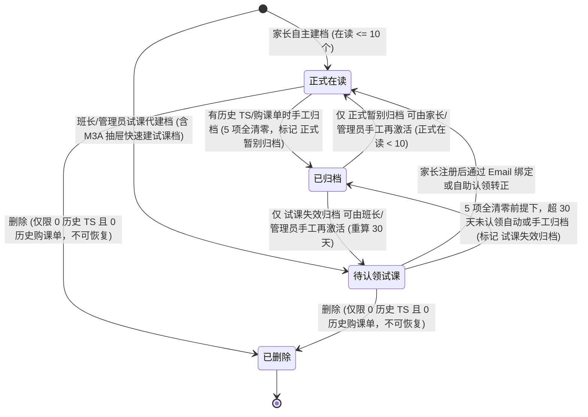

| 状态跃迁 | 触发人 / 驱动源 | 触发场景与行为 | 功能入口 |
| :--- | :--- | :--- | :--- |
| **`[*] -> 正式在读`** | 家长本人 | 家长账号下创建孩子档案（在读上限 10 个），自动组装全平台大小写不敏感唯一规范英文名（昵称） | Tab 2 多孩切换器【+ 添加新宝贝】；Tab 4【多孩档案】 |
| **`[*] -> 待认领试课`** | 建档班长 / 平台管理员 | 为未注册家长代建试课档案（班长创建归属本人，管理员可管全校）；试课列表中的`待认领`(`未结课TS==0`)与`试课中`(`未结课TS>0`)均为派生视图分组 | Tab 3【所辖学员】；Tab 4【试课建档】；M3A 约课抽屉【+ 快速建试课档】 |
| **`待认领试课 -> 正式在读`** | 家长 / 建档班长 / 管理员 | 后台录入家长已注册 Email 绑定，或家长输入规范英文名 + 联系方式后四位自助认领（且家长在读数 $< 10$），并归集历史试课单、TS、课件与备注 | Tab 4 试课详情【绑定家长 Email】；家长多孩切换器【🔗 认领试课宝贝】 |
| **`待认领试课 -> 已归档`** *(试课失效归档)* | 系统定时跑批 / 建档班长 / 管理员 | **5 项全清零守卫**（待排 TS、未来未结 TS、在途 `HOLD`、待付款单、异常回退全为 0）：自最后已结课 TS（或手工激活日；从未上课则自建档日）起超 30 天自动归档或提前手工归档；仅沉底试课【已归档】区，**规范昵称永久锁定** | 系统定时归档任务；Tab 4 试课详情【归档】 |
| **`正式在读 -> 已归档`** *(正式暂别归档)* | 家长本人 / 平台管理员 | 产生过任意历史 TS 或购课单禁删仅可归档：校验 **5 项全清零** 后自动停用 `AUTO_RENEWAL`，封存至家长【已归档宝贝】（严禁混入试课池），释放 `10` 名额上限，**规范昵称永久锁定** | Tab 4 多孩档案【归档】；管理员后台【归档】 |
| **`已归档 -> 待认领试课`** | 建档班长 / 平台管理员 | **仅限 `试课失效归档`** 手工再激活，移回待认领池并**自激活日起重算 30 天**（严禁跨类激活 `正式暂别归档`） | Tab 4 试课学员【已归档】卡片【重新激活】 |
| **`已归档 -> 正式在读`** | 家长本人 / 平台管理员 | **仅限 `正式暂别归档`** 手工再激活（校验家长当前在读 $< 10$ 且账号未停用；严禁跨类激活 `试课失效归档`），无缝恢复历史单据、备注与课件 | Tab 4【已归档宝贝】折叠区【重新激活】；管理员后台【重新激活】 |
| **`正式在读 / 待认领试课 -> 已删除`** | 家长 / 建档班长 / 管理员 | 仅当 **`历史 TS 总数 == 0 AND 历史购课单总数 == 0`**（含已取消/已作废）时允许逻辑软删；**不可再激活，规范昵称仍永久锁定** | Tab 4 多孩档案 / 试课详情【删除档案】 |

- **操作与变更记录**：① 每次状态跃迁追加只读状态流转记录（含归档类型与认领关系）；② 修改任一业务字段（`Student Note` 2000 字、小名、英文名、年龄、性别、常态作息偏好、头像、或经由 M1E/M3A/M3B 联动的课件进度与备注）均记入【档案变动日志】（管理员与关联班长可查，对家长/老师隐藏）；已删除/已归档档案长期只读留存。

---

### 2. M1B · 老师档案 (`TeacherProfile`)

> **SSOT 唯一归口**：[m1b_teacher_profile.md §4.7](./prd/m1b_teacher_profile.md#47-老师班长与价位字典唯一归口四支柱生命周期字段锁定留痕与跨实体联动-entity--log-ssot)
> 首期明确不做老师级长期休假状态；短期停课通过关闭可用时段或 M3B 单课次请假处理。

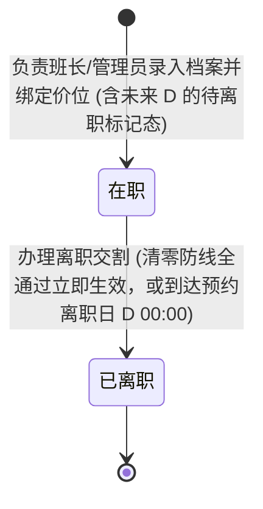

| 状态跃迁 | 触发人 / 驱动源 | 触发场景与行为 | 功能入口 |
| :--- | :--- | :--- | :--- |
| **`[*] -> 在职`** | 负责班长 / 管理员 | 录入国籍、英文名、价位（16/18/21 积分）、必填中英自我介绍（$\le 2000$ 字）、至少 1 张风采照片，及负责班长（管理员直录可暂置`平台直管`） | Tab 3【负责老师/全校老师】/ Tab 4【老师团队】→ M1B【新建老师】 |
| **`在职 -> 已离职`** | 负责班长 / 管理员 / 定时任务 | 校验自离职日 `D` 起 **4 项清零**（1–7 天临时课、固定位/`HOLD`、作为主讲的「正式开课」小班已解散、未履约代课已改派）；`D > 今天` 挂起待离职并封锁 `>= D` 日历，到 `D 00:00` 自动置「已离职」、下架选课大厅并作废未生效调价计划 | M1B 老师档案详情【办理离职】 |

- **附注（同归口配置实体 · 价位字典与预约调价）**：**老师价位字典**具备 `启用 / 停用` 2 态（被在职老师或待生效调价计划引用时严禁停用）；每位「在职」老师最多挂起 **1 条预约定时调价计划**（仅可落在有空窗的未来 4 周轮次首日周一 `00:00` 生效，先期离职自动作废）。
- **操作与变更记录**：每次状态跃迁与字段变更（含常规可约周模板、价位、预约调价、跨班长改绑、英文名、简介、视频、相册、ClassIn 二维码等）均追加【档案变动日志】（仅管理员可查），历史档案永久只读审计留存（不删）。

---

### 3. M1B · 班长职务档案 (`MonitorProfile`)

> **SSOT 唯一归口**：[m1b_teacher_profile.md §4.7](./prd/m1b_teacher_profile.md#47-老师班长与价位字典唯一归口四支柱生命周期字段锁定留痕与跨实体联动-entity--log-ssot)

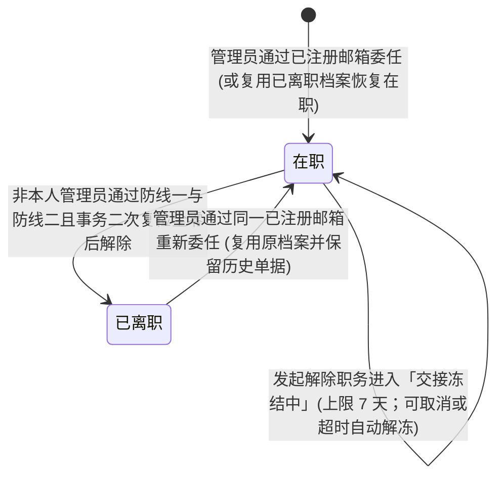

| 状态跃迁 | 触发人 / 驱动源 | 触发场景与行为 | 功能入口 |
| :--- | :--- | :--- | :--- |
| **`[*] / 已离职 -> 在职`** | 平台管理员 | 通过已在 M0A 注册的 Email 委任新班长或重新委任原班长（复用原档保留历史单据），授予班长权限视图 | Tab 4【班长管理】→ M1B【委任新班长】 |
| **`在职 <-> 交接冻结中`** | 平台管理员 / 系统超时任务 | 发起解除职务进入冻结（**上限 7 天**，阻断新收款/新开单/新建档案），可手工取消解冻，满 7 天未完结由系统自动解冻并通知管理员 | Tab 4【班长管理】→ 班长详情【解除职务 / 取消冻结】 |
| **`在职/交接冻结中 -> 已离职`** | 非本人平台管理员 | **严禁解除本人**；通过 **防线一（资金清算：未结 TS、待归集已结 TS 与在途待付款/`HOLD` 经 M5A 离职移交单「已完成入账」清零）+ 防线二（名下老师、正式开课小班与未认领试课档案 100% 改绑）** 且提交瞬间二次复检全零后解除并注销档案 | Tab 4【班长管理】→ 班长详情【确认解除职务】 |

- **操作与变更记录**：委任/冻结/解冻/解除职务的状态跃迁及显示名称、联系电话、微信二维码修改均记入只读流转与【档案变动日志】，管理员可查且永久只读留存。

---

### 4. M1C · 小班实体 (`GroupClass`)

> **SSOT 唯一归口**：[m1c_classes.md §4.2](./prd/m1c_classes.md#42-小班实体唯一归口四支柱生命周期字段锁定留痕与跨实体联动-entity--log-ssot)

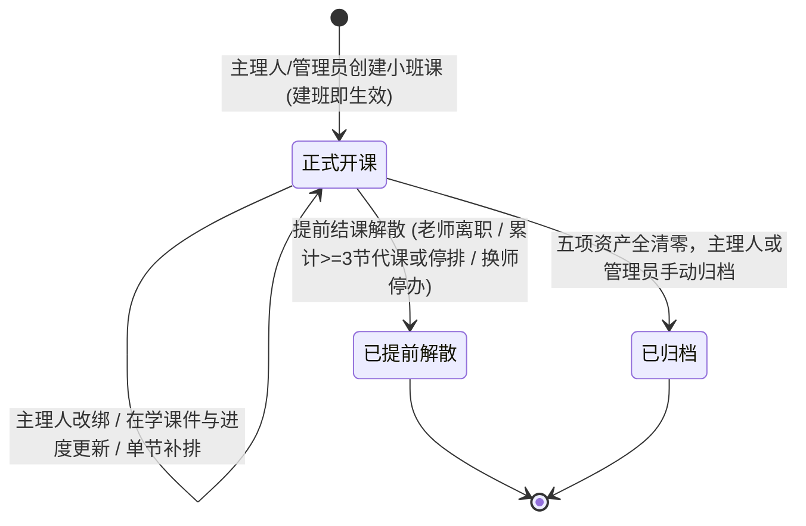

| 状态跃迁 | 触发人 / 驱动源 | 触发场景与行为 | 功能入口 |
| :--- | :--- | :--- | :--- |
| **`[*] -> 正式开课`** | 小班主理人 / 管理员 | 录入班名（1–64 字）、容量上限（$2\sim 20$，默认 3）、老师单节课酬积分与单节待上交积分，可选委任全平台在职老师（暂不绑定时标 `[待委任老师]` 并阻断购课排课） | Tab 3【主理小班/活跃小班】/ Tab 4【小班管理】→ M1C【创建小班】 |
| **`正式开课 -> 正式开课`** *(分阶段 ①②③ 锁定)* | 主理人 / 主讲或代课老师 / 管理员 | **阶段 ①**（待委任）与 **阶段 ②**（已委任零单零 TS）可修改容量/课酬/上交/老师；产生首笔在途/已付款单或 TS 后进入 **阶段 ③** 锁定上述财务与主讲老师字段，仅允许主理人改绑（M1B）、改班名、配置 0~6 门课件及更新 `Process Note`（2000 字） | M1C 详情 / M3A 课格 / M3B 交接与授课历史 |
| **`正式开课 -> 已提前解散`** | 小班主理人 / 平台管理员 | 校验**无已过开课时间未结课 TS** 后，选原因、流向并填 1–200 字解散备注（免传截图）；批量作废未来已排与待排 TS（保留老师 🔴 请假、取消代课待办），清在途待付款单与 `G-HOLD`；原「已付款」单据保持不变，**唯一同事务驱动生成 1 笔 [M2B](./prd/m2b_refund_orders.md#42-小班提前结课解散伴生清退流程m1c-单向驱动--宿主入边) 小班解散清退记录**（零 M5A 冲抵；仅通知管理员与原师，严禁通知家长） | M1C 小班详情页【提前结课解散】 |
| **`正式开课 -> 已归档`** | 小班主理人 / 平台管理员 | **五项资产全清零**（无未来已排、无待排池、无在途单及 `G-HOLD`、无过期未结 TS、无异常回退），手动归档为全字段只读阶段 ④ 并停用后续自动续费 | M1C 小班详情页【归档小班】 |

- **操作与变更记录**：每次状态跃迁与字段修改（含课件增删、改级与 `Process Note` 更新）均写入【小班操作与修改日志】；执行【提前结课解散】同时固化 4 项【解散结案依据卡】快照（操作结论、剩余节数拆分、按 TS 快照精准求和的剩余待上交积分、逐节作废 TS 明细），永久只读留存。

---

### 5. M1E · 课件主实体 (`Courseware`)

> **SSOT 唯一归口**：[m1e_courseware.md §4.3](./prd/m1e_courseware.md#43-课件与在学绑定唯一归口四支柱生命周期字段锁定留痕与跨实体联动-entity--log-ssot)

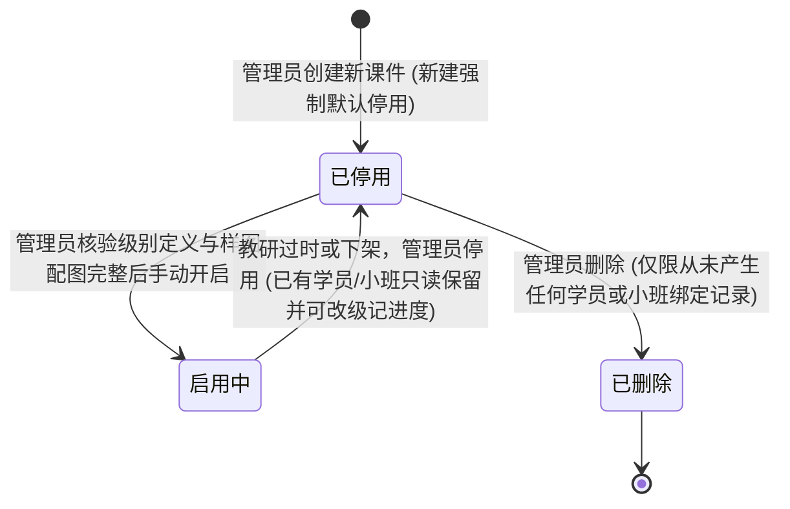

| 状态跃迁 | 触发人 / 驱动源 | 触发场景与行为 | 功能入口 |
| :--- | :--- | :--- | :--- |
| **`[*] -> 已停用`** | 平台管理员 | 新建课件强制默认「已停用」（防止未配齐 0~30 级与样图内页图的半成品暴露） | Tab 4【课件库管理】→ M1E【+ 新建课件】 |
| **`已停用 <-> 启用中`** | 平台管理员 | 配齐级别与样图后手动开启上架；下架停用后对新增备选池隐藏，但已有绑定对象仍可继续切换至其他启用级别并更新 `Process Note`（有历史绑定的级别仅停用禁删） | Tab 4【课件库管理】启用/停用开关 |
| **`已停用 -> 已删除`** | 平台管理员 | 仅当**从未产生任何 1v1 学员或 1vN 小班绑定记录**（含历史已移除）时允许物理删除；产生任意绑定后全端永久禁删 | Tab 4【课件库管理】空白课件删除 |

- **操作与变更记录**：课件元信息、0~30 级配置增改停用及主状态启停/删除记入平台课件库字典只读审计日志。

---

### 6. M1E · 在学课件绑定 (`CoursewareEnrollment`)

> **SSOT 唯一归口**：[m1e_courseware.md §4.3.1(2)](./prd/m1e_courseware.md#2-在学课件绑定统一适用于-1v1-学员与-1vn-小班)

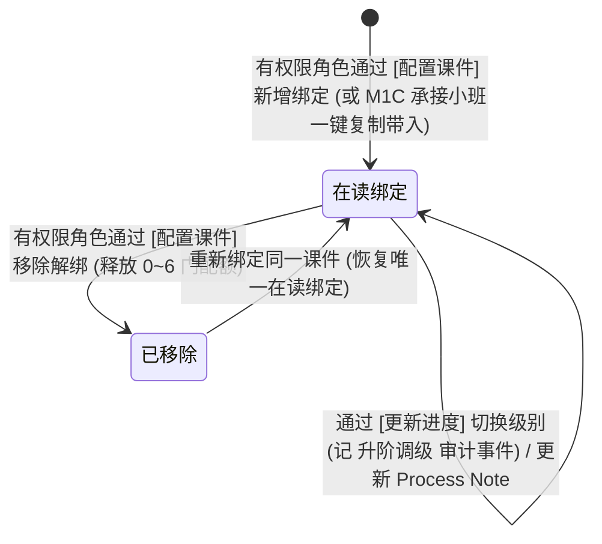

| 状态跃迁 | 触发人 / 驱动源 | 触发场景与行为 | 功能入口 |
| :--- | :--- | :--- | :--- |
| **`[*] / 已移除 -> 在读绑定`** | 管理员 / 班长或主理人 / 授权老师 / 家长(仅名下正式在读) | 同一学员或同一小班按课件全局唯一（上限 **0~6 门**）；含 `M1A` 试课认领转正继承与 `M1C` 换师承接新班一键复制带入；由家长操作时单次提交合并去重发 `M4` 站内提醒 | 学员/小班【配置课件】；M1C 新建承接 |
| **`在读绑定 -> 在读绑定`** | 管理员 / 班长或主理人 / 授权或代课老师 / 家长(1v1) | 通过 `[更新进度]` 切换当前级别（记 `升阶调级` 审计事件）或更新多行 `Process Note`（2000 字上限，提示尽量英文）；含 M3A 课格抽屉、M3B 请假交接与授课历史补录入边；老师更新小班日常静默不打扰主理人 | `[更新进度]`；M3A/M3B 抽屉及授课历史 |
| **`在读绑定 -> 已移除`** | 管理员 / 班长或主理人 / 家长(1v1 存在待上或待排关联二次确认) | 解绑释放 6 门配额；已归档/已删除学员与阶段 ④ 小班永久只读禁止改删；所有绑定变更与 `Process Note` 前后快照分别归口写入 M1A/M1C 日志长期留存 | `[配置课件]` 移除解绑 |

- **操作与变更记录**：所有新增绑定、移除、`升阶调级` 与 `Process Note` 变更快照同步归口写入 1v1 的 M1A【档案变动日志】及 1vN 的 M1C【小班操作与修改日志】（对家长端隐藏内部日志），且长期只读留存。

---

## 二、购课与清退（M2）

### 7. M2A · 购课单 (`CoursePurchaseOrder`)

> **SSOT 唯一归口**：[m2a_course_orders.md §4.5](./prd/m2a_course_orders.md#45-购课单唯一归口四支柱生命周期字段锁定留痕与跨实体联动-entity--log-ssot)

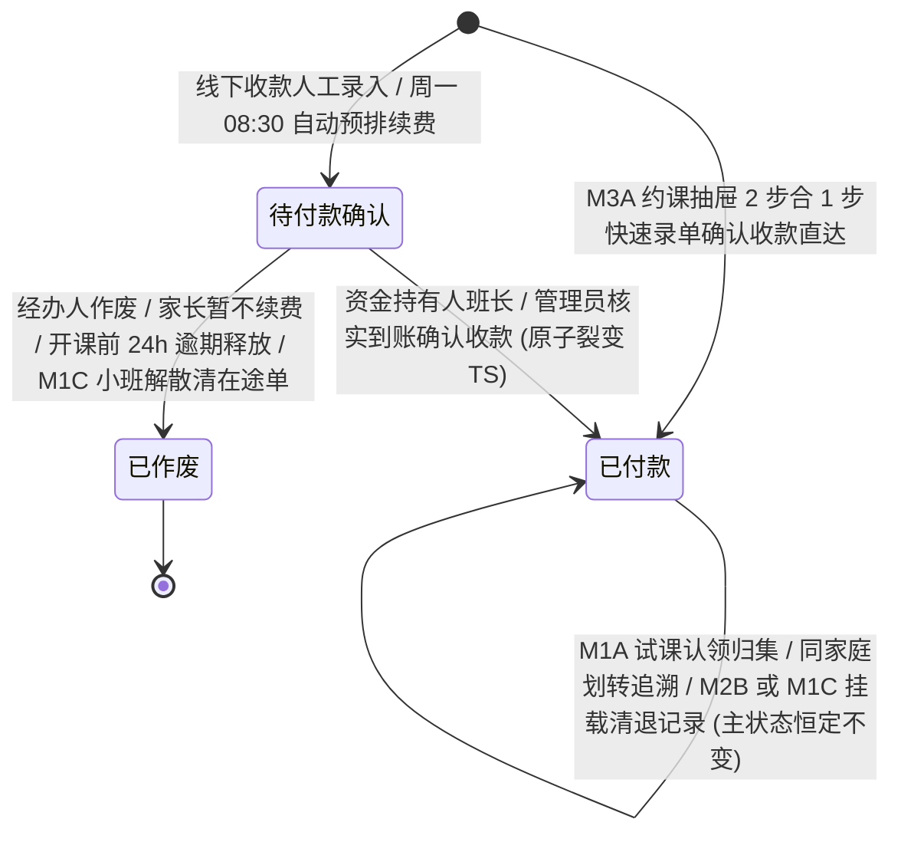

| 状态跃迁 | 触发人 / 驱动源 | 触发场景与行为 | 功能入口 |
| :--- | :--- | :--- | :--- |
| **`[*] -> 待付款确认`** | 班长 / 管理员 / 定时任务 | 录入 1v1 固定位（价位必选+老师选填）、1v1 临时课（1~20 节多价位组合按节购课，不允许改价，含试课）、小班购课单；或最后一周周一 08:30 自动预排续费单并锁未来 4 周 `HOLD` / `G-HOLD` | Tab 3【购课续费】→ 新建购课单；系统续费跑批 |
| **`[*] -> 已付款`** *(2合1快捷直达)* | 班长 / 管理员 | 在 M3A 约临时课抽屉勾选“同步录单”并强制勾选“已确认收到课次费用”，点击【确认已收款并立即约课】，单事务直接落盘「已付款」并裂变锁定「已排期（临时课 🟡）」TS（固定按本次代约 1~4 节计价，不可改价） | M3A 老师课表空闲绿格 → 代学员约课抽屉 |
| **`待付款确认 -> 已付款`** | 资金持有人班长 / 平台管理员 | 核实线下到账后点击【确认收款】：所有类型购课单原子裂变「待排期」TS 并锁定资金持有人 `holder_id`，续费单 `HOLD`/`G-HOLD` 转为正式排课（冲突跳过节数留待排池） | Tab 3【购课续费】单据列表/详情页；待办流【确认收款】 |
| **`待付款确认 -> 已作废`** | 班长 / 管理员 / 1v1 家长 / 定时任务 | 经办人作废；1v1 续费单家长点【暂不续费】；距次轮首节已排预占开课前 `24h` 逾期未付自动释放 `HOLD` / `G-HOLD`；或 M1C 小班提前解散清理在途单 | M2A 详情【作废】；家长【暂不续费】；24h 超时任务；M1C 解散 |
| **`已付款 -> 已付款`** *(挂载追溯)* | M1A / M2B / M1C / 班长或管理员 | 试课认领归集、同家庭 1v1 待排划转追溯、M2B 手动清退或 M1C 小班解散伴生清退挂载（原「已付款」主状态恒定不变，列表轻标 `含清退` / `小班已解散`） | M1A 认领/划转；M2B 清退；M1C【提前结课解散】 |
| *(协商子状态)* | 1v1 家长 → 班长 | 家长点击【申请调整】置为 `待班长处理`（保留 `HOLD`）；班长【修改购课单】或【标为已沟通】后置为 `已处理`（小班自动续费单对家长端隐藏） | 家长 M2A 待续费单【申请调整】；班长 M2A【修改购课单】/【标为已沟通】 |

- **操作与变更记录**：每次跃迁记入详情页【状态流转历史】（对家长隐藏强制提交原因，小班购课单对家长 100% 不可见）；自动续费单确认前编辑（改课次/老师/时段/实收）、协商标签与付款凭证附件同步审计，全部主记录、明细与凭证**永久只读留存、严禁物理删除**。

---

### 8. M2B · 课次清退记录 (`CreditDeduction`)

> **SSOT 唯一归口**：[m2b_refund_orders.md §4.3](./prd/m2b_refund_orders.md#43-课次清退记录专属实体生命周期字段锁定与留存规则-entity--log-ssot)

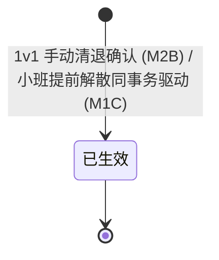

| 状态跃迁 | 触发人 / 驱动源 | 触发场景与行为 | 功能入口 |
| :--- | :--- | :--- | :--- |
| **`[*] -> 已生效`** *(唯一不可逆终态)* | 资金持有人班长 / 管理员兜底（需传凭证）/ M1C 解散单向驱动 | 1. **1v1 手动清退**：严格仅限 1v1「待排期」TS（含划转流入 TS；若仍有未来已排课次须先请假释放），按「价位（含是否 `+10` 备课费）+ 资金持有人」FIFO 作废并汇总 `1v1 退款实付积分`，必填 1–200 字财务备注；<br>2. **小班解散伴生清退**：仅由 [M1C 提前结课解散](./prd/m1c_classes.md#42-小班实体唯一归口四支柱生命周期字段锁定留痕与跨实体联动-entity--log-ssot) 同事务触发，固化作废未上 TS 明细、按原 TS 持有人拆列与 `小班核销待上交积分`（免上传截图，对家长 100% 不可见） | M1A 资产抽屉 / Tab 3【退款管理】→【课次清退】；M1C【提前结课解散】 |

- **操作与变更记录**：一经生效全字段永久只读锁定（不设撤销/删改，仅依赖提交前二次确认）；本身即为不可篡改财务核销凭据，永久只读审计留存，与 M5A 周转账单及 M5B 课酬单严格保持物理零耦合（零违约金、零周转账冲抵）。

---

## 三、教务排课、课表与考勤代课（M3 + 全域枢纽）

### 9. 全域枢纽 · 最小课次枢纽 (`TS / TimeSlot`)

> **SSOT 唯一归口**：[BUSINESS_RULES.md §3.2](./BUSINESS_RULES.md#32-ts-timeslot---最小课次流转枢纽)

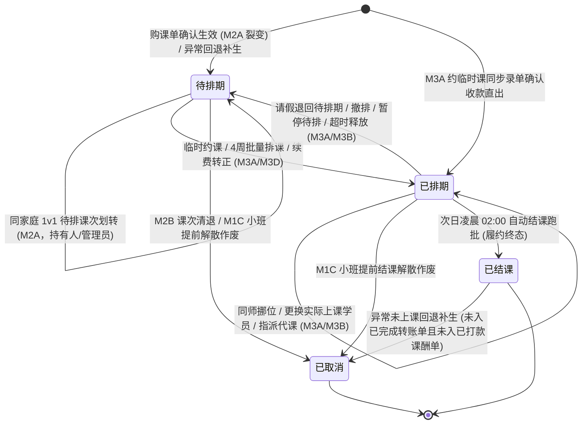

| 状态跃迁 | 触发人 / 驱动源 | 触发场景与行为 | 功能入口 |
| :--- | :--- | :--- | :--- |
| **`[*] -> 待排期`** | 班长 / 管理员（随购课/回退触发） | 购课单「已付款」裂变待排 TS 并固化价格/持有人快照；或异常未上课回退补生 1 节全新待排 TS | M2A【确认收款】；M3A 课格【异常未上课回退补生】 |
| **`[*] -> 已排期`** | 班长 / 管理员 | M3A 空闲绿格【2 步合 1 步快速录单】确认收款并立即约课直达「已排期（临时课 🟡）」 | M3A 空闲绿格代约抽屉 |
| **`待排期 -> 待排期`** | 资金持有人班长 / 管理员 | 同家长名下两个「正式在读」孩子之间划转 1v1 待排课次（按价位 FIFO，必填 1–200 字备注，保持原价位、原单与 `holder_id` 不变） | M1A 综合档案抽屉【↔️ 划转给同家庭孩子】 |
| **`待排期 -> 已排期`** | 家长 / 班长 / 管理员 | 1v1 临时约课全域选师（家长 1~7 天同价位）；**1v1 4 周固定位排课仅限目标老师所属负责班长或管理员**；小班需本人主理且已委任老师连续双格 | M3A 网格预约；M3D 排课工作台 |
| **`待排期 -> 已取消`** | 资金持有人班长 / 主理人 / 管理员 | M2B 课次清退扣减；或 M1C 小班提前解散作废待排 TS 并固化残值日志 | M1A 资产 / M2B；M1C【提前结课解散】 |
| **`已排期 -> 待排期`** | 家长（$\ge 24\text{h}$ 或老师请假时）/ 原师负责班长 / 主理人 / 管理员 / **`<3h` 跨班长驰援** / 超时任务 | 1v1 请假退期待排（`>=3h` 按师归属，`<3h` 适用跨班长紧急驰援豁免；`<3h` 班长/管理员温和弹窗且支持按学员旷课整节扣课）；撤排退回；老师请假后家长/班长退回或课程结束超时自动释放；小班【暂停待排】 | M3A 课格抽屉；M3A 日调度；M3B 应急代办包；课程结束超时任务 |
| **`已排期 -> 已排期`** | 家长（挪位 $\ge 3\text{h}$ 或 3h+ 自助换代课）/ 原师负责班长 / 主理人 / 管理员 / **`<3h` 跨班长驰援** | 同师挪位（`<3h` 放开跨班长驰援；挪位自动取消原代课）；**更换实际上课学员（全时段严禁跨班长，不纳入 `<3h` 驰援）**；指派或撤销临时代课（`>=3h` 按师归属，`<3h` 开放全校跨班长驰援） | M3A 课格动作抽屉；M3A 日调度【同屏对照空闲老师】 |
| **`已排期 -> 已取消`** | 小班主理人 / 平台管理员 | M1C 小班提前解散批量作废未来未开课 TS（存在已过开课时间未结课 TS 时拦截），释放日历并记残值日志 | M1C 小班详情【提前结课解散】 |
| **`已排期 -> 已结课`** *(履约终态)* | 系统自动跑批 | 每日 02:00 将前一日已排且未请假挂起/未取消 TS 批量流转为终态「已结课」（含学员旷课、老师迟到/早退）；周三发薪标记「已打款」后叠加不可逆财务只读冻结 | 每日凌晨 02:00 结课批处理 |
| **`已结课 -> 已取消`** | 原师负责班长 / 主理人 / 管理员 | 未入「已完成入账」周转账单且未入「已打款」课酬单的误结课 TS（全时段禁跨班长），作废原 TS、同步从未打款/草稿单剔除并补生 1 节全新待排 TS | M3A 已结课课格抽屉【异常未上课回退补生】 |

- **操作与变更记录**：**四类留痕严格分工**——① 【状态流转历史】（含同态自流转前后对象/时段/老师快照）；② 【经办记录】（M3B `§4.10`，仅记班长/管理员人工调度，跨组驰援标 `跨组紧急驰援`）；③ 《出勤异常记录》（M3B `§4.9`，核算异常出勤次数与课酬透出）；④ 通用字段审计日志。全部 TS 永久只读不可删。

---

### 10. M3A · 统一时段覆盖 (`SlotOverride`)

> **SSOT 唯一归口**：[m3a_calendar_grid.md §4.10](./prd/m3a_calendar_grid.md#410-实体生命周期与状态机-entity-lifecycles--state-machines)

```text
  优先级叠加：正式已排 TS  >  SlotOverride (临时加开 / 锁定不可约 / 请假不可约 / 续费预占)  >  M1B 周常规可约模板
```

| 覆盖态 | 触发人 / 驱动源 | 插入 / 更新场景 | 清除 / 转正 / 保留规则 | 功能入口 |
| :--- | :--- | :--- | :--- | :--- |
| **`临时加开 🟢`** | 老师 / 负责班长 / 管理员 | 在今天及未来 ⚪ 休息格勾选加开（支持同日批量） | **被约生成 TS 后保留**（退课/挪走后仍可约）；点击【恢复为休息】、离职或请假时清除/覆写 | M3A 老师周课表 ⚪ 格【加开时段】/ 🟢 加开格【恢复为休息】 |
| **`锁定不可约 ⚪`** | 负责班长 / 管理员 | 在 🟢 空闲格抽屉点击【锁定时段 / 设为不可约】 | 点击休息格【加开时段】解锁清除（严禁跨班长修改） | M3A 老师周课表 🟢 格【锁定时段】 |
| **`请假不可约 🔴`** | 老师 / 负责班长 / 管理员 / `<3h` 跨组驰援(仅当格急救) | 勾选空闲绿格提交请假（不生成请假单），或老师原因小班暂停待排 | 点击 🔴 格【恢复可约 / 销假】时清除，按最新周常规模板还原（`>=3h` 严禁跨班长操作） | M3A 老师周课表批量请假 / 🔴 格【恢复可约】；M3A 小班【暂停待排】 |
| **`续费预占 🟠/🟩 虚线`** | 系统自动跑批 / 班长或主理人 / 管理员 | 提前 7 天周一 08:30 预排或 M2A 改单重锁 | 关联购课单「已付款」/ M3D 转正生成 TS 时清除；购课单「已作废」（放弃/作废/24h 超时/M1C 解散）或换位时清除 | 系统续费跑批；M2A【确认收款】/【修改购课单】；M3D |

- **操作与变更记录**：班长/管理员锁格、代请假或销假记入【经办记录】；老师自助加开/恢复休息/纯空闲请假仅更新覆盖记录（不记独立业务流水），**早于 90 天**的历史过期单日覆盖记录定期物理清理（绝不影响已生成授课历史与财务档案）。

---

### 11. M3D · 排课调度批记录 (`ScheduleBatchTask`)

> **SSOT 唯一归口**：[m3d_course_scheduling.md §4.7](./prd/m3d_course_scheduling.md#47-核心实体生命周期修改规则与跨实体联动规范-entity-lifecycles--ssot)

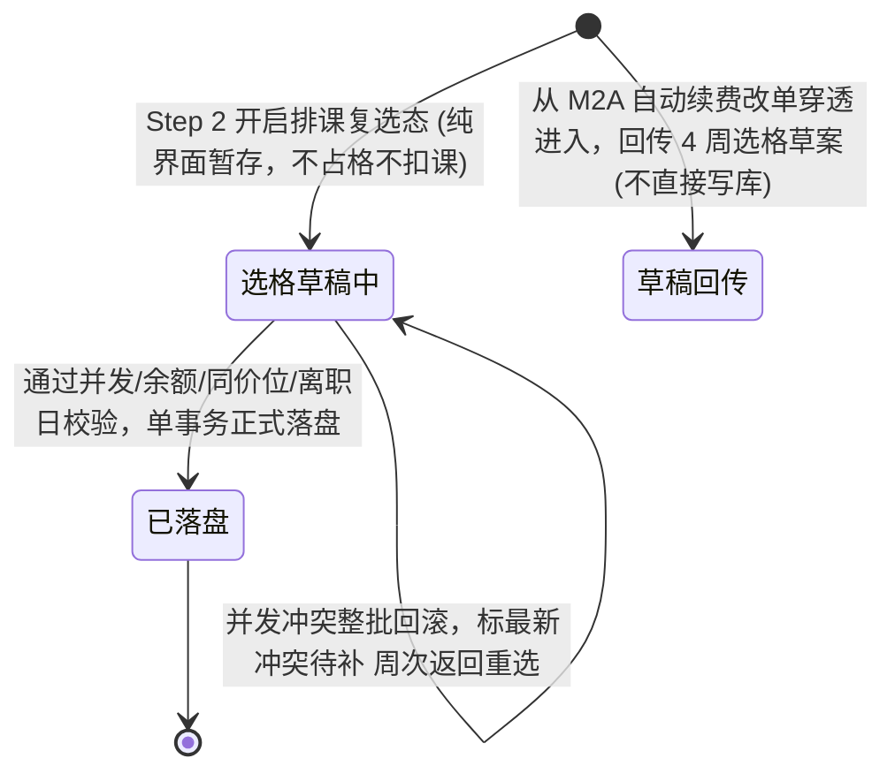

| 状态 / 运行态 | 触发人 / 驱动源 | 触发场景与行为 | 功能入口 |
| :--- | :--- | :--- | :--- |
| **`选格草稿中` *(含并发冲突回滚)*** | 家长 / 班长 / 主理人 / 管理员 | 在 Step 2 课表选格、第 1 周模板穿透第 2~4 周（标 `跟随模板`/`已调整`/`冲突待补`）；若提交瞬间遇并发抢占或新请假冲突，整批事务回滚并高亮冲突周退回草稿；离开页面立即释放 | M3D 排课工作台 Step 2 / M3A 排课复选态 |
| **`已落盘`** *(不可逆终态)* | 家长 / 班长 / 主理人 / 管理员 | 单事务驱动 TS 流转「已排期」、锁定老师日历网格（并释旧 `HOLD`、核销小班待补排待办）；追加 1 条只读排课调度流水（永久只读留存，退课挪位交由单节 TS 承接） | 点击【确认排课】 |
| **`草稿回传`** | 资金持有人班长 / 主理人 / 管理员 | 仅用于 M2A 自动续费单【调整时段/换师】入口，点击【✓ 确认排期并返回】只带回草案与重算预期积分，由 M2A 点击【保存并更正账单】单事务更新预占 | M2A 自动续费待付款单修改抽屉 → M3D/M3A |

- **操作与变更记录**：仅正式批进入「已落盘」时写入只读排课调度流水与【经办记录】（每轮批量按单次汇总记 1 条）并长期留存；草稿期尝试与并发回滚不记有效流水，退出会话立即清理。

---

### 12. M3B · 老师请假申请单 (`TeacherLeaveRequest`)

> **SSOT 唯一归口**：[m3b_attendance_substitution.md §4.8.2](./prd/m3b_attendance_substitution.md#2-老师请假申请单-teacherleaverequest)

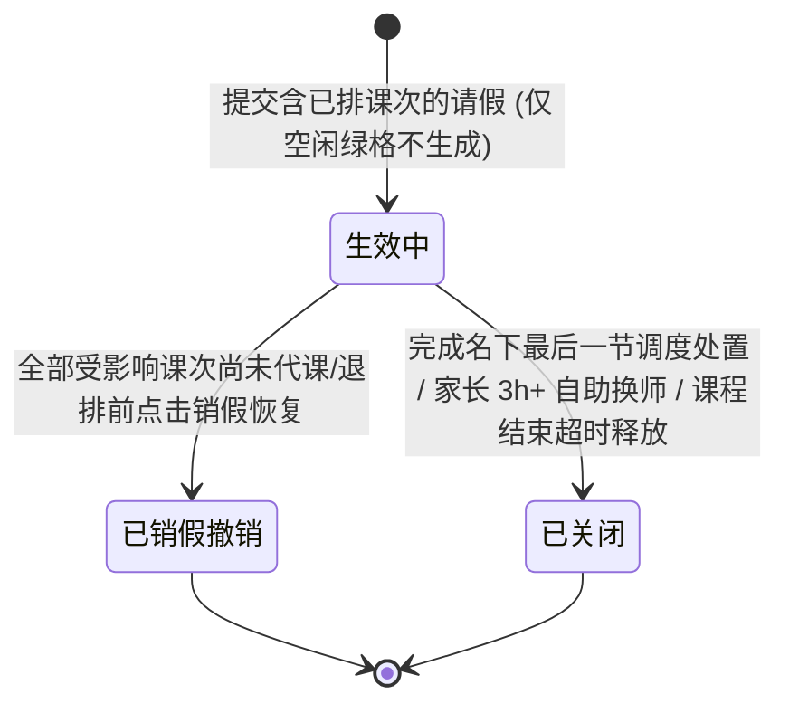

| 状态跃迁 | 触发人 / 驱动源 | 触发场景与行为 | 功能入口 |
| :--- | :--- | :--- | :--- |
| **`[*] -> 生效中`** | 原老师 / 负责班长 / 管理员 / `<3h` 跨组驰援 | 勾选当天 1~12 节请假且**包含至少 1 节已排课次**时生成（仅请假空闲绿格不生成本单）；可顺带更新 2000 字 `Process Note` / `Student Note` 交接快照 | M3A 老师课表抽屉批量请假；M3A 日调度代老师请假 |
| **`生效中 -> 已销假撤销`** | 原老师 / 负责班长 / 管理员 | 名下全部受影响课次均尚未被指派代课或退期待排前，在 🔴 格点击【恢复可约 / 销假】，同步将其《出勤异常记录》置为「已销假撤销」 | M3A 老师课表 🔴 格抽屉【恢复可约 / 销假】 |
| **`生效中 -> 已关闭`** | 班长 / 主理人 / `<3h` 跨组驰援 / 家长 / 超时任务 | 名下**最后一节受影响课次**完成指派代课（含家长 `≥3h` 换同价位老师）、退回待排、同师平移、小班暂停待排或课程结束超时自动释放后收口关闭 | Tab 3 浅红/浅黄待办 → M3A 抽屉 / 日调度；家长自助；超时释放任务 |

- **操作与变更记录**：提交后时段集合、原因与操作人只读固化；每次跃迁追加流转日志，命中已排课次同步生成《出勤异常记录》（代请假同步记【经办记录】），长期只读审计留存。

---

### 13. M3B · 代课调度工单 (`SubstitutionTask`)

> **SSOT 唯一归口**：[m3b_attendance_substitution.md §4.8.1](./prd/m3b_attendance_substitution.md#1-代课调度工单-substitutiontask)

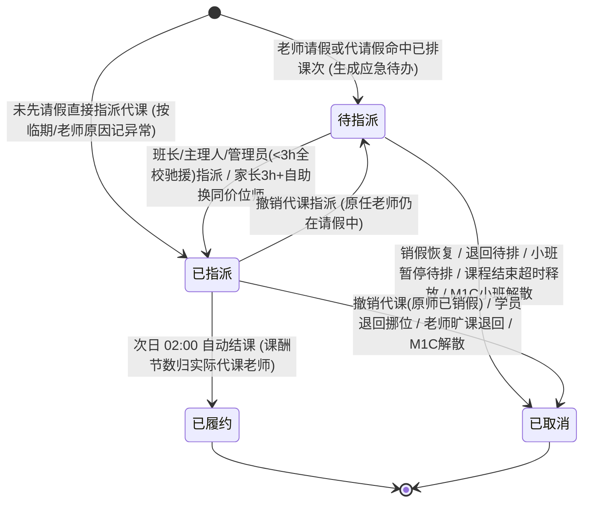

| 状态跃迁 | 触发人 / 驱动源 | 触发场景与行为 | 功能入口 |
| :--- | :--- | :--- | :--- |
| **`[*] -> 待指派`** | 原老师 / 负责班长 / 管理员 / `<3h` 驰援 | 请假时段命中已排课次，生成 Tab 3 待办包（`<3h` 进全校浅红紧急置顶，支持所有班长跨组驰援）与对应邮件/提醒 | M3A 老师课表批量请假；M3A 日调度代请假 |
| **`[*] / 待指派 -> 已指派`** | 负责班长 / 主理人 / 管理员 / `<3h` 跨组驰援 / 1v1 家长(`≥3h`) | 在全平台在职空闲老师中筛师指派（小班须连续双格空闲）；双视角染色（🔵 被代课 / 🟣 代上课）；`<3h` 跨组驰援触发温和确认、并发锁防抢单，并向原负责班长发 M4 中性知会 | Tab 3 待办 `[ 指派代课 ]` → M3A 抽屉 / 日调度同屏找代课；家长抽屉(`≥3h`) |
| **`待指派 -> 已取消`** | 原老师 / 负责班长 / `<3h` 驰援 / 主理人 / 家长 / 系统 | 原师销假恢复；改走退回待排期、小班暂停待排、课程结束超时自动释放或 M1C 小班提前解散；同步关闭全校 Tab 3 待办 | M3A 抽屉 / 日调度；超时释放任务；M1C 解散 |
| **`已指派 -> 待指派 / 已取消`** | 负责班长 / 主理人 / 管理员 / `<3h` 驰援 | **原师点击空闲格销假不自动解绑已指派代课**；须先执行【撤销代课指派】（原师仍在请假退回 `待指派` 重派，已销假或遇退回/挪位/撤排/老师旷课/解散则置 `已取消` 并通知原代课老师） | M3A 课格抽屉【指派代课】面板 →【撤销代课指派】 |
| **`已指派 -> 已履约`** | 系统自动跑批 | 次日凌晨 02:00 正常（或学员旷课/迟到早退）结课，1v1 按代课老师内部单价试算、小班按小班快照平移，节数 100% 计入实际代课老师周课酬单 | 每日自动结课批处理 |

- **操作与变更记录**：每次状态跃迁同事务追加只读流转日志；后台指派/撤销记【经办记录】（跨组驰援标 `跨组紧急驰援`）；全部工单长期只读审计留存，严禁删除。

---

### 14. M3B · 出勤异常记录 (`AttendanceAnomaly`)

> **SSOT 唯一归口**：[m3b_attendance_substitution.md §4.9](./prd/m3b_attendance_substitution.md#49-出勤异常记录产品规范字段埋点修改锁定与留存边界)

| 状态跃迁 | 触发人 / 驱动源 | 触发场景与行为 | 功能入口 |
| :--- | :--- | :--- | :--- |
| **`[*] -> 有效`** | 老师 / 班长 / 管理员 / 家长 | **7 处埋点自动记账**：① 老师/代请假命中已排课（按 `<3h`/`3~24h`/`>=24h` 归档）；② 未先请假 `<24h`（或老师原因）直接代课；③ 老师旷课；④ 老师迟到；⑤ 老师早退（后两项保持正常结课与默认计薪）；⑥ 学员旷课与 `<3h` 临期变动（严格隔离统计，不计入老师非常规频次）；⑦ M5A 异常未上课回退补生 | M3A/M3B 请假、直派代课、考勤标记及 M5A 异常回退自动触发 |
| **`有效 -> 已销假撤销`** | 原老师 / 负责班长 / 管理员 | 老师在未被代课或退排前点击 🔴 格销假恢复正常排期，或误标考勤后执行【恢复为正常出勤】，自动撤销异常计数 | M3A 🔴 格【恢复可约/销假】；【考勤/旷课标记】→【恢复为正常出勤】 |

- **操作与变更记录**：一经生成全字段只读，严禁手工篡改或删除；家长端物理不可见，在 M5B 老师周课酬对账页与管理员结算看板明细中透出，留存满 1~2 年按自然年冷存。

---

## 四、消息通知（M4）

### 15. M4 · 站内提醒 (`Notification`)

> **SSOT 唯一归口**：[m4_notification.md §4.4](./prd/m4_notification.md#44-站内提醒唯一归口规范-entity-lifecycle-fields-logs--retention-ssot)

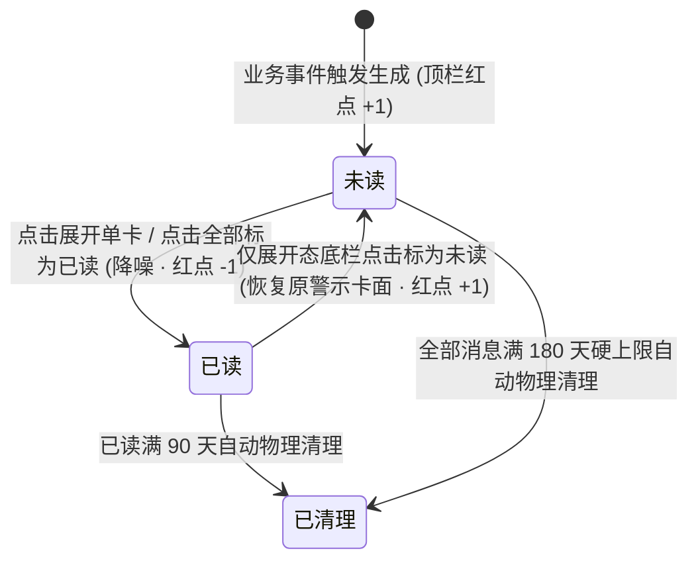

| 状态跃迁 | 触发人 / 驱动源 | 触发场景与行为 | 功能入口 |
| :--- | :--- | :--- | :--- |
| **`[*] -> 未读`** | 业务事件触发源（M1B/M1C/M1E/M2A/M3B/M3D/M5A/M5B） | 按三档卡面生成：**浅红紧急卡**（严格专属 `<3h` 临期变动/代课与 `<3h` 请假待代课）、**浅黄提醒卡**（续费 7 天/48h/`<24h` 释放警示、续费冲突、`3~24h` 待代课、周一转账/驳回、家长传凭证/调单）或**中性卡**（`>=24h` 调度、`[跨组紧急已代处理]` 协同知会、周课酬单等），顶栏红点 `+1` | 各端顶栏 🔔 消息中心；老师首页单条课表变动条 |
| **`未读 <-> 已读`** | 消息所属接收账号本人 | 点击展开（或【全部标为已读】）即置「已读」，浅红/浅黄底色自动降噪为中性卡外观（保留语义圆点）；仅展开态底栏点【标为未读】可折叠回退「未读」并恢复原警示卡面 | 端内消息中心列表（默认仅展近 90 天） |
| **`已读 / 未读 -> 已清理`** | 系统定期清理任务 | 已读满 **90 天** 或全部消息硬上限满 **180 天** 自动物理清理，不进入前端列表 | 定期消息清理任务 |

- **操作与变更记录**：**无独立跨模块审计日志**（阅读态属个人高频交互），每条记录仅保留 `生成时间` 与最近 `已读更新时间`；点击卡片快捷跳转仅导航无写入副作用。

---

## 五、资金归集与周度结算（M5）

### 16. M5A · 周转账单 (`TransferOrder`)

> **SSOT 唯一归口**：[m5a_transfer_collection.md §4.6](./prd/m5a_transfer_collection.md#46-周转账单全生命周期字段锁定留痕与留存-ssot-规则)

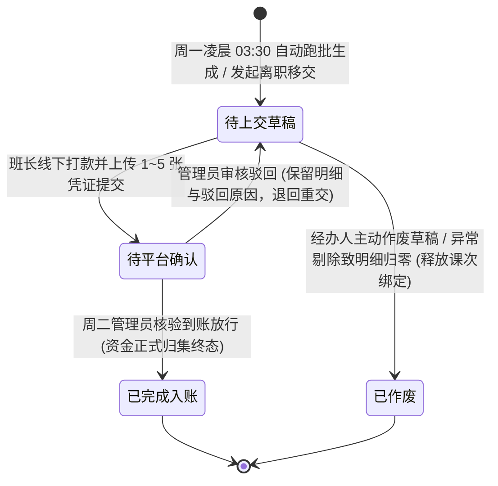

| 状态跃迁 | 触发人 / 驱动源 | 触发场景与行为 | 功能入口 |
| :--- | :--- | :--- | :--- |
| **`[*] -> 待上交草稿`** | 系统自动跑批 / 离职班长 / 管理员 | 周一 03:30 扫描上周待归集已结课 TS 生成草稿（总额 $> 0$；含单 TS 全局唯一防重打包约束），周一 08:00 推 M4 催办与邮件；或离职打包名下未归集/未结 TS | 周一跑批任务；M5A【离职移交专项面板】 |
| **`待上交草稿 -> 待平台确认`** | 负责班长 / 离职班长 | 线下打款后上传 1~5 张凭证并点击【确认已转账】（明细非空），**即刻锁定明细、总积分与凭证快照** | Tab 3【周转账单】详情页【去上交并打款】 |
| **`待平台确认 -> 待上交草稿`** | 平台管理员 | 金额不符、未到账、凭证模糊或课次存疑时填 1–200 字原因驳回，保留明细退回并推 M4 浅黄提醒卡，允许重传凭证或剔除异常 TS | Tab 3【周转审核】→ 详情页【驳回转账单】 |
| **`待上交草稿 -> 已作废`** | 班长 / 管理员 / 系统自动 | 草稿态主动作废重算，或因 M5A 异常未上课回退剔除 TS 致明细归零自动作废，释放课次打包占位 | M5A 草稿详情【作废草稿】；异常回退联动 |
| **`待平台确认 -> 已完成入账`** *(终态)* | 平台管理员 | 周二核验银行流水到账后点击【确认收款】，完成平台资金归集并永久锁定（单内 TS 永久禁回退）；若为离职移交单，同事务将未结 TS 资金持有人改绑为平台并核销防线一 | Tab 3【周转审核】→ 详情页【确认收款】 |

- **操作与变更记录**：每次状态跃迁及草稿自动剔除审计均追加只读流转记录，详情页展示【状态流转历史】时间轴；全部单据、明细与凭证永久只读留存不可删。

---

### 17. M5B · 老师周课酬单 (`TeacherSalaryReport`)

> **SSOT 唯一归口**：[m5b_weekly_settlement.md §4.6](./prd/m5b_weekly_settlement.md#46-老师周课酬单四支柱生命周期字段锁定留痕与永久只读留存策略附跨实体联动清单)

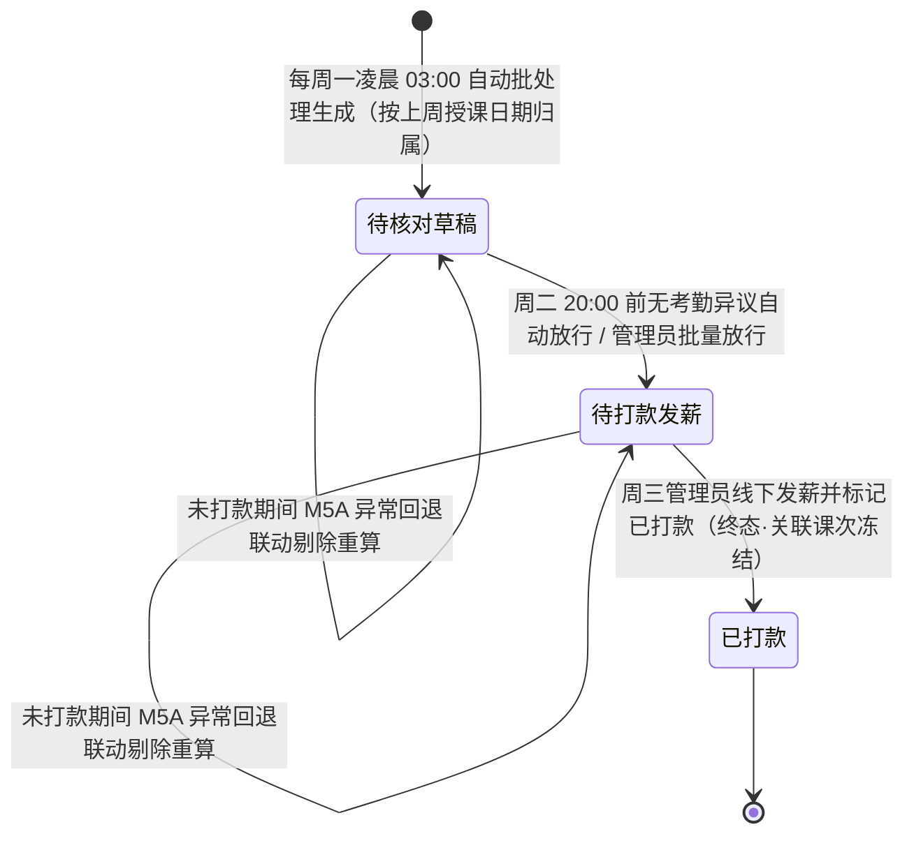

| 状态跃迁 | 触发人 / 驱动源 | 触发场景与行为 | 功能入口 |
| :--- | :--- | :--- | :--- |
| **`[*] -> 待核对草稿`** | 系统自动跑批 | 每周一 03:00 按实际授课老师汇总上周「已结课」TS（含存在老师责任类异常时生成的 `0 节` 兜底单），彻底解绑班长；老师端**只出节数不出金额**（管理员端可当期选填内部课酬单价试算），推 M4 中性卡不发邮件 | 周一 03:00 结算批处理 |
| **`待核对草稿 / 待打款发薪 -> 保持原态`** | 负责班长 / 管理员（经 M5A 回退触发） | 未「已打款」且关联课次未入「已完成入账」转账单时，M5A 异常未上课回退同步从本单剔除该节并重算 4 项节数与试算总积分（归零仍兜底保单） | M3A/M5A【异常未上课回退补生】 |
| **`待核对草稿 -> 待打款发薪`** | 系统自动 / 平台管理员 | 周二 20:00 前无异议自动放行，或管理员手动批量放行，进入周三待发薪池（不可退回草稿；未打款前均支持新增【差额调整项】填 1–200 字原因） | 老师端对账；管理员 Tab 3【课酬发薪】 |
| **`待打款发薪 -> 已打款`** *(终态)* | 平台超级管理员 | 周三线下打款后点击【标记为已打款】（凭证、备注与内部单价均为选填），全字段永久锁定并对单内关联 TS **叠加不可逆发薪只读冻结**，向老师发 M4 通知与发薪邮件（若勾选附发警告同步投递） | Tab 3【课酬发薪】→【标记为已打款】 |

- **操作与变更记录**：每次跃迁记入【状态流转历史】（老师端仅见节点与时间，严格过滤内部单价试算与内部惩罚备注）；差额调整项、打款警告与异常处理变动同步单行留痕，全生命周期永久只读留存不可删。
