/** (c) 2024-2026 Topee (https://topee.top). All rights reserved. Proprietary and confidential. */

# Dream 全域实体状态机全景索引与速查手册

> **【快照定位与 SSOT 归口声明】**：本文件为面向客户展示与阶段汇报用的**全域实体全景汇总快照**（按业务模块顺序编排，涵盖全域认证授权、主数据、订单清退、排课枢纽、消息与财务结算共 **21 个实体**；最近同步刷新日期：**2026-11-24**）。所有实体状态机、字段修改/锁定规则与日志留痕的**唯一权威定义（SSOT）与日常维护归口**位于 [BUSINESS_RULES.md](./BUSINESS_RULES.md)（TS 全局枢纽）及各专属子 PRD（`docs/prd/m*.md`）；**平时子 PRD 修订时无需高频同步更新本文件，仅在面向客户汇报或里程碑总结前按各归口 PRD 统一汇总刷新**。

---

## 总览索引（按业务模块排序 · 共 21 个实体）

| 序号 | 所属模块 | 实体名称 | 状态数 | 状态 / 覆盖态名称（中文标准口径） | 操作记录 / 留痕情况 | 数据留存与清理策略 |
| :---: | :---: | :--- | :---: | :--- | :--- | :--- |
| 1 | `M0A` | [自然人登录账号 (`UserAccount`)](#1-m0a--自然人登录账号实体-useraccount) | **5** | `未激活`*(兜底)*、`正常生效`、`临时锁定`、`已封禁`、`已注销停用` | 协议签约快照 + 【安全审计日志】（改密/换绑/锁解/注销） | 永久停用留存（禁物理删除，违规封禁不释 Email） |
| 2 | `M0A` | [平台管理员授权 (`AdminGrant`)](#2-m0a--平台管理员授权实体-admingrant) | **3** | `永久在任（受保护）`、`在任（普通）`、`已撤销` | 【授权变更安全审计日志】（仅在任管理员可查） | 永久只读审计留存（同 Email 再授任复用原记录） |
| 3 | `M1A` | [学员档案 (`StudentProfile`)](#3-m1a--学员档案-studentprofile) | **4** | `待认领试课`、`正式在读`、`已归档`*(分 `试课失效归档`/`正式暂别归档`)*、`已删除` | 状态流转日志 + 全字段【档案变动日志】 | 归档按来源类型只读留存（禁跨类激活）；空档删除隐匿不可激活（规范昵称一律永久锁定） |
| 4 | `M1B` | [老师档案 (`TeacherProfile`)](#4-m1b--老师档案-teacherprofile) | **2** | `在职`*(含 `待绑定账号`/`待离职` 派生标)*、`已离职`*(支持复用恢复)* | 状态流转日志 + 全字段【档案变动日志】 | 永久只读审计留存（不删） |
| 5 | `M1B` | [老师价位字典 (`PriceTier`)](#5-m1b--老师价位字典-pricetier) | **3** | `启用中`、`已停用`、`已删除`*(零使用错档移除；附预约调价计划)* | 【字典变更审计日志】+ 调价记【档案变动日志】 | 积分数永久锁定；有使用记录永久禁删 |
| 6 | `M1B` | [班长职务档案 (`MonitorProfile`)](#6-m1b--班长职务档案-monitorprofile) | **2** | `在职`*(含上限 7 天 `交接冻结中`)*、`已离职` | 状态流转日志 + 【档案变动日志】 | 永久只读审计留存（同邮箱再委任可复用原档） |
| 7 | `M1C` | [小班实体 (`GroupClass`)](#7-m1c--小班实体-groupclass) | **3** | `正式开课`*(分阶段 ①②③)*、`已提前解散`、`已归档` | 状态流转日志 + 【小班操作与修改日志】+ 解散残值卡 | 永久只读审计留存（不删） |
| 8 | `M1C` | [小班在读学员绑定 (`GroupClassEnrollment`)](#8-m1c--小班在读学员绑定-groupclassenrollment) | **3** | `在读绑定`、`已移除`、`随班归档只读留存` | 记入 M1C【小班操作与修改日志】 | 按生效/移除时间轴长期只读留存（历史回看课件） |
| 9 | `M1E` | [课件主实体 (`Courseware`)](#9-m1e--课件主实体-courseware) | **3** | `已停用`、`启用中`、`已删除`*(零绑定空白课件可删)* | 平台课件库字典审计日志 | 产生任意绑定后永久只读留存，严禁删除 |
| 10 | `M1E` | [在学课件绑定 (`CoursewareEnrollment`)](#10-m1e--在学课件绑定-coursewareenrollment) | **2** | `在读绑定`*(含同态 `升阶调级`)*、`已移除` | 同步记入 M1A【档案变动日志】/ M1C【小班操作日志】 | 历史绑定、`升阶调级` 与 `Process Note` 快照永久只读留存 |
| 11 | `M2A` | [购课单 (`CoursePurchaseOrder`)](#11-m2a--购课单-coursepurchaseorder) | **3** | `待付款确认`、`已付款`、`已作废` *(含 `已传凭证待核` 与协商子态)* | 【状态流转历史】+ 自动续费改单快照 + 清退/划转挂载 | 永久只读审计留存（不删） |
| 12 | `M2B` | [课次清退记录 (`CreditDeduction`)](#12-m2b--课次清退记录-creditdeduction) | **1** | `已生效` *(含外置 72h 兜底异议态：`无异议`/`待核验`/`已完结`)* | 本身即为不可篡改财务核销凭据（`1 ↔ N` 原单切片） | 永久只读审计留存（不删） |
| 13 | `全域枢纽` | [最小课次枢纽 (`TS / TimeSlot`)](#13-全域枢纽--最小课次枢纽-ts--timeslot) | **4** | `待排期`、`已排期`、`已取消`、`已结课`*(正常履约完结态)* | 状态流转历史（含同态划转/挪位/换人/代课）+【经办记录】+《出勤异常记录》 | 永久只读不可删 |
| 14 | `M3A` | [统一时段覆盖 (`SlotOverride`)](#14-m3a--统一时段覆盖-slotoverride) | **4** | `临时加开态`、`锁定不可约态`、`请假不可约态`、`续费预占态` | 班长/管理员代操作记入【经办记录】；老师自助加开/恢复休息无独立流水 | 早于 **90 天** 定期物理清理 |
| 15 | `M3D` | [排课调度批记录 (`ScheduleBatchTask`)](#15-m3d--排课调度批记录-schedulebatchtask) | **3** | `选格草稿中`、`已落盘`、`草稿回传` *(含 `并发冲突回滚`)* | 仅 `已落盘` 写入只读排课调度流水与【经办记录】 | `已落盘` 永久只读留存；退出页面立即释放草稿 |
| 16 | `M3B` | [老师请假申请单 (`TeacherLeaveRequest`)](#16-m3b--老师请假申请单-teacherleaverequest) | **3** | `生效中`、`已销假撤销`*(100% 撤回)*、`已关闭`*(含混态收口)* | 状态流转日志 + 《出勤异常记录》（代请假同步写【经办记录】） | 长期只读审计留存 |
| 17 | `M3B` | [代课调度工单 (`SubstitutionTask`)](#17-m3b--代课调度工单-substitutiontask) | **4** | `待指派`、`已指派`、`已履约`、`已取消`*(含回退撤销)* | 状态流转日志 + 【经办记录】（含 `跨组紧急驰援`/`跨高档代课` 标记） | 长期只读审计留存 |
| 18 | `M3B` | [出勤异常记录 (`AttendanceAnomaly`)](#18-m3b--出勤异常记录-attendanceanomaly) | **2** | `有效`、`已销假撤销` | 本身即为只读异常台账（代课记实授老师 B；故障保酬不写记录） | 留存满 **1~2 年** 后按年归档冷存（严禁删除） |
| 19 | `M4` | [站内提醒 (`Notification`)](#19-m4--站内提醒-notification) | **3** | `未读`、`已读`、`已清理` | 按 `接收业务视角` 投递与留痕（留存期内只读不可篡改） | 已读 **90 天** / 全部 **180 天** 定期物理清理 |
| 20 | `M5A` | [周转账单 (`TransferOrder`)](#20-m5a--周转账单-transferorder) | **4** | `待上交草稿`、`待平台确认`、`已完成入账`、`已作废` | 详情页【状态流转历史】只读时间轴（逾期标红追踪无冗余欠款账本） | 永久只读不可删 |
| 21 | `M5B` | [老师周课酬单 (`TeacherSalaryReport`)](#21-m5b--老师周课酬单-teachersalaryreport) | **3** | `待核对草稿`、`待打款发薪`、`已打款` | 【状态流转历史】+ 差额调整留痕 + 当期内部单价试算（仅永久主管理员可见） | 永久只读不可删 |

---

## 零、全域认证与授权中心（M0A）

### 1. M0A · 自然人登录账号实体 (`UserAccount`)

> **SSOT 唯一归口**：[m0a_auth_and_account.md §4.8.1(1)](./prd/m0a_auth_and_account.md#1-自然人登录账号)

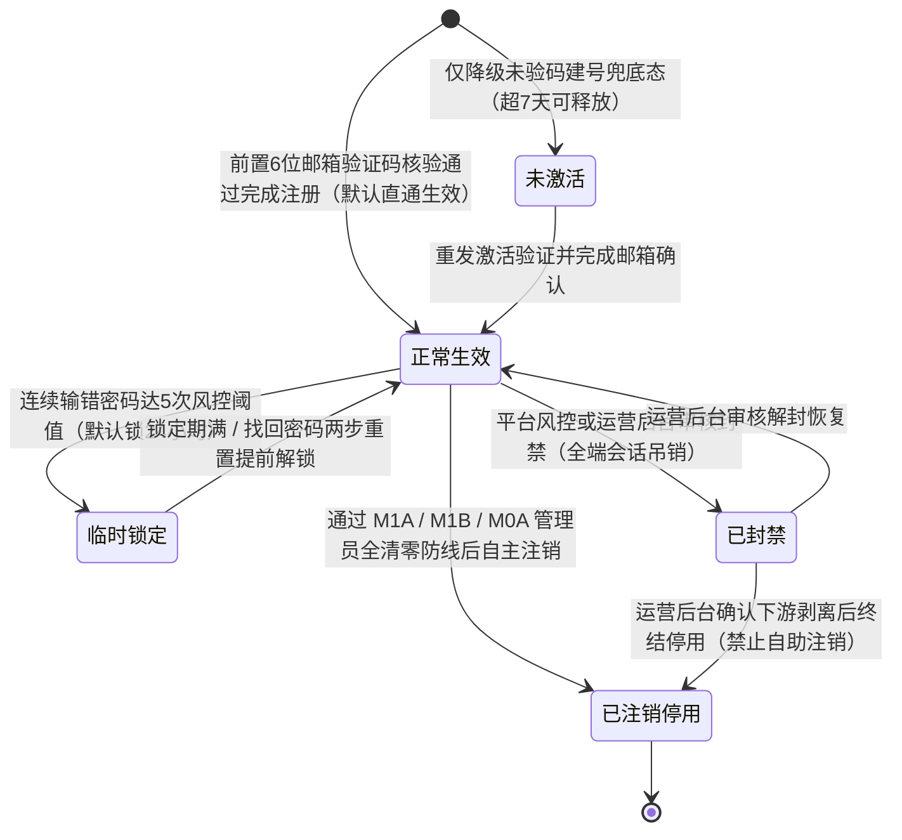

| 状态跃迁 | 触发人 / 驱动源 | 触发场景与行为 | 功能入口 |
| :--- | :--- | :--- | :--- |
| **`[*] -> 正常生效 / 未激活`** | 新用户自助注册 | 前置 6 位邮箱验证码（120 秒有效，连续错 5 次作废）校验通过直通「正常生效」；密码 $\ge 8$ 位含四类字符，记录协议版本；默认具备家长视角 | 登录/注册页 |
| **`正常生效 <-> 临时锁定`** | 安全风控 / 本人 | 连错 2 次出图形码，连错 **5 次**锁定 **24 小时**；支持通过图形码 + 邮箱验证码重置密码提前解锁并吊销历史会话 | 登录页 /【忘记密码】 |
| **`正常生效 <-> 已封禁`** | 平台统一运营后台 | 违规封禁立即失效会话、阻断高危操作，向 M1A/M1B 暴露封禁标放行管理员代清零改绑，**严禁释放违规 Email** | 平台运营后台 |
| **`正常生效 / 已封禁 -> 已注销停用`** | 账号本人 / 运营后台 | 须满足：① M1A「正式在读」== 0（历史已 5 项清零归档）；② M1B 无在职/冻结/待离职班长或老师；③ M0A 无在任管理员（永久主管理员受保护禁自助注销）；停用凭据且**不物理删除历史业务档案与账单** | 【我的】→ 注销账号；运营后台终结处置 |

- **操作与变更记录**：注册协议签约版本、改密/重置、两步安全换绑（旧邮箱即时释放）、锁解封禁及注销均后台静默记录合规留痕（前端界面不展示审计日志）。

---

### 2. M0A · 平台管理员授权实体 (`AdminGrant`)

> **SSOT 唯一归口**：[m0a_auth_and_account.md §4.8.1(2)](./prd/m0a_auth_and_account.md#2-平台管理员授权dream-本地管理名单) & [§4.7b](./prd/m0a_auth_and_account.md#47b-永久主管理员保护与普通管理员增设撤销流)

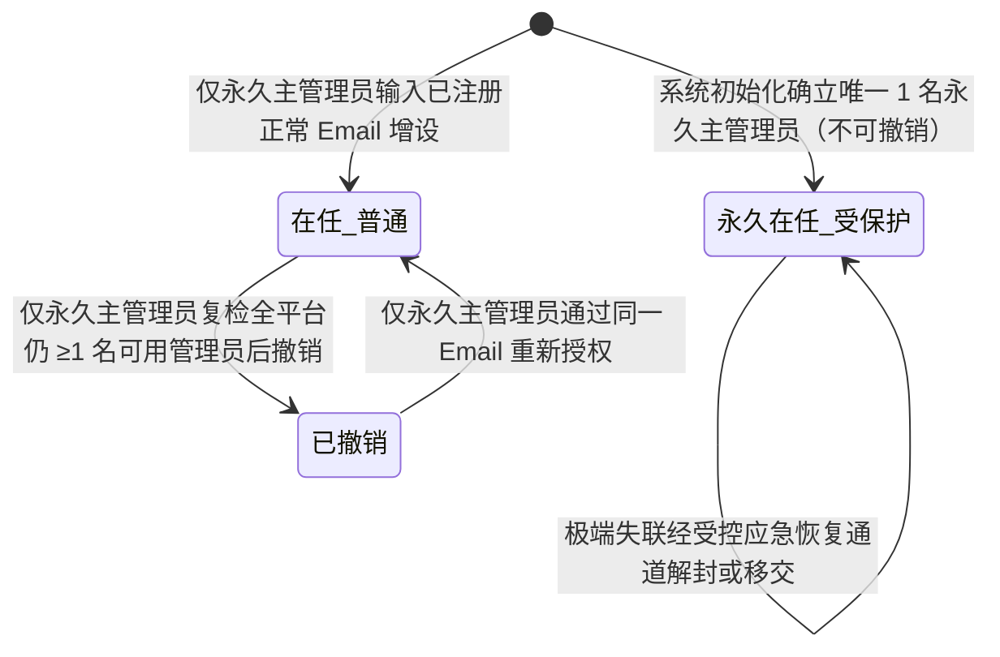

| 状态跃迁 | 触发人 / 驱动源 | 触发场景与行为 | 功能入口 |
| :--- | :--- | :--- | :--- |
| **`[*] -> 永久在任（受保护）`** | 系统初始化 / 平台应急恢复通道 | 唯一 1 名（账号 ID 永久不变，交接仅账密改密），**独占 4 项专属高危权限**：① 普通管理员增改撤；② M2B 72h 异议核验；③ M5A 周/移交确认收款与驳回（兼托管直收与离职 TS）；④ M5B 老师周课酬单写操作与发薪确认 | 系统初始化；Tab 4【管理员管理】 |
| **`[*]/已撤销 -> 在任（普通）`** | **仅唯一「永久主管理员」** | 目标 M0A 账号「正常生效」且无重复授权；复用原记录保留历史；日常教务平权，在管理员管理、M5A 审单与 M5B 仅只读查验 | Tab 4 → M0A `[ + 增设管理员 ]` / `[ 重新授权 ]` |
| **`在任（普通）-> 已撤销`** | **仅唯一「永久主管理员」** | 并发复检扣除后仍存 $\ge 1$ 名正常可用管理员 + 二次输入名称确认；即刻刷新降级在线管理端视图，**保留其兼任班长/老师/家长身份不受阻断** | Tab 4 → M0A `[ 撤销职务 ]` |

- **操作与变更记录**：全部增设、改名、撤销、重新授权与应急恢复操作后台静默记录合规留痕（前端界面不展示安全审计日志）并永久留存。

---

## 一、主数据与档案中心（M1）

### 3. M1A · 学员档案 (`StudentProfile`)

> **SSOT 唯一归口**：[m1a_student_profile.md §4.6](./prd/m1a_student_profile.md#46-学员档案唯一归口四支柱生命周期字段锁定留痕与跨实体联动-entity--log-ssot)

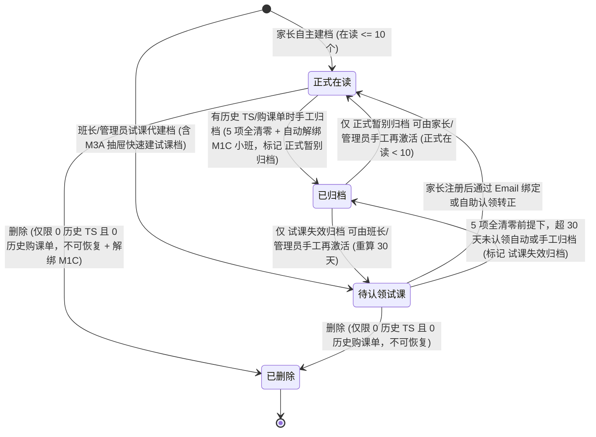

| 状态跃迁 | 触发人 / 驱动源 | 触发场景与行为 | 功能入口 |
| :--- | :--- | :--- | :--- |
| **`[*] -> 正式在读`** | 家长本人 | 家长账号下创建孩子档案（在读上限 10 个），自动组装全平台大小写不敏感唯一规范英文名（创建即永久锁定） | Tab 2 多孩切换器【+ 添加新宝贝】；Tab 4【多孩档案】 |
| **`[*] -> 待认领试课`** | 建档班长 / 平台管理员 | 为未注册家长代建试课档案（班长创建归属本人，管理员可管全校）；试课列表中的`待认领`(`未结课TS==0`)与`试课中`(`未结课TS>0`)均为派生视图分组；禁绑入 M1C 小班 | Tab 3【所辖学员】；Tab 4【试课建档】；M3A 约课抽屉【+ 快速建试课档】 |
| **`待认领试课 -> 正式在读`** | 家长 / 建档班长 / 管理员 | 通道 A 录入家长 M0A「正常生效」非教职/非管理员 Email 绑定，或通道 B 家长自助输入规范英文名 + 预留联系方式后四位（错 5 次冷却 30 分钟；原子抢占防重；在读 $< 10$），归集试课单、TS、课件与备注 | Tab 4 试课详情【绑定家长 Email】；家长多孩切换器【🔗 认领试课宝贝】 |
| **`待认领试课 -> 已归档`** *(试课失效归档)* | 系统定时跑批 / 建档班长 / 管理员 | **5 项全清零守卫**（待排 TS、未来未结 TS、在途 `HOLD`、待付款单、异常回退全为 0）：自最后已结课 TS（或手工激活日；从未上课则自建档日）起超 30 天（`UTC+8` 自然日跑批）自动归档或提前手工归档；仅沉底试课【已归档】区，**规范昵称永久锁定** | 系统定时归档任务；Tab 4 试课详情【归档】 |
| **`正式在读 -> 已归档`** *(正式暂别归档)* | 家长本人 / 平台管理员 | 产生过任意历史 TS 或购课单禁删仅可归档：校验 **5 项全清零** 后同事务停用 `AUTO_RENEWAL` 并**自动解除 M1C「正式开课」小班活跃成员绑定以释放 `Max` 名额**，封存至家长【已归档宝贝】（严禁混入试课池），释放 `10` 名额上限，**规范昵称永久锁定** | Tab 4 多孩档案【归档】；管理员后台【归档】 |
| **`已归档 -> 待认领试课`** | 建档班长 / 平台管理员 | **仅限 `试课失效归档`** 手工再激活，移回待认领池并**自激活日起重算 30 天**（严禁跨类激活 `正式暂别归档`） | Tab 4 试课学员【已归档】卡片【重新激活】 |
| **`已归档 -> 正式在读`** | 家长本人 / 平台管理员 | **仅限 `正式暂别归档`** 手工再激活（校验家长当前在读 $< 10$ 且账号未停用；严禁跨类激活 `试课失效归档`），无缝恢复历史单据、备注与课件（原已解绑小班不自动回绑） | Tab 4【已归档宝贝】折叠区【重新激活】；管理员后台【重新激活】 |
| **`正式在读 / 待认领试课 -> 已删除`** | 家长 / 建档班长 / 管理员 | 仅当 **`历史 TS 总数 == 0 AND 历史购课单总数 == 0`**（含已取消/已作废）时允许逻辑软删并同步解绑 M1C 活跃成员；**不可再激活，规范昵称仍永久锁定** | Tab 4 多孩档案 / 试课详情【删除档案】 |

- **操作与变更记录**：① 每次状态跃迁追加只读状态流转记录（含归档类型与认领关系）；② 修改任一业务字段（`Student Note` 2000 字、小名、英文名/姓首字母/微调锁定校验、年龄、性别、常态作息偏好、头像、或经由 M1E/M3A/M3B 联动的课件进度与备注）均记入【档案变动日志】（管理员与关联班长可查，对家长/老师隐藏）；已删除/已归档档案长期只读留存。

---

### 4. M1B · 老师档案 (`TeacherProfile`)

> **SSOT 唯一归口**：[m1b_teacher_profile.md §4.7(1)](./prd/m1b_teacher_profile.md#1-老师档案)
> 首期明确不做老师级长期休假状态；短期停课通过关闭可用时段或 M3B 单课次请假处理。

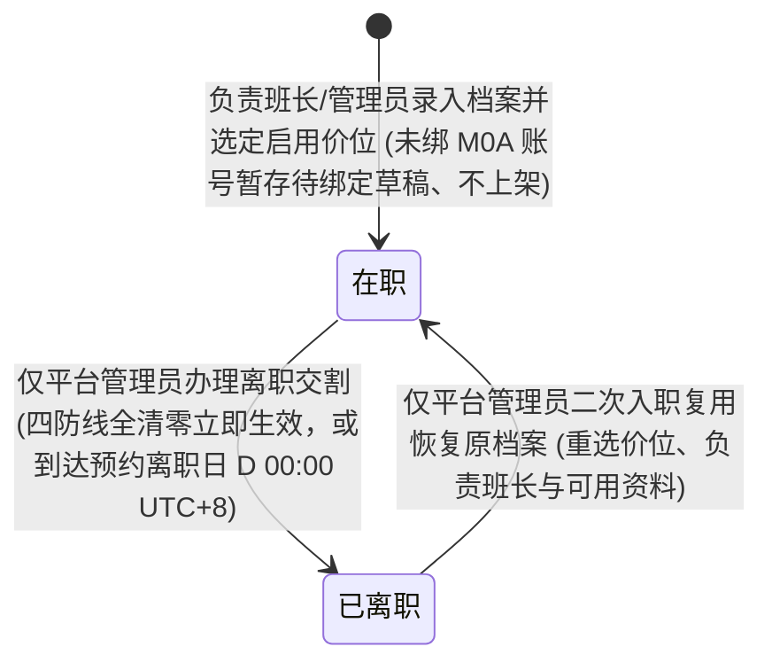

| 状态跃迁 | 触发人 / 驱动源 | 触发场景与行为 | 功能入口 |
| :--- | :--- | :--- | :--- |
| **`[*] -> 在职`** | 负责班长 / 管理员 | 录入国籍/时区、英文名、启用价位（`16积分`/`18积分`/`21积分`）、必填中英自我介绍（各 $\le 2000$ 字）、至少 1 张风采照片及负责班长（管理员直录可置`平台直管`）；**仅绑定 M0A「正常生效」且未绑其他非离职老师的账号 ID 后公开上架，暂未绑号仅存为「待绑定账号」内部草稿禁上架** | Tab 3/Tab 4 → M1B【新建老师】 |
| **`在职 -> 已离职`** | **仅平台管理员** / 定时任务 (`UTC+8`) | 校验自 **`D 00:00:00 UTC+8`** 起 **4 项清零**（1–7 天临时课、固定位/`HOLD`、作为主讲的「正式开课」小班已解散或提前结案、未履约代课已改派）；`D > 今天` 挂起`待离职`并封锁 `>= D` 日历且通知受影响 1v1 家长（**若为该价位最后 1 位在职老师，同步通知全校持有该价位待排 TS 的家长**）；到达 `D 00:00` 自动置「已离职」、作废预约调价、下架选课并自然收回老师工作台 | M1B 老师档案详情【办理离职】 |
| **`已离职 -> 在职`** | **仅平台管理员** | 绑定「正常生效」且未占用 M0A 账号，重选当前启用价位与负责班长并确认周模板与资料，复用原档案恢复在职，保留全部历史单据与审计链 | M1B 已离职档案【重新入职恢复】 |

- **操作与变更记录**：每次状态跃迁与字段变更（含常规可约周模板、立即/预约调价、跨班长改绑、英文名、简介、视频、相册、ClassIn 二维码、M0A 换绑与封禁标识）均追加【档案变动日志】（仅管理员可查），历史档案永久只读审计留存（不删）。

---

### 5. M1B · 老师价位字典 (`PriceTier`)

> **SSOT 唯一归口**：[m1b_teacher_profile.md §4.7(3)](./prd/m1b_teacher_profile.md#3-老师价位字典与预约定时调价计划)

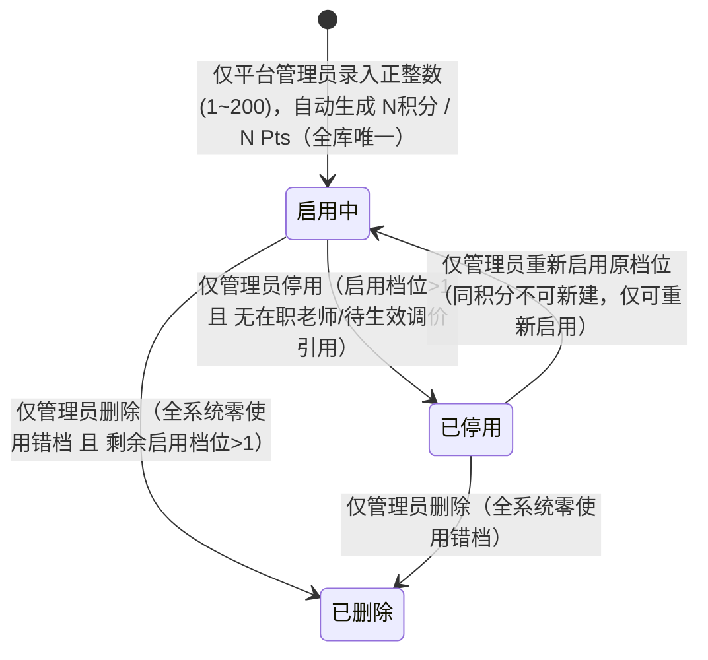

| 状态跃迁 | 触发人 / 驱动源 | 触发场景与行为 | 功能入口 |
| :--- | :--- | :--- | :--- |
| **`[*] / 已停用 -> 启用中`** | **仅平台管理员** | 新增录入 `1～200` 正整数自动命名并按积分数升序排列，**积分数与中英名创建后永久锁定不可改**；已停用同积分仅可点击【重新启用】恢复 | Tab 4 / 老师列表顶栏【价位字典】 |
| **`启用中 -> 已停用`** | **仅平台管理员** | 三防线并发锁校验：`启用档位 > 1` ∧ `无在职老师使用` ∧ `无待生效调价引用`；弹窗实告受影响存量待排 TS 数（提示走 M2B 清退或等新师/重启用），确认后下架选价位池 | 【老师价位字典】→ `[ 停用 ]` |
| **`启用中 / 已停用 -> 已删除`** | **仅平台管理员** | **仅限全系统零业务使用错档**（从未被任何老师/调价/订单/TS/清退引用且剩余启用档位 $\ge 1$）；移除列表并在同事务记入只读【字典变更审计日志】 | 【老师价位字典】→ `[ 删除 ]` |

- **附注（单师预约定时调价计划）**：每位在职老师最多挂起 1 个 `待生效` 计划（生效日限距前一周周一 `08:30` 自动续费尚有空窗的未来 4 周轮次首日周一 `00:00 UTC+8`）：`无计划 -> 待生效`（向有效固定位/续费家长发 M4 中性卡）、`待生效 -> 已作废`（手动撤销 / 立即改价同事务覆盖作废 / 离职自动作废）、`待生效 -> 已生效`（到点切换）。

---

### 6. M1B · 班长职务档案 (`MonitorProfile`)

> **SSOT 唯一归口**：[m1b_teacher_profile.md §4.7(2)](./prd/m1b_teacher_profile.md#2-班长职务档案)

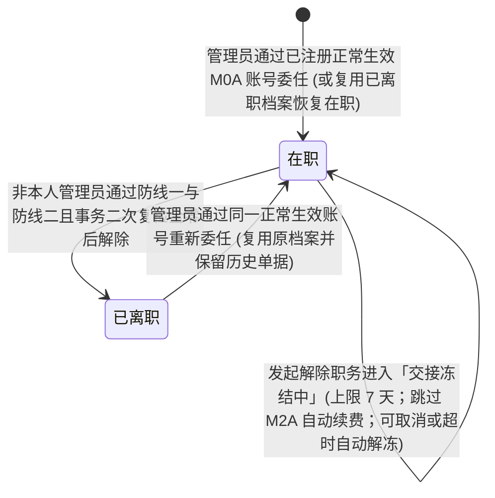

| 状态跃迁 | 触发人 / 驱动源 | 触发场景与行为 | 功能入口 |
| :--- | :--- | :--- | :--- |
| **`[*] / 已离职 -> 在职`** | 平台管理员 | 校验目标账号在 [M0A](./prd/m0a_auth_and_account.md) 处于「正常生效」（支持家长/在职老师/管理员兼任）并绑定 M0A 账号 ID，复用原档保留历史单据 | Tab 4【班长管理】→ M1B【委任新班长】 |
| **`在职 <-> 交接冻结中`** | 平台管理员 / 系统超时任务 | 冻结期（**上限 7 天**）阻断新收款、新开单、**M2A 周一 `08:30` 自动续费（自动跳过且不锁新 HOLD）**及建档；冻结班长严禁自发批量改绑；满 7 天自动解冻并通知管理员 | Tab 4【班长管理】→ 班长详情【解除职务 / 取消冻结】 |
| **`在职/交接冻结中 -> 已离职`** | 非本人平台管理员 | **严禁解除本人**；通过 **防线一（M5A 离职移交单「已完成入账」+ 在途待收清零；原班长 M0A「已封禁」时由非本人普通管理员在 M5A 代提交、唯一「永久主管理员」核销确认）+ 防线二（仅管理员批量改绑老师、小班〔先清在途单〕与未认领试课）** 后注销档案 | Tab 4【班长管理】→ 班长详情【确认解除职务】 |

- **操作与变更记录**：委任/冻结/解冻/解除职务的状态跃迁及显示名称、联系电话、微信二维码修改均记入只读流转与【档案变动日志】，管理员可查且永久只读留存。

---

### 7. M1C · 小班实体 (`GroupClass`)

> **SSOT 唯一归口**：[m1c_classes.md §4.2(1)](./prd/m1c_classes.md#1-小班主实体)

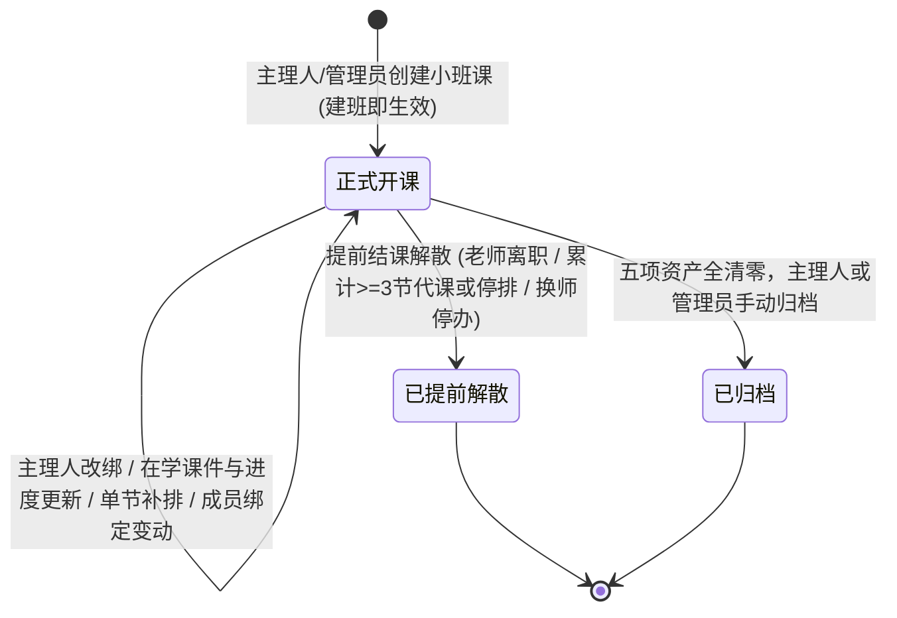

| 状态跃迁 | 触发人 / 驱动源 | 触发场景与行为 | 功能入口 |
| :--- | :--- | :--- | :--- |
| **`[*] -> 正式开课`** | 小班主理人 / 管理员 | 录入班名（1–64 字）、容量上限（$2\sim 20$，默认 3）与单节待上交积分，可选委任全平台在职老师（暂未委任标 `[待委任老师]` 并阻断购课排课） | Tab 3【主理小班/活跃小班】/ Tab 4【小班管理】→ M1C【创建小班】 |
| **`正式开课 -> 正式开课`** *(分阶段 ①②③ 锁定)* | 主理人 / 主讲或代课老师 / 管理员 | **阶段 ①/②** 可改容量/待上交积分/老师；首笔在途/已付款单或 TS 后进入 **阶段 ③** 锁定容量、待上交与主讲字段：**改绑主理人前若存在途「待付款确认」小班单强制拦截（先赴 M2A 确权或作废释 `G-HOLD`）**；保存小班 `Process Note` 必过隐私敏感词分级拦截与必勾确认；受 `>= D (UTC+8)` 老师离职日不可排熔断 | M1C 详情 / M3A 课格 / M3B 交接与授课历史 |
| **`正式开课 -> 已提前解散`** | 小班主理人 / 平台管理员 | 校验按 `UTC+8` **无开课时间 $\le$ 当前且未结课 TS** 后，选原因、流向并填 1–200 字备注（免传截图）；作废未来已排与待排 TS（保留老师 🔴 请假，取消代课待办），清在途单与 `G-HOLD`；原「已付款」单据保持不变；**自动结束活跃绑定并转「随班归档只读留存」；同事务唯一驱动生成 1 笔 [M2B](./prd/m2b_refund_orders.md#42-小班提前结课解散伴生清退流程m1c-单向驱动--唯一公式-ssot) 清退记录**（提交后异步发 M4 通知给管理员、原师与释放排期的原绑定正式家长） | M1C 小班详情页【提前结课解散】 |
| **`正式开课 -> 已归档`** | 小班主理人 / 平台管理员 | **五项资产全清零**（仅余在途待付款单时引导跳转 M2A 作废释 `G-HOLD`）；停用后续自动续费；原在读正式学员保留「随班归档只读留存」长期只读回看历史课件与 `Process Note` | M1C 小班详情页【归档小班】 |

- **操作与变更记录**：每次跃迁与改绑/课件/`Process Note` 更新均写入【小班操作与修改日志】；【提前结课解散】固化 4 项【解散结案依据卡】快照，永久只读留存。

---

### 8. M1C · 小班在读学员绑定 (`GroupClassEnrollment`)

> **SSOT 唯一归口**：[m1c_classes.md §4.2(2)](./prd/m1c_classes.md#2-小班在读学员绑定关系轻量视图关联--零线上收费零请假)

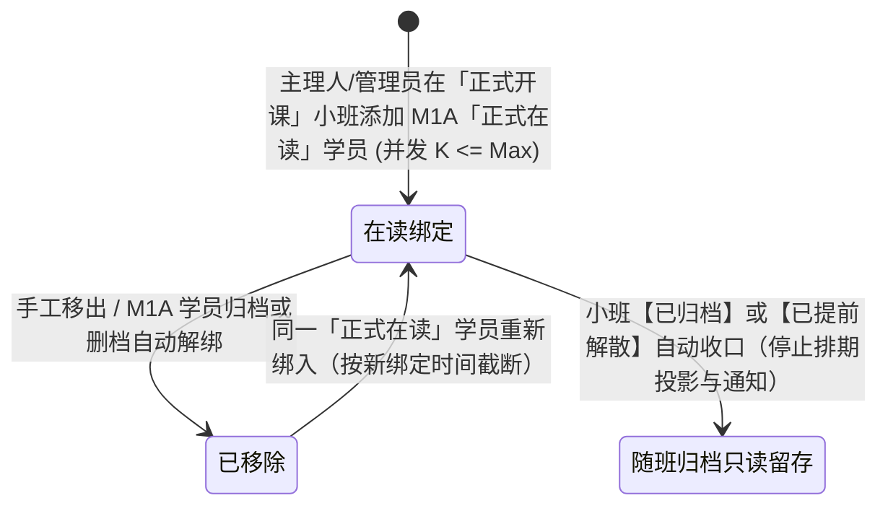

| 状态跃迁 | 触发人 / 驱动源 | 触发场景与行为 | 功能入口 |
| :--- | :--- | :--- | :--- |
| **`[*] / 已移除 -> 在读绑定`** | 小班主理人 / 平台管理员 | 仅限绑定 M1A「正式在读」学员（严禁试课/已归档）；单事务锁定本班容量复检 **`当前在读绑定数 + 1 <= Max`**；投影自绑定起未来 `[G]` 日程至学员课表与 M0（1v1 冲突退让），开放家长只读小班课件与 `Process Note` | M1C 小班详情【绑定正式学员】 |
| **`在读绑定 -> 已移除`** | 主理人 / 管理员 / M1A 归档删档 | 立即停止向该生投射未来日程、家长只读课件与后续通知，释放 1 个 `Max` 容量名额并写入【小班操作与修改日志】 | M1C 小班详情【移出学员】；M1A 归档/删档 |
| **`在读绑定 -> 随班归档只读留存`** | M1C 小班解散或归档同事务驱动 | 停止一切未来排期投影与通知、禁止新增/重绑；保留所属家长、曾执教/代课老师、主理班长与管理员对历史在学课件与 `Process Note` 的只读回看权（M1A 删档后终止展示） | M1C【提前结课解散】/【归档小班】 |

---

### 9. M1E · 课件主实体 (`Courseware`)

> **SSOT 唯一归口**：[m1e_courseware.md §4.3(1)](./prd/m1e_courseware.md#1-课件主实体含分级级别定义)

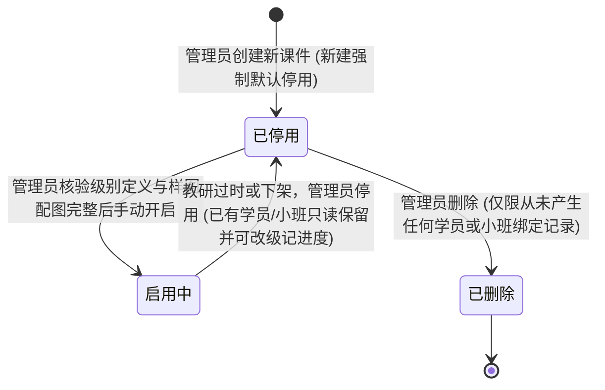

| 状态跃迁 | 触发人 / 驱动源 | 触发场景与行为 | 功能入口 |
| :--- | :--- | :--- | :--- |
| **`[*] -> 已停用`** | 平台管理员 | 新建课件中英文名全库唯一、强制默认「已停用」（防止未配齐 0~30 级与样图内页图的半成品暴露） | Tab 4【课件库管理】→ M1E【+ 新建课件】 |
| **`已停用 <-> 启用中`** | 平台管理员 | 启停必须弹出二次确认框；下架停用后对新增备选池隐藏，已有绑定仍可继续切换至其他启用级别并更新 `Process Note`（有历史绑定的级别仅停用禁删） | Tab 4【课件库管理】启用/停用开关 |
| **`已停用 -> 已删除`** | 平台管理员 | 仅当**从未产生任何 1v1 学员或 1vN 小班绑定记录**（含历史已移除）时允许物理删除；产生任意绑定后全端永久禁删 | Tab 4【课件库管理】空白课件删除 |

- **操作与变更记录**：课件元信息、0~30 级显式排序增改停用及主状态启停/删除记入平台课件库字典只读审计日志。

---

### 10. M1E · 在学课件绑定 (`CoursewareEnrollment`)

> **SSOT 唯一归口**：[m1e_courseware.md §4.3.1(2)](./prd/m1e_courseware.md#2-在学课件绑定统一适用于-1v1-学员与-1vn-小班)

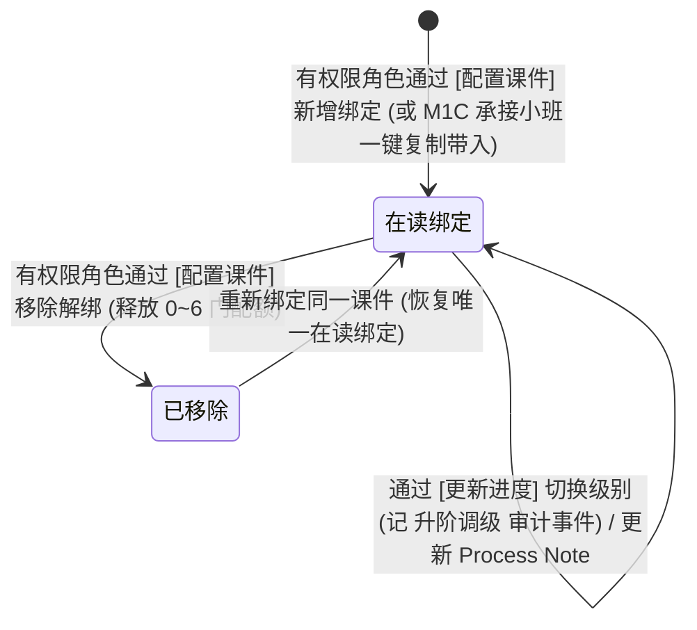

| 状态跃迁 | 触发人 / 驱动源 | 触发场景与行为 | 功能入口 |
| :--- | :--- | :--- | :--- |
| **`[*] / 已移除 -> 在读绑定`** | 管理员 / 班长或主理人 / 授权老师 / 家长(仅名下正式在读) | 同一学员或同一小班按课件全局唯一（上限 **0~6 门**）；含 `M1A` 试课认领继承与 `M1C` 换师承接复制（触发隐私再扫描与主理人复核）；1v1 家长修改按「待上老师+负责班长 ∪ 待排资金持有人」并集去重发 M4 提醒 | 学员/小班【配置课件】；M1C 新建承接 |
| **`在读绑定 -> 在读绑定`** | 管理员 / 班长或主理人 / 授权或代课老师 / 家长(1v1) | 切换级别（`升阶调级`）或更新 `Process Note`（2000 字，**多方提交过乐观版本校验**）；授权老师实时编辑截止于**次日 `02:00 UTC+8` 结课前**（已结课走 `M3B 授课历史` 补录）；1v1 家长切级需二次确认；小班保存必过隐私敏感词分级拦截与确认（对绑定/随班归档家长仅只读） | `[更新进度]`；M3A/M3B 抽屉及授课历史 |
| **`在读绑定 -> 已移除`** | 管理员 / 班长或主理人 / 家长(1v1 二次确认) | 解绑释放 6 门配额（家长全部移除或移除有关联课次课件须二次确认）；1v1 已归档/已删档与阶段 ④ 小班永久只读（留存历史回看，禁写入） | `[配置课件]` 移除解绑 |

- **操作与变更记录**：所有新增绑定、移除、`升阶调级` 与 `Process Note` 变更快照分别归口写入 M1A【档案变动日志】及 M1C【小班操作与修改日志】且长期只读留存；主力更新老师与 `180 天` 未更新时钟仅统计老师有效更新。

---

## 二、购课与清退（M2）

### 11. M2A · 购课单 (`CoursePurchaseOrder`)

> **SSOT 唯一归口**：[m2a_course_orders.md §4.5](./prd/m2a_course_orders.md#45-购课单唯一归口四支柱生命周期字段锁定留痕与跨实体联动-entity--log-ssot)

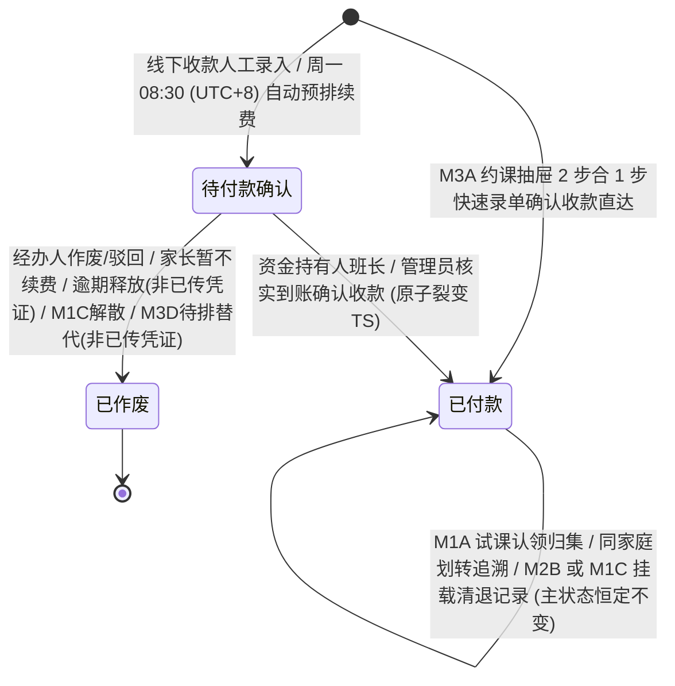

| 状态跃迁 | 触发人 / 驱动源 | 触发场景与行为 | 功能入口 |
| :--- | :--- | :--- | :--- |
| **`[*] -> 待付款确认`** | 班长 / 管理员 / 定时任务 (`UTC+8`) | 录入 1v1 固定位/临时课（正式强提改价须填 1–200 字原因；试课 1–20 节禁强提）、小班单（锁定最新课酬与待上交）；或最后一周周一 `08:30` 自动预排（4 周全轮次多数决 $\ge 2$ 周还原；**跳过交接冻结中班长**） | Tab 3【购课续费】→ 新建购课单；系统续费跑批 |
| **`[*] -> 已付款`** *(2合1快捷直达)* | 班长 / 管理员 | 在 M3A 约临时课抽屉勾选“同步录单并确认收款”，单事务直落「已付款」并裂变锁定「已排期（临时课 🟡）」TS | M3A 老师课表空闲绿格 → 代学员约课抽屉 |
| **`待付款确认 -> 已付款`** | 资金持有人班长 / 平台管理员 | 核实到账后确认收款：原子裂变「待排期」TS（正交固化`原价位档位`与`单节实付积分快照`）并锁定 `holder_id`；续费单仅将 `> 当前时刻 (UTC+8)` 的 `HOLD`/`G-HOLD` 转为正式排课（冲突跳过与因`已传凭证待核`豁免而过点的历史 `HOLD` 周次统一入待排池） | Tab 3【购课续费】/ 待办流【确认收款】 |
| **`待付款确认 -> 已作废`** | 班长 / 管理员 / 1v1 家长 / 系统 | ① 经办人作废（驳回`已传凭证待核`假图/未到账必填 1–200 字原因并通知家长；【取消固定并作废】同步终止后续自动出单）；② 1v1 家长【暂不续费】（终止自动出单）；③ 逾期自动释放（**1v1 取 `min(最早预占前 24h, 新轮首日周一 01:00 UTC+8)`；小班取 `T-24h`；`已传凭证待核` 1v1 单据一律豁免作废、保留剩余 `HOLD` 并向班长与唯一「永久主管理员」发浅红紧急卡与邮件**；小班连续 2 轮逾期暂停后续空转）；④ M1C 提前解散；⑤ M3D 待排池新排固定位替代在途未传凭证续费单 | M2A 详情【作废】/【驳回】；10 分钟逾期任务；M1C；M3D |
| **`已付款 -> 已付款`** *(挂载追溯)* | M1A / M2B / M1C / 班长或管理员 | 试课认领归集、同家庭 1v1 待排划转追溯、M2B 手动清退或 M1C 小班解散伴生清退挂载（主状态恒定，轻标 `含清退` / `小班已解散`） | M1A 认领/划转；M2B 清退；M1C【提前结课解散】 |
| *(凭证与协商子态)* | 1v1 家长 → 班长 | 家长传图进入 **`已传凭证待核`**（豁免逾期与 M3D 替代）；【申请调整】置为 `待班长处理`（保留 `HOLD`），【修改购课单】或【标为已沟通】后置为 `已处理` | 家长 M2A 传凭证/申请调整；班长修改或确认 |

- **操作与变更记录**：每次跃迁记入【状态流转历史】（对家长隐藏强提原因，小班购课单对家长 100% 不可见）；保存改单前原子重检订单、原 `HOLD` 与新格并发基线；全部单据与凭证永久只读留存。

---

### 12. M2B · 课次清退记录 (`CreditDeduction`)

> **SSOT 唯一归口**：[m2b_refund_orders.md §4.3](./prd/m2b_refund_orders.md#43-课次清退记录专属实体生命周期字段锁定与留存规则-entity--log-ssot)

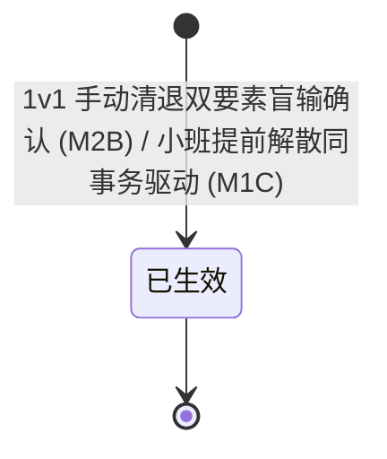

| 状态跃迁 | 触发人 / 驱动源 | 触发场景与行为 | 功能入口 |
| :--- | :--- | :--- | :--- |
| **`[*] -> 已生效`** *(唯一不可逆终态)* | 资金持有人班长 / 管理员兜底（需传凭证）/ M1C 解散单向驱动 | 1. **1v1 手动清退**：仅限 1v1「待排期」TS，按「`原价位档位` + 资金持有人」FIFO 作废并按`单节实付积分快照`逐节求和为 `1v1 退款实付积分`，必填 1–200 字备注，通过**手输学员规范英文名 + 清退总节数**双要素盲输强校验（管理员兜底须传 1–5 个 `≤10MB` `JPG/PNG/PDF` 凭证，站内提醒同事务落盘、邮件提交后异步投递）；<br>2. **小班解散伴生清退**：仅由 [M1C 提前结课解散](./prd/m1c_classes.md#42-小班与小班成员绑定唯一归口四支柱生命周期字段锁定留痕与跨实体联动-entity--log-ssot) 同事务触发，按单切片生成 `1 ↔ N` 挂载记录（免传图） | M1A 资产抽屉 / Tab 3【退款管理】→【课次清退】；M1C【提前结课解散】 |
| *(兜底异议外置审计态)* | 原资金持有人班长 → **唯一「永久主管理员」** | 仅管理员越级代班长兜底清退后，原持有人可在 **`72 小时`** 内补充发起只读审计异议（`无异议` → **`待主管理员核验异议`** → 唯一「永久主管理员」核验后标为 **`已核验完结`**）；**绝不回改主记录财务数值或恢复已作废 TS** | M2B 详情【提出异议复核】；唯一永久主管理员浅红通知直达 |

- **操作与变更记录**：一经生效核心字段永久只读锁定（不设撤销/冲正/0 积分补录）；本身即为不可篡改财务核销凭据，永久只读审计留存，与 M5A 周转账单及 M5B 课酬单严格保持物理零耦合。

---

## 三、教务排课、课表与考勤代课（M3 + 全域枢纽）

### 13. 全域枢纽 · 最小课次枢纽 (`TS / TimeSlot`)

> **SSOT 唯一归口**：[BUSINESS_RULES.md §3.2](./BUSINESS_RULES.md#32-ts-timeslot---最小课次流转枢纽)

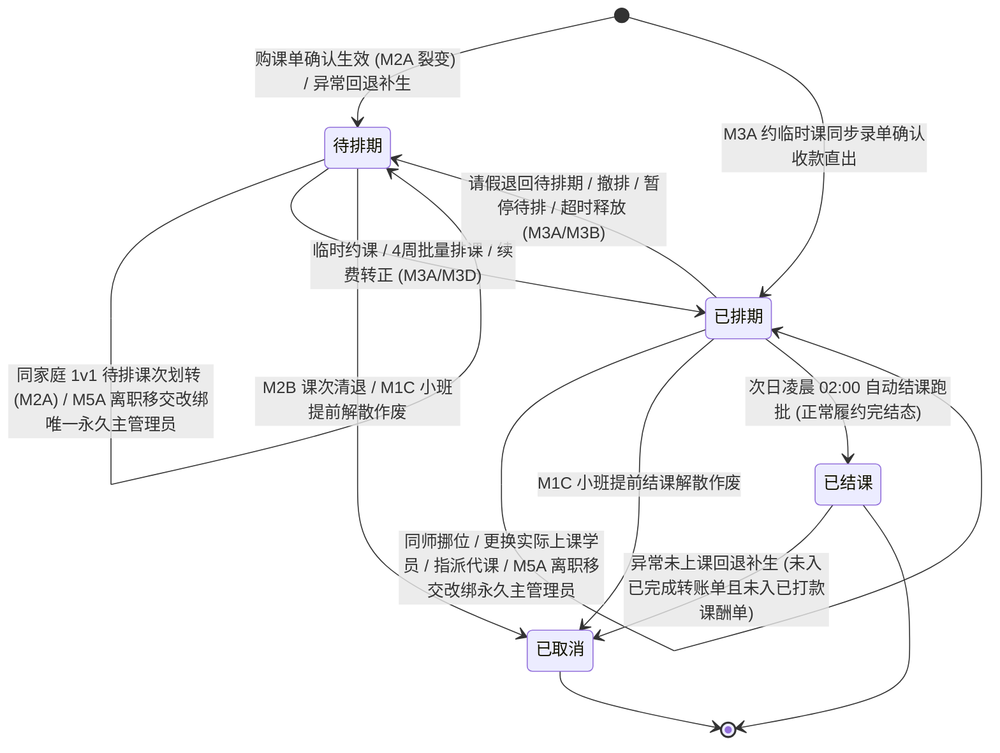

| 状态跃迁 | 触发人 / 驱动源 | 触发场景与行为 | 功能入口 |
| :--- | :--- | :--- | :--- |
| **`[*] -> 待排期`** | 班长 / 管理员（随购课/回退触发） | 购课单「已付款」裂变待排 TS 并正交固化`原价位档位`、`单节实付快照`与`holder_id`（平台直收归唯一「永久主管理员」）；或 M5A 异常未上课回退补生 1 节同原时长全新待排 TS | M2A【确认收款】；M5A/M3A【异常未上课回退】 |
| **`[*] -> 已排期`** | 班长 / 管理员 | M3A 空闲绿格【2 步合 1 步快速录单】确认收款并立即约课直达「已排期（临时课 🟡）」 | M3A 空闲绿格代约抽屉 |
| **`待排期 -> 待排期`** | 资金持有人班长 / 管理员 / 永久主管理员 | ① 同家长名下两个「正式在读」孩子划转 1v1 待排（按价位 FIFO，1–200 字备注，`holder_id` 不变）；② 唯一「永久主管理员」确认 M5A 离职移交单后未结 TS 资金持有人改绑为**唯一「永久主管理员（代表平台托管）」** | M1A 抽屉【↔️ 划转给同家庭孩子】；M5A【确认移交收款】 |
| **`待排期 -> 已排期`** | 家长 / 班长 / 管理员 | 1v1 临时约课全域选师（家长 1~7 天严禁跨价位，严禁占用已绑小班 `[G]` 时段）；**1v1 4 周固定位排课仅限目标老师所属负责班长或管理员**；小班需本人主理且已委任老师连续双格（撞学员 1v1 不阻断但发 M4 冲突待协调告警） | M3A 网格预约；M3D 排课工作台 |
| **`待排期 -> 已取消`** | 资金持有人班长 / 主理人 / 管理员 | M2B 课次清退扣减；或 M1C 小班提前解散作废待排 TS 并固化残值日志 | M1A 资产 / M2B；M1C【提前结课解散】 |
| **`已排期 -> 待排期`** | 家长（$\ge 24\text{h}$ 或老师请假时）/ 原师负责班长 / 主理人 / 管理员 / **`<3h` 跨班长驰援** / 超时任务 | 1v1 请假退期待排（`>=3h` 按师归属，`<3h` 适用跨班长紧急驰援豁免；`<3h` 班长/管理员温和弹窗且支持按学员旷课整节扣课）；撤排退回；老师请假后家长/班长退回或课程结束超时自动释放；小班【暂停待排】 | M3A 课格抽屉；M3A 日调度；M3B 应急代办包；课程结束超时任务 |
| **`已排期 -> 已排期`** | 家长（挪位 $\ge 3\text{h}$ 或 3h+ 自助换代课）/ 原师负责班长 / 主理人 / 管理员 / **`<3h` 跨班长驰援** / 永久主管理员 | 同师挪位（`<3h` 放开跨班长驰援；挪位自动解除原代课）；**更换实际上课学员（全时段严禁跨班长，跨家庭必填 1–200 字备注并互发 M4 知会）**；指派或撤销代课（`>=3h` 按师归属，`<3h` 开放全校驰援）；离职移交改绑唯一「永久主管理员」 | M3A 课格动作抽屉；M3A 日调度；M5A 离职移交确认 |
| **`已排期 -> 已取消`** | 小班主理人 / 平台管理员 | M1C 小班提前解散批量作废未来未开课 TS（存在已过开课时间未结课 TS 时拦截），释放日历并记残值日志 | M1C 小班详情【提前结课解散】 |
| **`已排期 -> 已结课`** *(正常履约完结态)* | 系统自动跑批 | 每日 02:00 将前一日已排且未请假挂起/未取消 TS 批量流转为**正常履约完结态「已结课」**（含学员旷课、老师迟到/早退）；周三唯一「永久主管理员」发薪标记「已打款」后叠加不可逆财务只读冻结 | 每日凌晨 02:00 结课批处理 |
| **`已结课 -> 已取消`** *(唯一异常回退纠偏)* | **原资金持有人班长 ∪ 授课老师负责班长 ∪ 平台管理员** *(禁无关第三方及 `<3h` 驰援跨组操作)* | 后端以 `已结课 → 已取消` 原子条件跃迁防并发双补生（先拦截已入已完成入账/已打款冻结，审核中单须先驳回）：区分`老师责任`（写实际授课老师异常并同步取消代课工单，剔除 M5B）与`平台故障保酬`（仅管理员可选，不记异常并向 M5B 自动追加 `+1 节` 正向差额调整）；资金与老师负责班长异方触发时发 M4 中性知会 | M3A 已结课抽屉 / M5A【异常未上课回退】 |

- **操作与变更记录**：**四类留痕严格分工**——① 【状态流转历史】（含同态自流转前后对象/时段/老师快照）；② 【经办记录】（M3B `§4.10`，仅记班长/管理员人工调度，跨组驰援标 `跨组紧急驰援`）；③ 《出勤异常记录》（M3B `§4.9`）；④ 通用字段审计日志。全部 TS 永久只读不可删。

---

### 14. M3A · 统一时段覆盖 (`SlotOverride`)

> **SSOT 唯一归口**：[m3a_calendar_grid.md §4.10](./prd/m3a_calendar_grid.md#410-实体生命周期与状态机-entity-lifecycles--state-machines)

```text
  优先级叠加：正式已排 TS  >  SlotOverride (临时加开态 / 锁定不可约态 / 请假不可约态 / 续费预占态)  >  M1B 周常规可用模板
```

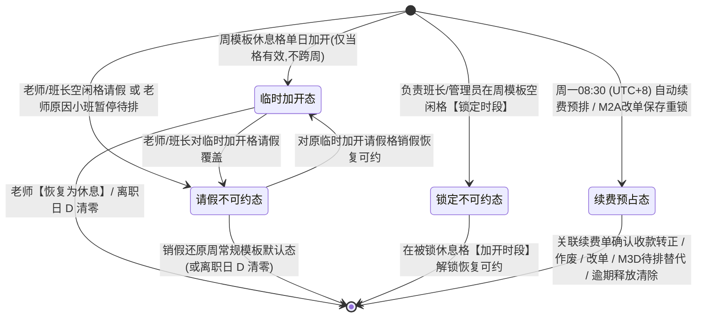

| 覆盖态 | 触发人 / 驱动源 | 插入 / 更新场景 | 清除 / 转正 / 保留规则 | 功能入口 |
| :--- | :--- | :--- | :--- | :--- |
| **`临时加开态 🟢`** | 老师 / 负责班长 / 管理员 | 在今天及未来未达 `D` ⚪ 休息格勾选加开 | **被约生成 TS 后保留**（退课/挪走后仍可约）；点击【恢复为休息】、到达 `D` 或请假时清除/覆写 | M3A 老师周课表 ⚪ 格【加开时段】/ 🟢 加开格【恢复为休息】 |
| **`锁定不可约态 ⚪`** | 负责班长 / 管理员 | 在未达 `D` 🟢 空闲格抽屉点击【锁定时段】 | 点击休息格【加开时段】解锁清除（严禁跨班长修改） | M3A 老师周课表 🟢 格【锁定时段】 |
| **`请假不可约态 🔴`** | 老师 / 负责班长 / 管理员 / `<3h` 跨组驰援(小班暂停) | 空闲格请假（不生成请假单）或老师原因小班暂停待排 | 点击 🔴 格【恢复可约 / 销假】时还原周模板或`临时加开态`（`>=3h` 严禁跨班长） | M3A 老师周课表批量请假 / 🔴 格【恢复可约】；M3A 小班【暂停待排】 |
| **`续费预占态 🟠/🟩 虚线`** | 系统自动跑批 / 班长或主理人 / 管理员 | 提前 7 天周一 08:30 预排或 M2A 改单重锁 | 关联续费单「已付款」转正、家长放弃、驳回/作废、M3D 待排池替代作废、小班解散或逾期释放（1v1 取 `min(T-24h, 周一 01:00 UTC+8)` 豁免`已传凭证待核`；小班 `T-24h`）时清除 | 系统续费跑批；M2A；M3D；M1C 解散 |

- **操作与变更记录**：班长/管理员锁格、代请假或销假记入【经办记录】；老师自助加开/恢复休息/纯空闲请假仅更新覆盖记录，**早于 90 天**的历史过期单日覆盖记录定期物理清理。

---

### 15. M3D · 排课调度批记录 (`ScheduleBatchTask`)

> **SSOT 唯一归口**：[m3d_course_scheduling.md §4.7](./prd/m3d_course_scheduling.md#47-核心实体生命周期修改规则与跨实体联动规范-entity-lifecycles--ssot)

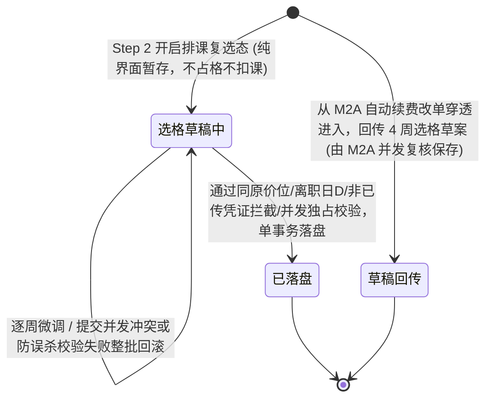

| 状态 / 运行态 | 触发人 / 驱动源 | 触发场景与行为 | 功能入口 |
| :--- | :--- | :--- | :--- |
| **`选格草稿中` *(含并发冲突回滚)*** | 家长 / 班长 / 主理人 / 管理员 | Step 2 选格穿透第 2~4 周（1v1 禁选学员已绑 `[G]` 时段）；提交瞬间若遇并发抢占、请假或命中 `已传凭证待核` `HOLD`，整批事务回滚并退回草稿；退出立即释放 | M3D 排课工作台 Step 2 / M3A 排课复选态 |
| **`已落盘`** *(不可逆终态)* | 家长 / 班长 / 主理人 / 管理员 | 过同`原价位档位`、离职日 `D`、小班防撞、`非已传凭证待核`与并发独占校验，单事务驱动 TS `待排期 → 已排期`（覆盖未传凭证 `HOLD` 时同步作废原续费单并改用待排实扣；小班叠排 1v1 发 M4 冲突告警；跨组临约发 M4 知会）；追加只读调度流水（不可整批撤销） | 点击【确认排课】 |
| **`草稿回传`** | 资金持有人班长 / 主理人 / 管理员 | 仅 M2A 自动续费单【调整时段/换师】入口带回草案与重算预期积分；实际切换由 M2A【保存并更正账单】时原子复核并发基线与 $X \le N_{新}$ 完成 | M2A 自动续费待付款单修改抽屉 → M3D/M3A |

- **操作与变更记录**：仅「已落盘」写入只读排课调度流水与【经办记录】并永久留存；草稿期尝试与并发回滚不记有效流水，退出会话立即清理。

---

### 16. M3B · 老师请假申请单 (`TeacherLeaveRequest`)

> **SSOT 唯一归口**：[m3b_attendance_substitution.md §4.8.2](./prd/m3b_attendance_substitution.md#2-老师请假申请单-teacherleaverequest)

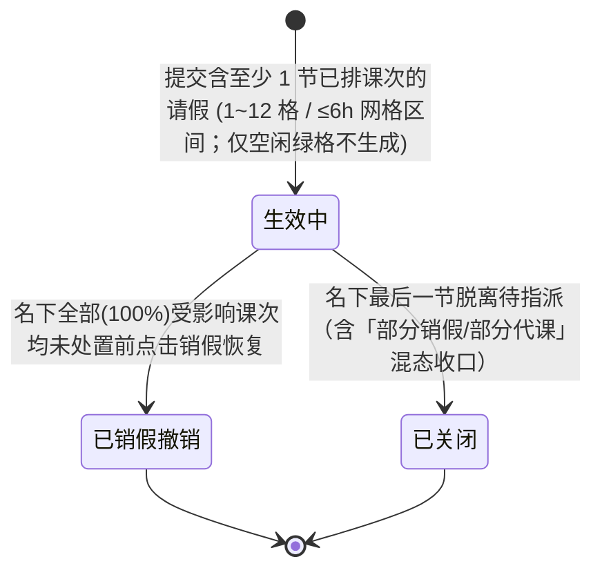

| 状态跃迁 | 触发人 / 驱动源 | 触发场景与行为 | 功能入口 |
| :--- | :--- | :--- | :--- |
| **`[*] -> 生效中`** | 原老师 / 负责班长 / 管理员 / `<3h` 跨组驰援 | 勾选当天 `1~12 个 30 分钟时段格`（跨度最长 `6` 小时）且**包含至少 1 节已排课次**时生成（仅请假空闲绿格不生成）；可顺带更新 2000 字 `Process Note` / `Student Note` 交接快照 | M3A 老师课表批量请假；M3A 日调度代请假 |
| **`生效中 -> 已销假撤销`** | 原老师 / 负责班长 / 管理员 | 仅当名下**100% 受影响课次均尚未被指派代课或退排/暂停/释放**时点击 🔴 格【恢复可约 / 销假】全量撤回，同步将其《出勤异常记录》置为「已销假撤销」 | M3A 老师课表 🔴 格抽屉【恢复可约 / 销假】 |
| **`生效中 -> 已关闭`** | 班长 / 主理人 / `<3h` 驰援 / 家长 / 超时任务 | 名下**最后一节**仍处 `待指派` 课次完成处置（代课指派、家长 `≥3h` 换师、退回待排、同师平移、小班暂停待排、超时释放或**单节销假恢复**，且含至少 1 节非销假处置，完整收敛「部分销假/部分代课」混态；单节销假者独立置 `已销假撤销` 异常记录） | Tab 3 浅红/浅黄待办 → M3A 抽屉 / 日调度；家长自助；超时任务 |

- **操作与变更记录**：提交后时段集合、原因与操作人只读固化；每次跃迁追加流转日志，命中已排课次同步生成《出勤异常记录》（代请假同步记【经办记录】），长期只读审计留存。

---

### 17. M3B · 代课调度工单 (`SubstitutionTask`)

> **SSOT 唯一归口**：[m3b_attendance_substitution.md §4.8.1](./prd/m3b_attendance_substitution.md#1-代课调度工单-substitutiontask)

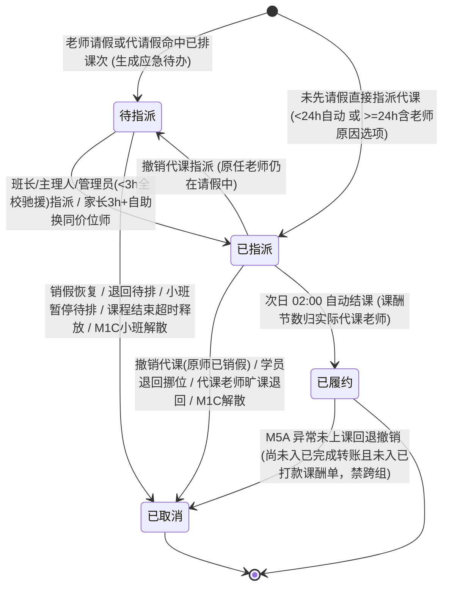

| 状态跃迁 | 触发人 / 驱动源 | 触发场景与行为 | 功能入口 |
| :--- | :--- | :--- | :--- |
| **`[*] -> 待指派`** | 原老师 / 负责班长 / 管理员 / `<3h` 驰援 | 请假时段命中已排课次，生成 Tab 3 待办包（`<3h` 进全校浅红紧急置顶，支持所有班长按允许急救动作集跨组驰援）与对应提醒/邮件 | M3A 老师课表批量请假；M3A 日调度代请假 |
| **`[*] / 待指派 -> 已指派`** | 负责班长 / 主理人 / 管理员 / `<3h` 驰援 / 1v1 家长(`≥3h`) | 按 `原价位档位` 筛空闲在职老师（`相近价位 = ±1 档`；`>= +2 档` 触发浅黄成本预警与 `[跨高档代课]` 审计标，差额由平台统筹盈余池兜底严禁扣代课师课酬；`<3h` 驰援禁止跨组换人与 `>=3h` 越权）；事前沟通即生效，双视角染色（🔵 被代 / 🟣 代上） | Tab 3 待办 `[ 指派代课 ]` → M3A 抽屉 / 日调度；家长抽屉(`≥3h`) |
| **`待指派 -> 已取消`** | 原老师 / 负责班长 / `<3h` 驰援 / 主理人 / 家长 / 系统 | 原师销假恢复；改走退回待排、小班暂停待排、超时自动释放或 M1C 小班提前解散；同步关闭全校 Tab 3 待办并按混态收敛请假单 | M3A 抽屉 / 日调度；超时释放任务；M1C 解散 |
| **`已指派 -> 待指派 / 已取消`** | 负责班长 / 主理人 / 管理员 / `<3h` 驰援 | **原师点击空闲格销假不自动解绑已指派代课**；须先执行【撤销代课指派】（原师仍在请假退回 `待指派`，已销假或遇退回/挪位/撤排/代课老师旷课/解散则置 `已取消` 并通知原代课老师；代课态旷课记入实际代课老师 B） | M3A 课格抽屉【指派代课】面板 →【撤销代课指派】 |
| **`已指派 -> 已履约`** | 系统自动跑批 | 次日凌晨 02:00 正常（或学员旷课/迟到早退）结课，1v1 与小班均按实际代课老师当期对应内部单价试算，节数 100% 计入实际代课老师 M5B 周课酬单 | 每日自动结课批处理 |
| **`已履约 -> 已取消`** | 原任/实际授课老师负责班长 / 主理人 / 管理员 *(禁跨组)* | 对尚未入 `已完成入账` M5A 与 `已打款` M5B 的已结课 TS 执行【异常未上课回退补生】（`老师责任` 分支），同事务撤销工单置终态 `已取消`、作废原 TS 并补生 1 节新待排 TS、写实际代课师 B 异常与【经办记录】 | M3A / M5A【异常未上课回退】 |

- **操作与变更记录**：每次状态跃迁同事务追加只读流转日志；后台指派/撤销记【经办记录】（标 `跨组紧急驰援`/`[跨高档代课]`）；全部工单长期只读审计留存，严禁删除。

---

### 18. M3B · 出勤异常记录 (`AttendanceAnomaly`)

> **SSOT 唯一归口**：[m3b_attendance_substitution.md §4.9](./prd/m3b_attendance_substitution.md#49-出勤异常记录产品规范字段埋点修改锁定与留存边界)

| 状态跃迁 | 触发人 / 驱动源 | 触发场景与行为 | 功能入口 |
| :--- | :--- | :--- | :--- |
| **`[*] -> 有效`** | 老师 / 班长 / 管理员 / 家长 | **7 处埋点自动记账**：① 老师/代请假命中已排课（`<3h`/`3~24h`/`>=24h`）；② `<24h`（或 `>=24h` 选`老师原因`）直接代课；③ 老师旷课；④ 老师迟到；⑤ 老师早退（代课态下 ③④⑤ 均记入**实际代课老师 B** 名下并知会 B 负责班长）；⑥ 学员旷课与 `<3h` 临期变动（严格隔离统计）；⑦ M5A 异常未上课回退 **`老师责任` 分支**（归属**实际授课老师**；**`平台故障保酬` 分支严禁写入本记录**） | M3A/M3B 请假、直派代课、考勤标记及 M5A 异常回退 |
| **`有效 -> 已销假撤销`** | 原老师 / 负责班长 / 管理员 | 老师在未被代课或退排前点击 🔴 格销假恢复正常排期，或误标考勤后执行【恢复为正常出勤】，自动撤销异常计数 | M3A 🔴 格【恢复可约/销假】；【考勤/旷课标记】→【恢复为正常出勤】 |

- **操作与变更记录**：一经生成全字段只读，严禁手工篡改或删除；家长端物理不可见，在 M5B 老师周课酬对账页与管理员结算看板明细中透出，留存满 1~2 年按自然年冷存。

---

## 四、消息通知（M4）

### 19. M4 · 站内提醒 (`Notification`)

> **SSOT 唯一归口**：[m4_notification.md §4.4](./prd/m4_notification.md#44-站内提醒唯一归口规范-entity-lifecycle-fields-logs--retention-ssot)

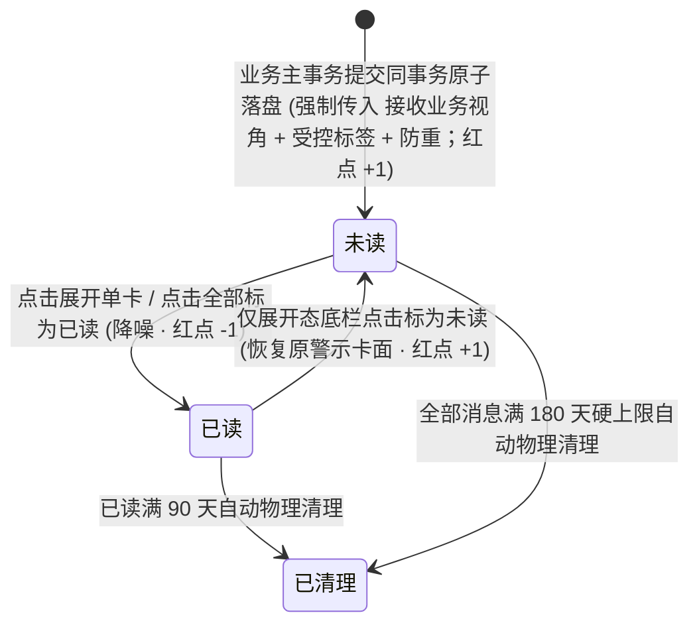

| 状态跃迁 | 触发人 / 驱动源 | 触发场景与行为 | 功能入口 |
| :--- | :--- | :--- | :--- |
| **`[*] -> 未读`** | 业务事件触发源（M0A/M1B/M1C/M1E/M2A/M2B/M3B/M3D/M5A/M5B） | 强制按 **`账号 ID + 接收业务视角`（`家长/老师/班长/小班主理人/管理员`）** 投递并决定首页隔离过滤、双语顺序与脱敏矩阵（全端含班长管理员仅显学员`规范英文名`），标签限 `GLOSSARY §4.1` **10 个受控字典项**；**站内提醒随主事务原子落盘（零幽灵通知）+ 关键邮件主事务后 `≤1 分钟`异步托管重试**；支持`防重标识`与`60 秒`同内容防轰炸；**浅红紧急卡**涵盖 `<3h` 临期变动/待代课 + **三类非时间窗授权高危**（考勤异常/投诉、`已传凭证待核`逾期急核与 M2B `72h` 异议复核、账号/安全告警） | 各端顶栏 🔔 消息中心；M0 首页视角过滤卡/变动条 |
| **`未读 <-> 已读`** | 消息所属接收账号本人 | 列表默认**未读高优（浅红→浅黄→中性）置顶**；点击展开即置「已读」，降噪为中性卡（保留语义色点+无障碍微图形）；含 `>=1` 条未读浅红卡时点击【全部标为已读】弹出二次确认；失效跳转落默认列表提示「该关联事项已取消或更新」，权限失效拦提示「您当前暂无权限查看该关联内容」；仅展开态底栏【标为未读】可回退 | 端内消息中心列表（默认近 90 天；**留存期内只读不可篡改**） |
| **`已读 / 未读 -> 已清理`** | 系统定期清理任务 | 定位为临时触达载体（长期财务/安全审计归回各自业务单据）；已读满 **90 天** 或全部消息硬上限满 **180 天** 自动物理清理 | 定期消息清理任务 |

- **操作与变更记录**：**无独立跨模块审计日志**，每条记录仅保留 `生成时间` 与最近 `已读更新时间`；留存期内标题/正文/视角/卡面只读不可回改。

---

## 五、资金归集与周度结算（M5）

### 20. M5A · 周转账单 (`TransferOrder`)

> **SSOT 唯一归口**：[m5a_transfer_collection.md §4.6](./prd/m5a_transfer_collection.md#46-周转账单全生命周期字段锁定留痕与留存-ssot-规则)

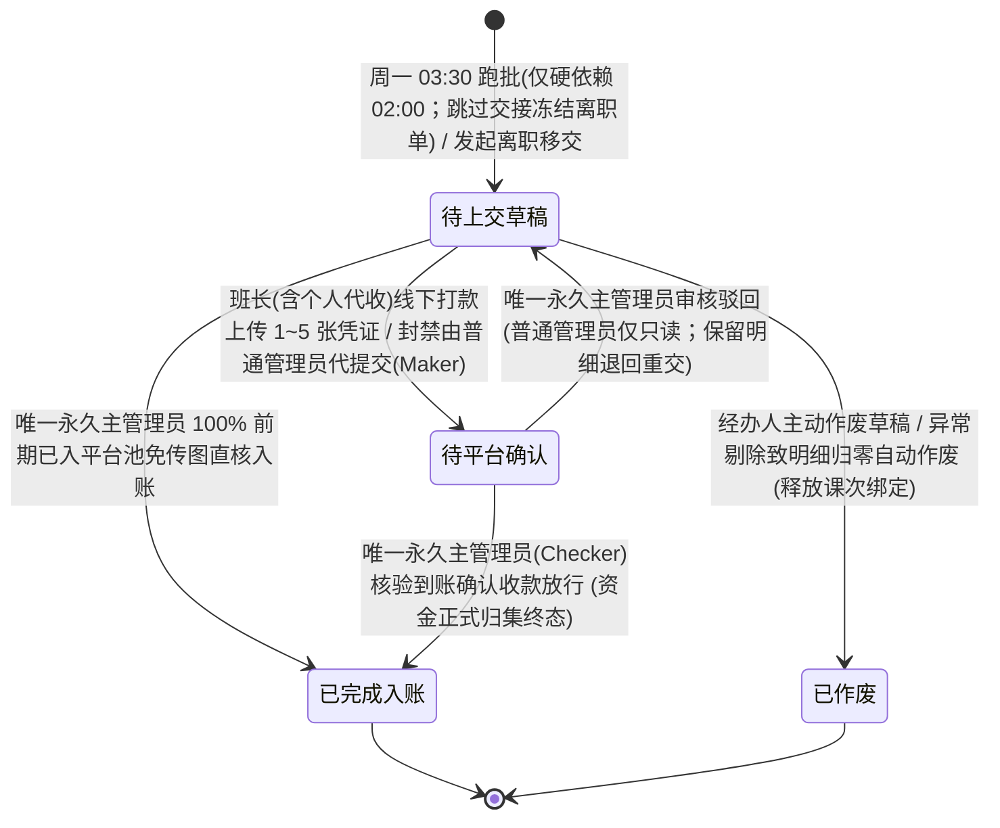

| 状态跃迁 | 触发人 / 驱动源 | 触发场景与行为 | 功能入口 |
| :--- | :--- | :--- | :--- |
| **`[*] -> 待上交草稿`** | 系统自动跑批 / 离职班长 / 管理员（含封禁代办） | 周一 `03:30`（**仅硬依赖 `02:00` 结课批，跳过名下存在未作废「离职移交」草稿的冻结班长**）为在职班长与**唯一「永久主管理员（代表平台固定持有直收与离职移交资产）」**生成上周待归集草稿（`0` 节智能跳过），周一 `08:00` 仅向常规「周结上交」草稿单推 M4 催办（不扫描离职移交单）；或离职打包未归集/未结 TS（在途审核单须先驳回草稿） | 周一 03:30 跑批；M5A【离职移交专项面板】 |
| **`待上交草稿 -> 待平台确认`** | 负责班长 / 离职班长 / 永久主管理员（个人代收）/ 普通管理员（封禁代交 Maker） | 存在需实际对外打款金额时上传 `1~5 张` 银行凭证（封禁代交传代办凭证并记审计日志，向永久主管理员发 M4 浅黄待核卡）；提交后**即刻锁定明细、总积分与凭证快照**（锁定直接异常回退） | Tab 3【周转账单】详情页【去上交并打款】 |
| **`待上交草稿 -> 已完成入账`** | **仅唯一「永久主管理员」** | 单据归属唯一「永久主管理员」且 **100% 为`[前期已入平台池·本周核销]`（平台直收 + 离职移交接管，实际待补打款 $= 0$）**时，免重复传银行截图，一步直接核销入账并生成 `M5B AC-5B-11a` 可穿透周单号 | 永久主管理员周核销草稿【核对并确认核销入账】 |
| **`待平台确认 -> 待上交草稿`** | **仅唯一「永久主管理员」** *(普通管理员只读)* | 金额不符、未到账、凭证模糊或单内含未上课 TS 时填 1–200 字原因驳回，保留明细与驳回原因退回重传凭证或草稿态异常回退剔除 TS | Tab 3【周转审核】→ 详情页【驳回转账单】 |
| **`待上交草稿 -> 已作废`** | 班长 / 管理员 / 系统自动 | 草稿态主动作废重算，或因 M5A 异常未上课回退剔除 TS 致明细归零自动作废（释放课次打包占位） | M5A 草稿详情【作废草稿】；异常回退联动 |
| **`待平台确认 -> 已完成入账`** *(终态)* | **仅唯一「永久主管理员」** *(Checker · 普通管理员只读)* | 核验流水到账后点击【确认收款】/【确认移交收款】（封禁代交在任管理员 $\ge 2$ 时强制 Maker-Checker 互斥），单内 TS 永久禁回退并自动消红逾期预警原单（**不另建冗余应收欠款账本**）；若为离职移交单，**同事务将未结 TS 资金持有人改绑为唯一「永久主管理员（代表平台托管）」，后续按周出核销单**并核销防线一 | Tab 3【周转审核】→【确认收款】/【确认移交收款】 |

- **操作与变更记录**：每次跃迁、封禁代交与草稿剔除均追加只读流转记录，详情页展示【状态流转历史】时间轴；全部单据、双视角明细与凭证永久只读留存不可删。

---

### 21. M5B · 老师周课酬单 (`TeacherSalaryReport`)

> **SSOT 唯一归口**：[m5b_weekly_settlement.md §4.6](./prd/m5b_weekly_settlement.md#46-老师周课酬单四支柱生命周期字段锁定留痕与永久只读留存策略附跨实体联动清单)

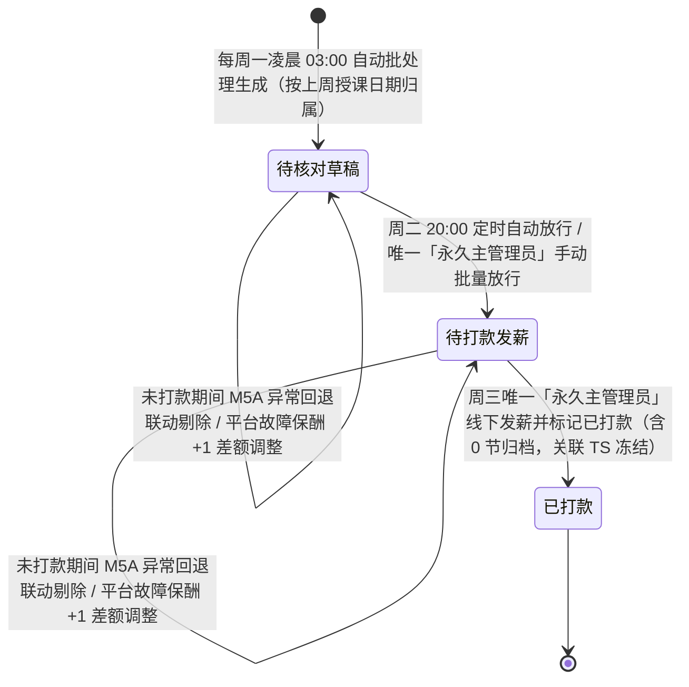

| 状态跃迁 | 触发人 / 驱动源 | 触发场景与行为 | 功能入口 |
| :--- | :--- | :--- | :--- |
| **`[*] -> 待核对草稿`** | 系统自动跑批 *(异常重跑限唯一「永久主管理员」)* | 每周一 03:00 按实际授课老师汇总上周「已结课」TS（全平台 `100%` 关联前置 M5A 周转账单编号穿透；存在老师责任异常时生成 `0 节` 兜底单，老师端可见），彻底解绑班长；老师端**只出节数不出积分单价**（**仅唯一「永久主管理员」可见并选填 1v1 与小班内部单价试算，普通管理员全程只读且隐藏单价/试算**，分别旁显最近一期非空历史参考值），推 M4 中性卡不发邮件 | 周一 03:00 结算批处理；唯一永久主管理员【重跑上周批处理】 |
| **`待核对草稿 / 待打款发薪 -> 保持原态`** | 授权班长 / 管理员（经 M5A 回退触发） | 未「已打款」且关联 TS 未入「已完成入账」转账单时，M5A 回退同步从本单及「实际出勤总节数」剔除：`老师责任`记异常并重算（归零保单）；`平台故障保酬`（仅管理员可选）**不记老师异常并自动追加 `+1 节` 正向【差额调整项】**重算「本期发薪结算总节数」与试算总积分 | M3A/M5A【异常未上课回退】 |
| **`待核对草稿 -> 待打款发薪`** | 系统自动 / **仅唯一「永久主管理员」** *(普通管理员只读)* | 周二 20:00 定时自动放行（老师端无阻塞按钮），或仅唯一「永久主管理员」手动批量放行（单向流转不退回；未打款前均限唯一「永久主管理员」录入单价与新增正负【差额调整项】，含发薪后才暴露平台故障的下周 `[跨周平台故障补偿]`） | 老师端对账；Tab 3【课酬发薪】（普通管理员仅只读） |
| **`待打款发薪 -> 已打款`** *(终态)* | **仅唯一「永久主管理员」** *(普通管理员只读、服务端强拦截)* | 周三线下打款后由唯一「永久主管理员」点击【标记为已打款】（或 `0 节` 归档单点【确认 0 节归档】；凭证、备注与内部单价均选填），全字段永久锁定并对单内关联 TS **叠加不可逆发薪只读冻结**；存在正实发节数或警告时发 M4 通知与发薪邮件（有调整时邮件/详情均分列「实际出勤节数」与「差额调整节数」） | Tab 3【课酬发薪】→【标记为已打款】 |

- **操作与变更记录**：每次跃迁记入【状态流转历史】（普通管理员与老师端均严格过滤内部单价试算与内部惩罚备注，普通管理员导出仅限纯节数表）；差额调整项、打款警告与异常处理变动同步单行留痕，全生命周期永久只读留存不可删。
