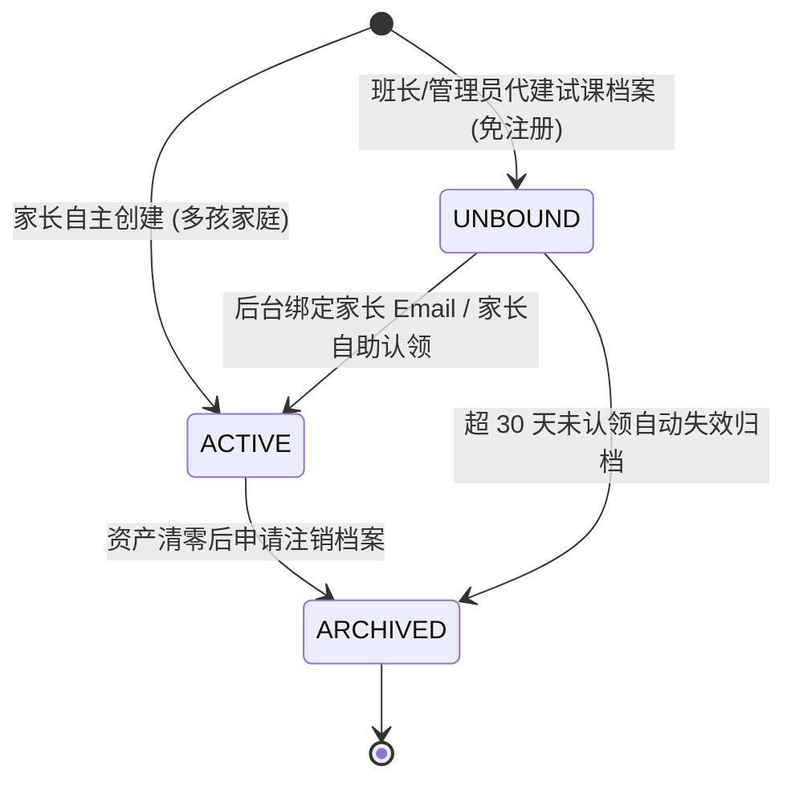
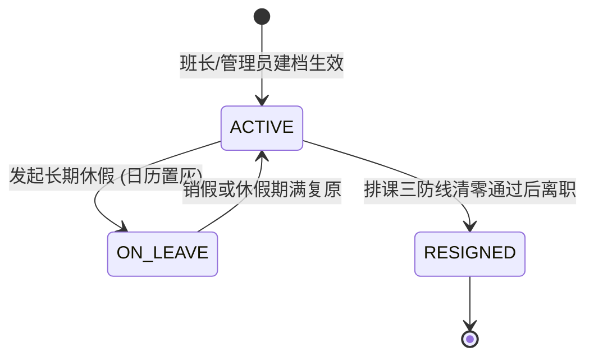
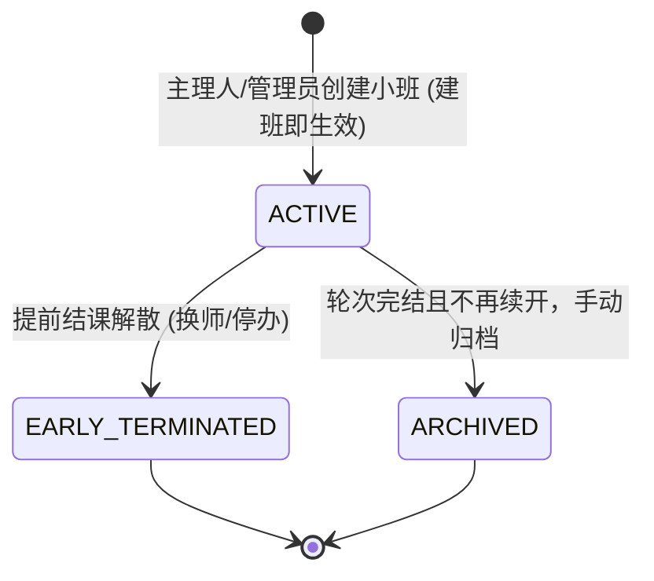
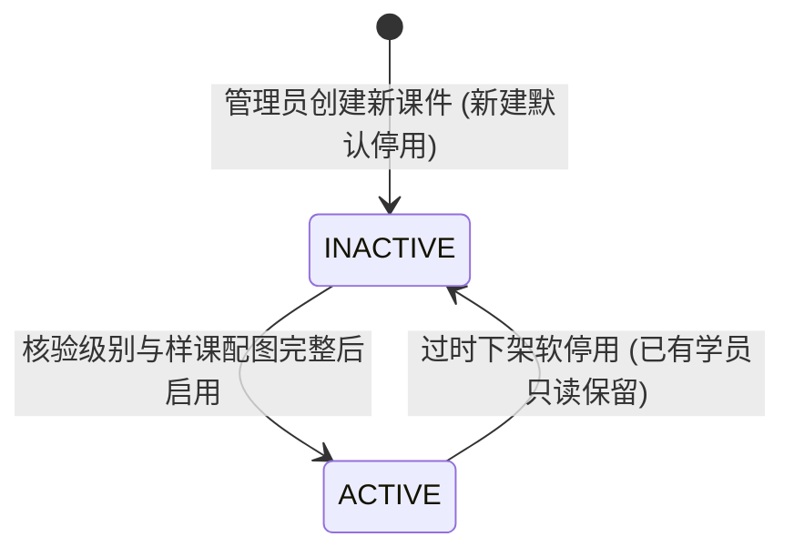
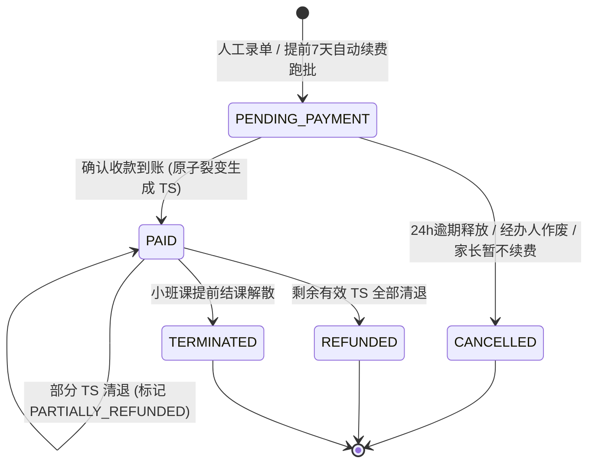
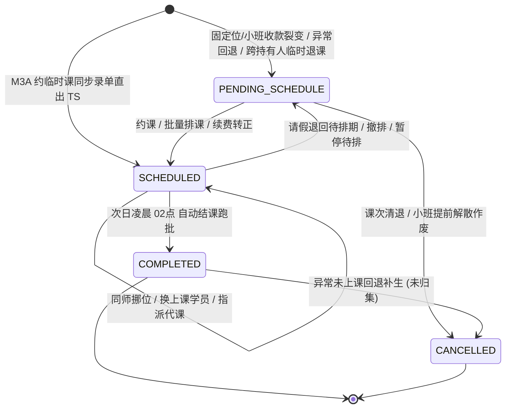
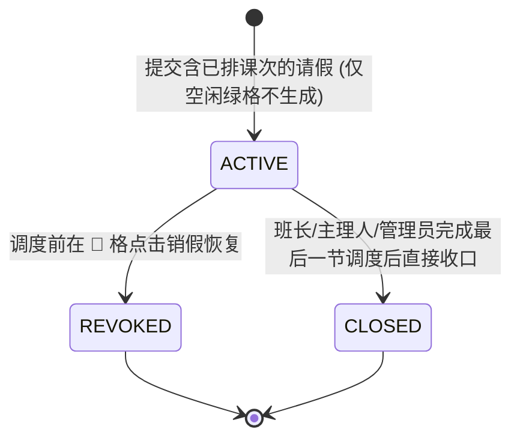
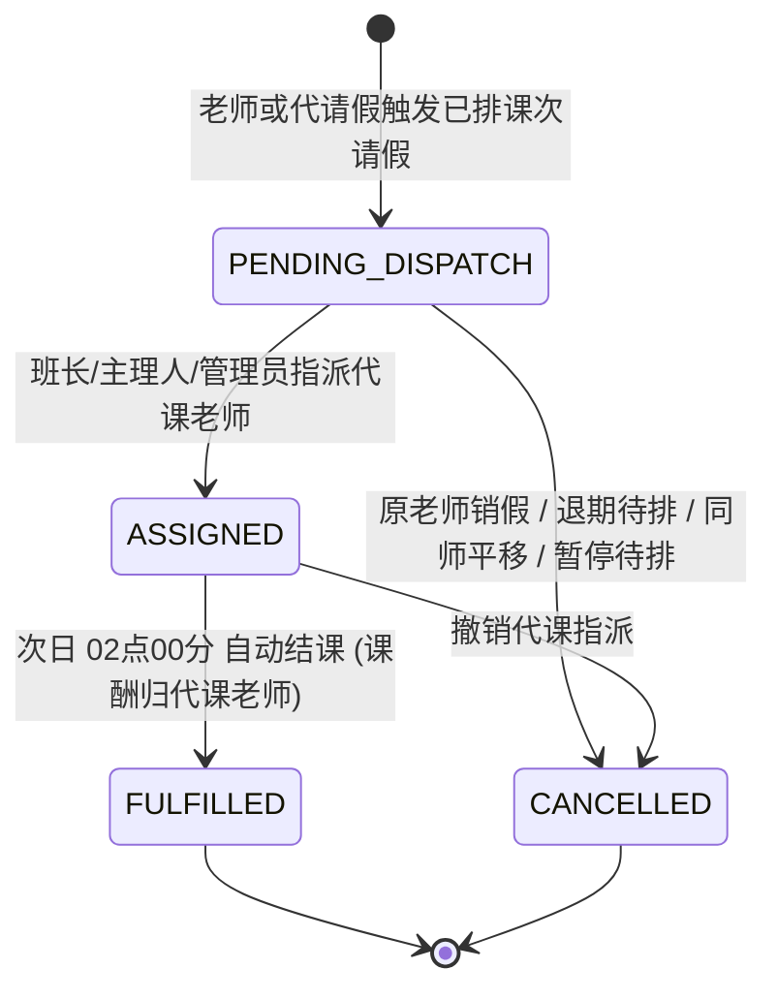
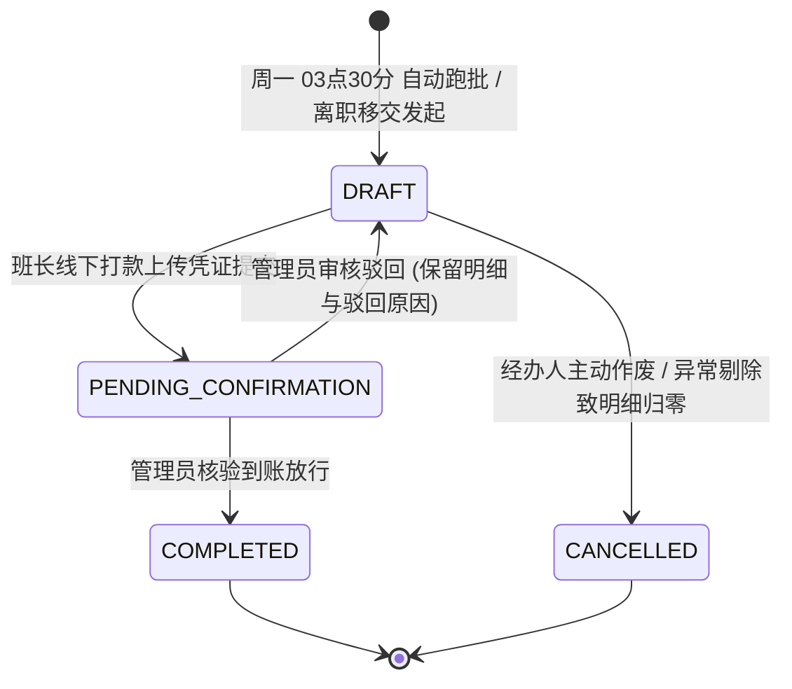
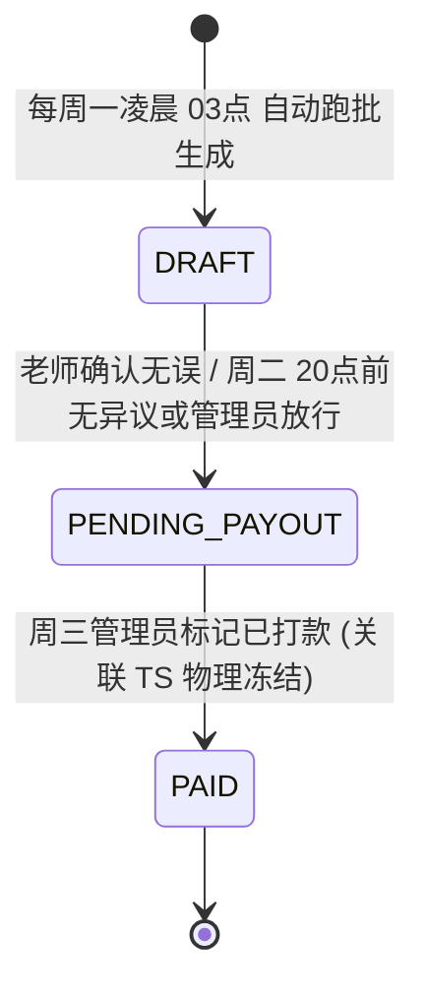

/** (c) 2024-2026 Topee (https://topee.top). All rights reserved. Proprietary and confidential. */

# Dream 全域实体状态机全景索引与速查手册

> **【SSOT 归口声明】**：本文件为 Dream 系统全部具备 **2 个及以上状态** 实体的全景汇总速查手册，按业务模块顺序编排。所有实体状态机的唯一权威定义与修改归口仍位于 [BUSINESS_RULES.md](./BUSINESS_RULES.md)（TS 全局枢纽）及各专属子 PRD（`docs/prd/m*.md`）；后续任何状态机变更须先修改对应归口文档，再同步更新本手册。

---

## 总览索引（按业务模块排序 · 共 14 个实体）

| 序号 | 所属模块 | 实体名称 | 状态数 | 状态 / 覆盖态枚举 | 操作记录 / 留痕情况 | 数据留存与清理策略 |
| :---: | :---: | :--- | :---: | :--- | :--- | :--- |
| 1 | `M1A` | [学员档案 (`StudentProfile`)](#1-m1a--学员档案-studentprofile) | **3** | `UNBOUND`、`ACTIVE`、`ARCHIVED` | 状态流转记录 + 全字段【档案变动日志】 | 只读留存（不删） |
| 2 | `M1B` | [老师档案 (`TeacherProfile`)](#2-m1b--老师档案-teacherprofile) | **3** | `ACTIVE`、`ON_LEAVE`、`RESIGNED` | 状态流转记录 + 全字段【档案变动日志】 | 只读留存（不删） |
| 3 | `M1B` | [班长职务档案 (`MonitorProfile`)](#3-m1b--班长职务档案-monitorprofile) | **2** | `ACTIVE`、`RESIGNED` | 状态流转记录 + 【职务档案变动日志】 | 只读留存（不删） |
| 4 | `M1C` | [小班实体 (`GroupClass`)](#4-m1c--小班实体-groupclass) | **3** | `ACTIVE`、`ARCHIVED`、`EARLY_TERMINATED` | 状态流转记录 + 【小班操作与修改日志】时间轴 | 只读留存（不删） |
| 5 | `M1E` | [课件主实体 (`Courseware`)](#5-m1e--课件主实体-courseware) | **2** | `ACTIVE`、`INACTIVE` | 仅在学课件调整记入学员档案日志；课件库无独立时间轴 | 只读留存（不删） |
| 6 | `M2A` | [购课单 (`CoursePurchaseOrder`)](#6-m2a--购课单-coursepurchaseorder) | **5** | `PENDING_PAYMENT`、`PAID`、`CANCELLED`、`REFUNDED`、`TERMINATED` *(子状态 `PENDING_HANDLE`/`RESOLVED`)* | 状态流转历史 + 确认前改单变更记录 | 永久只读不可删 |
| 7 | `全域枢纽` | [最小课次枢纽 (`TS / TimeSlot`)](#7-全域枢纽--最小课次枢纽-ts--timeslot) | **4** | `PENDING_SCHEDULE`、`SCHEDULED`、`COMPLETED`、`CANCELLED` | 状态流转历史（含同状态挪位/换人/代课）+【经办记录】+《出勤异常记录》 | 永久只读不可删 |
| 8 | `M3A` | [统一时段覆盖 (`SlotOverride`)](#8-m3a--统一时段覆盖-slotoverride) | **4** | `OPEN`、`LOCKED`、`LEAVE`、`HOLD` | 班长/管理员代操作记入【经办记录】；老师自助加开/恢复休息无独立流水 | 早于 **90 天** 定期物理清理 |
| 9 | `M3B` | [老师请假申请单 (`TeacherLeaveRequest`)](#9-m3b--老师请假申请单-teacherleaverequest) | **3** | `ACTIVE`、`REVOKED`、`CLOSED` | 状态流转记录 + 《出勤异常记录》（代请假同步记入【经办记录】） | 留痕只读保留 |
| 10 | `M3B` | [代课调度工单 (`SubstitutionTask`)](#10-m3b--代课调度工单-substitutiontask) | **4** | `PENDING_DISPATCH`、`ASSIGNED`、`FULFILLED`、`CANCELLED` | 状态流转记录 + 【经办记录】 | 随调度留痕只读保留 |
| 11 | `M3B` | [出勤异常记录 (`AttendanceAnomaly`)](#11-m3b--出勤异常记录-attendanceanomaly) | **2** | `EFFECTIVE`、`REVOKED` | 本身即为只读异常台账（M5B 课酬单透出） | 留存满 **1~2 年** 后按年归档冷存 |
| 12 | `M4` | [站内提醒 (`Notification`)](#12-m4--站内提醒-notification) | **2** | `UNREAD`、`READ` | 无单独操作日志（本身即为通知记录） | 已读 **90 天** / 全部 **180 天** 定期物理清理 |
| 13 | `M5A` | [周转账单 (`TransferOrder`)](#13-m5a--周转账单-transferorder) | **4** | `DRAFT`、`PENDING_CONFIRMATION`、`COMPLETED`、`CANCELLED` | 详情页【状态流转历史】只读时间轴 | 永久只读不可删 |
| 14 | `M5B` | [老师周课酬单 (`TeacherSalaryReport`)](#14-m5b--老师周课酬单-teachersalaryreport) | **3** | `DRAFT`、`PENDING_PAYOUT`、`PAID` | 详情页【状态流转历史】时间轴 + 差额调整留痕 + 管理员内部单价试算 | 永久只读不可删 |

---

## 一、主数据与档案中心（M1）

### 1. M1A · 学员档案 (`StudentProfile`)



| 状态跃迁 | 触发人 / 驱动源 | 触发场景与行为 | 功能入口 |
| :--- | :--- | :--- | :--- |
| `[*] -> ACTIVE` | 家长本人 | 家长账号下创建孩子档案（上限 10 个），自动组装全平台唯一规范昵称 | Tab 2 多孩切换器【+ 添加新宝贝】；Tab 4【多孩档案】 |
| `[*] -> UNBOUND` | 班长 / 平台管理员 | 为未注册家长代建试课档案（班长创建自动归属本人负责，管理员可管理全校所有试课档案） | Tab 3【所辖学员】；Tab 4【试课建档】；M3A 代约课抽屉【+ 快速建试课档】 |
| `UNBOUND -> ACTIVE` | 管理员 / 班长 / 家长 | 后台输入家长注册 Email 绑定，或家长输入规范昵称 + 预留联系方式后四位自助认领 | Tab 4 试课详情【绑定家长 Email】；家长多孩切换器【🔗 认领试课宝贝】 |
| `UNBOUND -> ARCHIVED` | 系统自动跑批 | 最后一节试课结课或建档超 30 天仍未认领，自动失效归档并锁定昵称 | 系统定时失效归档任务 |
| `ACTIVE -> ARCHIVED` | 家长本人 / 管理员 | 校验待排 TS 与未来已排 TS 均为 0 后软删除档案，永久锁定昵称 | Tab 4 / M1A 学员档案详情【注销/删除档案】 |

- **操作与变更记录**：① 每次状态跃迁追加只读状态流转记录（含原/新状态、操作人、时间、原因/认领关系，管理员后台可查）；② 修改任一业务字段（备注、小名、英文名、年龄、头像、规范昵称、家长换绑、在学课件与级别）均记录只读变动快照，管理员与负责班长可在学员综合档案抽屉展开查看【档案变动日志】（家长端不可见）。

---

### 2. M1B · 老师档案 (`TeacherProfile`)



| 状态跃迁 | 触发人 / 驱动源 | 触发场景与行为 | 功能入口 |
| :--- | :--- | :--- | :--- |
| `[*] -> ACTIVE` | 班长 / 管理员 | 录入老师英文名、价位（16/18/21 积分）、负责班长、多媒体相册与简介并生效 | Tab 3【负责老师/全校老师】/ Tab 4【老师团队】→ M1B【新建老师】 |
| `ACTIVE -> ON_LEAVE` | 老师 / 班长 / 管理员 | 发起全天或跨周长期休假，选课大厅标注暂不接新约 | M1B 老师详情 / 排期状态操作 |
| `ON_LEAVE -> ACTIVE` | 老师 / 班长 / 管理员 / 系统 | 销假或休假期满自动复原为正常可约 | M1B 老师详情 / 系统定时复原 |
| `ACTIVE -> RESIGNED` | 负责班长 / 管理员 | 通过未来临时课/固定位/小班三防线清零校验后办理离职，收回老师权限并下架 | M1B 老师档案详情【办理离职】 |

- **操作与变更记录**：① 每次状态跃迁追加只读状态流转记录；② 修改价位、负责班长、英文展示名、中英简介、试讲视频、风采相册、ClassIn 二维码等字段时均写入字段前后快照，仅管理员可在老师档案详情页底部展开查看【档案变动日志】（老师端与家长端不可见）。

---

### 3. M1B · 班长职务档案 (`MonitorProfile`)

| 状态跃迁 | 触发人 / 驱动源 | 触发场景与行为 | 功能入口 |
| :--- | :--- | :--- | :--- |
| `[*] -> ACTIVE` | 平台管理员 | 通过已注册邮箱委任新班长，授予班长权限并开始管辖老师与小班 | Tab 4【班长管理】→ M1B【委任新班长】 |
| `ACTIVE -> RESIGNED` | 平台管理员 | 通过“资金移交清算 + 老师/小班全量改绑”两道防线后解除职务，收回权限并软删除档案 | Tab 4【班长管理】→ 班长详情【解除职务】 |

- **操作与变更记录**：委任/解除职务的状态跃迁及显示名称、联系电话等字段修改均追加只读留痕，管理员可在班长详情页展开查看【职务档案变动日志】。

---

### 4. M1C · 小班实体 (`GroupClass`)



| 状态跃迁 | 触发人 / 驱动源 | 触发场景与行为 | 功能入口 |
| :--- | :--- | :--- | :--- |
| `[*] -> ACTIVE` | 小班主理人(班长) / 管理员 | 录入班名、容量上限、财务参数并可选委任全平台在职老师（暂不绑定时阻断购课排课） | Tab 3【主理小班/活跃小班】/ Tab 4【创建小班】→ M1C【创建小班】 |
| `ACTIVE -> EARLY_TERMINATED` | 小班主理人 / 管理员 | 老师离职/集体换师/停办，作废未来已排与待排 TS 并终止关联购课单，不走系统退款单 | M1C 小班详情页【提前结课解散】 |
| `ACTIVE -> ARCHIVED` | 小班主理人 / 管理员 | 无未来未上 TS 且历史账目已结清，手动归档为只读态 | M1C 小班详情页【归档小班】 |

- **操作与变更记录**：每次状态跃迁与关键字段变更（新建、编辑字段、委任老师、提前结课解散等）均追加只读记录；主理人与管理员可在小班详情页展开查看【小班操作与修改日志】时间轴。

---

### 5. M1E · 课件主实体 (`Courseware`)



| 状态跃迁 | 触发人 / 驱动源 | 触发场景与行为 | 功能入口 |
| :--- | :--- | :--- | :--- |
| `[*] -> INACTIVE` | 平台管理员 | 新建课件默认停用（防止未配齐级别样课图的半成品暴露） | Tab 4【课件库管理】→ M1E【+ 新建课件】 |
| `INACTIVE <-> ACTIVE` | 平台管理员 | 配齐级别与样课图后手动启用上架；过时下架时软停用（已有在学学员只读保留，禁止物理删除） | Tab 4【课件库管理】列表卡片启用/停用开关 |

- **操作与变更记录**：学员绑定与调整【在学课件及级别】的每次变更均写入学员档案变动日志；课件库主实体本身的编辑与启停目前未设前端独立查看时间轴。

---

## 二、购课与订单（M2）

### 6. M2A · 购课单 (`CoursePurchaseOrder`)



| 状态跃迁 | 触发人 / 驱动源 | 触发场景与行为 | 功能入口 |
| :--- | :--- | :--- | :--- |
| `[*] -> PENDING_PAYMENT` | 班长 / 管理员 / 系统自动跑批 | 录入 1v1 固定位（价位必选+老师选填）、1v1 临时课（1~20 节多价位组合按节购课，不允许改价，含试课）、小班购课单；或最后一周周一 08点30分 自动生成续费单（并锁 `HOLD`） | Tab 3【购课续费】→ 新建购课单；系统续费跑批 |
| `[*] -> PAID` *(2合1快捷直达)* | 班长 / 管理员 | 在 M3A 约临时课抽屉勾选“同步录单”并强制勾选“已确认收到课次费用”，点击【确认已收款并立即约课】，单事务直接落盘 `PAID` 购课单并裂变锁定 `SCHEDULED` TS（固定按本次代约 1~4 节计价，不可改价） | M3A 老师课表空闲绿格 → 代学员约课抽屉 |
| `PENDING_PAYMENT -> PAID` | 班长 / 主理人 / 管理员 | 核实线下到账后点击【确认收款】：所有类型购课单（1v1 固定位、1v1 临时课、小班、试课单）均原子裂变待排 TS 并锁定资金持有人 `holder_id`（M3A 约课抽屉同步录单直接生成 `SCHEDULED` TS），续费单 `HOLD` 转正 | Tab 3【购课续费】单据列表/详情页；班长待办流【确认收款】 |
| `PENDING_PAYMENT -> CANCELLED` | 班长 / 管理员 / 家长 / 系统定时任务 | 经办人作废；1v1 续费单家长点击【暂不续费】；或开课前 24h 逾期未付自动释放 `HOLD` | M2A 购课单详情【作废】；家长端待续费单【暂不续费】；24h 超时释放任务 |
| `PAID -> PAID` | 资金持有人班长 / 管理员(需传凭证兜底) | M2B 清退部分待排 TS，单据打上部分清退标记 | M1A 学员资产卡 / Tab 3【退款管理】→【课次清退】 |
| `PAID -> REFUNDED` | 资金持有人班长 / 管理员(需传凭证兜底) | M2B 将该单剩余有效待排 TS 全部清退归零 | M1A 学员资产卡 / Tab 3【退款管理】→【课次清退】 |
| `PAID -> TERMINATED` | 小班主理人 / 管理员 | 小班在 M1C 执行【提前结课解散】，联动终止小班购课单 | M1C 小班详情页【提前结课解散】 |
| *(协商子状态 `adjustment_status`)* | 家长 → 班长 | 家长点击【申请调整】置为待处理（保留 `HOLD`）；班长【修改购课单】或【标为已沟通】后置为已处理 | 家长端 M2A 待续费单【申请调整】；班长端 M2A【修改购课单】/【标为已沟通】 |

- **操作与变更记录**：① 每次状态跃迁均追加只读状态流转记录（含操作人、时间、作废/清退原因），详情页展示流转时间轴；② 确认收款前修改购课单（调时段/改老师/增减课次/改实收）与强制提交原因同步写入变更日志；③ 家长申请调整保留诉求标签、留言摘要与提交时间。

---

## 三、教务排课、课表与考勤代课（M3 + 全域枢纽）

### 7. 全域枢纽 · 最小课次枢纽 (`TS / TimeSlot`)



| 状态跃迁 | 触发人 / 驱动源 | 触发场景与行为 | 功能入口 |
| :--- | :--- | :--- | :--- |
| `[*] -> PENDING_SCHEDULE` | 班长 / 管理员（随购课/回退触发） | 购课单 `PAID` 裂变生成待排 TS；或异常未上课回退自动补生 1 节新 TS | M2A【确认收款】；M3A 课格抽屉【异常未上课回退补生】 |
| `PENDING_SCHEDULE -> SCHEDULED` | 家长 / 班长 / 管理员 | 1v1 临时约课（1~4 节）、固定位/小班 4 周批量排课或单节补排 | M3A 家长课表 / 老师课表空闲格预约；M3D 排课工作台【确认排课】 |
| `PENDING_SCHEDULE -> CANCELLED` | 班长 / 主理人 / 管理员 | M2B 课次清退扣减；或 M1C 小班提前结课解散作废待排 TS | M1A 资产抽屉 / M2B【课次清退】；M1C【提前结课解散】 |
| `SCHEDULED -> PENDING_SCHEDULE` | 家长（$\ge 24\text{h}$ 或老师请假时）/ 班长 / 管理员 / 系统自动 | 1v1 固定位/临时课请假退期待排、撤排退回为绑定原持有人的待排 TS；**老师请假后家长/班长退回重排，或原定课程结束仍未处理由系统自动释放退回待排**；小班【暂停待排】退回小班池 | M3A 课格动作抽屉；M3A 日调度抽屉；M3B 应急代办包；课程结束超时释放任务 |
| `SCHEDULED -> SCHEDULED` | 家长（挪位 $\ge 3\text{h}$）/ 班长 / 管理员 | 同师平移挪位；更换实际上课学员（1v1）；指派或撤销临时代课 | M3A 课格动作抽屉；M3A 日调度同屏找代课 |
| `SCHEDULED -> COMPLETED` | 系统自动跑批 | 每日凌晨 02点 自动将前一日已排且未取消的 TS 结课（含学员旷课） | 每日自动结课批处理 |
| `COMPLETED -> CANCELLED` | 班长 / 管理员 | 已结课但实际未上课（且未进已完成周转账单），作废原 TS 并补生新 TS | M3A 已结课课格抽屉【异常未上课回退补生】 |

- **操作与变更记录**：① **状态流转历史**：每次状态跃迁及同师挪位、换上课学员、指派代课等同状态流转均记录前后时段/老师/学员；② **【经办记录】**：班长/管理员人工执行的约课排课、代课、代请假挪位、考勤标记与异常回退全部记入 Tab 3【经办记录】（只读流水）；③ **《出勤异常记录》**：请假、`<24h` 直接代课、旷课及异常回退记入《出勤异常记录》（M5B 透出）。*(注：家长自助约课/请假/挪位与系统自动结课不记入【经办记录】)*

---

### 8. M3A · 统一时段覆盖 (`SlotOverride`)

```text
  优先级叠加：正式已排 TS  >  SlotOverride (OPEN / LOCKED / LEAVE / HOLD)  >  周常规可用模板
```

| 覆盖态 | 触发人 / 驱动源 | 插入 / 更新场景 | 清除 / 转正 / 保留规则 | 功能入口 |
| :--- | :--- | :--- | :--- | :--- |
| **`OPEN`** *(临时加开 🟢)* | 老师 / 班长 / 管理员 | 在今天及未来 ⚪ 休息格点击【加开时段】（支持同日休息格批量勾选） | **被约生成 TS 后保留**（退课/挪走后仍可约）；点击【恢复为休息】、离职或请假时清除/覆写 | M3A 老师周课表 ⚪ 休息格抽屉【加开时段】/ 🟢 临时加开格【恢复为休息】 |
| **`LOCKED`** *(锁定不可约 ⚪)* | 班长 / 管理员 | 在 🟢 空闲格抽屉点击【锁定时段 / 设为不可约】 | 点击休息格【加开时段】解锁清除 | M3A 老师周课表 🟢 空闲格抽屉【锁定时段】 |
| **`LEAVE`** *(请假不可约 🔴)* | 老师 / 班长 / 管理员 | 勾选空闲绿格提交请假（不生成请假单），或小班因老师原因暂停待排 | 点击 🔴 格【恢复可约 / 销假】时清除恢复 🟢 | M3A 老师周课表空闲格批量请假 / 🔴 格【恢复可约】；M3A 小班【暂停待排】 |
| **`HOLD`** *(续费预占 🟠/🟩 虚线)* | 系统自动跑批 / 班长 | 到期前 7 天周一 08点30分 预排、冲突候补锁定或 M2A 改单重锁 | 关联购课单 `PAID`/M3D 转正生成 TS 时清除；购课单 `CANCELLED`（放弃/作废/24h 超时）或换位时清除 | 系统续费跑批；M2A【确认收款】/【修改购课单】；M3D 排课确认 |

- **操作与变更记录**：班长/管理员代老师锁定时段、代请假或销假记入【经办记录】；老师本人点击【加开时段】、【恢复为休息】或纯空闲格请假仅更新日历格覆盖状态并记录原因（不生成独立业务流水，且早于 90 天的历史覆盖记录定期物理清理）。

---

### 9. M3B · 老师请假申请单 (`TeacherLeaveRequest`)



| 状态跃迁 | 触发人 / 驱动源 | 触发场景与行为 | 功能入口 |
| :--- | :--- | :--- | :--- |
| `[*] -> ACTIVE` | 老师本人 / 班长 / 管理员 | 勾选当天 1~12 节请假且**包含至少 1 节已排课次**时生成（纯空闲绿格请假不生成本单） | M3A 老师课表抽屉批量请假；M3A 日调度代请假 |
| `ACTIVE -> REVOKED` | 原老师 / 班长 / 管理员 | 班长尚未调度前点击 🔴 格销假恢复可约，同步撤销关联代课调度工单 | M3A 老师课表 🔴 格抽屉【恢复可约 / 销假】 |
| `ACTIVE -> CLOSED` | 班长 / 小班主理人 / 管理员 | 完成该请假单下**最后一节受影响课次**的调度处置（指派代课 / 退期待排 / 同师平移 / 暂停待排）时直接收口 | Tab 3 待办卡【指派代课】→ M3A 课格抽屉 / 日调度 |

- **操作与变更记录**：每次状态跃迁均追加只读状态流转记录；命中已排课次同步生成《出勤异常记录》（若顺带更新了学员在学课件或备注，同步写入学员档案变动日志；班长代请假额外记入【经办记录】）。

---

### 10. M3B · 代课调度工单 (`SubstitutionTask`)



| 状态跃迁 | 触发人 / 驱动源 | 触发场景与行为 | 功能入口 |
| :--- | :--- | :--- | :--- |
| `[*] -> PENDING_DISPATCH` | 老师本人 / 班长 / 管理员 | 提交当天 1~12 节请假命中已排课次，生成待调度代课任务并提醒班长/主理人 | M3A 老师课表抽屉批量请假；M3A 日调度代请假 |
| `PENDING_DISPATCH -> ASSIGNED` | 班长 / 小班主理人 / 管理员 | 筛出空闲可接手老师并确认指派（原师蓝色被代课，代课紫色代上课） | Tab 3 待办卡【指派代课】→ M3A 课格抽屉；M3A 日调度【同屏找代课】 |
| `PENDING_DISPATCH -> CANCELLED` | 原老师 / 班长 / 主理人 / 管理员 | 原老师销假恢复；或班长/主理人改走【退回待排期】、【同师平移】或【暂停待排】 | M3A 课格抽屉；M3A 老师课表 🔴 格【恢复可约/销假】 |
| `ASSIGNED -> CANCELLED` | 班长 / 主理人 / 管理员 | 开课前撤销已指派的代课（距开课不足 3 小时弹出温和确认） | M3A 课格抽屉【指派代课】二级面板 →【撤销代课指派】 |
| `ASSIGNED -> FULFILLED` | 系统自动跑批 | 次日凌晨 02点00分 自动结课，课酬 100% 计入实际代课老师周课酬单 | 每日自动结课批处理 |

- **操作与变更记录**：每次状态跃迁均追加只读状态流转记录；班长/主理人/管理员执行【指派代课】或【撤销代课指派】同步记入 Tab 3【经办记录】（含是否临期不足 3 小时标记）。

---

### 11. M3B · 出勤异常记录 (`AttendanceAnomaly`)

| 状态跃迁 | 触发人 / 驱动源 | 触发场景与行为 | 功能入口 |
| :--- | :--- | :--- | :--- |
| `[*] -> EFFECTIVE` | 老师 / 班长 / 管理员 / 家长 | 命中已排课请假、不足 24 小时直接代课、旷课、异常回退或学员不足 3 小时变动时自动记账并透出到周课酬单 | M3A/M3B 请假、代课、考勤标记及异常回退动作自动触发 |
| `EFFECTIVE -> REVOKED` | 原老师 / 班长 / 管理员 | 老师在未被代课或退排前点击 🔴 格销假恢复正常排期，自动撤销对应异常计数 | M3A 老师课表 🔴 格抽屉【恢复可约 / 销假】 |

- **操作与变更记录**：**本身即操作异常台账**。完整记录归属老师、归属学员、操作来源角色、提前时间窗口、原因与处置结果，在 M5B 老师周课酬对账页与管理员结算看板明细中透出（满 1~2 年按年归档冷存）。

---

## 四、消息通知（M4）

### 12. M4 · 站内提醒 (`Notification`)

| 状态跃迁 | 触发人 / 驱动源 | 触发场景与行为 | 功能入口 |
| :--- | :--- | :--- | :--- |
| `[*] -> UNREAD` | 系统事件触发 | 续费/排课/请假/代课/发薪等业务事件即时推送站内提醒，顶栏铃铛红点 +1 | 各端顶部 🔔 消息中心入口 |
| `UNREAD <-> READ` | 登录用户本人 | 点击消息卡片原地展开即置为已读（或【全部标为已读】）；点击【标为未读】可回退未读 | 端内消息列表页 |

- **操作与变更记录**：**无单独操作日志**。消息本身即为业务触发的站内通知记录，已读满 90 天、全部消息满 180 天后定期物理清理。

---

## 五、资金归集与周度结算（M5）

### 13. M5A · 周转账单 (`TransferOrder`)



| 状态跃迁 | 触发人 / 驱动源 | 触发场景与行为 | 功能入口 |
| :--- | :--- | :--- | :--- |
| `[*] -> DRAFT` | 系统自动跑批 / 离职班长 / 管理员 | 每周一 03点30分 扫描上周已结课 TS 生成草稿（总额 $> 0$）；或办理离职时一键打包名下全部未结 TS | 周一跑批任务；M5A【离职移交专项面板】 |
| `DRAFT -> PENDING_CONFIRMATION` | 负责班长 / 离职班长 | 线下打款后上传 1~5 张截图凭证并点击【确认已转账】（明细必须非空） | Tab 3【周转账单】详情页【去上交并打款】 |
| `PENDING_CONFIRMATION -> DRAFT` | 平台管理员 | 金额不符、未到账、凭证模糊或课次存疑时录入 1-200 字原因驳回，保留明细退回重交 | Tab 3【周转审核】→ 转账单详情页【驳回转账单】 |
| `DRAFT -> CANCELLED` | 班长 / 管理员 / 系统自动 | 草稿态主动作废重算，或因异常未上课回退剔除 TS 导致明细归零自动作废，释放待打包占位 | M5A 草稿单详情页【作废草稿】；M3A 异常回退自动联动 |
| `PENDING_CONFIRMATION -> COMPLETED` | 平台管理员 | 周二核验银行流水到账后点击【确认收款】，完成资金归集（离职单同步将资金持有方改绑为平台） | Tab 3【周转审核】→ 转账单详情页【确认收款】 |

- **操作与变更记录**：每次状态跃迁（生成草稿、提交审核、审核驳回退回草稿、确认收款、作废）均在同一事务内追加只读流转记录（含操作人、时间、驳回/作废原因），【转账单详情页】完整展示【状态流转历史】时间轴。

---

### 14. M5B · 老师周课酬单 (`TeacherSalaryReport`)



| 状态跃迁 | 触发人 / 驱动源 | 触发场景与行为 | 功能入口 |
| :--- | :--- | :--- | :--- |
| `[*] -> DRAFT` | 系统自动跑批 | 每周一 03点 按实际授课老师汇总上周结课 TS（或存在老师责任类非常规异常时兜底生成 0 节单），只出节数不出金额 | 周一结算跑批任务 |
| `DRAFT -> PENDING_PAYOUT` | 老师本人 / 管理员 / 系统 | 老师核对考勤节数无误，或周二 20点 前无异议/管理员批量放行，进入待发薪池 | 老师端 Tab 4【周课酬对账】；管理员 Tab 3【课酬发薪】 |
| `PENDING_PAYOUT -> PAID` | 平台管理员 | 周三线下打款后点击【标记为已打款】（凭证与备注选填），永久冻结关联 TS 并通知老师 | Tab 3【课酬发薪】看板/详情页【标记为已打款】 |

- **操作与变更记录**：① 每次状态跃迁均追加只读流转记录，详情页展示【状态流转历史】时间轴（老师端仅展示状态变更节点与时间，隐藏管理员内部课酬单价、试算与惩罚备注）；② 发薪前新增【差额调整项】强制录入 1-200 字原因并独立单行留痕。
