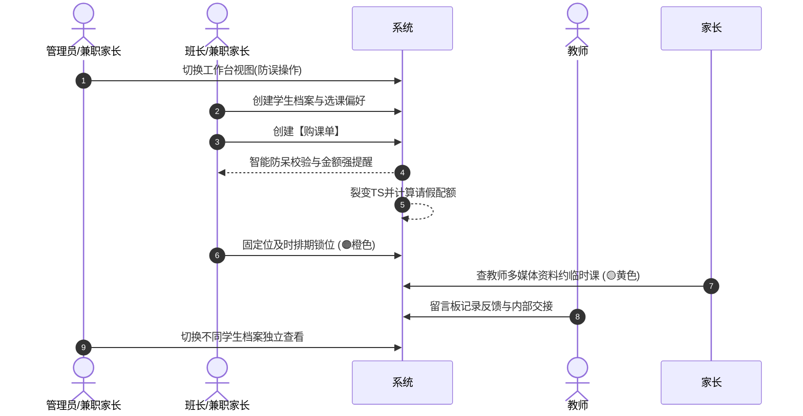
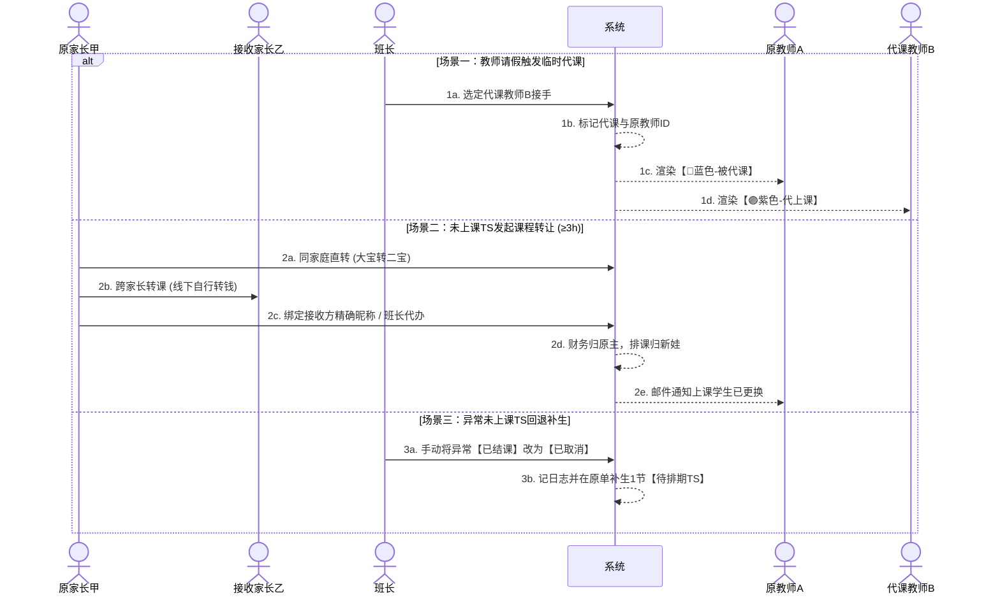
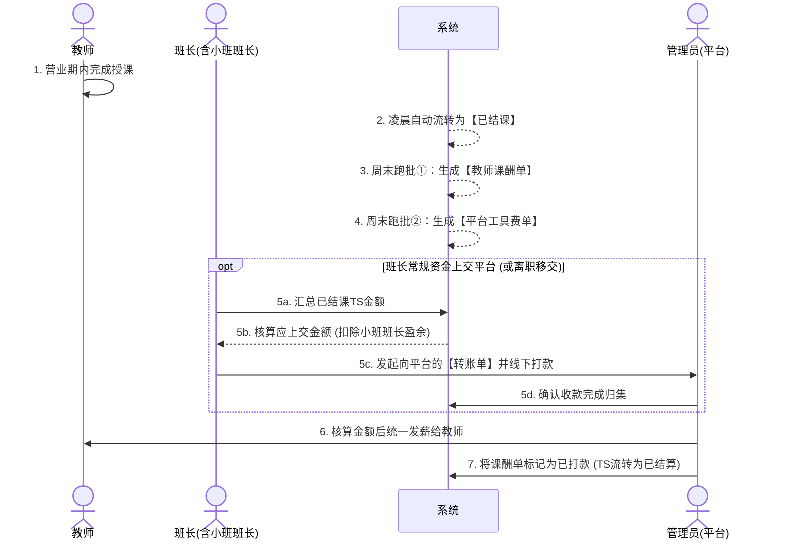

# 教务排班与分账管理系统需求规格说明书（PRD v5.1 定稿版）

> **【架构重要说明 · 实体生命周期归口管辖铁律 (Entity Lifecycle SSOT)】**：
> 本 PRD 作为系统顶层需求规格总纲，统领宏观业务模型与四大工作台交互基准。系统中各业务实体对象（学员档案、教师档案、班级、课件、留言、购课单、退款单、排课预占锁、代课/请假工单、课次转让单、通知/邮件任务、转账单、教师周结单）的**全生命周期状态机、前置守卫与流转规则，统一且唯一收敛归属于各业务模块专属 PRD 文档（`docs/prd/m*.md`）**。
> **后续任何实体的生命周期修改，统一直接定位至各业务模块对应的专属子 PRD 文档中维护**，严禁在总纲或跨模块子 PRD 中私自变更或越界复读。TS 课次作为全系统唯一运转中枢由 [`docs/BUSINESS_RULES.md Section 3.2`](./BUSINESS_RULES.md) 统领封板。

## 一、 账号体系、角色权限与多视图隔离架构

### 1. 账号与档案分离原则 (Account vs. Profile)
针对少儿教育场景中“家长出资操作、低龄学生上课、二胎家庭多娃共管、管理层兼职多重身份”的业务现状，系统底层采用 **“登录账号（Account）”与“学生档案（Student Profile）”解耦分离** 的架构：
*   **登录账号（Account）**：代表自然人操作主体（管理员、班长、教师、家长）。使用唯一的 **Email** 注册登录，用于鉴权与接收所有系统通知邮件。一个登录账号可同时拥有多个角色权限标签（如：`[管理员, 班长, 家长]`）。
*   **学生档案（Student Profile）**：代表实际消耗课时的“上课实体”。**1 个家长角色下可创建并挂载 N 个学生档案（支持二胎/多胎家庭）**。学生档案本身无登录密码，所有购课单、TS 排期、选课偏好、请假配额及留言板均绑定在具体的“学生档案 ID”上。（注：成人或大龄独立学生注册家长账号后，在名下创建自己的学生档案即可，架构完全兼容）。
*   **多重角色公私分流与多孩日程聚合机制（免频繁切换体验架构）**：
    1.  **兼职角色自然聚合与公私分流**：当管理员或班长账号同时兼任家长（自家孩子上课）时，系统彻底摒弃繁琐的顶部强制切换工作台模式，采用**“主页垂直分区聚合 + 底部最多 4 个 Tab 极简映射 + 金刚位按角色分行（单角色 4 个，双角色 8 个，三合一管理员 12 个）”**架构。主页上方呈现教务/财务待办，下方直接展示自家孩子即将上课日程；自家孩子排课收拢于 Tab 2【学生课表】，外部学员教务收拢于 Tab 3【教务中心】，平台低频配置下沉至 Tab 4【管理与设置】，公私入口物理分流，既免去在多个工作台之间反复横跳的割裂感，又在底层严防跨角色误操作与资金账目混淆。
    2.  **多孩家庭“主页时间流聚合与 Tab 2 默认 7 色周课表”**：在家长主页，名下所有孩子的即将上课日程合并在同一时间流中呈现（卡片醒目标注孩子昵称标签），家长 3 秒通览全家日程；在 Tab 2【学生课表】中，默认直接呈现直观的“7 色周课表网格”（彻底取消长列表卡片流），常驻**吸顶多孩切换器**（如：`[ 👧 大宝 Alice (本周4节) ]` `[ 👦 二宝 Bob (本周2节) ]`），点击秒级下钻切换当前孩子整周排课，一眼掌控一周课程与空闲，点击网格格子唤起课程操作抽屉（进班、请假、挪位、转让）。

### 2. 系统四大角色与业务权限体系

| 角色 | 账号分配 | 核心定位 | 业务权限与工作台视角 |
| :--- | :--- | :--- | :--- |
| **管理员**<br>*(平台方)* | 内部配置<br>*(可兼班长/家长)* | 平台统筹、中央财务结算与发薪方 | **1. 基础配置与试课预建档**：维护课程类型字典、教师档案（定级/维护技能范围/绑定班长/上传介绍视频与 ClassIn 二维码等）、班长档案、学生档案及全局参数；**独享为未注册试课家长代建待认领档案（UNBOUND）及代约 1v1 临时课权限**。<br>**2. 小班课创建与分成配置**：创建小班课班级，设置**小班课主理人**、**教师单节课酬**及**平台服务分成比例**。<br>**3. 全域教务代办与跨班长统筹（低频支撑通道）**：在教师或学生排期表视图下，跨班长统筹为任意学员代约 1v1 临时课与提前排下轮 4 周固定位（**严禁挤占他人提前 7 天续费专属保护期 HOLD 时段**；跨班长借用外教预约统一由管理员在后台代约）；协助同师同周期代挪位（免扣配额）；代办常规请假（扣配额）与**非常规特批请假**（免扣配额或突破开课前 3 小时锁定限制，弹窗勾选“是否给老师补偿课酬，默认不补”，强制写入审计日志 `dream.audit_logs`）。<br>**4. 平台直收与资金归集**：作为收款方创建【购课单】；接收班长发起的【转账单】（含每周资金上交、班长离职移交）。<br>**5. 教师统一发薪**：根据每周【教师课酬单】在线下核算金额后统一发薪。<br>**6. 异常处理与全局报表**：处理异常完课回退（将已结课 TS 改为已取消并补生待排期 TS）；查看全平台总账与【平台工具费单】。<br>*（注：若兼任班长或家长，主页自动聚合教务待办与家庭双焦点，并通过 Tab 2 孩子课表与 Tab 3 教务中心自然分流，无需频繁切换身份）* |
| **班长**<br>*(Monitor)* | Email注册<br>*(可由家长兼任)* | 教师服务经纪人、小班课主理人与前端收款托管方 | **1. 我负责的教师/学生/小班**：在【班长工作台】管理名下绑定的教师团队（可有名下老师，也可无名下老师专职小班）、关联学生档案及主理的小班课（负责招生与班级运营核算；作为小班主理人时可直接委任全平台在职外教授课或代课，委任后系统自动关联外教绑定班长并推送协同通知，外教绑定班长享有小班信息与修改日志只读查看权）；维护学生【选课偏好】与【留言板】（支持“师生公开”或“仅内部教学可见”）。<br>**2. 收款与退费**：代 1v1 学生或小班课线下收款并生成【购课单】（转积分，可勾选固定位额外费用）；处理退费生成【退款单】。<br>**3. 教务排班与代约调度**：为所辖在职教师执行固定位买 4 周排 4 周；**在所辖在职教师日历中代约 1-7 天 1v1 临时课（单约/连约）或跨周期提前预排下一轮连续 4 周固定位（穿透检索全平台有效学员并智能抑制原时段提前 7 天 HOLD 预占；1v1 严禁跨班长代约外教，跨班长借用外教统一由平台管理员代办）**；处理学生请假、教师 1~12 节突发停电批量请假应急调度（小班课待办精准拆单至主理人处理）；**对老师实际未上课但已结课的异常 TS，修改为“已取消”并自动补生 1 节待排期 TS**。<br>**4. 向平台转账交割（周一转账日）**：每周一接收系统自动预生成的【转账单草稿】（已扣除主理人留存收益积分），08:00 接收定时提醒并于周一内完成线下打款并上传凭证一键确认（周二平台核算，周三平台统一发薪）。 |
| **教师** | Email注册 | 授课执行方 | **1. 我的档案与排期**：查看个人多媒体档案；设定常规可授课时段，查看个人课表（含空闲可约、固定位、临时课、被代课、代上课等 7 色标识）。<br>**2. 学生留言板协同**：在学生档案留言板中发布留言（选“师生公开”或“仅内部教学可见”）；作为代课老师时查阅原老师记录的教学进度。<br>**3. 请假/销假**：标记请假/销假，支持单节或批量勾选 1~12 节课发起请假（报备家庭突发停电/断网等不可抗力，系统自动生成班长应急待办包并承诺免扣学生配额）。<br>**4. 课酬对账**：查看每周【教师课酬单】（汇总实际完课的正课与代上课节数，不区分收款渠道），接收平台发放的课酬。<br>**5. 离职与教务交接**：离职时在选课大厅立即下架并清空周模板；由负责班长在三道防线中完成未来排课（临时课/固定位/小班课）交接清零；历史已完课课酬正常参与周结发薪；档案软删除只读留存。 |
| **家长**<br>*(挂载学生档案)* | Email注册 | 购课出资方、日常操作方與通知接收方 | **1. 多档案管理与偏好设置**：在名下创建/切换多个【学生档案】（昵称规范：`英文名+姓首字母+年龄`）；维护【选课偏好】（仅设课程类型）；在【个人留言板】中查看“师生公开”反馈并回复。<br>**2. 积分与账单中心**：付款 1:1 转换为【积分】（无余额池，按单购课），查看 1v1【购课单】与【退款单】记录（*小班课购课单对家长不可见*）。<br>**3. 课表查看与邮件接收**：切换查看各孩子的【已排期 TS】与 1v1【未排期 TS】；通过 Email 接收新排课、请假、代课、课程转让等所有通知。<br>**4. 约课、考勤与转让**：查看教师多媒体介绍，提前 1-7 天预约临时课；对 1v1 排期课程自助请假、挪位，或**发起课程转让**（直转给同账号二宝，或输入精确昵称转给其他家长）。 |

---

## 二、 核心业务对象与数据模型定义

### 1. 课程、定价与教师档案体系
*   **课程类型（双向匹配标签）**：
    *   **双重业务定位**：既是**教师的技能范围**（如某些老师只能教 3-7 岁少儿英语，某些老师专注于雅思），也是**学生的学习目的**（如练习生活口语、旅游应急、或参加特定等级考试）。
    *   **预设字典枚举**：`少儿英语`、`生活口语`、`旅游口语`、`KET`、`PET`、`雅思`、`托福`（支持后台字典动态扩展补充）。
*   **教师档案多媒体字段（约课展示）**：
    *   除基础信息（姓名、Email、定级、技能范围、绑定班长、离职日期）外，包含四大展示字段：**① 老师文字介绍**、**② 介绍视频**、**③ 教师风采相册与主头像**（支持上传 1~6 张照片，点选一张 1:1 独立裁切为主头像；家长/学生端以紧凑网格展示，点击单张唤起全屏大图灯箱放大查看）、**④ ClassIn 二维码图片**。家长在选课/约课及查看课表详情时可直接浏览并扫码添加。
*   **课件库与学员在学课件体系 (Submodule 1E)**：
    *   **平台级课件库（元数据与级别图谱）**：由管理员统一在系统内维护中英文名称、中英简介、封面配图、归属课程类型（多选），并支持按英文级别维护 0~9 张内页样章配图及排序，全面替代外部腾讯文档。
    *   **学员在学课件精细化配置**：在学生档案中支持管理员或责任班长为学生配置 1~6 门【在学课件 + 当前就读级别】（出资家长端只读）。学生初学或阶段升阶调整时强制沉淀审计日志，并在教师日历待上课详情卡片中联动展示，实现备课与教学进度无缝衔接。
*   **营业时间窗**：每日 **06:00 - 00:00**（早夜均有排课需求，以 30 分钟为一个基础日历网格单元，全天共 36 个基础网格）。
*   **授课班型与时长标准**：
    *   **1v1（一对一）**：标准授课 **25 分钟**，占用日历网格 **30 分钟**（含 5 分钟课间）。
    *   **小班课（1vN）**：标准授课 **50 分钟**，占用日历网格 **1 小时**（即连续占用 2 个 30 分钟的日历格子）。
*   **多元收款与资金持有人锁定规则**：
    *   同一位老师的 TS 课程，系统支持三种收款来源：**① 1v1 班长收款**、**② 平台（管理员）直接收款**、**③ 小班课班长收款**。
    *   **持有人锁定原则**：无论某节 TS 后续由哪位老师来上课（哪怕跨班长选了其他班长名下的老师上临时课或临时代课），或者转让给了其他家长的孩子上课，**该 TS 的“资金持有人（收款方）”永远跟随最初的收款方（原班长或平台）保持不变**，直至周末该 TS 结课并由持有人通过【转账单】将资金转交给平台（或原班长离职移交）。
*   **定价与分账结构（1v1 vs 小班课）**：
    *   **1v1 计费与积分转换**：购课金额 **1元 = 1积分**（页面统一显示积分，不设账户余额池，按购课单裂变 TS）。每节标准 1v1 TS 固定包含 **2 积分作为平台工具费**，其余部分为教师课酬。
    *   **1v1 固定位额外费用（特殊备课/批改附加费）**：
        *   **业务场景**：针对固定位课程，学生可能需要老师提前深度备课或课后批改作业（典型场景如：**演讲、比赛、写稿、改稿、备考、改作业、拍照稿、图片台词、电影/书籍/动画片精讲、时事主题、偏门冷门话题**等）。
        *   **计费规则**：在创建购课单时支持勾选“包含额外费用”，系统默认按 **10 积分/节** 叠加计入单节 TS 标准费用中（全额归入教师课酬部分，不增加平台工具费）。
    *   **小班课计费（小班课主理人承包自负盈亏 + 平台服务分成模式，前端脱敏展示为班级管理）**：
        *   **业务逻辑**：小班课实行**小班课主理人独立运营核算承包制**。**小班课学生免家长注册与免建档**，招生与沟通 100% 由主理人在线下微信群自主完成。主理人以“班级主体”在系统内开具小班课购课单采购课时、自主排课，每周上交扣除留存盈余后的积分。
        *   **建班核心指标与直接委任规约**：在创建小班课时，录入字段严格收敛为以下核心指标：
            1.  **小班课主理人**：指定负责该班级运营核算的“主理人”（赋予班长角色，可有名下外教也可无名下外教）。
            2.  **授课老师与课程类型**：主理人可直接从全平台在职外教中委任授课老师（选定后自动关联外教绑定班长并推送协同通知，绑定班长享有小班信息与修改日志只读权；亦支持建班时暂不绑定老师，但未绑定具体老师前物理禁止开具小班购课单与日历排课）。
            3.  **最大学生数 (Max)**：**平台固定工具费的计算基准**（默认 $Max = 3$ 人，单节工具费 = $Max \times 6$ 积分，默认 3 人班为 18 积分）。
            4.  **教师单节课酬**：人工设定该班级每节课固定付给老师的课酬积分。
            5.  **单节待上交费用**：主理人录入多少就上交多少积分（停用原平台抽佣与自留收益字段）。
            6.  **底线覆盖硬阻断**：单节待上交费用必须 $\ge$ 教师单节课酬 + 工具费；超出部分页面文案统一显示为**“其他结余”**（不可退，沉淀在平台）。
        *   **单节小班课 TS 的费用核算与归集口径**：
            1.  **固定工具费**：系统自动计算，`工具费 = 最大学生数 (Max) × 6 积分`。
            2.  **其他结余**：`其他结余 = 待上交单节费用 - 教师单节课酬 - 工具费 >= 0`（页面文案，不可退）。
            3.  **周度转账上交口径**：主理人录入多少就上交多少，转账单直接按已结课小班 TS 待上交积分累加，不扣除自留，不计提抽佣。

### 2. 学生档案、选课偏好与双权限简易留言板
*   **注册基础信息验证与待认领试课档案体系**：
    *   **常规建档校验**：家长创建学生档案时，强制校验必填项：**学生昵称**（格式：`英文名+姓首字母+年龄`，如 `AliceZ12`）、**性别**、**出生年月**。支持在创建学生档案时对注册信息做规则验证或后置补充。
    *   **试课免注册代建档与双通道认领 (Trial Unbound Profile)**：为解决新学员初访试听免注册痛点，系统仅限**平台管理员**在后台为未注册家长预先创建学生档案（初始状态为 `UNBOUND` 平台托管态，录入基本信息并必填家长联系方式）。管理员可开具 1v1 临时课购课单（上限 20 节，按标准课酬录单计费）并代约 1-7 天临时课。试课满意后家长使用 Email 注册账号，支持**双通道认领**（管理员/班长在后台输入邮箱绑定，或家长端登录后输入规范昵称+预留联系方式自助认领）。认领后档案转正为 `ACTIVE`，历史试课购课单、已结课 TS 课表记录及留言板公开留言无缝移交承接；若试课完结超 30 天未认领，系统定时跑批自动将其标记为 `ARCHIVED` 归档失效。
    *   **退学离场与档案注销闭环 (Student Offboarding)**：家长决定不再让孩子上课时，可通过同家庭转让（二宝接盘）、跨家长转让或班长录入退款单（一键全量清退未消课次）清空资产。删除/注销学生档案时，系统强制校验剩余有效 TS 必须为 0 且无未来排课（否则阻断 `STUDENT_PROFILE_HAS_ACTIVE_ASSETS`）；档案软删除后规范昵称永久锁定，历史留言板与财务单据只读归档；家长名下所有孩子档案清空后允许停用家长账号，历史财务流水依法永久留存。
*   **选课偏好配置（轻量化过滤）**：
    *   **课程类型**：可选择上述课程类型集合，**默认选中“不限制课程类型”**。维护权限归属家长本人及班长，修改后下次约课生效，已排课程不受影响。
    *   **教师级别（不设档案限制，仅作前端筛选）**：学生档案中**不用设置教师级别**，默认可以选择所有级别的老师；“教师级别”仅作为家长或班长在约课选老师界面时的**前端列表过滤条件**。
*   **学生档案简易留言板（区分“师生公开”与“仅内部教学可见”）**：
    *   **功能形态**：每个学生档案下挂载一个独立的**简易留言板**，支持纯文本输入、多行换行展示，按时间流式呈现（记录留言人角色、姓名、时间戳及可见性标签）。
    *   **双级隐私与可见范围控制（关键安全隔离）**：
        *   🔓 **【师生公开】模式**：家长（学生）、正课老师、代课老师、班长、管理员**全员可见**。用于：老师课后写学习反馈、记录最近使用的教材与授课进度；家长/学生回复老师反馈或向老师提问。
        *   🔒 **【仅内部教学可见】模式**：**仅对教师、代课教师、班长、管理员可见，对家长（学生）端完全隐藏屏蔽**。用于：班长备注孩子的性格特点、家庭沟通注意事项、真实英语底子；或原老师向代课老师交接内部教学提示，避免敏感评价被家长/学生看到引发客诉。

### 3. 班级实体与预约模式
*   **1v1 个人班**：学生档案首次排 1v1 课程时，系统后台**自动静默创建**专属个人班级，无需人工干预。
*   **小班课班级（小班课主理人承包制，前端统一展示为班级管理）**：由管理员或班长在后台**手动创建**，实行主理人独立承包制。**小班课完全不开放家长注册，不录入学生档案**，由主理人在线下自主招生与组织。核心录入属性收敛为：`班级名称`、`课程类型`、`指定授课教师（支持直接委任全平台在职外教，或暂不绑定老师）`、`小班课主理人`、`外教绑定班长（自动关联带出）`、`最大学生数 (Max，平台单节固定工具费计算基准 Max×6)`、`教师单节课酬`、`平台服务分成比例 R%`、`单节折算总学费`。建班即为 `ACTIVE` 生效（未绑定具体老师时禁止开单与排课），主理人委任老师后开具购课单直接排课。
*   **固定位与临时课排期规则**：
    *   **固定位（🟠橙色，优先预约权）**：
        *   学生档案绑定 1 位固定老师在固定时段学习（例如每周二至周五下午，每天 4 节课）。**四周为一轮（一个学习周期）**，一次购买 4 周的课次，并在购课后**及时一次性排满四周的固定位课表**。每轮开始前，可重新调整老师和时间形成新的固定课。
        *   **购课次数 4 倍数弱提醒**：创建固定位【购课单】时，系统自动校验购买课次数是否为 **4 的倍数**；若不是 4 的倍数（例如因上一轮请假 1 次结余了 1 节课，本轮只需买 15 节），**系统弹出弱提醒提示班长，但允许确认后正常提交**。
        *   **固定位变更限制**：固定位**不可直接取消**，只可选择**挪位**（提前 24 小时，与同一老师协调其他空闲时段学习）或**转让**（提前 3 小时，按转让规则转给其他学生上课）。
    *   **临时课（🟡黄色）**：
        *   临时课创建【购课单】时，可任意设置购买课次数（**一般次数较少，系统限制单次不超过 20 次**）。
        *   家长可使用剩余未排期 TS 提前 **1 - 7 天**自主预约空闲老师（约课界面可查看老师的文字介绍、视频、风采相册照片及 ClassIn 二维码，并支持按课程类型、教师级别过滤）。**固定位的预约优先级高于临时课**（系统上线初期，支持班长或管理员先为存量固定位学生和小班课录入购课单并批量锁位占座，避免被临时课抢占）。

### 4. 核心业务单据（5大财务与流转单据）

#### （1）购课单（Course Purchase Order，原充值单）
*   **业务场景**：系统不设虚拟账户余额池，家长每次付款均对应购买具体课程与课次。支持 **1v1 班长收款**、**小班课班长收款** 以及 **平台（管理员）直接收款** 三种渠道创建购课单。
*   **核心字段**：
    *   `购课单ID`、`所属家长账号ID`、`关联学生档案ID`（或小班班级ID）
    *   `购课类型`（固定位 / 临时课 / 小班课）、`意向教师`、`课程类型`
    *   `收款持有方`（班长ID / 平台直收）
    *   `是否含固定位额外费用`（勾选项，默认 10 积分/节）
    *   `购买课次数`（固定位校验 4 倍数弱提醒；临时课校验 $\le$ 20 次）
    *   `购课总积分`、`转账凭证截图`
    *   `允许直接取消次数上限`（计算规则：总课时的 **12.5%**，每四周为一期计算一次，不足四周按实际 12.5% 计算，遇到小数**向下取整**）、`已使用取消次数`
*   **智能防呆校验机制**：录入 1v1 积分和课数时，系统自动匹配该意向教师的“教师级别”标准课酬 + 工具费（2积分）+ 额外费用（若勾选则+10积分）进行比对。**若录入金额与系统计算标准不一致，系统弹窗简要提示计算公式进行强提醒**；提醒后，**允许点击“强制提交”**。
*   **状态机**：`待付款确认` $\rightarrow$ `已购课`（系统立即裂变生成 N 个【待排期 TS】） $\rightarrow$ `已排期` $\rightarrow$ `已取消`。

#### （2）TS（TimeSlot，最小课次单元 —— 核心运转枢纽）
*   **核心字段**：
    *   **基础与财务归属**：`TS_ID`、`所属购课单ID`、**`原购课家长账号ID & 原学生档案ID（费用归属方）`**、**`实际排课上课学生档案ID（默认等于原学生档案ID，发生转让时更新为接收方学生档案ID）`**、**`资金持有方（初始收款的班长ID 或 平台，排课/代课/转让均不改变此归属）`**、`班型（1v1占30分钟/小班占1小时）`、`排期属性（固定位/临时课）`、`是否已转让标识`、`关联班级ID`、`上课日期与具体时段`。
    *   **教师与代课追踪字段**：`当前授课教师ID`、**`是否代课（Boolean 标识，默认 False）`**、**`原教师ID（Original_Teacher_ID，发生代课时记录被代课的原老师A，当前授课教师ID更新为代课老师B）`**。
    *   **费用快照**：
        *   1v1 快照：`单节实付总积分`、`教师课酬积分`、`额外费用积分（如有）`、`工具费积分（固定2积分）`。
        *   小班课快照：`单节实付总积分`、`教师单节课酬积分`、`工具费积分（Max×6）`、`平台抽佣积分（有盈余时按比例算，无盈余为0）`、`班长自留盈余积分`。
*   **状态流转机与异常回退机制**（权威全景状态图与转移矩阵参见 [docs/BUSINESS_RULES.md Section 3.2](./BUSINESS_RULES.md#32-ts-timeslot---最小课次流转枢纽)）：
    遵循**“教务履约与财务结算严格解耦”**架构原则，TS 状态机收敛为纯粹聚焦教学履约全过程的极简 4 态，履约结课即告终态，不承载下游财务过程状态：
    1.  `待排期 (PENDING_SCHEDULE)`：购课单确认后初始生成，锁定资金持有方与原购课学生档案（小班课锁定 class_id 与主理人）。
    2.  `已排期 (SCHEDULED)`：已分配教师与日历时段（含同师挪位、课程转让、代课安排，状态均维持为`已排期`）。
    3.  `已结课 (COMPLETED)`：**次日凌晨 02:00** 系统跑批自动触发，将前一日营业期内所有履约完课的 TS 流转为该终态；教务履约圆满达成。后续周转账单归集与教师发薪完全由下游财务单据独立承载，并通过 `transfer_order_items` 唯一索引保障防重打包，不再回写 TS 状态。
    4.  `已取消 (CANCELLED)`：
        *   **常规退费取消**：学生中途退课退款核销；
        *   **异常未上课回退（关键兜底）**：若老师实际未上课（旷课/故障），跨过凌晨已被系统自动置为已结课，且该 TS 尚未被包含在状态为 `COMPLETED` 的周转账单中，支持在后台手动回退为 `已取消` 并记录审计日志：
            *   **1v1 课次**：原购课单下自动补生 1 节全新待排 TS 归还学生；
            *   **小班课次**：原小班单下向班级待排池 (`class_id`) 退回补生 1 节待排期（严禁关联学生档案），由主理人择期重新排课；免收平台工具费与分成，不计发教师课酬。

#### （3）退款单（Refund Order）
*   **退费前置保障规则**：为避免影响老师收入，固定位学生退费前**必须优先选择挪位，或先在线下群发起转让**；若仍然无人接手且确需退费，必须**提前 24 小时告知班长（或平台）**，在后台创建退款单。
*   **核心字段**：退款单ID、原购课单ID、关联学生档案、经办人（班长或管理员）、退款明细（勾选未结课 TS 子集）、扣款/退款比例、实际应退积分总额、退款交易截图凭证。
*   **违约金分账规则**：若扣除违约金，违约金按原 TS 的“教师课酬”与“工具费”比例自动拆分。

#### （4）转账单（Transfer Order —— 班长向平台单向归集，支持小班预留盈余）
*   **业务定位**：**班长发起的转账单，一律只转账给平台（管理员），不发生班长之间的互转**。因为所有教师课酬统一由管理员发放，班长手里的应交资金必须归集到平台。
*   **两大核心触发场景与金额核算**：
    *   **场景一（周度资金上交闭环：周一转账日、周二核算日、周三发薪日）**：系统于**每周一 03:30** 自动跑批生成【待确认转账草稿单】（金额 $\le 0$ 智能跳过免打扰），**周一 08:00** 定时向班长推送转账催办提醒。班长登录后双视角核对明细，按平台收款信息完成线下打款并上传凭证确认；**周二核算日**管理员后台集中审核；**周三发薪日**平台统一全额向外教发薪（若个别班长未转账，平台先行全额垫付兜底保障外教信誉，未转资金在后台标红计入欠款追缴）：
        *   **针对 1v1 已结课 TS**：按 **“已结课 TS 实付总积分（即教师课酬 + 2积分工具费 + 额外费）”** 全额计入应转金额。
        *   **针对小班课已结课 TS（录多少交多少原则）**：按主理人开单录入的“待上交单节费用”全额计入应转总额，系统停用平台抽佣与自留盈余计算；底线要求覆盖教师单节课酬 + 工具费(Max×6)，超出部分页面文案显示为不可退“其他结余”。
    *   **场景二（班长离职时的未结资产移交）**：当某位班长离职时，将其名下持有的**所有未结 TS（`待排期`和未结课的`已排期` TS）**一键打包生成向平台的【转账单】，将对应未消耗的托管资金全额转交给平台，系统同步将这些 TS 的“资金持有方”变更为**平台（管理员）**。
*   **核心字段**：转账单ID、转出方（班长ID）、**接收方（固定为：平台/管理员）**、转账类型（`周度结课上交` / `离职未结移交`）、关联的 TS 列表、分组汇总视图（按学生/按教师）、打包课次数、**实际应转平台总积分**、转账截图凭证、状态（`待划转` / `已完成`）。

#### （5）教师课酬单 & 平台工具费单（Weekly Settlement Reports）
*   **教师课酬单（每周每师一单，与班长解绑，代课算入代课老师）**：
    *   **维度**：`1位教师 + 1个自然周（如 2026W31） = 1张课酬单`（**彻底取消班长ID绑定**，系统每周自动为每个老师计算一次）。
    *   **代课与异常剔除铁律**：当 A 老师的课由 B 老师代上时，**该节 TS 的课酬节数严格算入代课老师 B 的课酬单里，绝不计入原老师 A 的课酬单**；因老师未上课而被回退置为 `已取消` 的异常 TS，自动从课酬统计中剔除。
    *   **内容格式**：**只出课节数，不出具体金额**。清晰统计该教师当周实际完课（含正课与🟣代上课）的 **“1v1 授课节数”**（附带标注其中含额外备课费节数）与 **“小班课授课节数”**。
    *   **发放闭环**：**由管理员（平台）**根据课酬单节数，在线下核算总金额后统一转账发放给老师，并维护状态（`待结算` $\rightarrow$ `已结算` $\rightarrow$ `已打款`）。
*   **平台工具费单（全局纯财务核算报表，无状态字段）**：
    *   **维度与定位**：`全平台 + 1个自然周（如 2026W31） = 每周自动生成 1 张全局平台工具费单`。本质是给管理员看的一张**“平台每周从收上来的总池子里净赚了多少工具费与管理费”的纯财务核算报表**。
    *   **核心特征**：**不跟家长（学生）挂钩，不设状态字段（无需打款流转）**。
    *   **内容结构**：提供**按授课老师分组汇总**的统计视图，并包含底层 **TS 明细列表**（记录每节已结课 TS 贡献的 1v1 工具费 `2积分`、小班课工具费 `Max×6积分` 及小班课其他结余积分）。

---

## 三、 日历 7 色视觉规范、请假代课与课程转让规则

### 1. 页面日历全局颜色标识规范（代课双视角）
系统对日历网格实施严格的 7 色状态渲染，特别针对**“代课”场景实施双视角差异化染色**：

| 颜色标识 | 状态名称 | 适用视图与业务含义说明 |
| :--- | :--- | :--- |
| 🟠 **橙色** | **固定位** | **全端通用**：已排定的四周一轮固定位正课（具备最高锁位优先级；若发生学生间线下转让，保持🟠橙色并加注【转】字角标与接盘学生昵称）。 |
| 🟡 **黄色** | **临时课** | **全端通用**：家长提前 1-7 天自主预约的临时正课。 |
| 🔵 **蓝色** | **被代课** | **仅在【原被代课老师A、班长、家长/学生】视图显示**：当某节课发生老师请假并安排了其他老师代课时，在原老师A课表、班长课表和学生课表上，该时段显示为**蓝色（被代课）**，提示“本节课由 B 老师代上（不计入 A 老师课酬）”。 |
| 🟣 **紫色** | **代上课** | **仅在【代课老师B】视图显示**：接手代课任务的老师B查看自己课表时，这节替别人上的课显示为**紫色（代上课）**，提示“替 A 老师代课（计入代课老师课酬，可点开学生留言板看进度）”。 |
| ⚪ **灰色** | **教师不可约** | **全端通用**：教师未开放授课的日常休息时段。 |
| 🟢 **绿色** | **空闲可约** | **全端通用**：教师设定的常规可授课且未被占用的空闲时段。 |
| 🔴 **红色** | **已请假** | **全端通用**：教师主动标记请假的空闲时段，或已排期但发生整班停课/取消的请假时段。 |

### 2. 未上课 TS 的“课程转让”详细规则（距开课 $\ge$ 3 小时）
针对未上课的已排期 TS（尤其是不可直接取消的固定位课程，在距开课 **$\ge$ 3 小时** 前），支持将其转让给另一个学生档案上课，具体分为以下两种场景：

| 转让类型 | 业务场景说明 | 操作路径与系统底层处理逻辑 | 消息触达 |
| :--- | :--- | :--- | :--- |
| **场景 A：同家长名下学生互转**<br>*(如大宝转给二宝)* | 转出方与转入方属于**同一个家长账号**下的两个学生档案。 | **1. 操作方式**：家长在端内点击该节 TS 选择“转让”，直接从自己名下的其他学生档案下拉框中选中二宝，一键完成转让（或由班长协助操作）。<br>**2. 系统处理**：不涉及任何资金变动；将该节 TS 的 `实际排课上课学生档案ID` 更新为二宝，二宝的课表上立刻出现该节排课，大宝课表标记“已转出”。 | 自动发送 **Email + 站内信** 通知授课教师：“本次课上课学生已变更为 [二宝昵称]（可点击查看二宝档案留言板）”。 |
| **场景 B：跨不同家长转让**<br>*(如家长甲转给家长乙)* | 转出方与接收方属于**两个不同家长账号**下的学生档案。 | **1. 双路径匹配接收方**：支持 **① 转出家长在端内输入接收方孩子的精确“学生昵称（如 BobZ10）”校验匹配**，或 **② 联系班长在后台直接选择接收方学生档案代操作**。<br>**2. 财课分离处理原则**：两位家长在**线下自行微信转钱交割**；系统底层**记录的费用归属（原购课单、原购课家长、资金持有人班长）完全保持原家长不变**；但排课层将该节 TS 的 `实际排课上课学生档案ID` 绑定为接收方学生，**直接呈现在接收方学生的课表上**供其正常上课。 | 自动发送 **Email + 站内信** 通知授课教师（提示本次课学生换了并附接收方学生档案入口），同时邮件通知接收方家长排课已生效。 |

### 3. 请假、销假与代课规则矩阵

#### （1）通用请假配额算法
*   **12.5% 向下取整原则**：无论是教师还是学生，每个周期（每四周为一期，不足四周按实际课时算）的允许直接请假次数上限均为**周期总课时的 12.5%（即 1/8）**，系统参数可配置。计算结果若为小数，统一**向下取整**。

#### （2）教师端请假、销假与代课计酬规则
| 目标时段状态 | 时间红线条件 | 允许操作与系统底层逻辑 | 课酬与违约处理 |
| :--- | :--- | :--- | :--- |
| **未排期（🟢绿色空闲）** | 距该时段开始 **> 5分钟** | **直接标记请假 / 随时销假**：教师可在日历上直接将空闲格置为“🔴红色已请假”；开课前 5 分钟内可随时“销假”恢复为🟢绿色空闲。 | 不占配额，无违约 |
| **已排期 TS** | 距开课 **$\ge$ 24 小时** <br>*且* **未超 12.5% 配额** | **常规请假**：允许发起请假，扣减教师当期配额 1 次。通知班长与家长协商挪位或安排代课。 | 若安排代课，课酬归代课老师 |
| **已排期 TS** | 距开课 **< 24 小时** <br>*或* **已超 12.5% 配额** | **紧急请假（协调代课）**：禁止前端直接取消，由班长协调其他空闲老师B代课。<br>**代课数据落盘**：更新 TS 的 `是否代课 = True`、`原教师ID = A`、`当前授课教师ID = B`（TS 资金持有人保持原收款班长不变）。原老师A/班长/学生端渲染为🔵**蓝色（被代课）**，代课老师B端渲染为🟣**紫色（代上课）**。 | **先不惩罚原老师A**；该节 TS 完课后，**课酬节数直接计入代课老师B的周课酬单** |

#### （3）家长/学生端变更规则（固定位 vs 临时课 vs 小班课）
| 课程类别 | 距开课时间红线 | 允许操作与系统流转逻辑 | 消息触达 |
| :--- | :--- | :--- | :--- |
| **1v1 固定位（🟠橙色）**<br>*(不可取消，仅可挪位/转让)* | **$\ge$ 24 小时** | **同师挪位**：不可退回待排期。只允许在同一位老师的🟢绿色空闲时段中协调平移（或按转让规则转给其他学生）。<br>**垫底退费**：若无法挪位且线下群转让无人接手，确需退费的，须提前 24 小时告知班长走【退款单】流程。 | Email + 站内信通知教师 |
| **1v1 固定位（🟠橙色）** | **3 小时 ~ 24 小时** | **课程转让（同家长直转 / 跨家长转让）**：不可挪位。可转给同账号另一孩子，或线下群私了后通过“输入精确学生昵称 / 班长后台代办”转给其他家长的孩子排课上课（费用仍记原家长名下）。 | Email + 站内信通知教师本次课学生已更换 |
| **1v1 临时课（🟡黄色）**<br>*(提前1-7天预约)* | **$\ge$ 24 小时** 且 **未超 12.5% 配额** | **直接请假（退回待排期）**：允许自助取消，TS 退回`待排期`，扣减本单请假配额 1 次，原格子恢复为🟢绿色空闲（亦支持走转让流程）。 | Email + 站内信通知教师 |
| **1v1 临时课（🟡黄色）** | **3 ~ 24 小时** 或 **已超 12.5% 配额** | **强制同师改期（挪位）或转让**：禁止退回待排期，强制在当前页面立即选择同一位老师的其他🟢绿色空闲时段完成平移（或转让给其他学生）。 | Email + 站内信通知教师 |
| **所有 1v1 课程** | **< 3 小时** | **授课准备期锁定**：前端关闭所有挪位、转让、请假入口，老师已进入备课阶段。若缺席，次日凌晨 2 点照常按`已结课`扣除 TS。 | - |
| **小班课（1vN，小班课主理人承包）** | **任意时间（线下协商）** | **1. 单人缺席**：小班课学生免家长注册与免建档，学生个人请假完全由主理人在线下微信群处理协调，系统不记录个人考勤，不扣减配额不退费。<br>**2. 临时代课**：常规外教请假须提前 $\ge 3\text{h}$，由主理人从全平台在职外教中指派代课（直接委任，需连续双单元格空闲，课酬快照对平结算）；若遇外教突发停电断网等不可抗力触发绿色通道，开课前 $\ge 15\text{min}$ 仍允许主理人紧急指派代课。<br>**3. 整班停课（含突发停电不可抗力）**：由小班课主理人在后台操作整班停课；若遇外教突发停电且截至开课前 15 分钟仍无人代课，系统自动触发整班停课安全兜底。TS 自动退回班级待排期池，**100% 物理豁免扣除学员课时，严禁扣除学员个人请假配额**；系统向小班主理人推送紧急邮件与待办，由主理人第一时间在私域微信群通告全班家长免除进教室空等，并在主理人工作台生成置顶手工择期补排待办。<br>**4. 中途换老师**：支持从全平台在职外教中直接委任换师（全周期剩余排期 100% 无冲突，换高课酬主理人自负盈亏贴补，换低课酬差额分成）。<br>**5. 异常未上课回退**：仅限主理人与管理员操作。 | 委任/代课/停课/换师均向外教及其绑定班长发协同通知，向小班主理人推送紧急告警；小班家长无系统账号，由主理人在私域微信群内闭环通告并协调补课 |

---

## 四、 三级消息通知分发网络 (站内信 + 家长账号 Email)
1.  **常规通知（仅站内信）**：课表生成、每周教师课酬节数单生成提醒、学生留言板新回复提醒（仅“师生公开”类留言触发家长通知）。
2.  **必达通知（站内信 + 兜底 Email）**：购课单确认、排课成功、24 小时外常规请假/挪位。系统先发站内信，若超出“未读超时阈值”未读，自动向家长账号补发 Email。
3.  **紧急通知（站内信与 Email 并发）**：24 小时内改期/转让、**课程转让成功（通知授课教师学生变更及接收方家长）**、**小班课整班停课请假（通知老师与负责班长，家长由班长线下群通知）**、教师紧急请假与安排代课（通知原老师、代课老师与家长）、中途退款单生成。

---

## 五、 核心业务流程与时序图 (Workflows)

为了确保 PDF 导出时渲染完整并方便阅读，以下时序图中的节点描述仅作简要标识，所有核心业务逻辑及数据流转细节均在图表下方的说明列表中进行了详细约束，请结合阅读。

### 流程 1：工作台物理隔离、防呆购课、即买即排与多媒体选课



**【流程 1 业务细节说明】**：
1. **切换工作台视图**：管理员或班长若兼任家长，需在顶部切换【管理员/班长/家长工作台】。系统通过主题色和独立菜单完全物理隔离，防止给别人排课时误操作自己孩子的课。
2. **创建学生档案与选课偏好**：在家长工作台创建【学生档案】（大宝/二宝），并设置轻量化的选课偏好（如默认不限制课程类型）。
3. **创建【购课单】**：班长在班长工作台创建购课单。若是固定位购课，系统会校验是否为 4 的倍数（若非 4 的倍数则弹出弱提醒，兼容请假结余，但允许提交）；临时课限制单次不超过 20 次。
4. **智能防呆校验与金额强提醒**：录入 1v1 购课积分时，系统自动匹配“教师级别标准价 + 工具费 + 额外备课费（若勾选）”。如不一致，弹窗提示公式强提醒，班长确认后允许强制提交。
5. **裂变TS并计算请假配额**：购课后，系统裂变生成 N 节【待排期 TS】（资金持有方永久锁定原收款班长），并自动按 12.5% 算出请假配额（向下取整）。
6. **排期锁位与约课**：固定位排满 4 周（渲染 🟠 橙色）；家长约临时课时可查看教师文字介绍、视频、风采相册（支持放大看）、ClassIn二维码（渲染 🟡 黄色）。
7. **留言板记录反馈与内部交接**：课后，教师在【简易留言板】记进度（设为“师生公开”），或备注敏感内情（设为“仅内部教学可见”，对家长屏蔽）。
8. **切换不同学生档案独立查看**：在家长视图下，顶部下拉切换大宝/二宝的档案，独立查看各自的课表、ClassIn 二维码与公开留言。

---

### 流程 2：代课双视角、同家庭/跨家庭转让与异常回退补生



**【流程 2 业务细节说明】**：
*   **1a - 1d（代课双视角染色与应急调度）**：教师支持单节或批量勾选 1~12 节课发起请假（报备家庭突发停电等不可抗力）。班长在应急调度待办包中选定空闲代课教师B后，TS 的资金持有方保持不变，系统更新 `是否代课=True` 并记录原教师ID。在原老师A/班长/家长视图中渲染为 **【🔵蓝色-被代课】**；在代课教师B视图中渲染为 **【🟣紫色-代上课】**。教师 B 可直接查看原老师在内部留言板的交接进度，课酬完课后归教师 B。若无合适代课老师，班长可免扣退回待排期（**100% 物理豁免扣除学生请假配额**）或同师同轮平移；距开课不足 15 分钟未指派代课时系统自动取消退期待排防空堂。
*   **2a - 2e（课程转让与财课分离）**：
    *   **同家庭直转**：家长直接下拉选中二宝档案，自动更新排课。
    *   **跨家长转课**：家长甲与家长乙线下自行结清费用；通过输入精确学生昵称或班长后台代操作，将接收方绑定至该节 TS。
    *   **财课分离机制**：系统财务底层记录的费用归属（原家长、原购课单）完全不变，不产生跨账户积分拆借；排课层将权益交接给乙的孩子，直接在其课表显示，并自动发 Email 通知原授课教师A。
*   **3a - 3b（异常回退兜底补生）**：若发现老师实际未上课，但该 TS 因跨过凌晨已被系统自动结课，班长/管理员可手动将其改为【已取消】。系统强制记录操作审计日志，并**自动在原购课单下补生 1 节全新的【待排期 TS】**归还学生，确保课次不流失且周末不误发课酬。

---

### 流程 3：次日自动结课、班长单向转账归集与平台发薪



**【流程 3 业务细节说明】**：
1. **完成授课**：06:00-00:00 营业期内，教师完成授课（含正课与 🟣 代上课）。
2. **凌晨自动结课**：次日凌晨 02:00，系统自动将前一日正常完课的 TS 流转为【已结课/待结算】状态。
3. **跑批①-教师课酬单**：周末生成每师 1 单（自动剔除异常取消的 TS，代课课酬严格计入代课老师单内；单据彻底解绑班长，只显示节数与额外备课费标识，不显示金额）。
4. **跑批②-平台工具费单**：生成 1 张全局纯财务报表（按老师分组汇总含 TS 明细，提供管理员查阅平台净收益，无状态字段，不与家长挂钩）。
5. **资金单向转账归集**：
    * 班长汇总名下已结课 TS。1v1 按实付总积分全额上交；小班课录入多少就上交多少（满足底线覆盖），多出部分页面显示为不可退其他结余。
    * 班长发起向平台的【转账单】并线下打款上传截图；平台确认收款，资金完成中央星型归集（班长离职时同理将未结 TS 移交平台）。
6. **管理员发薪闭环**：平台管理员依据【教师课酬单】上的考勤节数，线下核算实际金额，统一转账发薪给教师。在系统内标记课酬单为【已打款】，对应 TS 达到【已结算】终态。
```