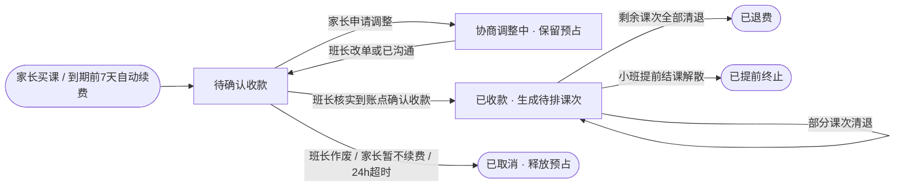
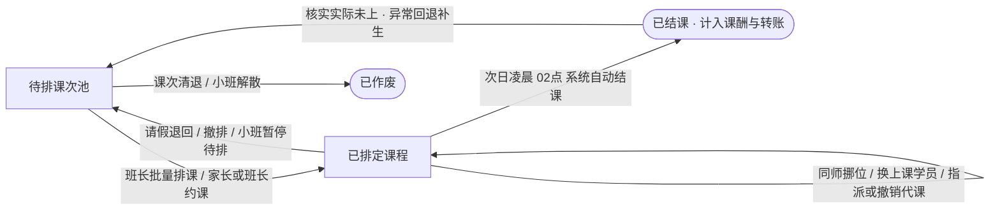
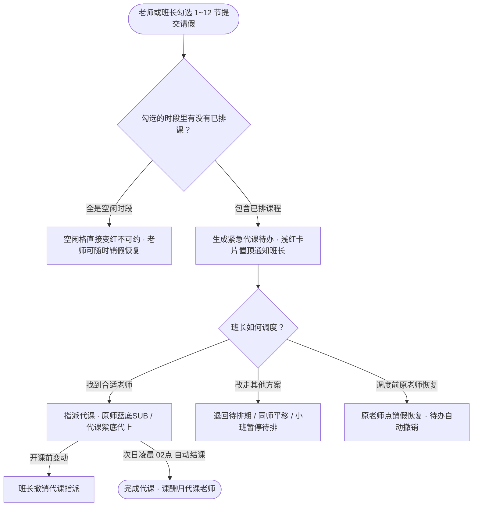
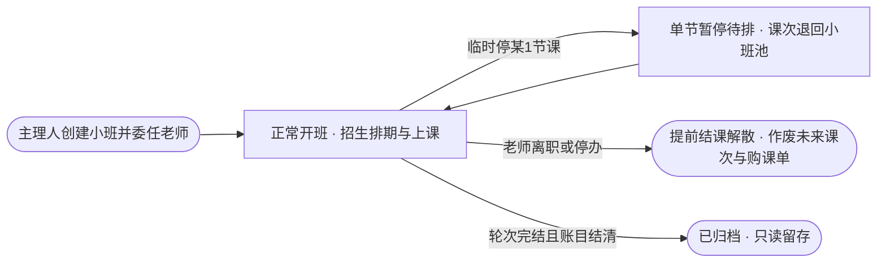

# Dream 班长使用手册

> **适用对象**：Dream 平台带班班长（兼任家长或小班主理人时同样适用）  
> **阅读说明**：本手册面向日常教务办公，全文使用通俗易懂的语言编写。你可以在前两部分快速上手日常操作，在第三部分通过流程图看懂每项业务的流转过程、班长处理要点与各端协作变化，在第四、五部分速查界面分工与核心规则。

---

## 0. 手册导读

| 你现在想做什么？ | 看哪一部分？ |
| :--- | :--- |
| 我是新任班长，想跟着走一遍“看首页 → 进教务中心救场 → 查经办记录” | [第一部分：入门教程](#第一部分入门教程--班长的第一单教务闭环) |
| 我要处理具体工作（排课、管老师/小班、录单续费退费、代课调课、周一转账等） | [第二部分：日常实操指南](#第二部分日常实操指南) |
| 我想用流程图看懂各项业务的流转过程、班长处理要点与各端联动 | [第三部分：核心业务流转图解](#第三部分核心业务流转图解) |
| 我想快速查底部导航分工、教务中心 8 大入口、7 色课表与待办颜色 | [第四部分：界面与规则速查](#第四部分界面与规则速查) |
| 我想了解制度原因（为什么谁收款谁转账、为什么不锁班长 3 小时） | [第五部分：核心规则解析](#第五部分核心规则解析) |

---

## 第一部分：入门教程 · 班长的第一单教务闭环

> **本节目标**：用 5 分钟带你走通一次“看公私分区首页 → 处理一条紧急代课待办 → 回看经办记录”的完整流程。

### 1.1 登录并认识“上公下私”首页

1. 登录 Dream 后默认进入 **【首页】**（底部第 1 个图标）。
2. 如果你同时也是自己孩子的家长，首页已经自动把“公事”和“私事”分成上下两块，互不串扰：
   - **上半区（教务工作）**：第 1 行是班长 4 个常用快捷入口，紧接着是一条精简的**教务概览条**，直接显示你名下的 `所辖学员`、`所辖教师`、`负责小班` 数量，右侧有一个 **`[ 进入教务中心 ↗ ]`** 按钮。
   - **下半区（自家孩子）**：第 2 行是家长快捷入口，下方只展示你自家孩子的上课与续费提醒，不会混入外部学员。

### 1.2 进入【教务中心】处理第一条紧急待办

1. 点击首页教务概览条右侧的 **`[ 进入教务中心 ↗ ]`**，或点击底部第 3 个图标 **【教务中心】**。
2. 顶部有 8 个功能入口，其中需要你及时处理的入口（如 `今日调度`、`购课续费`、`退款管理`、`周转账单`）在有待办时右上角会亮小红点。
3. 往下看待办列表，排在最顶部的**浅红色紧急卡片**就是最急迫的事项（例如 `老师请假待代课`）：
   - 点击卡片上的 **`[ 指派代课 ]`**，页面会直接打开原任老师周课表里对应的那一节课。
   - 系统已经把全平台当时有空的老师按“**曾教过这名学员 → 价位相同或相近 → 本周排课较少**”排好了顺序，选一位合适的老师点击确认即可。
4. 回到 **【教务中心】**，点击第 2 行最右侧的 **【📜 经办记录】**，可以看到你刚才操作的这笔代课指派已经自动记入流水，方便随时回查。

---

## 第二部分：日常实操指南

### 2.1 学员管理与排课（档案、买 4 排 4、换上课学员）

1. **查看与维护所辖学员（教务中心 →【👥 所辖学员】）**：
   - 支持按姓名或家长手机号快速查找学员，点开档案抽屉即可查看：**剩余未排课次、已排待上课程、在学课件（最多 6 个）、学员备注**以及档案修改记录。
   - 如果试课学员的家长已经注册账号，班长可在试课详情中协助输入家长注册邮箱完成绑定认领。
2. **新购固定位“买 4 排 4”批量排课**：
   - 从待办卡进入排课工作台，先选定目标老师，系统会同时校验接下来连续 4 周同一时段是否都空闲，确认后一键锁定 4 周固定位。
3. **老师课表空闲格直接代约**：
   - 点开所辖老师的周课表，点击任意绿色“约”单元格，可直接为已购课学员代约 1～4 节连课（系统会自动提醒学员同一时间是否已在其他老师处撞课）。
4. **更换实际上课学员（仅限 1 对 1 课程）**：
   - 在周课表点击已排课格，在底部抽屉选择 **【换上课学员】**，按学员唯一英文名搜索并选中新学员即可完成更换（无需同一家庭；原购课单的付款家长与资金归属保持不变）。

---

### 2.2 老师团队与小班主理

#### 管理负责老师（教务中心 →【👨‍🏫 负责老师】）
- **新建老师**：点击【新建老师】，填写英文展示名、价位档位、所属班长、中英双语简介、风采相册、试讲视频及 ClassIn 二维码后即可上线接课。
- **协助维护老师资料与课表**：老师无法自己修改个人名片与相册，可由班长随时补充更新；点击老师卡片上的 ClassIn 按钮可直接查看二维码图片。
- **调整老师临时可约时段**：在老师周课表中，班长可帮老师在灰色“休”格批量 **【加开时段】**，也可在绿色“约”格点击 **【锁定时段 / 设为不可约】**，或代老师发起请假与销假。
- **长期休假与办理离职**：
  - 老师需要全天或跨周长假时，可将其标记为“长期休假”（选课大厅会提示暂不接新约），期满或销假后恢复。
  - 办理老师离职前，系统会强制校验三项：**未来临时课全部清零、未来固定位全部清零、名下负责的小班全部交接或解散**，三项全部通过后才可办结离职。

#### 主理小班课（教务中心 →【🏫 主理小班】）
- **创建与委任老师**：填写小班名称、人数上限、单节课酬与分成比例即可创建；创建后可委任全平台任意在职老师上课（尚未绑定老师时暂不允许购课和排课）。
- **日常运营**：可在小班详情中管理学员进班/退班、查看小班 4 周排期。
- **暂停待排 vs 提前解散 vs 归档**：
  - 仅临时停某 1 节课：在课格抽屉选择 **【暂停待排】**（区分“老师原因暂停 → 原时段标红不可约”或“节假日全班调休 → 原时段释放为绿色可约”），课次退回小班池择期补排。
  - 老师离职或停办整班：在小班详情点击 **【提前结课解散】**，系统会作废未来所有已排和待排课次，并联动终止关联的小班购课单。
  - 轮次上完且不再续开：确认无未来未上课次且账目结清后，点击 **【归档小班】**。

---

### 2.3 购课录单、续费协商与课次清退

1. **线下收款与录单（教务中心 →【📋 购课续费】）**：
   - 为学员录入 1 对 1 固定位、1 对 1 临时课/试课或小班购课单。
   - 核实家长线下转账到账后，点击 **【确认收款】**，系统立即按购买节数生成对应待排课次，并将这笔钱的收款人锁定为**你本人**。
2. **跟进 1 对 1 到期自动续费单**：
   - 固定位在最后一周的周一早上 08:30 会自动生成下一轮续费单，并提前帮学员预占好原老师的同一时段。
   - **当家长点击【申请调整】时**：该单会在你的待办里自动置顶，并标出 **`家长申请调整`** 和家长的留言摘要。你在点【确认收款】之前，可以点 **【修改购课单】**（调时段、换老师、增减节数或改实收金额）或 **【标为已沟通】**。
   - **当家长放弃续费或超时未付**：家长点击【暂不续费】，或直到开课前 24 小时仍未确认收款，系统会自动作废续费单并释放预占时段；未付款的普通草稿单也可由班长手动点【作废】。
3. **课次清退（教务中心 →【↩️ 退款管理】）**：
   - 只能清退**还没有排上日程的有效课次**（已排上日程的需先撤排退回）。
   - 支持部分清退或全部清退；如果一笔购课单的剩余有效课次被全部清退，该订单会自动标为已退费。

---

### 2.4 日常调课、今日调度与突发请假代课

#### 用好【📅 今日调度】同屏看全局
进入 **教务中心 →【📅 今日调度】**，可以按“今天 / 明天 / 后天”日维度同屏看到你管辖的所有老师和当天的课表，适合早晚高峰集中处理临时调课、代请假与找代课，不用在多个老师课表之间来回切。

#### 在周课表 3 层抽屉就地调课与救场
在老师周课表点击任意已有排课格，底部会滑出操作抽屉（如果当天有连续两节 50 分钟连堂课，顶部默认勾选连带两节，也可取消勾选只操作单节）：

1. **指派代课 / 撤销代课**：
   - 点击 **【指派代课】**，系统自动筛出全平台在目标时段（含连选多节或小班 1 小时双格）都有空的老师，并标出“曾教过该学员/本班”、价位差异和本周已排节数；不满足条件的老师会置灰并写明具体原因（如 `19:30 已有课`）。
   - 如果实在找不到老师同时接多节连课，可减少连选节数拆开指派，或改走【退回待排期】/【同师挪位】。
   - 开课前如需换回或取消，可在原面板点 **【撤销代课指派】**。
2. **请假退期待排 & 同师挪位（班长不锁 3 小时）**：
   - **请假退期待排**：释放老师该时段变为绿色可约，课次退回学员待排池。如果距离开课**不足 3 小时**，系统会弹出温和提示并显示该学员近 30 天临期变动次数，你可以二选一：**【通融退回待排期】**（不扣课次）或 **【按学员旷课扣 1 节】**（保障老师课酬）。
   - **同师挪位**：点击后课表立即高亮原老师其他空闲绿格（同时自动置灰学员已经排了其他课的撞课时段），点选目标绿格即可完成平移；如果这节课原本已指派代课，挪位后会自动解除原代课。
3. **撤排退回课次（仅未上课显示）**：
   - 对尚未开课的排期，可在抽屉底部危险区点 **【撤排退回课次】** 直接退回待排池。
4. **考勤异常标记与回退补生**：
   - 正常课程会在次日凌晨 02:00 自动结课，日常无需手动点出勤。
   - 如发生爽约，可标为 **【学员旷课】**（照常扣课并计入老师课酬）或 **【老师旷课】**（剔除老师该节课酬，课次退回或补生）；误标可在周结算前点【恢复为正常出勤】纠偏。
   - **异常未上课回退补生**：如果某节课系统已经自动结课、但事后核实其实没上成（且还没进已确认的周转账单），在抽屉底部危险区点击 **【异常未上课回退补生】**，作废原课次、剔除课酬并原单补生 1 节全新待排课次。

---

### 2.5 每周一核对并上交周转账单（教务中心 →【💰 周转账单】）

1. **自动生成草稿**：每周一凌晨 03:30，系统自动把上周已经结课、且收款人是你本人的课次打包生成一张周转账单（办理班长离职移交时也会触发打包）。
2. **线下打款并上传凭证**：核对账单里的逐节明细无误后，线下向平台转账，点击 **【去上交并打款】**，上传 **1～5 张**转账截图凭证并点 **【确认已转账】**，单据提交给管理员核验。
3. **被驳回后的处理**：如果管理员核对银行流水时发现金额不符、凭证模糊或课次存疑而驳回，账单会**保留原有明细并退回草稿**，同时显示具体驳回原因；你只需按原因核对补充后重新上传提交（如明细有误需重算，也可先作废草稿）。

---

### 2.6 消息中心、沟通留言与经办记录

- **消息中心（顶栏 🔔 铃铛）**：重要变动（如老师临期请假、续费申请调整、转账单被驳回）会生成浅红紧急或浅黄提醒卡片；点开卡片原地展开中英双语详情并自动消红点；如果当时没空处理，可点左下角 **`[ 标为未读 ]`** 让它恢复警示提醒，避免遗忘。
- **学员备忘双权限**：给学员写备忘时注意区分——**公开留言**家长和老师都能看；**内部备注**只有老师、班长和管理员可见，适合写教务交接与学情提醒。
- **经办记录（教务中心 →【📜 经办记录】）**：你经手的所有约课排课、指派/撤销代课、代请假挪位、考勤标记与异常回退，都会按时间倒序永久记录在此，支持按时间和操作类型筛选，随时与老师或家长对账。

---

## 第三部分：核心业务流转图解

> **说明**：下面用通俗流程图展示与班长直接相关的 **6 条核心业务主线**，并在每张图下方说明**班长处理要点**与**联动影响与协作提示**。

---

### 3.1 购课、自动续费与退费流转

- **班长处理要点**：
  - 收到家长线下转账后，及时进【购课续费】核对金额并点击 **【确认收款】**，只有确认收款后学员才会真正拿到待排课次，同时收款人会锁定为你本人。
  - 看到置顶的 **`家长申请调整`** 续费单时，先与家长沟通，在【修改购课单】里调好时段/老师/节数/金额后再确认收款；如果家长明确不续了或要退未排课次，及时作废或走清退。
- **联动影响与协作提示**：
  - **家长**：续费单提前 7 天自动生成并预占原老师时段；不满意可点【申请调整】，放弃可点【暂不续费】；若直到开课前 24 小时仍未付款，预占会自动释放。
  - **老师**：续费单还没确认收款前，课表上对应时段会显示橙色虚线 **`【预】`** 字样，代表正在等家长续费确认；一旦班长确认收款，就会转为正常排课。

---

### 3.2 约课、调课与上课结课流转

- **班长处理要点**：
  - 负责把待排课次按 4 周买 4 排 4 或单节补排落到老师课表上；遇突发情况时帮学员办理【请假退期待排】、【同师挪位】、【换上课学员】或【撤排退回课次】。
  - 如果一节课系统在凌晨 02:00 自动结课了、但事后核实其实没上成（且尚未完成周转账归集），由班长在课格抽屉执行 **【异常未上课回退补生】**，把原课次作废并给学员补回 1 节新课次。
- **联动影响与协作提示**：
  - **老师**：课表上有绿色“约”代表可约；已排定课程在次日凌晨 02:00 会自动结课并计入课酬，**老师下课后不用手动点出勤**，只需更新课件进度和学员备忘即可。
  - **家长**：开课前 24 小时及以上可自助请假、3 小时及以上可自助同师挪位；超过时限需联系班长处理。

---

### 3.3 老师请假与代课安排流转

- **班长处理要点**：
  - 一旦看到浅红紧急卡片 **`老师请假待代课`**，点击 **`[ 指派代课 ]`** 直达原任老师课格面板，结合面板顶部原老师留下的课件进度与交接备注，优先选“曾教过该学员/本班、价位匹配、本周负荷较轻”的空闲老师接手。
  - 当你把一次请假下**最后一节受影响课次**全部安排妥当后，这张请假单会自动收口完结。
- **联动影响与协作提示**：
  - **原任老师**：突发状况随时可在课表抽屉批量勾选 1～12 节请假（不锁 3 小时入口），若含已排课建议顺带填一下交接课件与备注，方便代课同事备课；被代上的课在课表上显示蓝色 `[SUB]`，该节不计入本人课酬。如果只是空闲格请假，之后有空了随时点红色格子【恢复可约 / 销假】即可。
  - **代课老师**：被指派代课后首页会收到紧急变动通知条，课表显示紫色 `[代上]`；打开课格就能直接看到原老师更新的交接备注；完成授课后课酬节数 100% 计入你本人的周课酬单。

---

### 3.4 老师入职、休假与离职交接流转

- **班长处理要点**：
  - 负责为名下新老师建档、维护中英简介/相册/ClassIn 二维码，以及协助处理长期休假与复原。
  - 办理老师离职时，必须先把该老师名下**所有未来临时课、未来固定位和负责的小班**全部交接或清零，三项检查全部通过才能办结离职。
- **联动影响与协作提示**：
  - 个人简介、展示照片、试讲视频和 ClassIn 二维码均由班长或管理员在后台统一更新；老师自己在【我的名片】中看到的是与家长端一致的只读预览效果。

---

### 3.5 小班开班、上课与解散归档流转

- **主理人处理要点**：
  - 创建小班后记得委任执教老师，否则无法购买和排课；日常管理学员进退班与 4 周排期。
  - 遇到小班老师临时请假时，先看能否在全平台筛出连续 1 小时双格空闲的老师代课；实在无人可代再选择 **【暂停待排】**，并直接在微信群通知小班家长。
- **联动影响与协作提示**：
  - 小班课在周课表上固定占 **1 小时（双倍高度）**，呈青绿色粗框并带有 **`[G]`** 徽标和在读人数；遇到小班代课时，系统会自动只筛选连续 1 小时完整空闲的老师。

---

### 3.6 每周一收款归集与转账流转

- **班长处理要点**：
  - 每周一早上留意邮件和【周转账单】红点，核对账单里每一节由你收款的已结课明细，线下转账后上传 **1～5 张**截图凭证提交。
  - 如果被管理员驳回，账单会保留原明细并退回给你，同时写明驳回原因，核实补充后重新提交即可。
- **联动影响与协作提示**：
  - 班长的周转账单只核算“家长把钱交给了班长、再由班长上交平台”的资金归集，**不影响老师周课酬单的生成**——老师只需在自己的【周课酬单】中核对实际授课节数即可。

---

## 第四部分：界面与规则速查

### 4.1 班长端 4 个底部导航分工（公私绝对隔离）

| 底部导航 | 页面职责 | 隔离规则 |
| :--- | :--- | :--- |
| **首页** | 上半区：班长入口 + 教务概览条；下半区：自家孩子事项 | 上公下私分区展示，不放教务待办数字红点 |
| **学员课表** | 自家孩子的 7 色周课表（顶部支持切换孩子） | **仅限自家孩子**，不混入外部学员 |
| **教务中心** | 外部学员、负责老师、主理小班与全部对公待办 | **纯对公**：不混入自家孩子，**不显示正常待上课** |
| **我的** | 自家多孩档案、自家购课账单、账号安全与语言切换 | **纯对私**：不放周转账单、学员或老师管理入口 |

### 4.2 【教务中心】8 个快捷入口与红点规则

- **第 1 行（对象与今日调度）**：`👥 所辖学员` ｜ `🏫 主理小班` ｜ `👨‍🏫 负责老师` ｜ `📅 今日调度` *(仅“今日调度”在有待办时亮小红点)*
- **第 2 行（单据与经办记录）**：`📋 购课续费` ｜ `↩️ 退款管理` ｜ `💰 周转账单` ｜ `📜 经办记录` *(前 3 项在有待办时亮小红点)*
- **待办卡片分级与排序**：
  - **浅红色紧急卡（永远置顶）**：`老师请假待代课`、`1v1 续费时段冲突调解`。
  - **浅黄色提醒卡（排在其后）**：`小班待补排`、`老师离职交接`、`转账差额待补凭证`、新购待排、待确认收款/续费、待审核退款、待上交周转账单。

### 4.3 7 色周度日历速查表

| 颜色 | 含义 | 颜色 | 含义 |
| :--- | :--- | :--- | :--- |
| 🟠 橙色细框 | 1v1 固定位 | 🟠 橙色虚线 | 1v1 续费预占【预】 |
| 🟡 黄色细框 | 1v1 临时课 / 试课 | 🟩 青绿粗框 | 1vN 小班课 `[G]`（双格 1 小时） |
| 🔵 蓝色细框 | 原师被代课 `[SUB]` | 🟣 紫色细框 | 代课老师代上课 `[代上]` |
| 🔴 红色细框 | 请假时段（“假”） | ⚪ / 🟢 细框 | 灰色不可约（“休”） / 绿色可约（“约”） |

---

## 第五部分：核心规则解析

### 5.1 为什么“谁收款就由谁转账”，且不随代课或换学员改变？
家长把购课款线下转给你、你点击【确认收款】的那一刻，资金就已经实际进了你的账户。如果后续因为老师请假找了另一位班长名下的老师代课、或者把课转给了另一位学员上，就把这笔钱的账单归属转移走，就会出现“钱还在你手里、对账单却跑到别人名下”的混乱。因此系统规定：**谁收的钱，这批课次无论谁来代课或换谁上课，最终都由收款班长在周一通过【周转账单】统一上交平台**。

### 5.2 为什么班长操作不锁 3 小时，却要弹出提醒并显示学员近 30 天变动次数？
家长端限制 24 小时内不能自助请假、3 小时内不能自助挪位，是为了防止临时随意爽约；而真正遇到突发紧急情况时（比如家长微信临时联系、老师开课前断网），需要班长在后台立刻拍板兜底。因此系统对班长**完全不锁时间门槛**，只在不足 3 小时时弹出温和提醒并顺带列出该学员近 30 天临期变动次数——既让你能马上救场，也给你足够的依据判断本次应该【通融退回】还是【按学员旷课扣 1 节】保护老师利益。

### 5.3 为什么【教务中心】不显示正常“待上课”？
班长同时管着几十位学员和多位老师，每天都有大量正常履约的待上课。如果把不需要你人工干预的正常待上课也全部堆进教务中心，真正需要你立刻救场的**浅红紧急代课**、**续费冲突**和**待审单据**就会被淹没。正常待上课交给老师首页和各自课表去展示，教务中心只聚焦“需要你做决定或经办的事”。
