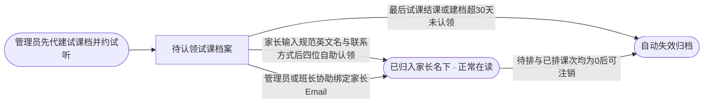
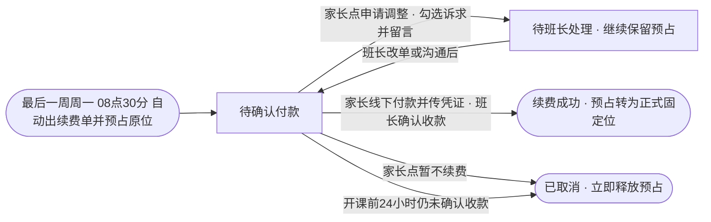
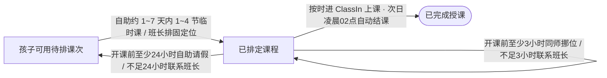

# Dream 家长使用手册

> **适用对象**：Dream 平台家长（包括单孩与多孩家庭、试课转正新家长）  
> **开课前重要提醒**：你**注册时使用的 Email** 也会作为后续接收所有系统通知（如续费账单、课表变动、代课与临期提醒）的邮箱，请务必保证手机上对应 **Email App 的通知提醒处于开启状态**。

---

## 0. 手册导读

| 你现在想做什么？ | 看哪一部分？ |
| :--- | :--- |
| 我是新家长，想跟着走一遍“认识首页 → 认领或添加孩子 → 进教室上课” | [第一部分：入门教程](#第一部分入门教程--第一次带孩子在-dream-上课) |
| 我要办具体事情（约临时课、请假挪位、处理续费账单、切多孩、看课件与备忘） | [第二部分：日常实操指南](#第二部分日常实操指南) |
| 我想用流程图看懂试课认领、自动续费和约课调课是怎么流转的 | [第三部分：核心业务流转图解](#第三部分核心业务流转图解) |
| 我想快速查底部导航分工、家庭信息流、7 色课表与自助时间门槛 | [第四部分：界面与规则速查](#第四部分界面与规则速查) |
| 我想了解规则原因（为什么临时约课限 1～7 天、为什么提前 7 天发续费单） | [第五部分：常见问题与规则解析](#第五部分常见问题与规则解析) |

---

## 第一部分：入门教程 · 第一次带孩子在 Dream 上课

> **本节目标**：用 5 分钟带你走通一次“认识家长首页 → 添加或认领孩子档案 → 带孩子进 ClassIn 上课”的完整流程。

### 1.1 登录并认识家长首页

1. 使用注册时的 **Email** 登录 Dream，系统会自动进入 **【首页】**（底部第 1 个图标）。
2. 页面上方是 4 个常用快捷入口：**约临时课**、**学员档案**、**在学课件**、**购课/账单**。
3. 下方是 **【家庭信息流】**，按固定顺序展示家里最需要关注的事项（有则显示、没有就自动隐藏）：**通知 → 课程 → 提醒 → 资产 → 课件**。
4. 如果家里有多个孩子，在【家庭信息流】标题行右侧可以直接切换查看单个孩子，或选“全部”。

### 1.2 添加孩子或认领试课宝贝

- **新添加孩子**：进入底部 **【我的】**（第 4 个图标）→【多孩档案】，或点击课表顶部的孩子切换器 **【+ 添加新宝贝】**，填写孩子英文名、年龄与基础信息即可创建（单个家长账号最多可添加 **10 个**孩子）。
- **如果孩子之前先试过课**：管理员已经为孩子建过试课档案时，无需重新建档。点击孩子切换器底部的 **【🔗 认领试课宝贝】**，输入孩子的**规范英文名**以及当时预留的**家长联系方式后四位**，验证通过后试课档案与剩余课次就会直接归入你的名下。

### 1.3 课前准备与扫码添加老师 ClassIn 好友

1. **跟新老师第一次上课前**：请先在【约课大厅】点开该老师名片（或点击首页课程卡右下角的 **`ClassIn 二维码 →`**），**扫码添加老师的 ClassIn 二维码为好友**，确保老师能顺利拉孩子进班或同步课堂。
2. 在首页【家庭信息流】的 **课程卡** 上，可以看到全家庭最近一节待上的课（包含孩子名字、上课时间、授课老师、授课进度和开课倒计时）。
3. 上课前可点击【在学课件】确认今天要学的教材级别，点击【学员备忘】浏览老师留下的课堂复习或预习建议。
4. 临近开课时，直接在本地打开 **ClassIn** 客户端即可进班上课；若更换了新老师或代课老师，也可在课程卡或【学员课表】课格抽屉中随时查看该老师的 **ClassIn 二维码**。

---

## 第二部分：日常实操指南

### 2.1 如何为孩子自助预约 1 对 1 临时课

联系班长购买 **1 对 1 临时课次**（1～20 节，支持在同一单内按不同老师价位分别购买，如 `18 积分 × 1 节` + `21 积分 × 1 节`）后，即可在未来 **1～7 天**内自助预约对应价位的空闲老师（每个价位的待排课次仅能约同价位老师，不跨价位兼容；当天及 7 天以后不可自助临时约）：

#### 方式 A：在【约课大厅】选老师预约
1. 点击底部第 3 个图标 **【约课大厅】**（或首页快捷入口 **【📅 约临时课】**），页面会直接展示全平台在职老师风采列表。
2. 点开老师名片，可以查看老师的中英简介、风采相册、试讲视频、ClassIn 二维码以及未来 1～7 天的绿色可约时段（**如果是第一次跟该老师上课，记得顺手扫码加上老师的 ClassIn 好友**）。
3. 选好合适时段并确认预约节数后提交，系统自动扣减待排课次并锁定课程。

#### 方式 B：在【学员课表】空闲绿格直接预约（支持 1～4 节连约）
1. 进入底部第 2 个图标 **【学员课表】**（若有多孩，先在顶部切换目标孩子）。
2. 点击未来 1～7 天内你想上课的 **🟢 绿色“约”单元格**，底部滑出预约抽屉：
   - **选择连约节数（1～4 节）**：可选 `1 节 (25分钟)`、`2 节 (50分钟)`、`3 节 (75分钟)` 或 `4 节 (100分钟)`。如果孩子剩余待排课次不够、孩子在后续时段已经有别的课，或者没有老师能连续空出这么多节，对应档位会自动置灰并提示原因。
   - **挑选老师**：系统已自动筛选出能连续空出所选节数的老师，并按 **“曾教过该孩子 → 匹配当前课次档位 → 本周空闲较充足”** 排好序，默认帮你预选首位推荐老师，你也可以点击切换或按老师姓名搜索。
   - **确认预约**：核对下方显示的消耗节数与剩余待排临时课次后点击 **【确认预约】**，课表上立即出现对应节数的黄色临时课；后续提前 24 小时请假退回时，会原路退回为 1 节待排临时课次，方便你重新预约其他老师。

---

### 2.2 如何给已排课程请假或同师挪位

在 **【学员课表】** 中点击孩子已经排好的 1 对 1 课程（橙色固定位、黄色临时课或蓝色代课），在底部弹出的抽屉中可以自助处理：

1. **请假退回待排期（需距离开课 ≥ 24 小时）**：
   - 点击 **【请假退期待排】**（同一天连上多节可连带勾选合并请假），确认后这节课会取消排期并退回孩子的待排课次池，以后可以重新约。
   - **如果距离开课不足 24 小时**：按钮会置灰禁用，请直接微信联系你的负责班长协助处理。
2. **同师挪位（需距离开课 ≥ 3 小时）**：
   - 点击 **【临时挪位 / 挪位】**，课表会自动高亮同一位老师本周或近期其他绿色可约时段（并自动把孩子同时段已有其他课的冲突时段置灰，防止撞课）。点选新时段确认即可完成平移，无需重新扣减课次。
   - **如果原本那节课处于代课状态**：挪位目标老师仍为**原任老师**，挪位成功后原代课安排会自动解除。
   - **如果距离开课不足 3 小时**：按钮会置灰禁用，请联系班长协助处理。
3. **如果老师临时请假了怎么办？（固定课与临时课通用）**：
   - 老师请假后系统会第一时间通知你。**距离开课 ≥ 3 小时**时，点开该课格可以直接选择 **【换同价位老师代上】**（原时间不变）或 **【退回待排期】**（退回后可另约其他时间）。
   - **距离开课不足 3 小时**时，为避免新换的老师未在线而耽误上课，系统不再支持直接换老师，你可以点 **【退回待排期】** 留待以后再约，或点 **【💬 联系班长微信】** 由班长确认好在线老师后再帮你指派。
   - 如果到原定下课时间你和班长都没来得及处理，系统会**自动把这节课退回为待排课次**，不会误扣你的课时。

---

### 2.3 如何处理 1 对 1 固定位自动续费账单

如果你的孩子报了 4 周固定位课程，在当前轮次最后一周（第 4 周）的**周一早上 08:30**，系统会自动为孩子生成下一轮续费账单并预占好未来 4 周课表：

- **排课安排怎么产生**：系统会以孩子**本轮常规固定位课表**为基准，**自动排除本轮内单次偶发请假、临时挪位等变动干扰**，把原本每周固定的授课老师与上课时段完整延续到下一轮的未来 4 周。
- **具体课次数与计价怎么算**：按下一轮 **4 周标准周期**完整计算总课次数（例如每周二、周四各 1 节，一轮自动按 `2 节/周 × 4 周 = 8 节` 生成），并按授课老师**当前最新价位**核算费用。

进入 **【我的】→【购课与账单】**（或点击首页黄色【提醒卡】上的 `去续费`），在待付款续费单上你有 3 个选择：

1. **继续按原排期续费**：
   - 线下向班长或平台付款后，可在账单页点击 **【上传付款凭证】** 方便班长快速核对；班长确认收款后，预占时段即刻转为正式固定位排课。
2. **想换时间、换老师或改节数（【申请调整】）**：
   - 点击 **【申请调整】**，勾选诉求标签（如更换上课时段、更换授课老师、调整每周课次、其他说明）并填写补充留言后提交。
   - 提交后**系统会继续为你保留原有的预占时段**（防止协商期间时段被他人约走），同时你的诉求会置顶推送给班长跟进修改。
3. **本轮暂时不续了（【暂不续费】）**：
   - 点击 **【暂不续费】** 并二次确认后，续费单立即取消并释放预占时段，同时通知班长不再催办。

> **重要时间截点**：如果直到下一轮第一节课**开课前 24 小时**，班长仍未确认收到你的续费款项（即使你上传了截图或提交了调整申请但未谈妥付款），系统会自动取消该续费单并释放预占时段。

---

### 2.4 如何切换多孩视角与查看课件、老师备忘

1. **【课次资产与账单】页面（首页 `💳 购课/账单` 或 `资产卡 → 查看明细` 直达）**：
   - 同屏清晰展示三项资产：**临时课待排课次**（按所购价位分别展示）、**固定位待排课次**以及**已约待上课程**；
   - 下方提供 **`[ 购课与续费单 ]`** 与 **`[ 课次变动明细 ]`**（每一笔购课、约课、请假退回或课次清退记录）切换。
2. **切换孩子**：
   - 在 **【首页】** 标题行右侧切换：2 个孩子时直接点姓名分段标签（如 `全部 / Alice / Bob`）；3～10 个孩子时点击 `全部孩子 (N) ▾` 在抽屉里直接点选。
   - 在 **【学员课表】** 顶部常驻孩子切换器与剩余课次胶囊（如 `👧 Alice · 剩余: 5 节 ▾`），点击胶囊可随时查看该孩子详细的待排课次与已排课程明细。
3. **查看与更新在学课件及学习进度**：点击首页 **【📚 在学课件】** 或课表抽屉内的课件进度，可查看或调整孩子当前在学的教材、级别及**学习进度**（如 `Unit 3 · Page 24`，老师、家长、班长均可更新，每个孩子最多同时关联 6 个在学课件；家长修改后系统会通知班长和授课老师）。每门课件还会展示**最后更新人**、**更新次数最多的主力老师**，以及超过 6 个月未更新时的 **“近 6 个月没有更新”** 提醒。
4. **查看老师课堂备忘**：在学员档案或课后动态中可查看老师公开发布的课堂表现、学习特点与复习建议（与具体单元/页码的课件学习进度分开展示）。

---

### 2.5 消息中心、账号安全与中英文切换

- **消息中心（顶栏 🔔 铃铛）**：
  - 点击未读消息卡片会原地展开完整的中英双语内容并自动标记为已读（铃铛红点减 1）；如果当时没空处理，可点击卡片内的 **`[ 标为未读 ]`** 恢复警示提醒，避免遗忘。
- **账号安全与语言（底部【我的】）**：
  - 支持修改登录密码、换绑邮箱或手机号、清理本地缓存，以及随时切换系统显示语言（中文 / English）。

---

## 第三部分：核心业务流转图解

### 3.1 试课认领与建档流转

- **家长处理要点**：
  - 如果孩子是先联系老师或管理员试听的，注册账号后直接用【认领试课宝贝】绑定即可，无需再建一个重复档案；如忘记规范英文名，可向班长或管理员询问后绑定。
- **联动影响与协作提示**：
  - 试课档案若超过 30 天未认领会自动失效归档，避免英文昵称被长期占用；平时多孩家庭自己在【多孩档案】添加孩子会直接生效，无需认领步骤。

---

### 3.2 1 对 1 固定位自动续费与协商流转

- **家长处理要点**：
  - 收到续费账单与邮件提醒后，尽早决定：按原样续费就付款并上传凭证；想改时段或老师就点【申请调整】；确认不续请点【暂不续费】。
- **联动影响与协作提示**：
  - 【申请调整】期间系统会替孩子稳稳锁住原老师时段，不会在沟通途中被别人约走；但务必留意**开课前 24 小时**的最终截止节点，避免超时自动释放。

---

### 3.3 约课、请假与挪位流转

- **家长处理要点**：
  - 遇到临时有事时，优先记住两条自助线：**请假提前 24 小时、同师挪位提前 3 小时**；超过这个时间窗请在微信上联系负责班长帮你处理。
- **联动影响与协作提示**：
  - 如果原本的老师临时请假，班长安排了其他老师代课，孩子课表上这节课会变成蓝色并标注代课老师姓名与 `[SUB]`，上课时间不变，你也会收到邮件与站内通知；若未曾加过代课老师好友，可直接在课格抽屉里扫码添加其 **ClassIn 二维码**。

---

## 第四部分：界面与规则速查

### 4.1 底部 4 个主导航分工

| 底部导航 | 页面内容 |
| :--- | :--- |
| **首页** | 4 个快捷入口 + 家庭信息流（通知 / 课程 / 提醒 / 资产 / 课件，各展示全家庭最关键的一张代表卡） |
| **学员课表** | 孩子的 7 色周度日历（多孩家庭可在顶部切换孩子），支持点绿格约临时课、点已排课格查老师 ClassIn 二维码/请假/挪位 |
| **约课大厅** | 直接展示全平台在职老师列表与简介、试讲视频、可约时段，方便挑老师约 1 对 1 临时课 |
| **我的** | 多孩档案管理、认领试课宝贝、购课与续费账单（含负责班长微信二维码）、账号安全与中英文切换 |

*(注：遇到临期无法自助请假/挪位、或需联系负责班长排课/续费时，可在课格抽屉、首页提示及购课单详情页点击 **【💬 联系班长微信】** 一键扫码添加。)*

### 4.2 7 色周度日历速查表

| 课格样式 | 含义 | 课格样式 | 含义 |
| :--- | :--- | :--- | :--- |
| 🟠 橙色细框 | 1 对 1 固定位课程 | 🟠 橙色虚线 | 续费审核中的预占时段【预】 |
| 🟡 黄色细框 | 1 对 1 临时课 / 试课 | 🔵 蓝色细框 | 原任老师请假已安排代课 `[SUB]` |
| 🟢 绿色细框 | 未来 1～7 天空闲可约时段 | ⚪ 灰色细框 | 老师休息或不可约时段 |

### 4.3 自助操作时间门槛速查

| 操作类型 | 家长自助门槛 | 超过门槛怎么处理 |
| :--- | :--- | :--- |
| **预约 1 对 1 临时课** | 仅限未来 **1～7 天**（每次连约 1～4 节） | 当天紧急加课或 4 周固定位连排请联系班长 |
| **1 对 1 请假退期待排** | 距离开课 **≥ 24 小时** | 不足 24 小时联系班长协助处理 |
| **1 对 1 同师挪位** | 距离开课 **≥ 3 小时** | 不足 3 小时联系班长协助处理 |

---

## 第五部分：常见问题与规则解析

### 5.1 为什么临时约课只能约未来 1～7 天，而固定位能连排 4 周？
4 周固定位用于保证孩子每周同一时间跟着熟悉的老师稳定学习；而临时课是为灵活补课或试听准备的，如果开放过远日期的散课抢占，会把老师的长期固定位切割得支离破碎。因此自助临时约课限定在未来 1～7 天内，需要 4 周固定位时联系班长统一锁定。

### 5.2 为什么系统提前 7 天发续费单，又要在开课前 24 小时收回预占？
提前 7 天生成续费单并先锁住原位，是为了给老学员留足考虑、沟通调整和付款的时间，确保黄金时段不被别人抢走；但如果直到下一轮第一节课开课前 24 小时仍未完成收款，系统必须把空位释放出来给其他等待排课的学员，避免老师时段被无限期占空。

### 5.3 为什么家里有多个孩子时，首页只展示一张课程卡或通知卡？
如果家里有 3 个孩子、每个孩子又把所有通知、待上课、资产、课件全部摊开在首页，手机一屏就会被塞满、反而看不清最急的事。因此首页每类只精选当前最紧急的一张家庭代表卡（并提示“另有 N 个孩子/条”），需要查看单个孩子的完整排期时，直接点顶部切换器或进入【学员课表】即可一目了然。
