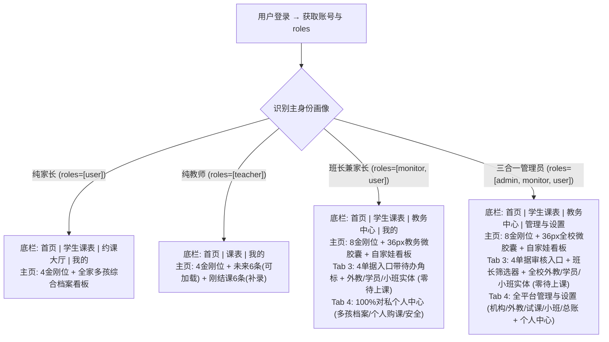

/** (c) 2024-2026 Topee (https://topee.top). All rights reserved. Proprietary and confidential. */

# 产品需求文档 (PRD) — M0：工作台与主页全域基座模块

| 元数据项 | 说明 / 内容 |
|---|---|
| **模块代号** | `m0` |
| **模块定位** | 顶层横向基座模块 (App Shell)，统领 M1–M5 五大垂直业务模块 |
| **文档状态** | 方案演进定稿版 (Architecture Evolution & Final PRD) |
| **关联顶层 PRD** | [Prd-v5.md](../Prd-v5.md) |
| **关联规范** | [DESIGN.md](../../DESIGN.md) / [CODING_STANDARDS.md](../CODING_STANDARDS.md) / [BUSINESS_RULES.md](../BUSINESS_RULES.md) |
| **创建与更新日期** | 2026-11-06 (创建) / 2026-11-07 (重大架构与体验演进定稿) / 2026-11-10 (升级外教与家长主页：全面剥离待办；外教上线前后7天待上与刚结课6+6双列表与周指标；家长端确立每孩一卡综合看板、课件列表直通与5条活动动态流；班长端落地方案二36px微胶囊；落地方案一升级教务中心Tab 3：顶部4大单据入口带动态待办角标+外教/学员/小班三大实体，禁显待上课；纯化班长Tab 4为纯私域个人中心，公事移入教务中心；落地方案A升级管理员Tab 3为教务中心：监管型4大单据+班长筛选器+全校三大实体，严禁待上课，确立Tab 3排班运营场与Tab 4机构治理场绝对物理隔离红线) |

---

## 1. 摘要 (Summary)

M0 是 Dream 的顶层横向基座（App Shell），为管理员、班长、教师、家长四类角色提供统一入口、差异化底部导航、角色主页、个人中心与管理配置出口，统领 M1–M5 五大垂直业务模块。针对多角色兼职（如班长兼家长、三合一管理员）与多孩共管场景，本版本彻底重构升级了交互哲学：
- **尽量不切换身份**：摒弃生硬的顶部强制工作台切换器，兼职身份采用“主页垂直分区聚合 + 金刚区按角色分行”模式，公私自然分流；
- **克制底部导航**：严格限制每个身份底部导航**最多 4 个图标**，按主身份进行专属定制；
- **金刚位严控**：单角色严格 4 个核心图标，双角色最多 8 个（分两行，每行 4 个，公私两行视觉隔离）；
- **主页信息流精简聚焦**：外教主页聚焦“未来 6 条（可加载更多）+ 刚结课 6 条（补录反馈）”；家长主页聚焦“多孩即将上课时间流 + 刚结课评语”；班长/三合一增加教务待办与结算双焦点；
- **多孩周课表与智能压缩排版**：家长第二个 Tab【学生课表】默认直接呈现所选孩子的**单屏 7 列周度日历网格**，全量搭载智能外接时间窗裁剪（首尾非营业时段物理隐藏，保底 6 小时）与日间长空档折叠算法，彻底取消卡片列表展示；以孩子为唯一中心（不按老师倒置切换，代课同格合并），点击单元格唤起课程详情抽屉；教师端 Tab 2【课表】与 M3A 教师排班日历 100% 物理复用同一个底层组件；
- **管理功能下沉与场域隔离**：管理员 Tab 4【管理与设置】统揽机构配置、班长管理、教师团队主数据、试课代建档及课程字典等静态治理功能，与 Tab 3【教务中心】的动态排班运营严格物理隔离。

---

## 2. 背景 (Background)

M1–M5 的 PRD 已分别定义学员与教师档案、购课与退款、7 色日历排班、通知和周度结算。在早期 M0 设计中，为了防止多角色兼职数据串扰，系统曾采用严格的“顶部工作台物理隔离”和“顶部多孩下拉切换器”。但在实际移动端真机体验（`prototype/m0_workspace_home.html`）中暴露出明显的体验痛点：
1. **身份切换心智割裂**：现实中班长普遍兼任家长，管理员往往兼任班长与家长（自家孩子上课、管所辖外教、统管平台总账）。每次要看一眼自家娃下午是否上课，先要点顶部切工作台，再下拉选孩子，层级过深、流程繁琐，不符合常规成熟 App 的直觉体验；
2. **多孩家庭看课盲人摸象**：多孩家长必须逐个在顶部切换才能获知不同孩子的上课时间，无法在一屏内通览家庭总日程；
3. **底部导航过载与网格过密**：前期移动端底部常驻 5 个 Tab 偏挤，且排课默认展示高密度 7 列周日历网格，在手机窄屏上点按容错率极低、空白格过多。

因此，本 PRD 对交互架构实施重大演进：不搞生硬隔离，也不做无序平铺，而是采用**“公私自然分流、多孩时间流聚合、吸顶锚点平滑定位、底部 4 Tab 极简克制”**的高成熟度方案。

---

## 3. 目标 (Objective)

**核心目标**：
1. **零繁琐身份切换**：兼职用户（班长兼家长、管理员兼班长/家长）登录后即在一屏内掌控全局，公事待办与家庭孩子上课双焦点一目了然；
2. **多孩日程秒级触达**：多孩家庭日程按时间流自然聚合，进入排课页通过顶部吸顶锚点 Tab 1 秒定位指定孩子；
3. **极简 4 Tab 触控标准**：底部导航严格 ≤ 4 个，金刚位单角色 4 个、双角色 ≤ 8 个，80% 高频操作首屏闭环；
4. **后台配置模块收拢**：将平台低频档案与字典管理集中收纳至管理员【我的】页面，保持业务主线清爽。

**与产品战略的关系**：M0 只做外壳、导航、权限上下文与信息流聚合，不侵入 M1–M5 核心业务逻辑与财务分账公式；所有底层业务动作仍由对应模块承载。

**关键结果 (Key Results，基线待验证)**：

- **KR1**：兼职用户（班长/管理员）确认自家娃今日上课日程与进教室的时间，由原来的平均 15 秒（需 2 次切换）缩短至 **≤ 3 秒（首屏直达）**。
- **KR2**：底部导航严格限制为 **≤ 4 个**，单屏金刚位单角色 4 个、双角色 ≤ 8 个，误触率下降 80%。
- **KR3**：多孩家长在【学生课表】中直观通览孩子整周排期并定位到指定课程详情的耗时 **≤ 2 秒**。
- **KR4**：外教主页未来上课与刚结课闭环率 ≥ 95%，课后反馈补录遗漏率降低 60%。

> KR 目标值为本稿提议，需在产品与运营确认基线后锁定。

---

## 4. 目标用户与细分 (Market Segments)

| 细分 | 他们要完成的事 | 关键约束与设计策略 |
|---|---|---|
| **多孩家长** | 确认全家孩子何时上课、如何进教室；在规则允许时请假、挪位、转让；管理多个孩子档案 | 手机为主；拒绝频繁切身份/切孩子；主页时间流聚合多孩，课表页默认 7 色周网格直观掌控周排期与空闲 |
| **班长（常兼任家长）** | 管理 50+ 学生的固定位、代课、收款与退费；同时关注自家孩子上课与约课 | 拒绝繁琐的工作台横跳；主页采用 8 金刚位双行排布 + 教务/家庭双区平铺；Tab 3 设立独立【教务中心】 |
| **教师（兼职外教）** | 看今日课表与下一节课；代课时快速接上原老师进度；补录课后反馈 | 中英双语；时间碎片化；中文阅读能力有限；主页精简为 6 条未来课（可加载更多）+ 6 条刚结课（补录反馈） |
| **平台管理员（常兼班长与家长，三合一）** | 审核转账单、核对课酬、确认平台直收、配置字典与小班；同时兼管种子外教与自家孩子上课 | 财务强一致；拒绝多层切换；首屏聚合结算待办与自家娃动态；将班长/教师/字典等低频配置下沉至【管理与设置】（我的） |

**本期范围**：四类细分全部进入首个版本。M0 是产品唯一入口，聚焦解决多角色与多孩场景下“高频动作顺畅闭环、低频配置清晰归位”。

---

## 5. 价值主张 (Value Propositions)

### 5.1 多孩家长

- **Who**：一位家长账号下挂 1–10 个孩子，负责出资、约课、请假与家校沟通。
- **Why**：想在几秒内确认“全家孩子今天什么时候上课、怎么进教室”，并在规则允许时完成请假或转让。
- **What before**：旧设计需在顶部下拉频繁切换孩子；或依赖外部微信群与文档，容易漏课。
- **How**：主页以“全家孩子时间流”为中心，多孩即将上课按开课倒计时自然混排（标注孩子名），直接呈现 ClassIn 唤醒入口；进入排课页提供吸顶锚点 Tab，点击孩子头像秒级平滑定位。
- **What after**：打开应用 3 秒内知晓全家孩子今日上课安排；多孩切换零等待。
- **Alternatives**：微信群 + 日历 + ClassIn 原生；我们胜在把多孩聚合与规则校验融于一屏。
- **Statement**：对多孩家长，Dream 把“全家孩子下一节课”放在主页，排课页点击头像秒达目标，省心直观。

### 5.2 班长（常兼任家长）

- **Who**：管理 50+ 学生与外教团队的班长，同时往往也是自己孩子的家长。
- **Why**：需要在“给自家孩子约课/看课”和“给其他学生排课、收款、调代课”之间高频兼顾，但不能混淆权限与资金账目。
- **What before**：传统工作台强制在“班长端”和“家长端”之间反复切来切去；看一眼娃要切一次，排个课又要切一次。
- **How**：免频繁切身份——主页提供 8 个金刚位（第 1 行教务管理，第 2 行家庭孩子）；主页内容区垂直分区（上方教务待办，下方自家娃上课）；Tab 3 专设【教务中心】（所辖外教、买4排4排课向导、小班课），公私物理分流。
- **What after**：生活与工作一目了然，无需在工作台之间横跳；公私账目入口天然隔离，永不串账。
- **Alternatives**：双账号切换或多系统操作；我们胜在一个账号聚合呈现且边界分明。
- **Statement**：对兼任家长的班长，Dream 让“自家孩子”与“负责学生”在主页与 Tab 间自然分流，工作生活两不误。

### 5.3 教师（兼职外教）

- **Who**：兼职外教，中英双语用户，时间碎片化，中文阅读能力有限。
- **Why**：上课前只想知道“今天几节、下一节是谁、是不是代课、原老师交代了什么”，课后想快速补齐反馈。
- **What before**：在群消息、表格和留言板之间翻找交接信息；代课时不知道原老师进度，课后容易漏写反馈。
- **How**：教师主页极简双语，4 个核心金刚位，主页精简展示“未来 6 条上课（支持加载更多 6 条）”与“刚结课 6 条（未写评语高亮补写反馈按钮）”；代课时自动浮现原老师教学交接摘要。
- **What after**：打开即上课；代课交接一目了然；课后反馈补录闭环率显著提升。
- **Alternatives**：微信群 + ClassIn 课表；我们胜在把交接、日程与反馈整合在主页 6+6 信息流中。
- **Statement**：对兼职外教，Dream 用 6+6 精简卡片驱动课前准备与课后反馈，授课无负担。

### 5.4 平台管理员（三合一管理员）

- **Who**：平台中央运营负责人，往往兼任核心外教班长，同时也是给自家孩子购课上课的家长。
- **Why**：每周固定时点必须完成转账单审核、课酬核对、平台直收确认；同时要处理负责外教的教务，还要了解自家娃上课动态。
- **What before**：三大身份来回切，迷失在多层菜单中；低频后台管理（班长列表、教师定级、字典参数）侵占过多导航空间。
- **How**：主页 8 个金刚位（公事一行、家庭一行）+ 双焦点流（上方中央结算待办，下方自家孩子即将上课）；Tab 4【管理与设置】集中收拢班长列表、教师团队、试课待认领档案与系统字典等管理功能。
- **What after**：首屏一站式掌控“全平台结算 + 自家娃上课”，低频管理功能井井有条，移动端操作流畅从容。
- **Alternatives**：笨重的 PC 端后台；我们胜在移动端优先的掌上结算与家庭合一。
- **Statement**：对三合一管理员，Dream 把全周大盘与家庭日程融汇于指尖，后台管理有序收拢，运筹帷幄。

---

## 6. 解决方案 (Solution)

### 6.1 关键流程与信息架构 (Information Architecture)

**外壳三层结构演进**：

1. **全局顶栏 (App Bar / Role Banner)**：
   - 保留各角色专属低饱和背景色（家长夜蓝、教师深青绿、班长深梅红、管理员紫夜）与暗纹理，高度紧凑收敛至 **56–64px**；
   - **动态承载真实业务标题**：首页 Banner 显示工作台名称（如 `家长工作台` / `Teacher Center` / `班长工作台` / `运营中枢`）；进入所有非首页子页面（如课表、购课、档案、转账等）后，主标题 **100% 动态切换为当前页面的真实业务大标题**（如 `学生课表`、`购课与账单`、`学员档案`、`消息中心`、`班长周转账单`）；
   - **导航层级与返回按钮**：底部 4 个主 Tab 不显示返回箭头；深入二级/三级子页面时左侧常驻 **`<` 返回按钮**；
   - **消息通知入口常驻**：Banner 右侧统一常驻白色半透明通知铃铛，带未读数角标（`1~99` / `99+`），点击直通消息中心；
   - **副标题瘦身**：彻底移除“多孩家庭 · 双语通知接收人”、“母语外教 · 双语任务与课酬”等自我解释型废话与同义徽标；默认单行纯净标题，仅在存在高价值业务上下文时展示微型辅助字；
   - **顶栏不侵占与问候语归位**：顶栏不放多孩切换器，也不放语言切换器；迎宾问候语（“晚上好，Leo / Amy”）严格仅在首页首屏承载，子页面 100% 物理禁止展示问候语。
2. **角色内容区 (Content Canvas)**：
   - **单角色**：渲染专属业务流（如外教 6+6、家长多孩时间流）；
   - **多角色兼职（班长兼家长、三合一管理员）**：采用“主页垂直分区聚合”模式，无需在不同工作台之间切进切出，上方公事待办、下方自家孩子上课，公私自然分流；
   - **卡片用途分色**：课程/任务 amber、消息/通知 indigo、资产/财务 emerald、提醒/风险 rose、备忘/中性 slate；同一卡片内标题/正文/辅助信息统一同色系；单卡 4–5 行、130–150px，390×812 一屏 3–4 张（详见 DESIGN.md 2.2.1）。
3. **极简底部导航 (Bottom Tabbar)**：
   - **底栏严控规则**：每个身份底部导航**严格限制最多 4 个图标**，杜绝 5 个及以上拥挤排布；
   - **按核心身份差异化适配**：

| 身份场景 | Tab 1 (首页) | Tab 2 (核心日程) | Tab 3 (业务中心) | Tab 4 (管理与设置) |
| :--- | :--- | :--- | :--- | :--- |
| **纯家长 (Parent)** | **首页** (金刚4 + 即将/刚结课) | **学生课表** (7 色周课表网格 + 顶部多孩切换) | **约课大厅** (选外教 / 小班课大厅) | **我的** (多孩档案 / 购课账单 / 安全) |
| **纯外教 (Teacher)** | **首页** (金刚4 + 未来6条 + 结课6条) | **课表** (7 色周度排期网格 · 直通M3A) | — *(支持3个Tab极简形态)* | **我的** (个人名片 / 课酬对账) |
| **班长兼家长 (Monitor+Parent)** | **首页** (8金刚位 + 36px教务微胶囊 + 娃综合看板) | **学生课表** (自家娃 7 色周课表网格) | **教务中心** (4单据入口带角标 + 外教/学员/小班实体，零待上课) | **我的** (100%对私：家庭多孩档案/个人账单/安全) |
| **平台管理员 (Admin 3-in-1)** | **首页** (8金刚位 + 36px全校微胶囊 + 娃综合看板) | **学生课表** (自家娃 7 色周课表网格) | **教务中心** (4单据入口带角标[周转审核/退款总审/续费/代课] + 班长筛选器 + 全校外教/学员/小班实体，零待上课) | **管理与设置** (机构/教师定级/试课/小班/总账字典 + 个人中心) |

**用户会话与多角色路由流程**：

**交互原型**：[prototype/m0_workspace_home.html](../../prototype/m0_workspace_home.html)（纯前端 Mock，支持角色、设备、多角色开关与 URL 参数直达；外教课表直通 [prototype/m3a_calendar_grid.html](../../prototype/m3a_calendar_grid.html)）

### 6.2 关键功能 (Key Features)

#### 6.2.1 全局外壳与极简 4-Tab 导航规范

- **严格 4-Tab 限制与统一命名**：移动端底部导航栏项数 $N \le 4$；左一统一为【首页】，家长/班长/管理端左二统一为【学生课表】（外教端左二为【课表】），核心日程视图均默认直观呈现 7 色周课表网格；按当前登录人绑定的最高权限与角色组合动态渲染对应导航，任何情况下严禁横向滚动或挤压形变；
- **免生硬切换原则**：取消全局顶栏的单选工作台切换器。对于拥有兼职身份（如班长兼家长、三合一管理员）的用户，登录后由主页与底栏 Tab 自然映射公私入口，不再强迫用户“换装/分身”；
- **公私物理分流防呆**：
  - 自家孩子相关（课表、购课单、请假挪位）统一收纳在 **Tab 2【学生课表】** 与首页家庭区；
  - 外部学员教务（50+ 所辖学生买 4 排 4、负责外教代课、小班运营）统一收纳在 **Tab 3【教务中心】**；
  - 严禁在 Tab 2 中混入外部学员数据，严禁在 Tab 3 中使用家长个人资金账户，从架构根源上杜绝跨角色误操作。

#### 6.2.2 角色主页与金刚位矩阵（单角色 4 个，双角色最多 8 个）

金刚位（Quick Action Grid）是高频功能的快捷跳板，统一严格采用**单行 4 个图标**的栅格布局：

1. **金刚位图标排布规约**：
   - **单角色用户（纯家长、纯外教）**：单行 4 个金刚位；
   - **双角色/兼职用户（班长兼家长、三合一管理员）**：最多 2 行、共 8 个金刚位。
     - **第 1 行【教务管理 / 平台运营】**（公事）：采用深色系或稳重微徽标（如 Slate/Amber）；
     - **第 2 行【家庭孩子 / 个人育儿】**（私事）：采用浅色系或活力微徽标（如 Indigo/Sky）；
     - 两行之间具有清晰的轻量分区标题或微视觉隔离，肌肉记忆稳定。

2. **核心推荐金刚位功能定义矩阵**：

| 角色领域 | 金刚位 1 | 金刚位 2 | 金刚位 3 | 金刚位 4 |
| :--- | :--- | :--- | :--- | :--- |
| **家长领域 (Family)** | 📅 **约临时课** (消耗TS预约空闲外教) | 🧒 **学生档案** (管理多孩资料与偏好) | 💬 **家校留言** (查看外教公开评语) | 💳 **购课/账单** (1v1购课记录与续费) |
| **外教领域 (Teacher)** | ⏰ **开放时段** (维护常规可授课时段) | 👥 **我的学生** (常客学情与熟客档案) | 📝 **写反馈** (补录教学评语与进度) | 💰 **周课酬单** (核对上课节数与薪金) |
| **班长领域 (Monitor)** | 📝 **线下录单** (代收款录入购课单) | 🗓️ **教务排课** (买4排4向导与调配) | 👨‍🏫 **负责外教** (外教负荷巡视与课表) | 💸 **周转账单** (扣除盈余后交割平台) |
| **管理员领域 (Admin)** | 💸 **审核转账** (审核班长周转账单) | 💰 **教师发薪** (周课酬核对统一发放) | 🧒 **试课建档** (未注册试课代建档与约课) | 📊 **工具费单** (全平台工具费留存) |

3. **各角色金刚位待选库 (Quick Action Candidates)**：
为适配机构运营策略与未来自定义配置，系统设立以下金刚位功能备选池，可与上述默认 4 项按需置换：
- **👨‍👩‍👧 家长待选项**：
  - 🔄 **课程转让**：将课次转让给同账号二宝或其他家长；
  - 🏫 **小班大厅**：快速查看在招小班课并预约报名；
  - 🏖️ **请假/挪位**：直达近期可退改课程集中办理；
  - 👩‍🏫 **名师风采**：查阅外教介绍视频与 ClassIn 二维码；
  - 📚 **教材进度**：查看孩子当前所学级别与进度大纲。
- **👨‍🏫 外教待选项**：
  - 🏖️ **请假/销假**：临时闭麦请假或恢复可约网格；
  - 🪪 **我的名片**：编辑个人文字介绍与多媒体视频；
  - 🟣 **代课交接**：直达自己代课的课程交接记录；
  - 📜 **授课历史**：历史结课总计与课时出勤统计。
- **🎖️ 班长待选项**：
  - 🔄 **代课调配**：处理外教请假并快速指定代课老师；
  - ↩️ **创建退款**：代退费家长录入退款单并清退课次；
  - 👥 **所辖学员**：50+ 学员剩余 TS 资产盘点与提前 7 天续费出单预警（含开课前 48h 临期催办）；
  - 🏫 **负责小班**：小班招生进度与盈余预估；
  - 🔒 **内部留言**：录入师生保密的内部教学备忘；
  - ⚠️ **异常回退**：未上课已结课 TS 的取消与补生。
- **👑 管理员待选项**：
  - 🏫 **创建小班**：新建小班课班级、委任主讲外教、设置课酬与平台服务分成比例；
  - ⚠️ **异常回退**：全局异常完课 TS 状态修正；
  - 👥 **班长管理**：全平台班长列表与教师团队划拨；
  - 👨‍🏫 **教师定级**：外教等级标准与底薪课酬配置；
  - 📚 **课程字典**：少儿英语/KET/雅思等字典标签维护；
  - 💳 **平台直收**：平台收款通道购课单录入。

4. **各角色主页核心信息流详规**：

- **👨‍👩‍👧 纯家长主页 (Parent Home)**：
  - **待办剥离与以孩为本原则**：因系统已建立中英双语邮件网络（即时提醒与 30 分钟未读超时兜底）及全域顶栏 🔔 消息通知中心，家长主页**彻底移除任何独立的待办类卡片**，页面全面转向以孩子为中心（Per-Child Card）的综合档案式看板；
  - **顶部**：4 个家长金刚位（`[ 📅 预约上课 ]`、`[ 🔄 课程转让 ]`、`[ 👧 孩子档案 ]`、`[ 💳 购课账单 ]`）；
  - **主体内容区【每孩一卡综合档案看板 (Per-Child Comprehensive Card)】**：
    - **排布形态**：每个孩子独立生成一张综合档案卡片（独生家庭展示 1 张，多孩家庭按大宝、二宝顺序纵向平铺呈现）；
    - **单卡头部**：
      - 孩子规范昵称与标签：如 `👧 Alice (大宝 · 10岁)`；
      - 右侧课次进度胶囊：**`本周已上: 1/3 节 (待上 2 节)`**（分子为本周已完成结课节数，分母为本周排定总课时 = 已上 1 + 待上 2 节）；
    - **槽位一【下次上课 (Next Lesson)】**：
      - 上课时段：如 `周二 (11-10) 19:00 - 19:55 (连上 2 节 · 45分钟后开课)`；
      - 课程性质：`[ 🟠 1v1 固定位 ]` / `[ 🟡 临时课 ]` / `[ 🟣 KET小班课 ]`；
      - 授课教师：`👨‍🏫 David Miller`（若被代课显式标注 `(代 · Elena)`）；
      - 进班核心动作：**`[ 📱 ClassIn 教室号 / 扫码进班 ]`**（点击唤起弹窗，展示外教进门高清二维码与教室号，支持拿手机对准平板/PC扫码或一键复制进班；备用提供进入 ClassIn 协议直唤）；
      - **连上多节合并**：同一孩子同天相邻连续课程原子合并为单行展示（注明连续节数与总时长）；
      - **无下次课空状态规范**：若本周暂无待排课程，槽位渲染为浅灰虚线弱化引导条：`⏰ 下次上课: 本周暂无待上课程`，名下持有临时课资产时引导 **`[ 📅 立即约课 ]`**，无资产时引导 **`[ 联系班长排课 ]`** 或 **`[ 💳 去购课续费 ]`**，绝不突兀留白；
    - **槽位二【上次上课 (Last Lesson)】**：
      - 上次完课时段：如 `周日 (11-08) 18:00 - 18:25 (1节)`；
      - 课程性质与授课外教：`[ 🟡 临时课 ] 授课: 👩‍🏫 Linda Chen · 已完课`；
      - **无上次课空状态规范**：新生刚建档历史上从未完课时，槽位展示温和欢迎语：`📜 上次上课: 欢迎加入 Dream！孩子的首节探索之旅即将启程 ✨`；
    - **槽位三【双直通链接：教学交流 & 在学课件列表】**：
      - **留言板链接**：`💬 教学交流 (最新: 2小时前 · David 老师)`，点击直接带该孩子 `student_id` 穿透打开单学员教学交流板；
      - **在学课件列表直通链接**：`📘 在学课件: Wonders Grade 1 等 2 门 [查看课件 ↗]`（因学员可能在学多门课件，上限 6 门），点击直接打开该学员的在学课件列表抽屉/页面，通览全部修读教材与样章；
    - **槽位四【近期活动动态 (Activity Log · 默认展示 5 条)】**：
      - 默认直观展示**最近 5 条**关键活动记录（按时间倒序排列）；
      - 覆盖学员生命周期 7 类关键事件：
        1. 请假记录（如 `昨天 14:20 · 家长(我) · 申请请假 (11-10 课次退期待排)`）；
        2. 同师挪课（如 `11-08 10:15 · 班长 Leo · 协助同师挪课至周四 20:00`）；
        3. 课程转让（如 `11-07 16:30 · 家长(我) · 接收二宝转让 1 节临时课`）；
        4. 充值到账（如 `11-05 11:00 · 班长 Leo · 续费到账 (固定位入账 4 节)`）；
        5. 临时代课（如 `11-04 18:00 · 系统调度 · 11-05 课次由 Elena 代课`）；
        6. 课件升阶（如 `11-02 15:00 · 班长 Leo · 课件升级为 Wonders G1 (Stage 2)`）；
        7. 异常回退（如 `11-01 09:30 · 平台处理 · 异常未上课回退补生 1 节`）；
      - 每条动态清晰呈现：时间、操作人（家长本人/经办班长/管理员/系统调度）与简要事实；
      - **按家长 ID 高效拉取机制**：服务端 API 支持根据当前登录家长 `parent_user_id` 一次性拉取该账号名下全量孩子的最新活动动态流，前端根据卡片 `student_profile_id` 高效切片分发，避免多孩时多次重复发起网络请求。
- **👨‍🏫 纯外教主页 (Teacher Home)**：
  - **待办剥离与履约聚焦原则**：因系统已建立全链路邮件即时与超时兜底通知网络（及全域顶栏 🔔 消息中心），外教主页**彻底移除任何独立的待办类卡片**，让首页聚焦于高频授课履约与教学记录闭环；
  - **顶部**：4 个外教金刚位（`[ 📅 课表看板 ]`、`[ 🏖️ 请假申请 ]`、`[ 🪪 个人名片 ]`、`[ 📜 授课历史 ]`）；
  - **金刚位下方指标胶囊栏【周授课战报 (Teaching Stats Bar)】**：
    - 高度收敛至约 36px 的紧凑水平胶囊条，直观呈现核心课时负荷：
      - **本周已授进度**：`本周已授: 12/30 节`（分子 `12` 为本周已完成结课节数，分母 `30` 为本周总排课负荷 = 已完课 12 + 待上课 18 节）；
      - **上周结算状态**：`上周完成: 25/25 节`（上周全额顺利履约且课酬归集锁盘，100% 完结）；
      - 右侧文字链接 `[ 对账 ↗ ]`，点击直达个人课酬对账与授课历史明细；
  - **列表一【待上课日程 (Upcoming Classes · 近 7 天)】**：
    - **时间窗口**：严格限定展示未来 7 天内（$[当前时间, 当前时间 + 7天]$）的待履约日程；
    - **首屏与加载机制**：默认展示按时间从近到远排序的**最近 6 条**卡片；底部提供 `[ 加载更多待上课 (还有 N 条) ▾ ]`，**单列表最多允许加载 5 次**（理论上限 $6 + 5 \times 6 = 36$ 条，覆盖全周最大负荷）；满 5 次或无更多时底部展示 `[ 📅 打开完整课表 (Tab 2) ↗ ]`；
    - **卡片核心要素**：
      - **学生姓名**：大字加粗直观展示（如 `Alice`）；
      - **上课时间**：精确显示日期与时段（如 `今天 19:00 - 19:25`，距开课 $<1\text{h}$ 时展示动态倒计时如 `30分钟后开课`）；
      - **班型与代课徽标**：正常课显示 🟠 1v1 固定位 / 🟡 临时课 / `[G]` 小班课；若为代课，必须显式高亮 **`🟣 代课 (Sub)`** 醒目标签；
      - **学员留言板入口**：卡片右侧提供 `[ 💬 留言备忘 ]` 按钮，点击直接带 `student_id` 穿透打开该学员留言板（查阅原老师交接备忘或家长反馈）；
      - **进班按钮**：右侧常驻 `[ 🚪 进教室 ]`，点击触发 `classin://` 协议唤醒本地客户端进班；
    - **连上多节课合并规则 (Multi-Slot Merged Card)**：
      - 若同一学员在同一天预约了相邻连续的多节课（如 19:00-19:25 与 19:30-19:55 连约 2 节），系统**自动原子合并为单张大卡片**，时段展示为 `19:00 - 19:55 (连续 2 节 · 50m)`；
      - 留言板入口与进班入口统一收敛，外教课后只需点击 1 次留言即可完成两节课的教学总结，杜绝重复卡片；
  - **列表二【刚结束上课 (Recently Completed · 近 7 天)】**：
    - **时间窗口**：严格限定展示过去 7 天内（$[-7天, 当前时间]$）已结课的历史记录；
    - **首屏与加载机制**：默认按完课时间倒序排布（刚上完的排在最前），展示**最近 6 条**；支持每次加载 6 条，**单列表最多允许加载 5 次**；
    - **卡片核心要素**：学生姓名、结课时间、课程性质（是否代课）；
    - **方便老师留言与教学闭环**：
      - 若该节课老师**尚未提交课后评语反馈**：卡片右侧高亮醒目的 **`[ 📝 方便留言 (写反馈) ]`** 主行动按钮，点击直接带 `student_id` 唤起该学员留言板；
      - 若**已提交反馈**：展示最新评语摘要，按钮降级为弱中性 `[ 💬 交流记录 ]`；
      - 连上多节课同样原子合并为单张卡片。
- **🎖️ 班长兼家长主页 (Monitor + Parent Home)**：
  - **待办剥离与公私自然兼顾原则**：教务待办已由全域顶栏 🔔 铃铛、双语邮件网络及 Tab 3【教务中心】专门承载，主页彻底剥离教务待办卡片；
  - **顶部**：8 个金刚位（第 1 行班长公事 4 个：`[ 🔄 代课调配 ]`、`[ ↩️ 创建退款 ]`、`[ 👥 所辖学员 ]`、`[ 🏫 负责小班 ]`；第 2 行家长私事 4 个：`[ 📅 预约上课 ]`、`[ 🔄 课程转让 ]`、`[ 👧 孩子档案 ]`、`[ 💳 购课账单 ]`）；
  - **金刚位下方【教务概览微胶囊 (Monitor Ops Stats Capsule · 约 36px)】**：
    - **视觉规范**：位于 8 个金刚位下方、自家孩子卡片上方，采用低饱和中性浅灰圆角胶囊栏（`bg-slate-50 border border-slate-200 text-xs text-slate-600`），高度严格控制在约 36px，提供轻量大盘体感，不挤占首屏主视觉；
    - **三项核心直通指标（全链路可点击超链接，不设履约数与待办干扰）**：
      1. **所辖学员**：`👥 所辖学员: 48人`（超链接，点击直接穿透跳转所辖学员名单列表）；
      2. **所辖教师**：`👨‍🏫 所辖教师: 8位`（超链接，点击直接穿透跳转所辖教师团队列表）；
      3. **负责小班**：`🏫 负责小班: 2个`（超链接，点击直接穿透跳转负责小班管理列表）；
      4. **快捷直达**：右侧常驻微链接 `[ 进入教务中心 ↗ ]`，点击直接切换至 Tab 3【教务中心】总览看板；
    - **严禁设计红线**：
      - **坚决不展示“本周履约数”或课次完成度**（履约负荷已在 Tab 3 教务中心完整呈现，首页杜绝数字焦虑与视觉复读）；
      - **严禁展示任何待办卡片或数字徽标**（待办统一由全域顶栏 🔔 铃铛与邮件网络闭环）；
  - **主体内容区【自家孩子卡片流】**：
    - 紧随【教务概览微胶囊】下方，100% 同样挂载自家孩子的【每孩一卡综合档案看板】，与纯家长端完全一致（包含本周课次进度 `1/3 节`、下次课 ClassIn 扫码进班、上次课、双直达链接、最近 5 条 Activity Log）；
    - 班长登录后，扫一眼金刚位与微胶囊掌握公事大盘并可秒级直达，往下一滑即可沉浸关注自家娃上课动态，工作与家庭无缝兼顾，零工作台横跳。
- **👑 三合一管理员主页 (Super Admin Home)**：
  - **待办剥离与公私兼顾原则**：中央结算与审计待办由顶栏 🔔 铃铛、邮件与 Tab 4【管理与设置】承载，主页彻底剥离结算待办卡片；
  - **顶部**：8 个金刚位（第 1 行管理员公事 4 个：`[ 👥 班长管理 ]`、`[ 👨‍🏫 教师定级 ]`、`[ 📚 课程字典 ]`、`[ 💳 平台直收 ]`；第 2 行家长私事 4 个：`[ 📅 预约上课 ]`、`[ 🔄 课程转让 ]`、`[ 👧 孩子档案 ]`、`[ 💳 购课账单 ]`）；
  - **金刚位下方【全校概览微胶囊 (Admin Ops Stats Capsule · 约 36px)】**：
    - 视觉规范与交互行为与班长微胶囊完全对齐，高度控制在约 36px；
    - 三项全校直通核心指标：
      1. `👥 全校学员: 180人`（点击直达学员档案管理列表）；
      2. `👨‍🏫 认证教师: 25位`（点击直达外教团队管理列表）；
      3. `🏫 活跃小班: 8个`（点击直达小班课程列表）；
      4. 右侧快捷文字链接 `[ 管理后台 ↗ ]`（点击直接切换至 Tab 4【管理与设置】）；
    - 同样严禁展示“履约完成数”与任何待办类卡片；
  - **主体内容区【自家孩子卡片流】**：同样挂载自家孩子的【每孩一卡综合档案看板】，兼顾管理与家庭生活。

#### 6.2.3 家长 Tab 2【学生课表】交互规范（物理挂载 M3A 学生周课表视图）

- **App Shell 挂载模型与上下文注入 (Mount & Context Injection)**：
  - 家长进入 Tab 2【课表】时，App Shell 直接挂载 **[M3A 7色周度日历看板 (m3a_calendar_grid.md)](./m3a_calendar_grid.md)** 的学生周课表视图组件；
  - **上下文注入**：自动注入当前选中的学生档案 ID（`student_profile_id`），若家长名下有多孩，顶部吸顶栏常驻【多孩档案切换器 (Profile Switcher)】，切换孩子即刻联动重载 M3A 课表；
  - **权能边界与算法集成**：
    - 7 色网格色彩与图例、单屏 7 列 Excel 冻结网格、智能时间窗裁剪 $[T_{\min}, T_{\max}]$ 与日间长空档折叠算法 100% 由 M3A 统一管辖；
    - 点击课次单元格滑出的【课程详情与操作抽屉 (Lesson Action Drawer)】、退改挪位与转让规则矩阵 100% 遵照 M3A 与业务规约；
    - Tab 2 不展示冗余的纵向卡片列表，完全由直观的高可读性 7 色周课表接管。

#### 6.2.4 外教 Tab 2【课表】交互规范（100% 物理复用 M3A 教师日历）

- **App Shell 挂载模型与教师履约视角**：
  - 外教进入 Tab 2【课表】时，App Shell 100% 物理挂载 **[M3A 7色周度日历看板 (m3a_calendar_grid.md)](./m3a_calendar_grid.md)** 的教师周度排班日历组件；
  - **上下文注入**：自动注入当前登录教师 ID（`teacher_id`），日历默认呈现该教师自身的履约周课表，显示真实学员昵称；
  - 点击课次单元格滑出交接备忘与课酬归属说明（被代课课酬为 0，代上课计入个人周结单）；
  - 智能裁剪 $[T_{\min}, T_{\max}]$、空档折叠、28px 紧凑行高、1v1 与小班课混排及 4 周一轮双层导航条 100% 由 M3A 统一收敛与提供。

#### 6.2.5 班长与管理员 Tab 3【教务中心】架构（4 大单据常驻 + 动态数字角标 + 三大实体分段）

- **统一命名与业务心智对齐**：
  - 班长兼家长端与三合一管理员端的 Tab 3 **统一命名为【教务中心】**（彻底弃用原“教务调度”），在具备管理职能的兼职角色心智中建立清晰一致的“即时运营排班与资源调度业务台”认知；
  - **纯工作域物理隔离与禁显待上课铁律**：本 Tab 专供管理外部学员资产、外教团队与教务单据流，**严禁混入自家孩子个人数据**；**彻底不显示任何待上课信息**（待上课已完全由首页和 Tab 2【学生课表】承载，教务中心 100% 聚焦于教务资源调度、资产监控与单据闭环，绝不展示“今日待上课”或“下一节课”等即时日程流，消除冗余信息干扰与认知负荷）。

##### 1. 班长兼家长 Tab 3【教务中心】架构与组件复用规约

- **顶部【4 大对公单据入口 + 动态数字角标】**：
  - 4 列快捷单据入口首屏常驻，仅在存在待办时右上角浮现动态角标（待办为 0 时角标自动隐藏），穿透行为 100% 链接至权威单据模块：
    1. **`[ 💰 周转账单 ]`**：待归集时浮现角标，点击直达 **[M5A 班长周转账单归集 (m5a_transfer_collection.md)](./m5a_transfer_collection.md)**；
    2. **`[ ↩️ 退款管理 ]`**：有待审核退款时浮现橙色角标，点击直达 **[M2B 退款管理 (m2b_refund_orders.md)](./m2b_refund_orders.md)**（默认高亮【待我审核】Tab）；
    3. **`[ 📋 购课续费 ]`**：固定位到期提前 7 天预排进入 HOLD 预占待确认期时浮现角标，点击直达 **[M2A 购课与续费单 (m2a_course_orders.md)](./m2a_course_orders.md)**；
    4. **`[ 🔄 代课调配 ]`**：外教请假触发待指派代课时浮现红色角标，点击滑出 **[M3B 考勤、请假与代课 (m3b_attendance_substitution.md)](./m3b_attendance_substitution.md)** 代课交接面板。
- **主体【三大核心实体分段器】（100% 物理复用 M1 系列档案与抽屉能力）**：
  - 位于单据入口下方，提供 **`[ 👨‍🏫 负责外教 (N) ]`** | **`[ 👥 所辖学员 (N) ]`** | **`[ 🏫 主理小班 (N) ]`** 三大实体视图平滑切换：
    - **【负责外教】**：100% 物理复用 **[M1B 外教团队与多媒体档案 (m1b_teacher_profile.md)](./m1b_teacher_profile.md)**。严禁自建第二套教师列表；卡片提供 `[查周排期]`（滑出 M3A 日历抽屉）、`[代课调配]`，点击卡片主体呼出 M1B 外教综合档案抽屉；
    - **【所辖学员】**：100% 物理复用 **[M1A 学员档案与学情中枢 (m1a_student_profile.md)](./m1a_student_profile.md)**。顶部提供即时搜索，卡片展示剩余资产并提供 `[学生课表]`（穿透至 M3A 课表，底栏锁定 Tab 3）、`[买4排4排课]`（唤起 M3A 批量排课向导），点击卡片主体呼出 M1A 学员综合档案抽屉；
    - **【主理小班】**：100% 物理复用 **[M1C 班级与小班课管理 (m1c_classes.md)](./m1c_classes.md)**。展示在招/在读小班卡片、主讲外教、开课进度及进退班名单调配。

##### 2. 三合一管理员 Tab 3【教务中心】架构与组件复用规约

- **顶部【4 大监管型单据入口 + 动态数字角标】**：
  - 业务定位升级为全平台监管与终审，点击分别直达：
    1. **`[ 💰 周转审核 ]`**：全平台班长打款凭证待审列表，直通 **[M5A 班长周转账单归集](./m5a_transfer_collection.md)**；
    2. **`[ ↩️ 退款总审 ]`**：全平台退款终审看板，直通 **[M2B 退款管理](./m2b_refund_orders.md)**；
    3. **`[ 📋 购课续费 ]`**：全平台购课续费与超时预占池，直通 **[M2A 购课与续费单](./m2a_course_orders.md)**；
    4. **`[ 🔄 代课调度 ]`**：跨班长/全校兜底临时代课调度，直通 **[M3B 考勤、请假与代课调度](./m3b_attendance_substitution.md)**。
- **工具栏【班长筛选切片器 + 全局即时搜索】**：
  - 位于单据下方、实体分段器上方，支持按 `[全部教师]`、`[ ⭐ 我亲自管的 ]`、`[指定班长]` 快速下钻；全局搜索支持学员、家长电话、外教、小班即时检索。
- **主体【三大核心实体分段器】（全校全景视角 · 100% 物理复用 M1 系列）**：
  - **【全校教师】**：复用 M1B，标明所属班长徽标，支持查看周排期、临时代课调度与唤起 M1B 档案抽屉；
  - **【全校学员】**：复用 M1A，标明所属班长，支持穿透学生周课表（底栏锁定 Tab 3）、唤起 M3A 批量排课及唤起 M1A 综合档案抽屉；
  - **【活跃小班】**：复用 M1C，标明主理班长，支持小班日历查阅与名单调配。

##### 3. 架构红线：Tab 3【教务中心】vs Tab 4【管理与设置】教师/学生入口职责分流

为彻底杜绝功能重复与认知混乱，平台管理员在 Tab 3 与 Tab 4 的教师、学生、小班入口实施严格的“场域职责隔离”：

| 实体维度 | **Tab 3【教务中心】（高频排班运营与即时调度中枢）** | **Tab 4【管理与设置】（低频主数据治理与机构参数中枢）** |
| :--- | :--- | :--- |
| **业务核心心智** | **“做教务、调日程、盯资产、走单据”**（高频动态操作） | **“立档案、定规则、配归属、看总账”**（低频静态治理） |
| **教师入口差异** | **外教的“排期日历与此时此刻的授课负荷”**： • 7 色周课表排期看板（透视本周/下周空闲与占用） • 临时代课调配（外教请假一键指派代课老师） • 当周授课负荷巡视（如 24/30 节） | **外教的“准入资质、身份标签与主数据治理”**： • 教师基础档案维护（国籍、时区、联系方式） • 定级与课酬阶梯（L1~L5 课酬底薪标准配置） • 组织划拨（指派/变更负责该老师的班长） • 营销素材（ClassIn 二维码、多媒体介绍音视频） • 离职清零交接（名下未结课次移交指定新老师） |
| **学生入口差异** | **学员的“即时课表、排位占用与可用资产”**： • 穿透 7 色周课表（代请假、同师代挪课、特批调课） • 剩余 TS 课时资产盘点（固定位余几节、临时课余几节） • 4 周连排买4排4向导（跨周占用校验） • 到期前 7 天续费预排 HOLD 锁定跟踪与跟进 | **学员的“身份主体、初始建档与全生命周期”**： • 家长账号与孩子绑定关系（换绑家长、多孩归并） • **试课代建档（独享 UNBOUND 状态代建档、录入电话、开具 20 节内试课单并代约临时课）** • 基础学情画像（真实年龄、起步级别、特殊禁忌） • 档案注销/归档与全生命周期审计流水 |
| **小班入口差异** | **小班的“本周上课日历、出勤、代课与进退班”**： • 查本周小班排课日历与教师到课 • 临时代课处理 • 在读学员名单即时调配（进班/退班审核） | **小班的“产品定义、商业模型与财务参数”**： • 新建小班课产品（大纲、班级名称、指定主理人） • 招生名额规则（Min/Max 开班人数限制） • 商业分账配置（外教课酬、平台服务分成比例 $R\%$） |
| **主要操作行为** | `[ 📅 查周排期 ]`、`[ 穿透课表 ]`、`[ 代课指派 ]`、`[ 买4排4 ]` | `[ 编辑档案/定级 ]`、`[ 划拨班长 ]`、`[ 上传二维码 ]`、`[ 试课建档 ]` |

#### 6.2.6 Tab 4 职责彻底纯化（班长对私个人中心 vs 管理员管理与设置）

为杜绝公私概念混淆，Tab 4 实行角色间物理隔离与职责纯化：

- **🎖️ 班长兼家长 Tab 4【我的】（100% 对私个人中心）**：
  - **绝对纯私域原则**：班长端 Tab 4 彻底剥离所有对公教务功能与周转账单（已全部收拢归位于 Tab 3【教务中心】），页面纯化为标准的家长个人中心：
    1. **👨‍👩‍👧 自家多孩档案管理**：集中增删改自家孩子档案、选课偏好（单账号上限 10 个）；
    2. **💳 自家购课与账单**：个人为自家娃买课的消费充值流水与结余账单；
    3. **⚙️ 个人账号与系统偏好**：头像与昵称、改密、换绑邮箱/手机号、中英双语即时切换 (`dream_locale`)、通知偏好、清理缓存、退出登录；
    4. ❌ **架构红线**：严禁在班长 Tab 4 中出现班长周转账单、学员管理、外教团队或任何对公单据入口。
- **👑 三合一管理员 Tab 4【管理与设置】（平台机构对公后台 + 个人中心收口）**：
  - 为保持前台导航轻量，平台管理员的基础配置与低频管理功能统一收纳在 **Tab 4【管理与设置】**，按模块清晰分组：
    1. **💼 平台机构管理**：
       - 👥 **班长管理列表**：查看全平台班长、添加/编辑班长、分配其绑定的外教团队与负责的小班；
       - 👨‍🏫 **教师团队管理**：外教定级、维护技能范围标签、绑定所属班长、上传 ClassIn 二维码与多媒体介绍视频、办理离职清零交接；
       - 🧒 **待认领试课档案与全域学员课表穿透**：独享试课代建档（`UNBOUND` 状态，录入家长联系方式、开具 20 节内试课购课单并代约临时课）、试课认领进度跟踪；支持全平台学员检索，点击卡片 `[ 📅 查看课表 ]` 穿透查阅任意学员的 7 色周课表，执行代挪位或特批请假；
       - 🏫 **小班课全域配置**：创建小班课班级、设置小班课主理人、教师单节课酬与平台服务分成比例（$R\%$）。
    2. **📊 财务与总账中心**：
       - 平台工具费周报：集中核算全平台 1v1（2积分/节）与小班课（最大学生数 $\times 6$ 积分）工具费留存；
       - 异常完课回退：对老师实际未上课但已结课的异常 TS，执行一键取消并自动补生 1 节待排期 TS。
    3. **⚙️ 基础字典与参数**：
       - 课程类型字典：维护少儿英语、生活口语、KET、PET、雅思、托福等标签字典；
       - 全局分账基准参数查看。
    4. **👨‍👩‍👧 家庭多孩与个人中心**：
       - 页面底部收纳管理员个人多孩档案维护、自家购课记录与账单；
       - 个人账号安全与双语设置。

### 6.2.11 验收标准清单 (Acceptance Criteria - 外壳与主页规范)

- AC-M0-01 **底栏严格限额**：任何角色与兼职场景下，移动端底部导航 Tab 数量 $N \le 4$；
- AC-M0-02 **金刚位严控**：单角色主页仅呈现 1 行 4 个金刚位，兼职角色呈现 2 行共 8 个金刚位，严禁单行超 4 个或总数超 8 个；
- AC-M0-03 **外教主页 6+6 卡片列表、连课合并与限翻 5 次验收标准**：
  1. 外教主页彻底剥离独立待办卡片；金刚位下方常驻紧凑水平指标胶囊条，直观呈现本周排课完成进度（如 `12/30 节`）与上周结算归集状态（如 `25/25 节`）；
  2. 【待上课日程】与【刚结束上课】两个列表严格限制在**前后 7 天内**，首屏均默认展示 **6 条**；
  3. 两个列表均支持点击“加载更多 6 条”，**单列表最多允许加载 5 次**（上限 $6 + 5 \times 6 = 36$ 条）；加载满 5 次或无更多时展示直达 Tab 2 完整日历看板的引导链接；
  4. 待上课卡片必须展示学生名、上课时间、是否代课（代课醒目标注 `🟣 代课 (Sub)`）、留言板直通入口（携带 `student_id`）及一键进教室；
  5. 刚结课卡片中，未写评语时必须高亮显示 `[ 📝 方便留言 (写反馈) ]` 主行动按钮，促成教学即时闭环；
  6. **连课合并铁律**：同一学员同天相邻连续多节课（如连上 2 节 50m），两个列表均必须将其原子合并为单张卡片展示（标明连续节数与总时长），留言板与进班入口统一收敛，合并不拆分；
- AC-M0-04 **家长主页“每孩一卡”档案看板与近期活动动态验收标准**：
  1. 家长主页彻底移除任何独立待办卡片；
  2. 采用“每孩一卡综合档案看板 (Per-Child Comprehensive Card)”结构，单卡聚合呈现孩子昵称、本周课次统计（如 `1/3 节`，已上1/总排3）、下次课履约信息、上次课完课信息、双直通链接（留言板与在学课件列表直达）及最近 5 条关键活动动态（Activity Log）；
  3. 下次上课支持同天相邻连续课程原子合并显示，提供醒目的 ClassIn 二维码扫码/教室号弹窗入口；
  4. 空状态规范：下次无课转为“约课引导”，上次无课展示“欢迎启程”；
  5. 课件直达：课件链接直通该学员的在学课件列表抽屉/页面，支持查看名下多门在学教材；
  6. 近期活动动态（Activity Log）：支持按家长 `parent_user_id` 一次性拉取全量孩子动态流并在前端高效分发，默认展示最近 5 条高价值事件（请假、挪课、转让、充值到账、代课交接、课件升阶、异常回退），清晰标明时间、操作人与简要事实；
  7. **兼职班长与管理员主页公私兼顾与教务微胶囊验收标准**：
     - 8 个金刚位下方与自家孩子卡片上方必须常驻 ~36px【教务概览微胶囊 (Ops Stats Capsule)】；
     - 班长端收敛展示 `所辖学员`、`所辖教师`、`负责小班` 三项规模指标，三项指标文字必须具备独立超链接，分别穿透直通所辖学员列表、负责教师团队列表、负责小班列表，右侧常驻 `[进入教务中心 ↗]` 切换链接；
     - 管理员端同步展示 `全校学员`、`认证教师`、`活跃小班` 三项直达超链接指标与 `[管理后台 ↗]`；
     - **设计红线**：微胶囊内坚决不展示“本周履约数”或课次进度，严禁出现任何待办卡片或数字徽标；
     - 微胶囊下方 100% 挂载自家孩子的“每孩一卡”看板，实现免切身份、公私兼顾；
- AC-M0-05 **课表 7 色网格、智能压缩算法与教师课表 100% 物理复用验收标准**：
  1. **课表默认网格呈现**：家长端 Tab 2【学生课表】与教师端 Tab 2【课表】均默认呈现单屏 7 列周度日历网格，彻底废除卡片列表流；
  2. **智能压缩排版算法物理强制落地**：
     - **智能外接时间窗裁剪**：动态聚合当周有效排课最早至最晚时段 $[T_{\min}, T_{\max}]$，首尾清晨与深夜非授课时段物理级隐藏，保底展示连续 6 小时（336px），底部常驻全天展开兜底开关；
     - **日间长空档折叠**：营业窗内连续 $\ge 2$ 小时全无排课时，聚拢折叠为一行高度仅 22px 的浅灰折叠栏，点击就地平滑展开；
     - **28px 紧凑行高与 40px 冻结轴**：移动端单格物理高 28px (`h-7`)，左侧 40px 时间轴吸附冻结，周一至周日 7 列均分剩余宽度，单屏无横向滚动；
  3. **家长端以孩子为主体**：吸顶常驻多孩切换器，自动聚合孩子全周所有外教课程，严禁按老师倒置切换，代课课次就地渲染为代课蓝 🔵 **BLUE**（带 `[SUB]` 徽标）并同格合并；
  4. **教师课表 100% 物理复用 M3A 架构**：
     - M0 教师端 Tab 2【课表】与 M3A 定义的教师周度排班日历为**同一个底层组件/同一个页面**，绝不搞双轨制；
     - 班长和管理员从 Tab 3【教务中心】负责外教团队点击具体老师的 `[ 📅 查看排期 ]` 查看的，也是该教师排班日历（仅通过上下文参数注入外教状态卡、快捷排课与代约抽屉，底栏严格保持锁定 Tab 3）。
- AC-M0-06 **排课卡片授课准备期锁定**：请假/挪位/转让严格按照 24h、3h 与 12.5% 配额规则启用或置灰；
- AC-M0-07 **教务中心与个人中心公私隔离与单据待办角标验收标准**：
  1. 班长与管理员 Tab 3【教务中心】内严禁出现自家孩子数据，亦严禁展示任何“今日待上课”履约信息；
  2. Tab 3 顶部 4 大单据入口在有待办时必须展示动态数字/状态角标（待办为 0 时自动隐藏），点击直接穿透并默认定位到对应待处理视图；
  3. 班长端 Tab 3 聚焦所辖团队与提报类单据，管理员端 Tab 3 聚焦全校团队、监管审核类单据（周转审核、退款总审、续费监控、代课调度）与班长筛选切片；
  4. 班长 Tab 4【我的】纯化为 100% 对私个人中心，严禁包含周转账单或任何对公管理入口；
  5. 管理员 Tab 4【管理与设置】承载全平台对公管理、机构配置、总账与个人安全收口；
- AC-M0-08 **管理功能下沉与场域隔离验收标准**：管理员的班长列表、教师定级与二维码上传、试课代建档、课程字典必须在 Tab 4 中集中操作；严禁在 Tab 3【教务中心】进行外教定级修改、划拨所属班长或机构抽佣参数配置。

#### 6.2.7 个人中心与账号安全中心

- 账号基本信息卡：头像、昵称、登录账号（邮箱/手机）、当前角色标签。
- 修改登录密码：验证原密码 → 新密码 → 强度校验。
- 换绑邮箱/手机号：原凭证与新凭证双向验证码校验。
- 多孩档案管理（家长专属）：集中增删改孩子档案与选课偏好，单账号上限 10 个。
- 身份与账号：展示当前账号绑定的角色与当前工作台，入口位于【我的】/【管理与设置】；不提供顶部强制切换。
- 系统偏好：中英双语即时切换、消息通知接收偏好、检查更新与清理本地缓存（展示版本号）、退出登录。

**验收要点**：
- AC-M0-09 **改密与换绑鉴权**：改密与换绑必须重新验证原凭证，换绑需双向验证码通过后才生效；
- AC-M0-10 **多语言即时生效**：语言切换即时生效并持久化到 `dream_locale`；
- AC-M0-11 **清理缓存与会话安全**：清理缓存不得导致登录态丢失；退出登录清除 Token、本地敏感快照并注销服务端会话；

#### 6.2.8 法律合规与品牌信任中心

- 关于我们：品牌介绍、版本信息、官方客服/班长协助指引、版权声明。
- 用户服务协议：固定位四周一轮与不可取消、12.5% 请假配额、开课前 3 小时授课保障期、代课差价多退少不补、退费原收款方退回。
- 隐私保护政策：未成年人个人信息保护专章（仅收集上课必需的年龄与昵称，非授课教师物理隔离）；跨国数据跨境传输与海外外教端脱敏说明。

**验收要点**：
- AC-M0-12 **协议全域入口**：登录页、购课关键节点与“我的”页面均可进入协议与隐私政策；
- AC-M0-13 **法律版本标识**：法律文本展示版本号与生效日期，内容与 BUSINESS_RULES 中的业务财务口径保持 100% 一致。

#### 6.2.9 ClassIn 跨设备双模接入与弱化直跳规范 (Cross-Device ClassIn Access)

- **跨设备物理分离原则**：在少儿外教辅导场景中，实际上课学生大多使用平板（iPad）或电脑（PC）进教室，而家长日常使用手机查看排课与课表。因此手机端绝少直接唤醒并进入 ClassIn 上课；高频实际诉求是**“拿着手机给平板/电脑扫码进教室，或查看并复制老师的 ClassIn 账号”**。
- **进班动作区去高亮与平权中性规范**：
  - 【扫码 / 教室号】与【打开 ClassIn】**均严禁使用高饱和实心高亮样式（如蓝紫色强调色）**；
  - 两者统一采用低饱和中性平权样式（浅灰背景 `bg-slate-50` 搭配细边框 `border-slate-200`，文字为中性深灰 `text-slate-700`），避免在手机端产生“必须在手机上进入 ClassIn”的视觉误导；
  - 认知排位以【扫码 / 教室号】为首位，点击唤起全屏灯箱弹窗，展示外教高清进门二维码及 ClassIn 账号文本，支持一键复制；
  - 【打开 ClassIn】降级为辅助动作（文案统一固定为“进入Classin”），点击触发 `classin://` 协议唤醒本地 App 作为备用通道；
- **教师未上传二维码时的弱提示兜底**：
  - 若授课外教档案中暂未上传二维码，弹窗展示教师姓名与班长联系方式，温和提示“外教二维码正在同步中，请联系班长获取进班方式”，并提供外教 ClassIn ID 复制（若有）。

#### 6.2.10 终端文案去研发痕迹、去技术化与用户化高保真标准 (Zero Developer-Jargon & Human-Centric UI Copy Standards)

为确保终端用户（家长、外教、班长、管理员）享有高度专业、自然且具备人文关怀的教育 SaaS 体验，系统确立以下三大文案红线与排版规约：

##### 1. 绝对禁止研发模块代号与技术实现词汇外显 (Zero Technical / Architecture Jargon)
- **工程代号零容忍**：严禁在面向最终用户的界面元素（按钮、副标题、空状态引导、Toast 提示、底部导航描述、二次确认弹窗）中出现任何工程模块代号（如 `M0`~`M5`、`M1C`、`M3A` 等）或开发过程措辞（如“原型”、“Mxx 原型”、“见 Mxx”）；
- **底层架构与协议词汇物理屏蔽**：技术实现机制（如通信协议、异步队列、开发术语）必须 100% 转化为用户可理解的自然业务词汇，禁止自嗨式暴露技术细节：
  | 开发者视角 / 遗留技术措辞 | 终端面向用户的正式文案 | 消除的技术黑话说明 |
  | :--- | :--- | :--- |
  | **站内信 · 双语** | **系统通知** / **通知中心** | 屏蔽底层“站内信通道”与“双语格式”实现细节 |
  | **SSE 在线 · 5 秒推送** | **实时连接正常** / **服务在线** | 屏蔽“SSE 服务推送”协议名词 |
  | **task-relay 异步任务 / 邮件重试** | **邮件投递中** / **邮件发送未成功** | 屏蔽后端调度队列中间件名称 |
  | **通信基础设施 / 通信风控** | **消息通知服务** | 屏蔽基础设施架构名词 |
  | **ClassIn A-302** (旧) | **ClassIn: 982-123-456** | 规范为 9 位数字线上直播教室号，废除线下门牌号代号；配套操作精简为 [复制] |
  | **00:14:36 · 距开课** | **00:14:36 · 距上课**（或“还有 14 分钟上课”） | 更加生活化、亲切自然的口吻 |
  | **本机打开** | **进入Classin** | 直观传达行动意图 |
  | **7 色网格** | **课表** | 统一标准功能命名 |
  | **打开 M1C** / **约课大厅见 M1C** | **进入约课大厅** | 消除工程代号 |
  | **打开 M3A** / **M3A 完整日历** | **查看完整课表** | 消除工程代号 |
  | **去 M5A** / **已打开 M5A** | **处理资金移交** | 消除工程代号 |

##### 2. 通知等级数字彻底隐蔽化 (Notification Level De-quantification)
- **前后端解耦铁律**：后端调度体系与 Worker 跑批逻辑中，保留 `LEVEL_1_ROUTINE`（一级常规）、`LEVEL_2_MANDATORY`（二级必达）、`LEVEL_3_URGENT`（三级紧急）三级技术路由；
- **前端视口禁显等级数字**：在面向所有用户端（含管理端监控大盘）的界面视口中，**100% 物理禁止展示“一级”、“二级”、“三级”或“Level 1/2/3”等数字等级字眼**！用户无需感知平台的内部技术评级；
- **业务语义与自然紧迫感映射规范**：
  | 后端技术分发等级 | 界面徽章 (Tag) 规范 | 卡片副标题 (Sub) 与文本表达规范 | 典型业务场景示例 |
  | :--- | :--- | :--- | :--- |
  | **三级紧急 (Level 3)** | **`[紧急]`** 或 **`[重要]`**（搭配具体业务类型如 `[课程变动]`） | **自然陈述事实**（如“老师因急事请假，已安排代课老师”） ❌ 严禁出现：“含 1 条三级紧急通知” | 开课前 $<24$h 紧急挪位、代课指派、小班解散、课程转让成功、退款单生成 |
  | **二级必达 (Level 2)** | 直接展示业务类别徽章（如 **`[排课确认]`**、**`[账单待付]`**） | **陈述教务进展**（如“新一轮 4 周固定位排课已出具待确认”） ❌ 严禁出现：“二级必达待查阅” | 购课单收款确认、新约临时课、$\ge 24$h 常规挪位、小班跨班长协同通知 |
  | **一级常规 (Level 1)** | 浅灰弱化徽章（如 **`[新留言]`**、**`[课表更新]`**） | **轻量提示**（如“外教已在档案留言板发布课后评语”） | 师生公开留言回复、常规课表生成、周课酬单生成 |

##### 3. 首页卡片字段防冗余与单一事实原则 (Card Field Deduplication Standard)
- **严禁信息在同一卡片内多次复读**。卡片各槽位（顶部 Tag、主标题 Title、副标题 Sub、正文 Body、底栏 Foot）必须严格分工，每个字段承载独立维度的信息增量：
- **待续费卡片重构规范（彻底消解“72h”与“固定位”重复）**：
  - ❌ **旧有冗余结构**：顶部 `[72h]`，副标题 `固定位将在 72h 后到期`，正文 `今天 18:00 截止 · 逾期自动释放预占时段`，底栏 `固定位 · 待续费`。（同一卡片内“固定位”出现 2 次，“72h”出现 2 次，严重缺乏有效信息量）。
  - ✅ **规范去重结构**：
    - **顶部 Tag（紧迫感徽标）**：**`[ 临期预警 ]`** 或 **`[ 最后 3 天 ]`**（生活化时间认知，杜绝生硬数字缩写）；
    - **主标题 Title（核心行动）**：**`固定位续费待确认`**；
    - **副标题 Sub（关键信息增量）**：**`下轮课表：周二/四 18:00 (共8节)`**（消除 72h 复读，直接呈现下一轮买的是什么时段和节数）；
    - **正文 Body（截止时间与后果）**：**`今日 18:00 前需确认，逾期将自动释放日历排期`**（清晰明确的行动约束）；
    - **底栏 Foot（单据属性归属）**：**`固定位自动续费单`**，右侧常驻主行动按钮 **`[ 去续费 ]`**。
- **待上课卡片重构规范**：
  - **顶部 Tag**：**`[ 今日上课 ]`**（时间维度）；
  - **主标题 Title**：**`下一节课`**；
  - **副标题 Sub**：**`Alice (少儿英语)`**（学员名 + 课程科目）；
  - **正文 Body**：**`今日 18:00 · David 老师 · ClassIn: 982-123-456`**（核心上课信息，展示 9 位数字教室号并配套轻量 [复制] 按钮）；
  - **右上角 Right**：**`00:14:36`**，下方配微字标签 **`距上课`**；
  - **底栏 Foot**：**`固定位正课 · 授课准备期`**（说明课程属性与不可退改状态）。

### 6.2.12 验收标准清单 (Acceptance Criteria - 终端高保真与治理规范)

- AC-M0-14 **进班动作低饱和中性规范**：家长首页待上课卡片进班区域的双按钮均不得使用高饱和高亮实心样式，统一采用低饱和中性平权样式；
- AC-M0-15 **跨设备扫码优先与信息复制**：点击【扫码 / 教室号】弹出高清晰二维码大图，复制按钮文案统一精简为 **`[复制]`**（一键复制 9 位教室号/账号）；
- AC-M0-16 **教务待办两行紧凑排版**：班长与管理员主页的待办区域统一采用“首行图标与待办名称水平居左 + 数量居右，次行紧凑跟状态”结构，卡片高度较原垂直堆叠缩减 30% 以上；
- AC-M0-17 **身份入口归位**：顶部 Banner / 顶栏不得出现身份切换按钮；身份与账号入口统一位于【我的】/管理员【管理与设置】；
- AC-M0-18 **终端界面去工程化痕迹验收标准**：全站所有面向用户的视图文本、按钮文案与 Toast 提示，零工程模块代号暴露，100% 对齐业务语义；
- AC-M0-19 **卡片字段去重与单一事实验收标准**：首页任何卡片内，同一词汇或同义时效表达严禁在 Tag、Sub、Body、Foot 之间复读超过 1 次；待续费卡片副标题必须呈现下一轮课程核心参数（时段/节数）；
- AC-M0-20 **技术术语与协议词汇屏蔽验收标准**：严禁在 UI 出现“站内信”、“SSE”、“双语邮件补发”、“TaskRelay”、“通信基础设施”等技术词汇，统一映射为用户友好的业务自然表达；
- AC-M0-21 **通知等级去编号化验收标准**：全站面向用户的通知徽章、副标题与正文中，严禁出现“一级/二级/三级”、“三级紧急”、“二级必达”等技术编号词，统一使用“紧急/重要”及具体业务类型（如“代课提醒”、“课程变动”）表达；
- AC-M0-22 **顶栏低饱和角色底色与动态业务标题验收标准**：全站顶栏统一保留角色专属低饱和背景色（家长夜蓝、教师深青绿、班长深梅红、管理员紫夜），高度控制在 56–64px；首页展示工作台空间名，进入非首页子页面后必须 100% 动态呈现具体业务大标题（如 `学生课表`、`购课与账单`、`学员档案`、`消息中心`、`班长周转账单`、`教师课酬结算` 等），严禁在子页面继续显示“家长工作台”等笼统空间名；
- AC-M0-23 **消息铃铛常驻与未读数角标验收标准**：Banner 右侧统一常驻通知铃铛图标；当未读消息数 $>0$ 时，必须展示醒目红色角标（`1~99`，$>99$ 呈现 `99+`），点击即刻跳转至消息中心 `/notifications`；
- AC-M0-24 **问候语首页专属与二级页禁显验收标准**：“晚上好，Leo / Amy / David”等问候语严格仅限在【首页/工作台主页】的内容区首屏迎宾位展示；所有非首页的业务 Tab 与二级子页面，100% 物理禁止展示问候语与重复的当天摘要，首屏直接呈现业务表单、日历或列表；
- AC-M0-25 **副标题废话剥离与高价值上下文准入标准**：彻底移除“多孩家庭 · 双语通知接收人”、“母语外教 · 双语任务与课酬”、“Dream 教务 · 教务统筹”等自我解释型废话；消除“家长工作台”旁又挂“家长”徽章等同义复读；各页面默认不展示副标题（单行 18px 标题纯净呈现）；仅在具备明确增量业务上下文时（如教师端英文对照小字、班长端 `共 50 位在读学员`、转账单 `2026年第46周归集单`）允许展示 1 行 12px 浅白辅助字；
- AC-M0-26 **多孩切换脱钩顶栏与默认语言策略验收标准**：顶栏严禁放置多孩单选下拉框或胶囊，多孩档案切换统一收敛在 Tab 2【学生课表】吸顶栏或档案中心内部；教师身份默认界面语言为英文 (en-US)，家长/班长/管理员默认界面语言为简体中文 (zh-CN)，语言切换入口统一收敛在【我的】(Me) 设置中；
- AC-M0-27 **页面层级与返回导航策略验收标准**：底部 4 个主 Tab（首页、学生课表、业务中心、我的）切换时不显示返回箭头；只有点击卡片或链接深入到二级/三级子页面时，Banner 左侧必须展示 `<` 返回按钮，点击平滑返回上一级路由；
- AC-M0-28 **教务中心与管理后台学员课表穿透查阅与底栏锁定规范**：
  1. 班长在 Tab 3【教务中心】视角 B【所辖学员名单】中，支持通过学员卡片的 `[ 📅 查看课表 ]` 按钮一键直达学员专属 7 色周课表看板；顶栏 Banner 动态呈现 `[学员名] 的课表`（如 `Alice 的课表`），左侧常驻 `<` 返回按钮，副标题呈现高价值上下文（如 `授课外教: David · 本周 2 节`）；底部导航高亮**必须 100% 锁定在 Tab 3【教务中心】(`ops`)**，绝对禁止跳切到 Tab 2【学生课表】（公私物理隔离防呆）；
  2. 管理员在 Tab 4【管理与设置】学员档案列表中，点击 `[ 📅 查看课表 ]` 穿透查阅任意学员周课表时，顶栏同样动态呈现 `[学员名] 的课表` 并带返回箭头，底部导航高亮**锁定在 Tab 4【管理与设置】**；
  3. 班长与管理员在学员专属周课表网格中，轻触具体排课单元格滑出代办抽屉，直接协助家长办理【同师挪位】或【代请假】；
  4. **班长端严禁自建第二套学员档案列表页**：所有负责学员的列表浏览与即时检索 100% 物理统一收敛于 Tab 3【教务中心】视图 2【所辖学员】；点击卡片主体或 `[ 档案/学情 ↗ ]` 直接呼出 [M1A 学员综合档案抽屉](./m1a_student_profile.md#86-班长端-tab-3教务中心--所辖学员卡片与-m1a-档案抽屉复用线框-component-reuse)，实现排课调度与学情档案治理组件的 100% 复用。

### 6.3 技术与约束 (Technology)

- 前端：Vue 3 + Pinia + Vue Router；差异化路由映射按 `meta.roles` 隔离；家长/教师/班长/管理员统一遵循手机优先布局（微信 WeUI 规范）；100% Tailwind CSS；PWA；`vue-i18n` 全量双语。
- 视口：手机端优先（≥360px），平板端自适应双栏/宽屏；不做 PC 浏览器适配，管理员端同样以手机/平板为主。
- 登录态：复用 `@topeetop/auth-core`，通过 `GET /api/auth/v1/user` 获取账号、头像、昵称、邮箱与 `roles`；401 走 refresh_token 无感刷新。
- 角色路由与视图适配：系统根据登录账号的最高权限与角色组合（纯家长、纯外教、班长兼家长、三合一管理员）直接映射对应的主页与 4 个底部导航 Tab，不再依赖顶栏强制切身份。
- 多孩与锚点上下文：多孩排课在客户端维护选中的激活档案或全量混合流，通过吸顶锚点 Tab 实现单页平滑定位，无整页重载。
- 数据边界：M0 不承载 M1–M5 的业务规则，业务数据归属各模块；M0 仅保存外壳偏好（如语言偏好、锚点滚动记忆）；所有 SQL 仍只能落在 `dream-core` 的 Mapper 中。
- 缓存分级：App Shell 与静态资源 CacheFirst；字典与角色上下文 StaleWhileRevalidate；主页脱敏快照 NetworkFirst；财务与抢位动作 NetworkOnly，离线置灰并提示。
- 跨角色待办计数的数据来源与聚合方式由技术方案确定，本 PRD 只约束展示与跳转行为。
- 安全与数据隔离：主页公私分区（教务与家庭）在数据获取层由不同的接口隔离请求，不在前端缓存中保存资金类单据明文。

### 6.4 假设与待决问题 (Assumptions & Open Questions)

**假设**

- 四类角色细分全部进入首个版本；M0 是唯一入口，不按角色分批上线。
- KR 目标值可在试点后校准，当前无历史基线。
- ClassIn 二维码在绝大多数场景下编码了可用的官方链接，无法解析时允许手动覆盖。
- 法律文本内容待定；V1 只要求入口与占位内容，不记录用户同意的版本号。

**待决问题**

1. 法律文本由谁提供与审核、预计何时定稿？（本期不记录用户同意版本）
2. 兼职用户多角色主身份识别优先级已锁定为：`admin` > `monitor` > `teacher` > `user`，若后续存在非标准角色组合，由权限中台提供角色组合映射策略。
3. 试点班级/用户范围、样本量与 KR 基线由谁提供？

> 以上事项与后续交付项统一记录于 [docs/TODO.md](../TODO.md)，关闭后回写本 PRD。

---

## 7. 发布 (Release)

**首个版本 (V1)**

工作台外壳与物理隔离、四套角色主页、跨角色待办透传、个人中心与账号安全、法律合规页面、ClassIn 双模唤醒。

**后续版本 (V1.1+)**

待办聚合与推送优化、主页卡片个性化排序、新用户引导、更多品牌内容位。

**本期明确不做**

- 不做原生 App；仅交付 PWA。
- 不做 PC 浏览器适配；管理员端同样以手机/平板为主。
- 不自建 ClassIn 教室或课中能力，只做唤醒与扫码入口。
- 不做离线财务操作、离线抢位或离线排课落盘。
- 不支持双家长共管同一学生档案。
- 不替换 M4 通知中心，不重造消息通道。
- 不做自定义主题或角色外观配置。

**时间预估**：首个版本约 4–6 周（按 3 名前端、1 名后端、1 名设计并行估算），不含法律文本定稿与试点反馈迭代；该估算为相对时间，不作为交付承诺。
