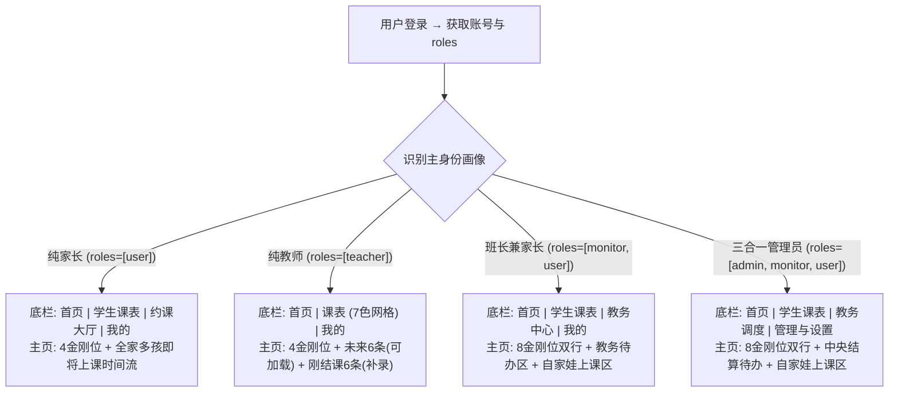

/** (c) 2024-2026 Topee (https://topee.top). All rights reserved. Proprietary and confidential. */

# 产品需求文档 (PRD) — M0：工作台与主页全域基座模块

| 元数据项 | 说明 / 内容 |
|---|---|
| **模块代号** | `m0` |
| **模块定位** | 顶层横向基座模块 (App Shell)，统领 M1–M5 五大垂直业务模块 |
| **文档状态** | 方案演进定稿版 (Architecture Evolution & Final PRD) |
| **关联顶层 PRD** | [Prd-v5.md](../Prd-v5.md) |
| **关联规范** | [DESIGN.md](../../DESIGN.md) / [CODING_STANDARDS.md](../CODING_STANDARDS.md) / [BUSINESS_RULES.md](../BUSINESS_RULES.md) |
| **创建与更新日期** | 2026-11-06 (创建) / 2026-11-07 (重大架构与体验演进定稿) |

---

## 1. 摘要 (Summary)

M0 是 Dream 的顶层横向基座（App Shell），为管理员、班长、教师、家长四类角色提供统一入口、差异化底部导航、角色主页、个人中心与管理配置出口，统领 M1–M5 五大垂直业务模块。针对多角色兼职（如班长兼家长、三合一管理员）与多孩共管场景，本版本彻底重构升级了交互哲学：
- **尽量不切换身份**：摒弃生硬的顶部强制工作台切换器，兼职身份采用“主页垂直分区聚合 + 金刚区按角色分行”模式，公私自然分流；
- **克制底部导航**：严格限制每个身份底部导航**最多 4 个图标**，按主身份进行专属定制；
- **金刚位严控**：单角色严格 4 个核心图标，双角色最多 8 个（分两行，每行 4 个，公私两行视觉隔离）；
- **主页信息流精简聚焦**：外教主页聚焦“未来 6 条（可加载更多）+ 刚结课 6 条（补录反馈）”；家长主页聚焦“多孩即将上课时间流 + 刚结课评语”；班长/三合一增加教务待办与结算双焦点；
- **多孩课表体验革新**：家长第二个 Tab【孩子排课信息】默认不展示高密网格，改用“呼吸感日程卡片流 + 顶部吸顶多孩锚点 Tab”；
- **管理功能下沉**：管理员的【我的】页面收拢班长列表、老师团队、试课待建档及课程字典等平台管理功能。

---

## 2. 背景 (Background)

M1–M5 的 PRD 已分别定义学员与教师档案、购课与退款、7 色日历排班、通知和周度结算。在早期 M0 设计中，为了防止多角色兼职数据串扰，系统曾采用严格的“顶部工作台物理隔离”和“顶部多孩下拉切换器”。但在实际移动端真机体验（`prototype/m0_workspace_home.html`）中暴露出明显的体验痛点：
1. **身份切换心智割裂**：现实中班长普遍兼任家长，管理员往往兼任班长与家长（自家孩子上课、管所辖外教、统管平台总账）。每次要看一眼自家娃下午是否上课，先要点顶部切工作台，再下拉选孩子，层级过深、流程繁琐，不符合常规成熟 App 的直觉体验；
2. **多孩家庭看课盲人摸象**：多孩家长必须逐个在顶部切换才能获知不同孩子的上课时间，无法在一屏内通览家庭总日程；
3. **底部导航过载与网格过密**：前期移动端底部常驻 5 个 Tab 偏挤，且排课默认展示高密度 7 列周日历网格，在手机窄屏上点按容错率极低、空白格过多。

因此，本 PRD 对交互架构实施重大演进：不搞生硬隔离，也不做无序平铺，而是采用**“公私自然分流、多孩时间流聚合、吸顶锚点平滑定位、底部 4 Tab 极简克制”**的高成熟度方案。

---

## 3. 目标 (Objective)

**核心目标**：
1. **零繁琐身份切换**：兼职用户（班长兼家长、管理员兼班长/家长）登录后即在一屏内掌控全局，公事待办与家庭孩子上课双焦点一目了然；
2. **多孩日程秒级触达**：多孩家庭日程按时间流自然聚合，进入排课页通过顶部吸顶锚点 Tab 1 秒定位指定孩子；
3. **极简 4 Tab 触控标准**：底部导航严格 ≤ 4 个，金刚位单角色 4 个、双角色 ≤ 8 个，80% 高频操作首屏闭环；
4. **后台配置模块收拢**：将平台低频档案与字典管理集中收纳至管理员【我的】页面，保持业务主线清爽。

**与产品战略的关系**：M0 只做外壳、导航、权限上下文与信息流聚合，不侵入 M1–M5 核心业务逻辑与财务分账公式；所有底层业务动作仍由对应模块承载。

**关键结果 (Key Results，基线待验证)**：

- **KR1**：兼职用户（班长/管理员）确认自家娃今日上课日程与进教室的时间，由原来的平均 15 秒（需 2 次切换）缩短至 **≤ 3 秒（首屏直达）**。
- **KR2**：底部导航严格限制为 **≤ 4 个**，单屏金刚位单角色 4 个、双角色 ≤ 8 个，误触率下降 80%。
- **KR3**：多孩家长在【孩子课表】中定位到指定二宝排课并查看详情的耗时 **≤ 2 秒**。
- **KR4**：外教主页未来上课与刚结课闭环率 ≥ 95%，课后反馈补录遗漏率降低 60%。

> KR 目标值为本稿提议，需在产品与运营确认基线后锁定。

---

## 4. 目标用户与细分 (Market Segments)

| 细分 | 他们要完成的事 | 关键约束与设计策略 |
|---|---|---|
| **多孩家长** | 确认全家孩子何时上课、如何进教室；在规则允许时请假、挪位、转让；管理多个孩子档案 | 手机为主；拒绝频繁切身份/切孩子；主页时间流聚合多孩，排课页提供吸顶锚点 Tab |
| **班长（常兼任家长）** | 管理 50+ 学生的固定位、代课、收款与退费；同时关注自家孩子上课与约课 | 拒绝繁琐的工作台横跳；主页采用 8 金刚位双行排布 + 教务/家庭双区平铺；Tab 3 设立独立【教务中心】 |
| **教师（兼职外教）** | 看今日课表与下一节课；代课时快速接上原老师进度；补录课后反馈 | 中英双语；时间碎片化；中文阅读能力有限；主页精简为 6 条未来课（可加载更多）+ 6 条刚结课（补录反馈） |
| **平台管理员（常兼班长与家长，三合一）** | 审核转账单、核对课酬、确认平台直收、配置字典与小班；同时兼管种子外教与自家孩子上课 | 财务强一致；拒绝多层切换；首屏聚合结算待办与自家娃动态；将班长/教师/字典等低频配置下沉至【管理与设置】（我的） |

**本期范围**：四类细分全部进入首个版本。M0 是产品唯一入口，聚焦解决多角色与多孩场景下“高频动作顺畅闭环、低频配置清晰归位”。

---

## 5. 价值主张 (Value Propositions)

### 5.1 多孩家长

- **Who**：一位家长账号下挂 1–10 个孩子，负责出资、约课、请假与家校沟通。
- **Why**：想在几秒内确认“全家孩子今天什么时候上课、怎么进教室”，并在规则允许时完成请假或转让。
- **What before**：旧设计需在顶部下拉频繁切换孩子；或依赖外部微信群与文档，容易漏课。
- **How**：主页以“全家孩子时间流”为中心，多孩即将上课按开课倒计时自然混排（标注孩子名），直接呈现 ClassIn 唤醒入口；进入排课页提供吸顶锚点 Tab，点击孩子头像秒级平滑定位。
- **What after**：打开应用 3 秒内知晓全家孩子今日上课安排；多孩切换零等待。
- **Alternatives**：微信群 + 日历 + ClassIn 原生；我们胜在把多孩聚合与规则校验融于一屏。
- **Statement**：对多孩家长，Dream 把“全家孩子下一节课”放在主页，排课页点击头像秒达目标，省心直观。

### 5.2 班长（常兼任家长）

- **Who**：管理 50+ 学生与外教团队的班长，同时往往也是自己孩子的家长。
- **Why**：需要在“给自家孩子约课/看课”和“给其他学生排课、收款、调代课”之间高频兼顾，但不能混淆权限与资金账目。
- **What before**：传统工作台强制在“班长端”和“家长端”之间反复切来切去；看一眼娃要切一次，排个课又要切一次。
- **How**：免频繁切身份——主页提供 8 个金刚位（第 1 行教务管理，第 2 行家庭孩子）；主页内容区垂直分区（上方教务待办，下方自家娃上课）；Tab 3 专设【教务中心】（所辖外教、买4排4排课向导、小班课），公私物理分流。
- **What after**：生活与工作一目了然，无需在工作台之间横跳；公私账目入口天然隔离，永不串账。
- **Alternatives**：双账号切换或多系统操作；我们胜在一个账号聚合呈现且边界分明。
- **Statement**：对兼任家长的班长，Dream 让“自家孩子”与“负责学生”在主页与 Tab 间自然分流，工作生活两不误。

### 5.3 教师（兼职外教）

- **Who**：兼职外教，中英双语用户，时间碎片化，中文阅读能力有限。
- **Why**：上课前只想知道“今天几节、下一节是谁、是不是代课、原老师交代了什么”，课后想快速补齐反馈。
- **What before**：在群消息、表格和留言板之间翻找交接信息；代课时不知道原老师进度，课后容易漏写反馈。
- **How**：教师主页极简双语，4 个核心金刚位，主页精简展示“未来 6 条上课（支持加载更多 6 条）”与“刚结课 6 条（未写评语高亮补写反馈按钮）”；代课时自动浮现原老师教学交接摘要。
- **What after**：打开即上课；代课交接一目了然；课后反馈补录闭环率显著提升。
- **Alternatives**：微信群 + ClassIn 课表；我们胜在把交接、日程与反馈整合在主页 6+6 信息流中。
- **Statement**：对兼职外教，Dream 用 6+6 精简卡片驱动课前准备与课后反馈，授课无负担。

### 5.4 平台管理员（三合一管理员）

- **Who**：平台中央运营负责人，往往兼任核心外教班长，同时也是给自家孩子购课上课的家长。
- **Why**：每周固定时点必须完成转账单审核、课酬核对、平台直收确认；同时要处理负责外教的教务，还要了解自家娃上课动态。
- **What before**：三大身份来回切，迷失在多层菜单中；低频后台管理（班长列表、教师定级、字典参数）侵占过多导航空间。
- **How**：主页 8 个金刚位（公事一行、家庭一行）+ 双焦点流（上方中央结算待办，下方自家孩子即将上课）；Tab 4【管理与设置】集中收拢班长列表、教师团队、试课待认领档案与系统字典等管理功能。
- **What after**：首屏一站式掌控“全平台结算 + 自家娃上课”，低频管理功能井井有条，移动端操作流畅从容。
- **Alternatives**：笨重的 PC 端后台；我们胜在移动端优先的掌上结算与家庭合一。
- **Statement**：对三合一管理员，Dream 把全周大盘与家庭日程融汇于指尖，后台管理有序收拢，运筹帷幄。

---

## 6. 解决方案 (Solution)

### 6.1 关键流程与信息架构 (Information Architecture)

**外壳三层结构演进**：

1. **全局顶栏 (App Bar)**：
   - 彻底取消生硬的顶部强制工作台切换胶囊与多孩单选下拉框；
   - 顶部升级为**角色身份 Banner**：仅保留头像、品牌、角色徽标、角色副标题与全局通知铃铛；低饱和角色色 + 纹理，高度 64–72px；
   - **Banner 不承载问候语、当天摘要与统计数字**；问候、摘要与 3 个关键统计下沉到内容区首屏；**身份与账号、语言切换入口统一收纳到【我的】/管理员【管理与设置】，顶部 Banner 不提供身份切换按钮或语言切换**；
   - 界面视觉干净呼吸，将主要高度留给核心业务内容。
2. **角色内容区 (Content Canvas)**：
   - **单角色**：渲染专属业务流（如外教 6+6、家长多孩时间流）；
   - **多角色兼职（班长兼家长、三合一管理员）**：采用“主页垂直分区聚合”模式，无需在不同工作台之间切进切出，上方公事待办、下方自家孩子上课，公私自然分流；
   - **卡片用途分色**：课程/任务 amber、消息/通知 indigo、资产/财务 emerald、提醒/风险 rose、备忘/中性 slate；同一卡片内标题/正文/辅助信息统一同色系；单卡 4–5 行、130–150px，390×812 一屏 3–4 张（详见 DESIGN.md 2.2.1）。
3. **极简底部导航 (Bottom Tabbar)**：
   - **底栏严控规则**：每个身份底部导航**严格限制最多 4 个图标**，杜绝 5 个及以上拥挤排布；
   - **按核心身份差异化适配**：

| 身份场景 | Tab 1 (首页) | Tab 2 (核心日程) | Tab 3 (业务中心) | Tab 4 (管理与设置) |
| :--- | :--- | :--- | :--- | :--- |
| **纯家长 (Parent)** | **首页**<br>(金刚4 + 即将/刚结课) | **学生课表**<br>(日程卡片流 + 顶部锚点Tab) | **约课大厅**<br>(选外教 / 小班课大厅) | **我的**<br>(多孩档案 / 购课账单 / 安全) |
| **纯外教 (Teacher)** | **首页**<br>(金刚4 + 未来6条 + 结课6条) | **课表**<br>(7 色周度排期网格 · 直通M3A) | — *(支持3个Tab极简形态)* | **我的**<br>(个人名片 / 课酬对账) |
| **班长兼家长 (Monitor+Parent)** | **首页**<br>(金刚8 + 教务待办 + 娃上课) | **学生课表**<br>(自家娃日程流 + 锚点Tab) | **教务中心**<br>(负责外教 / 买4排4 / 小班) | **我的**<br>(班长周转账 / 家庭多孩档案) |
| **平台管理员 (Admin 3-in-1)** | **首页**<br>(金刚8 + 结算待办 + 娃上课) | **学生课表**<br>(自家娃日程流 + 锚点Tab) | **教务调度**<br>(负责外教 / 全局排班网格) | **管理与设置**<br>(班长/教师/字典管理 + 我的) |

**用户会话与多角色路由流程**：



**交互原型**：[prototype/m0_workspace_home.html](../../prototype/m0_workspace_home.html)（纯前端 Mock，支持角色、设备、多角色开关与 URL 参数直达；外教课表直通 [prototype/m3a_calendar_schedule.html](../../prototype/m3a_calendar_schedule.html)）

### 6.2 关键功能 (Key Features)

#### 6.2.1 全局外壳与极简 4-Tab 导航规范

- **严格 4-Tab 限制与统一命名**：移动端底部导航栏项数 $N \le 4$；左一统一为【首页】，家长/班长/管理端左二统一为【学生课表】（外教端左二为【课表】，展示 7 色周度排期网格并直通 M3A 原型）；按当前登录人绑定的最高权限与角色组合动态渲染对应导航，任何情况下严禁横向滚动或挤压形变；
- **免生硬切换原则**：取消全局顶栏的单选工作台切换器。对于拥有兼职身份（如班长兼家长、三合一管理员）的用户，登录后由主页与底栏 Tab 自然映射公私入口，不再强迫用户“换装/分身”；
- **公私物理分流防呆**：
  - 自家孩子相关（课表、购课单、请假挪位）统一收纳在 **Tab 2【学生课表】** 与首页家庭区；
  - 外部学员教务（50+ 所辖学生买 4 排 4、负责外教代课、小班运营）统一收纳在 **Tab 3【教务中心】**；
  - 严禁在 Tab 2 中混入外部学员数据，严禁在 Tab 3 中使用家长个人资金账户，从架构根源上杜绝跨角色误操作。

#### 6.2.2 角色主页与金刚位矩阵（单角色 4 个，双角色最多 8 个）

金刚位（Quick Action Grid）是高频功能的快捷跳板，统一严格采用**单行 4 个图标**的栅格布局：

1. **金刚位图标排布规约**：
   - **单角色用户（纯家长、纯外教）**：单行 4 个金刚位；
   - **双角色/兼职用户（班长兼家长、三合一管理员）**：最多 2 行、共 8 个金刚位。
     - **第 1 行【教务管理 / 平台运营】**（公事）：采用深色系或稳重微徽标（如 Slate/Amber）；
     - **第 2 行【家庭孩子 / 个人育儿】**（私事）：采用浅色系或活力微徽标（如 Indigo/Sky）；
     - 两行之间具有清晰的轻量分区标题或微视觉隔离，肌肉记忆稳定。

2. **核心推荐金刚位功能定义矩阵**：

| 角色领域 | 金刚位 1 | 金刚位 2 | 金刚位 3 | 金刚位 4 |
| :--- | :--- | :--- | :--- | :--- |
| **家长领域 (Family)** | 📅 **约临时课**<br>(消耗TS预约空闲外教) | 🧒 **学生档案**<br>(管理多孩资料与偏好) | 💬 **家校留言**<br>(查看外教公开评语) | 💳 **购课/账单**<br>(1v1购课记录与续费) |
| **外教领域 (Teacher)** | ⏰ **开放时段**<br>(维护常规可授课时段) | 👥 **我的学生**<br>(常客学情与熟客档案) | 📝 **写反馈**<br>(补录教学评语与进度) | 💰 **周课酬单**<br>(核对上课节数与薪金) |
| **班长领域 (Monitor)** | 📝 **线下录单**<br>(代收款录入购课单) | 🗓️ **教务排课**<br>(买4排4向导与调配) | 👨‍🏫 **负责外教**<br>(外教负荷巡视与课表) | 💸 **周转账单**<br>(扣除盈余后交割平台) |
| **管理员领域 (Admin)** | 💸 **审核转账**<br>(审核班长周转账单) | 💰 **教师发薪**<br>(周课酬核对统一发放) | 🧒 **试课建档**<br>(未注册试课代建档与约课) | 📊 **工具费单**<br>(全平台工具费留存) |

3. **各角色金刚位待选库 (Quick Action Candidates)**：
为适配机构运营策略与未来自定义配置，系统设立以下金刚位功能备选池，可与上述默认 4 项按需置换：
- **👨‍👩‍👧 家长待选项**：
  - 🔄 **课程转让**：将课次转让给同账号二宝或其他家长；
  - 🏫 **小班大厅**：快速查看在招小班课并预约报名；
  - 🏖️ **请假/挪位**：直达近期可退改课程集中办理；
  - 👩‍🏫 **名师风采**：查阅外教介绍视频与 ClassIn 二维码；
  - 📚 **教材进度**：查看孩子当前所学级别与进度大纲。
- **👨‍🏫 外教待选项**：
  - 🏖️ **请假/销假**：临时闭麦请假或恢复可约网格；
  - 🪪 **我的名片**：编辑个人文字介绍与多媒体视频；
  - 🟣 **代课交接**：直达自己代课的课程交接记录；
  - 📜 **授课历史**：历史结课总计与课时出勤统计。
- **🎖️ 班长待选项**：
  - 🔄 **代课调配**：处理外教请假并快速指定代课老师；
  - ↩️ **创建退款**：代退费家长录入退款单并清退课次；
  - 👥 **所辖学员**：50+ 学员剩余 TS 资产盘点与提前 7 天续费出单预警（含开课前 48h 临期催办）；
  - 🏫 **负责小班**：小班招生进度与盈余预估；
  - 🔒 **内部留言**：录入师生保密的内部教学备忘；
  - ⚠️ **异常回退**：未上课已结课 TS 的取消与补生。
- **👑 管理员待选项**：
  - 🏫 **创建小班**：新建小班课班级、设置课酬与抽佣；
  - ⚠️ **异常回退**：全局异常完课 TS 状态修正；
  - 👥 **班长管理**：全平台班长列表与教师团队划拨；
  - 👨‍🏫 **教师定级**：外教等级标准与底薪课酬配置；
  - 📚 **课程字典**：少儿英语/KET/雅思等字典标签维护；
  - 💳 **平台直收**：平台收款通道购课单录入。

4. **各角色主页核心信息流详规**：

- **👨‍👩‍👧 纯家长主页 (Parent Home)**：
  - **顶部**：4 个家长金刚位；
  - **卡片一【孩子即将上课】**：多孩合并时间流（大宝与二宝的排课混合按时间从近到远排序），卡片醒目标注孩子昵称（如 `[👧 Alice / 大宝]`）、开课时间、授课外教头像；进班动作区遵循**【双按钮平权中性、弱化直跳、扫码优先】**规范：因学生设备（平板/PC）与家长手机通常不同，家长手机绝少直接唤起 ClassIn，故【扫码 / 教室号】与【本机打开】均采用低饱和中性浅底样式（都不高亮），并将【扫码 / 教室号】作为高频首要入口，支持拿手机对准上课设备扫码或复制账号进班；
  - **卡片二【刚结课记录】**：精简展示最近 3~5 条已完课，重点展示外教最新公开评语，家长可一键点击回复。
- **👨‍🏫 纯外教主页 (Teacher Home)**：
  - **顶部**：4 个外教金刚位；
  - **卡片一【未来授课 (Upcoming Lessons)】**：精简展示最近 **6 条**待授课日程。支持底部点击 **“加载更多 6 条”**（原地展开，不跳页）。每条卡片包含时间、学生昵称、班型、代课标识（🟣）及一键进入教室 ClassIn；代课课程自动浮现原老师教学交接摘要；
  - **卡片二【刚结课记录 (Recently Completed)】**：精简展示最近 **6 条**已结课记录；若某节课老师尚未提交课后反馈，卡片高亮醒目 **【📝 补写反馈】** 按钮，促成教学闭环。
- **🎖️ 班长兼家长主页 (Monitor + Parent Home)**：
  - **顶部**：8 个金刚位（第 1 行班长 4 个，第 2 行家长 4 个）；
  - **卡片一【班长教务待办与预警】**：待办卡片采用**【紧凑两行网格 (Compact 2-Row Grid)】**排版：首行水平并列 `[小图标 + 待办事项名称]` 居左，右侧并排展示大号待办数量；次行紧跟微型辅助状态/紧急度标签；严格压缩垂直纵深（卡片高度降低 30% 以上），避免卡片过高挤占教务主页首屏视线；
  - **卡片二【自家孩子即将上课】**：直接展示自家大宝、二宝最近排课与进教室入口，班长处理完教务往下一滑即可关注自家娃，无需切工作台；
  - **卡片三【自家孩子刚结课】**：展示自家孩子最近完课记录与外教评语。
- **👑 三合一管理员主页 (Super Admin Home)**：
  - **顶部**：8 个金刚位（第 1 行管理员/班长 4 个，第 2 行家长 4 个）；
  - **卡片一【平台结算与待办总览】**：待办卡片同样遵循紧凑两行网格排版，首行并排展示图标、事项名称与数量，次行展示状态指标，大幅压缩卡片高度；
  - **卡片二【自家孩子即将上课】**：无缝呈现管理员自家孩子的排课动态与进教室倒计时，工作生活兼备。

#### 6.2.3 家长 Tab 2【学生课表】交互规范（体验革新）

- **默认视图改造**：弃用手机竖屏默认展示的高密度 7 列周日历网格，默认采用高可读性、带呼吸感的**“日程卡片流 (Agenda Cards)”**；
- **吸顶多孩锚点 Tab (Anchor Tabs)**：
  - 页面顶部常驻吸顶栏，平铺展示当前家长账号名下所有孩子档案及待上课节数角标：
    ```
    [ 全部孩子 ]   [ 👧 大宝 Alice (4节待上) ]   [ 👦 二宝 Bob (2节待上) ]
    ```
  - **锚点平滑定位与过滤联动机制**：
    - 点击某一孩子头像/名称（如“二宝 Bob”），页面**平滑滚动 (Smooth Scroll)** 定位到二宝的课程区块；或切换为该孩子的专属日程过滤视图；
    - 向上滑动长列表时，顶部吸顶 Tab 随视口中正在浏览的孩子自动高亮对应头像；
- **卡片操作与授课准备期锁定**：
  - 每张日程卡片清晰呈现：上课日期、星期、时段（如 `18:00 - 18:25`）、授课外教、课程性质（固定位🟠 / 临时课🟡 / 代课🔵）；
  - 卡片右侧快捷操作区严格根据业务时间窗口动态启用：
    - 开课前 $\ge 24\text{h}$：允许自主【挪位】（同老师其他空闲时段）或【请假】（扣减 12.5% 配额）；
    - 开课前 $3\text{h} \sim 24\text{h}$：只允许【发起课程转让】（转让给二宝或其他家长）；
    - 开课前 $< 3\text{h}$：进入授课准备保障期，禁止退改，按钮置灰并提示“老师已在做授课准备，暂无法变更”；
- **网格视图兜底**：右上角常驻轻量图标 `[📅切换为网格]`，仅在家长需要宏观对照整周空隙时按需唤起抽屉展开 7 列看板，支持直接跳转至独立日历原型 [prototype/m3a_calendar_schedule.html](../../prototype/m3a_calendar_schedule.html)，不影响日常列表浏览。

#### 6.2.4 外教 Tab 2【课表】7 色日历网格规范（直通 M3A 原型）

与家长端多孩日程流不同，外教核心工作为把握全局授课时段与空闲排期。外教点击 Tab 2【课表】（Schedule）时直接呈现 **7 色周度排期看板 (Weekly 7-Color Calendar Grid)**：

- **7 色 Design Tokens 严格实施**：
  - 🟠 **固定位** (`ORANGE`，`bg-amber-50 border-amber-300 text-amber-900`)：显示学生缩写如 `Alic`；
  - 🟡 **临时课** (`YELLOW`，`bg-yellow-50 border-yellow-300 text-yellow-900`)：显示学生缩写如 `BobZ`；
  - 🟣 **代上课** (`PURPLE`，`bg-purple-50 border-purple-300 text-purple-900`)：替同事代课并计入本人课酬，带 `SUB` 标志；
  - 🔵 **被代课** (`BLUE`，`bg-blue-50 border-blue-300 text-blue-900`)：原老师请假，由代课老师上课；
  - 🟢 **空闲可约** (`GREEN`，`bg-emerald-50 border-emerald-200 text-emerald-700`)：显示单字“约”，家长可约时段；
  - ⚪ **不可用** (`GRAY`，`bg-slate-100 border-slate-200 text-slate-400`)：显示单字“休”，日常休息时段；
  - 🔴 **已请假** (`RED`，`bg-rose-50 border-rose-200 text-rose-700`)：显示单字“假”，外教闭麦请假时段。
- **周度切换与图例栏**：顶部支持【上周】、【本周】、【下周】切换，并常驻 7 色图例说明；
- **无缝直通 M3A 完整原型**：顶部操作栏与底部面板均配备醒目的 **【↗ 打开独立 7 色排课大日历原型 (M3A)】** 入口，可直接跳转至 [prototype/m3a_calendar_schedule.html](../../prototype/m3a_calendar_schedule.html)，体验单屏 7 列 Excel 冻结首列/表头、连续连约 2~4 节等桌面级复杂排课交互。

#### 6.2.5 班长兼家长 Tab 3【教务中心】架构

- **纯工作域物理隔离**：本 Tab 专供班长管理外部学员与外教团队，严禁混入自家孩子个人数据；
- **三重视角分段器 (Segmented Bar)**：
  - **视角 A：【我负责的外教】(默认)**：
    - 展示绑定的外教团队卡片（姓名、定级、今日课时数、ClassIn 二维码）；
    - 若外教临时请假（标红），卡片高亮浮现 **【待指定代课】** 强提醒，点击唤起代课弹窗，系统按“相同技能范围 + 空闲时段”智能推荐代课老师，快速完成交接；
    - 点击外教卡片上的 **【查周排期】**，以底部抽屉滑出该单人的 7 色排期看板，聚焦查空闲。
  - **视角 B：【所辖学员名单】**：
    - 快速搜索框（按英文昵称/首字母过滤）；
    - 学员卡片展示剩余待排 TS 资产余额（如：固定位剩余 4 节待排）；
    - **买 4 排 4 固定位连续排课向导**：点击“固定位排课”，直接唤起 4 周连排抽屉（选择外教 ➔ 勾选每周固定星期与时段 ➔ 系统自动连占 4 周并完成冲突校验），免去逐节选网格的繁琐。
  - **视角 C：【我的小班课】**：
    - 展示负责的小班列表、主讲外教、在读人数 (Min/Max)、开课进度；
    - 快捷操作：学员进出班名单调配、查看本周课酬与班长自留盈余预估。

#### 6.2.6 管理员 Tab 4【管理与设置】（我的）功能下沉

为保持前台导航轻量，平台管理员的基础配置与低频管理功能统一收纳在 **Tab 4【管理与设置】**，按模块清晰分组：

1. **💼 平台机构管理**：
   - 👥 **班长管理列表**：查看全平台班长、添加/编辑班长、分配其绑定的外教团队与负责的小班；
   - 👨‍🏫 **教师团队管理**：外教定级、维护技能范围标签、绑定所属班长、上传 ClassIn 二维码与多媒体介绍视频、办理离职清零交接；
   - 🧒 **待认领试课档案**：独享试课代建档（`UNBOUND` 状态，录入家长联系方式、开具 20 节内试课购课单并代约临时课）、试课认领进度跟踪；
   - 🏫 **小班课全域配置**：创建小班课班级、设置小班课负责人、教师单节课酬与平台盈余抽佣比例（$R\%$）。
2. **📊 财务与总账中心**：
   - 平台工具费周报：集中核算全平台 1v1（2积分/节）与小班课（最大学生数 $\times 6$ 积分）工具费留存；
   - 异常完课回退：对老师实际未上课但已结课的异常 TS，执行一键取消并自动补生 1 节待排期 TS。
3. **⚙️ 基础字典与参数**：
   - 课程类型字典：维护少儿英语、生活口语、KET、PET、雅思、托福等标签字典；
   - 全局分账基准参数查看。
4. **👨‍👩‍👧 家庭多孩与个人中心**：
   - 管理员个人多孩档案维护、自家购课记录与账单；
   - 账号与安全设置（改密、中英双语切换入口）。

**验收要点（外壳与主页）**：
- AC-M0-01 **底栏严格限额**：任何角色与兼职场景下，移动端底部导航 Tab 数量 $N \le 4$；
- AC-M0-02 **金刚位严控**：单角色主页仅呈现 1 行 4 个金刚位，兼职角色呈现 2 行共 8 个金刚位，严禁单行超 4 个或总数超 8 个；
- AC-M0-03 **外教主页 6+6**：外教主页未来授课默认展示 6 条，点击“加载更多”每次下翻 6 条；刚结课列表未提交反馈时高亮显示补写按钮；
- AC-M0-04 **家长多孩时间流**：家长主页即将上课卡片聚合所有孩子待上日程，按时间先后自然排序，并显式标注孩子昵称标签；
- AC-M0-05 **课表差异化呈现**：家长端【学生课表】默认呈现多孩日程卡片流并支持顶部锚点过滤；教师端【课表】直接呈现 7 色周度排期看板，并支持一键跳转到独立的 M3A 7 色排课日历完整原型；
- AC-M0-06 **排课卡片授课准备期锁定**：请假/挪位/转让严格按照 24h、3h 与 12.5% 配额规则启用或置灰；
- AC-M0-07 **教务中心公私隔离**：班长 Tab 3【教务中心】内严禁出现自家孩子数据；Tab 2【孩子课表】严禁出现外部学员数据；
- AC-M0-08 **管理功能下沉**：管理员的班长列表、教师定级与二维码上传、课程字典必须在 Tab 4 中集中操作。

#### 6.2.6 个人中心与账号安全中心

- 账号基本信息卡：头像、昵称、登录账号（邮箱/手机）、当前角色标签。
- 修改登录密码：验证原密码 → 新密码 → 强度校验。
- 换绑邮箱/手机号：原凭证与新凭证双向验证码校验。
- 多孩档案管理（家长专属）：集中增删改孩子档案与选课偏好，单账号上限 10 个。
- 身份与账号：展示当前账号绑定的角色与当前工作台，入口位于【我的】/【管理与设置】；不提供顶部强制切换。
- 系统偏好：中英双语即时切换、消息通知接收偏好、检查更新与清理本地缓存（展示版本号）、退出登录。

**验收要点**：
- AC-M0-09 **改密与换绑鉴权**：改密与换绑必须重新验证原凭证，换绑需双向验证码通过后才生效；
- AC-M0-10 **多语言即时生效**：语言切换即时生效并持久化到 `dream_locale`；
- AC-M0-11 **清理缓存与会话安全**：清理缓存不得导致登录态丢失；退出登录清除 Token、本地敏感快照并注销服务端会话；

#### 6.2.7 法律合规与品牌信任中心

- 关于我们：品牌介绍、版本信息、官方客服/班长协助指引、版权声明。
- 用户服务协议：固定位四周一轮与不可取消、12.5% 请假配额、开课前 3 小时授课保障期、代课差价多退少不补、退费原收款方退回。
- 隐私保护政策：未成年人个人信息保护专章（仅收集上课必需的年龄与昵称，非授课教师物理隔离）；跨国数据跨境传输与海外外教端脱敏说明。

**验收要点**：
- AC-M0-12 **协议全域入口**：登录页、购课关键节点与“我的”页面均可进入协议与隐私政策；
- AC-M0-13 **法律版本标识**：法律文本展示版本号与生效日期，内容与 BUSINESS_RULES 中的业务财务口径保持 100% 一致。

#### 6.2.8 ClassIn 跨设备双模接入与弱化直跳规范 (Cross-Device ClassIn Access)

- **跨设备物理分离原则**：在少儿外教辅导场景中，实际上课学生大多使用平板（iPad）或电脑（PC）进教室，而家长日常使用手机查看排课与课表。因此手机端绝少直接唤醒并进入 ClassIn 上课；高频实际诉求是**“拿着手机给平板/电脑扫码进教室，或查看并复制老师的 ClassIn 账号”**。
- **进班动作区去高亮与平权中性规范**：
  - 【扫码 / 教室号】与【打开 ClassIn】**均严禁使用高饱和实心高亮样式（如蓝紫色强调色）**；
  - 两者统一采用低饱和中性平权样式（浅灰背景 `bg-slate-50` 搭配细边框 `border-slate-200`，文字为中性深灰 `text-slate-700`），避免在手机端产生“必须在手机上进入 ClassIn”的视觉误导；
  - 认知排位以【扫码 / 教室号】为首位，点击唤起全屏灯箱弹窗，展示外教高清进门二维码及 ClassIn 账号文本，支持一键复制；
  - 【打开 ClassIn】降级为辅助动作（文案为“本机打开”或“唤醒应用”），点击触发 `classin://` 协议唤醒本地 App 作为备用通道；
- **教师未上传二维码时的弱提示兜底**：
  - 若授课外教档案中暂未上传二维码，弹窗展示教师姓名与班长联系方式，温和提示“外教二维码正在同步中，请联系班长获取进班方式”，并提供外教 ClassIn ID 复制（若有）。

**验收要点**：
- AC-M0-14 **进班动作低饱和中性规范**：家长首页待上课卡片进班区域的双按钮均不得使用高饱和高亮实心样式，统一采用低饱和中性平权样式；
- AC-M0-15 **跨设备扫码优先与信息复制**：点击【扫码 / 教室号】弹出高清晰二维码大图，并支持秒级一键复制 ClassIn 账号；
- AC-M0-16 **教务待办两行紧凑排版**：班长与管理员主页的待办区域统一采用“首行图标与待办名称水平居左 + 数量居右，次行紧凑跟状态”结构，卡片高度较原垂直堆叠缩减 30% 以上。
- AC-M0-17 **身份入口归位**：顶部 Banner / 顶栏不得出现身份切换按钮；身份与账号入口统一位于【我的】/管理员【管理与设置】。

### 6.3 技术与约束 (Technology)

- 前端：Vue 3 + Pinia + Vue Router；差异化路由映射按 `meta.roles` 隔离；家长/教师/班长/管理员统一遵循手机优先布局（微信 WeUI 规范）；100% Tailwind CSS；PWA；`vue-i18n` 全量双语。
- 视口：手机端优先（≥360px），平板端自适应双栏/宽屏；不做 PC 浏览器适配，管理员端同样以手机/平板为主。
- 登录态：复用 `@topeetop/auth-core`，通过 `GET /api/auth/v1/user` 获取账号、头像、昵称、邮箱与 `roles`；401 走 refresh_token 无感刷新。
- 角色路由与视图适配：系统根据登录账号的最高权限与角色组合（纯家长、纯外教、班长兼家长、三合一管理员）直接映射对应的主页与 4 个底部导航 Tab，不再依赖顶栏强制切身份。
- 多孩与锚点上下文：多孩排课在客户端维护选中的激活档案或全量混合流，通过吸顶锚点 Tab 实现单页平滑定位，无整页重载。
- 数据边界：M0 不承载 M1–M5 的业务规则，业务数据归属各模块；M0 仅保存外壳偏好（如语言偏好、锚点滚动记忆）；所有 SQL 仍只能落在 `dream-core` 的 Mapper 中。
- 缓存分级：App Shell 与静态资源 CacheFirst；字典与角色上下文 StaleWhileRevalidate；主页脱敏快照 NetworkFirst；财务与抢位动作 NetworkOnly，离线置灰并提示。
- 跨角色待办计数的数据来源与聚合方式由技术方案确定，本 PRD 只约束展示与跳转行为。
- 安全与数据隔离：主页公私分区（教务与家庭）在数据获取层由不同的接口隔离请求，不在前端缓存中保存资金类单据明文。

### 6.4 假设与待决问题 (Assumptions & Open Questions)

**假设**

- 四类角色细分全部进入首个版本；M0 是唯一入口，不按角色分批上线。
- KR 目标值可在试点后校准，当前无历史基线。
- ClassIn 二维码在绝大多数场景下编码了可用的官方链接，无法解析时允许手动覆盖。
- 法律文本内容待定；V1 只要求入口与占位内容，不记录用户同意的版本号。

**待决问题**

1. 法律文本由谁提供与审核、预计何时定稿？（本期不记录用户同意版本）
2. 兼职用户多角色主身份识别优先级已锁定为：`admin` > `monitor` > `teacher` > `user`，若后续存在非标准角色组合，由权限中台提供角色组合映射策略。
3. 试点班级/用户范围、样本量与 KR 基线由谁提供？

> 以上事项与后续交付项统一记录于 [docs/TODO.md](../TODO.md)，关闭后回写本 PRD。

---

## 7. 发布 (Release)

**首个版本 (V1)**

工作台外壳与物理隔离、四套角色主页、跨角色待办透传、个人中心与账号安全、法律合规页面、ClassIn 双模唤醒。

**后续版本 (V1.1+)**

待办聚合与推送优化、主页卡片个性化排序、新用户引导、更多品牌内容位。

**本期明确不做**

- 不做原生 App；仅交付 PWA。
- 不做 PC 浏览器适配；管理员端同样以手机/平板为主。
- 不自建 ClassIn 教室或课中能力，只做唤醒与扫码入口。
- 不做离线财务操作、离线抢位或离线排课落盘。
- 不支持双家长共管同一学生档案。
- 不替换 M4 通知中心，不重造消息通道。
- 不做自定义主题或角色外观配置。

**时间预估**：首个版本约 4–6 周（按 3 名前端、1 名后端、1 名设计并行估算），不含法律文本定稿与试点反馈迭代；该估算为相对时间，不作为交付承诺。
