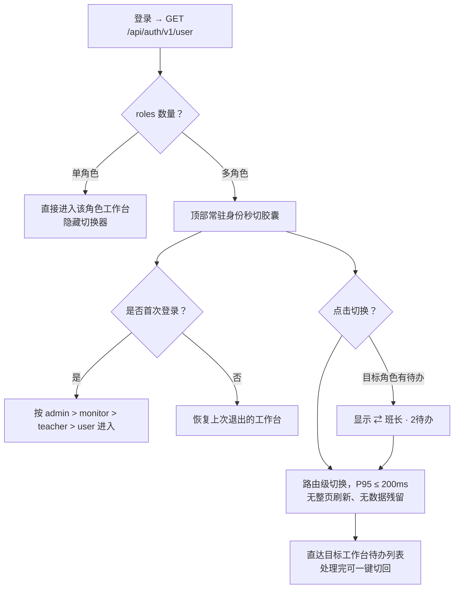

/** (c) 2024-2026 Topee (https://topee.top). All rights reserved. Proprietary and confidential. */

# 产品需求文档 (PRD) — M0：工作台与主页全域基座模块

| 元数据项 | 说明 / 内容 |
|---|---|
| **模块代号** | `m0` |
| **模块定位** | 顶层横向基座模块 (App Shell)，统领 M1–M5 五大垂直业务模块 |
| **文档状态** | 讨论稿 (Draft) |
| **关联顶层 PRD** | [Prd-v5.md](../Prd-v5.md) |
| **关联规范** | [DESIGN.md](../../DESIGN.md) / [CODING_STANDARDS.md](../CODING_STANDARDS.md) / [BUSINESS_RULES.md](../BUSINESS_RULES.md) |
| **创建与更新日期** | 2026-11-06 |

---

## 1. 摘要 (Summary)

M0 是 Dream 的顶层横向基座（App Shell），为管理员、班长、教师、家长四类角色提供统一入口、工作台切换、角色主页、个人中心与法律合规页面，统领 M1–M5 五大垂直模块。它解决多角色兼职用户在“自家孩子”与“所辖学生”之间误操作、高频任务入口分散、以及账号安全与合规出口缺失的问题。首个版本交付四套角色主页，并落地“工作台物理隔离 + 顶部胶囊秒切 + 跨角色待办透传”的外壳方案。

---

## 2. 背景 (Background)

M1–M5 的 PRD 已分别定义学员与教师档案、购课与退款、7 色日历排班、通知和周度结算，但这些模块都默认“已经存在一个外壳”，没有模块负责统一导航、角色切换、主页聚合与账号设置。M1–M3 已具备可用能力，若继续由各模块各自实现入口，会产生重复导航、权限口径不一致和跨角色数据泄露风险。

用户现实中普遍身兼多角色：班长往往也是家长，管理员也可能兼任班长。若把四类角色的功能平铺在同一个界面，会出现四类硬冲突：排课与熔断规则冲突、留言板隐私可见性冲突、资金账目公私混淆、移动端底部导航承载超限（9–10 个入口）。因此本模块不采用“融合平铺”，而采用已讨论确定的物理隔离方案。

---

## 3. 目标 (Objective)

**目标**：让每个角色登录后进入唯一正确的工作台；让 80% 的高频操作在第一屏闭环；让多角色切换零刷新、零串数据；把账号安全与法律合规收敛到统一出口。

**与产品战略的关系**：M0 只做外壳与聚合，不重复 M1–M5 的业务规则；所有业务动作仍由对应模块的 Service 承载，M0 负责入口、权限上下文与待办呈现。

**关键结果 (Key Results，基线待验证)**：

- **KR1**：试点用户中，≥80% 的高频任务（看下一节课、进 ClassIn、请假/挪位、录单、代课调配、结算确认）可在首屏 2 次点击内完成。
- **KR2**：多角色切换 P95 ≤ 200ms，无整页刷新；权限测试中跨角色数据泄露为 0。
- **KR3**：试点 2 周内，≥90% 的家长能在 10 秒内找到下一节课并进入教室；教师代课交接摘要阅读率 ≥90%；跨角色误操作投诉为 0。

> KR 目标值为本稿提议，需在产品与运营确认基线后锁定。

---

## 4. 目标用户与细分 (Market Segments)

| 细分 | 他们要完成的事 | 关键约束 |
|---|---|---|
| **多孩家长** | 确认下一个孩子何时上课、如何进教室；在规则允许时请假、挪位、转让；管理多个孩子档案 | 手机为主；低数字化耐心；同一账号最多 10 个孩子档案 |
| **班长（常兼任家长）** | 管理 50+ 学生的固定位、代课、收款与退费；同时给自己孩子约课 | 必须与家庭视角物理隔离；移动端导航入口有限 |
| **教师（兼职外教）** | 看今日课表与下一节课；代课时快速接上原老师进度；补录反馈 | 中英双语；时间碎片化；中文阅读能力有限 |
| **平台管理员** | 审核转账单、核对课酬、确认平台直收、处理异常申诉与抽佣配置 | 财务动作强一致；不能离线；手机/平板优先，无 PC 端 |

**本期范围**：四类细分全部进入首个版本。M0 是产品唯一入口，缺少任一角色都会导致该角色无法使用 M1–M5；其中**班长（兼家长）**与**教师**是差异化投入的重点。

---

## 5. 价值主张 (Value Propositions)

### 5.1 多孩家长

- **Who**：一位家长账号下挂 1–10 个孩子，负责出资、约课、请假与家校沟通。
- **Why**：想在几秒内确认“下一个孩子什么时候上课、怎么进教室”，并在规则允许时完成请假或转让。
- **What before**：微信群通知、腾讯文档和 ClassIn 手动找教室，信息分散，容易漏课或错过时限。
- **How**：家长主页以当前孩子为中心，首屏给出下一节课倒计时、ClassIn 双模入口、动态待办与课时资产快照。
- **What after**：打开应用 10 秒内完成“看下一节课 → 进教室/请假”；多孩切换不刷新页面。
- **Alternatives**：微信群 + 日历 + ClassIn 原生；我们胜在把规则与入口聚合到一处。
- **Statement**：对多孩家长，Dream 把“下一节课”和“能做什么”放在首屏，让家长不再翻群消息找教室，也不会错过请假窗口。

### 5.2 班长（常兼任家长）

- **Who**：管理 50+ 学生与教师团队的班长，其中很多人同时是自己孩子的家长。
- **Why**：需要在“给自家孩子约课”和“给其他学生排课、收款、调代课”之间切换，但不能混淆权限与资金账目。
- **What before**：一个扁平后台承载所有功能，家庭账单与托管账目混排；移动端底部导航塞不下 9–10 个入口。
- **How**：四套工作台物理隔离 + 顶部胶囊 0.1 秒切换 + 跨角色待办红点透传；班长主页首屏只放四类紧急教务待办与八大高频入口。
- **What after**：切换零刷新、零串数据；紧急代课、待排固定位、待确认单据在一屏内处理。
- **Alternatives**：多个账号或多套系统；我们胜在一个账号多角色但不混权限。
- **Statement**：对身兼家长的班长，Dream 让“自家孩子”和“50 个学生”各自待在自己的工作台里，一键切换但永不串账。

### 5.3 教师（兼职外教）

- **Who**：兼职外教，中英双语用户，时间碎片化，中文阅读能力有限。
- **Why**：上课前只想知道“今天几节、下一节是谁、是不是代课、原老师交代了什么”。
- **What before**：在群消息、表格和留言板之间翻找交接信息；代课时不知道原老师进度。
- **How**：教师主页极简双语，今日授课概览 + 下一节课大卡片；代课时自动浮现原老师最新教学交接摘要；待补录反馈提醒。
- **What after**：打开即上课；代课交接从“翻记录”变成“读一张卡”；反馈补录率提升。
- **Alternatives**：微信群 + ClassIn 课表；我们胜在把交接与反馈放在同一屏。
- **Statement**：对兼职外教，Dream 用一张“下一节课”卡片取代翻群记录，代课也能无缝接上原老师的进度。

### 5.4 平台管理员

- **Who**：平台中央运营，负责资金归集、教师发薪、小班抽佣与全局风控。
- **Why**：每周固定时点必须完成转账单审核、课酬核对、平台直收确认与异常申诉处理；漏一项就影响发薪与对账。
- **What before**：财务动作散落在多个报表和线下表格；到期与异常没有统一待办。
- **How**：管理员主页以“中央结算待办”为第一屏，四类待办卡片直达处理页；金刚区提供小班抽佣、工具费周报、教师/班长调配与全局参数。
- **What after**：每周结算在一屏内启动并闭环；异常与到期项不再依赖人工记忆。
- **Alternatives**：Excel + 线下对账；我们胜在待办驱动与全链路留痕。
- **Statement**：对平台管理员，Dream 把每周结算变成一屏待办，而不是一份需要人工回忆的 Excel 清单。

---

## 6. 解决方案 (Solution)

### 6.1 关键流程与信息架构

**外壳三层结构**：

1. **全局顶栏**：工作台秒切胶囊（仅多角色可见）、家长端多孩档案切换器、通知中心、语言切换（教师端显式展示）。
2. **角色内容区**：四套独立路由树、导航菜单、主题色与 Pinia 状态。
3. **底部导航**：按角色独立配置，每角色 ≤5 项；移动端不横向滚动。

**工作台切换流程**：

**首屏信息架构**：家长 = 下一节课 + 待办 + 资产 + 金刚区；班长 = 四类紧急待办 + 续费预警 + 八入口 + 周度概览；教师 = 今日概览 + 下一节课大卡片 + 反馈提醒 + 四工具 + 7 色课表；管理员 = 四类结算待办 + 四入口。

**交互原型**：[prototype/m0_workspace_home.html](../../prototype/m0_workspace_home.html)（纯前端 Mock，支持角色、设备、多角色开关与 URL 参数直达）

### 6.2 关键功能 (Key Features)

#### 6.2.1 全局外壳与导航

- 登录后按 `roles`（`admin` / `monitor` / `teacher` / `user`）渲染工作台；**单角色隐藏切换器**，多角色显示胶囊。
- 默认工作台：按账号在服务端记忆上次退出项；首次登录按 **管理员 > 班长 > 教师 > 家长** 进入。
- 切换为路由级与状态级隔离，不整页刷新；切走前若存在未保存表单，先弹确认。
- 跨角色待办透传：胶囊显示目标工作台待办数（如 `⇄ 班长 · 2待办`），点击切换并定位到待办列表。
- 切换后不保留上一角色的菜单、主题、列表缓存等敏感数据；路由守卫与接口 403 双保险。
- 统一空态、加载态、错误态与无权限页。

**验收要点**：AC-M0-01 单角色不出现切换器；AC-M0-02 切换 P95 ≤ 200ms 且无整页刷新；AC-M0-03 切换后无上一角色数据/菜单/主题残留；AC-M0-04 胶囊待办数与待办列表一致并可直达；AC-M0-05 首次登录默认工作台符合优先级、之后记忆上次；AC-M0-06 每角色底部导航 ≤5 项且移动端不横向滚动。

#### 6.2.2 角色主页

**家长端（Parent Home）**：顶部胶囊 + 当前孩子切换器 + 通知；第一屏“下一节课”焦点卡片（倒计时、时段、教师头像、课程标签）；三个快捷动作——打开 ClassIn、全屏扫码/账号、请假/挪位/转让（按 24h / 3h / 配额动态启用）；动态待办胶囊（去约课、看反馈、72 小时续费提醒）；课时资产快照（已排待上 / 待排余课 / 请假配额 X/Y）；六大金刚区（约临时课、课程转让、留言板、购课与账单、孩子档案、小班课大厅）；严选外教与小班橱窗。

**班长端（Monitor Home）**：四类紧急待办卡片——待调配代课/紧急请假、待排满 4 周固定位、待确认购课/退费、本周待上交转账单；72 小时固定位续费预警条；八大金刚区（新建购课单、全局排课网格、异常完课回退、跨家长转课、发起转账单、创建退款单、我负责的外教、内部教学留言）；周度概览（已结课节数、小班自留净盈余、待上交总积分）。

**教师端（Teacher Home）**：今日授课概览（共 N 节 / 已完课 X / 待上 Y / 代上课 Z）；下一节课大卡片——时段与倒计时、正常授课或 🟣 代上课身份、学生昵称与学习目标、代课交接摘要（原老师最新教学进度与注意事项）、动作（留言板/写反馈、打开 ClassIn、请假）；待补录反馈提醒；四工具（开放常规时段、请假/销假、周课酬节数单、我的名片预览）；内嵌 7 色课表。

**管理员端（Admin Home）**：中央结算待办——待确认班长转账单、待打款教师课酬单、平台直收待确认单、全局异常与申诉；金刚区（创建小班与抽佣配置、平台工具费周报、教师与班长调配、全局字典与参数）。

**验收要点**：AC-M0-07 家长端切换孩子后，主页焦点卡、待办与资产快照随 `activeProfileId` 联动刷新；AC-M0-08 请假/挪位/转让按钮严格按 24h、3h 与配额规则启用或置灰；AC-M0-09 各角色待办数字与对应列表一致，卡片可一键直达；AC-M0-10 教师仅在代课时展示交接摘要，且仅展示其有权查看的留言；AC-M0-11 所有角色主页支持中英双语，无硬编码文案。

#### 6.2.3 个人中心与账号安全中心

- 账号基本信息卡：头像、昵称、登录账号（邮箱/手机）、当前角色标签。
- 修改登录密码：验证原密码 → 新密码 → 强度校验。
- 换绑邮箱/手机号：原凭证与新凭证双向验证码校验。
- 多孩档案管理（家长专属）：集中增删改孩子档案与选课偏好，单账号上限 10 个。
- 系统偏好：中英双语即时切换、消息通知接收偏好、检查更新与清理本地缓存（展示版本号）、退出登录。

**验收要点**：AC-M0-12 改密与换绑必须重新验证原凭证；AC-M0-13 换绑需双向验证码通过后才生效；AC-M0-14 语言切换即时生效并持久化到 `dream_locale`；AC-M0-15 清理缓存不得导致登录态丢失；AC-M0-16 退出登录清除 Token、`activeProfileId` 与本地敏感快照。

#### 6.2.4 法律合规与品牌信任中心

- 关于我们：品牌介绍、版本信息、官方客服/班长协助指引、版权声明。
- 用户服务协议：固定位四周一轮与不可取消、12.5% 请假配额、开课前 3 小时阶梯熔断、代课差价多退少不补、退费原收款方退回。
- 隐私保护政策：未成年人个人信息保护专章（仅收集上课必需的年龄与昵称，非授课教师物理隔离）；跨国数据跨境传输与海外外教端脱敏说明。

**验收要点**：AC-M0-17 登录页、购课关键节点与“我的”页面均可进入协议与隐私政策；AC-M0-18 法律文本定稿后，每份展示版本号与生效日期；本期不记录用户同意的版本；AC-M0-19 协议内容与 BUSINESS_RULES 中的规则口径一致，不出现相互矛盾的条款。

#### 6.2.5 ClassIn PWA 双模唤醒

- 班长上传 ClassIn 二维码时，系统自动解析并提取其中的官方唤醒链接（支持选填/手动覆盖）。
- 主动作“打开 ClassIn 上课”：触发 `classin://` 协议唤醒本地 App；系统弹出唤醒确认（如适用）。
- 辅助动作“扫码/账号”：全屏放大二维码并展示 ClassIn 账号文本，支持“家长手机看排课、孩子用平板扫码进教室”。
- 二维码无法解析或未安装 App 时，降级展示全屏二维码与下载/联系班长提示。

**验收要点**：AC-M0-20 合法二维码可解析出可用链接，解析失败时提示手动填写；AC-M0-21 唤醒失败不得白屏，必须保留扫码兜底路径；AC-M0-22 全屏二维码在手机与平板视口下均可完整显示。

### 6.3 技术与约束 (Technology)

- 前端：Vue 3 + Pinia + Vue Router；四套路由树通过 `meta.roles` 隔离；家长/教师用 TDesign Mobile，班长/管理员用 TDesign Web（平板布局）；100% Tailwind CSS；PWA；`vue-i18n` 全量双语。
- 视口：手机端优先（≥360px），平板端自适应双栏/网格；不做 PC 浏览器适配，管理员端同样以手机/平板为主。
- 登录态：复用 `@topeetop/auth-core`，通过 `GET /api/auth/v1/user` 获取账号、头像、昵称、邮箱与 `roles`；401 走 refresh_token 无感刷新。
- 工作台记忆：按账号持久化在服务端，登录后随账号上下文返回；首次登录按优先级兜底。
- 家长上下文：`activeProfileId` 通过 `X-Profile-Id` 请求头穿透，切换后联动刷新，不做整页跳转。
- 数据边界：M0 不承载 M1–M5 的业务规则，业务数据归属各模块；M0 仅保存外壳偏好（如工作台记忆）；所有 SQL 仍只能落在 `dream-core` 的 Mapper 中。
- 缓存分级：App Shell 与静态资源 CacheFirst；字典与角色上下文 StaleWhileRevalidate；主页脱敏快照 NetworkFirst；财务与抢位动作 NetworkOnly，离线置灰并提示。
- 跨角色待办计数的数据来源与聚合方式由技术方案确定，本 PRD 只约束展示与跳转行为。
- 安全：切换工作台时清空上一角色敏感 Pinia store；所有入口做角色权限校验；不在前端缓存中保存资金类单据明文。

### 6.4 假设与待决问题 (Assumptions & Open Questions)

**假设**

- 四类角色全部进入首个版本；M0 是唯一入口，不按角色分批上线。
- KR 目标值可在试点后校准，当前无历史基线。
- ClassIn 二维码在绝大多数场景下编码了可用的官方链接，无法解析时允许手动覆盖。
- 法律文本内容待定；V1 只要求入口与占位内容，不记录用户同意的版本号。

**待决问题**

1. 法律文本由谁提供与审核、预计何时定稿？（本期不记录用户同意版本）
2. 管理员/班长/教师兼任家长时，是否都能看到家长工作台与档案切换器？当前按 `roles` 包含 `user` 处理，需确认角色映射口径。
3. 试点班级/用户范围、样本量与 KR 基线由谁提供？

> 以上事项与后续交付项统一记录于 [docs/TODO.md](../TODO.md)，关闭后回写本 PRD。

---

## 7. 发布 (Release)

**首个版本 (V1)**

工作台外壳与物理隔离、四套角色主页、跨角色待办透传、个人中心与账号安全、法律合规页面、ClassIn 双模唤醒。

**后续版本 (V1.1+)**

待办聚合与推送优化、主页卡片个性化排序、新用户引导、更多品牌内容位。

**本期明确不做**

- 不做原生 App；仅交付 PWA。
- 不做 PC 浏览器适配；管理员端同样以手机/平板为主。
- 不自建 ClassIn 教室或课中能力，只做唤醒与扫码入口。
- 不做离线财务操作、离线抢位或离线排课落盘。
- 不支持双家长共管同一学生档案。
- 不替换 M4 通知中心，不重造消息通道。
- 不做自定义主题或角色外观配置。

**时间预估**：首个版本约 4–6 周（按 3 名前端、1 名后端、1 名设计并行估算），不含法律文本定稿与试点反馈迭代；该估算为相对时间，不作为交付承诺。
