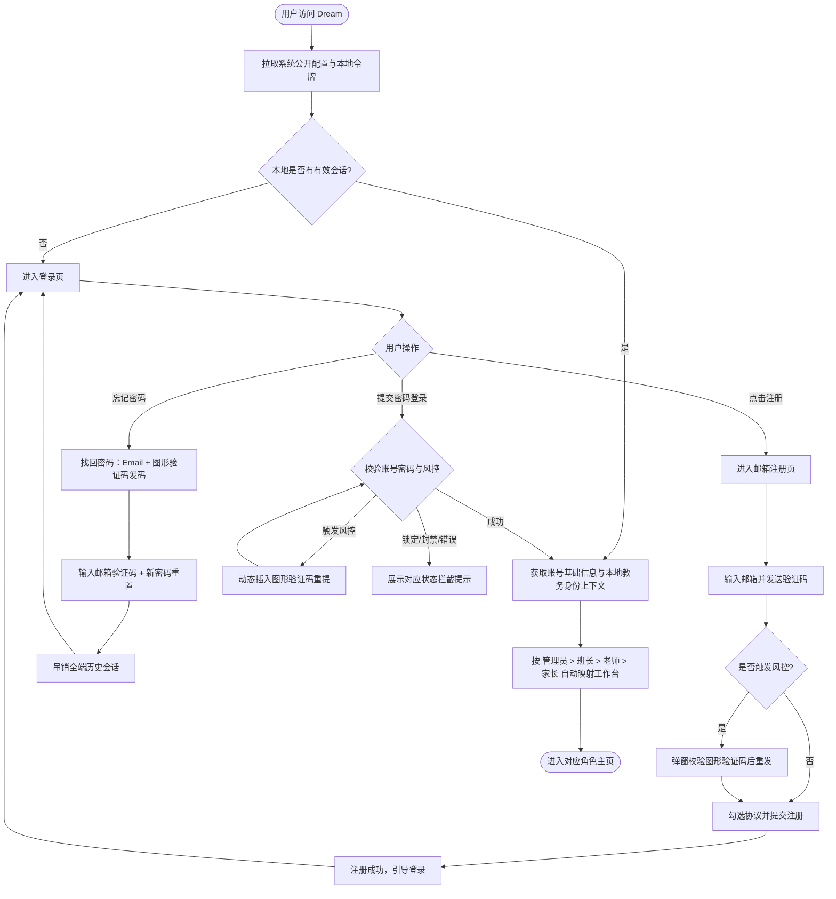

/** (c) 2024-2026 Topee (https://topee.top). All rights reserved. Proprietary and confidential. */

# 产品需求文档 (PRD) — M0A：账号认证、安全中心与业务身份解耦

| 元数据项 | 说明 / 内容 |
|---|---|
| **模块代号** | `m0a` |
| **所属模块** | 模块零：全域基座与账号安全 (Workspace Shell & Account) |
| **文档状态** | 待审阅 (Draft for Review) |
| **关联顶层 PRD** | [Prd-v5.md](../Prd-v5.md) |
| **关联规范** | [m0_workspace_and_home.md](./m0_workspace_and_home.md) / [BUSINESS_RULES.md](../BUSINESS_RULES.md) |
| **创建与更新日期** | 2026-11-18 (创建：对齐统一认证接入要求与 Dream 账号解耦规范) |

---

## 1. 概述与执行摘要 (Executive Summary)

账号认证与安全中心（`m0a`）是 Dream 教务排班与分账管理系统的自然人身份准入与账号安全基座，服务于平台管理员、班长、授课老师与出资家长四类用户。本模块在底层复用统一认证底座完成注册、登录、令牌无感续期、找回密码、改密与安全换绑，并在业务层贯彻“账号与业务身份解耦”原则——**完全不使用认证底座的角色体系**，而是通过业务侧档案绑定关系天然驱动工作台与权限视图。当前阶段：MVP 正式功能规划。

---

## 2. 问题定义与背景 (Problem Statement)

- **痛点 1：认证入口与安全交互缺失闭环**：现有基座规范主要聚焦已登录后的工作台主页与导航分流，对未登录态的准入控制（注册开关、协议签署留痕、风控图形验证码、锁号/封禁提示）、多端会话失效感知及无感续期防误杀机制尚无统一产品规格。
- **痛点 2：自然人账号与教务身份易混淆**：传统系统常在认证中心维护复杂的业务角色标签，导致管理员委任班长、绑定外教或家长兼任多角色时出现跨系统状态不一致与权限同步延迟。
- **痛点 3：多端语言与通知载体割裂**：外教以英文为主、家长/班长以中文为主，且家长/班长/老师更换 Email 后若未同步通知载体，会导致课酬单、排课变动与续费提醒邮件投递失效。

---

## 3. 目标用户与角色画像 (Users & Personas)

### 3.1 角色一：出资家长（Amy）
- **角色定位**：家庭课次出资人与日常排课操作人（单账号可挂载最多 10 个学员档案）。
- **核心诉求**：使用常用 Email 快速自助注册与登录，在“记住我”状态下免去频繁重复登录；忘记密码或更换常用邮箱时能安全找回/换绑，确保购课确认、排课通知与续费提醒邮件准确送达。
- **预期成果**：顺利完成注册登录与协议确认，安全管理个人账号凭证，并无缝进入家长工作台或认领试课学员档案。

### 3.2 角色二：海外授课老师（David）
- **角色定位**：通过个人 Email 自助注册后，由负责班长或平台管理员在后台绑定入驻的母语授课老师。
- **核心诉求**：无需复杂后台录入，使用英文界面自助完成账号注册、邮箱验证、登录与安全改密，将注册 Email 提供给班长/管理员完成绑定后即可查看个人课表与周结单。
- **预期成果**：在英文界面下零障碍完成账号全生命周期操作，第一时间接收排课、代课与周结邮件通知。

### 3.3 角色三：中方班长与平台管理员（Leo / Sarah）
- **角色定位**：教务经纪人与平台统筹方，往往兼任自家孩子的家长。
- **核心诉求**：使用单一 Email 账号登录，系统自动聚合其管理职责与家长身份，无需手动切换身份；在安全敏感操作（如资金转账确认、离职交接）中确保账号处于有效未被封禁状态；更换邮箱或密码时保障历史会话及时收敛。
- **预期成果**：兼顾操作便捷性与资金/教务高安全水位。

---

## 4. 核心业务流程 (Main Flows)

### 4.1 启动准入与会话无感续期流

1. **前置配置检测**：用户进入登录页或注册页时，系统自动拉取系统公开配置开关。
   - 若系统处于全站维护模式，页面阻断表单操作并展示维护公告。
   - 若当前关闭了开放注册，注册页禁用提交按钮并展示“平台暂未开放注册”提示，同时登录页隐藏或置灰注册引导入口。
2. **多并发无感续期**：用户处于已登录态访问业务页面时，若短效访问凭据过期且本地持有有效刷新凭据，系统自动执行单通道互斥刷新（同一时刻仅发起一次换票请求，其余并发请求排队等待新凭据后自动重放），避免并发换票触发令牌重放保护导致用户被误踢下线。
3. **会话失效兜底**：当刷新凭据过期、被管理员封禁或已在其他端修改密码导致凭据失效时，系统立即清空本地登录态与敏感业务快照，并重定向至登录页（携带原目标路径以便登录后回跳）。

### 4.2 邮箱自助注册流（含协议签署与风控拦截）

1. 用户在注册页填写 **Email**（必填）、**登录密码**、**确认密码**，可选填**昵称**与**性别**；页面支持右上角一键切换 `简体中文 / English`。
2. 用户点击“发送验证码”，系统校验 Email 格式合法且未被其他账号占用后，向该 Email 发送 6 位数字验证码，按钮进入 **60 秒倒计时**。
   - **分支（触发人机风控）**：若因同 IP 或同邮箱请求频繁触发风控，系统弹窗要求输入**图形验证码**（支持点击刷新图片），用户输入后再重发邮箱验证码。
   - **异常（邮箱已被占用）**：直接提示“该邮箱已被注册，请直接登录或更换邮箱”，不发送验证码。
3. 用户勾选 **《用户服务协议》与《隐私保护政策》**（点击链接可弹出全文模态框阅读）。
4. 用户输入邮箱验证码并点击“注册”，系统携带用户同意的协议标识与当前版本号提交注册。
5. **后置状态**：注册成功后，引导用户前往登录页登录（或若自动签发凭据则直接进入工作台）；新注册账号默认具备家长视角，可立即新建孩子档案或自助认领班长/管理员预建的待认领试课档案。

### 4.3 邮箱密码登录与异常拦截流

1. 用户输入 **Email** 与 **密码**，可勾选 **“记住我”**（勾选后保持 7 天长效会话，未勾选则为当前浏览器会话期）。
2. 默认界面**不展示**图形验证码；仅当连续输错密码或触发服务端风控时，表单内动态插入图形验证码输入行，用户输入后再次提交。
3. 登录成功：
   - 认证侧返回账号基础信息（账号 ID、Email、昵称、头像、超管标识等）。
   - 业务侧紧接着拉取当前账号的本地教务身份上下文（是否管理员、是否在职班长、是否在职老师、名下学员档案列表），按 **`管理员 > 班长 > 老师 > 家长`** 优先级自动映射首页分区与底部导航，**全程不依赖认证中心的角色标签，也不展示顶部强身份切换器**。
4. **异常分支**：
   - 账号或密码错误：提示“账号或密码不正确”并清空密码框（若触发风控则同步弹出图形验证码）。
   - 连续输错锁定：提示“连续错误次数过多，账号已锁定”，显示解锁时长并引导使用“忘记密码”。
   - 账号被封禁：弹窗阻断提示“账号已被封禁，如有疑问请联系客服或负责班长”。
   - 账号未激活：提示用户前往邮箱查收激活邮件或重发验证。

### 4.4 找回密码流（两步重置）

1. **第 1 步（身份与人机校验）**：用户在找回密码页输入注册 Email，并**强制输入图形验证码**，点击“发送重置验证码”。
   - 若该 Email 未注册，提示“该账号未注册”。
2. **第 2 步（验证码与新密码提交）**：发送成功后锁定 Email 输入框，展示邮箱验证码输入框与新密码输入框（需符合密码强度规则）；用户点击“确认重置”。
3. **后置状态**：密码重置成功后，系统自动吊销该账号在所有设备上的历史会话，弹窗提示重置成功并跳转至登录页。

### 4.5 个人中心与两步安全换绑流

1. **基础资料维护**：用户可在【我的】（或管理员【管理与设置】底部个人中心）修改昵称、姓名、性别，以及上传个人头像（本地选图 `≤ 2MB`，支持 JPG/PNG/WebP 裁切直传后同步更新账号头像，确保全平台头像唯一可信）。
2. **语言偏好同步**：用户在个人中心或登录页切换 `简体中文 / English` 时，界面即时刷新，并在本地持久化保存，同时登录后同步至业务侧用户偏好记录（外教首次默认英文，家长/班长默认中文）。
3. **修改登录密码**：用户输入“当前旧密码”与“新密码”（含强度校验与二次确认），验证通过后更新密码并**强制吊销所有设备登录态**，界面提示后自动跳转登录页要求使用新密码重新登录。
4. **两步安全换绑邮箱（旧凭证确权 → 新凭证绑定）**：
   - **第 1 步（验证旧邮箱）**：弹窗展示脱敏后的当前绑定邮箱（如 `ab***@example.com`），用户点击发送验证码并填写，校验通过后获得有效期 **10 分钟（600 秒）** 的单次安全换绑凭证。
   - **第 2 步（验证并绑定新邮箱）**：输入新 Email 并发送验证码，连同安全凭证提交换绑。新邮箱不得已被其他账号占用。
   - **异常回退**：若第 2 步提交时安全凭证已过期或失效，提示“操作超时，请重新验证当前邮箱”并自动回退至第 1 步。
   - **后置联动**：换绑成功后，本地账号缓存即时更新，后续所有排课、请假、周结等系统通知邮件自动发往新 Email。

### 4.6 账号退出与注销流

1. **主动退出登录**：用户点击“退出登录”并二次确认后，系统注销服务端当前会话与刷新令牌，清除本地认证凭据与业务敏感快照（保留语言偏好等非敏感外壳设置），跳转至登录页。
2. **清理本地缓存**：用户点击“清理缓存”时，仅清除本地业务列表与静态缓存并展示当前版本号，**严禁清除登录凭据导致掉线**。
3. **申请注销账号（业务前置防线）**：
   - 若账号名下挂载了学员档案，必须先确保所有孩子档案名下**待排课次为 0 且未来已排课次为 0** 并已完成档案删除；
   - 若账号兼任班长或授课老师，必须先在教务侧完成离职资金清算与所辖老师/小班/排课交接；
   - 校验全部通过后，剥离该账号登录权限并停用账号；历史购课单、课次清退单、转账单与周结单据永久依法留痕，不随注销物理删除。

### 4.7 纯自助注册与业务身份绑定流（无跨系统写角色）

1. **班长委任**：平台管理员在班长管理界面输入目标用户已注册的 Email，系统仅核验该 Email 账号是否存在；存在即可在业务侧创建或恢复在职班长档案，该用户下次进入工作台即自动聚合展示班长功能，**不向认证中心写入任何角色**。
2. **老师入驻绑定**：海外外教自行使用个人 Email 在系统完成注册后，将注册 Email 告知负责班长或管理员；班长/管理员在老师档案录入或编辑页输入该 Email 检索并绑定，绑定后老师登录即自动进入老师工作台（默认英文界面）。

---

## 5. 用户故事 (User Stories)

1. **作为一个新家长**，我想要通过常用 Email、邮箱验证码并阅读勾选《用户服务协议》与《隐私政策》自助完成注册，以便于获得合法合规的登录账号并开始为孩子建档购课。
2. **作为一个海外授课老师**，我想要在登录/注册页直接切换为英文界面，自助注册 Email 账号并安全修改密码，以便于把邮箱提供给班长完成绑定后直接看懂我的排课与课酬单。
3. **作为一个兼任班长与家长的用户**，我想要在“记住我”状态下免去频繁重复登录，即使在弱网并发刷新首页时也不会被误踢下线，以便于稳定处理日常教务待办与查看孩子课表。
4. **作为一个更换了工作邮箱的用户**，我想要通过“先验证旧邮箱、再验证新邮箱”的两步安全流程完成换绑，以便于防止他人盗用账号篡改通知邮箱，并确保后续课程提醒能发到我的新邮箱。
5. **作为一个忘记密码的用户**，我想要通过图形验证码人机校验加邮箱验证码重设密码，并在重设后自动踢出所有旧设备会话，以便于在设备丢失或遗忘密码时保障账号资产安全。

---

## 6. 验收标准清单 (Acceptance Criteria)

### 6.1 注册、协议与配置开关
- `AC-M0A-01` **仅开放 Email 注册与密码登录**：系统注册页与登录页仅提供 Email 通道（不展示手机注册tab、不展示短信免密登录入口）。
- `AC-M0A-02` **全局注册开关响应**：当系统公开配置返回禁止注册时，注册提交按钮处于禁用状态并明确展示“平台暂未开放注册”提示。
- `AC-M0A-03` **协议读取与版本留痕**：注册页未勾选《用户服务协议》与《隐私保护政策》时禁止提交注册；点击协议名称可打开包含当前版本号与生效日期的全文模态框；提交注册时必须将当前协议 Key 与版本号一并提交留痕。
- `AC-M0A-04` **密码强度校验**：注册、改密与重置密码表单提交时，若密码长度少于 8 位或未同时包含大写字母、小写字母、数字及特殊字符，前端实时拦截并提示具体规则；服务端校验不通过时精确映射对应错误提示。

### 6.2 登录、风控与无感续期
- `AC-M0A-05` **按需触发图形验证码**：登录页默认不显示图形验证码；仅当登录接口返回需图形验证码风控错误码时，动态展示图形验证码输入框与可点击刷新的验证码图片。
- `AC-M0A-06` **记住我会话周期**：勾选“记住我”登录后，刷新凭证有效期为 7 天；未勾选时为当前会话期。
- `AC-M0A-07` **并发 401 防误杀续期**：当页面同时发出 $\ge 3$ 个业务请求且均返回访问令牌过期时，系统仅发起 1 次刷新令牌请求，其余请求挂起等待新令牌后自动重放成功，不得因旧刷新令牌被作废而误触发强制退出。
- `AC-M0A-08` **异常账号精准拦截**：账号连续输错密码被锁定、被管理员封禁或未激活时，登录界面必须分别展示清晰的锁定/封禁/激活引导提示，不得笼统提示“系统错误”。

### 6.3 个人中心、安全换绑与注销
- `AC-M0A-09` **两步安全换绑与超时回退**：已绑定邮箱换绑必须依次完成旧邮箱验证码确权（获取 10 分钟单次安全凭证）与新邮箱验证码校验；当安全凭证过期或重复提交时，系统提示操作超时并自动回退至第 1 步。
- `AC-M0A-10` **改密与重设全端强踢**：用户在个人中心修改密码或通过找回密码重设成功后，所有设备历史会话立即失效，当前端强制清理登录态并跳转至登录页。
- `AC-M0A-11` **头像上传限制与单一可信源**：头像上传限制文件大小 $\le 2\text{MB}$、格式仅限 JPG/PNG/WebP；上传完成后同步更新账号头像字段，全工作台统一读取同一头像地址。
- `AC-M0A-12` **清理缓存与安全退出隔离**：在个人中心执行“清理缓存”后，登录状态必须保持有效；执行“退出登录”后，必须注销服务端会话并清除本地令牌与敏感业务快照，仅保留语言偏好。
- `AC-M0A-13` **账号注销资产拦截**：名下仍存在待排/已排有效课次、或尚未完成班长/老师离职交接的账号发起注销申请时，系统必须阻断并引导先完成资产清退或教务交接；注销完成后历史财务单据仍可追溯留痕。

### 6.4 业务身份解耦与自助绑定
- `AC-M0A-14` **零认证角色依赖**：登录后工作台视图、底部导航与金刚位仅由账号超管标识与本地业务档案（班长/老师/学员）联合决定，不读取或写入认证中心的业务角色字段。
- `AC-M0A-15` **高危操作实时验活**：执行资金转账确认、课次清退、离职交接等高危操作时，服务端必须实时核验操作人账号未被封禁，若已封禁立即阻断返回无权限/封禁错误。

---

## 7. 本期范围外清单 (Out of Scope)

- **暂不开放手机号注册与短信免密登录**：本期仅支持 Email 注册与 Email 密码登录（待后续采购短信网关后再按配置开关开启）。
- **暂不开放个人中心手机号初次绑定与换绑入口**：本期个人中心安全换绑仅开放 Email 换绑与登录密码修改。
- **暂不支持后台代建账号与首次强制改密**：管理员/班长不代为创建外教或家长登录账号（无 `must_change_password` 后台批量初始化流程），统一采用自助 Email 注册后按邮箱检索绑定。
- **暂不支持第三方 OAuth 快捷登录**：如微信扫码登录、Google/Apple 一键登录本期不做。
- **暂不支持双家长账号共管同一学员档案**：一个学员档案仅归属一个家长登录账号。

---

## 8. 约束条件 (Constraints)

### 8.1 业务与合规约束
- **唯一通知载体约束**：每个自然人账号以唯一 Email 作为登录凭据与官方通知邮件接收地址；换绑 Email 成功后通知投递地址同步生效。
- **隐私与最小化原则**：个人中心与认证扩展字段仅存储界面偏好等轻量非敏感配置（总容量 $\le 16\text{KB}$），严禁在用户扩展元数据中存放未脱敏隐私或敏感凭证。
- **财务单据不可抹除**：账号注销仅停用登录凭据，不得级联物理删除历史购课单、清退单、周转账单或老师周结单。

### 8.2 功能与规格限制
- **密码规则**：长度至少 8 位，必须同时包含大写字母、小写字母、数字及特殊字符。
- **验证码发送频控**：同账号/IP 发送邮箱验证码冷却时间为 **60 秒**；单次安全换绑凭证有效期 **10 分钟（600 秒）**，单次消费即刻作废。
- **会话凭据周期**：短效访问令牌有效期 **15 分钟 ~ 1 小时**；勾选“记住我”时刷新令牌默认有效期 **7 天**。
- **头像文件限制**：单张图片 $\le 2\text{MB}$，仅允许 `JPG`、`PNG`、`WebP` 格式。

### 8.3 外部文档与参照依据
| 文档名称 | 存放路径 / 链接 | 使用场景说明 |
|---|---|---|
| **账号体系接入指南** | `packages/docs/auth_integration_guide.md` | 认证底座接口契约、令牌轮换、验证码场景值与错误码字典 |
| **核心业务规则与分账规约** | [BUSINESS_RULES.md](../BUSINESS_RULES.md) | 账号与学员档案解耦模型、Email 通知载体规范 |
| **工作台与首页基座 PRD** | [m0_workspace_and_home.md](./m0_workspace_and_home.md) | 登录后四角色工作台映射、Tab 4 个人中心承载与语言偏好 |

---

## 9. UI/UX 界面线框说明 (Wireframe Level)

### 9.1 登录页
- **界面结构与布局**：顶部右侧语言切换按钮（`简体中文` / `English`）；品牌标志与标题；表单区含 Email 输入框、密码输入框（支持明暗文切换）、按需动态展开的图形验证码行（输入框 + 可点击刷新验证码图片）、“记住我”勾选框与“忘记密码”文字链、主提交按钮、顶部/底部“立即注册”引导链。
- **加载态**：提交按钮置为加载禁用态并显示“登录中...”，锁定输入框防止重复提交。
- **错误态**：表单上方或按钮上方展示可关闭错误提示条，精确区分账号密码错误、账号锁定、封禁、未激活与网络异常；当触发风控时自动展开图形验证码行并聚焦输入框。

### 9.2 注册页
- **界面结构与布局**：顶部返回登录入口与语言切换；表单区含 Email 输入框、密码与确认密码输入框、昵称（选填）、性别选择（选填）、6 位邮箱验证码输入框 + 右侧“发送验证码”按钮（点击后变为 `59s` 倒计时）、协议勾选区（“我已阅读并同意《用户服务协议》与《隐私保护政策》”，支持点击打开协议全文弹窗）、主提交按钮。
- **空/禁用态**：当全局配置关闭注册时，顶部展示停用公告横幅，主提交按钮置灰不可点。
- **风控态**：点击“发送验证码”若命中风控，弹出图形验证码弹窗，输入正确后自动继续发送邮箱验证码。

### 9.3 找回密码页
- **界面结构与布局**：分步表单结构。第 1 步展示 Email 输入框、图形验证码输入行（强制显示）及“发送重置验证码”按钮；第 2 步锁定 Email 展示为只读态，展开邮箱验证码输入框、新密码输入框及“确认重置”按钮，底部保留“返回登录”链接。
- **错误态**：未注册邮箱、验证码错误或频控超限在当前步骤就地提示，不丢失已填表单上下文。

### 9.4 个人中心与账号安全（承接 M0 Tab 4【我的】）
- **界面结构与布局**：
  - **账号信息卡**：可点击编辑的头像区域（带相机遮罩）、Email 展示、昵称/姓名/性别编辑入口、当前绑定身份标签（如管理员/班长/老师/家长）。
  - **安全设置列表**：已绑定邮箱（脱敏展示 + `[ 更换邮箱 ]` 按钮，呼出 3 步换绑弹窗：旧邮箱确权 → 新邮箱绑定 → 完成提示）、修改登录密码入口、系统语言切换、清理缓存（附当前版本号）、退出登录与注销账号入口。
- **空/异常态**：换绑弹窗第 2 步若因超时报错，弹出提示并自动切回第 1 步步骤条。

---

## 10. 用户流程图 (User Flow Diagram)

---

## 11. 待定事项与补充说明 (Further Notes)

- **法律协议内容定稿与录入**：《用户服务协议》与《隐私保护政策》具体法律条文需法务/产品定稿后录入认证服务协议配置中，版本更新后前端将自动读取最新版本号并在注册时留痕。
- **后续联动更新项**：本 PRD 确认后，需同步清理 [m1b_teacher_profile.md](file:///Users/shanzao/ravll-workspace/dream/docs/prd/m1b_teacher_profile.md) §4.2 中“调用 `auth-core` 授予/收回 `monitor` 角色”的旧表述，并更新 [TODO.md](file:///Users/shanzao/ravll-workspace/dream/docs/TODO.md) 相关事项状态。
