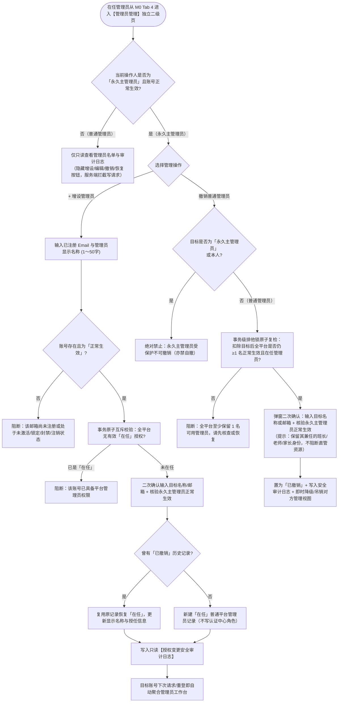
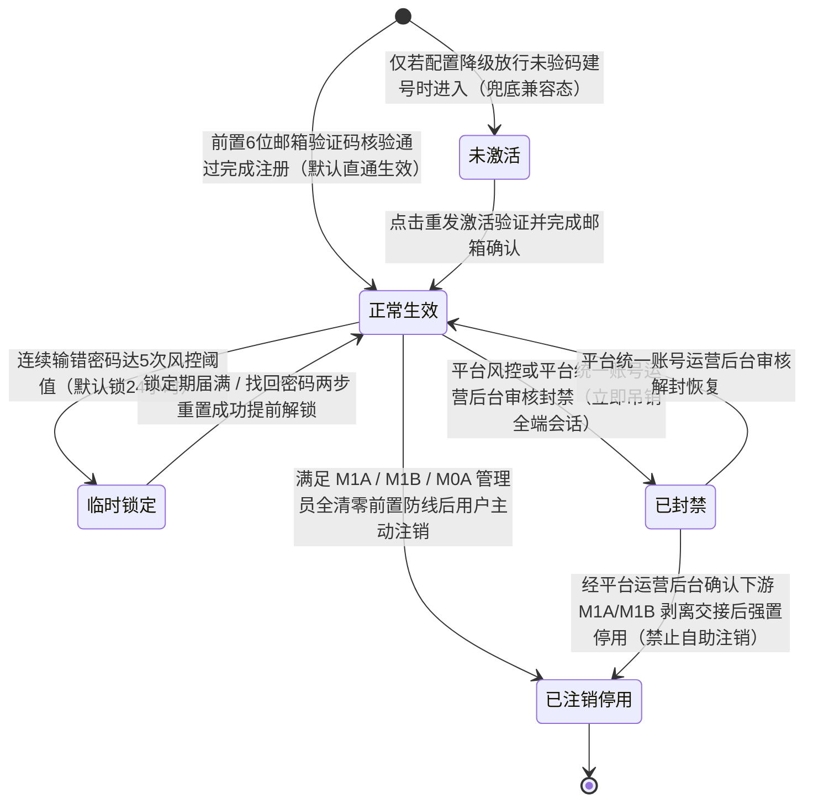
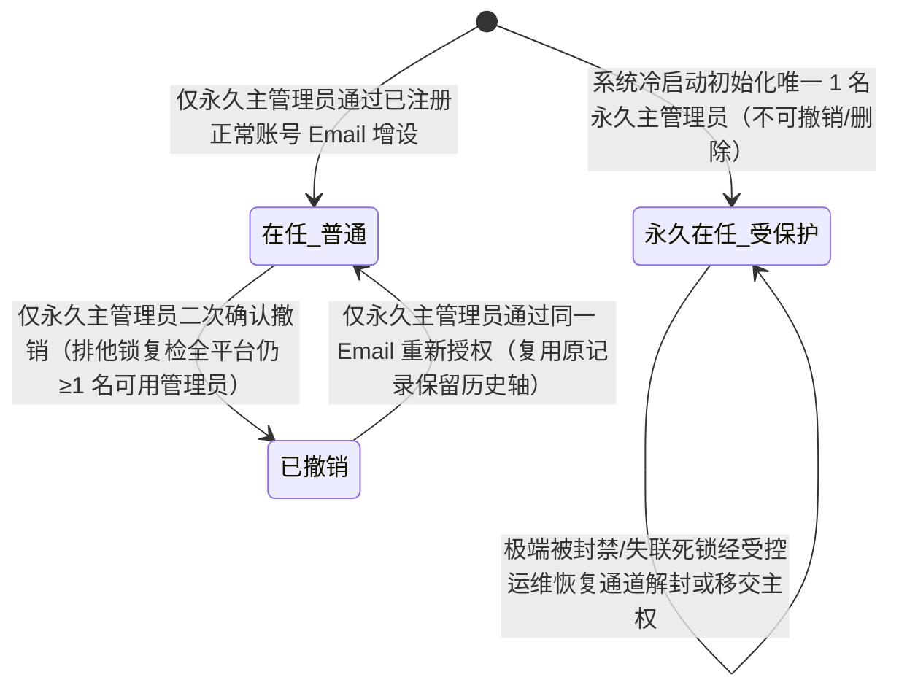
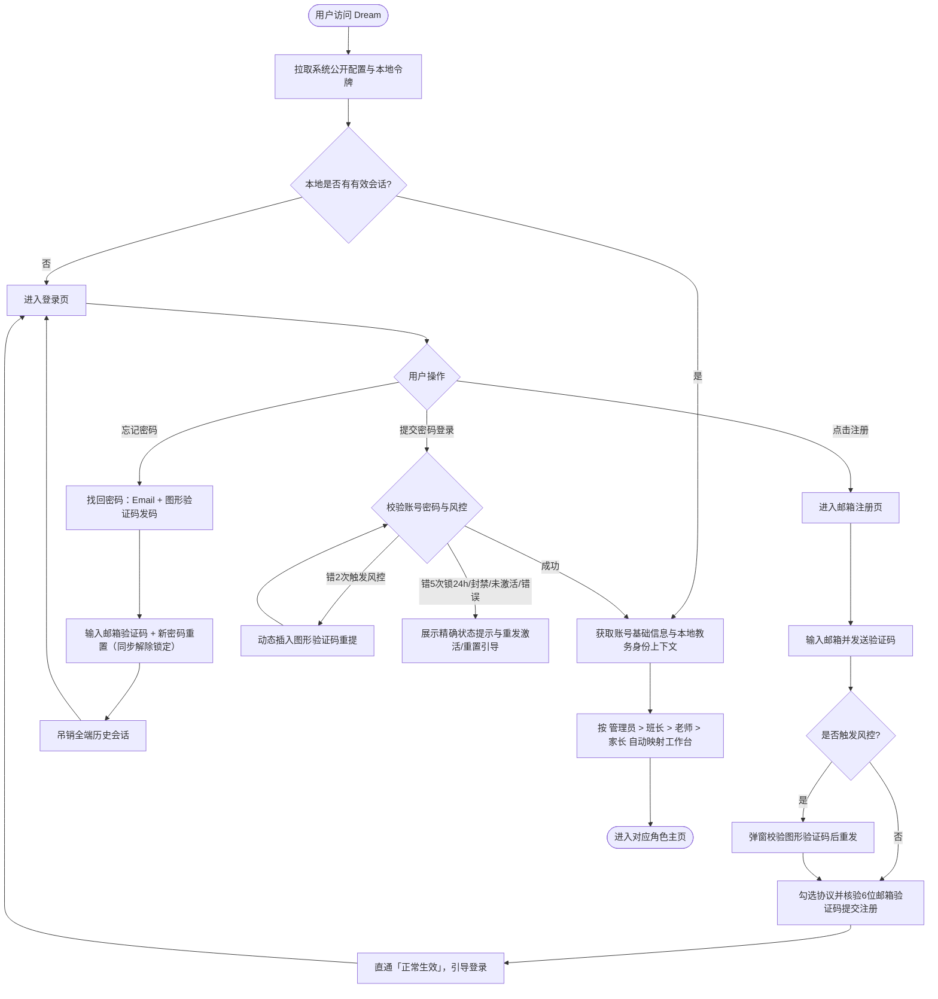

/** (c) 2024-2026 Topee (https://topee.top). All rights reserved. Proprietary and confidential. */

# 产品需求文档 (PRD) — M0A：账号认证、安全中心与业务身份解耦

| 元数据项 | 说明 / 内容 |
|---|---|
| **模块代号** | `m0a` |
| **所属模块** | 模块零：全域基座与账号安全 (Workspace Shell & Account) |
| **文档状态** | 待审阅 (Draft for Review) |
| **关联顶层 PRD** | [Prd-v5.md](../Prd-v5.md) |
| **关联规范** | [m0_workspace_and_home.md](./m0_workspace_and_home.md) / [BUSINESS_RULES.md](../BUSINESS_RULES.md) / [GLOSSARY.md](../GLOSSARY.md) |
| **创建与更新日期** | 2026-11-18 (创建：对齐统一认证接入要求与 Dream 账号解耦规范) / 2026-11-22 (**SSOT 归口与合规清洗**：新增 `§4.8` 登录账号实体四支柱生命周期、字段锁定、安全留痕与留存及第 2 层跨实体联动/协同索引；修正 `§4.6(3)` 账号注销前提与 `M1A`“有历史记录仅可归档不可删除”保持一致；清理残留技术标识符) / 2026-11-23 (**补齐平台管理员维护 PRD**：新增 `§4.7(3)` 与 `§4.7b` 本地平台管理员增设、撤销、复用恢复与防线流程；升级 `§4.8` 纳入平台管理员授权实体四支柱 SSOT、独立解耦规则与跨实体联动；增补用户故事 `6~7`、`AC-M0A-16~19`、`§7` 范围外边界及 `§9.5` 管理员管理独立二级页线框) / 2026-11-23 (**协同 M1B 红队收口 D4/D5/D11/D14**：明确委任班长与绑定老师均须校验 M0A 账号「正常生效」且支持多角色兼任，老师以 M0A 账号 ID 为唯一锚点，明确 M0A 注销前须校验 M1B 不存在「在职（含冻结/待离职）」班长或老师档案) / 2026-11-23 (**M0A 策略红队全面闭环 + 永久主管理员机制落地**：① 设立系统冷启动初始化唯一 `1` 名**「永久主管理员（不可撤销）」**，剩余普通管理员的新增、编辑名称、撤销与复用恢复**仅限该永久主管理员操作**（D0），并补齐事务级排他并发控制与重复授任原子防重（D1/L-6）；② 统一 `§4.6(3)`、`§4.8.1`、`AC-M0A-13` 账号注销前必须已卸载在任管理员身份（D2），明确极端归零时由受控运维恢复通道破冰并留痕（D3），澄清封禁/解封归属平台统一运营后台及封禁账号冻结/Email 不释放口径（D4）；③ 补齐邮箱验证码 `120` 秒有效与连续错 `5` 次即作废防爆破（D5）、`2` 次错密码出图形码 / `5` 次锁定 `24` 小时基准阈值（D8）及图形验证码 `5` 分钟/刷新限频（L-5）；④ 界定「限本人老师」= M1B「负责班长」归属本人（D6）、闭合注册前置验码直通「正常生效」与兜底「未激活」重发（D7/L-1），并 clarify 账号昵称/姓名独立边界及换绑旧邮箱即时释放等 `L-2~L-8` 规范) / 2026-11-23 (**协同 M5A 资金归集收口**：明确 [M5A](./m5a_transfer_collection.md) 周转账单与离职移交单【确认收款】【确认移交收款】及【驳回转账单】专属唯一「永久主管理员」，其兼代表平台固定持有「平台直收」与离职移交资产且账号主体永久不变) / 2026-11-23 (**协同 M5B 老师发薪收口**：补充 [M5B](./m5b_weekly_settlement.md) 老师周课酬单内部单价录入/修改、差额调整、手动批量放行、确认发薪【标记为已打款】、含试算全表导出与批处理重跑专属唯一「永久主管理员」，其余普通管理员仅限只读查验节数、流水明细与转账单号穿透且隐藏内部单价与试算积分) |

---

## 1. 概述与执行摘要 (Executive Summary)

账号认证与安全中心（`m0a`）是 Dream 教务排班与分账管理系统的自然人身份准入与账号安全基座，服务于平台管理员、班长、授课老师与出资家长四类用户。本模块在底层复用统一认证底座完成注册、登录、令牌无感续期、找回密码、改密与安全换绑，并在业务层贯彻“账号与业务身份解耦”原则——**完全不使用认证底座的角色体系**，而是通过本地平台管理员授权及教务侧档案绑定关系天然驱动工作台与权限视图。当前阶段：MVP 正式功能规划。

---

## 2. 问题定义与背景 (Problem Statement)

- **痛点 1：认证入口与安全交互缺失闭环**：现有基座规范主要聚焦已登录后的工作台主页与导航分流，对未登录态的准入控制（注册开关、协议签署留痕、风控图形验证码、锁号/封禁提示）、多端会话失效感知及无感续期防误杀机制尚无统一产品规格。
- **痛点 2：自然人账号与教务身份易混淆**：传统系统常在认证中心维护复杂的业务角色标签，导致管理员委任班长、绑定外教或家长兼任多角色时出现跨系统状态不一致与权限同步延迟。
- **痛点 3：多端语言与通知载体割裂**：外教以英文为主、家长/班长以中文为主，且家长/班长/老师更换 Email 后若未同步通知载体，会导致课酬单、排课变动与续费提醒邮件投递失效。

---

## 3. 目标用户与角色画像 (Users & Personas)

### 3.1 角色一：出资家长（Amy）
- **角色定位**：家庭课次出资人与日常排课操作人（单账号可挂载最多 10 个学员档案）。
- **核心诉求**：使用常用 Email 快速自助注册与登录，在“记住我”状态下免去频繁重复登录；忘记密码或更换常用邮箱时能安全找回/换绑，确保购课确认、排课通知与续费提醒邮件准确送达。
- **预期成果**：顺利完成注册登录与协议确认，安全管理个人账号凭证，并无缝进入家长工作台或认领试课学员档案。

### 3.2 角色二：海外授课老师（David）
- **角色定位**：通过个人 Email 自助注册后，由负责班长或平台管理员在后台绑定入驻的母语授课老师。
- **核心诉求**：无需复杂后台录入，使用英文界面自助完成账号注册、邮箱验证、登录与安全改密，将注册 Email 提供给班长/管理员完成绑定后即可查看个人课表与周结单。
- **预期成果**：在英文界面下零障碍完成账号全生命周期操作，第一时间接收排课、代课与周结邮件通知。

### 3.3 角色三：中方班长与平台管理员（Leo / Sarah）
- **角色定位**：教务经纪人与平台统筹方，往往兼任自家孩子的家长。
- **核心诉求**：使用单一 Email 账号登录，系统自动聚合其管理职责与家长身份，无需手动切换身份；在安全敏感操作（如资金转账确认、离职交接）中确保账号处于有效未被封禁状态；更换邮箱或密码时保障历史会话及时收敛。
- **预期成果**：兼顾操作便捷性与资金/教务高安全水位。

---

## 4. 核心业务流程 (Main Flows)

### 4.1 启动准入与会话无感续期流

1. **前置配置检测**：用户进入登录页或注册页时，系统自动拉取系统公开配置开关。
   - 若系统处于全站维护模式，页面阻断表单操作并展示维护公告。
   - 若当前关闭了开放注册，注册页禁用提交按钮并展示“平台暂未开放注册”提示，同时登录页隐藏或置灰注册引导入口。
2. **多并发无感续期**：用户处于已登录态访问业务页面时，若短效访问凭据过期且本地持有有效刷新凭据，系统自动执行单通道互斥刷新（同一时刻仅发起一次换票请求，其余并发请求排队等待新凭据后自动重放），避免并发换票触发令牌重放保护导致用户被误踢下线。
3. **会话失效兜底**：当刷新凭据过期、被管理员封禁或已在其他端修改密码导致凭据失效时，系统立即清空本地登录态与敏感业务快照，并重定向至登录页（携带原目标路径以便登录后回跳）。

### 4.2 邮箱自助注册流（含协议签署与风控拦截）

1. 用户在注册页填写 **Email**（必填）、**登录密码**、**确认密码**，可选填**昵称**与**性别**；页面支持右上角一键切换 `简体中文 / English`。
2. 用户点击“发送验证码”，系统校验 Email 格式合法且未被其他账号占用后，向该 Email 发送 6 位数字验证码（有效期 **120 秒**），按钮进入 **60 秒倒计时**。
   - **分支（触发人机风控）**：若因同 IP 或同邮箱请求频繁触发风控，系统弹窗要求输入**图形验证码**（单张有效期 **5 分钟**，支持点击刷新图片且高频刷新受同 IP 频控保护），用户输入后再重发邮箱验证码。
   - **异常（邮箱已被占用）**：直接提示“该邮箱已被注册，请直接登录或更换邮箱”，不发送验证码。
3. 用户勾选 **《用户服务协议》与《隐私保护政策》**（点击链接可弹出全文模态框阅读）。
4. 用户输入 6 位邮箱验证码并点击“注册”，系统携带用户同意的协议标识与当前版本号提交注册。
   - **防爆破与原子防重**：若单个验证码连续校验失败达到 **5 次**，当前验证码即刻强制作废并提示“验证码错误次数过多，请重新获取验证码”，用户须待 **60 秒**冷却届满后重新发送；注册落盘当步以原子方式再次校验该 Email 在全平台未被并发抢占。
5. **后置状态**：因注册提交前已强制完成 6 位邮箱验证码校验，注册成功后账号**直接处于「正常生效」状态**，引导用户前往登录页登录（或若自动签发凭据则直接进入工作台）；新注册账号默认具备家长视角，可立即新建孩子档案或自助认领班长/管理员预建的待认领试课档案。

### 4.3 邮箱密码登录与异常拦截流

1. 用户输入 **Email** 与 **密码**，可勾选 **“记住我”**（勾选后保持 7 天长效会话，未勾选则为当前浏览器会话期）。
2. 默认界面**不展示**图形验证码；当同一账号连续输错密码达到 **`2` 次**（或触发服务端风控阈值）时，表单内动态插入图形验证码输入行，用户输入后再次提交。
3. 登录成功：
   - 认证侧返回账号基础信息（账号 ID、Email、昵称、头像、初始超管兜底标识等）。
   - 业务侧紧接着拉取当前账号的本地平台管理员授权及本地教务身份上下文（是否本地「在任」管理员及是否为唯一永久主管理员、是否在职班长、是否在职老师、名下学员档案列表；其中认证底层超管标识仅作系统冷启动初始化与极端运维破冰参考），按 **`管理员 > 班长 > 老师 > 家长`** 优先级自动映射首页分区与底部导航，**全程不依赖认证中心的角色标签，也不展示顶部强身份切换器**。
4. **异常分支**：
   - 账号或密码错误：提示“账号或密码不正确”并清空密码框（累计错误达到 **`2` 次**动态展开图形验证码）。
   - 连续输错锁定：同一账号连续输错密码达到 **`5` 次**，触发账号「临时锁定」（默认锁定时长 **`24` 小时**，随平台安全风控配置微调），阻断密码登录、精确展示剩余解锁时长，并引导使用【忘记密码】完成邮箱双验提前重置解锁。
   - 账号被封禁：弹窗阻断提示“账号已被封禁，如有疑问请联系客服或负责班长”。
   - 兜底未激活账号提示：仅若存在因历史数据或特殊配置放行未验码建号产生的「未激活」存量账号，登录时拦截提示“账号尚未激活”，并在提示条内提供就地 **`[ 重发激活验证 ]`** 按钮（受 60 秒发送冷却限制），引导完成邮箱验证激活后转为「正常生效」。

### 4.4 找回密码流（两步重置）

1. **第 1 步（身份与人机校验）**：用户在找回密码页输入注册 Email，并**强制输入图形验证码**，点击“发送重置验证码”。
   - 若该 Email 未注册，提示“该账号未注册”；若该账号处于「已封禁」或「已注销停用」，阻断重置并提示对应账号状态异常。
2. **第 2 步（验证码与新密码提交）**：发送成功后锁定 Email 输入框，展示 6 位邮箱验证码输入框（有效期 **120 秒**）与新密码输入框（需符合密码强度规则）；用户点击“确认重置”。
   - **防爆破熔断**：单个重置验证码连续校验失败达到 **5 次**即刻自动作废，提示“验证码错误次数过多，请重新获取验证码”，须等待 **60 秒**发码冷却届满后重发；确认重置成功时同步解除因密码连错导致的「临时锁定」状态。
3. **后置状态**：密码重置成功后，系统自动吊销该账号在所有设备上的历史会话，弹窗提示重置成功并跳转至登录页。

### 4.5 个人中心与两步安全换绑流

1. **基础资料维护**：用户可在【我的】（或管理员【管理与设置】底部个人中心）修改昵称、个人姓名（选填，仅用于本人账号基础资料展示，与 M1A 学员规范昵称、M1B 班长/老师显示名及管理员显示名称彼此独立且互不覆盖）、性别，以及上传个人头像（本地选图 `≤ 2MB`，支持 JPG/PNG/WebP 裁切直传后同步更新账号头像，确保全平台头像唯一可信）。
2. **语言偏好同步**：用户在个人中心或登录页切换 `简体中文 / English` 时，界面即时刷新，并在本地持久化保存，同时登录后同步至业务侧用户偏好记录（外教首次默认英文，家长/班长默认中文）。
3. **修改登录密码**：用户输入“当前旧密码”与“新密码”（含强度校验与二次确认），验证通过后更新密码并**强制吊销所有设备登录态**，界面提示后自动跳转登录页要求使用新密码重新登录。
4. **两步安全换绑邮箱（旧凭证确权 → 新凭证绑定）**：
   - **第 1 步（验证旧邮箱）**：弹窗展示脱敏后的当前绑定邮箱（如 `ab***@example.com`），用户点击发送验证码并填写，校验通过后获得有效期 **10 分钟（600 秒）** 的单次安全换绑凭证（单个验证码连续输错 **5 次**即作废重发）。
   - **第 2 步（验证并绑定新邮箱）**：输入新 Email 并发送验证码，连同安全凭证提交换绑（连续输错 **5 次**同样作废重发）。新邮箱在全平台不得已被其他账号占用，提交落盘当步以原子方式再次核验唯一性，杜绝并发抢注或双向互换竞态。
   - **异常回退**：若第 2 步提交时安全凭证已过期或失效，提示“操作超时，请重新验证当前邮箱”并自动回退至第 1 步。
   - **后置联动与旧邮箱释放**：换绑成功后，本地账号缓存即时更新，后续所有排课、请假、周结等系统通知邮件自动发往新 Email；**原旧邮箱自换绑成功即刻释放，可被其他账号重新注册或绑定**（历史审计日志与既往通知投递流水只读保留当时邮箱快照，不作回溯改写）。

### 4.6 账号退出与注销流

1. **主动退出登录**：用户点击“退出登录”并二次确认后，系统注销服务端当前会话与刷新令牌，清除本地认证凭据与业务敏感快照（保留语言偏好等非敏感外壳设置），跳转至登录页。
2. **清理本地缓存**：用户点击“清理缓存”时，仅清除本地业务列表与静态缓存并展示当前版本号，**严禁清除登录凭据导致掉线**。
3. **申请注销账号（跨模块业务前置防线）**：
   - 若账号名下挂载了学员档案，必须先确保名下**「正式在读」档案数为 0**——所有孩子均须在 [M1A](./m1a_student_profile.md) 满足五项资产全清零，无历史课次及购课单的空档已完成删除，产生过历史课次或购课单的档案已完成归档（不可强行删除）；
   - 若账号曾被委任为班长或绑定为授课老师，**必须强制校验在 [M1B](./m1b_teacher_profile.md) 中名下已无任何处于「在职」（含班长「交接冻结中」或老师「待离职」）状态的职务/老师档案**——即便名下排课与托管资金均为 `0`，也必须先走完 M1B 离职交接流程并正式转为「已离职」，方可注销账号；
   - 若账号当前拥有 Dream 本地**「在任」平台管理员身份**：① 普通在任管理员申请注销前，必须先由**永久主管理员**在后台撤销其管理员职务（转为「已撤销」）；② **系统初始化的「永久主管理员（不可撤销）」在受保护在任状态下严禁直接自助注销账号**（须先经受控运维恢复通道完成主管理员移交与卸载）；**严禁任何账号带着「在任」管理员身份注销**，彻底杜绝僵尸授权残留；
   - 校验全部通过后，剥离该账号登录权限、吊销全端会话并停用账号；历史归档学员档案及规范昵称、历史购课单、课次清退单、转账单、周课酬单据与管理员授权审计日志永久依法留痕，不随注销物理删除。

### 4.7 纯自助注册与业务身份绑定流（无跨系统写角色）

1. **班长委任**：平台管理员在班长管理界面输入目标用户已注册的 Email，系统核验该账号存在且处于 **「正常生效」**；校验通过后在业务侧以 **M0A 账号 ID** 创建或恢复「在职」班长档案（允许家长、在职老师及平台管理员通过同一自然人账号兼任），该用户下次进入工作台即自动聚合展示班长功能，**不向认证中心写入任何角色**。
2. **老师入驻绑定**：海外外教自行使用个人 Email 在系统完成注册后，将注册 Email 告知负责班长或管理员；班长（**严格仅限「本人老师」，即在 [M1B](./m1b_teacher_profile.md) 中「负责班长」归属为当前操作班长本人的老师档案；严禁班长操作其他班长名下或平台直管/未划拨老师**）或平台管理员在老师档案录入或编辑页输入该**完整 Email 精准检索**（前端严禁提供未绑定自然人账号的模糊浏览列表以防邮箱枚举泄露），系统核验该账号处于 **「正常生效」** 且未绑定其他非离职老师档案后，以 **M0A 账号 ID** 完成唯一绑定（支持先存为「待绑定账号」资料草稿暂不上架，绑定后立即生效；换绑邮箱自动同步展示），老师登录即自动进入老师工作台（默认英文界面）。
3. **平台管理员授权（唯一永久主管理员主控制）**：全平台由系统冷启动初始化唯一确立 **1 名「永久主管理员（不可撤销）」**；其余普通「在任」平台管理员的增设、编辑名称、撤销与复用恢复**仅限该「永久主管理员」在 Dream 本地业务侧操作**，不向认证中心写入任何角色；除明确收归「永久主管理员」专属的高危授权、M2B `72h` 异议终审、M5A 归集确认/驳回与 M5B 老师周课酬单写/发薪外，其余日常教务与运营职责中所有在任管理员保持平权，底层超管标识仅作系统初始化兜底种子及极端运维破冰参照，日常治理以本地「在任」管理员名单为准。

### 4.7b 永久主管理员保护与普通管理员增设、撤销流

1. **入口隔离、唯一永久主管理员与权责分层原则**：
   - 平台管理员从 [M0 管理与设置](./m0_workspace_and_home.md) → `👑 管理员管理` 进入独立二级管理页（页面内包含 `[ 管理员名单 ]` 与 `[ 只读授权审计日志 ]` 两个页签或分区，不集成用户账号封禁台）；
   - **非管理员访问拦截**：班长、老师与家长直接访问本页时必须由系统拦截拒绝并提示无权限；
   - **「永久主管理员」唯一初始化与不可撤销铁律**：
     - 全平台有且仅有 **`1` 名「永久主管理员（不可撤销）」**，由系统冷启动初始化自动固化确立（不开放从前端列表增设第 2 名永久主管理员，亦**严禁**任何管理员在前端摘除或转移该保护标记，彻底消除管理员之间互相撤销或夺权互锁的风险）；
     - **任何管理员（含永久主管理员本人及所有普通管理员）均绝对禁止撤销或删除「永久主管理员」**；名单行固定展示 `永久主管理员 · 不可撤销` 徽章且不提供撤销按钮，本人亦不可自助注销账号；
   - **日常业务平权、授权与中央资金归集终审收口**：
     - 除明确收归唯一「永久主管理员」专属的高危授权与资金终审权外，所有「在任」平台管理员（永久主管理员与普通管理员）在班长委任、老师管理、小班调度、课次退费及异常回退等日常教务与运营职责上保持平权；
     - **唯一「永久主管理员」专属高危权限**：① 普通管理员的新增、编辑名称、撤销与复用恢复；② [M2B](./m2b_refund_orders.md) 兜底代清退 `72h` 异议最终核验；③ [M5A](./m5a_transfer_collection.md) 全平台周转账单与离职移交单的**【确认收款】【确认移交收款】与【驳回转账单】**（同时代表平台固定持有「平台直收」与离职移交接管 TS，每周按周单核销，账号主体永久不变），普通管理员对 M5A 审单仅只读查阅明细与凭证、严禁越权放行收款；④ [M5B](./m5b_weekly_settlement.md) 全平台老师周课酬单的**内部课酬单价录入/修改、新增【差额调整项】、手动【批量放行】、确认发薪【标记为已打款】、含试算全表导出与批处理异常重跑**，其余普通管理员在 M5B 仅只读查阅出勤节数、课次流水、前置转账单穿透与状态时间轴（隐藏内部单价与试算参考总积分，且导出仅限纯节数表）。
2. **增设（与已撤销复用恢复）及并发防重流程**：
   - **仅永久主管理员**点击 **`[ + 增设管理员 ]`**，输入目标用户已注册 Email（去空格转小写）；系统仅只读核验账号存在且处于「正常生效」（未激活、已锁定、已封禁或已注销停用账号禁止授任）；
   - 校验通过后回显目标账号当前昵称，由永久主管理员确认或填写管理员显示名称（1–50 字）；若目标曾有「已撤销」管理员记录，自动复用原记录恢复「在任」并保留过往授权历史；
   - **并发防重**：同一账号同一时刻全平台最多仅允许存在 `1` 条有效管理员授权记录，提交落盘事务以原子互斥检查防重，阻断多窗口并发重复授权；
   - 提交前需弹窗二次确认（输入目标显示名称或 Email），并在事务内实时核验永久主管理员账号处于「正常生效」；成功后落盘并写入只读安全审计日志，不向认证中心写入角色。
3. **普通管理员撤销双防线、并发排他锁与极端破冰通道**：
   - **强权限与并发双防线校验**：
     1. **唯一授权人与不可撤销硬锁**：仅「永久主管理员」可撤销**普通在任管理员**；「永久主管理员」本身受永久保护，严禁任何自撤或他撤，普通管理员之间严禁互相撤销；
     2. **事务级排他并发锁 + 全平台可用基线兜底**：执行撤销操作时，事务内必须对全平台有效管理员集合施加排他并发控制，在锁内原子复检“扣除拟撤销对象后，全平台是否仍存在至少 `1` 名状态为「在任」**且关联账号处于「正常生效」**的可用管理员”（防止连击撤销或多端并发在永久主管理员异常态前后把剩余可用管理员清零）；
   - **独立解耦（无教务/资金交接阻断）**：撤销普通管理员身份**仅收回平台治理权限**，**保留该账号兼任的班长（含所辖老师/小班/托管课次，班长卸任另行在 [M1B](./m1b_teacher_profile.md) 走双防线）、授课老师与家长身份**；原由其处理的「平台直管」老师与全校审单工作由永久主管理员及其余在任管理员自然接续，系统不阻断撤销；
   - **二次确认与即时生效**：弹窗展示解耦提示并要求输入目标显示名称或 Email 二次确认，提交时在排他锁事务内再次复检永久主管理员权限与可用性；成功后置为「已撤销」、写入只读安全审计日志，并**立即吊销或强制刷新目标用户当前在线会话的管理工作台视图**（若目标还兼任班长/老师/家长，降级为对应工作台视图；若无其他角色，收拢为家长视角）；
   - **极端死锁 Break-Glass 恢复通道**：若唯一「永久主管理员」因密码连错处于「临时锁定」，本人可通过【忘记密码】完成邮箱双验重置密码即刻解锁恢复；若「永久主管理员」遭遇账号「已封禁」或彻底失联（导致全平台丧失授权操作人或可用管理员归零），允许通过**平台受控运维恢复通道**（冷启动兜底超管引导 / 平台统一运营后台审核解封原账号或紧急移交指定新「永久主管理员」）破冰恢复，且该受控运维恢复动作必须强制记入不可篡改的独立安全审计日志。

### 4.8 登录账号与平台管理员授权实体唯一归口：四支柱生命周期、字段锁定、留痕与跨实体联动 (Entity & Log SSOT)

> **【实体生命周期、字段与日志唯一归口声明】**：**自然人登录账号实体（含会话凭据、两步换绑安全凭证及轻量扩展偏好）**与 **Dream 本地平台管理员授权实体**的生命周期状态机、字段可编与锁定边界、协议及安全审计留痕规则及留存策略 100% 统一且唯一由本 PRD 管辖与定义；认证底座底层接口契约遵循账号体系接入指南。

#### 4.8.1 生命周期状态机与转移矩阵

##### 1. 自然人登录账号实体

| 初始状态 | 目标状态 | 触发角色 / 机制 | 前置条件与守卫防线 | 伴随副作用与系统行为 |
| :--- | :--- | :--- | :--- | :--- |
| **`[*]`** | **正常生效 / 未激活（兜底）** | 新用户自助注册 | 开放注册开关开启；Email 格式合法且原子校验全平台未占用；密码 $\ge 8$ 位含大小写字母、数字与特殊字符；默认前置 6 位邮箱验证码校验通过（连续错 `5` 次作废）；已阅读并勾选协议 | 固化写入注册协议标识与版本号；默认注册后**直通「正常生效」**并具备家长视角（仅特殊降级配置未验码建号进入兜底「未激活」，长期未激活超 `7` 天可清理释放） |
| **正常生效** | **临时锁定** | 登录安全风控 | 连续输入错误密码达到 **`5` 次**基准风控阈值（连续错 `2` 次起动态触发图形验证码） | 阻断继续密码登录并精确展示剩余解锁时长（默认 **`24` 小时**，随安全配置微调）；引导走【忘记密码】两步重置 |
| **临时锁定** | **正常生效** | 系统计时 / 本人重置密码 | 达到锁定期限，或通过图形验证码 + 邮箱验证码完成两步密码重置 | 恢复正常登录；若经由重置密码解锁，同步吊销全部旧设备历史会话 |
| **正常生效** | **已封禁** | 平台风控 / 平台统一账号运营后台 | 存在违规或安全风险（注：Dream 业务工作台本期不自建封禁前端，统一消费运营后台封禁状态） | 立即失效全端登录会话；阻断登录、找回密码与全端高危操作；向 [M1A](./m1a_student_profile.md) / [M1B](./m1b_teacher_profile.md) 暴露只读封禁标识放行管理员强清退、改绑与代清零交接；**严禁释放原绑定 Email 供重注** |
| **已封禁** | **正常生效** | 平台统一账号运营后台审核 | 经运营后台审核确认解除风险 | 恢复登录及原有业务身份访问（需确保下游未被强制改绑/离职） |
| **正常生效** | **已注销停用** | 登录账号本人 | **跨模块前置清零防线**：① [M1A](./m1a_student_profile.md) 名下「正式在读」档案数 == 0（空档已删除、有历史记录档案已完成 5 项全清零归档）；② [M1B](./m1b_teacher_profile.md) 若兼任班长或老师，已完成资金清算与教务交接并转为「已离职」；③ **在 M0A 不得存在「在任」平台管理员身份**（普通管理员须先由永久主管理员撤销，永久主管理员受保护不可自助注销，须先走运维移交并卸载） | 吊销全端会话并剥离登录权限；不可逆停用登录凭证；**严禁物理删除下游档案、规范昵称占位、管理员授权日志及历史财务单据** |
| **已封禁** | **已注销停用** | 平台统一账号运营后台（终结处置） | 已封禁账号禁止本人自助注销；须确认下游 M1A/M1B 资产已通过管理员接管剥离且无在任管理员授权后，由平台运营后台执行终结停用 | 永久终止登录凭证并保留历史业务与财务审计留痕，默认不释放违规原邮箱占位 |

##### 2. 平台管理员授权实体（Dream 本地业务侧）

| 初始状态 | 目标状态 | 触发角色 / 机制 | 前置条件与守卫防线 | 伴随副作用与系统行为 |
| :--- | :--- | :--- | :--- | :--- |
| **`[*]`** | **永久在任（受保护）** | 系统冷启动初始化 / 受控运维恢复通道 | 系统冷启动按兜底种子初始化确立全平台唯一 `1` 名「永久主管理员」；**不可被任何管理员（含本人）在前端撤销、删除或摘除保护**，本人亦不可自助注销账号 | 拥有全部平台业务治理权及普通管理员唯一增撤权；日常业务与普通管理员平权；极端死锁时由受控运维恢复通道解封或移交并写独立安全审计日志 |
| **`[*] / 已撤销`** | **在任（普通）** | **仅「永久主管理员」**（且其账号「正常生效」） | 目标邮箱在 M0A 存在且账号处于「正常生效」，全平台当前无有效管理员授权（事务原子防重）；输入显示名称（1–50 字）；二次输入确认 | 创建或复用原授权记录置为普通「在任」；写入只读【授权变更安全审计日志】；目标下次请求或重登自动聚合管理员工作台（不写认证中心角色） |
| **在任（普通）** | **已撤销** | **仅「永久主管理员」**（且其账号「正常生效」） | ① 目标不得为「永久主管理员」（绝对禁止自撤或互撤）；② **事务级排他并发锁内原子复检**：撤销后全平台仍存在 $\ge 1$ 名「在任」且绑定账号处于「正常生效」的可用管理员（不计已封禁/已注销账号）；③ 输入目标名称或 Email 二次确认（不校验班长/直管交接） | 置为「已撤销」并记录撤销人/时间；写入安全审计日志；**立即吊销或强制刷新目标用户在线管理工作台视图**；保留兼任班长/老师/家长身份不受影响 |

#### 4.8.2 关键字段可编与锁定规则矩阵

| 所属实体 | 业务字段 | 状态与可编性 | 操作角色与校验门禁 | 锁定与禁止修改规则 |
| :--- | :--- | :--- | :--- | :--- |
| **登录账号** | **绑定 Email（唯一登录凭据与通知载体）** | 仅允许两步安全换绑 | 本人在【我的】完成「旧邮箱验证码确权（10 分钟单次凭证，超时回退第 1 步）→ 新邮箱验证码校验」；两步连续错码均限 `5` 次；提交当步原子校验全平台未占用 | **暂不开放手机绑定/换绑**；「已封禁」或「已注销停用」态永久锁定禁止修改（**违规封禁账号不释放原 Email**）；安全换绑成功后**原旧邮箱即时释放** |
| **登录账号** | **登录密码** | 随时可改密或重置 | 登录态验证旧密码改密，或找回密码页图形+邮箱双验证重置（错码限 `5` 次）；均须满足密码强度规则 | 改密或重置成功立即强制踢出所有设备旧会话；「已封禁」或「已注销停用」态不可修改或找回 |
| **登录账号** | **基础资料与界面偏好**（昵称、可选个人姓名、性别、头像 $\le 2\text{MB}$、语言偏好） | 「正常生效」态随时自主修改 | 登录本人维护；扩展界面偏好总容量 $\le 16\text{KB}$（仅限非敏感偏好）；**账号昵称/个人姓名与 M1A 规范昵称、M1B 老师/班长显示名、管理员显示名称彼此独立，互不覆盖且不共享唯一校验** | 「已封禁」与「已注销停用」态禁止自助修改；严禁在扩展元数据存放未脱敏隐私或敏感凭证 |
| **登录账号** | **协议签署快照**（协议标识、版本号、签署时间） | 注册提交即永久只读固化 | 注册流程自动固化 | 永久只读不可篡改，平台协议升级时另行触发新版本签署留痕 |
| **管理员授权** | **管理员显示名称（1–50 字）** | 「在任」态仅永久主管理员维护 | **仅「永久主管理员」**（账号处于「正常生效」） | 普通管理员与「已撤销」态只读不可改；再次复用授任时允许永久主管理员更新 |
| **管理员授权** | **永久保护标记、绑定账号 Email、授任人/撤销人、授任/撤销时间** | 初始化或操作时系统自动固化 | 系统在冷启动初始化、受控运维移交及增设/撤销事务内自动写入 | 前端对所有角色永久只读不可修改、不可摘除保护或抹除 |

#### 4.8.3 状态流转与安全留痕规则（唯一归口定义）

1. **协议、账号与管理员授权安全留痕**：注册提交时持久化记录所同意的《用户服务协议》与《隐私保护政策》标识、版本号及签署时间；每次密码修改/重置、两步邮箱换绑（记录旧邮箱、新邮箱与操作时间，历史快照只读保留）、触发锁定/解封/封禁、账号注销停用，**每次永久主管理员发起增设普通管理员、变更显示名称、撤销与复用恢复，以及极端死锁触发受控运维 Break-Glass 恢复通道**，必须在同一事务内追加只读安全审计日志（含操作人、目标账号/管理员、变更前后状态及时间），同步更新会话状态；授权审计日志**仅在任平台管理员只读可查**，对班长、老师、家长物理隐藏。
2. **高危操作实时验活**：执行普通管理员增设/撤销、[M5A](./m5a_transfer_collection.md) 资金转账确认、[M5B](./m5b_weekly_settlement.md) 老师周课酬单写与发薪确认、[M2B](./m2b_refund_orders.md) 课次清退、[M1B](./m1b_teacher_profile.md) 离职交接等高危操作时，必须实时核验操作人账号处于「正常生效」且未被封禁（涉管理员操作同时核验处于「在任」，涉管理员增撤、M2B `72h` 核验、M5A 确认收款/驳回及 M5B 写/发薪操作同时强制核验为唯一「永久主管理员」），任一失效立即阻断。

#### 4.8.4 数据留存与清理策略

- 严禁物理删除已注销或已封禁的自然人账号记录，以及已撤销的平台管理员授权记录与安全审计日志；账号注销仅作停用登录凭据与吊销会话处理，管理员撤销仅置为「已撤销」只读留存；
- 账号关联的协议签署快照、安全审计日志、管理员授权审计时间轴，以及下游 [M1A](./m1a_student_profile.md) 归档/软删学员档案与规范昵称占位、[M1B](./m1b_teacher_profile.md) 老师/班长历史档案、[M2A](./m2a_course_orders.md) 购课单、[M2B](./m2b_refund_orders.md) 清退记录、[M5A](./m5a_transfer_collection.md) 转账单、[M5B](./m5b_weekly_settlement.md) 周课酬单及凭证，均**长期只读审计留存、严禁级联物理清理**；
- 同一 Email 再次被永久主管理员授予普通管理员身份时复用原授权记录，保留过往审计历史连续可查；
- 主动退出登录清除本地令牌与敏感业务快照（保留语言偏好）；点击【清理缓存】仅清除本地静态业务缓存，严禁清除登录凭据导致掉线。

#### 4.8.5 第 2 层 · 跨实体同事务联动清单与跨模块只读协同索引

- **A. 触发方联动清单（M0A 变更驱动下游）**：

| 联动序号 | M0A 触发动作 | 驱动目标实体与结果方向 | 单向归口指针（M0A 不复述对方细则） |
| :---: | :--- | :--- | :--- |
| **1** | 两步安全换绑邮箱成功 | 同步刷新本地账号邮箱缓存并即时释放原旧邮箱；新邮箱作为 **M4 关键触发邮件** 唯一新投递地址，并同步反映至 **M1B 班长/老师绑定账号邮箱视图**与本模块管理员列表视图 | [M4](./m4_notification.md)、[M1B](./m1b_teacher_profile.md) |
| **2** | 切换系统语言偏好 | 即时刷新 **M0 全局外壳** 双语展示并同步保存至用户偏好（外教首次默认英文，家长/班长默认中文） | [M0](./m0_workspace_and_home.md) |
| **3** | 登录鉴权与会话恢复 | 拉取本地「在任」管理员授权（冷启动初始化唯一永久主管理员）并聚合 **M1A** 学员与 **M1B** 班长/老师本地档案，按 `管理员 > 班长 > 老师 > 家长` 映射 **M0 工作台视图与底栏**（零认证角色依赖） | [M0](./m0_workspace_and_home.md)、[M1A](./m1a_student_profile.md)、[M1B](./m1b_teacher_profile.md) |
| **4** | 永久主管理员增设或撤销普通管理员 | ① **立即更新目标账号在 M0 的工作台聚合视图**：增设后目标下次请求/重登聚合管理员首页与 Tab 4（在管理员管理页仅只读）；撤销后**立即吊销或强制刷新目标在线会话的管理视图**（保留其班长/老师/家长视图）； ② **严格解耦零联动改绑**：不改动 **M1B** 兼任班长/老师档案及资金持有人，原平台直管资源由其余在任管理员自然接续 | [M0](./m0_workspace_and_home.md)、[M1B](./m1b_teacher_profile.md) |

- **B. 跨模块前置协同边界（只读校验 · 零跨系统写角色）**：
  1. **[M1A 学员档案](./m1a_student_profile.md)**：M0A 注销账号前只读核验名下「正式在读」档案数 == 0（全部空档已删且有历史档案已完成 5 项全清零归档）；
  2. **[M1B 老师与班长档案](./m1b_teacher_profile.md)**：M1B 委任班长或绑定老师账号时只读核验 M0A 目标账号存在、处于「正常生效」（且老师绑定仅限「负责班长」为操作人本人的档案或由管理员操作，严格遵循 M1B 归口之「1 账号仅绑 1 个非离职老师档案」口径，零写角色）；M0A「已封禁」状态向 M1B 暴露只读标识以放行管理员代清零与改绑；**M0A 注销账号前强制校验 M1B 不存在「在职（含交接冻结中）」班长档案与「在职（含待离职）」老师档案（即便 0 资产亦须先在 M1B 办理离职），且 M0A 自身不得存在「在任」平台管理员身份**；撤销普通管理员不触发 M1B 离职双防线；
  3. **[M2B](./m2b_refund_orders.md) / [M5A](./m5a_transfer_collection.md) / [M1B](./m1b_teacher_profile.md)**：执行高危业务动作时实时核验 M0A 账号处于「正常生效」且未被封禁。

---

## 5. 用户故事 (User Stories)

1. **作为一个新家长**，我想要通过常用 Email、邮箱验证码并阅读勾选《用户服务协议》与《隐私政策》自助完成注册，以便于获得合法合规的登录账号并开始为孩子建档购课。
2. **作为一个海外授课老师**，我想要在登录/注册页直接切换为英文界面，自助注册 Email 账号并安全修改密码，以便于把邮箱提供给班长完成绑定后直接看懂我的排课与课酬单。
3. **作为一个兼任班长与家长的用户**，我想要在“记住我”状态下免去频繁重复登录，即使在弱网并发刷新首页时也不会被误踢下线，以便于稳定处理日常教务待办与查看孩子课表。
4. **作为一个更换了工作邮箱的用户**，我想要通过“先验证旧邮箱、再验证新邮箱”的两步安全流程完成换绑，以便于防止他人盗用账号篡改通知邮箱，并确保后续课程提醒能发到我的新邮箱。
5. **作为一个忘记密码的用户**，我想要通过图形验证码人机校验加邮箱验证码重设密码，并在重设后自动踢出所有旧设备会话，以便于在设备丢失或遗忘密码时保障账号资产安全。
6. **作为唯一永久主管理员**，我想要通过已注册 Email 检索并增设普通管理员、修改其显示名称、或恢复曾被撤销的管理员身份，且确认本人永久主管理员权限不被任何人误撤，以便于长期安全掌控平台治理锚点。
7. **作为唯一永久主管理员**，我想要在确保至少保留 1 名可用管理员的前提下安全撤销不再履职的普通管理员权限，并保留对方兼任的班长/老师/家长业务身份不受中断，以便于平滑交接平台管理权责。

---

## 6. 验收标准清单 (Acceptance Criteria)

### 6.1 注册、协议与配置开关
- `AC-M0A-01` **仅开放 Email 注册与密码登录**：系统注册页与登录页仅提供 Email 通道（不展示手机注册页签、不展示短信免密登录入口）。
- `AC-M0A-02` **全局注册开关响应**：当系统公开配置返回禁止注册时，注册提交按钮处于禁用状态并明确展示“平台暂未开放注册”提示。
- `AC-M0A-03` **协议读取与版本留痕**：注册页未勾选《用户服务协议》与《隐私保护政策》时禁止提交注册；点击协议名称可打开包含当前版本号与生效日期的全文模态框；提交注册时必须将当前协议标识与版本号一并提交留痕。
- `AC-M0A-04` **密码强度与前置验码直通生效**：注册、改密与重置密码表单提交时，若密码长度少于 8 位或未同时包含大写字母、小写字母、数字及特殊字符，前端实时拦截并提示具体规则；通过 6 位邮箱验证码提交注册时原子校验邮箱全平台未占用，成功后账号直接处于「正常生效」状态并进入登录或工作台引导。

### 6.2 登录、风控与无感续期
- `AC-M0A-05` **按需触发图形验证码与刷新风控**：登录页默认不显示图形验证码；当同一账号连续输错密码达到 **`2` 次**（或触发风控阈值）时，动态展示图形验证码输入框与可点击刷新的验证码图片（单张有效 **5 分钟**，高频刷新触发冷却拦截）。
- `AC-M0A-06` **记住我会话周期**：勾选“记住我”登录后，刷新凭证有效期为 7 天；未勾选时为当前会话期。
- `AC-M0A-07` **并发凭据过期防误杀续期**：当页面同时发出 $\ge 3$ 个业务请求且均返回访问凭据过期时，系统仅发起 1 次刷新凭据请求，其余请求挂起等待新凭据后自动重放成功，不得因旧刷新凭据被作废而误触发强制退出。
- `AC-M0A-08` **异常账号精准拦截与量化锁号**：账号连续输错密码达 **`5` 次**触发「临时锁定」（默认锁定 **`24` 小时**）时展示明确剩余解锁时长并引导走【忘记密码】解锁；账号被封禁时提示已封禁；兜底未激活账号提示未激活并提供就地 `[ 重发激活验证 ]`（60 秒冷却），严禁笼统提示“系统错误”。

### 6.3 个人中心、安全换绑与注销
- `AC-M0A-09` **两步安全换绑、旧邮箱释放与验证码防爆破**：已绑定邮箱换绑必须依次完成旧邮箱验证码确权（获取 10 分钟单次安全凭证）与新邮箱验证码校验；任意场景下的 6 位数字邮箱验证码连续校验失败达到 **`5` 次**必须强制作废并提示重新获取；新邮箱提交当步原子校验未占用，安全凭证过期回退第 1 步；换绑成功后原旧邮箱即时释放可重用。
- `AC-M0A-10` **改密与重设全端强踢**：用户在个人中心修改密码或通过找回密码重设成功后，所有设备历史会话立即失效，当前端强制清理登录态并跳转至登录页；若此前因连续输错密码处于「临时锁定」，通过找回密码重设后同步解除锁定。
- `AC-M0A-11` **头像上传限制与单一可信源**：头像上传限制文件大小 $\le 2\text{MB}$、格式仅限 JPG/PNG/WebP；上传完成后同步更新账号头像字段，全工作台统一读取同一头像地址；账号「昵称」及「可选个人姓名」仅用于个人账号展示，与 M1A/M1B/管理员显示名称彼此独立、互不覆盖且不共享唯一校验。
- `AC-M0A-12` **清理缓存与安全退出隔离**：在个人中心执行“清理缓存”后，登录状态必须保持有效；执行“退出登录”后，必须注销服务端会话并清除本地令牌与敏感业务快照，仅保留语言偏好。
- `AC-M0A-13` **账号注销跨模块全清零拦截**：名下仍存在「正式在读」学员档案（含尚未删除空档或尚未完成 5 项全清零归档的历史学员）、尚未完成班长/老师离职交接、**或当前仍持有「在任」平台管理员身份（普通管理员尚未被永久主管理员撤销，或本人为受保护「永久主管理员」）**的账号发起注销申请时，系统必须阻断并明确引导完成前置清零/卸任；已封禁账号禁止本人自助注销；注销完成后历史归档学员档案与全部历史财务单据、授权审计日志永久只读留痕。

### 6.4 业务身份解耦与自助绑定
- `AC-M0A-14` **零认证角色依赖与归属绑定边界**：登录后工作台视图、底部导航与金刚位仅由本地平台管理员授权（冷启动初始化唯一永久主管理员）与本地业务档案（班长/老师/学员）联合决定，不读取或写入认证中心的业务角色字段；班长绑定老师账号时仅限操作 [M1B](./m1b_teacher_profile.md) 中「负责班长」归属本人的老师档案且仅支持完整 Email 精准核验，严禁代绑跨班长或平台直管老师。
- `AC-M0A-15` **高危操作实时验活**：执行管理员授收权、资金转账确认、课次清退、离职交接等高危操作时，必须实时核验操作人账号处于「正常生效」且未被封禁（管理员操作同步校验「在任」，授权写操作同时校验为唯一「永久主管理员」），任一失效立即阻断返回无权限/封禁提示。

### 6.5 平台管理员名单维护、永久主管理员锁定与安全审计
- `AC-M0A-16` **独立管理页入口、权责分层门禁与列表规范**：
  1. [M0 Tab 4【管理与设置】](./m0_workspace_and_home.md) → `👑 管理员管理` 直达本模块独立二级页，页面包含 `[ 管理员名单 ]` 与 `[ 只读授权审计日志 ]` 两个页签/分区；非管理员角色（班长、老师、家长）直接访问必须拦截拒绝并提示无权限；
  2. 管理员名单展示唯一「永久主管理员（不可撤销）」及普通「在任 / 已撤销」记录，字段涵盖：显示名称、绑定 Email、角色保护标识（永久主管理员 / 普通管理员）、授权状态（在任 / 已撤销）、授任人/撤销人、授任/撤销时间，支持按姓名或 Email 搜索、按状态筛选；默认按「永久主管理员置顶 → 普通在任 → 已撤销」排列，空态与异常态支持友好提示与重试；
  3. **写操作严格收口永久主管理员**：仅系统初始化的「永久主管理员」行显示顶部 `[ + 增设管理员 ]`、各普通管理员行的 `[ 编辑名称 ]` / `[ 撤销职务 ]` / `[ 重新授权 ]` 按钮；普通在任管理员访问本页呈只读查看态（隐藏全部授权写按钮），后端接口同步阻断普通管理员发起的增设、编辑、撤销或复用恢复请求。
- `AC-M0A-17` **邮箱检索增设、并发防重与复用恢复**：
  1. **仅永久主管理员**点击 `[ + 增设管理员 ]` 输入 Email（去空格转小写）与显示名称（1–50 字）；系统核验该 Email 在 M0A 存在且账号处于「正常生效」，否则阻断提示（未注册 / 未激活 / 已锁定封禁或注销）；
  2. 同一账号同一时刻全平台最多仅存 1 条有效管理员授权，并发提交由事务原子互斥防重，若目标已是「在任」管理员阻断提示已具备权限；若目标曾有「已撤销」记录，复用原记录恢复「在任」并保留过往授权历史；
  3. 弹窗输入目标名称或 Email 二次确认且核验永久主管理员账号正常生效后提交，全过程不向认证中心写入任何角色；仅永久主管理员可编辑普通管理员显示名称（仅名称实际变化时记录日志）。
- `AC-M0A-18` **永久主管理员防撤销保护、普通管理员撤销双防线与 Break-Glass 审计**：
  1. **永久主管理员绝对不可撤销**：全平台冷启动初始化确立的唯一「永久主管理员」行固定展示 `永久主管理员 · 不可撤销` 保护徽章且永不显示撤销按钮，严禁任何管理员（含本人）在前端或接口撤销、删除或摘除其受保护标记；
  2. 点击普通管理员行 `[ 撤销职务 ]` 时系统在**事务级排他并发锁**内强制校验：① 操作人为正常生效的「永久主管理员」；② 扣除拟撤销对象后全平台仍存在 $\ge 1$ 名状态为「在任」**且账号处于「正常生效」**的可用管理员，否则强阻断提示“全平台至少保留 1 名可用管理员，请先核查恢复”；
  3. 确认弹窗要求输入目标管理员显示名称或 Email 二次确认；撤销落盘置为「已撤销」并**立即吊销或强制刷新目标在线会话的管理工作台视图**；每次增设、改名、撤销、复用恢复及极端死锁触发受控运维 Break-Glass 恢复通道均必须在同一事务内写入只读【授权变更安全审计日志】，永久只读不可删除。
- `AC-M0A-19` **撤销普通管理员与兼任业务身份独立解耦**：
  1. 撤销普通管理员身份时不触发 [M1B](./m1b_teacher_profile.md) 班长离职资金/教务双防线，不校验或改绑目标兼任的班长/老师/家长身份与托管 TS，对方兼任的班长、老师或家长工作台继续正常可用；
  2. 平台直管老师及全校跨班长审批职责由永久主管理员及其他在任管理员自然接续，系统不因存在平台直管老师而阻断撤销。

---

## 7. 本期范围外清单 (Out of Scope)

- **暂不开放手机号注册与短信免密登录**：本期仅支持 Email 注册与 Email 密码登录（待后续采购短信网关后再按配置开关开启）。
- **暂不开放个人中心手机号初次绑定与换绑入口**：本期个人中心安全换绑仅开放 Email 换绑与登录密码修改。
- **暂不支持后台代建账号与首次强制改密**：管理员/班长不代为创建外教或家长登录账号（无后台批量初始化强制改密流程），统一采用自助 Email 注册后按邮箱检索绑定。
- **暂不支持多永久主管理员与自定义细粒度后台角色组**：全部「在任」管理员在日常教务职责上保持平权，仅设 `1` 名系统冷启动初始化的「永久主管理员（不可撤销）」独占普通管理员增撤、M2B `72h` 终审、M5A 资金确认/驳回及 M5B 周课酬单写与发薪确认权（普通管理员对 M5A 审单与 M5B 只读查验），本期不开放前端增设或转移永久保护标，也不拆分“仅看财务/仅管课表”等细粒度子角色组。
- **暂不在 Dream 管理员管理页集成账号封禁/解封台**：本页仅聚焦维护管理员名单与授权审计日志，全平台普通用户的风控封禁与审核解封统一由平台级账号运营后台承接，不在 Dream 本页重复建设。
- **暂不支持第三方 OAuth 快捷登录**：如微信扫码登录、Google/Apple 一键登录本期不做。
- **暂不支持双家长账号共管同一学员档案**：一个学员档案仅归属一个家长登录账号。

---

## 8. 约束条件 (Constraints)

### 8.1 业务与合规约束
- **唯一通知载体约束**：每个自然人账号以唯一 Email 作为登录凭据与官方通知邮件接收地址；安全换绑 Email 成功后原旧邮箱即时释放、新邮箱即刻作为通知投递地址（已封禁违规账号不释放原邮箱）。
- **隐私与最小化原则**：个人中心与认证扩展字段仅存储界面偏好等轻量非敏感配置（总容量 $\le 16\text{KB}$），严禁在用户扩展元数据中存放未脱敏隐私或敏感凭证。
- **财务单据不可抹除**：账号注销仅停用登录凭据，不得级联物理删除历史购课单、清退单、周转账单、老师周结单或授权安全审计日志。

### 8.2 功能与规格限制
- **密码规则**：长度至少 8 位，必须同时包含大写字母、小写字母、数字及特殊字符。
- **登录防爆破与锁号规则**：连续输错密码达 **`2` 次** 动态触发图形验证码；连续输错达 **`5` 次** 触发「临时锁定」，默认锁定 **`24` 小时**（可由系统安全配置参数微调，找回密码重设可提前解锁）。
- **验证码有效期、错误上限与频控**：6 位数字邮箱验证码默认有效期 **`120` 秒（2 分钟）**，同一收件邮箱与场景下单个验证码连续输错达 **`5` 次**即刻作废须重发；同账号/IP 发送邮箱验证码冷却 **`60` 秒**，且单邮箱与同 IP 每日总发码次数受风控配额限制；图形验证码单张有效 **`300` 秒（5 分钟）**，高频恶意刷新受同 IP 频控拦截；单次安全换绑凭证有效期 **`10` 分钟（600 秒）**，单次消费即刻作废。
- **会话凭据周期**：短效访问令牌有效期 **15 分钟 ~ 1 小时**；勾选“记住我”时刷新令牌默认有效期 **7 天**。
- **头像文件限制**：单张图片 $\le 2\text{MB}$，仅允许 `JPG`、`PNG`、`WebP` 格式。

### 8.3 外部文档与参照依据
| 文档名称 | 存放路径 / 链接 | 使用场景说明 |
|---|---|---|
| **账号体系接入指南** | `packages/docs/auth_integration_guide.md` | 认证底座接口契约、令牌轮换、验证码场景值与错误码字典 |
| **核心业务规则与分账规约** | [BUSINESS_RULES.md](../BUSINESS_RULES.md) | 账号与学员档案解耦模型、Email 通知载体规范 |
| **工作台与首页基座 PRD** | [m0_workspace_and_home.md](./m0_workspace_and_home.md) | 登录后四角色工作台映射、Tab 4 个人中心承载与语言偏好 |

---

## 9. UI/UX 界面线框说明 (Wireframe Level)

### 9.1 登录页
- **界面结构与布局**：顶部右侧语言切换按钮（`简体中文` / `English`）；品牌标志与标题；表单区含 Email 输入框、密码输入框（支持明暗文切换）、按需动态展开的图形验证码行（连错 2 次或触及风控时显示输入框 + 可点击刷新验证码图片）、“记住我”勾选框与“忘记密码”文字链、主提交按钮、顶部/底部“立即注册”引导链。
- **加载态**：提交按钮置为加载禁用态并显示“登录中...”，锁定输入框防止重复提交。
- **错误态**：表单上方或按钮上方展示可关闭错误提示条，精确区分账号密码错误、账号锁定（精确显示剩余解锁时长并附忘记密码引导）、封禁、兜底未激活（附带 60 秒冷却的 `[ 重发激活验证 ]` 触发按钮）与网络异常；当触发风控时自动展开图形验证码行并聚焦输入框。

### 9.2 注册页
- **界面结构与布局**：顶部返回登录入口与语言切换；表单区含 Email 输入框、密码与确认密码输入框、昵称（选填）、性别选择（选填）、6 位邮箱验证码输入框 + 右侧“发送验证码”按钮（点击后变为 `59s` 倒计时）、协议勾选区（“我已阅读并同意《用户服务协议》与《隐私保护政策》”，支持点击打开协议全文弹窗）、主提交按钮；注册成功直通「正常生效」引导登录或进工作台。
- **空/禁用态**：当全局配置关闭注册时，顶部展示停用公告横幅，主提交按钮置灰不可点。
- **风控态**：点击“发送验证码”若命中风控，弹出图形验证码弹窗，输入正确后自动继续发送邮箱验证码；单验证码连续输错 5 次提示作废并引导冷却后重发。

### 9.3 找回密码页
- **界面结构与布局**：分步表单结构。第 1 步展示 Email 输入框、图形验证码输入行（强制显示）及“发送重置验证码”按钮；第 2 步锁定 Email 展示为只读态，展开邮箱验证码输入框、新密码输入框及“确认重置”按钮，底部保留“返回登录”链接。
- **错误态**：未注册邮箱、封禁/注销阻断、验证码错 5 次作废或频控超限在当前步骤就地提示，不丢失已填表单上下文。

### 9.4 个人中心与账号安全（承接 M0 Tab 4【我的】）
- **界面结构与布局**：
  - **账号信息卡**：可点击编辑的头像区域（带相机遮罩）、Email 展示、昵称/个人姓名（选填，仅个人展示）/性别编辑入口、当前绑定身份标签（如永久主管理员/管理员/班长/老师/家长）。
  - **安全设置列表**：已绑定邮箱（脱敏展示 + `[ 更换邮箱 ]` 按钮，呼出 3 步换绑弹窗：旧邮箱确权 → 新邮箱绑定 → 完成提示）、修改登录密码入口、系统语言切换、清理缓存（附当前版本号）、退出登录与注销账号入口。
- **空/异常态**：换绑弹窗第 2 步若因超时报错，弹出提示并自动切回第 1 步步骤条。

### 9.5 平台管理员管理独立二级页与增撤弹窗（承接 M0 Tab 4【管理与设置】→ 👑 管理员管理）
- **界面结构与布局（仅在任管理员可访问 · 写操作仅限唯一永久主管理员）**：
  - **顶栏与分页签切换**：返回按钮 `< 返回`、标题「管理员管理」、右上角主操作按钮 `[ + 增设管理员 ]`（**仅「永久主管理员」可见可点；普通在任管理员隐藏**）；下方分段页签 `[ 管理员名单 ]` ｜ `[ 只读授权审计日志 ]`；
  - **管理员名单页签**：搜索框（按显示名称或 Email 搜索）+ 状态筛选胶囊（`[ 全部 ]` / `[ 在任 ]` / `[ 已撤销 ]`），默认按“永久主管理员置顶 → 普通在任 → 已撤销”排列；每张名单卡片展示显示名称、绑定 Email、授权角色标签（`永久主管理员 · 不可撤销` 或 `普通管理员`）、当前状态标签（`在任` / `已撤销`）、兼任身份标签（如兼任班长，只读提示不关联操作）、授任/撤销人与时间；行内动作（仅对「永久主管理员」开放）：`永久主管理员`行**永久不显示撤销/删除按钮**；普通`在任`行展示 `[ 编辑名称 ]` 与 `[ 撤销职务 ]`（若撤销后可用管理员将归零则同步禁用并附提示）；`已撤销`行展示 `[ 重新授权 ]`；普通在任管理员视角隐藏全部增改撤恢复按钮，呈纯只读视图；
  - **只读授权审计日志页签**：按操作时间倒序展示每笔增设、改名、撤销、复用恢复及运维 Break-Glass 恢复记录（动作标签、目标管理员名称与 Email、变更前后状态快照、操作人、操作时间），全程只读不可篡改。
- **增设管理员弹窗（仅永久主管理员）**：
  - 分步确认结构：输入已注册用户 Email → 实时检索并回显账号状态与昵称（未注册/未激活/锁定/封禁/注销直接阻断提示） → 填写管理员显示名称（1–50 字） → 输入确认文本（目标显示名称或 Email）提交（若目标为「已撤销」历史管理员，顶部展示“将复用原授权记录恢复在任”）。
- **撤销普通管理员二次确认弹窗（仅永久主管理员）**：
  - 展示目标普通管理员姓名、Email 与独立解耦说明（“仅收回平台管理员权限，保留其兼任的班长/老师/家长身份；撤销后对方在线管理端将立即失效”） → 强制输入目标显示名称或 Email 后激活 `[ 确认撤销 ]` 主按钮。
- **空态 / 加载态 / 错误态**：
  - **空态**：筛选无匹配或暂无已撤销记录时展示对应空状态提示语；
  - **加载态**：列表与提交按钮呈加载占位/禁用防连击状态；
  - **错误态**：列表加载失败展示“加载失败，点击重试”；非管理员或普通管理员越权发起增撤改请求、尝试撤销永久主管理员、触发排他锁后可用管理员不足或操作人账号已失效时就地拦截并清晰告知原因。

---

## 10. 用户流程图 (User Flow Diagram)

---

## 11. 待定事项与补充说明 (Further Notes)

- **法律协议内容定稿与录入**：《用户服务协议》与《隐私保护政策》具体法律条文需法务/产品定稿后录入认证服务协议配置中，版本更新后前端将自动读取最新版本号并在注册时留痕。
- **后续联动项状态**：[m1b_teacher_profile.md §4.2](./m1b_teacher_profile.md) 中的旧认证角色调用表述已同步清理完毕，彻底贯彻业务身份与认证底座物理隔离。
