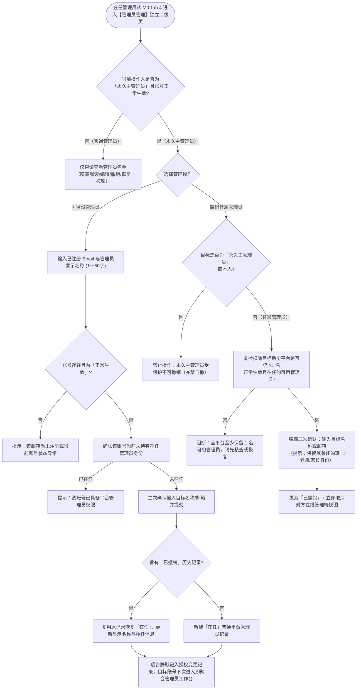
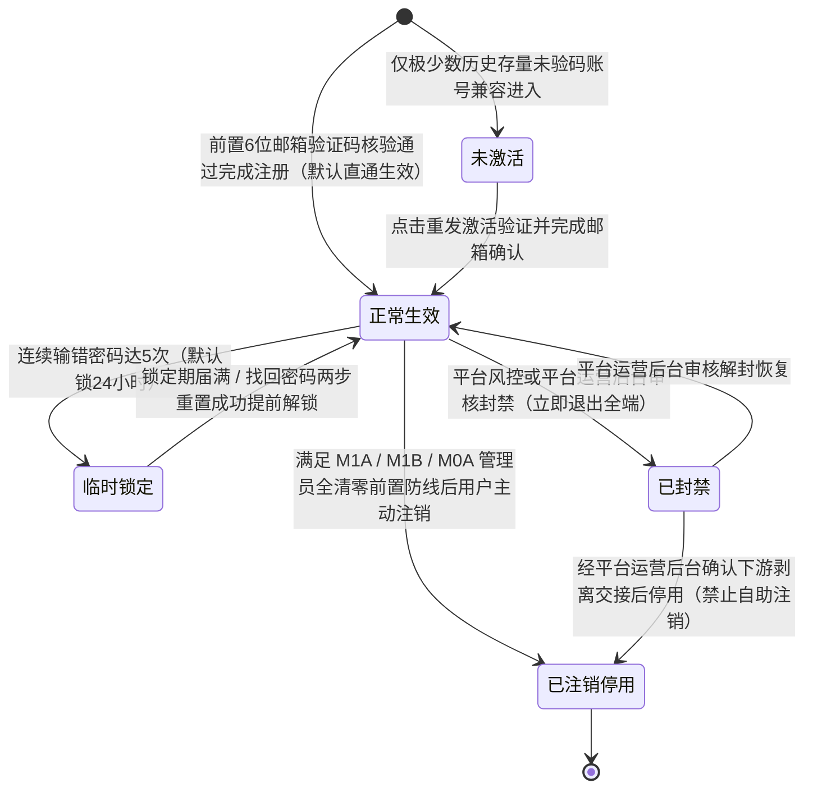
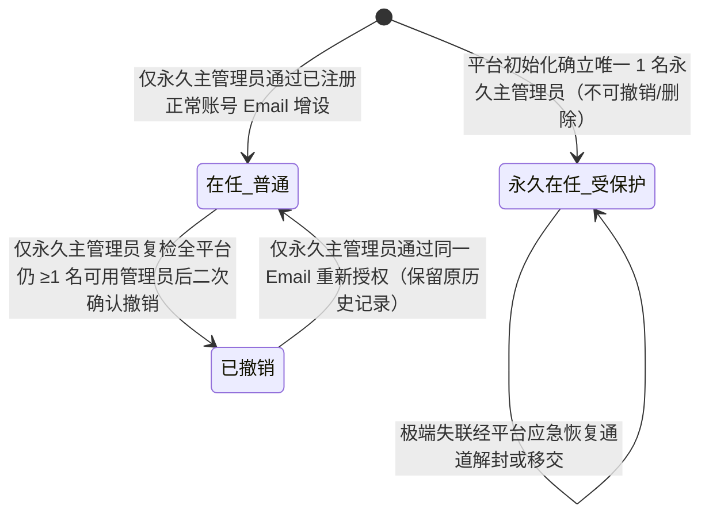
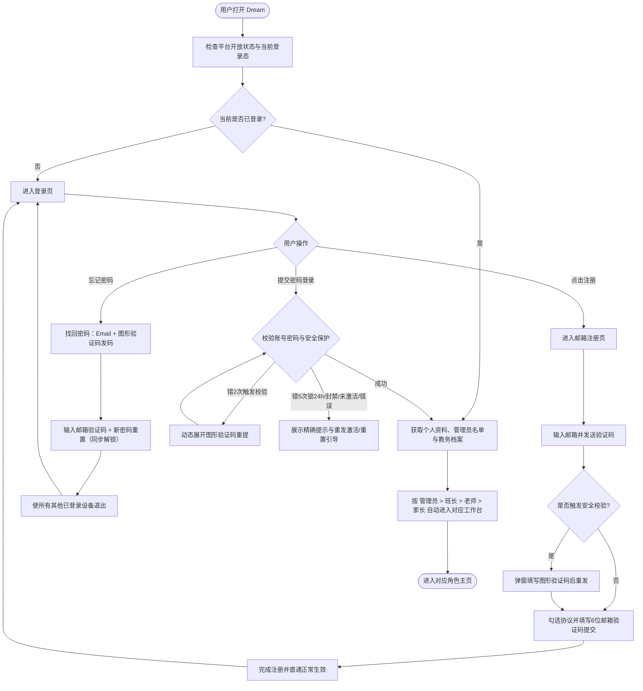

/** (c) 2024-2026 Topee (https://topee.top). All rights reserved. Proprietary and confidential. */

# 产品需求文档 (PRD) — M0A：账号认证、安全中心与业务身份解耦

| 元数据项 | 说明 / 内容 |
|---|---|
| **模块代号** | `m0a` |
| **所属模块** | 模块零：全域基座与账号安全 (Workspace Shell & Account) |
| **文档状态** | 待审阅 (Draft for Review) |
| **关联顶层 PRD** | [Prd-v5.md](../Prd-v5.md) |
| **关联规范** | [m0_workspace_and_home.md](./m0_workspace_and_home.md) / [BUSINESS_RULES.md](../BUSINESS_RULES.md) / [GLOSSARY.md](../GLOSSARY.md) |
| **创建与更新日期** | 2026-11-18 (创建：对齐统一登录接入要求与 Dream 账号身份解耦规范) / 2026-11-22 (补充登录账号生命周期、字段修改边界、操作记录与留存及跨模块联动) / 2026-11-23 (补齐平台管理员维护：本地平台管理员增设、撤销、恢复与防线流程) / 2026-11-23 (明确委任班长与绑定老师均须校验账号「正常生效」且支持多角色兼任，注销前须无在职班长或老师档案) / 2026-11-23 (确立唯一「永久主管理员」机制、防错码锁号与验证码有效期规范) / 2026-11-23 (协同 M5A/M5B 收口永久主管理员专属资金确认与老师发薪权限) / 2026-11-24 (协同 M0 统一各角色【修改登录密码】与【安全换绑邮箱】独立二级页入口，移除手机号与通知偏好) / 2026-11-24 (**视觉文案与交互收口**：全篇改写为面向业务与用户的自然表达，统一与 M0 一致的应用外壳与顶栏规范、修复登录/注册/找回页 Email 顶部留白防遮挡、将永久主管理员应急恢复说明收进可点击 `ⓘ` 小图标浮层、前端界面不展示安全审计日志) |

---

## 1. 概述与执行摘要 (Executive Summary)

账号登录与安全中心（`m0a`）是 Dream 教务排班与分账管理系统的个人账号准入与安全中心，服务于平台管理员、班长、授课老师与出资家长四类用户。本模块负责邮箱注册、账号密码登录、登录状态自动保活、找回密码、修改密码与邮箱换绑，并在业务上贯彻“登录账号与教务身份分离”原则——不依赖外部身份体系的业务角色标签，而是由平台管理员名单及教务侧家长/老师/班长档案关系共同决定用户进入后的工作台与功能权限。当前阶段：MVP 正式功能规划。

---

## 2. 问题定义与背景 (Problem Statement)

- **痛点 1：登录入口与账号安全闭环不完整**：现有工作台规范主要聚焦已登录后的首页与导航分流，对未登录态的准入控制（如关闭注册提示、协议勾选确认、安全验证、锁号与封禁提示）、多端同步退出以及弱网下登录状态自动保活尚无统一产品规格。
- **痛点 2：自然人账号与教务身份易混淆**：传统系统常在登录账号层维护复杂业务角色标签，导致管理员委任班长、绑定老师或家长兼任多身份时出现权限状态不一致。
- **痛点 3：多端语言与通知邮箱同步问题**：授课老师以英文界面为主、家长与班长以中文为主，更换常用 Email 后若不同步更新通知收件地址，会导致课酬单、排课变动与续费提醒邮件无法送达。

---

## 3. 目标用户与角色画像 (Users & Personas)

### 3.1 角色一：出资家长（Amy）
- **角色定位**：家庭课次出资人与日常约课操作人（单账号最多可管理 10 个孩子档案）。
- **核心诉求**：使用常用 Email 快速自助注册与登录，勾选“记住我”后一段时间内无需频繁重复登录；忘记密码或更换常用邮箱时能安全找回或换绑，确保购课确认、排课通知与续费提醒邮件准确送达。
- **预期成果**：顺利完成注册登录与协议确认，安全管理个人密码与邮箱，并无缝进入家长工作台或认领试课学员档案。

### 3.2 角色二：海外授课老师（David）
- **角色定位**：使用个人 Email 自助注册后，由负责班长或平台管理员在后台关联绑定的外教。
- **核心诉求**：无需繁琐后台代建流程，直接用英文界面自助完成注册、邮箱验证、登录与修改密码，把注册 Email 提供给班长或管理员完成绑定后即可查看个人课表与周课酬单。
- **预期成果**：在英文界面下顺畅完成账号注册与安全维护，第一时间收到排课、代课与周结邮件通知。

### 3.3 角色三：中方班长与平台管理员（Leo / Sarah）
- **角色定位**：教务管理负责人与平台统筹人员，往往兼任自家孩子的家长。
- **核心诉求**：使用单一 Email 账号登录，系统自动聚合其管理职责与家长视角，无需手动切换身份；在资金确认、离职交接等高敏感操作中确保账号状态正常有效；更换邮箱或修改密码时其他已登录设备能及时退出。
- **预期成果**：兼顾操作便捷性与资金及教务数据安全。

---

## 4. 核心业务流程 (Main Flows)

### 4.1 打开页面校验与登录状态保活

1. **打开登录/注册页前的状态检测**：用户进入登录页或注册页时，系统自动读取当前平台开放状态。
   - 若系统处于全站维护期间，页面展示维护公告并暂停登录与注册操作。
   - 若平台当前关闭了新用户注册，注册页禁用提交按钮并提示“平台暂未开放注册”，同时登录页隐藏或置灰注册入口。
2. **已登录状态自动保活**：用户在已登录状态下浏览业务页面时，若短期登录凭证临近过期且仍处于“记住我”等有效保活期内，系统在后台排队统一完成单次续期后再继续页面操作，避免多个页面请求同时触发续期导致用户被意外退出。
3. **登录失效退回登录页**：当登录有效期届满、账号被平台封禁或已在其他设备修改/重置密码时，系统立即清空本地登录状态与暂存敏感信息，并自动跳转至登录页（保留原访问页面地址，重新登录后可直接回到原页面）。

### 4.2 邮箱自助注册流程

1. 用户在注册页填写 **Email**（必填）、**登录密码**、**确认密码**，可选填**昵称**与**性别**；页面右上角支持一键切换 `简体中文 / English`。
2. 用户点击“发送验证码”，系统校验 Email 格式正确且未被其他账号占用后，向该 Email 发送 6 位数字验证码（有效期 **120 秒**），按钮进入 **60 秒重发倒计时**。
   - **安全验证分支**：若短时间内请求发送过于频繁触发安全保护，系统弹出**图形验证码**窗口（单张有效期 **5 分钟**，支持点击换一张，频繁刷新同样受频控保护），填写正确后继续发送邮箱验证码。
   - **异常（邮箱已被注册）**：直接提示“该邮箱已被注册，请直接登录或更换邮箱”，不发送验证码。
3. 用户阅读并勾选 **《用户服务协议》与《隐私保护政策》**（点击协议名称可打开包含当前版本号与生效日期的全文窗口）。
4. 用户输入 6 位邮箱验证码并点击“创建账号”，系统连同当前协议版本号一并提交。
   - **防试错与重抢校验**：单个邮箱验证码连续输错达到 **5 次**即刻作废，提示“验证码错误次数过多，请重新获取验证码”，须待 **60 秒**倒计时结束后重新获取；正式创建时再次确认该邮箱未被他人同时抢注。
5. **注册完成后**：因提交前已完成邮箱验证码核验，注册成功后账号直接处于 **「正常生效」** 状态，引导前往登录页登录（或直接进入工作台）；新注册账号默认具备家长视角，可立即新建孩子档案或自助认领班长/管理员预建的试课学员档案。

### 4.3 邮箱密码登录与异常提示

1. 用户输入 **Email** 与 **登录密码**，可勾选 **“记住我”**（勾选后保持 **7 天**免登录，未勾选仅在本次使用期间有效）。
2. 默认界面**不显示**图形验证码；当同一账号连续输错密码达到 **`2` 次**（或触发安全校验）时，表单内动态展开图形验证码输入行，用户输入后再提交登录。
3. **登录成功与工作台进入**：系统核验账号密码通过后，读取本地平台管理员名单及教务侧家长/老师/班长档案关系，按 **`管理员 > 班长 > 老师 > 家长`** 优先级自动进入对应工作台并聚合底部导航，**全程不在顶部或个人中心放置角色切换器**。
4. **异常情况处理**：
   - **账号或密码错误**：提示“账号或密码不正确”并清空密码输入框（连续错 **`2` 次**起展开图形验证码）。
   - **连续输错临时锁定**：同一账号连续输错密码达到 **`5` 次**，账号进入 **「临时锁定」**（默认锁定 **`24` 小时**），阻断继续试密、精确显示剩余解锁时间，并引导通过【忘记密码】完成邮箱验证后提前解锁。
   - **账号被封禁**：明确提示“账号已被封禁，如有疑问请联系客服或负责班长”。
   - **历史未激活账号兜底**：极少数历史存量未激活账号尝试登录时，提示“账号尚未激活”，并在提示条内提供就地 **`[ 重发激活验证 ]`** 按钮（受 60 秒发送冷却限制），完成邮箱确认后即可转为「正常生效」正常登录。

### 4.4 找回密码流程（两步重置）

1. **第 1 步（验证注册邮箱）**：用户在找回密码页输入注册 Email，并填写**图形验证码**后点击“发送重置验证码”。
   - 若邮箱未注册，提示“该账号未注册”；若账号处于「已封禁」或「已注销停用」，阻断重置并给出明确状态说明。
2. **第 2 步（验证验证码并设置新密码）**：发送成功后锁定上方 Email 显示为只读，展示 6 位邮箱验证码输入框（有效期 **120 秒**）与新密码、确认新密码输入框（须符合密码强度要求），用户点击“确认重置”。
   - **错码作废与顺带解锁**：单个重置验证码连续输错达到 **5 次**即刻作废，提示“验证码错误次数过多，请重新获取验证码”，须等待 **60 秒**倒计时结束后重发；重置密码成功时同步解除此前因输错密码导致的「临时锁定」。
3. **完成后退出旧设备**：密码重置成功后，该账号在所有其他设备上的登录状态立即失效，弹窗提示成功后返回登录页。

### 4.5 个人中心与两步安全换绑流

1. **基础资料维护与跨角色统一入口**：家长、老师、班长（Tab 4【我的】）及三合一管理员（Tab 4【管理与设置】底部个人中心）**统一配备完全一致的个人中心与账号安全入口**：可修改昵称、个人姓名（选填，仅用于本人账号个人资料展示，与 M1A 学员规范昵称、M1B 班长/老师显示名及管理员显示名称彼此独立且互不覆盖）、性别及头像（本地选图 `≤ 2MB`，支持 JPG/PNG/WebP 裁切上传）；**全系统个人账号不采集、不存储、不展示手机号，不设“消息通知接收偏好”，且严禁放置任何角色/身份切换开关**。
2. **语言偏好同步**：用户在个人中心或登录页切换 `简体中文 / English` 时，界面即时刷新并保存为个人偏好（外教首次登录默认英文，家长与班长默认中文）。
3. **修改登录密码（直达指定独立二级页）**：全角色（含三合一管理员 Tab 4）点击【修改登录密码】后**跳转至专属【修改登录密码】独立二级页面**（顶栏带 `< 返回`，底栏锁定 Tab 4），输入“当前密码”与“新密码”（含强度校验与二次确认），确认提交后更新密码并**使所有设备登录状态立即失效**，提示后跳转至登录页要求使用新密码重新登录。
4. **两步安全换绑邮箱（旧邮箱确认 → 新邮箱绑定 · 直达指定独立二级页）**：
   - **第 1 步（验证当前绑定邮箱）**：点击【更换邮箱】跳转至**专属【安全换绑邮箱】独立二级页面**（顶栏带 `< 返回`，底栏锁定 Tab 4），顶部步骤条显示第 1 步并展示脱敏后的当前绑定邮箱（如 `ab***@example.com`），用户发送并填写 6 位验证码，通过后进入 **10 分钟（600 秒）** 有效的新邮箱绑定环节（单个验证码连续输错 **5 次**作废重发）。
   - **第 2 步（验证并绑定新邮箱）**：输入新 Email 并发送验证码提交换绑（连续输错 **5 次**同样作废重发）；新邮箱不得已被平台内其他账号占用，提交时同步校验唯一性，防止多人同时换绑同一邮箱。
   - **超时回退**：若第 2 步提交时已超过 **10 分钟**安全确认时限，提示“操作超时，请重新验证当前邮箱”并自动退回第 1 步。
   - **换绑生效与旧邮箱释放**：换绑成功后，个人账号绑定邮箱即时更新，后续所有排课、请假、周结等系统通知邮件自动发往新 Email；**原旧邮箱自换绑成功即刻释放，可被其他账号重新注册或绑定**（既往已发送的历史业务单据与通知记录保留当时邮箱记录）。

### 4.6 账号退出与注销流

1. **主动退出登录**：用户点击“退出登录”并二次确认后，清除当前登录状态与本地个人暂存业务信息（保留语言偏好），返回登录页。
2. **清理本地缓存**：用户点击“清理缓存”时，仅清理本地页面临时缓存并展示当前版本号，**不得导致用户退出登录**。
3. **申请注销账号（跨模块前置清零防线）**：
   - 若账号名下关联了孩子档案，必须确保名下**「正式在读」档案数为 0**——所有孩子均须在 [M1A](./m1a_student_profile.md) 满足五项资产全清零，无历史课次及购课单的空档已删除，有历史记录的档案已完成归档（不可强行删除）；
   - 若账号曾被委任为班长或绑定为授课老师，**必须核验在 [M1B](./m1b_teacher_profile.md) 中名下已无任何处于「在职」（含班长「交接冻结中」或老师「待离职」）状态的档案**——即便名下排课与代收资金均为 `0`，也须先走完 M1B 离职交接流程并正式转为「已离职」；
   - 若账号当前拥有 Dream **「在任」平台管理员身份**：① 普通在任管理员注销前，必须先由**永久主管理员**在后台撤销其管理员身份（转为「已撤销」）；② 唯一 **「永久主管理员（不可撤销）」在受保护在任状态下严禁本人自助注销账号**（仅在极端失联情形下通过受控应急恢复通道处理交接）；**严禁任何账号带着「在任」管理员身份注销**；
   - 全部前置校验通过后，停用该账号登录权限并退出所有设备；历史归档学员档案、历史购课单、课次清退单、周转账单、老师周课酬单及后台合规记录继续长期留存，不因账号注销而删除。

### 4.7 账号与业务身份绑定流（零全局角色写回）

1. **班长委任**：平台管理员在班长管理页输入目标用户已注册的 Email，核验该账号存在且处于 **「正常生效」** 后，直接以该用户账号为锚点创建或恢复「在职」班长档案（允许家长、在职老师及平台管理员使用同一账号兼任），下次进入工作台即自动出现班长能力。
2. **老师入驻绑定**：海外授课老师自行使用个人 Email 注册后，将注册 Email 告知负责班长或管理员；班长（**严格仅限「本人老师」，即在 [M1B](./m1b_teacher_profile.md) 中「负责班长」归属为操作人本人的老师档案；严禁班长操作其他班长名下或平台直管/未划拨老师**）或平台管理员在老师档案页输入该**完整 Email 精准匹配**（界面不提供未绑定普通用户列表供翻查，防止他人邮箱泄露），核验账号处于 **「正常生效」** 且未绑定其他非离职老师后完成唯一绑定（支持先存为「待绑定账号」资料草稿暂不上架，绑定后立即生效；后续换绑邮箱自动同步展示），老师登录即自动进入老师工作台（默认英文界面）。
3. **平台管理员授权（唯一永久主管理员主控）**：全平台初始化时唯一确立 **1 名「永久主管理员（不可撤销）」**；其余普通「在任」平台管理员的增设、编辑名称、撤销与重新授权**仅限该「永久主管理员」在 Dream 本地管理页操作**；除明确收归「永久主管理员」专属的授权管理、M2B `72h` 异议终审、M5A 归集确认/驳回与 M5B 老师周课酬单写/发薪外，其余日常教务与运营职责中所有在任管理员保持平权。

### 4.7b 永久主管理员保护与普通管理员增设、撤销流

1. **入口隔离、唯一永久主管理员与权责分层原则**：
   - 平台管理员从 [M0 管理与设置](./m0_workspace_and_home.md) → `👑 管理员管理` 进入独立二级管理页（页面**仅展示管理员名单管理区**，**前端界面不展示安全审计日志列表或独立审计页签**，亦不集成普通用户账号封禁台）；
   - **非管理员访问拦截**：班长、老师与家长直接访问本页时必须由系统拦截拒绝并提示无权限；
   - **「永久主管理员」唯一初始化与不可撤销铁律**：
     - 全平台有且仅有 **`1` 名「永久主管理员（不可撤销）」**，由平台初始化确立（不开放从前端列表增设第 2 名永久主管理员，亦**严禁**任何管理员在前端摘除或转移该保护标记，彻底消除管理员之间互相撤销或夺权风险）；
     - **任何管理员（含永久主管理员本人及所有普通管理员）均绝对禁止撤销或删除「永久主管理员」**；名单行固定展示 `永久主管理员 · 不可撤销` 徽章且不提供撤销按钮，本人亦不可自助注销账号；
   - **日常业务平权、授权与中央资金归集终审收口**：
     - 除明确收归唯一「永久主管理员」专属的高危授权与资金终审权外，所有「在任」平台管理员（永久主管理员与普通管理员）在班长委任、老师管理、小班调度、课次退费及异常回退等日常教务与运营职责上保持平权；
     - **唯一「永久主管理员」专属高危权限**：① 普通管理员的新增、编辑名称、撤销与重新授权；② [M2B](./m2b_refund_orders.md) 兜底代清退 `72h` 异议最终核验；③ [M5A](./m5a_transfer_collection.md) 全平台周转账单与离职移交单的**【确认收款】【确认移交收款】与【驳回转账单】**（同时代表平台固定持有「平台直收」与离职移交接管课次，每周按周单核销，账号主体永久不变），普通管理员对 M5A 审单仅只读查阅明细与凭证、严禁越权放行收款；④ [M5B](./m5b_weekly_settlement.md) 全平台老师周课酬单的**内部课酬单价录入/修改、新增【差额调整项】、手动【批量放行】、确认发薪【标记为已打款】、含试算全表导出与批处理异常重跑**，其余普通管理员在 M5B 仅只读查阅出勤节数、课次流水、前置转账单穿透与状态时间轴（隐藏内部单价与试算参考总积分，且导出仅限纯节数表）。
2. **增设（与已撤销复用恢复）及防重复授权流程**：
   - **仅永久主管理员**点击 **`[ + 增设管理员 ]`**，输入目标用户已注册 Email（去空格转小写）；系统仅核验账号存在且处于「正常生效」（未激活、已锁定、已封禁或已注销停用账号禁止授任）；
   - 校验通过后回显目标账号当前昵称，由永久主管理员确认或填写管理员显示名称（1–50 字）；若目标曾有「已撤销」管理员记录，自动复用原记录恢复「在任」；
   - **防重复授权**：同一账号同一时刻全平台最多仅允许存在 `1` 条有效管理员授权记录，提交时自动阻断多窗口并发重复授权；
   - 提交前需弹窗二次确认（输入目标显示名称或 Email），并实时核验永久主管理员账号处于「正常生效」；成功后立即生效并在后台静默记入合规操作记录。
3. **普通管理员撤销双防线与应急恢复说明折叠规则**：
   - **强权限与防清零校验**：
     1. **唯一授权人与不可撤销硬锁**：仅「永久主管理员」可撤销**普通在任管理员**；「永久主管理员」本身受永久保护，严禁任何自撤或他撤，普通管理员之间严禁互相撤销；
     2. **并发撤销安全复检 + 全平台可用基线兜底**：执行撤销操作时，系统并发加检确保“扣除拟撤销对象后，全平台仍存在至少 `1` 名状态为「在任」**且绑定账号处于「正常生效」**的可用管理员”（防止连击撤销或多端并发导致全平台可用管理员归零）；
   - **独立解耦（无教务/资金交接阻断）**：撤销普通管理员身份**仅收回平台治理权限**，**保留该账号兼任的班长（含所辖老师/小班/托管课次，班长卸任另行在 [M1B](./m1b_teacher_profile.md) 走双防线）、授课老师与家长身份**；原由其处理的「平台直管」老师与全校审单工作由永久主管理员及其他在任管理员自然接续，系统不阻断撤销；
   - **二次确认与即时生效**：弹窗展示解耦提示并要求输入目标显示名称或 Email 二次确认，提交时再次复检永久主管理员权限与可用管理员余量；成功后置为「已撤销」、后台静默记录合规留痕，并**立即退出或刷新降级目标用户当前在线的管理端视图**（若目标还兼任班长/老师/家长，降级为对应工作台视图；若无其他角色，收拢为家长视角）；
   - **极端失联应急恢复说明（`ⓘ` 小图标点击查看）**：若唯一「永久主管理员」因密码连错处于「临时锁定」，本人可通过【忘记密码】完成邮箱验证重置密码立即解锁；若遭遇账号「已封禁」或彻底失联（导致全平台无可用授权人），须由平台运营支持通过受控应急恢复通道核验解封或紧急移交指定新「永久主管理员」并静默留痕。**界面展示收口原则**：上述应急恢复介绍文字在【账号安全】及【管理员管理】页面**默认折叠隐藏**，仅在 `永久主管理员 · 不可撤销` 旁（或页面信息区）提供一枚小巧可点击的 **`ⓘ` 说明图标**，点击后弹出简洁说明浮层供查看，不在主页面正文大段平铺展示。

### 4.8 登录账号与平台管理员授权生命周期、字段规则与留存说明

> **【唯一归口声明】**：**自然人登录账号（含登录态与邮箱换绑安全时效）**与 **Dream 本地平台管理员授权**的生命周期状态机、字段可编与锁定边界、操作留痕及留存策略 100% 统一且唯一由本 PRD 管辖与定义。

#### 4.8.1 生命周期状态机与转移矩阵

##### 1. 自然人登录账号

| 初始状态 | 目标状态 | 触发角色 / 机制 | 前置条件与守卫防线 | 伴随副作用与系统行为 |
| :--- | :--- | :--- | :--- | :--- |
| **`[*]`** | **正常生效 / 未激活（兜底）** | 新用户自助注册 | 开放注册开关开启；Email 格式合法且未被全平台其他账号占用；密码 $\ge 8$ 位含大小写字母、数字与特殊字符；默认前置 6 位邮箱验证码校验通过（连续错 `5` 次作废）；已阅读并勾选协议 | 固化记录注册协议标识与版本号；默认注册后**直通「正常生效」**并具备家长视角（仅极少数未验码存量账号处于「未激活」，超 `7` 天未激活可清理释放） |
| **正常生效** | **临时锁定** | 登录安全保护 | 连续输入错误密码达到 **`5` 次**（连续错 `2` 次起动态显示图形验证码） | 阻断继续密码登录并精确展示剩余解锁时长（默认 **`24` 小时**）；引导走【忘记密码】两步重置 |
| **临时锁定** | **正常生效** | 系统计时 / 本人重置密码 | 达到锁定期限，或通过图形验证码 + 邮箱验证码完成两步密码重置 | 恢复正常登录；若经由重置密码解锁，同步使全部其他设备退出登录 |
| **正常生效** | **已封禁** | 平台安全管理 / 运营后台 | 存在违规或安全风险（注：Dream 工作台不提供封禁账号操作入口，由平台账号运营后台统一处理） | 立即退出全部已登录设备；阻断登录、找回密码与所有高敏感操作；向 [M1A](./m1a_student_profile.md) / [M1B](./m1b_teacher_profile.md) 暴露只读封禁状态以放行管理员代清零改绑；**严禁释放原绑定 Email 供重注** |
| **已封禁** | **正常生效** | 平台运营后台审核 | 经运营后台审核确认解除风险 | 恢复登录及原有业务身份访问（需确保下游未被强制改绑或离职） |
| **正常生效** | **已注销停用** | 登录账号本人 | **跨模块前置清零防线**：① [M1A](./m1a_student_profile.md) 名下「正式在读」档案数 == 0（空档已删除、有历史记录档案已完成 5 项全清零归档）；② [M1B](./m1b_teacher_profile.md) 若兼任班长或老师，已完成资金清算与教务交接并转为「已离职」；③ **在 M0A 不得存在「在任」平台管理员身份**（普通管理员须先由永久主管理员撤销，永久主管理员受保护不可自助注销，须先通过应急恢复通道移交并卸载） | 退出全部已登录设备并永久停用登录权限；**严禁删除下游历史档案、规范昵称占位及历史财务单据** |
| **已封禁** | **已注销停用** | 平台运营后台（终结处置） | 已封禁账号禁止本人自助注销；须确认下游 M1A/M1B 资产已由管理员接管剥离且无在任管理员授权后，由平台运营后台执行终结停用 | 永久终止登录权限并保留历史业务与财务留存记录，默认不释放违规原邮箱占位 |

##### 2. 平台管理员授权（Dream 本地管理名单）

| 初始状态 | 目标状态 | 触发角色 / 机制 | 前置条件与守卫防线 | 伴随副作用与系统行为 |
| :--- | :--- | :--- | :--- | :--- |
| **`[*]`** | **永久在任（受保护）** | 系统初始化 / 平台应急恢复通道 | 系统初始化确立全平台唯一 `1` 名「永久主管理员」；**不可被任何管理员（含本人）在前端撤销、删除或摘除保护**，本人亦不可自助注销账号 | 拥有全部平台业务治理权及普通管理员唯一增撤权；日常业务与普通管理员平权；极端失联时经平台应急恢复通道解封或移交并后台静默记入合规留痕 |
| **`[*] / 已撤销`** | **在任（普通）** | **仅「永久主管理员」**（且其账号「正常生效」） | 目标邮箱在 M0A 存在且账号处于「正常生效」，全平台当前无有效管理员授权；输入显示名称（1–50 字）；二次输入确认 | 创建或复用原授权记录置为普通「在任」；后台静默记入授权变更合规记录（前端界面不展示）；目标下次进入即自动聚合管理员工作台 |
| **在任（普通）** | **已撤销** | **仅「永久主管理员」**（且其账号「正常生效」） | ① 目标不得为「永久主管理员」（绝对禁止自撤或互撤）；② **并发撤销安全复检**：撤销后全平台仍存在 $\ge 1$ 名「在任」且绑定账号处于「正常生效」的可用管理员（不计已封禁/已注销账号）；③ 输入目标名称或 Email 二次确认（不阻断班长/直管交接） | 置为「已撤销」并记录撤销人/时间；后台静默记入合规留痕；**立即取消或刷新降级目标用户在线的管理工作台视图**；保留兼任班长/老师/家长身份不受影响 |

#### 4.8.2 关键字段可编与锁定规则矩阵

| 所属对象 | 业务字段 | 状态与可编性 | 操作角色与校验门禁 | 锁定与禁止修改规则 |
| :--- | :--- | :--- | :--- | :--- |
| **登录账号** | **绑定 Email（唯一登录账号与通知邮箱）** | 仅允许两步安全换绑 | 本人在指定【安全换绑邮箱】二级页完成「旧邮箱验证码确权（10 分钟有效期，超时退回第 1 步）→ 新邮箱验证码校验」；两步连续错码均限 `5` 次；提交时校验全平台未被占用 | **暂不支持手机号绑定/换绑**；「已封禁」或「已注销停用」态永久锁定禁止修改（**违规封禁账号不释放原 Email**）；换绑成功后**原旧邮箱即时释放** |
| **登录账号** | **登录密码** | 随时可改密或重置 | 本人在指定【修改登录密码】二级页验证当前密码改密，或找回密码页图形+邮箱双验证重置（错码限 `5` 次）；均须满足密码强度规则 | 改密或重置成功立即退出所有其他设备；「已封禁」或「已注销停用」态不可修改或找回 |
| **登录账号** | **基础资料与界面偏好**（昵称、可选个人姓名、性别、头像 $\le 2\text{MB}$、语言偏好） | 「正常生效」态随时自主修改 | 登录本人维护；**账号昵称/个人姓名与 M1A 规范昵称、M1B 老师/班长显示名、管理员显示名称彼此独立，互不覆盖且不共享唯一校验** | 「已封禁」与「已注销停用」态禁止自助修改；界面偏好仅限语言等非敏感选项，不存放手机或通知偏好开关 |
| **登录账号** | **协议同意记录**（协议名称、版本号、同意时间） | 注册提交即永久只读固化 | 注册流程自动固化 | 永久只读不可修改，平台协议升级时另行触发新版本确认记录 |
| **管理员授权** | **管理员显示名称（1–50 字）** | 「在任」态仅永久主管理员维护 | **仅「永久主管理员」**（账号处于「正常生效」） | 普通管理员与「已撤销」态只读不可改；重新授权时允许永久主管理员更新 |
| **管理员授权** | **永久保护标记、绑定账号 Email、授任人/撤销人、授任/撤销时间** | 初始化或操作时系统自动固化 | 系统在初始化、应急移交及增设/撤销操作时自动记录 | 前端对所有角色永久只读不可修改、不可摘除保护或抹除 |

#### 4.8.3 状态流转与操作记录规则（前端不展示审计日志）

1. **后台静默合规留痕（前端不展示）**：注册同意协议版本、密码修改/重置、两步邮箱换绑（保留当时旧邮箱、新邮箱与操作时间）、锁定/解封/封禁、账号注销停用，**以及永久主管理员发起的增设普通管理员、改名、撤销、重新授权或极端应急恢复操作**，均由系统在后台静默追加合规变更记录（含操作人、目标对象、变更前后状态及时间）；**前端各工作台、个人中心、账号安全及管理员管理页面均不展示【安全审计日志】列表、时间轴或独立审计页签**。
2. **高敏感操作实时校验**：执行管理员授收权、[M5A](./m5a_transfer_collection.md) 资金转账确认、[M5B](./m5b_weekly_settlement.md) 老师周课酬单写与发薪确认、[M2B](./m2b_refund_orders.md) 课次清退、[M1B](./m1b_teacher_profile.md) 离职交接等高敏感操作时，系统实时核验操作人账号处于「正常生效」且未被封禁（涉管理员操作同时核验处于「在任」，涉管理员增撤、M2B `72h` 核验、M5A 确认收款/驳回及 M5B 写/发薪操作同时强制核验为唯一「永久主管理员」），任一条件不满足立即阻断提示。

#### 4.8.4 数据留存与清理策略

- 严禁删除已注销或已封禁的个人账号基础历史记录，以及已撤销的平台管理员授权记录与后台合规留痕；账号注销仅停用登录权限，管理员撤销仅置为「已撤销」留存；
- 账号关联的协议同意记录、后台合规记录，以及下游 [M1A](./m1a_student_profile.md) 归档/停用学员档案与规范昵称占位、[M1B](./m1b_teacher_profile.md) 老师/班长历史档案、[M2A](./m2a_course_orders.md) 购课单、[M2B](./m2b_refund_orders.md) 清退记录、[M5A](./m5a_transfer_collection.md) 周转账单、[M5B](./m5b_weekly_settlement.md) 周课酬单及凭证，均**长期只读留存、严禁连带清除**；
- 同一 Email 再次被永久主管理员授予普通管理员身份时复用原授权记录；
- 主动退出登录清除当前登录态与本地个人暂存业务信息（保留语言偏好）；点击【清理缓存】仅清理本地页面临时缓存，严禁导致用户退出登录。

#### 4.8.5 跨模块联动与只读协同索引

- **A. 本模块操作引发的下游联动**：

| 联动序号 | M0A 触发动作 | 驱动目标对象与结果方向 | 关联模块 |
| :---: | :--- | :--- | :--- |
| **1** | 两步安全换绑邮箱成功 | 即时更新绑定 Email 并释放原旧邮箱；新邮箱作为 **M4 官方通知邮件** 唯一新收件地址，并同步更新至 **M1B 班长/老师关联邮箱展示**与管理员名单邮箱展示 | [M4](./m4_notification.md)、[M1B](./m1b_teacher_profile.md) |
| **2** | 切换系统语言偏好 | 即时刷新 **M0 工作台全局页面** 双语展示并保存个人偏好（外教首次默认英文，家长/班长默认中文） | [M0](./m0_workspace_and_home.md) |
| **3** | 登录完成与自动恢复 | 读取本地「在任」管理员名单并聚合 **M1A** 学员与 **M1B** 班长/老师本地档案，按 `管理员 > 班长 > 老师 > 家长` 自动进入 **M0 工作台与底部导航** | [M0](./m0_workspace_and_home.md)、[M1A](./m1a_student_profile.md)、[M1B](./m1b_teacher_profile.md) |
| **4** | 永久主管理员增设或撤销普通管理员 | ① **立即更新目标账号在 M0 的工作台视图**：增设后目标下次进入聚合管理员首页与 Tab 4（管理员管理页呈只读）；撤销后**立即退出或刷新降级目标在线的管理视图**（保留其兼任的班长/老师/家长视图）； ② **严格解耦零联动改绑**：不改动 **M1B** 兼任班长/老师档案及资金持有人，原平台直管资源由其余在任管理员自然接续 | [M0](./m0_workspace_and_home.md)、[M1B](./m1b_teacher_profile.md) |

- **B. 跨模块前置协同校验**：
  1. **[M1A 学员档案](./m1a_student_profile.md)**：M0A 注销账号前核验名下「正式在读」档案数 == 0（空档已删除且有历史档案已完成 5 项全清零归档）；
  2. **[M1B 老师与班长档案](./m1b_teacher_profile.md)**：M1B 委任班长或绑定老师账号时核验目标账号存在且处于「正常生效」（且老师绑定仅限「负责班长」为操作人本人的档案或由管理员操作，严格遵循 M1B「1 账号仅绑 1 个非离职老师档案」规则）；账号「已封禁」状态向 M1B 暴露只读标识以放行管理员代清零与改绑；**M0A 注销账号前强制校验 M1B 不存在「在职（含交接冻结中）」班长档案与「在职（含待离职）」老师档案（即便 0 资产亦须先在 M1B 办理离职），且自身不得存在「在任」平台管理员身份**；撤销普通管理员不触发 M1B 离职双防线；
  3. **[M2B](./m2b_refund_orders.md) / [M5A](./m5a_transfer_collection.md) / [M1B](./m1b_teacher_profile.md)**：执行高敏感业务操作时实时核验操作人账号处于「正常生效」且未被封禁。

---

## 5. 用户故事 (User Stories)

1. **作为一个新家长**，我想要通过常用 Email、邮箱验证码并阅读勾选《用户服务协议》与《隐私政策》自助完成注册，以便于获得合法合规的登录账号并开始为孩子建档购课。
2. **作为一个海外授课老师**，我想要在登录/注册页直接切换为英文界面，自助注册 Email 账号并安全修改密码，以便于把邮箱提供给班长完成绑定后直接看懂我的排课与课酬单。
3. **作为一个兼任班长与家长的用户**，我想要在“记住我”状态下免去频繁重复登录，即使在弱网并发刷新首页时也不会被误踢下线，以便于稳定处理日常教务待办与查看孩子课表。
4. **作为一个更换了工作邮箱的用户**，我想要通过“先验证旧邮箱、再验证新邮箱”的两步安全流程完成换绑，以便于防止他人盗用账号篡改通知邮箱，并确保后续课程提醒能发到我的新邮箱。
5. **作为一个忘记密码的用户**，我想要通过图形验证码安全校验加邮箱验证码重设密码，并在重设后自动退出所有已登录设备，以便于在设备丢失或遗忘密码时保障账号资产安全。
6. **作为唯一永久主管理员**，我想要通过已注册 Email 检索并增设普通管理员、修改其显示名称、或恢复曾被撤销的管理员身份，且确认本人永久主管理员权限不被任何人误撤，以便于长期安全掌控平台治理锚点。
7. **作为唯一永久主管理员**，我想要在确保至少保留 1 名可用管理员的前提下安全撤销不再履职的普通管理员权限，并保留对方兼任的班长/老师/家长业务身份不受中断，以便于平滑交接平台管理权责。

---

## 6. 验收标准清单 (Acceptance Criteria)

### 6.1 注册、协议与配置开关
- `AC-M0A-01` **仅开放 Email 注册与密码登录**：系统注册页与登录页仅提供 Email 通道（不展示手机注册页签、不展示短信免密登录入口）。
- `AC-M0A-02` **全局注册开关响应**：当系统公开配置返回禁止注册时，注册提交按钮处于禁用状态并明确展示“平台暂未开放注册”提示。
- `AC-M0A-03` **协议读取与版本留痕**：注册页未勾选《用户服务协议》与《隐私保护政策》时禁止提交注册；点击协议名称可打开包含当前版本号与生效日期的全文模态框；提交注册时必须将当前协议标识与版本号一并提交留痕。
- `AC-M0A-04` **密码强度与前置验码直通生效**：注册、改密与重置密码表单提交时，若密码长度少于 8 位或未同时包含大写字母、小写字母、数字及特殊字符，前端实时拦截并提示具体规则；通过 6 位邮箱验证码提交注册时原子校验邮箱全平台未占用，成功后账号直接处于「正常生效」状态并进入登录或工作台引导。

### 6.2 登录、安全保护与无感保活
- `AC-M0A-05` **按需触发图形验证码与刷新限流**：登录页默认不显示图形验证码；当同一账号连续输错密码达到 **`2` 次**（或触发高频安全保护）时，动态展示图形验证码输入框与可点击换一张的验证码图片（单张有效 **5 分钟**，频繁连续刷新将提示稍后再试）。
- `AC-M0A-06` **记住我登录时长**：勾选“记住我”登录后，免登保持 **7 天**；未勾选时仅限本次访问期间有效。
- `AC-M0A-07` **并发操作防误退保活**：当页面同时触发多个操作且登录状态临近过期时，系统仅执行 1 次后台续期并自动完成后续操作，不得因重复续期误触发强制退出登录。
- `AC-M0A-08` **异常账号精准提示与锁号**：账号连续输错密码达 **`5` 次**触发「临时锁定」（默认锁定 **`24` 小时**）时展示明确剩余解锁时间并引导走【忘记密码】解锁；账号被封禁时提示已封禁；极少数存量未激活账号提示未激活并提供就地 `[ 重发激活验证 ]`（60 秒冷却），严禁笼统提示“系统错误”。

### 6.3 个人中心、安全换绑与注销
- `AC-M0A-09` **两步安全换绑、旧邮箱释放与验证码防试错**：已绑定邮箱换绑必须依次完成旧邮箱验证码确认（获得 **10 分钟**新邮箱绑定有效期）与新邮箱验证码校验；任意场景下的 6 位数字邮箱验证码连续输错达到 **`5` 次**必须作废并提示重新获取；新邮箱提交时校验全平台未占用，超时未提交自动退回第 1 步；换绑成功后原旧邮箱即时释放可重用。
- `AC-M0A-10` **改密与重设全端退出**：用户在【修改登录密码】二级页改密或通过【忘记密码】重设成功后，该账号所有其他设备立即退出登录，当前设备同步退回登录页要求重新登录；若此前因连续输错密码处于「临时锁定」，通过找回密码重设后同步解除锁定。
- `AC-M0A-11` **头像上传限制与姓名独立原则**：头像上传限制文件大小 $\le 2\text{MB}$、格式仅限 JPG/PNG/WebP；上传完成后同步更新账号头像，全工作台统一展示同一头像；账号「昵称」及「可选个人姓名」仅用于个人账号展示，与 M1A/M1B/管理员显示名称彼此独立、互不覆盖且不共享唯一校验。
- `AC-M0A-12` **清理缓存与安全退出隔离**：在个人中心执行“清理缓存”后，登录状态必须保持有效；执行“退出登录”后，必须清除本地登录凭证与个人暂存业务数据，仅保留语言偏好。
- `AC-M0A-13` **账号注销跨模块全清零拦截**：名下仍存在「正式在读」学员档案（含尚未删除空档或尚未完成 5 项全清零归档的历史学员）、尚未完成班长/老师离职交接、**或当前仍持有「在任」平台管理员身份（普通管理员尚未被永久主管理员撤销，或本人为受保护「永久主管理员」）**的账号发起注销申请时，系统必须阻断并明确引导完成前置清零或卸任；已封禁账号禁止本人自助注销；注销完成后历史归档学员档案与全部历史财务单据、合规留痕继续长期留存。

### 6.4 业务身份解耦与自助绑定
- `AC-M0A-14` **零全局角色依赖与归属绑定边界**：登录后工作台视图、底部导航与金刚位仅由本地平台管理员名单（初始化唯一永久主管理员）与本地业务档案（班长/老师/学员）联合决定；班长绑定老师账号时仅限操作 [M1B](./m1b_teacher_profile.md) 中「负责班长」归属本人的老师档案且仅支持完整 Email 精准核验，严禁代绑跨班长或平台直管老师。
- `AC-M0A-15` **高敏感操作实时校验**：执行管理员授收权、资金转账确认、课次清退、离职交接等高敏感操作时，必须实时核验操作人账号处于「正常生效」且未被封禁（管理员操作同步校验「在任」，授权写操作同时校验为唯一「永久主管理员」），任一失效立即阻断提示。

### 6.5 平台管理员名单维护、永久主管理员锁定与界面精简规范
- `AC-M0A-16` **独立管理页入口、权责分层门禁与列表规范**：
  1. [M0 Tab 4【管理与设置】](./m0_workspace_and_home.md) → `👑 管理员管理` 直达本模块独立二级页，**页面仅展示管理员名单管理区，不展示【安全审计日志】列表、时间轴或独立审计页签**；非管理员角色（班长、老师、家长）直接访问必须拦截拒绝并提示无权限；
  2. 管理员名单展示唯一「永久主管理员（不可撤销）」及普通「在任 / 已撤销」记录，字段涵盖：显示名称、绑定 Email、角色保护标识（永久主管理员 / 普通管理员）、授权状态（在任 / 已撤销）、授任人/撤销人、授任/撤销时间，支持按姓名或 Email 搜索、按状态筛选；默认按「永久主管理员置顶 → 普通在任 → 已撤销」排列，空态与异常态支持友好提示与重试；
  3. **写操作严格收口永久主管理员**：仅系统初始化的「永久主管理员」视角显示顶部 `[ + 增设管理员 ]`、各普通管理员行的 `[ 编辑名称 ]` / `[ 撤销职务 ]` / `[ 重新授权 ]` 按钮；普通在任管理员访问本页呈只读查看态（隐藏全部授权写按钮），并拦截一切越权提交。
- `AC-M0A-17` **邮箱检索增设、防重复授权与重新授权**：
  1. **仅永久主管理员**点击 `[ + 增设管理员 ]` 输入 Email（去空格转小写）与显示名称（1–50 字）；系统核验该 Email 在 M0A 存在且账号处于「正常生效」，否则阻断提示（未注册 / 未激活 / 已锁定封禁或注销）；
  2. 同一账号同一时刻全平台最多仅存 1 条有效管理员授权，并发提交自动防重，若目标已是「在任」管理员则阻断提示已具备权限；若目标曾有「已撤销」记录，复用原记录恢复「在任」并保留后台历史留痕；
  3. 弹窗输入目标名称或 Email 二次确认且核验永久主管理员账号正常生效后提交；仅永久主管理员可编辑普通管理员显示名称。
- `AC-M0A-18` **永久主管理员防撤销保护、普通管理员撤销双防线与 `ⓘ` 应急恢复说明**：
  1. **永久主管理员绝对不可撤销**：全平台初始化确立的唯一「永久主管理员」行固定展示 `永久主管理员 · 不可撤销` 保护徽章且永不显示撤销按钮，严禁任何管理员（含本人）在前端或后台撤销、删除或摘除其受保护标记；
  2. 点击普通管理员行 `[ 撤销职务 ]` 时系统在并发校验内强制确认：① 操作人为正常生效的「永久主管理员」；② 扣除拟撤销对象后全平台仍存在 $\ge 1$ 名状态为「在任」**且账号处于「正常生效」**的可用管理员，否则强阻断提示“全平台至少保留 1 名可用管理员，请先核查恢复”；
  3. 确认弹窗要求输入目标管理员显示名称或 Email 二次确认；撤销置为「已撤销」并**立即取消或刷新降级目标在线的管理端视图**；**应急恢复说明（不平铺长文案）**：若永久主管理员遭遇封禁或彻底失联，仅在页面保护标识旁（或账号安全说明行）放置一枚可点击的 **`ⓘ` 信息图标**，点击后弹出简洁说明浮层告知应急恢复路径，默认折叠隐藏；后台静默记入合规记录，前端界面不展示安全审计日志。
- `AC-M0A-19` **撤销普通管理员与兼任业务身份独立解耦**：
  1. 撤销普通管理员身份时不触发 [M1B](./m1b_teacher_profile.md) 班长离职资金/教务双防线，不校验或改绑目标兼任的班长/老师/家长身份与托管课次，对方兼任的班长、老师或家长工作台继续正常可用；
  2. 平台直管老师及全校跨班长审批职责由永久主管理员及其他在任管理员自然接续，系统不因存在平台直管老师而阻断撤销。
- `AC-M0A-20` **应用外壳统一、Email 表单防遮挡、去技术词与日志不外显**：
  1. 登录、注册、找回密码、我的、修改密码、换绑邮箱、账号安全与管理员管理页面必须与 [M0](./m0_workspace_and_home.md) 使用**完全一致的标准应用外壳与 `56–64px` 简洁顶栏**，**严禁负边距上移层遮挡顶栏或表单首个 `Email` 输入项**（登录/注册/找回密码页的 Email 标签与输入框上方留白完整、清晰可点）；
  2. 面向用户的全部页面文案、弹窗提示与按钮名称**严禁出现工程或技术词汇**（如 `Break-Glass`、`冷启动`、`种子`、`令牌`、`会话`、`枚举`、`TTL`、`认证底座`、`审计日志` 等）；
  3. 全界面不显示安全审计日志时间轴、区块或审计页签；永久主管理员应急恢复说明收起至点击 **`ⓘ` 小图标**后可见的简洁说明浮层内。

---

## 7. 本期范围外清单 (Out of Scope)

- **暂不开放手机号注册与短信免密登录**：本期仅支持 Email 注册与 Email 密码登录。
- **暂不开放个人中心手机号初次绑定与换绑入口**：本期个人中心安全换绑仅开放 Email 换绑与登录密码修改，全系统不存个人账号手机号。
- **暂不支持后台代建账号与首次强制改密**：管理员/班长不代为创建外教或家长登录账号（无后台批量初始化强制改密流程），统一采用自助 Email 注册后按邮箱检索绑定。
- **暂不支持多永久主管理员与自定义细粒度后台角色组**：全部「在任」管理员在日常教务职责上保持平权，仅设 `1` 名平台初始化的「永久主管理员（不可撤销）」独占普通管理员增撤、M2B `72h` 终审、M5A 资金确认/驳回及 M5B 周课酬单写与发薪确认权（普通管理员对 M5A 审单与 M5B 只读查验），本期不开放前端增设或转移永久保护标，也不拆分“仅看财务/仅管课表”等细粒度子角色组。
- **暂不在 Dream 管理员管理页集成账号封禁/解封台**：本页仅聚焦维护管理员名单，全平台普通用户的风控封禁与审核解封统一由平台运营后台承接，不在 Dream 本页重复建设；**前端亦不开放授权审计日志明细页签**。
- **暂不支持第三方 OAuth 快捷登录**：如微信扫码登录、Google/Apple 一键登录本期不做。
- **暂不支持双家长账号共管同一学员档案**：一个学员档案仅归属一个家长登录账号。

---

## 8. 约束条件 (Constraints)

### 8.1 业务与合规约束
- **唯一通知载体约束**：每个自然人账号以唯一 Email 作为登录凭据与官方通知邮件接收地址；安全换绑 Email 成功后原旧邮箱即时释放、新邮箱即刻作为通知投递地址（已封禁违规账号不释放原邮箱）。
- **隐私与最小化原则**：个人中心仅保留语言偏好等基础设置，严禁采集或存储个人手机号或多余隐私敏感数据。
- **财务单据不可抹除**：账号注销仅停用登录权限，不得连带删除历史购课单、清退单、周转账单、老师周结单与后台合规留痕。

### 8.2 功能与规格限制
- **密码规则**：长度至少 8 位，必须同时包含大写字母、小写字母、数字及特殊字符。
- **登录防错码与锁号规则**：连续输错密码达 **`2` 次** 动态显示图形验证码；连续输错达 **`5` 次** 触发「临时锁定」，默认锁定 **`24` 小时**（找回密码重设可提前解锁）。
- **验证码有效期、错误上限与频控**：6 位数字邮箱验证码默认有效期 **`120` 秒（2 分钟）**，同一收件邮箱与场景下单个验证码连续输错达 **`5` 次**即刻作废须重发；重新发送邮箱验证码冷却 **`60` 秒**，且受每日发码限额保护；图形验证码单张有效 **`300` 秒（5 分钟）**；安全换绑两步确认有效期 **`10` 分钟（600 秒）**，超时自动退回第 1 步。
- **登录保持周期**：勾选“记住我”后可保持 **7 天**免重复登录；未勾选仅限本次访问期间有效。
- **头像文件限制**：单张图片 $\le 2\text{MB}$，仅允许 `JPG`、`PNG`、`WebP` 格式。

### 8.3 外部文档与参照依据
| 文档名称 | 存放路径 / 链接 | 使用场景说明 |
|---|---|---|
| **UI 视觉与设计系统** | [DESIGN.md](../../DESIGN.md) | 统一应用外壳、顶栏高度、返航按钮与前端自然语言文案禁词红线 |
| **核心业务规则与分账规约** | [BUSINESS_RULES.md](../BUSINESS_RULES.md) | 账号与学员档案解耦模型、Email 通知载体规范 |
| **工作台与首页基座 PRD** | [m0_workspace_and_home.md](./m0_workspace_and_home.md) | 登录后四角色工作台映射、Tab 4 个人中心承载与语言偏好 |

---

## 9. UI/UX 界面线框说明 (Wireframe Level)

> **全模块统一应用外壳铁律**：所有登录、注册、找回密码及已登录【我的】/二级管理页均复用与 [M0](./m0_workspace_and_home.md) 一致的标准应用外壳与 `56–64px` 简洁顶栏；表单主体采用独立自然间距（`padding-top >= 16px`），**严禁使用负边距上移圆角卡片覆盖顶栏或挤压首个 Email 输入框**。

### 9.1 登录页
- **界面结构与布局**：标准 `56–64px` 顶栏（左侧展示 Dream 品牌标志与“登录”标题，右侧固定 `简体中文 / English` 切换胶囊）；下方白底正文区顶部留白充足，依次排布简短引导语、**Email 输入框（完整清晰、不被顶栏或任何遮罩层压盖）**、密码输入框（支持明暗文切换）、按需动态展开的图形验证码行（连错 2 次或触发高频校验时显示输入框 + 可点击换一张图片）、“记住我（7 天）”勾选框与“忘记密码？”文字链、主提交按钮、`[ 立即注册 ]` 引导链。
- **加载态**：提交按钮置为加载禁用态并显示“登录中...”，锁定输入框防止重复提交。
- **错误态**：表单上方展示可关闭提示条，精确区分账号密码错误、账号锁定（精确显示剩余解锁时间并附找回密码引导）、已封禁、未激活（附带 60 秒冷却的 `[ 重发激活验证 ]` 按钮）与网络异常。

### 9.2 注册页
- **界面结构与布局**：标准 `56–64px` 顶栏左侧 `< 返回` 返回登录、标题「创建账号」、右侧 `简体中文 / English` 语言切换；下方表单区顶部充足留白，首位放置 **Email 输入框** + 右侧`[ 发送验证码 ]`（点击后变为 `59s` 倒计时），随后为 6 位邮箱验证码输入框、密码与确认密码输入框、昵称（选填）、性别选择（选填）、协议勾选区（“我已阅读并同意《用户服务协议》与《隐私保护政策》”，支持点击打开协议全文弹窗）、主提交按钮；注册成功直接处于「正常生效」状态并引导登录或进入工作台。
- **空/禁用态**：当平台关闭开放注册时，顶部展示公告提示条，提交按钮置灰不可点。
- **风控态**：点击“发送验证码”若请求过于频繁，弹出图形验证码窗口，填写正确后自动继续发送；单验证码连续输错 5 次提示作废并引导冷却后重发。

### 9.3 找回密码页
- **界面结构与布局**：标准 `56–64px` 顶栏左侧 `< 返回` 返回登录、标题「找回密码」、右侧语言切换；下方正文区顶部充足留白，分两步展示：步骤条下方为 **注册 Email 输入框**、图形验证码输入行及`[ 发送重置验证码 ]` 按钮；第 2 步锁定 Email 展示为只读态，展开 6 位邮箱验证码输入框、新密码输入框及`[ 确认重置 ]` 按钮，底部保留“返回登录”链接。
- **错误态**：未注册邮箱、已封禁/已注销账号、验证码错 5 次作废在当前步骤就地提示，不丢失已填信息。

### 9.4 个人中心与账号安全（承接 M0 Tab 4【我的】及管理员【管理与设置】底部）
- **界面结构与布局（全角色含三合一管理员完全一致复用）**：
  - **账号信息卡**：可点击编辑的头像区域（带相机角标）、绑定 Email 展示、昵称/个人姓名（选填，仅个人展示）/性别编辑入口、只读当前业务身份标签（如永久主管理员/管理员/班长/老师/家长；**无角色切换按钮、无手机号字段**）。
  - **安全设置列表**：已绑定邮箱（脱敏展示 + `[ 更换邮箱 ]` 按钮，**跳转直达专属【安全换绑邮箱】独立二级页面**：第 1 步旧邮箱验证 → 第 2 步新邮箱绑定 → 完成提示）、**`[ 修改登录密码 ]` 按钮（跳转直达专属【修改登录密码】独立二级页面）**、**账号安全中心**入口（可查看账号安全状态，若为管理员则在保护说明旁**仅提供一枚可点击 `ⓘ` 小图标**，点击后弹出简洁的应急恢复说明浮层，默认折叠不在页面平铺长文）、系统语言切换、清理缓存（附当前版本号）、退出登录与注销账号入口（**全页面不展示安全审计日志时间轴、无消息通知接收偏好开关、无手机号、无角色切换**）。
- **空/异常态**：安全换绑邮箱指定页第 2 步若因超时报错，弹出提示并自动退回第 1 步。

### 9.5 平台管理员管理独立二级页与增撤弹窗（承接 M0 Tab 4【管理与设置】→ 👑 管理员管理）
- **界面结构与布局（仅在任管理员可访问 · 写操作仅限唯一永久主管理员）**：
  - **顶栏**：标准 `56–64px` 顶栏，左侧 `< 返回`、标题「管理员管理」、右上角主操作按钮 `[ + 增设管理员 ]`（**仅「永久主管理员」可见可点；普通在任管理员隐藏**）；**页面内不设【只读授权审计日志】页签或列表展示**；
  - **管理员名单主区**：
    - 顶部轻量状态汇总栏：左侧显示在任与已撤销数量统计，右侧展示 `永久主管理员 · 不可撤销` 徽章并紧随一枚小巧可点击的 **`ⓘ` 信息图标**（点击弹出简洁浮层：说明“仅永久主管理员可增撤普通管理员及处理资金核销；如遇账号临时锁定可通过【忘记密码】解锁，极端封禁或失联由平台运营应急恢复处理”），默认折叠收起，不堆砌大段文字提示卡；
    - 搜索框（按显示名称或 Email 搜索）+ 状态筛选胶囊（`[ 全部 ]` / `[ 在任 ]` / `[ 已撤销 ]`），默认按“永久主管理员置顶 → 普通在任 → 已撤销”排列；
    - 每张名单卡片展示显示名称、绑定 Email、授权角色标签（`永久主管理员 · 不可撤销` 或 `普通管理员`）、当前状态标签（`在任` / `已撤销`）、兼任身份标签（如兼任班长，只读提示不关联操作）、授任/撤销人与时间；行内动作（仅对「永久主管理员」开放）：`永久主管理员`行**永久不显示撤销/删除按钮**；普通`在任`行展示 `[ 编辑名称 ]` 与 `[ 撤销职务 ]`（若撤销后可用管理员将归零则同步禁用并附提示）；`已撤销`行展示 `[ 重新授权 ]`；普通在任管理员视角隐藏全部增改撤恢复按钮，呈纯只读视图。
- **增设管理员弹窗（仅永久主管理员）**：
  - 分步确认结构：输入已注册用户 Email → 实时检索并回显账号状态与昵称（未注册/未激活/锁定/封禁/注销直接阻断提示） → 填写管理员显示名称（1–50 字） → 输入确认文本（目标显示名称或 Email）提交（若目标为「已撤销」历史管理员，顶部展示“将复用原授权记录恢复在任”）。
- **撤销普通管理员二次确认弹窗（仅永久主管理员）**：
  - 展示目标普通管理员姓名、Email 与独立解耦说明（“仅收回平台管理员权限，保留其兼任的班长/老师/家长身份；撤销后对方在线管理端将立即失效”） → 强制输入目标显示名称或 Email 后激活 `[ 确认撤销 ]` 主按钮。
- **空态 / 加载态 / 错误态**：
  - **空态**：筛选无匹配或暂无已撤销记录时展示对应空状态提示语；
  - **加载态**：列表与提交按钮呈加载占位/禁用防连击状态；
  - **错误态**：列表加载失败展示“加载失败，点击重试”；非管理员或普通管理员越权发起请求、尝试撤销永久主管理员、可用管理员不足或操作人账号已失效时就地拦截并清晰告知原因。

---

## 10. 用户流程图 (User Flow Diagram)

---

## 11. 待定事项与补充说明 (Further Notes)

- **法律协议内容定稿与录入**：《用户服务协议》与《隐私保护政策》具体法律条文需法务与产品定稿后更新上线，版本更新后系统自动读取最新版本号并在注册时记录。
- **后续联动项状态**：[m1b_teacher_profile.md §4.2](./m1b_teacher_profile.md) 中的旧身份调用表述已同步清理完毕，彻底贯彻账号与业务身份分离原则。
