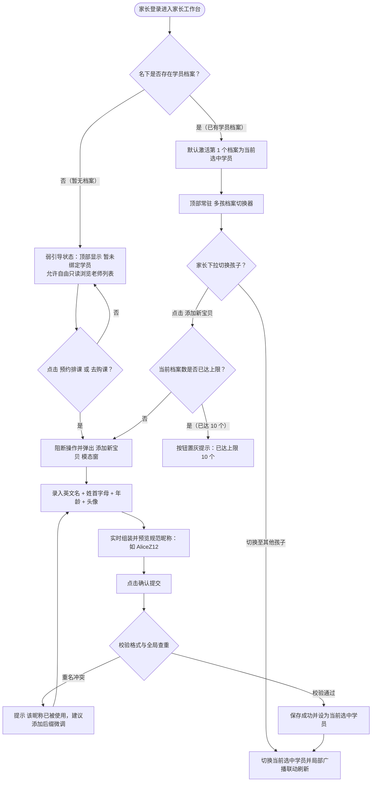
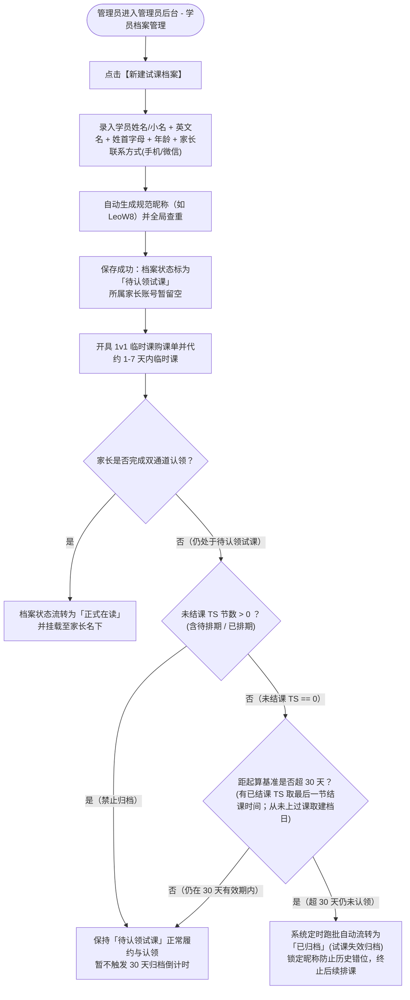
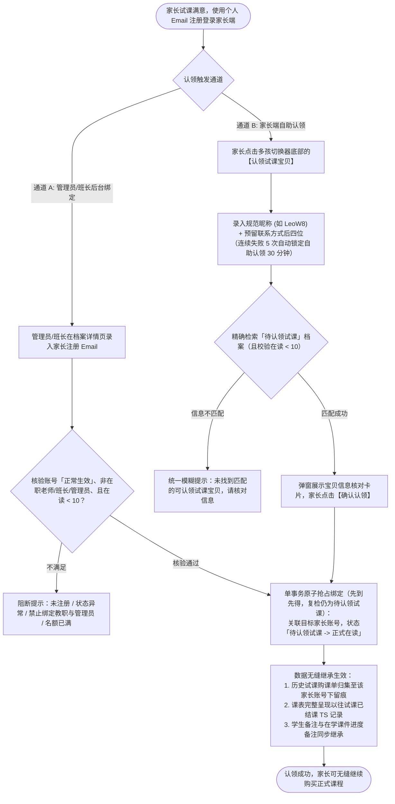
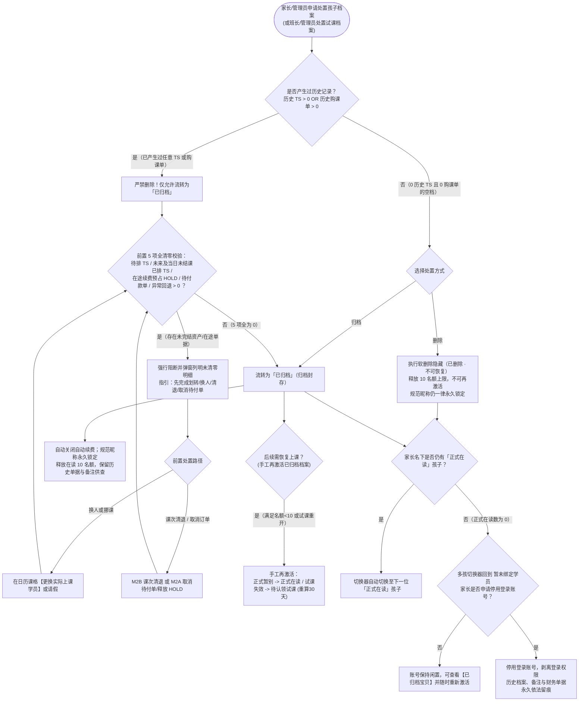
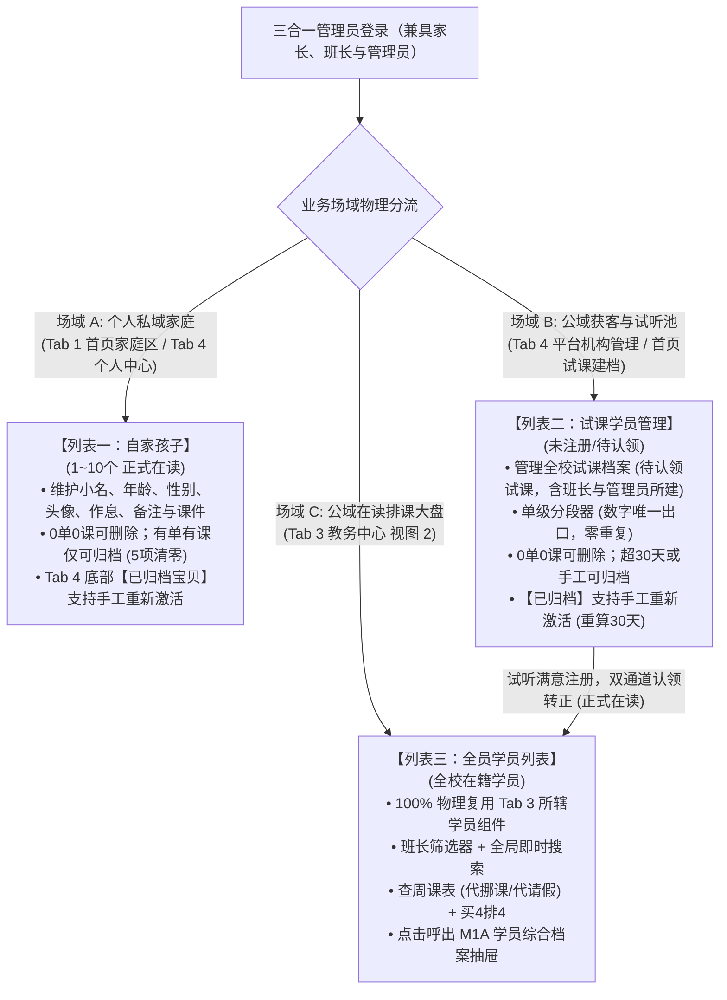
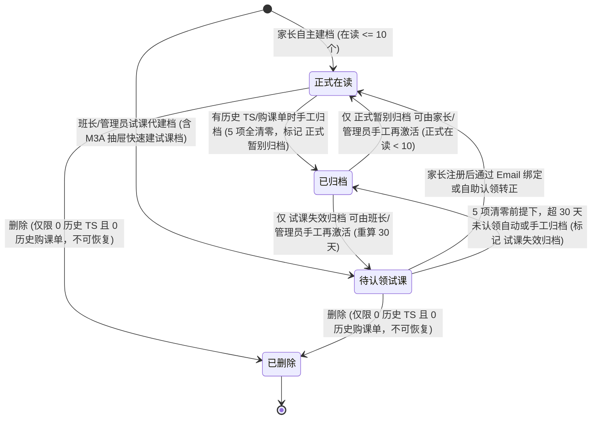

/** (c) 2024-2026 Topee (https://topee.top). All rights reserved. Proprietary and confidential. */

# 产品需求文档 (PRD) — 子模块 1A：学员与多孩档案中心 (Student Profile)

| 元数据项 | 说明 / 内容 |
|---|---|
| **模块代号** | `m1a` |
| **所属模块** | 模块一：教学教务基座与主数据 (Master Data & Profiles) |
| **文档状态** | 已批准 (Approved) |
| **关联顶层 PRD** | [Prd-v5.md](../Prd-v5.md) |
| **创建与更新日期** | 2026-11-04 (创建) / 2026-11-07 (修订) / 2026-11-10 (重大架构修订：1. 真实姓名变更为“学员姓名或小名”；2. 班长端学员列表统一复用 Tab 3【所辖学员】；3. 确立三合一管理员三大档案列表体系与试课列表去噪规范)；2026-11-12 卡片视觉改为只声明卡片类型 / 2026-11-19 (统一为【自家孩子】、合并 1v1 待排 TS 余额展示、新增三类学员档案列表排序与首字母检索索引规范、并在学员学情综合档案中移除学生家长字段) / 2026-11-20 (更新 AC-1A-26：老师端底部固定 4 个 Tab，Tab 3 设为【我的学员】，并与自家课表命名对齐；新增 AC-1A-27：老师端【我的学员】隐藏学生价位与总课次余额，仅展示“本轮 已上X次/共Y次”) / 2026-11-21 (在 M1A 学员综合档案抽屉接入同家庭待排课次划转入口指针，并修正 §8.5 注销阻断弹窗；明确正式在读学员不强绑唯一班长，班长端【所辖学员】按试课创建/本组老师上课/本人托管课次三条动态关系关联，并对齐【学员课表】跨班长只读门禁与待排课次按资金持有人操作口径) / 2026-11-22 (统一试课档案 30 天自动归档计时口径与未结课 TS 节数 > 0 禁止归档守卫；确立“0 历史 TS 且 0 购课单可删除、产生过 TS 或购课单仅可归档且校验 5 项资产清零、已归档支持按原类型手工再激活、规范昵称一律永久锁定”的完整生命周期模型；补充选填字段「常态作息偏好」) / 2026-11-22 (**SSOT 归口与合规清洗**：按双层实体/日志唯一归口铁律升级 `§4.6` 学员档案四支柱与第 2 层跨实体同事务联动清单/宿主入边索引，全篇清零英文枚举及技术实现词汇，统一超 10 人首字母索引门槛及 `DESIGN.md` 路径；同步对齐 `[➕ 买4排4]` 为 1v1 固定位限本人负责老师/管理员、临时课全域开放) / 2026-11-23 (**小班成员解耦协同**：明确「正式在读」档案归档或删除时同事务自动解除 M1C 小班活跃成员绑定以防占位，且「待认领试课」严禁绑入小班；确认班长【所辖学员】仍严格保持 1v1 三条动态关联，不混入纯本人主理小班外组学员) / 2026-11-23 (**Red-Team 审查闭环修订 D1–D8 + L1–L4**：锁定英文名/姓首字母/微调字母创建即不可改；补全双通道认领原子抢占防重、通道 A 限 M0A「正常生效」非教职/非管理员邮箱、通道 B 5 次失败冷却 30 分钟；补全 `AC-1A-19` 近 30 天请假与临期变动占比分子分母并严格保留 `> 12.5% 或 >= 3 次` 阈值；明确多方并发版本防覆盖与代课收权/【授课历史】补录边界；补入 M0A 封禁班长试课强制改绑入边、每日自然日跑批与无歧义反解析/再激活审计口径) |

---

## 1. 概述与执行摘要 (Executive Summary)

学员与多孩档案中心（`m1a`）是 Dream 系统的学员主体管理子模块。针对少儿教务场景中“出资家长操作”与“实际上课学员消耗”的分离特征，本子模块实现**自然人登录账号与上课学员档案的物理级解耦**，提供多孩家庭共管体验、全局档案切换器、规范化唯一学员昵称体系、四方共管可编辑的纯文本「学生备注 (`Student Note`)」（家长/老师/班长/管理员均可看可改，提示填写英文）及自定义头像管理，为后续购课出资、课程预约、更换实际上课学员提供精准的学员实体标识。

除常规家长自主建档外，子模块支持**班长与平台管理员为试听学员预先创建「待认领试课」档案**（复用同一极简建档功能，班长管理本人创建/负责的试课学员，管理员可管理全校所有试课学员），以极简建档配合 1v1 临时课快速实现试听履约；并在家长后续正式注册后，提供**双通道档案认领（管理员/班长后台绑定 或 家长端自助认领）**，历史排课、试课购课单、在学课件及公开备忘无缝归属家长；未认领档案在不存在任何未结课课次（`TS`）的前提下，自最后一节已结课 TS（从未上过课则自建档日）起超 30 天未认领时自动失效归档。

---

## 2. 问题定义与背景 (Problem Statement)

- **痛点 1：多孩家庭账号切换繁琐与课表混淆**：
  二孩/多孩家庭由同一位家长负责购课出资与排课管理。传统教务系统常将登录账号与学员捆绑，家长要么为每个孩子注册不同邮箱反复登退，要么单账号下多个孩子的课次与日程混杂堆叠，极易导致大宝误排二宝的课或错退课次。
- **痛点 2：排课与更换实际上课学员缺乏唯一匹配防线**：
  多孩家庭或线下协调换人上课时，由于缺少全平台唯一的学员身份标识，教务在系统中检索选择时极易选错孩子，引发课次误扣。
- **痛点 3：冷启动无档案时的体验断点**：
  新注册家长首次登录时名下没有任何孩子档案，若强行要求必须先建档才能看老师，容易造成早期用户流失；若允许不建档就直接约课，又会产生无主单据。
- **痛点 4：新学员试课注册门槛高导致获客转化流失**：
  新学员在初步咨询时往往仅希望先试上一两节课，若强行要求家长先注册邮箱账号并手动建档才能排试课，操作链路过长且摩擦力极大；同时，若采用平台临时公用账号或无主上课，会导致课后老师评价与排课记录丢失，试课转正后无法继承历史教学数据。

---

## 3. 目标用户与角色画像 (Users & Personas)

### 3.1 角色一：二孩出资家长（Amy，双胞胎/多孩妈妈）
- **诉求**：使用一个邮箱账号登录系统，在工作台顶部一键切换大宝（Alice）与二宝（Bob）的视图；为每个宝贝上传专属正方形头像；能随时查看每个孩子名下的课次与日程。
- **痛点**：不想记多个账号密码，不想看混在一起的日历。

### 3.2 角色二：排课与换人操作方（班长 / 教务）
- **诉求**：在排课或家长线下微信协调由另一位孩子顶替上课时，能通过唯一的规范昵称 100% 精确检索到目标孩子，杜绝选错风险，并随时在档案中更新学员教学备忘。

### 3.3 角色三：平台管理员（Sarah）
- **诉求**：防范账号滥用刷单，对单账号名下的学员创建数量设定上限保护；全平台学员昵称具备全局唯一性；**与班长复用待认领试课档案代建档与 2 合 1 试听录单约课能力，且管理员具备查看与管理全校所有试课学员的全局权限**；家长注册后在后台协助完成一键绑定。

### 3.4 角色四：试课转正新家长（Grace）
- **诉求**：孩子试听满意后，自己用邮箱注册账号，能通过输入规范昵称及预留联系方式自助把孩子的档案认领到名下（或由教务在后台绑定），完整查看此前试听时老师写的教室反馈与历史记录，无缝续费买课。

---

## 4. 核心业务流程 (Workflows)

### 4.1 家长端自主建档与档案切换流 (Parent Self-Service Flow)



### 4.2 管理员预建待认领试课档案与生命周期流 (Admin Pre-Creation Flow)



### 4.3 试课转正与档案双通道认领流 (Claiming & Handover Flow)



### 4.4 学员退场：删除、归档、手工激活与家长离场注销流程 (Student Offboarding & Reactivation Flow)



### 4.5 三合一管理员三大档案列表体系与场域隔离架构 (Three Student Profile Lists Architecture)

针对三合一管理员（兼具出资家长、教务班长与超级管理员）的特殊性，系统在学员维度物理隔离并设立 **三大档案列表**，按业务本质分流场域，杜绝公私混淆与功能杂糅：



---

### 4.6 学员档案唯一归口：四支柱生命周期、字段锁定、留痕与跨实体联动 (Entity & Log SSOT)

> **【实体生命周期、字段与日志唯一归口声明】**：**学员档案**（正式在读学员与待认领试课学员，1v1 专属主体；小班严禁创建学员档案）的状态机、字段可编/锁定规则、状态流转与字段修改留痕规则及数据留存策略 100% 统一且唯一由本 PRD 管辖与定义；其余文档仅作单向指针引用。全局中枢 **TS（课次）** 的状态机与四类跨端日志分工以 [BUSINESS_RULES.md §3.2](../BUSINESS_RULES.md) 为唯一统领基线。

#### 4.6.1 生命周期状态机与转移矩阵（含归档双型隔离与宿主入边）

为彻底消除「已归档」双路径歧义，档案进入「已归档」时**必须不可变绑定归档类型（`试课失效归档` vs `正式暂别归档`）**，确保试课池与正式家庭归档池 100% 物理隔离且严禁跨类激活：



| 初始状态 | 目标状态 | 触发角色 / 驱动源 | 前置条件与守卫防线 | 伴随数据与系统行为 |
| :--- | :--- | :--- | :--- | :--- |
| **`[*]`** | **正式在读** | 家长本人 | 家长账号已登录；名下「正式在读」档案数 $< 10$；昵称格式与全局大小写不敏感查重通过 | 档案直接挂载至当前家长账号（不强绑唯一负责班长，由后续购课与授课关系动态关联班长工作台）；开放正式购课与排课权限 |
| **`[*]`** | **待认领试课** | ① 建档班长 / 平台管理员；<br>② **宿主入边**：[M3A 约课抽屉](./m3a_calendar_grid.md) 快速建试课档 | 录入家长预留联系方式、预设规范昵称（如 `LeoW8`）；极简 2 字段建档支持从规范英文名反解析 | 档案处于待认领池（班长建档归属本人，管理员可管全校）；试课列表中`待认领`(`未结课TS==0`)与`试课中`(`未结课TS>0`)均为视图派生分组；建档后可开具 20 节内试课单 |
| **待认领试课** | **正式在读** *(认领转正)* | 家长本人 / 建档班长 / 管理员 | 路径 A：管理员或建档班长录入家长已注册 Email 绑定；<br>路径 B：家长自主录入规范昵称 + 预留联系方式后四位核对成功；且目标家长名下「正式在读」数 $< 10$ | 绑定至目标家长账号；同事务归集历史试课购课单（[M2A](./m2a_course_orders.md)）、试课 TS（[BUSINESS_RULES](../BUSINESS_RULES.md)）、在学课件（[M1E](./m1e_courseware.md)）与学生备注，解除建档班长私域锁定 |
| **待认领试课** | **已归档** *(标为：试课失效归档)* | 系统定时跑批 / 建档班长 / 管理员 | **5 项全清零守卫**（待排 TS == 0、未来及当日未结课已排 TS == 0、在途续费预占 HOLD == 0、待付款确认购课单 == 0、待处理异常回退 == 0）：① 自最后一节已结课 TS（或手工激活日；从未上课则自建档日）起超 30 天未认领；② 或建档班长/管理员提前手工归档 | 置为「已归档」并不可变绑定 `试课失效归档`（徽章 `[已归档·试课失效]`）；移入试课【已归档】分组只读沉底；停止后续约课排课；**规范昵称一律永久锁定** |
| **正式在读** | **已归档** *(标为：正式暂别归档)* | 家长本人 / 平台管理员 | 产生过任意历史 TS 或购课单时严禁删除，只能归档（0 记录亦可选归档）；强制校验 **5 项资产全清零**，未通过阻断并列明明细指引处置（M1C 小班成员绑定无线上资产，不阻断归档） | 置为「已归档」并不可变绑定 `正式暂别归档`（徽章 `[已归档·暂别停课]`），同事务关闭自动续费（[M2A](./m2a_course_orders.md)）并**自动解除在 [M1C](./m1c_classes.md) 全部「正式开课」小班的活跃成员绑定以释放 Max 名额**；释放 `10` 名额并切至下一位正式孩子；仅封存至家长 Tab 4【已归档宝贝】（**严禁混入试课池**）；**规范昵称一律永久锁定** |
| **已归档** | **待认领试课** *(试课再激活)* | 建档班长 / 平台管理员 | 仅限归档类型为 `试课失效归档`（严禁跨类激活 `正式暂别归档`） | 状态恢复为「待认领试课」并移回待认领池；**自手工激活日起重新起算 30 天认领窗口**；写入状态流转日志 |
| **已归档** | **正式在读** *(正式再激活)* | 家长本人 / 平台管理员 | 仅限归档类型为 `正式暂别归档`（严禁跨类激活 `试课失效归档`）；所属家长账号未停用；且该家长当前「正式在读」档案数 $< 10$ | 状态恢复为「正式在读」并占回 `1` 个名额；重现于多孩切换器与首页；历史 TS、购课单、学生备注与课件进度无缝恢复可见；写入状态流转日志（原已解除的小班成员绑定不自动回绑，需由主理人按需重新绑定） |
| **正式在读** / **待认领试课** | **已删除** *(空档软删除)* | 家长(名下正式) / 建档班长(名下试课) / 管理员 | **唯一放行前提：`历史 TS 总数 == 0 AND 历史购课单总数 == 0`**（含已取消/已作废记录）；产生过任一 TS 或购课单强行拦截引导改走【归档】 | 逻辑软删除并从所有日常列表与【已归档】区彻底隐藏，**不可再手工激活**；同事务**自动解除在 [M1C](./m1c_classes.md) 全部「正式开课」小班的活跃成员绑定**；释放 `10` 名额上限；**规范昵称仍一律永久锁定，不予释放复用** |

#### 4.6.2 关键字段可编与锁定规则矩阵

| 业务字段 | 在读 / 试课态可编性 | 编辑与查看权限边界 | 锁定、脱敏与不可逆规则 |
| :--- | :--- | :--- | :--- |
| **规范昵称及其静态前缀组件（英文名、姓首字母、可选微调字母）** | **创建即永久锁死** | 全角色按唯一规范昵称检索与教学呼唤识别 | 创建时全局大小写不敏感唯一锁定；**规范昵称及英文名、姓首字母、可选微调字母三项组成字段一经建档永久不可修改或重算**（0 历史 TS 且 0 购课单可软删后新建，已产生记录后仅可调整中文小名）；无论年龄增长、档案认领、归档或软删除，规范昵称一律永久占用 |
| **年龄、小名、性别、头像** | 建档后激活态可编辑（年龄变更不重算规范昵称） | • **正式在读**：所属家长、平台管理员可编辑；<br>• **待认领试课**：建档班长、平台管理员可编辑 | 老师端**物理隐藏中文小名**；年龄增长明确**不触发重算规范昵称**；建档班长归属可在 [M1B 班长离职或 M0A 账号封禁强绑](./m1b_teacher_profile.md) 批量改绑；**进入「已归档」或「已删除」后全部只读锁定** |
| **常态作息偏好** *(选填)* | 激活态随时可多选更新（**并发版本防覆盖**） | • **正式在读**：所属家长、当前动态关联班长、平台管理员可编辑；<br>• **待认领试课**：建档班长、平台管理员可编辑 | 对老师端**严格隐藏**；仅作为 [M3D](./m3d_course_scheduling.md) 排课高亮参考；多方协同遵循**最后保存生效 + 提交时校验修改版本防静默覆盖**（若提交期间已被他人修改则提示刷新核对后再保存）；进入「已归档」或「已删除」后只读锁定 |
| **学生备注 (`Student Note`)** *(2000 字纯文本)* | 激活态四方共管随时编辑（**并发版本防覆盖**） | 所属家长（仅限本人正式在读孩子）、关联班长、**授权授课/代课老师（仅限当前对该生存在待上或未结 1v1 课次〔含已接单代课〕的在职老师）**、平台管理员四方均可读写 | 不再拆分多套留言板；**一旦代课撤销、改派或当前已无待上/未结课次，M1A 读写权限立即收回**（已实际代课并正常结课的历史课节仅保留经由 [M3B 【授课历史】](./m3b_attendance_substitution.md) 对应课节卡片的课后补录通道）；四方并发编辑遵循**最后保存生效 + 提交时校验修改版本防静默覆盖**，每次实际变动同事务写入【档案变动日志】；进入「已归档」或「已删除」后全字段只读 |
| **所属家长账号 / 归档类型** | 创建/认领/归档时单向固化 | • 认领绑定由建档班长/管理员或家长本人一次性完成；<br>• 归档类型随进入路径不可变固化 | **严禁**正式档案在家长账号间跨号合并迁徙；**严禁**变更既定归档类型或跨类再激活 |

#### 4.6.3 状态流转与档案变动留痕规则（唯一归口定义）

1. **状态流转时间轴日志**：学员档案每次状态创建与跃迁（自主/试课建档、后台或自助认领转正、手工或每日凌晨 30 天自然日自动归档含归档类型、按原类型手工再激活并记录累计再激活次数、0 记录空档软删除，以及 M1B 班长离职或 M0A 账号封禁触发的未认领试课归属改绑）必须在同一事务内追加只读状态流转记录，明确记载**原状态、目标状态、归档类型、操作人/定时任务、流转时间与原因/认领关系**。
2. **全字段通用审计变动日志**：凡修改学员档案任一业务字段（**学生备注 `Student Note`**、小名、年龄、性别、**常态作息偏好**、头像、或经由 M1E/M3A/M3B 入口联动调整的课件进度与备注快照），仅当字段值实际发生改变时，在同一事务内追加写入只读【档案变动日志】（操作人、时间、变更字段、变更前快照、变更后快照）；长文本变更在日志卡片默认折叠 **`2 行 / ≤64 字符`**，点击可展开原文对比。
3. **资产履约流水与跨端可见隔离**：
   - 学员综合档案抽屉内的【近期课节与履约记录】只读汇总呈现已排/已结课 TS 变动、同家庭划转及 M2B 课次清退流水；
   - **家长端与老师端物理隐藏内部状态流转日志与【档案变动日志】**（仅平台管理员及当前动态关联班长可查阅，未认领试课档案按建档私域隔离），避免家庭或教学端摩擦。

#### 4.6.4 数据留存与清理策略

- 全系统对学员档案**严格禁止任何物理删库操作**；
- **正式在读档案有意不设超时自动归档**：即便所属家长账号长期未登录或名下暂无待上/已排课次，「正式在读」档案依然长期保留当前状态（保护阶段性停课家庭复课），仅响应所属家长或平台管理员主动发起且满足 `AC-1A-12a` 五项全清零守卫的手工归档或 `0` 记录空档软删除；
- 进入**「已删除」**（空档软删除）、**「已归档」**（`试课失效归档` 与 `正式暂别归档`）的档案主体，以及全部历史状态流转日志、全字段【档案变动日志】、学生备注历史与课节履约流水，均**长期只读审计留存、严禁物理清理**；
- 已锁定规范昵称永久占用不可释放；即便家长账号在 [M0A](./m0a_auth_and_account.md) 停用注销，其关联学员的历史购课单、TS、清退记录与凭证依然依法长期只读留存。

#### 4.6.5 第 2 层 · 跨实体同事务联动清单与宿主入边索引

- **A. 触发方同事务联动清单（M1A 主动驱动下游，单事务原子提交或整体回滚）**：

| 联动序号 | M1A 触发动作 | 驱动目标实体与结果方向 | 单向归口指针（M1A 不复述对方细则） |
| :---: | :--- | :--- | :--- |
| **1** | 试课档案双通道认领转正（`待认领试课 -> 正式在读`） | ① 驱动 **M2A 历史试课购课单** 归集更新至目标家长账号下只读可查；<br>② 同步 **TS 全局中枢** 与 **M1E 在学课件绑定** 并入家长视角（资金持有人维持不变） | [M2A §4.5](./m2a_course_orders.md)、[BUSINESS_RULES §3.2](../BUSINESS_RULES.md)、[M1E](./m1e_courseware.md) |
| **2** | 正式档案手工归档 / 试课档案 30 天自动或手工归档 | 在 5 项在途资产清零守卫通过后，同事务驱动 **M2A 自动续费配置** 关停该档案后续自动续费生成 | [M2A](./m2a_course_orders.md) |
| **3** | 家长在本档案抽屉增删或调整「在学课件与进度」 | 同事务落盘 **M1E 在学课件绑定** 与改级/进度审计日志，并按规则触发 **M4 站内提醒**（合并去重推送给有待上课次的授课老师及其负责班长，无待上则发待排托管班长） | [M1E](./m1e_courseware.md)、[M4 §4.2](./m4_notification.md) |
| **4** | 家长名下「正式在读」档案数清零（含全部删除或归档） | 作为 **M0A 账号注销** 的前置资产放行依据（仅「正式在读」数 == 0 且无师/班长未结教务时允许停用账号） | [M0A](./m0a_auth_and_account.md) |
| **5** | 正式学员归档（`正式暂别归档`）或空档软删除 | 同事务自动将该学员在 **M1C 小班** 全部「正式开课」小班中的在读成员绑定置为「已移除」，释放 `Max` 容量并记入小班操作日志（同时清除 **M3A** 个人课表小班投影） | [M1C §4.2](./m1c_classes.md)、[M3A](./m3a_calendar_grid.md) |

- **B. 宿主方跨模块入边索引（外部模块同事务驱动 M1A，M1A 不复述对方弹窗与调度细则）**：
  1. **[M3A 日历约课抽屉](./m3a_calendar_grid.md#410-实体生命周期与状态机-entity-lifecycles--state-machines)**：【+ 快速建试课档】同事务新建「待认领试课」档案；抽屉内修改 `Student Note` 同事务更新档案备注并写【档案变动日志】；
  2. **[M3B 老师请假交接](./m3b_attendance_substitution.md)**：老师请假附带交接学生备注时，同事务更新 M1A `Student Note` 并写入【档案变动日志】；
  3. **[M2A 同家庭待排课次划转](./m2a_course_orders.md)** & **[M2B 1v1 课次清退](./m2b_refund_orders.md)**：同事务向划转/清退双方或当事学员档案追加资产变动履约流水；
  4. **[M1B 班长解除职务或 M0A 账号封禁强制改绑](./m1b_teacher_profile.md)**：班长离职防线二或班长在 [M0A](./m0a_auth_and_account.md) 账号被置为「已封禁」触发管理员强制批量改绑时，同事务将原班长创建的未认领「待认领试课」档案改绑至在职、非冻结且 M0A 账号正常的接手班长并写入变更留痕。

---

## 5. 用户故事 (User Stories)

- **US-1A-01（多孩管理）**：作为一个多孩家长，我想要在同一个登录账号下创建并管理多个孩子的独立学员档案，以便于无需频繁登退账号即可分别查看和管理每个孩子的日程。
- **US-1A-02（规范昵称防选错）**：作为一个班长，我想要为每位孩子生成全平台唯一的规范昵称（如 `AliceZ12`），以便于在排课与更换实际上课学员时精确匹配无误。
- **US-1A-03（弱引导冷启动）**：作为一个刚注册的新家长，我想要在未建档前先浏览老师团队和空课表，以便于建立对平台的信任后再建档。
- **US-1A-04（个性化头像）**：作为一个家长，我想要为每个孩子上传专属正方形头像，以便于在顶部切换器与卡片中一眼分辨。
- **US-1A-05（上限防呆保护）**：作为一个管理员，我期望限制单个家长账号最多只能挂载 10 个学员档案，以防止脚本恶意刷单建立过多虚拟档案。
- **US-1A-06（管理员代建试课档案）**：作为一个平台管理员，我想要为未注册家长代建待认领试课档案，以便于免除家长早期注册门槛，快速促成试听排课。
- **US-1A-07（试课档案双通道认领）**：作为一个试课转正家长，我想要在注册后通过输入孩子规范昵称与预留联系方式自助认领档案（或由教务在后台协助绑定），以便于无缝查阅历史试听记录与在学课件进度，继续为孩子买课。
- **US-1A-08（超时未认领自动失效）**：作为一个系统风控机制，我想要在试课档案不存在未结课 TS 且超 30 天未认领时自动标记为归档失效，以便于防范游离虚拟档案长期堆积，同时避免误伤仍有待排或已排试听课次的学员。
- **US-1A-09（无单无课可删、有课有单归档及资产清零防线）**：作为一个平台管理员与家长，我期望从未上过课也未买过课的误建档案可直接删除，而产生过 TS 或购课单的档案禁止删除、只能先清空在途课次与订单后再归档（后续复课可随时手工重新激活），以便于兼顾纠错便利与历史审计完整性。
- **US-1A-10（离场退学财务留痕）**：作为一个平台财务审计机制，我想要在档案删除/归档或家长注销账号后，依然永久锁定规范昵称并留存所有历史购课单、TS 与课次清退备注记录，以便于满足税务合规与资金审计要求。

---

## 6. 验收标准清单 (Acceptance Criteria)

### 6.1 多孩档案全局切换器 (Profile Switcher)
- **AC-1A-01**：用户进入家长工作台，若名下拥有 $\ge 1$ 个档案，顶部二级操作条常驻【多孩档案切换器】。默认激活最后一次选中的档案（初始为首个档案）。
- **AC-1A-02**：切换选中的学员后，页面**不得发生全页刷新**，在毫秒级内完成局部数据联动刷新（课表、购课单、在学课件）。
- **AC-1A-03**：多孩切换器的下拉菜单底部固定显示【+ 添加新宝贝 (N/10)】。

### 6.2 档案数量与冷启动模式
- **AC-1A-04**：单个家长账号名下最多允许创建 **10 个**有效学员档案。当达到 10 个时，【+ 添加新宝贝】入口置灰并禁用，提示“名下档案已达上限 (10/10)”。
- **AC-1A-05**：若名下档案为 0，切换器显示“暂未绑定学员”，允许自由查看老师列表；但在点击“预约”或“购课”等强业务动作时，系统阻断并自动呼出【添加学员模态框】。

### 6.3 规范昵称规则与全局唯一性 (Unique Nickname)
- **AC-1A-06（学员姓名或小名与基础字段规范）**：创建/编辑学员时，表单字段分为：
  - **学员姓名或小名 (Student Name / Nickname)**：如“跳跳”、“乐乐”或“张小丽”（选填/简填，以出资家长在家庭内部辨识多孩为主，降低未成年人敏感个人信息输入心理顾虑；老师端不展示中文小名，排课与跨家长转课统一依赖全平台唯一的英文规范昵称）；
  - **英文名 (English Name)**：必填，英文字母 1-24 位，老师端教学呼唤唯一用名；**创建后随规范昵称永久锁定不可修改**；
  - **姓首字母 (Initial)**：必填，单字母自动转大写；**创建后随规范昵称永久锁定不可修改**；
  - **年龄 (Age)**：必填，整数 1-99；激活态可编辑（年龄增长或编辑不触发重算规范昵称）；
  - **可选微调字母**：1-2 位小写英文字母（置于姓首字母与年龄之间，仅用于重名区分，不再支持数字）；**创建后随规范昵称永久锁定不可修改**；
  - **性别 (Gender)**：**选填**，提供 `[男孩]`、`[女孩]`、`[保密]`（未选择时默认按“保密”处理，不阻断档案创建或保存）；
  - **常态作息偏好 (Preferred Schedule Slots)**：**选填**，支持多选「星期一至星期日 × 四大常用时段标签（`早 06-11`、`中 10-15`、`下 14-19`、`晚 18-24`）」，默认留空且不阻断建档保存；仅供 [m3d_course_scheduling.md §4.1](./m3d_course_scheduling.md) 排课时对匹配空闲格做轻量高亮推荐，不构成排课硬限制，且对老师端严格隐藏（多方并发编辑采用最后保存生效 + 提交时版本校验防静默覆盖）。
- **AC-1A-07**：系统自动组装规范昵称并实时向用户展示，公式为：`英文名 + 大写姓首字母 + [可选微调字母] + 年龄`（例如 `Alice` + `Z` + `12` $\rightarrow$ `AliceZ12`；重名微调时如 `Alice` + `Z` + `b` + `12` $\rightarrow$ `AliceZb12`），确保规范昵称的**最后 1–2 位只能是年龄数字，其余前缀部分必须全部为英文字母**；建档生成后**英文名、姓首字母与可选微调字母三项前缀组件随规范昵称一律永久锁定不可修改**，且后续年龄字段增长或编辑时明确**不触发重算规范昵称**，彻底防止唯一昵称与教学英文名脱节或历史单据标识错位。
- **AC-1A-08**：组装后的昵称必须匹配正则 `^[A-Za-z]{1,24}[A-Z][a-z]{0,2}\d{1,2}$`，总长度介于 3 至 29 字符（其中末尾 `1–2` 位对应整数 `1–99` 岁，除末尾 `1–2` 位年龄外其余全部为英文字母）。无歧义反解析严格遵循自右向左位置切分：**末尾 `1–2` 位数字 = 年龄；紧邻其前 `0–2` 位连续小写字母 = 可选微调字母；紧邻微调字母（若无则紧邻年龄）之前的最后一个大写英文字母 = 姓首字母；其余全部前置 `1–24` 位英文字母 = 英文名**，保证开头英文名识别与极简建档无歧义反解析。
- **AC-1A-09**：学员昵称在全系统内**大小写不敏感全局唯一**。若提交的昵称与其他家长的学员重名，系统拦截并明确报错提示“该昵称已被占用，建议添加前置微调字母（如 AliceZa12 / AliceZb12）”，同时可自动推荐首个未占用的小写区分字母，禁止重复落盘。

### 6.4 头像与在学课件
- **AC-1A-10**：家长支持上传学员自定义正方形头像（1:1），体积上限 2MB，格式支持 JPG、PNG、WebP。前端裁剪后安全直传存储，仅保存头像引用路径。
- **AC-1A-11a（在学课件绑定与进度备注共管及 2000 字多行上限，详见 m1e）**：支持为学员档案配置 0~6 门同课件不重复的【在学课件 + 所选级别 + 进度备注（`Process Note`，选填，**多行纯文本，上限 2000 字符**，如 `Unit 3 · Page 24\nReview sight words...`）】；**界面上严禁展示“单行坐标，区别于……”等技术类或研发解释性提示文字**；由**管理员、关联班长（含在组内上课或持有其待排课次的班长，多班长并发遵循版本校验）、授权授课老师（仅限对该生当前存在「待上」或 `02:00 UTC+8` 结课前未结 1v1 课次的在职老师〔含已接单代课〕，代课撤销/改派或结课后立即收回 M1A 实时编辑权；实际完成代课结课的课节仅限经 M3B【授课历史】补记）及所属家长**四方均可查看与更新（家长仅限操作本人名下「正式在读」孩子，**移除任意在学课件或切换课件级别时前端均弹出二次确认**；归档后四方均仅可只读回看），多方并发提交遵循**乐观修改版本校验防静默覆盖**；输入框与抽屉内须明确提示**“请尽量填写英文，便于老师看懂”**（引导英文录入而不做硬性字种拦截），卡片内展示**最后更新人**、**主力更新老师（按老师角色有效更新次数最多者）**及低饱和中性提醒微标**`近 6 个月没有更新`（仅计老师角色有效更新，非红/黄阻塞告警）**。学员档案与老师日历联动遵循 [m1e_courseware.md](./m1e_courseware.md) 规约，每次调整强制记录审计日志（`AC-1A-24`），家长修改后**并集去重推送**端内中性卡提醒给**有未来待上课次的授课老师及其负责班长**以及**持有待排期课次的资金托管班长/直管管理员**（同一收信人合并去重为 1 条，不发 Email）。
- **AC-1A-11b（学生备注 Student Note 共管读写与 2000 字多行上限）**：每个学员档案挂载统一的**多行纯文本学生备注 (`Student Note`，上限 2000 字符，支持换行与实时 `0/2000` 字数统计)**（不再拆分“公开留言”与“内部私有备注”两套列表），用于记录孩子的性格特点、学习习惯、英语基础与教学注意事项；**所属家长（仅限本人名下「正式在读」激活孩子）、平台管理员、关联班长（创建其「待认领试课」/ 组内老师有课 / 持有其未结课次）与授权授课老师（仅限当前对该生存在待上或未结 1v1 课次的在职老师〔含已接单代课〕；代课撤销/改派或无待上/未结课次立即收回 M1A 读写权限，已完成实际代课结课仅可经由 [m3b_attendance_substitution.md](./m3b_attendance_substitution.md) 【授课历史】对应课节卡片课后补录）四方均可查看、均可编辑保存**，实时多端同步展示。多方并发编辑遵循**最后保存生效 + 提交时校验修改版本防静默覆盖**（若提交期间已被他人修改则弹窗提示刷新核对后再保存）。家长可在自家孩子档案详情及 Tab 2【自家课表】课次详情抽屉中直接查看与修改；所有编辑学生备注的输入框均须提供明确引导提示：**“请尽量填写英文，便于老师看懂（如 Shy at first, needs encouragement）”**（友好提示但不做硬性字符拦截）。任一角色修改学生备注后均在同一事务内追加写入【档案变动日志】（`AC-1A-24`，日志本身对家长隐藏）。
- **AC-1A-11c（长文本默认折叠展开与档案编辑页“零重复编辑按钮”铁律）**：
  1. **分层默认折叠与点击展开**：
     - **单学生列表卡片 / 极紧凑单行位置**（只要卡片展示单个学员，如 M0 老师首页日程卡、M0 家长课件卡、M1A 学员列表卡、M3B 授课历史/待代课卡片）：卡片内透出的 `Process Note` 与 `Student Note` **默认全部折叠**——先把原文中的换行符视觉收敛为空格（防空行撑高卡片），按 **`1 行` 且不超过 `36~40 字符`**（以先达到者为准）截断展示；若原文超长、超过 1 行或包含换行符，末尾展示省略号与轻量 `[ 展开 ▾ ]` 入口，点击后就地或轻量浮层按原文换行展开全部 2000 字符并支持 `[ 收起 ▴ ]`；
     - **学员综合档案抽屉 / 日历与在学课件详情面板内部**：默认展示 **`2 行`（且不超过 `64 字符`）**，超出或含换行时支持点击 `[ 展开全文 ▾ ]` / `[ 收起 ▴ ]`；所有多行展示必须做好安全换行防长英文词或网址撑破窄屏；
  2. **学生档案详情/编辑页“零重复编辑按钮”铁律**：
     - **学生备注唯一入口**：在学员档案详情/编辑页中，**全页仅允许保留 1 个 `[ 编辑备注 ]` 入口**（置于【学生备注】区块右上角），严禁在页头、基础信息编辑表单、卡片底部等其他位置重复放置第二个“编辑学生备注”按钮或输入区；
     - **课件进度唯一入口（与配置课件彻底解耦）**：在学课件区块右上角 **`[ 配置课件 ]`** 职责纯粹收敛为**新增/移除在学课件（新增时可选初始级别，禁止在已选列表中重复放改级别下拉框与进度备注输入框）**；每门已绑定在学课件行内保留**唯一 1 个 `[ 更新进度 ]`** 按钮（统一承接切换当前就读级别与编辑 2000 字进度备注）；基础信息编辑弹窗内亦严禁重复挂载在学课件进度编辑区。

### 6.5 档案删除、归档、手工激活与归属权
- **AC-1A-12（删除与归档严格分流及规范昵称一律永久锁定）**：
  1. **严禁物理删除与昵称一律永久锁定**：任何学员档案在系统中严禁物理删库；无论档案最终进入**「已删除」**还是**「已归档」**，其规范昵称在全平台内**一律永久锁定占用，不予释放或复用**，防止历史已消课次或已取消单据产生标识错位；
  2. **仅“0 历史 TS 且 0 历史购课单”允许删除**：仅当目标档案名下**从未生成过任何历史 TS（含已结课、已取消）且从未生成过任何历史购课单（含已作废）**时，允许有权限操作人执行【删除档案】；删除后该档案从全部日常列表与【已归档】列表隐藏移除，**不可再手工激活**，并不再计入家长 `10` 个名额上限；
  3. **只要产生过任意 TS 或购课单，绝对禁止删除、只能归档**：若目标档案名下存在过 $\ge 1$ 条历史 TS **或** $\ge 1$ 张历史购课单（哪怕均已结课、退回或作废），系统物理禁用并拒绝【删除】请求，提示改用【归档】。
- **AC-1A-12a（归档前置五项资产全清零强校验）**：执行档案**手工归档**（`正式在读 / 待认领试课 -> 已归档`）及系统**试课 30 天自动归档**（`待认领试课 -> 已归档`）时，必须在单事务内同时校验以下 **5 项在途资产全部为 `0`**：
  1. **「待排期」TS 节数为 `0`**；
  2. **未来及当日尚未结课的「已排期」TS 节数为 `0`**；
  3. **在途续费预占 `HOLD` 节数为 `0`**；
  4. **「待付款确认」购课单张数为 `0`**；
  5. **待处理异常未上课回退补生流转为 `0`**。
  若任一项不为 `0`，系统强行阻断并弹窗分项列明未清零明细与处理指引；校验全通过后自动关闭该档案关联的自动续费配置，**自动解除在 [M1C](./m1c_classes.md) 全部「正式开课」小班中的在读成员绑定（不因小班绑定阻断归档）**，状态置为「已归档」，「正式在读」归档即时释放 `1` 个家庭名额上限并自动切换激活下一位「正式在读」孩子（若名下已无「正式在读」孩子，多孩切换器回到“暂未绑定学员”冷启动引导态）。
- **AC-1A-12b（家长账号停用与财务数据永久法定留痕）**：家长账号申请注销/停用登录资格时，系统强制校验该家长名下**当前处于「正式在读」状态的学员档案数必须为 `0`**（即所有孩子均已完成删除或归档）；校验通过后，停用登录账号并剥离登录鉴权（停用后不可再自助登录激活已归档孩子）；**财务审计留痕红线**：严禁物理删除该账号及档案关联的历史购课单、TS、课次清退备注记录及线下打款截图凭证，历史财务单据永久只读留存。
- **AC-1A-12c（手工归档、双归档类型隔离与手工激活规则）**：
  1. **双归档类型不可变绑定与列表物理隔离**：档案进入「已归档」时必须不可变绑定归档类型——由「待认领试课」进入标记为**`试课失效归档`**（UI 标 `[已归档·试课失效]`，仅入 Tab 4【试课学员管理 → 已归档】）；由「正式在读」进入标记为**`正式暂别归档`**（UI 标 `[已归档·暂别停课]`，仅入家长 Tab 4【已归档宝贝】及管理员后台）。两类归档列表查询必须按归档类型严格过滤，**严禁将「正式暂别归档」混入试课池**；
  2. **手工归档入口与权限**：
     - **正式档案（`正式在读 -> 已归档` / `正式暂别归档`）**：由**所属家长本人**（在 Tab 4【多孩档案管理】）或**平台管理员**发起（需先满足 `AC-1A-12a` 五项清零）；班长不可擅自归档他人正式在读孩子；
     - **试课档案（`待认领试课 -> 已归档` / `试课失效归档`）**：由**建档/负责班长**或**平台管理员**在 Tab 4【试课学员管理】提前手工归档（同样须满足 `AC-1A-12a` 五项清零）；
  3. **手工激活入口、权限与恢复校验（`已归档 -> 正式在读 / 待认领试课`）**：
     - **`正式暂别归档` 恢复为「正式在读」与归档期历史只读回看**：家长本人可在 **Tab 4【多孩档案管理】底部折叠区【已归档宝贝】**（日常首页与 Tab 2 多孩切换器不展示已归档孩子，避免干扰日常选课）只读查看该孩子历史购课单、在学课件与 **`Process Note`**（所属家长、曾执教/代课老师经 `M3B 授课历史` 及历史课格、关联班长及平台管理员经后台 `已归档` 视图均保留只读查看权限，不可编辑）并点击 `[ 重新激活 ]`，平台管理员亦可在后台代为激活；激活前强制校验家长当前「正式在读」孩子总数 **`< 10`**（已达 10 个时阻断并提示先归档或删除其他闲置档案）；激活后原历史 TS、购课单、学生备注与在学课件无缝恢复正常可编；
     - **`试课失效归档` 恢复为「待认领试课」**：仅**建档/负责班长**或**平台管理员**可在 Tab 4【试课学员管理 → `已归档`】点击 `[ 重新激活 ]`；作为内部受信任运营角色，支持按实际跟进需要多次重新激活（每次均记录状态流转日志与累计再激活次数供管理员审计防滥用）；**激活后统一自“手工激活操作日”起重新起算 30 天认领有效期**（避免因历史结课日期已满 30 天而在次日跑批立即复归档；若激活后产生新的已结课 TS，则随新结课 TS 按 `AC-1A-18` 重算）；
  4. **禁止跨类激活与审计留痕**：`试课失效归档` 严禁激活为「正式在读」，`正式暂别归档` 严禁激活为「待认领试课」；每次归档与激活均须记录含归档类型的只读状态流转日志（`AC-1A-23`）。
- **AC-1A-13（归属与操作权限边界）**：任何对已绑定学员档案的查询、修改、归档、重新激活与删除操作，必须物理强制校验当前登录家长的归属权，严禁跨账号越权；「待认领试课」档案仅允许其建档/负责班长或平台管理员在后台进行维护、排课、归档、重新激活与删除（管理员可管理全校所有试课档案）。

### 6.6 待认领试课档案与双通道认领规范 (Unbound Profile & Claiming)
- **AC-1A-14（班长与管理员复用建档权限与数据隔离）**：**班长与平台管理员**复用同一套「待认领试课」档案创建功能，且均在两处入口开放：① **M3A 老师课表空闲绿格【代学员约课】抽屉 `+ 快速建试课档`**；② **班长 Tab 3【所辖学员】顶部 / 管理员 Tab 4【试课建档】顶部【+ 新建试课学员】**。班长创建的试课档案自动锁定归属当前班长，仅在本人【所辖学员】与 M3A 约课搜索中管理；**平台管理员可查看和管理全校所有试课学员**。**「正式在读」学员档案不提供班长/管理员代录入口，统一由家长注册后自行添加或由试课档案认领转正**，各端按钮与说明文案须明确区分「正式在读学员」与「待认领试课学员」。
- **AC-1A-15（试课建档字段与状态）**：建档项包含：学员姓名或小名（选填/简填）、英文名（必填）、姓首字母（必填）、年龄（必填）、性别（选填，默认保密）、家长预留联系方式（手机/微信，必填）。系统自动生成全局唯一规范昵称（如 `LeoW8`），初始状态为「待认领试课」，所属家长账号暂留空（若由班长创建则建档/负责班长锁定为当前班长）。
  - **极简 2 字段建档兼容规则**：在 [m3a_calendar_grid.md](./m3a_calendar_grid.md) 【代学员约课】抽屉及【所辖学员】快捷弹窗内触发极简建试课档时，允许仅录入 **① 规范英文名**（如 `MarkL10`，重名微调可录入 `MarkLa10`，须通过 `AC-1A-08` 新正则及 `AC-1A-09` 全局唯一性校验）与 **② 家长联系方式**（必填，至少 4 位有效字符）；系统严格按 `AC-1A-08` 自右向左无歧义规则（末尾 `1–2` 位数字=年龄，其前 `0–2` 位小写字母=微调字母，紧邻最后一个大写字母=姓首字母，其余前置英文字母=英文名）从规范英文名中解析提取 `英文名`（如 `Mark`）、`姓首字母`（如 `L`）、`可选微调字母`（如 `a`）与 `年龄`（如 `10`），**性别默认取“保密”**，并将 **学员姓名或小名默认复制填入该规范英文名**（如 `MarkL10`），后续仅小名/年龄/性别/作息偏好可编辑完善（英文名/姓首字母/微调字母创建即锁定）。
- **AC-1A-16（双通道认领机制、并发防重、目标校验与防爆破）**：
  - **通道一（后台人工绑定）**：管理员或建档/负责班长在学员档案详情页输入家长已注册的合法 Email（去空格转小写），系统必须严格核验目标账号同时满足：① 在 [M0A](./m0a_auth_and_account.md) 存在且状态为**「正常生效」**（严禁未激活、临时锁定、已封禁或已注销停用账号）；② **彻底禁止绑定当前拥有在职/交接冻结中班长职务、在职老师档案或在任平台管理员授权的邮箱**，拦截并提示“禁止将试课档案绑定至在职教职人员或管理员邮箱，请填写家长普通注册邮箱”；③ 目标账号名下当前「正式在读」档案数 $< 10$；④ 执行单事务并发抢占，先到先得完成关联并转为「正式在读」；
  - **通道二（家长端自助认领）**：家长在移动端多孩切换器点击【认领试课宝贝】，输入孩子精确规范昵称（如 `LeoW8`）及建档预留联系方式后四位。若目标档案校验通过且家长名下「正式在读」$< 10$，先展示核对预览卡片并在确认提交时执行单事务原子抢占绑定；**防暴力枚举规则**：同一登录家长账号连续匹配失败达 `5 次` 时自动冷却锁定自助认领入口 **30 分钟**（弹窗提示联系建档班长走通道一协助绑定），未锁定前凡昵称不存在、已认领/归档或后四位不匹配，一律统一返回模糊话术（“未找到匹配的可认领试课宝贝，请核对规范昵称与预留联系方式后四位”），严禁泄露具体失败原因；
  - **双通道并发与先到先得幂等规则**：通道一与通道二均在提交绑定瞬间于单事务内原子复检目标档案仍处于「待认领试课」（且未归档、未删除）及目标家长在读 $< 10$；并发或重复请求仅先提交成功者胜出并触发 `AC-1A-17` 资产归集，后者一律阻断并明确提示“该宝贝已被认领，请刷新查看最新状态”，严禁重复归集或二次覆盖。
- **AC-1A-17（试课转正后 5 类数据全量归属家长与动态关联生效）**：认领绑定成功后，单事务内以下 5 类数据无缝归属/开放给该家长账号（原待排/已排课次的收款托管人保持不变；转正后档案纳入「正式在读」学员，按“本组老师上课/持有未结课次”与各班长动态关联，不再强制锁死单一归属班长）：
  - ① **学员档案本身**：关联至目标家长账号，转为「正式在读」，家长可编辑基础信息与头像；
  - ② **全部 TS 课次资产**：该档案名下所有「待排期」、未来「已排期」及历史「已结课」TS 100% 归入家长课表与资产视图；
  - ③ **试课购课单与清退记录**：原托管占位下的试课购课单归属账号原子更新归集至该家长账号下只读可查；
  - ④ **在学课件进度**：已配置的 1～6 门在学课件、当前级别与学习进度备注（`Process Note`）同步继承，家长可查看亦可直接调整与更新（编辑进度时提示尽量填写英文，便于老师看懂）；
  - ⑤ **学生备注 (`Student Note`)**：已记录的学生备注随档案无缝归属，家长**可查看亦可直接编辑补充**（编辑时提示尽量填写英文，便于老师看懂；内部【档案变动日志】仍严格对家长隐藏）。
- **AC-1A-18（30 天超时自动失效归档与五项资产阻断守卫）**：
  1. **五项资产阻断守卫（与 `AC-1A-12a` 对齐）**：只要「待认领试课」档案名下存在**未结课 TS 节数 $> 0$**（即处于「待排期」或「已排期」状态的课次合计 $> 0$），或存在当日尚未结课课次、在途续费预占 `HOLD`、「待付款确认」购课单或待处理异常回退，**绝对不能归档**；系统定时跑批必须跳过该档案，且页面不触发归档倒计时警示；仅当上述 5 项在途资产均为 `0` 时，方具备触发自动归档评估的条件；
  2. **统一 30 天自然日计时与每日跑批口径**：
     - **跑批频率与自然日口径**：系统**每日凌晨定时跑批评估一次**，严格按平台运营时区完整自然日计算（`当前评估自然日 - 起算基准自然日 > 30 天`，即满 `30` 个完整自然日后的次日凌晨自动触发）；
     - **手工激活后的试课档案**（`已归档 -> 待认领试课`）：若激活后尚未产生新的已结课 TS，自**最近一次手工激活自然日**起算，满 **30 个自然日**（超过 30 天）仍未被家长认领；一旦后续产生新的已结课 TS，则切回“最后一节已结课 TS 所在自然日”起算；
     - **常规有已结课记录的档案**（「已结课」TS 节数 $\ge 1$，且未发生过归档后再激活重算）：统一自**最后一节已结课 TS 所在自然日**起算，满 **30 个自然日**（超过 30 天）仍未被家长认领；
     - **从未上过课的档案**（「已结课」TS 节数为 `0`，含建档后未排课或历史排课均已取消）：统一自**建档自然日**（若曾归档后再激活则取**最近一次手工激活自然日**）起算，满 **30 个自然日**（超过 30 天）仍未被家长认领；
  3. **归档执行与后置冻结**：同时满足上述守卫条件与超 30 天未认领条件时，系统每日凌晨定时跑批自动将其状态变更为「已归档」（标记为 `试课失效归档`）并写入状态流转日志（`AC-1A-23`）；归档后该档案不再支持约课与排课，日历停止调度，规范昵称仍一律永久锁定，防止历史已消课次单据产生标识错位（如需恢复试听跟进，可由负责班长或管理员按 `AC-1A-12c` 手工重新激活）。

### 6.7 班长与管理员端列表复用铁律（收敛于 Tab 3【教务中心】）
- **AC-1A-19（班长端【所辖学员】动态关联范围与列表复用）**：
  - **严禁双重列表**：班长端严禁自建或分离出第二套独立的“学员档案列表页面”，所有关联学员的列表浏览与检索**唯一收敛于 Tab 3【教务中心】的视图 2【所辖学员】**（遵循 [m0_workspace_and_home.md](./m0_workspace_and_home.md) 6.2.5 规约）；
  - **动态关联范围（满足任一条件即纳入，自动去重；不强制单班长死绑）**：
    1. **名下试课生**：由当前班长创建且尚未被家长认领（「待认领试课」）的试课档案（严格私域隔离，其他班长不可见）；
    2. **本组在读生**：当前在本人负责老师名下存在未来待上课、续费预占 `HOLD`、或最近 90 天内有已排/已结课 1v1 课次的正式学员；
    3. **持课学员**：名下尚有本人作为收款托管人（资金持有人）的未结 1v1 待排期课次，或待确认/待审核购课与清退单据的正式学员；
    - 卡片上可按当前关系轻量标注属性（如 `试课待认领`、`本组在读`、`持有未排课次`），帮助班长区分来源；家长自主建档且尚未与本人产生以上任一关联的学员，不在列表中曝光（须在 M3A/M3D/M2A 按完整规范昵称精准搜索后建联）。**严格保持【所辖学员】仅覆盖上述 1v1 三条关联，不将本人主理 [M1C](./m1c_classes.md) 小班中纯他组绑定的学员混入本列表**（核对小班绑定学员排期冲突由 M1C 小班成员行 `[ 📅 看课表 ]` 直接穿透）。
  - **“卡片即教务，抽屉即档案”复用架构**：
    - **列表卡片层**：展示规范昵称与小名（如 `AliceZ12 (跳跳 · 10岁)`）、近期/主讲老师、课次资产余额与在学课件简标（如 `📘 Wonders G1`），提供 `[ 📅 查看课表 ]`（进入后遵循模式 Z：仅本人负责老师的 1v1 课格可代请假/代挪位，非本人负责老师的 1v1 课格与小班格按规定只读展示）与 `[ ➕ 买4排4 ]`（1v1 4 周固定位限本人负责老师/管理员；1v1 临时课全域开放）高频动作；
    - **综合档案抽屉层**：点击卡片主体或 `[ 档案/学情 ↗ ]`，直接呼出本模块定义的 **【M1A 学员综合档案抽屉】**，聚合呈现：
      1. **基础信息**（规范昵称、小名、英文名〔创建后随规范昵称锁定〕、年龄、性别、常态作息偏好（选填）、建档时间；不展示出资家长及其 Email/手机号等隐私字段；「待认领试课」档案仅建档班长与管理员可编辑年龄/小名/性别/作息偏好，「正式在读」档案由家长端、关联班长与管理员维护作息偏好，基础可改字段由家长端与管理员维护）；
      2. **在学课件管理 (M1E)**（1v1 支持 0~6 门同课件不重复的课件、就读级别与学习进度备注 `Process Note` 维护，**管理员、关联班长、授权授课老师及所属家长四方均可查看与更新**；列表仅保留区块顶部唯一的 **`[ 配置课件 ]`**（纯负责增删课件，不放进度框）及每门课件行内唯一的 **`[ 更新进度 ]`**（统一承接调整级别与 2000 字进度备注），进度默认折叠 `2 行 / ≤64 字` 可点展开，编辑框上限 2000 字符且提示尽量填写英文；**若该正式在读孩子同时已绑定在营 `M1C` 小班，家长端卡片/资料区另设「小班在学课件（仅查看）」只读分组展示对应小班课件、级别、样图与 `Process Note`，无任何编辑/增删按钮**）；
      3. **课次资产与排课总览 (M2A/M3A)**（1v1 待排课次按价位明细、当前已排固定位轮次、历史购课单据一键穿透、课次清退入口，以及当所属家长名下存在 $\ge 2$ 个「正式在读」孩子且当前存在可用待排 1v1 课次时展示 `[ ↔️ 划转给同家庭孩子 ]` 入口；**其中【课次划转】与【课次清退】对班长仅开放操作本人作为资金持有人托管的待排课次**，管理员可操作全校，划转规则详见 [m2a_course_orders.md](./m2a_course_orders.md)）；
      4. **学生备注 (`Student Note`)**（替代原留言板：多行纯文本共享备注，上限 **2000 字符**，**所属家长（仅限本人名下「正式在读」孩子）、平台管理员、关联班长与授权授课老师（仅限当前有待上或未结 1v1 课次〔含已接单代课〕的在职老师）均可查看并随时编辑保存；多方并发提交做版本校验防静默覆盖**；抽屉内默认折叠展示 `2 行 / ≤64 字` 并支持点击展开全文；**全页仅此处保留唯一 1 个 `[ 编辑备注 ]` 按钮，无重复编辑入口**；输入框明确提示**“请尽量填写英文，便于老师看懂”**）；
      5. **试课转正绑定**：若为「待认领试课」档案，支持在此直接输入家长 Email 执行单事务并发抢占绑定（仅建档班长与管理员可见可用，仅限 M0A「正常生效」且非在职/冻结教职与管理员的邮箱、正式在读 $< 10$）；
      6. **课次变更与履约记录**：直接展示该学员的已排/已结课课次流水与同家庭课次划转只读流水（供内部追溯核对）；并在班长/管理员视角的档案头部与详情卡透出 **`近 30 天请假与临期(<3h)变动次数`**：
         - **分子**：滚动近 `30` 个自然日内，由家长或班长/管理员代家长发起的 1v1「请假退期待排」与「`<3h` 临期变动（临期退回 / 临期同师挪位 / 临期更换上课学员）」总次数（不含因老师请假/离职/旷课或系统原因导致的被动退回）；
         - **分母**：同一滚动近 `30` 个自然日内，该学员名下应履约 1v1 已排课次基数（含该 30 天内已结课及因上述请假/临期变动离开原课格的 1v1 课次，不含未来未到上课日排期及 `M1C` 小班）；
         - **分母为 0 与轻标红规则**：分母为 `0` 时展示 `0 次 (0%)` 且不标红；分母 $> 0$ 时按 `分子 / 分母 × 100%` 计算占比，**严格保留原阈值——当 `占比 > 12.5%` 或 `分子 >= 3 次` 时轻标红提醒**（辅助班长决定是否提醒家长或取消固定位资格；该指标对家长端隐藏）。
- **AC-1A-20（管理员端学员档案全校复用）**：
  - 管理员在 Tab 3【教务中心】查看【全校学员】时，复用同一个学员列表组件（保留 `[ 全部班长 ▾ ]` 筛选器，按上述动态关联关系筛选对应班长关联学员，并在卡片按需展示关联班长标签）；
  - 点击卡片主体同样呼出此套 M1A 学员综合档案抽屉，实现跨角色业务与展示口径的 100% 复用。

### 6.8 三合一管理员三大档案列表架构与试课列表去噪规范 (Admin Three Lists & De-cluttering Standards)
- **AC-1A-21（三大档案列表场域严格隔离铁律）**：
  1. **列表一【自家孩子】(My Own Children)**：
     - 宿主：Tab 1【首页】家庭区与 Tab 4【管理与设置】个人中心（或首页金刚位 `[ 🧒 自家孩子 ]`）；
     - 范围：严格限制仅挂载当前登录管理员名下的 1~10 个自家孩子档案；
     - 权限：仅管理员以出资家长身份操作，绝不混入任何外部学员或试课名单；支持注销软删除（受资产清零前置强校验保护）。
  2. **列表二【试课学员管理】(Trial Students)**：
     - 宿主：Tab 4【管理与设置】平台机构管理（或首页金刚位 `[ 🧒 试课建档 ]`）；
     - 范围与状态机 1:1 互斥映射（**严禁虚构脱离主状态机的“试课中”独立实体状态**）：仅汇聚未注册试听生源及近 30 天转化轨迹，按 4 个互斥子集映射到 5 段过滤器：
       - **`待认领`（状态 `待认领试课` · 派生过滤）**：处于「待认领试课」**且 `未结课 TS == 0`**（含刚建档尚未约课，或试听已全结课等待认领、已进入 `AC-1A-18` 30 天归档倒计时）；
       - **`试课中`（状态 `待认领试课` · 派生过滤）**：处于「待认领试课」**且 `未结课 TS > 0`**（尚有待排或已排试听课，试听推进中、暂不进入归档倒计时；卡片主实体徽章仍标 `[待认领]`，辅以 `[试课中]` 进度标签）；
       - **`已转正`（状态 `正式在读` · 近 30 天只读转化留痕）**：最近 30 天内由 `待认领试课 -> 正式在读` 认领转正的学员（满 30 天自动退出试课列表，避免与【全员学员】长期重叠）；卡片隐藏绑定 Email、代约试课与归档倒计时，仅保留 `[ 查看在读档案 ↗ ]` 穿透；
       - **`已归档`（状态 `已归档` · 仅限 `试课失效归档`）**：仅包含归档类型为**`试课失效归档`** 的档案（**严禁混入 `正式暂别归档`**）；
       - **`全部`**：以上 4 个互斥子集的并集；
     - 权限：班长与平台管理员均具备新建权限（班长仅管理本人所建/所辖试课学员，管理员可统一查看与调度全校所有试课学员）；支持即时检索、代约临时试课、录入家长 Email 转正绑定，以及对 `试课失效归档` 卡片执行 `[ 重新激活 ]`；
     - 流转：试课满意认领后，状态变更为「正式在读」，立即进入 Tab 3【全员学员列表】并按动态关联规则在各班长工作台呈现（试课池仅在 `[ 已转正 ]` 保留 30 天只读转化轨迹）。
  3. **列表三【全员学员列表】(All Enrolled Students)**：
     - 宿主：Tab 3【教务中心】实体分段视图 2【全校学员】（遵循 AC-1A-19/20 物理复用铁律，Tab 4【管理与设置】中的“全校学员”链接点击直接锚定直通此处）；
     - 范围：全平台所有已正式入读在籍的学员大盘；
     - 权限：支持班长切片筛选 `[ 全部班长 ▾ ]`、全局即时搜索、周课表穿透代挪课/代请假、买4排4排课向导，点击卡片主体呼出 M1A 学员综合档案抽屉。
- **AC-1A-22（试课学员列表去花哨、去重复数字与视觉降噪验收标准）**：
  1. **彻底废除顶部 KPI 统计大色块卡片**：严禁在试课学员列表页面顶部放置大色块卡片展示待认领、归档等数量，首屏 100% 空间释放给搜索与列表内容；
  2. **数字单一事实出口铁律 (Single Source of Truth for Counts)**：待认领等各状态数量**必须且仅允许在单级分段器（Segmented Filter）标签文字后展示一次**（如 `[ 全部 (18) ]`、`[ 待认领 (3) ]`、`[ 试课中 (4) ]`、`[ 已转正 (8) ]`、`[ 已归档 (3) ]`，各分段计数按 `AC-1A-21(2)` 互斥口径统计且子项之和严格等于 `全部`）；某状态数量为 0 时隐藏括号数字；全页面其他任何区域严禁二次复读该数字；
  3. **中性卡与去彩条规范**：卡片统一采用 [DESIGN.md Section 2.2.1](../../DESIGN.md) 规定的【中性卡】样式，严禁使用彩色大边框、侧边加粗彩条等杂乱装饰；
  4. **临期归档弱警示规范**：对于**未结课 TS 节数为 0** 且按 `AC-1A-18` 口径距 30 天归档 $\le 7$ 天即将超期失效的试课档案，仅在卡片内部右侧以低饱和暗红文字 `(剩 3 天归档)` 标注（若存在未结课 TS 节数 $> 0$，因不允许归档，仅展示试课/待排进度而不显示归档倒计时警示），杜绝高饱和大红大黄色块污染。
- **AC-1A-23（学员档案生命周期状态流转留痕）**：学员档案每次发生状态跃迁（`待认领试课` → `正式在读` 认领转正、`待认领试课`/`正式在读` → `已归档` 自动或手工归档、`已归档` → `正式在读`/`待认领试课` 手工再激活、`待认领试课`/`正式在读` → `已删除` 零记录删除），必须在同一事务内追加只读状态流转记录（含原状态、目标状态、归档类型、操作人/系统、流转时间与原因/认领关系），供管理员在后台档案追溯查验（家长端物理不可见）。
- **AC-1A-24（学员档案全字段变动日志）**：除状态流转外，凡修改学员档案任一业务字段（包括**学生备注 (`Student Note`)**、小名、年龄、性别、**常态作息偏好**、头像、建档初始化/后台绑定的所属家长与规范昵称静态信息、在学课件与级别及进度备注），必须在同一事务内追加写入只读【档案变动日志】（记录操作人、操作时间、变更字段及变更前后快照；仅当字段值实际发生变化时写入）；当变动字段为长文本 `Student Note` 或 `Process Note` 时，日志卡片内的变更前后快照默认折叠至 **`2 行 / ≤64 字符`** 并支持点击展开全文对比；管理员与当前动态关联班长在学员综合档案抽屉可展开查看【档案变动日志】（家长端物理不可见）。
- **全端唯一主标识与中文小名隔离铁律（协同全库 PRD）**：全平台统一以全局大小写不敏感唯一的 **「规范英文名」（又称规范昵称，如 `AliceZ12`、`MarkL10`）** 作为学员核心主标识；**一般老师端（全域）与班长/管理员在日常业务流水（M3A 课表/日调度/代约/换人、M3D 排课选人、M2A 购课单、M2B 清退单、M3B 代课/经办/授课历史、M4 提醒邮件、M5A/M5B 账单与 M1E 课件卡）均只展示并只按「规范英文名」搜索**；**学员小名/中文名及其他个人辅助资料**仅限家长本人查看（自家孩子与自家账单），以及有权限的班长与管理员在进入 **M1A【学员档案卡片 / 详情】**时按权限查看（对老师端 100% 物理隐藏中文小名）。
- **AC-1A-25（三类学员档案列表排序、规范英文名 1-2 字母检索与超 10 人首字母索引）**：
  1. **列表一【自家孩子】**：固定按建档时间正序（`大宝 → 二宝 → … → 十宝`）排列，与首页家庭信息流及顶栏多孩切换器顺序 100% 一致，不设额外排序切换器（家长端自家列表可同时展示小名与规范英文名）；
  2. **列表二【试课学员管理】**：默认按防流失优先级排序——① `待认领`（`待认领试课` 且 `未结课 TS == 0`，已进入 30 天归档倒计时）按**距 30 天自动归档剩余天数升序**（同天数按起算时间降序）→ ② `试课中`（`待认领试课` 且 `未结课 TS > 0`，暂不触发归档）按最近排课/结课/建档时间降序 → ③ `已转正`（近 30 天内 `待认领试课 -> 正式在读`）按转正时间降序 → ④ `已归档`（`已归档` 且 `试课失效归档`）按归档时间降序沉底；支持按**规范英文名**前 `1–2` 个字母或联系方式检索并按规范英文名 `A → Z` 排序列出；
  3. **列表三【所辖学员 / 全校学员】（Tab 3 教务中心）**：
     - **默认排序（`智能优先`）**：① 有待排课次（`待排 TS > 0`）按待排课次数降序 → ② 纯在读中（`待排 == 0` 且 `已排 > 0`）按剩余已排课次升序 → ③ 零资产停课（`待排 == 0` 且 `已排 == 0`）按最近结课/更新时间降序沉底；同梯队并列按规范英文名 `A → Z` 兜底；
     - **轻量排序切换**：列表顶栏右侧提供 4 档切换：`智能优先`（默认）、`待排最多`、`余课最少`（零资产仍沉底）、`规范英文名 A-Z`；
     - **1–2 字母规范英文名搜索**：搜索框**统一按规范英文名（含前 `1–2` 个字母，如 `A` 或 `Al`，不区分大小写）精准检索**，不再依赖小名模糊检索以免跨组混淆；**只要处于搜索态，结果列表自动按规范英文名 `A → Z` 排序列出**，清空搜索后恢复原选排序；有权限的班长/管理员点开 M1A 档案卡片或详情抽屉后可按权限查看该生小名等档案详情（老师端【我的学员】卡片与详情全程隐藏小名）；
     - **超 10 人规范英文名首字母索引（默认收起）**：当当前列表学生总数 **`> 10` 人** 时（`≤ 10` 人隐藏），搜索栏下方显示轻量折叠条 **`[ 🔤 首字母索引 ▾ ]`**（**默认收起**）；点击展开后按 `A → Z` 列出当前学生中实际存在的规范英文名首字母（最多 26 个，附 `[ 全部 ]`），点选任一字母即筛选该首字母开头的学生并按 `A → Z` 排序展示，再次点击或点 `[ 全部 ]` 取消筛选。
- **AC-1A-26（老师端【我的学员】Tab 定位与多角色底部导航对齐）**：
  1. **老师端 4-Tab 底栏规范**：老师角色在 M1A 查看【我的学员】与【学员学情档案】时，底部导航必须严格遵循 [m0_workspace_and_home.md §6.1](./m0_workspace_and_home.md) 呈现 **4 个 Tab：`首页` / `课表` / `我的学员`（本页高亮） / `我的`**（支持从底栏 Tab 3 及老师首页金刚位进入，其中 `首页` 回老师首页、`课表` 直达 M3A 老师课表、`我的` 直达老师个人中心）；**严禁在老师端出现 `今日课表`、`个人中心` 等偏离 M0 规范的 Tab 命名**；
  2. **Tab 2 命名对齐**：家长、班长兼家长与管理员在 M1A 视图的底部 Tab 2 统一命名为 **`自家课表`**，严禁继续使用旧称 `学员课表`。
- **AC-1A-27（老师端【我的学员】隐藏价位与全局课次、仅展示本轮课次进度）**：
  1. **严禁展示价位、全局课次资产与“查看课表”入口**：在老师身份的【我的学员】列表卡片及【学员学情档案 / 学员详情页】视图中，**严禁展示**学生的**课次价位**（如 `16积分/节`）、**购课积分**、**全平台剩余待排课次余额**、**其他老师的排课节数**、购课/退费/清退入口，以及 **`[ 📅 查看课表 ]` / `[ 学生课表 ]` 按钮或跳转链接**；
  2. **仅展示本轮本人授课进度**：卡片与学情摘要中仅展示当前登录老师本人与该学员最近一轮排课周期的履约进度，标准文案格式为 **`本轮 已上X次/共Y次`**（如 `本轮 已上12次/共15次`）：
     - `共Y次`：该学员当前最新一轮排课中归属**当前登录老师本人**的排课总节数（含已结课与待上课；若暂无本轮排课则显示 `暂无本轮排课`）；
     - `已上X次`：该轮次中由**当前登录老师本人实际完成结课**的节数（不含 `🔵` 被代课及取消退回课次）；
  3. **教学信息保留**：保留学员英文名/规范昵称、年龄、在学课件与 `Process Note`（进度备注）入口及 `Student Note`（学生备注）；同时延续隐私隔离铁律，对老师端隐藏中文小名、家长账号联系方式及班长/管理员内部变动日志。

---

## 7. 范围外清单 (Out of Scope - 本期明确不做)

- **暂不支持双家长共管单个孩子**：本期学员档案严格归属于创建它的唯一家长登录账号（一对多单向绑定），不提供“父母两个账号共同绑定管理大宝”的双主权共享模式。
- **暂不提供学员档案跨家长合并迁徙工具**：本期仅支持从「待认领试课」档案向注册家长的单向归集认领；已正常绑定家长的「正式在读」档案依然严格禁止在家长之间任意跨账号合并迁徙（特殊家庭变动走人工客服处理）。

---

## 8. 界面线框与交互规范 (Wireframe Level)

### 8.1 家长端顶部多孩切换条
```
+--------------------------------------------------------------------------+
|  [Logo] 家长工作台          [语言: 中文 v]   [角色: 家长]        [头像]    |
+--------------------------------------------------------------------------+
|  当前宝贝: [头像] AliceZ12 (12岁) [▼]                                    |
|            +------------------------------------+                        |
|            | (*) [头像] AliceZ12 (12岁) 大宝    |                        |
|            | ( ) [头像] BobZ10   (10岁) 二宝    |                        |
|            |------------------------------------|                        |
|            | + 添加新宝贝 (2/10)                |                        |
|            | 🔗 认领试课宝贝                    |                        |
|            +------------------------------------+                        |
+--------------------------------------------------------------------------+
```

### 8.2 添加新学员模态弹窗 (Modal)
- **弹窗标题**：添加新学员档案
- **字段项**：
  1. **头像上传**：圆形预览区，点击唤起图片裁剪（强制 1:1），支持 2MB 内 JPG/PNG/WebP；
  2. **宝贝姓名或小名**：如 `跳跳` / `张小丽`（选填/简填，主要供出资家长在家庭内部辨识多孩）；
  3. **英文名 (English Name)**：如 `Alice`（必填，仅字母，老师端上课呼唤用名）；
  4. **姓首字母 (Initial)**：如 `Z`（单个英文字母，自动转大写）；
  5. **宝贝年龄**：如 `12` 岁；
  6. **规范昵称预览卡片**（高亮带锁）：`AliceZ12`（附说明：全平台唯一，末尾 1–2 位固定为建档年龄且后续锁定不变，用于转课精准识别）；
  7. **微调区分字母（可选）**：如重名提示，可输入 1–2 位小写字母（如 `b`），自动置于姓首字母与年龄之间生成 `AliceZb12`；
  8. **性别（选填）**：单选组 `[男孩] [女孩] [保密]`（未选时默认按“保密”处理，不阻断提交）；
  9. **常态作息偏好（选填）**：多选「星期 × 常用时段胶囊（早/中/下/晚）」，默认留空，供排课高亮参考。
- **操作项**：【取消】、【确认创建】。

### 8.3 班长 / 管理员 — 新建试课学员弹窗 (Trial Student Modal)
- **弹窗标题**：新建试课学员（待认领）
- **说明提示**：正式学员请由家长注册后自行添加；此处仅用于家长未注册前的试听建档，系统将生成「待认领试课」档案；无未结课 TS 且自最后一节已结课 TS（从未上过课则自建档日）起超 30 天未认领将自动归档。
- **字段项**：
  1. **学员姓名或小名**：如 `跳跳` / `王小明`（选填/简填）；
  2. **英文名 (English Name)**：如 `Leo`（必填，仅英文字母）；
  3. **姓首字母 (Initial)**：如 `W`（必填，单字母）；
  4. **学员年龄**：如 `8` 岁（必填）；
  5. **微调区分字母（可选）**：重名时可输入 1–2 位小写字母置于年龄前（如 `a` 生成 `LeoWa8`）；
  6. **规范昵称实时预览**：`LeoW8`（高亮带锁）；
  7. **性别（选填）**：单选组 `[男孩] [女孩] [保密]`（默认“保密”，支持不填）；
  8. **家长联系方式**：如 `13800138000` / `WeChat_ID`（必填，用于后续认领核验与线下排课通知）；
  9. **常态作息偏好（选填）**：多选「星期 × 常用时段胶囊」，默认留空。
- **操作项**：【取消】、【确认创建并去排课】。

### 8.4 家长端 — 自助认领试课宝贝弹窗 (Claim Trial Profile Modal)
- **弹窗标题**：认领试课宝贝
- **步骤结构**：
  - **步骤一（核验信息）**：
    - 输入框：`孩子规范昵称`（占位提示：如 LeoW8，向建档老师获取）；
    - 输入框：`建档预留手机/微信后四位`（防呆核验；同一家长账号连续失败 5 次锁定本自助认领入口 30 分钟并引导联系班长后台绑定）；
    - 按钮：【查询宝贝】（未匹配或不可认领时统一展示模糊错误提示，不区分具体错因）。
  - **步骤二（确认卡片）**：
    - 匹配成功后展示学员预览卡片：`[头像] LeoW8 ｜ 男（若选保密或未填则显示“性别保密”） ｜ 8岁 ｜ 历史试听: 1 节`；
    - 提示文案：认领后孩子的上课记录与在学进度将同步并入您的名下。
  - **操作项**：【返回修改】、【确认认领并绑定】。

### 8.5 宝贝档案归档前置校验阻断弹窗与删除分流 (Archive Guard & Delete Modal)

- **入口动作自动分流**：
  - 若 `历史 TS == 0 AND 历史购课单 == 0`：展示【删除档案】（确认后彻底隐藏不可再激活，昵称永久锁定）与【归档封存】（可再激活）选项；
  - 若 `历史 TS > 0 OR 历史购课单 > 0`：隐藏/禁用【删除】按钮（旁注：`已有历史课次或购课单，不支持删除，请使用归档`），主按钮为 **【归档档案】**，不满足 5 项全清零时弹出如下阻断弹窗：

```
+------------------------------------------------------------------+
| 归档宝贝档案：AliceZ12                                       [x]  |
|------------------------------------------------------------------|
| ⚠ 无法归档该宝贝档案！检测到名下仍有未完结资产或待处理单据：     |
|                                                                  |
| · 待排期课时：剩余 4 节 TS (可退积分: 160)                       |
| · 已排期/当日未结课：未来仍有 2 节已预约课程 (🟠 固定位)          |
| · 续费预占 HOLD：有 1 轮待续费预占 (4 节待支付)                  |
| · 待付款购课单：有 1 张待确认收款单                              |
| · 待处理异常回退：0 项（若有则列明异常单明细）                   |
|                                                                  |
| 清算与处理指引：                                                 |
| 1. 待排期课次：请联系该课次的收款托管班长办理【课次划转】给其他  |
|    孩子（多孩时），或申请办理【课次清退/扣减】核销；             |
| 2. 已排期课程：由该课授课老师所属班长协助【更换实际上课学员】给  |
|    其他孩子，或请假退回待排期后按第 1 条处理；                   |
| 3. 在途 HOLD / 待付款单 / 异常回退：请先取消待续费/待付单并完成  |
|    异常回退处置；五项全清零后方可归档，后续需要时可随时重新激活。 |
|------------------------------------------------------------------|
|                                         [知道了]  [联系对应班长] |
+------------------------------------------------------------------+
```

### 8.6 班长端 Tab 3【教务中心 · 所辖学员】卡片与 M1A 档案抽屉复用线框 (Component Reuse)

```
========================= Tab 3【教务中心 · 所辖学员】列表卡片 =========================
+---------------------------------------------------------------------------------------+
| [ 🔍 输入规范英文名(如 A / Al / AliceZ12)... ]         [ 排序: 智能优先 ▾ ]               |
| [ 🔤 首字母索引 ▾ ]  (仅 > 10 名学生时显示，默认收起；展开后列 A-Z 最多 26 个实际首字母)    |
+---------------------------------------------------------------------------------------+
+---------------------------------------------------------------------------------------+
| [头像] AliceZ12 (跳跳 · 10岁)  [本组在读] [持有课次] [📘 Wonders G1] [待排: 6 TS] |
| 授课老师: 👨‍🏫 David Miller (已锁定固定位)                                          |
| [ 📅 查看课表 (跨组只读) ]     [ ➕ 买4排4排课 ]           [ 档案与学情详情 ↗ (点卡片打开) ]|
+---------------------------------------------------------------------------------------+
                                            │
                                            ▼ 点击呼出（半屏/全屏抽屉）
+---------------------------------------------------------------------------------------+
| ◀ 学员综合档案与学情详情：AliceZ12 (跳跳)                                         [X]  |
+---------------------------------------------------------------------------------------+
| 【基础信息】                                                                          |
| · 规范昵称: AliceZ12         · 学生小名: 跳跳           · 年龄: 10岁 (女)              |
| · 常态作息偏好: 周二/周四 晚 18-24 · 周六 中 10-15 (选填)       · 建档时间: 2026-09-01   |
|---------------------------------------------------------------------------------------|
| 【在学课件管理 (M1E)】（家长/老师/班长/管理员均可看可改）            [ 配置课件 ]  |
| 1. Wonders Grade 1 · Stage 2                                          [ 更新进度 ]  |
|    进度：Unit 3 · Page 24. Practiced reading fluency and phonics…       [ 展开全文 ▾ ]  |
| 2. KET Vocabulary Booster · Level 1                                   [ 更新进度 ]  |
|    进度：Lesson 5 · Completed word matching quiz.                                     |
|    💡 配置课件仅管增删（新增可选初始级）；改级与 2000 字进度由各课件 [ 更新进度 ] 统一维护 |
|---------------------------------------------------------------------------------------|
| 【课时资产与排课总览 (M2A/M3A)】    [ ↔️ 划转给同家庭孩子 ]   [ 课时清退/扣减 ]        |
| · 1v1 待排期: 共 6 节 (其中本人托管 4 节 · 可划转/清退；其他托管 2 节仅展示余额)       |
| · 当前已排固定位轮次: 11-10 ~ 12-05                                                   |
|---------------------------------------------------------------------------------------|
| 【学生备注 (Student Note)】（仅此 1 处编辑入口，最多 2000 字）          [ 编辑备注 ]  |
| "Shy at first, David guides well; needs encouragement to speak in full… [ 展开全文 ▾ ]  |
|    💡 最多 2000 字，默认折叠 2 行；请尽量填写英文，便于老师看懂                       |
|---------------------------------------------------------------------------------------|
| 【近期课节与履约记录】                                                                  |
| · 11-15 19:00 请假退回待排期                                                  (2小时前) |
| · 11-08 18:30 同师挪位至 11-10 19:00 (David老师)                              (3天前)   |
| · 11-01 16:00 由 Elena 老师代课 (照常履约)                                    (1周前)   |
+---------------------------------------------------------------------------------------+
```

### 8.7 试课学员管理极简去噪线框图 (Clean Trial Students Wireframe)

```
+-------------------------------------------------------------------------------+
| ◀ 试课学生管理                                              [ + 新建试课档案 ] |
+-------------------------------------------------------------------------------+
| [ 🔍 搜索规范英文名 / 预留联系方式 (如 LeoW8)                             ] (即时搜索) |
|                                                                               |
| [ 全部 (18) ]  [ 待认领 (3) ]  [ 试课中 (4) ]  [ 已转正 (8) ]  [ 已归档 (3) ]   | (单级分段器，数字唯一出口)
+-------------------------------------------------------------------------------+
|                                                                               |
| +---------------------------------------------------------------------------+ |
| | [头像] LeoW8 (跳跳 · 8岁)                        [待认领] [平台直管]      | |
| | 家长预留: 138****0001 (微信: leo_mom)           建档: 2026-10-12          | |
| | 试课进度: 末节试听已结课 (无未结课 TS)          (剩 5 天归档)             | |
| | [ 🔗 绑定家长 Email ]     [ 📅 代约试听课 ]     [ 综合档案详情 ↗ ]        | |
| +---------------------------------------------------------------------------+ |
|                                                                               |
| +---------------------------------------------------------------------------+ |
| | [头像] EricS9 (小宝 · 9岁)                [待认领] [试课中] [已排期]     | |
| | 家长预留: 139****8888                           建档: 2026-11-02          | |
| | 试课进度: 已约 1 节临时试听 (待完课)            存在未结课 TS · 暂不归档  | |
| | [ 🔗 绑定家长 Email ]     [ 📝 编辑备注 ]       [ 综合档案详情 ↗ ]        | |
| +---------------------------------------------------------------------------+ |
|                                                                               |
| +---------------------------------------------------------------------------+ |
| | [头像] MiaL7 (米娅 · 7岁) (切换[已归档]) [已归档·试课失效] [平台直管]   | |
| | 家长预留: 136****7777                           归档: 2026-11-18          | |
| | 试课进度: 已上 1 节试听 · 超 30 天未认领已归档    昵称永久锁定            | |
| | [ 🔄 重新激活 ]           [ 综合档案详情(只读) ↗ ]                         | |
| +---------------------------------------------------------------------------+ |
+-------------------------------------------------------------------------------+
```

### 8.8 家长端 Tab 4【多孩档案管理 · 已归档宝贝】折叠区

- **入口定位**：日常首页信息流与 Tab 2 多孩切换器仅展示「正式在读」孩子（避免已归档孩子干扰日常约课）；在 **Tab 4【个人中心 → 多孩档案管理】** 列表底部，若存在归档类型为 **正式暂别归档** 的孩子，展示默认收起的折叠入口 **`[ 📦 已归档宝贝 (N) ▾ ]`**（含 0 条时隐藏；仅限 `正式暂别归档`，绝不混入 `试课失效归档`）；
- **卡片信息与动作**：展开后每张卡片显示宝贝规范昵称、小名、**`[已归档·暂别停课]`** 徽章、归档日期、历史已结课/订单汇总（可穿透只读查看历史账单与课表）、以及 **`[ 🔄 重新激活 ]`** 按钮；
  - 若当前「正式在读」孩子已达 `10` 个上限，点击 `[ 重新激活 ]` 提示“名下激活档案已达上限 (10/10)，请先删除或归档其他孩子后再激活”；
  - 满足 `< 10` 个确认后即刻恢复为「正式在读」，同步恢复至首页、多孩切换器与 Tab 2 课表。
