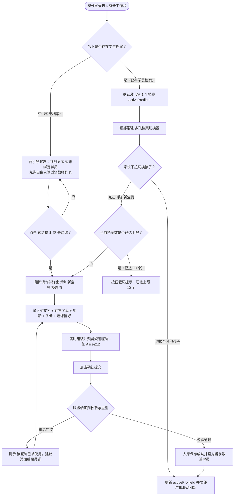
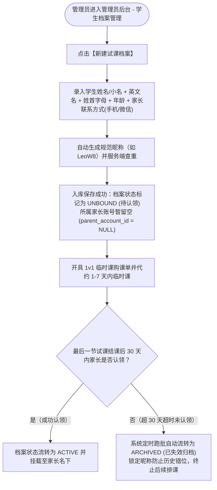
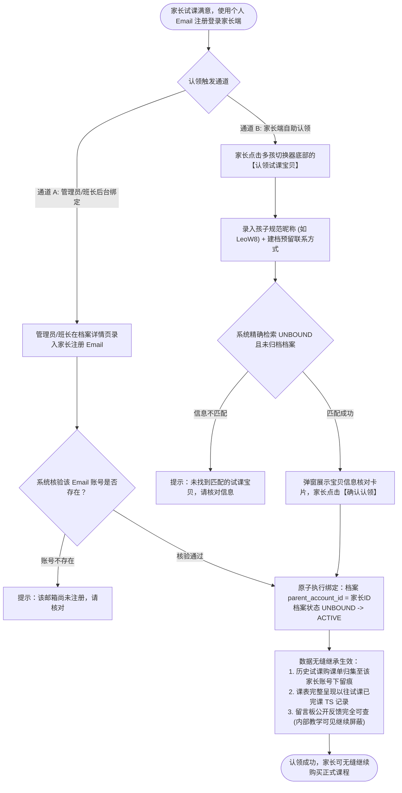
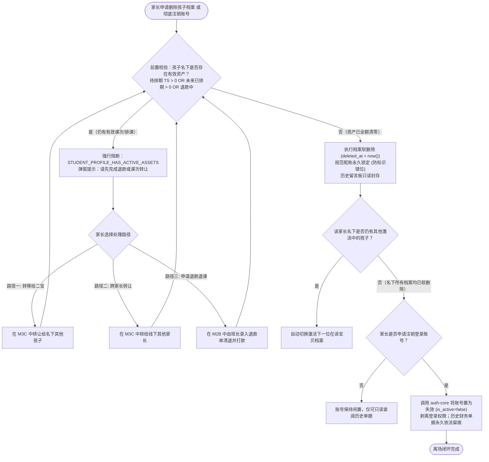
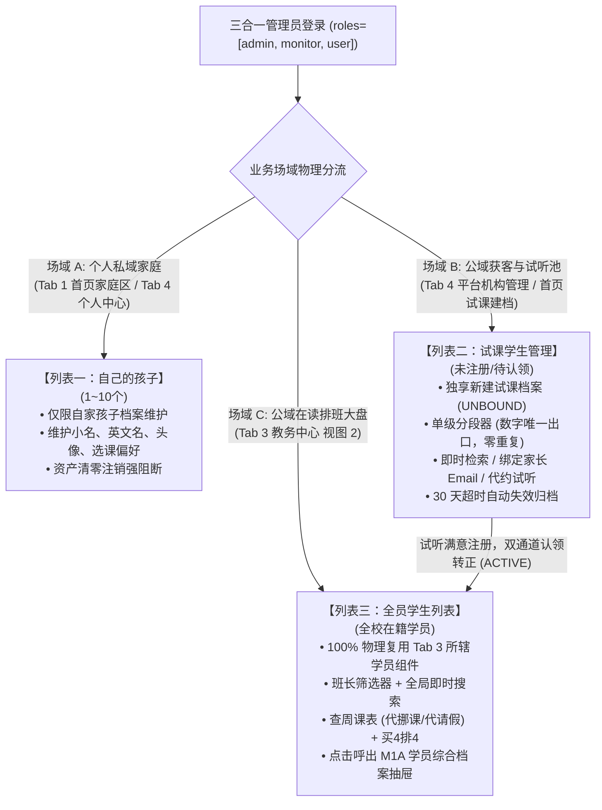
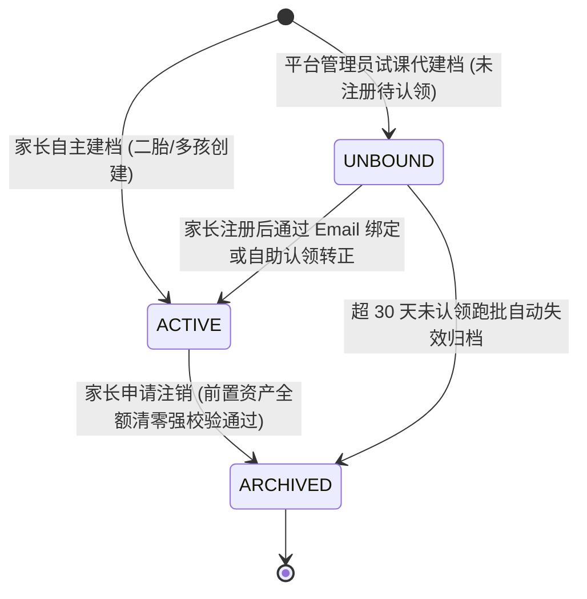

/** (c) 2024-2026 Topee (https://topee.top). All rights reserved. Proprietary and confidential. */

# 产品需求文档 (PRD) — 子模块 1A：学员与多孩档案中心 (Student Profile)

| 元数据项 | 说明 / 内容 |
|---|---|
| **模块代号** | `m1a` |
| **所属模块** | 模块一：教学教务基座与主数据 (Master Data & Profiles) |
| **文档状态** | 已批准 (Approved) |
| **关联顶层 PRD** | [Prd-v5.md](../Prd-v5.md) |
| **创建与更新日期** | 2026-11-04 (创建) / 2026-11-07 (修订) / 2026-11-10 (重大架构修订：1. 真实姓名变更为“学生姓名或小名”，以家长端家庭辨识为主，外教端使用英文名，转课使用规范昵称；2. 物理明确班长端学员档案列表 100% 统一复用 Tab 3【教务中心】所辖学员列表组件，严禁自建第二套独立学员列表；3. 确立三合一管理员三大档案列表体系[自家孩子/试课学生/全员学生]与场域隔离，重构试课学生列表去花哨与去数字重复规范，单级分段器为数字唯一出口) |

---

## 1. 概述与执行摘要 (Executive Summary)

学员与多孩档案中心（`m1a`）是 Dream 系统的学员主体管理子模块。针对少儿教务场景中“出资家长操作”与“实际上课学员消耗”的分离特征，本子模块实现**自然人登录账号与上课学员档案的物理级解耦**，提供多孩家庭共管体验、全局档案切换器、规范化唯一学员昵称体系（防呆防转错）及自定义头像管理，为后续购课出资、课程预约、课后反馈与课程跨家长转让提供精准的学员实体标识。

除常规家长自主建档外，子模块支持**平台管理员为试听学员预先创建待认领档案 (UNBOUND)**，以极简建档配合 1v1 临时课快速实现试听履约；并在家长后续正式注册后，提供**双通道档案认领（管理员/班长后台绑定 或 家长端自助认领）**，历史排课、公开留言及试课购课单无缝移交承接，未认领档案 30 天超时自动失效归档。

---

## 2. 问题定义与背景 (Problem Statement)

- **痛点 1：多孩家庭账号切换繁琐与课表混淆**：
  二孩/多孩家庭由同一位家长负责购课出资与排课管理。传统教务系统常将登录账号与学员捆绑，家长要么为每个孩子注册不同邮箱反复登退，要么单账号下多个孩子的课时与日程混杂堆叠，极易导致大宝误排二宝的课或错退课时。
- **痛点 2：跨家长线下转让课次缺乏唯一匹配防线**：
  家长在线下微信群交割转让未消课次时，由于缺少全平台唯一的学员身份标识，转出方在系统中搜索时极易选错接收人，引发资金纠纷与课时误充。
- **痛点 3：冷启动无档案时的体验断点**：
  新注册家长首次登录时名下没有任何孩子档案，若强行要求必须先建档才能看教师，容易造成早期用户流失；若允许不建档就直接约课，又会产生无主单据。
- **痛点 4：新学员试课注册门槛高导致获客转化流失**：
  新学员在初步咨询时往往仅希望先试上一两节课，若强行要求家长先注册邮箱账号并手动建档才能排试听课，操作链路过长且摩擦力极大；同时，若采用平台临时公用账号或无主上课，会导致课后外教评价与排课记录丢失，试课转正后无法继承历史教学数据。

---

## 3. 目标用户与角色画像 (Users & Personas)

### 3.1 角色一：二孩出资家长（Amy，双胞胎/多孩妈妈）
- **诉求**：使用一个邮箱账号登录系统，在工作台顶部一键切换大宝（Alice）与二宝（Bob）的视图；为每个宝贝上传专属正方形头像；能随时查看每个孩子名下的课时与日程。
- **痛点**：不想记多个账号密码，不想看混在一起的日历。

### 3.2 角色二：转让接收方家长（Tom，受让家长）
- **诉求**：在线下协商好转让课次后，将自家孩子的规范昵称提供给转出方，转出方在系统内输入后能 100% 精确匹配定位，杜绝转错风险。

### 3.3 角色三：平台管理员（Sarah）
- **诉求**：防范账号滥用刷单，对单账号名下的学员创建数量设定上限保护；全平台学员昵称具备全局唯一性；**具备为未注册家长代建待认领试课档案（录入联系方式与生成规范昵称）的独享权限**，开具临时课试听单并代约课；家长注册后在后台协助完成一键绑定。

### 3.4 角色四：试课转正新家长（Grace）
- **诉求**：孩子试听满意后，自己用邮箱注册账号，能通过输入规范昵称及预留联系方式自助把孩子的档案认领到名下（或由教务在后台绑定），完整查看此前试听时老师写的课堂反馈与历史记录，无缝续费买课。

---

## 4. 核心业务流程 (Workflows)

### 4.1 家长端自主建档与档案切换流 (Parent Self-Service Flow)



### 4.2 管理员预建待认领试课档案与生命周期流 (Admin Pre-Creation Flow)



### 4.3 试课转正与档案双通道认领流 (Claiming & Handover Flow)



### 4.4 学员注销归档与家长离场注销流程 (Student Offboarding Flow)



### 4.5 三合一管理员三大档案列表体系与场域隔离架构 (Three Student Profile Lists Architecture)

针对三合一管理员（兼具出资家长、教务班长与超级管理员）的特殊性，系统在学员维度物理隔离并设立 **三大档案列表**，按业务本质分流场域，杜绝公私混淆与功能杂糅：



---

### 4.6 实体生命周期与状态机 (Entity Lifecycles & State Machines)

学员档案实体由 M1A 负责全生命周期闭环管辖，严格收敛为以下状态转移矩阵：



- **学员档案状态转移规则与资产防线**：

| 初始状态 | 目标状态 | 触发角色 | 前置条件与守卫防线 | 伴随数据与系统行为 |
| :--- | :--- | :--- | :--- | :--- |
| `[*]` | `ACTIVE` (在读正式) | 家长本人 | 家长账号已登录；名下激活档案数 $< 10$；昵称格式校验通过 | 档案直接挂载至当前家长账号；开放正式购课与排课权限。 |
| `[*]` | `UNBOUND` (试课未认领) | 平台管理员 (独享) | 录入联系电话、预设规范昵称（如 `LeoW8`）；开具 20 节内试课单 | 档案处于待认领池；允许管理员代约临时试听课；限期 30 天。 |
| `UNBOUND` | `ACTIVE` (认领转正) | 家长 / 管理员 | 路径 A：管理员录入家长注册 Email 绑定；<br>路径 B：家长自主录入昵称+预留电话核对成功 | `parent_account_id` 指向真实家长；历史试课 TS、购课单与留言板无缝并入家长视角。 |
| `UNBOUND` | `ARCHIVED` (超时归档) | 系统跑批 (`dream-worker`) | 试课建档已满 30 天仍未认领且无未完课 TS | 档案状态置为 `ARCHIVED`；释放试听排期；锁定昵称防止错位。 |
| `ACTIVE` | `ARCHIVED` (离场注销) | 家长本人 / 管理员 | **资产绝对清零防线**：<br>必须满足 `待排期 TS == 0 AND 未来已排期 == 0 AND 无退款中单据`；存在资产强行抛出 `STUDENT_PROFILE_HAS_ACTIVE_ASSETS` 阻断 | 执行软删除 (`deleted_at = now()`)；**规范昵称永久锁定**；历史留言板只读封存；自动切换下一位激活宝贝。 |

---

## 5. 用户故事 (User Stories)

- **US-1A-01（多孩管理）**：作为一个多孩家长，我想要在同一个登录账号下创建并管理多个孩子的独立学生档案，以便于无需频繁登退账号即可分别查看和管理每个孩子的日程。
- **US-1A-02（规范昵称防转错）**：作为一个需要跨家长接收/转让课次的家长，我想要为孩子生成全平台唯一的规范昵称（如 `AliceZ12`），以便于在线下转让交割时能精确匹配无误。
- **US-1A-03（弱引导冷启动）**：作为一个刚注册的新家长，我想要在未建档前先浏览教师团队和空课表，以便于建立对平台的信任后再建档。
- **US-1A-04（个性化头像）**：作为一个家长，我想要为每个孩子上传专属正方形头像，以便于在顶部切换器与卡片中一眼分辨。
- **US-1A-05（上限防呆保护）**：作为一个管理员，我期望限制单个家长账号最多只能挂载 10 个学生档案，以防止脚本恶意刷单建立过多虚拟档案。
- **US-1A-06（管理员代建试课档案）**：作为一个平台管理员，我想要为未注册家长代建待认领试课档案，以便于免除家长早期注册门槛，快速促成试听排课。
- **US-1A-07（试课档案双通道认领）**：作为一个试课转正家长，我想要在注册后通过输入孩子规范昵称与预留联系方式自助认领档案（或由教务在后台协助绑定），以便于无缝查阅历史试听记录与老师公开评语，继续为孩子买课。
- **US-1A-08（超时未认领自动失效）**：作为一个系统风控机制，我想要在试课档案超过 30 天未认领时自动标记为归档失效，以便于防范游离虚拟档案长期堆积。
- **US-1A-09（档案删除资产清零防线）**：作为一个平台管理员与家长，我期望在删除宝贝档案时被系统强制校验剩余课次与未来排课，以便于避免因误操作注销导致有效课时和排期丢失。
- **US-1A-10（离场退学财务留痕）**：作为一个平台财务审计机制，我想要在家长注销账号后依然永久保留其名下历史购课单与退款单，以便于满足税务合规与资金审计要求。

---

## 6. 验收标准清单 (Acceptance Criteria)

### 6.1 多孩档案全局切换器 (Profile Switcher)
- **AC-1A-01**：用户进入家长工作台（`parent`），若名下拥有 $\ge 1$ 个档案，顶部二级操作条常驻【多孩档案切换器】。默认激活最后一次选中的 `activeProfileId`（初始为首个档案）。
- **AC-1A-02**：切换选中的学员后，页面**不得发生全页刷新**，通过响应式状态管理（Pinia）在毫秒级内完成局部数据联动刷新（课表、购课单、留言板）。
- **AC-1A-03**：多孩切换器的下拉菜单底部固定显示【+ 添加新宝贝 (N/10)】。

### 6.2 档案数量与冷启动模式
- **AC-1A-04**：单个家长账号名下最多允许创建 **10 个**有效学员档案。当达到 10 个时，【+ 添加新宝贝】入口置灰并禁用，提示“名下档案已达上限 (10/10)”。
- **AC-1A-05**：若名下档案为 0，切换器显示“暂未绑定学员”，允许自由查看教师列表；但在点击“预约”或“购课”等强业务动作时，系统阻断并自动呼出【添加学员模态框】。

### 6.3 规范昵称规则与全局唯一性 (Unique Nickname)
- **AC-1A-06（学生姓名或小名与基础字段规范）**：创建/编辑学员时，表单字段分为：
  - **学生姓名或小名 (Student Name / Nickname)**：如“跳跳”、“乐乐”或“张小丽”（选填/简填，以出资家长在家庭内部辨识多孩为主，降低未成年人敏感个人信息输入心理顾虑；外教端不展示中文小名，排课与跨家长转课统一依赖全平台唯一的英文规范昵称）；
  - **英文名 (English Name)**：必填，英文字母 1-24 位，外教端教学呼唤唯一用名；
  - **姓首字母 (Initial)**：必填，单字母自动转大写；
  - **年龄 (Age)**：必填，整数 1-99；
  - **可选微调后缀**：1-3 位小写字母/数字。
- **AC-1A-07**：系统自动组装规范昵称并实时向用户展示，公式为：`英文名 + 姓首字母 + 年龄 [+ 可选后缀]`（例如 `Alice` + `Z` + `12` $\rightarrow$ `AliceZ12`；微调后缀如 `AliceZ12b`）。
- **AC-1A-08**：组装后的昵称必须匹配正则 `^[A-Za-z]{1,24}[A-Z]\d{1,2}[a-z0-9]{0,3}$`，总长度介于 3 至 30 字符。
- **AC-1A-09**：学员昵称在全系统内**大小写不敏感全局唯一**。若提交的昵称与其他家长的学员重名，系统拦截并明确报错提示“该昵称已被占用，建议添加微调后缀（如 AliceZ12b）”，禁止提交落盘。

### 6.4 头像与选课偏好
- **AC-1A-10**：家长支持上传学员自定义正方形头像（1:1），体积上限 2MB，格式支持 JPG、PNG、WebP。前端裁剪后通过对象存储预签名凭证直传，数据库仅保存相对路径 Key。
- **AC-1A-11**：支持勾选学员选课偏好（课程类型复选，默认不勾选视为“不限”）。
- **AC-1A-11a（在学课件绑定，详见 m1e）**：支持为学生档案配置 1~6 门【在学课件 + 当前就读级别】（由管理员或负责班长维护，家长端只读）。学生档案与教师日历联动遵循 [m1e_courseware.md](./m1e_courseware.md) 规约，每次调整强制记录审计日志。

### 6.5 软删除与归属权
- **AC-1A-12**：学员档案支持软删除（`deleted_at IS NOT NULL`）。软删除后其占用的昵称依然保留锁定，防止历史已消课次单据产生标识错位。
- **AC-1A-12a（学员档案注销前置强校验）**：删除/注销学生档案时，系统必须在单事务内校验：该学生名下处于 `TS.status IN ('待排期', '已排期')` 的节数必须为 0，且无处于 `PENDING_REFUND` 的退款单。若仍有剩余有效课次或未来排课，接口强行阻断并返回 `409 STUDENT_PROFILE_HAS_ACTIVE_ASSETS`，弹窗拦截并列明未清退明细，强制引导完成退款或转让后方可注销。
- **AC-1A-12b（家长账号停用与财务数据永久法定留痕）**：家长账号申请注销/停用时，系统强制校验其名下所有挂载的学生档案必须均处于已软删除（`deleted_at IS NOT NULL`）状态；校验通过后，调用 `@topeetop/auth-core` 将账号登录状态置为失效（`is_active=false`），剥离登录鉴权；**财务审计留痕红线**：严禁物理删除该账号关联的历史购课单（`purchase_orders`）、退款单（`refund_orders`）及线下打款截图凭证，历史财务单据永久只读留存，供监管与税务合规审计。
- **AC-1A-13**：任何对已绑定学员档案的查询、修改、删除接口，必须物理强制校验当前登录家长的 `account_id`，严禁跨账号越权操作；未绑定的试课档案（`UNBOUND`）仅允许平台管理员在后台进行维护与排课。

### 6.6 待认领试课档案与双通道认领规范 (Unbound Profile & Claiming)
- **AC-1A-14（代建权限收敛）**：仅限**平台管理员（Admin）**具备在后台创建待认领试课档案（`UNBOUND`）的权限；班长（Monitor）无权创建，严格收敛建档权限防止班长随意生成虚拟档案。
- **AC-1A-15（试课建档字段与状态）**：管理员建档项包含：学生姓名或小名（选填/简填）、英文名（必填）、姓首字母（必填）、年龄（必填）、家长预留联系方式（手机/微信，必填）。系统自动生成全局唯一规范昵称（如 `LeoW8`），初始状态为 `UNBOUND`，归属平台托管（`parent_account_id` 为空）。
- **AC-1A-16（双通道认领机制）**：
  - **通道一（后台人工绑定）**：管理员或负责班长在学生档案详情页输入家长已注册的合法 Email，系统校验账号存在后，原子将档案更新为该家长 `parent_account_id`，状态转为 `ACTIVE`；
  - **通道二（家长端自助认领）**：家长在移动端多孩切换器点击【认领试课宝贝】，输入孩子精确规范昵称（如 `LeoW8`）及建档预留联系方式后四位，匹配成功即绑入名下，状态转为 `ACTIVE`。
- **AC-1A-17（历史教学与单据资产全量继承）**：认领绑定成功后：
  - ① **历史排课 TS 记录**：该档案名下以往所有试课已排期与已结课 TS 课表记录，在家长端日历中 100% 完整可见；
  - ② **留言板权限**：留言板“师生公开”反馈（如外教课后评测、教材进度）完全对家长透出可查；“仅内部教学可见”备忘录保持对家长端单向隐藏；
  - ③ **购课单归集**：原试课临时课购课单同步归集至该家长账号下清晰留痕。
- **AC-1A-18（30 天超时自动失效归档）**：若待认领档案自最后一节试课结课（或建档之日）起超过 **30 天** 仍未被家长认领，系统定时跑批自动将其状态变更为 `ARCHIVED`（已失效归档），该档案不再支持约课与排班，日历停止调度，昵称仍保持占用锁定，防止历史已消课次单据产生标识错位。

### 6.7 班长与管理员端列表复用铁律（收敛于 Tab 3【教务中心】）
- **AC-1A-19（班长端学员档案列表 100% 物理复用 Tab 3 所辖学员视图）**：
  - **严禁双重列表**：班长端严禁自建或分离出第二套独立的“学员档案列表页面”，所有负责学员的列表浏览与检索**唯一收敛于 Tab 3【教务中心】的视图 2【所辖学员】**（遵循 [m0_workspace_and_home.md](./m0_workspace_and_home.md) 6.2.5 规约）；
  - **“卡片即教务，抽屉即档案”复用架构**：
    - **列表卡片层**：展示规范昵称与小名（如 `AliceZ12 (跳跳 · 10岁)`）、主讲外教、课时资产余额（固定位/临时课）与在学课件简标（如 `📘 Wonders G1`），提供 `[ 📅 查看课表 ]`（代挪课/代请假）与 `[ ➕ 买4排4 ]` 高频排班动作；
    - **综合档案抽屉层**：点击卡片主体或 `[ 档案/学情 ↗ ]`，直接呼出本模块定义的 **【M1A 学员综合档案抽屉 (Student Profile Drawer)】**，聚合呈现：
      1. **基础信息**（小名、英文名、年龄、出资家长关联 Email/手机号）；
      2. **在学课件管理 (M1E)**（1~6 门教材与就读级别维护，班长具备升阶与调整权限）；
      3. **课时资产与排课总览 (M2A/M3A)**（固定位与临时课余额、历史购课单据一键穿透）；
      4. **教学交流 (M1D)**（外教公开教学评语查看 + 班长录入仅内部可见教学备忘）；
      5. **试课转正绑定**：若为待认领试课档案，支持在此直接输入家长 Email 执行原子绑定。
- **AC-1A-20（管理员端学员档案全校复用）**：
  - 管理员在 Tab 3【教务中心】查看【全校学员】时，复用同一个学员列表组件（增加了 `[ 全部班长 ▾ ]` 筛选器，卡片标注所属班长标签）；
  - 点击卡片主体同样呼出此套 M1A 学员综合档案抽屉，实现前端组件与业务逻辑的 100% 复用，消除重复开发。

### 6.8 三合一管理员三大档案列表架构与试课列表去噪规范 (Admin Three Lists & De-cluttering Standards)
- **AC-1A-21（三大档案列表场域严格隔离铁律）**：
  1. **列表一【自己的孩子】(My Own Children)**：
     - 宿主：Tab 1【首页】家庭区与 Tab 4【管理与设置】个人中心（或首页金刚位 `[ 🧒 学生档案 ]`）；
     - 范围：严格限制仅挂载当前登录管理员名下的 1~10 个自家孩子档案；
     - 权限：仅管理员以出资家长身份操作，绝不混入任何外部学员或试课名单；支持注销软删除（受资产清零前置强校验保护）。
  2. **列表二【试课学生管理】(Trial Students)**：
     - 宿主：Tab 4【管理与设置】平台机构管理（或首页金刚位 `[ 🧒 试课建档 ]`）；
     - 范围：汇聚全平台未正式注册的临时试听生源（状态包含：待认领 `UNBOUND`、试课中、已转正绑定 `ACTIVE`、超 30 天已归档 `ARCHIVED`）；
     - 权限：仅平台管理员具备新建与统一调度权限；支持即时检索、代约临时试课、录入家长 Email 转正绑定；
     - 流转：试课满意认领后，状态变更为 `ACTIVE`，自动脱离试课池，转正并入【全员学生列表】并划拨给指定班长。
  3. **列表三【全员学生列表】(All Enrolled Students)**：
     - 宿主：Tab 3【教务中心】实体分段视图 2【全校学员】（遵循 AC-1A-19/20 物理复用铁律，Tab 4【管理与设置】中的“全校学员”链接点击直接锚定直通此处）；
     - 范围：全平台所有已正式入读在籍的学员大盘；
     - 权限：支持班长切片筛选 `[ 全部班长 ▾ ]`、全局即时搜索、周课表穿透代挪课/代请假、买4排4排课向导，点击卡片主体呼出 M1A 学员综合档案抽屉。
- **AC-1A-22（试课学生列表去花哨、去重复数字与视觉降噪验收标准）**：
  1. **彻底废除顶部 KPI 统计大色块卡片**：严禁在试课学生列表页面顶部放置大色块卡片展示待认领、归档等数量，首屏 100% 空间释放给搜索与列表内容；
  2. **数字单一事实出口铁律 (Single Source of Truth for Counts)**：待认领等各状态数量**必须且仅允许在单级分段器（Segmented Filter）标签文字后展示一次**（如 `[ 全部 (18) ]`、`[ 待认领 (3) ]`、`[ 试课中 (4) ]`、`[ 已转正 (8) ]`、`[ 已归档 (3) ]`）；某状态数量为 0 时隐藏括号数字；全页面其他任何区域严禁二次复读该数字；
  3. **中性纯白底色与去彩条规范**：卡片统一采用中性纯白背景与低饱和中性边框 (`bg-white border-slate-200`)，严禁使用彩色大边框、侧边加粗彩条等杂乱装饰；
  4. **临期归档弱警示规范**：对于 $\le 7$ 天即将超期失效的试课档案，仅在卡片内部右侧以低饱和暗红文字 `(剩 3 天归档)` 标注，杜绝高饱和大红大黄色块污染。

---

## 7. 范围外清单 (Out of Scope - 本期明确不做)

- **暂不支持双家长共管单个孩子**：本期学员档案严格归属于创建它的唯一家长登录账号（1对多单向绑定），不提供“父母两个账号共同绑定管理大宝”的双主权共享模式。
- **暂不提供学员档案跨家长合并迁徙工具**：本期仅支持从待认领试课档案（`UNBOUND`）向注册家长的单向归集认领；已正常绑定家长的激活档案（`ACTIVE`）依然严格禁止在家长之间任意跨账号合并迁徙（特殊家庭变动走人工客服处理）。

---

## 8. 界面线框与交互规范 (Wireframe Level)

### 8.1 家长端顶部多孩切换条
```
+--------------------------------------------------------------------------+
|  [Logo] 家长工作台          [语言: 中文 v]   [角色: 家长]        [头像]    |
+--------------------------------------------------------------------------+
|  当前宝贝: [头像] AliceZ12 (12岁) [▼]                                    |
|            +------------------------------------+                        |
|            | (*) [头像] AliceZ12 (12岁) 大宝    |                        |
|            | ( ) [头像] BobZ10   (10岁) 二宝    |                        |
|            |------------------------------------|                        |
|            | + 添加新宝贝 (2/10)                |                        |
|            | 🔗 认领试课宝贝                    |                        |
|            +------------------------------------+                        |
+--------------------------------------------------------------------------+
```

### 8.2 添加新学员模态弹窗 (Modal)
- **弹窗标题**：添加新学员档案
- **字段项**：
  1. **头像上传**：圆形预览区，点击唤起图片裁剪（强制 1:1），支持 2MB 内 JPG/PNG/WebP；
  2. **宝贝姓名或小名**：如 `跳跳` / `张小丽`（选填/简填，主要供出资家长在家庭内部辨识多孩）；
  3. **英文名 (English Name)**：如 `Alice`（必填，仅字母，外教端上课呼唤用名）；
  4. **姓首字母 (Initial)**：如 `Z`（单个英文字母，自动转大写）；
  5. **宝贝年龄**：如 `12` 岁；
  6. **规范昵称预览卡片**（高亮带锁）：`AliceZ12`（附说明：全平台唯一，用于转课精准识别）；
  7. **微调后缀（可选）**：如重名提示，可输入 `b` 生成 `AliceZ12b`；
  8. **性别**：单选组 `[男孩] [女孩] [保密]`；
  9. **选课偏好**：标签复选流 `[少儿英语] [KET] [PET] [生活口语]`。
- **操作项**：【取消】、【确认创建】。

### 8.3 管理员后台 — 新建待认领试课档案弹窗 (Admin Trial Profile Modal)
- **弹窗标题**：创建试课学员档案 (待认领)
- **说明提示**：用于免注册家长的试听体验，系统将生成待认领档案 (UNBOUND)，试课完结后超 30 天未认领将自动归档。
- **字段项**：
  1. **学员姓名或小名**：如 `跳跳` / `王小明`（选填/简填）；
  2. **英文名 (English Name)**：如 `Leo`（必填，仅英文字母）；
  3. **姓首字母 (Initial)**：如 `W`（必填，单字母）；
  4. **学员年龄**：如 `8` 岁（必填）；
  5. **规范昵称实时预览**：`LeoW8`（高亮带锁）；
  6. **家长联系方式**：如 `13800138000` / `WeChat_ID`（必填，用于后续认领核验与线下排课通知）；
  7. **选课偏好**：标签复选流 `[少儿英语] [自然拼读] [生活口语]`（选填）。
- **操作项**：【取消】、【确认创建并去排课】。

### 8.4 家长端 — 自助认领试课宝贝弹窗 (Claim Trial Profile Modal)
- **弹窗标题**：认领试课宝贝
- **步骤结构**：
  - **步骤一（核验信息）**：
    - 输入框：`孩子规范昵称`（占位提示：如 LeoW8，向建档老师获取）；
    - 输入框：`建档预留手机/微信后四位`（防呆核验）；
    - 按钮：【查询宝贝】。
  - **步骤二（确认卡片）**：
    - 匹配成功后展示学员预览卡片：`[头像] LeoW8 ｜ 男 ｜ 8岁 ｜ 历史试听: 1 节`；
    - 提示文案：认领后孩子的上课记录与老师评语将同步并入您的名下。
  - **操作项**：【返回修改】、【确认认领并绑定】。

### 8.5 宝贝档案删除前置校验阻断弹窗 (Profile Deactivation Guard Modal)

```
+------------------------------------------------------------------+
| 删除宝贝档案：AliceZ12                                       [x]  |
|------------------------------------------------------------------|
| ⚠ 无法注销该宝贝档案！检测到名下仍有未完结的课次资产：           |
|                                                                  |
| · 待排期课时：剩余 4 节 TS (可退积分: 160)                       |
| · 已排期课程：未来仍有 2 节已预约课程 (🟠 固定位)                |
|                                                                  |
| 清算与处理指引：                                                 |
| 1. 若继续在本校上课：可通过【课程转让】直接平移给二宝；          |
| 2. 若不再上课：请联系负责班长录入【退款单】完成课时退费核销。    |
| 资产清零后方可注销档案。                                         |
|------------------------------------------------------------------|
|                              [知道了]  [联系班长退课]            |
+------------------------------------------------------------------+
```

### 8.6 班长端 Tab 3【教务中心 · 所辖学员】卡片与 M1A 档案抽屉复用线框 (Component Reuse)

```
========================= Tab 3【教务中心 · 所辖学员】列表卡片 =========================
+---------------------------------------------------------------------------------------+
| [头像] AliceZ12 (跳跳 · 10岁)                 [📘 Wonders G1]   [剩余: 固定4 / 临时2]  |
| 授课老师: 👨‍🏫 David Miller (已锁定固定位)                              [正常在读]     |
| [ 📅 查看课表 (代挪/请假) ]   [ ➕ 买4排4排课 ]            [ 档案与学情详情 ↗ (点卡片打开) ]|
+---------------------------------------------------------------------------------------+
                                            │
                                            ▼ 点击呼出（半屏/全屏抽屉）
+---------------------------------------------------------------------------------------+
| ◀ 学员综合档案与学情详情：AliceZ12 (跳跳)                                         [X]  |
+---------------------------------------------------------------------------------------+
| 【基础信息】                                                                          |
| · 规范昵称: AliceZ12         · 学生小名: 跳跳           · 年龄: 10岁 (女)              |
| · 出资家长: Amy (138****1234 / amy@example.com)        · 建档时间: 2026-09-01         |
|---------------------------------------------------------------------------------------|
| 【在学课件管理 (M1E)】 [编辑/升阶 ↗]                                                   |
| 1. Wonders Grade 1 (Stage 2 · 就读中)                                                 |
| 2. KET Vocabulary Booster (辅助修读)                                                  |
|---------------------------------------------------------------------------------------|
| 【课时资产与排课总览 (M2A/M3A)】                                                      |
| · 1v1 固定位: 剩余 4 节待排期 (当前轮次: 11-10 ~ 12-05)                               |
| · 1v1 临时课: 剩余 2 节可约 TS                                                        |
|---------------------------------------------------------------------------------------|
| 【教学交流与内部备忘 (M1D)】                                                          |
| · 最新外教公开评语: "Alice participated actively today, great pronunciation!" (2天前) |
| · 班长/教学内部备忘: [🔒 仅教学内部可见] "跳跳性格偏内向，David 老师引导节奏很好"   |
|   [+ 录入新备忘]                                                                      |
+---------------------------------------------------------------------------------------+
```

### 8.7 试课学生管理极简去噪线框图 (Clean Trial Students Wireframe)

```
+-------------------------------------------------------------------------------+
| ◀ 试课学生管理                                              [ + 新建试课档案 ] |
+-------------------------------------------------------------------------------+
| [ 🔍 搜索学生小名 / 英文名 / 预留手机号 / 规范昵称                     ] (即时搜索) |
|                                                                               |
| [ 全部 (18) ]  [ 待认领 (3) ]  [ 试课中 (4) ]  [ 已转正 (8) ]  [ 已归档 (3) ]   | (单级分段器，数字唯一出口)
+-------------------------------------------------------------------------------+
|                                                                               |
| +---------------------------------------------------------------------------+ |
| | [头像] LeoW8 (跳跳 · 8岁)                        [待认领] [平台直管]      | |
| | 家长预留: 138****0001 (微信: leo_mom)           建档: 2026-11-05          | |
| | 试课进度: 已约 1 节临时试听 (待完课)            ⚠️ 剩 5 天未认领将归档    | |
| | [ 🔗 绑定家长 Email ]     [ 📅 代约试听课 ]     [ 综合档案详情 ↗ ]        | |
| +---------------------------------------------------------------------------+ |
|                                                                               |
| +---------------------------------------------------------------------------+ |
| | [头像] EricS9 (小宝 · 9岁)                       [试课中] [已排期]        | |
| | 家长预留: 139****8888                           建档: 2026-11-02          | |
| | 试课进度: 首节试听已完成 (David 老师评语已出)   剩余 23 天有效            | |
| | [ 🔗 绑定家长 Email ]     [ 💬 查看评语 ]       [ 综合档案详情 ↗ ]        | |
| +---------------------------------------------------------------------------+ |
+-------------------------------------------------------------------------------+
```
