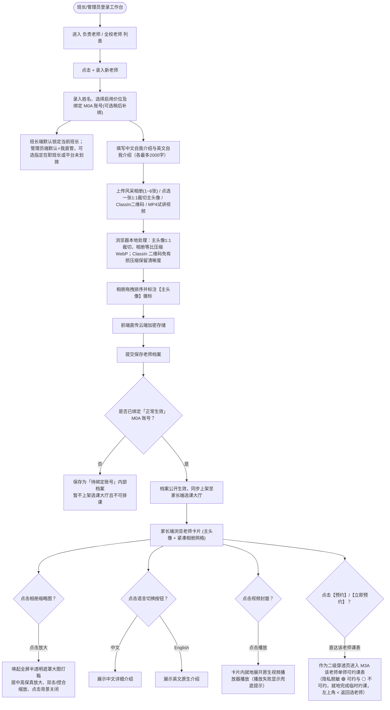
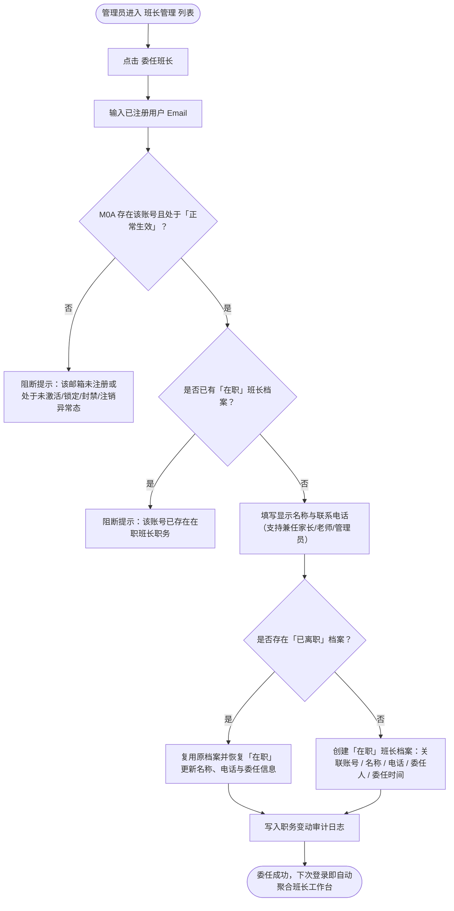
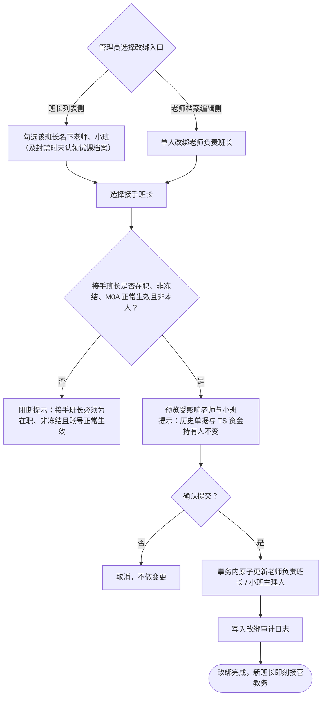
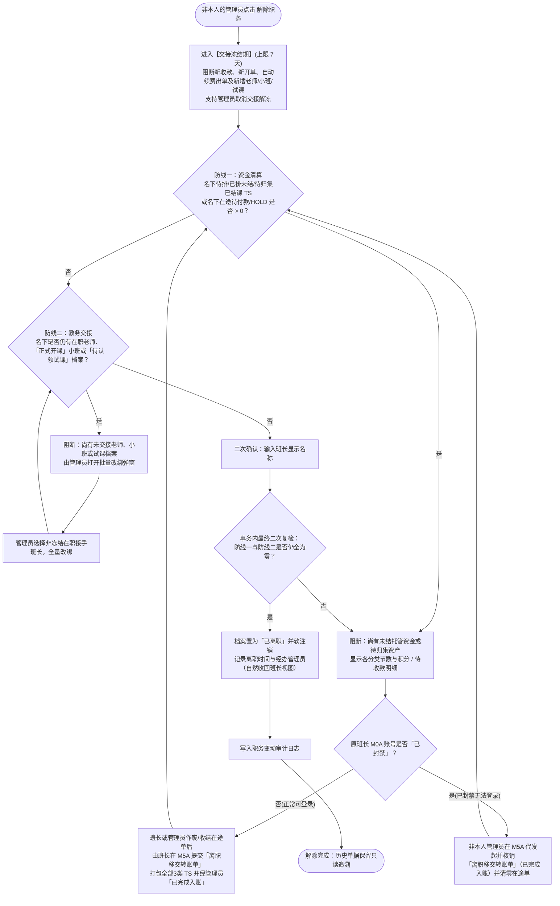
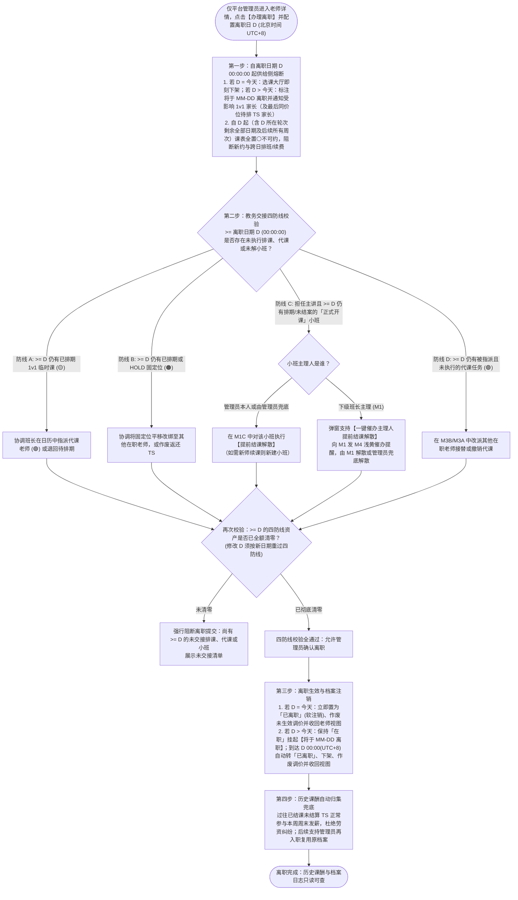
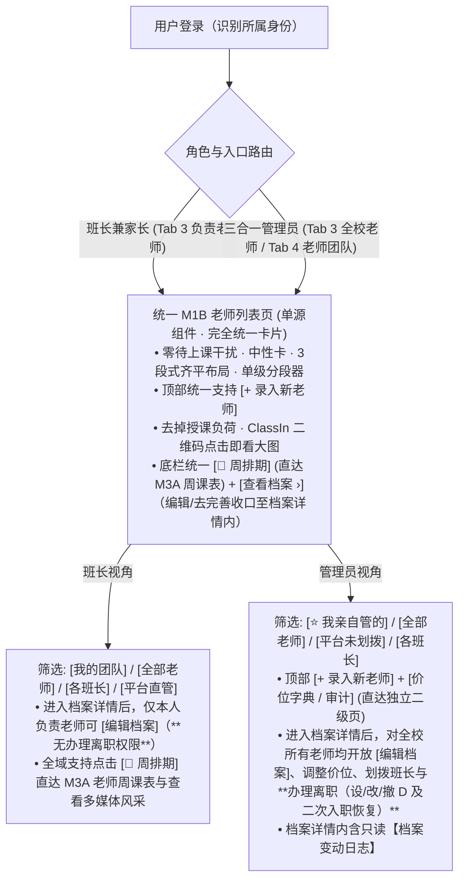
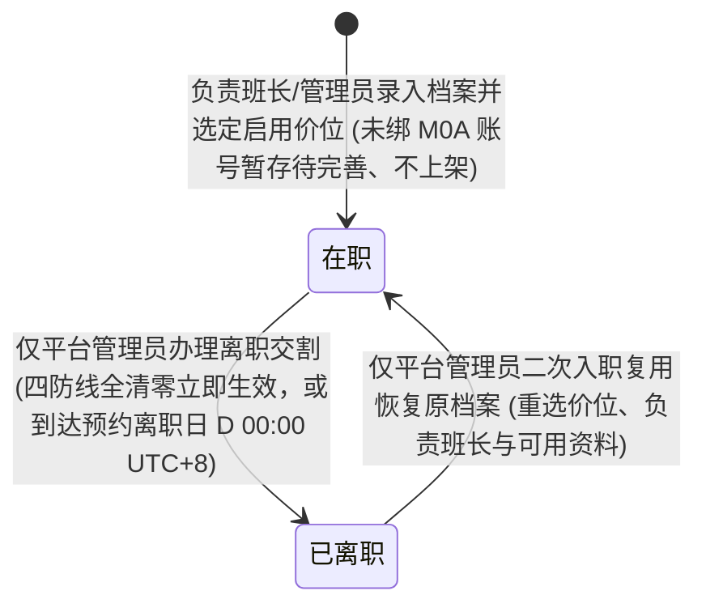
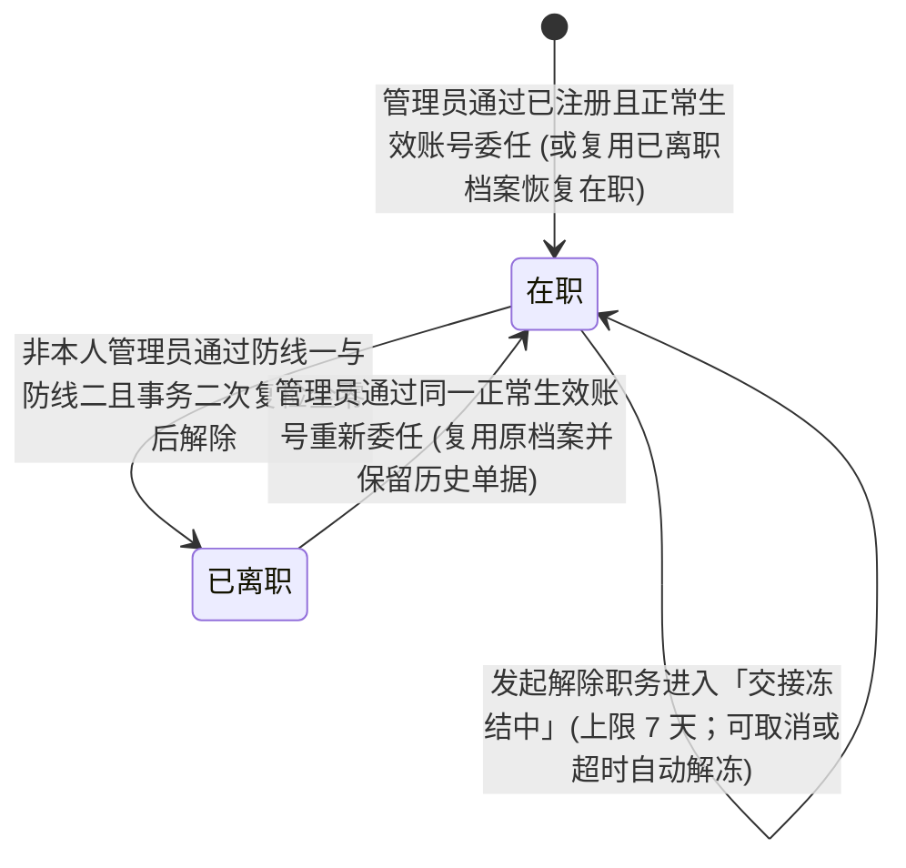
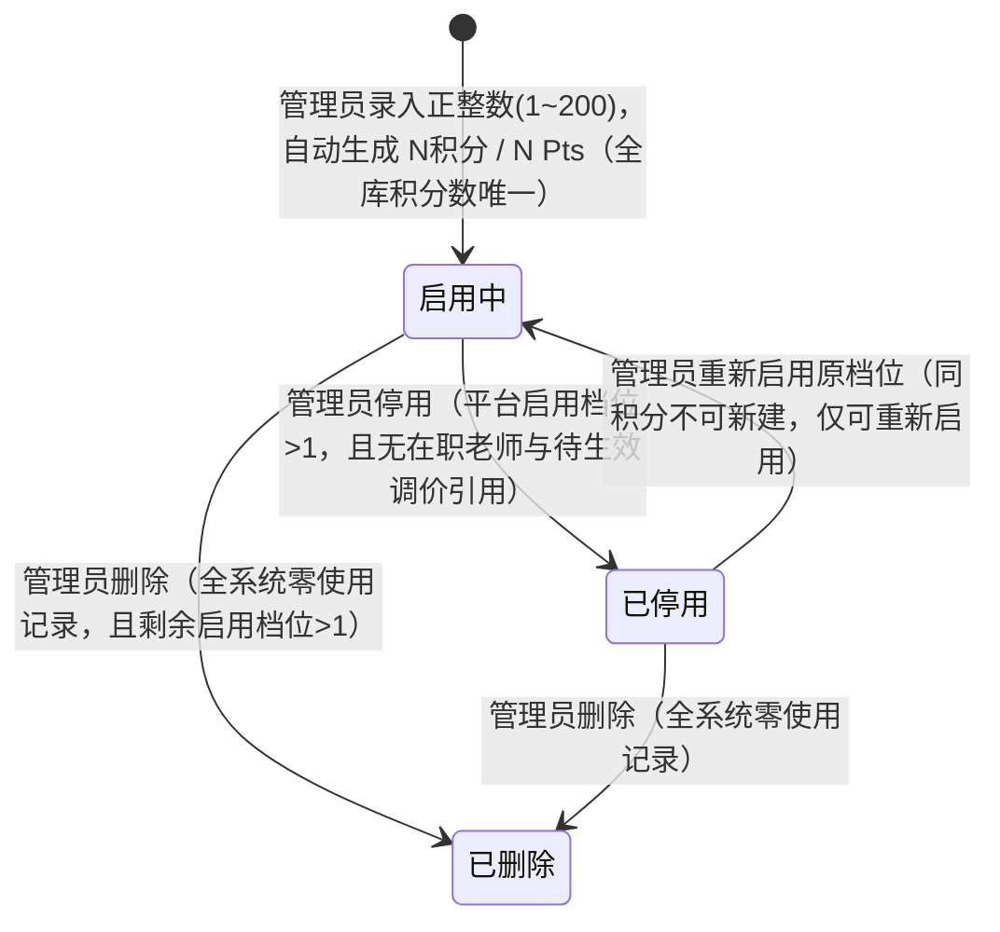

/** (c) 2024-2026 Topee (https://topee.top). All rights reserved. Proprietary and confidential. */

# 产品需求文档 (PRD) — 子模块 1B：老师与班长档案管理 (Teacher & Monitor Profiles)

| 元数据项 | 说明 / 内容 |
|---|---|
| **模块代号** | `m1b` |
| **所属模块** | 模块一：教学教务基座与主数据 (Master Data & Profiles) |
| **文档状态** | 已批准 (Approved) |
| **关联顶层 PRD** | [Prd-v5.md](../Prd-v5.md) |
| **创建与更新日期** | 2026-11-07 (创建) / 2026-11-10 (重大架构修订：1. 列表去花哨与去数字重复铁律；2. 班长端 100% 物理复用 Tab 3【教务中心】负责老师视图；3. 管理员端 Tab 3 与 Tab 4 分流复用；4. 确立三合一管理员直管老师筛选机制) / 2026-11-12 卡片视觉改为只声明卡片类型 / 2026-11-19 (统一班长端与管理员端老师列表卡片骨架与操作能力) / 2026-11-21 (明确模式 Z 履约管辖与微信二维码路由：全域约课开放但课后履约严格归老师所属负责班长；班长离职防线二同步交接名下未认领试课档案) / 2026-11-22 (Red-Team 审查闭环修订：班长解除新增 7 天交接冻结期与二次复检，禁止自解；已结课待归集与在途待付款单并入离职移交防线；老师离职小班防线与 M1C 解散对齐；首期不设长期休假态；ClassIn 二维码收口为仅对已购课家长展示) / 2026-11-22 (**SSOT 归口与合规清洗**：升级 `§4.7` 老师/班长档案与价位字典四支柱及第 2 层跨实体同事务联动清单/宿主入边索引，全篇清零英文枚举、错误码、Tailwind 类名与`教师`/`级别`/`定级`/`72h`/`金额`/`资质`等禁用及矛盾词，对齐「平台直管」归属口径；增补 `AC-1B-02a` 明确家长端老师卡片/详情页预约按钮作为二级穿透页直达该老师 M3A 可约课表；增补 `§4.1b`、`AC-1B-33` 与 `§8.6` 正式定义归属 M1B 的【老师常规可约时段模板】独立 2 色可智能折叠页面并纳入 `§4.7` SSOT 归口；修订 `§6.1` / `AC-1B-02` 收紧 1v1 固定位排课为仅限老师所属负责班长或平台管理员，并同步补充 `<3h` 跨班长紧急驰援例外指针) / 2026-11-23 (**补齐价位管理完整 PRD**：新增 `§4.1c` 全局老师价位字典独立管理与单师调价双轨流程；完善 `§4.7` 价位字典两态转移矩阵、只增停启不可修改积分与排序规则及立即改价联动；增补 `US-1B-14~16`、`AC-1B-09b~09c` 与 `§8.7` 老师价位字典独立二级管理页线框) / 2026-11-23 (**协同 M1A 红队修订 D7**：明确班长 M0A 账号被「已封禁」时管理员可跳过离职本人配合，直接对其名下「待认领试课」档案及在职老师/小班发起强制批量改绑) / 2026-11-23 (**红队全面收口与价位删除新规**：① 确立价位字典「数字永锁、未使用错档可删（写审计日志）、已用过仅可按守卫停用」；② 收紧老师办理离职与设/改/撤离职日 `D` 为**仅平台管理员操作**（D10），统一离职**四防线**口径为 **`>= D`**（D6/L-3）；③ 补全老师 M0A 账号 ID 锚定绑定与先建档后绑号未上架草稿门禁（D5）、`已离职 -> 在职` 管理员复用恢复（D7）、运营时区 `UTC+8` 统一（D8）；④ 补齐停用/最后同价位师离职真实文案与家长通知（D1）、立即改价自动作废待生效计划（D2）、交接冻结跳过自动续费（D3）、封禁班长管理员 M5A 代发起移交（D4）、仅管理员发起跨班长改绑（D9）、委任正常生效与兼任（D11）、关闭常规模板发浅黄卡与续费跳格（D12）、老师离职通知 1v1 家长（D13）、M0A 注销前无在职档案强校验（D14）及 `L-1~L-15` 全量修正) / 2026-11-23 (**协同 M1C 红队 D4-A 收口**：明确改绑小班主理人前若该班尚存在途「待付款确认」小班购课单，强制拦截改绑并引导先赴 M2A 确认收款或作废释放 `G-HOLD`) / 2026-11-24 (**补全班长/管理员「周排期」直达 M3A 老师周课表路由与详情页快捷入口规范**：新增 `AC-1B-31a` 明确列表卡片 `[ 📅 周排期 ]` 与详情页底部 `[ 📅 查周排期 ]` 双共源入口直达 M3A 老师周课表、来源 Tab 锁定、跨组只读/半脱敏及 `待绑定账号`/`已离职` 边界，并补齐 `§8.5` 详情页快捷入口线框；同日**精简老师列表卡片底栏**：移除列表卡片 `[ 编辑 ]` / `[ 去完善 ]` 按钮，将编辑与去完善入口统一收口至老师综合档案详情内，列表卡片底栏仅保留 `[ 📅 周排期 ]` 与 `查看档案 ›`**) / 2026-11-26 (**固定「下一轮首日」老师预约定时调价规范**：对接 [BUSINESS_RULES.md §4.0](../BUSINESS_RULES.md#40-全局-4-周轮次锚点与时间基准-global-4-week-cycle-anchor--ssot) 冷启动初始化永久锁定的全局 4 周轮次基准周一，预约定时调价弹窗**仅只读固定展示下一轮首日、无需选择日期**；若已超过本轮第 4 周周一 `08:30 (UTC+8)` 自动续费截点，保留展示该下一轮首日但置灰禁用提交并注明原因，并补齐 `§8.7` 两态弹窗线框) |

---

## 1. 概述与执行摘要 (Executive Summary)

老师与班长档案管理（`m1b`）是 Dream 系统的教学供给侧与教务经纪人主数据子模块。本子模块涵盖两大核心领域：一是**班长（Monitor）全生命周期管理**，支持平台管理员查看全量班长列表及实时负荷指标（所辖老师数、负责小班数、托管未结课次资产），通过已注册邮箱检索委任新班长、批量/单人改绑所辖老师与小班，以及在解除班长职务（离职注销）时执行“资金清算 + 教务交接”双防线强校验阻断；二是**老师团队多媒体电子档案与全生命周期管控**，确立**“负责班长 1:1 强绑定责任制”**，支持**风采相册多图管理（1~6 张，支持自由拖拽排序并点选一张 1:1 独立裁切为主头像；家长/学员端以紧凑网格缩略呈现并支持全屏画廊灯箱无损放大查看）**、中英双语自我介绍、试讲视频就地播放与 ClassIn 扫码添加，并在管理员办理老师离职时执行“公开供给即刻下架 + 存量排课清零交接四防线 + 历史课酬正常周结”闭环，同时承载全平台的老师价位字典。当前阶段：MVP 正式功能迭代。

---

## 2. 问题定义与背景 (Problem Statement)

- **痛点 1：班长权责生命周期缺乏闭环管控，离职易引发托管资金与老师失管**：班长既负责管理老师团队与小班课，又是前端代收款的资金托管人。若缺乏统一的班长委任、负荷监控与离职前置拦截机制，一旦班长离职时直接撤销权限，会导致其名下未上完的课次托管款成为无主坏账，所辖老师和小班课无人接管。
- **痛点 2：老师履历薄弱导致选课转化低**：传统纯文字教务简历无法真实呈现老师口音、肢体语言与教学亲和力，家长选课试听决策成本高。
- **痛点 3：老师责任人割裂与跨国协调困难**：老师多为海外远程办公，若没有固定的中方班长作为第一责任人，一旦发生缺课、请假或教学争议，家校协调极易脱节。
- **痛点 4：中文家长阅读障碍与英文原汁原味表达的冲突**：仅提供英文简介对国内低龄家长不够友好；仅提供中文翻译又难以展现老师本人的英文写作与教学风格。
- **痛点 5：老师离职缺乏教务交接机制导致未来排课断崖式空转**：老师若突然离职或解聘，若无系统级离职清零防线，未来已排好的固定位和临时课将无人授课，家长上课时面临空堂；主讲小班课停滞；同时过往已结课课酬若缺乏自动归集结算，易引发跨国劳资纠纷。

---

## 3. 目标用户与角色画像 (Users & Personas)

### 3.1 角色一：平台管理员（Sarah，中央统筹与人事管理方）
- **职责与诉求**：在管理员后台查看全平台所有班长名册及其实时业务负荷（负责多少老师、多少小班、手里还托管着多少未结课次积分）；通过检索已注册用户的邮箱快速委任新班长；在日常人事调动或班长离职时，一键将老师团队批量或单人改绑给其他在职班长；在解除班长职务前由系统自动校验资金与教务是否交割完毕，安全收回班长权限。

### 3.2 角色二：教务服务经纪人（Leo，中方班长）
- **职责与诉求**：管理所辖 10-15 位固定老师团队；在班长工作台代录老师履历，上传老师 1~6 张生活与教学风采相册、自主点选并 1:1 独立裁切主头像、自由拖拽调整相册展示顺序，上传老师高清试讲视频与 ClassIn 二维码；确保信息对外准确展示。

### 3.3 角色三：选课出资家长与学员（Amy，家长 / 学员）
- **诉求**：在选课列表直观浏览老师 1:1 主头像、价位标签（`16积分` / `18积分` / `21积分`）与紧凑风采相册；点击相册中任意单张照片唤起全屏大图灯箱，无损放大并查看老师教学与生活细节；就地原位观看 1-3 分钟试讲视频；自由一键切换中文介绍与英文介绍；点击放大查看 ClassIn 二维码扫码加好友。

### 3.4 角色四：一线授课老师（David，母语老师）
- **诉求**：档案由负责班长统一代录与维护，个人仅需提供中英简介素材与试讲视频，免除复杂后台录入负担。

---

## 4. 核心业务流程 (Workflows)

### 4.1 老师档案录入与家长浏览流程



### 4.1b 老师常规可约时段模板配置流程（M1B 独立设置页）

1. **多端共源独立入口（与具体日期周课表彻底隔离）**：
   - **老师端**：从 M0 首页金刚位 `⏰ 开放时段` 直达本页（左上角 `< 返回首页`），默认英文界面并提供中文辅助对照；
   - **班长端 / 管理员端**：从 M1B 老师编辑表单或档案综合详情抽屉点击 `[ ⏰ 常规可约时段 ]` 按钮进入同一独立配置页（仅归属负责班长与平台管理员可编辑，离职后只读锁定）。
2. **纯 2 色网格、运营时区基准与零学员信息原则**：
   - **横轴仅展示 `周一 ~ 周日` 共 7 列**（不展示具体日期，不设“本周 / 下周 / 4 周轮次”切换条）；纵轴以 30 分钟为粒度覆盖 `06:00–24:00`（共 36 格）；
   - **全平台统一时区口径**：本页配置与全校排课均严格采用**平台运营时区（北京时间 `UTC+8`）**（老师端页面显式标注 `All times in Beijing Time (UTC+8)`）；老师档案中的 `国籍/时区` 仅作个人履历背景展示，**严禁对可约时段网格执行跨时区自动换算**；
   - 网格单元**仅存在 2 种颜色与状态**：**`🟢 开放可约`**（浅绿底 + 深绿字/绿边框）与 **`⚪ 休息`**（浅灰底 + 灰字/灰边框）；
   - **绝对零学员名字与课次信息**：本页面绝不渲染任何学员昵称、小班名称、固定位橙、临时课黄、代课蓝紫或请假红等 7 色课表语义。
3. **智能折叠早晚与中间连续休息时段**：
   - 依据该老师每周常规已开放时段动态裁剪上下首尾全休息区间（如 `06:00–08:30` 早间与 `21:30–24:00` 晚间），并将日间**连续 `>= 2 小时` 全周均为空白休息的中间时段**（如 `12:00–14:30` 午休空档）自动折叠为 `22px` 紧凑折叠提示条（标注折叠起止时段，如 `12:00–14:30 已折叠 · 点击展开设置`）；
   - 点击任意折叠条即可就地平滑展开对应区间格子，方便补设早课、午间或晚间常规可约时段；页面顶部亦提供 `[ 展开全天 06:00–24:00 ]` / `[ 恢复智能折叠 ]` 一键切换开关。
4. **严格禁止任何预约交互与纯开关配置交互**：
   - 本页面**严禁承载任何约课、预约、选学员、选价位、排固定位、临时代课、请假报备或滑出课程详情抽屉交互**；
   - 点击或连续滑动勾选格子**仅执行「🟢 开放可约 ↔ ⚪ 休息」二态切换**；
   - 顶部或操作条提供快捷批量工具（`[ 复制某天至工作日 ]`、`[ 复制某天至全周 ]`、`[ 按时段区间批量开关 ]`），修改后由显式 **`[ 保存模板 ]`** 主按钮提交落盘并记入老师【档案变动日志】。
5. **网格下方常驻【颜色图例与文案说明区】**：
   - **双色图例**：明确展示 **`🟢 开放可约`**（每周此时段默认对外开放接单）与 **`⚪ 休息`**（每周默认休息不对外开放）；
   - **业务文案说明**（老师端英文为主辅以中文、后台中英双语）：清晰向老师与教务说明——① 本页配置的是**每周循环重复生效的常规营业时段**，不展示也不关联具体学员名单；② **修改不影响已排定的具体日期课次**，关闭已有未来课次的时段不会自动取消既有课程，仅暂停后续新约及下轮自动续费排入；③ 如需对**具体某一天临时加开时段或突发请假**，请前往 **[M3A 课表](./m3a_calendar_grid.md)** 操作。
   - **无姓名冲突安全提示与关闭时段通知/续费协同**：若点击 `[ 保存模板 ]` 时检测到本次拟关闭（`🟢 → ⚪`）的时段中共有 `N` 个星期时段存在未来已排课程或有效固定位，弹窗**严禁透出任何学员名字**，仅提示“检测到周几时段共有 `N` 处已有已排课程或固定位，已排课程不受影响（仍需按时授课或前往【课表】另行请假），确认保存后仅停止后续新约与下轮自动续费排入？”由操作人二次确认后落盘；落盘后，若存在受影响的有效 1v1 固定位或「正式开课」小班固定排期，系统在同一事务内向该老师**负责班长**、关联**小班主理人**及受影响 **1v1 固定位家长**发送 [M4](./m4_notification.md) 站内浅黄提醒卡（**不发 Email**；小班严禁向任何家长发通知），且下轮周一 `08:30` [M2A](./m2a_course_orders.md) 自动续费扫描遇该已关闭时段时按冲突日格跳过或挂起人工待办处理。

### 4.1c 全局老师价位字典管理与单师调价双轨流程

1. **共源独立入口与权限门禁**：
   - 平台管理员可通过以下两个共源入口进入同一个**【老师价位字典】独立二级管理页面**：① [M0 管理与设置](./m0_workspace_and_home.md) → 基础字典与全局参数 → **`🏷️ 老师价位字典`**；② 本模块老师列表顶部 **`[ 价位字典 / 审计 ]`** 按钮；
   - 本页面**仅限平台管理员访问与维护**，非管理员角色（班长、老师、家长）直接访问必须拦截拒绝；班长在录入老师时仅能从「启用中」字典档位中单选，不支持自建或改价。
2. **字典查看、数值规范与默认排序**：
   - 页面主体按「启用中」与「已停用」分层展示价位档位（全端字典列表与老师编辑页选价位胶囊**统一按积分数升序固定排列**，如 `16积分 → 18积分 → 21积分`）；
   - 每个档位展示：**中英文标准名**（由系统按正整数自动生成 `N积分` / `N Pts`，不支持自定义别名）、**当前引用概况**（在职使用老师数 + 待生效调价引用数）及当前状态；页面内同步提供只读【字典变更审计日志】页签或区块。
3. **新增与复用档位流程**：
   - 管理员点击页面顶部 **`[ + 新增价位 ]`**，输入**正整数积分数（允许范围 `1～200` 积分，步长 `1`）**；
   - 系统校验重复性：① 若同积分数处于「启用中」，阻断保存并提示“该价位已存在”；② 若同积分数处于「已停用」，**禁止重复新建同积分档位**，提示“该价位已存在历史记录（已停用），请直接重新启用原档位”并提供一键跳转定位；
   - 校验通过后，自动生成 `N积分` / `N Pts` 标准档位，初始置为「启用中」并写入只读配置审计日志。
4. **创建即锁定铁律（数字永锁；未用可删，已用可停用）**：
   - 价位档位一经创建，其**积分数与中英文标准名永久锁定不可修改**（保障历史购课单、待排课次与选课匹配语义恒定），不提供任何编辑修改积分数或名称的入口；
   - **未使用错档允许删除**：若某档位刚录入出错且全平台**从未有过任何业务使用记录**（同时满足：无任何「在职」或「已离职」老师使用或历史引用、无任何待生效或历史调价计划引用、无任何 1v1 购课单明细或 TS 课次及清退快照引用；且若处于「启用中」时删除后全平台仍保留 $\ge 1$ 个启用档位），管理员可点击 **`[ 删除 ]`** 经二次确认后从字典列表移除，并在只读【字典变更审计日志】追加一条 `[删除]` 记录留痕；一旦在任意业务中被使用过一次，**永久禁止删除**，仅可按下方守卫条件走停用流程。
5. **已使用档位停用三防线、存量待排 TS 真实出路与重新启用**：
   - 点击 **`[ 停用 ]`** 时，系统强制校验以下三项条件，任一不满足即阻断并明确告知原因：
     1. **平台底线保底**：当前「启用中」档位总数必须 `> 1`（全平台至少保留 1 个启用档位，最后一个启用档位禁止停用或删除）；
     2. **在职老师零占用**：当前无任何「在职」老师正在使用该价位；
     3. **待生效调价零引用**：当前无任何老师挂起该价位的待生效调价计划；
   - **存量待排 TS 提示与真实处理出路**：即使全校仍有学员持有该价位的未消待排 TS、已排未上课程或历史单据，也不阻断字典停用；停用二次确认弹窗必须明确列明全校当前受影响的待排 TS 总节数与学员数，并清晰告知“**停用后全平台当前已无该价位在职老师，存量待排 TS 仅可联系班长通过 [M2B](./m2b_refund_orders.md) 办理清退（或待日后重新启用该价位 / 新入驻同价位老师后再约）**”。同理，当某价位**最后一位在职老师**设置或生效离职后，系统亦向持有该价位待排 TS 的家长发送 [M4](./m4_notification.md) 站内中性卡提醒（不发 Email）；
   - 三项校验全通过并经二次确认后置为「已停用」；后续管理员可随时对「已停用」档位点击 **`[ 重新启用 ]`**，二次确认后恢复「启用中」，并均在同一事务内写入配置审计日志。
6. **单师【立即改价】与【预约定时调价】双轨协同**：
   - **新录入老师**：负责班长与平台管理员均可从「启用中」价位字典中选择初始价位；
   - **在职老师立即改价**（在老师编辑表单直接修改「老师当前价位」）：**仅平台管理员可修改**（负责班长编辑在职老师时当前价位只读锁定，界面提示“在职老师调价请联系管理员操作”）；若该老师当前名下存在有效 4 周固定位、未来已排课程、自动续费设置或**已挂起的【待生效预约调价计划】**，管理员保存时必须弹出二次确认弹窗列出受影响在读固定位数与课程数，并提示“立即改价将同时**自动作废当前已预约的待生效调价计划**；建议优先使用【待生效调价】在下轮首日切换”。确认后同一事务内切换当前价位并自动作废原待生效调价计划，向受影响固定位/自动续费家长发送 [M4](./m4_notification.md) 站内中性卡提醒（不发 Email），并记入【档案变动日志】；**既已购入的未排 TS 与已生成待付单保持原价位快照不变**；
   - **在职老师预约定时调价（固定下一轮首日 · 无需选日期）**：仅平台管理员可设置/覆盖/撤销（每位老师最多挂起 1 个待生效计划）。生效日严格依据 [BUSINESS_RULES.md §4.0](../BUSINESS_RULES.md#40-全局-4-周轮次锚点与时间基准-global-4-week-cycle-anchor--ssot) 系统初始化永久锁定的全局 4 周轮次基准周一（跨年每 28 天无缝滚动），**在表单内只读固定展示「下一轮首日（`YYYY-MM-DD 周一 00:00 UTC+8`）」，不提供日期选择器或多轮下拉框**。在本轮第 1 周周一 `00:00` 至第 4 周周一 `08:30:00 (UTC+8)`（距下一轮首日约 `6 天 15.5 小时`）自动续费跑批截点前开放设置与覆盖；**一旦到达或超过第 4 周周一 `08:30:00` 截点（直至本轮周日 `24:00`），保留展示该下一轮首日但置灰禁用提交，并显性注明不可选原因**（已过 `MM-DD 周一 08:30` 自动续费截点，须待下周一 `00:00` 进入新轮次后自动切换展示新的下一轮首日并解锁预约，紧急调价可改走【立即改价】）；到点由系统自动切换并写入档案变动日志；详细跨实体边界见 `§4.7.5` 与 `AC-1B-09a`。

### 4.2 管理员委任新班长流程



> **一致性与兼任要求**：Dream 完全不使用认证中心的角色体系，委任班长仅校验目标账号在 [M0A](./m0a_auth_and_account.md) 存在且处于「正常生效」，并在本地以 **M0A 账号 ID** 为唯一外键创建或恢复「在职」班长档案；明确允许在职老师、家长或平台管理员通过同一自然人账号兼任班长（按 `管理员 > 班长 > 老师 > 家长` 聚合视图）；「已离职」档案再次委任时复用原档案，保留历史单据关联。

### 4.3 管理员执行老师与小班批量/单人改绑流程



> **业务边界与权限**：**仅平台管理员**可发起任何单人或跨班长批量改绑（含交接冻结中班长的资产移交）；老师改绑仅变更其人事归属的“负责班长”，小班改绑仅变更“小班主理人”（小班改绑后的盈亏与预留盈余归属以 `M1C` 为准）；TS 课次的“资金持有人”仅在 M5A 的周度转账或离职移交时变更，二者不可混用。批量改绑必须全量成功或全量回滚。

### 4.4 班长解除职务（离职注销）交接冻结与两道强防线流程



> **防线一范围与冻结期/封禁兜底**：① 该班长作为资金持有人的全部「待排期」与「已排期（未完成）」TS；② 该班长尚未在任何周度转账单中完成向平台归集的「待归集已结课」TS（即状态为「已结课」但尚未随已完成入账周转账单归集的课次，统一并入 M5A 离职移交转账单一次核销清算）；③ 该班长作为收款方的在途「待付款确认 / 续费预占 (HOLD)」单据。**交接冻结期内，M2A 周一 `08:30` 自动续费跑批自动跳过该班长名下固定位与小班（不生成新续费单且不锁新 HOLD），防止一边清账一边被新单补回**；若原班长 M0A 账号处于**「已封禁」**无法登录，**平台管理员可在 [M5A](./m5a_transfer_collection.md) 代其发起并核销「离职移交转账单」**并作废在途未收款单。只有 M5A 离职移交转账单确认收款（「已完成入账」）且名下上述三项全部清零后，防线一才通过。
>
> **防线二范围**：该班长名下未离职的「在职」老师、「正式开课」小班，以及尚未认领且未归档的「待认领试课」学员档案。接手班长必须为在职、非冻结、M0A 正常生效且非本人，**批量改绑仅由平台管理员发起**（冻结班长不可私自改绑）。
>
> **解除后**：仅管理员可发起，且**严禁解除本人**（若全平台仅余 1 位管理员兼任班长想卸任，须先增设另一名管理员后由其操作）；注销仅收回本地班长职务档案，自然人账号不删除（不写入认证中心角色）；兼任家长的账号仍可正常使用家长端；历史单据原班长名只读展示；已离职班长不可再被选为接手班长，也不可新增老师、小班或收款。

### 4.5 平台管理员办理老师离职与存量教务清零四防线流程 (Teacher Resignation Flow)



### 4.6 老师列表合并收敛与三合一管理员直管筛选架构 (Unified Teacher List & Admin Direct Filter)

针对老师列表在班长端与管理员端的入口与展示，系统实施**单一列表合并收敛与按权限分流**机制（Tab 3【教务中心】与 Tab 4【管理与设置】物理合并为同一个 M1B 老师列表页；明确 **`平台直管`** 指平台管理员作为正式责任人直管该老师、**`平台未划拨`** 指管理员直录暂未指定下级班长时的筛选切片〔履约暂由平台管理员代管〕、**`⭐ 我直管`** 仅为当前管理员亲自管或平台直管老师的前端展示标签）：



---

### 4.7 老师、班长与价位字典唯一归口：四支柱生命周期、字段锁定、留痕与跨实体联动 (Entity & Log SSOT)

> **【实体生命周期、字段与日志唯一归口声明】**：**老师档案**、**班长职务档案**及**老师价位字典（含预约定时调价计划）**的生命周期状态机、字段可编/锁定规则、状态流转与字段修改留痕规则及数据留存策略 100% 统一且唯一由本 PRD 管辖与定义；其余文档仅作单向指针引用。说明：**老师内部课酬参考单价为 [M5B 老师周课酬单](./m5b_weekly_settlement.md) 的单据级手工录入参考字段，严禁持久化落入 M1B 老师档案**（详见 [BUSINESS_RULES §3.5](../BUSINESS_RULES.md)）。

#### 4.7.1 生命周期状态机与转移矩阵

##### 1. 老师档案
- **状态机**（首期仅设「在职」与「已离职」2 个主状态，不设老师级长期休假态；「在职」态下存在两类前端派生子态/徽章：`待绑定账号`〔未绑 M0A 账号前仅存为内部草稿，不上架选课〕与 `待离职`〔已设未来离职日 `D > 今天` 过渡标记〕，外加排班派生列表微徽章 `正常可约 / 请假 / 代课中 / 待完善`；支持平台管理员二次入职复用原档案）：



| 状态跃迁 | 触发角色 / 机制 | 前置条件与防线守卫 | 伴随副作用与系统行为 |
| :--- | :--- | :--- | :--- |
| **`[*] -> 在职`** | 负责班长 / 管理员 | 录入国籍/时区（展示用）、英文名、启用价位（`16积分`/`18积分`/`21积分`）、必填中英自我介绍（各 $\le 2000$ 字）、至少 1 张风采照片，及归属负责班长（管理员直录可暂置`平台直管`）；<br>若建档时一并**绑定登录账号**，须检索 [M0A](./m0a_auth_and_account.md) 目标账号存在且处于「正常生效」，且该账号当前未绑定其他非离职老师档案（若已绑定「已离职」历史档案，提示由管理员改走 `已离职 -> 在职` 复用恢复，禁止建重号） | ① 已绑定「正常生效」M0A 账号时：档案正式公开生效，选课大厅上架展示、开放日历排期与老师工作台登录；<br>② 暂未绑定 M0A 账号时：保存为「在职（待绑定账号）」内部资料草稿，**物理阻断上架选课大厅及对外约课**，仅在后台老师列表标 `待完善/待绑定账号`，待后续补绑通过后即时公开生效；<br>③ 底层以 **M0A 账号 ID** 为唯一关联锚点，零跨系统写入角色 |
| **`在职 -> 已离职`** | **仅平台管理员** / 定时任务（北京时间 `UTC+8`） | **教务清零四防线强校验**（全部以离职生效日 `D 00:00:00 UTC+8` 起算）：<br>1. `>= D` 仍有状态为「已排期」的 1v1 临时课（🟡）；<br>2. `>= D` 仍有处于「已排期」或「续费预占 (HOLD)」的 1v1 固定位（🟠）；<br>3. 作为主讲的「正式开课」小班在 `>= D` 仍有已排期、预占或未完结排期计划（未在 `D` 前结案归档且未提前结课解散）；<br>4. `>= D` 仍有被指派且尚未执行的代课任务（🟣，含 1v1 与小班）。<br>任一未清零强阻断并展示未交接明细 | 1. 自 `D 00:00:00 (UTC+8)` 起（`D=今天` 立即，`D>今天` 先挂起`将于 MM-DD 离职`并封锁 `>= D` 日历）选课大厅下架并停用可用时段；<br>2. 设置/变更未来离职日 `D > 今天` 时，向 `>= D` 受影响 1v1 家长发送 [M4](./m4_notification.md) 站内中性卡；若该老师为**某启用价位最后一位在职老师**，同步向全校持有该价位待排 TS 的家长发 M4 站内中性卡引导 M2B 清退或补差重开；<br>3. 到达 `D 00:00:00 (UTC+8)` 自动置为「已离职」、自动作废未生效调价计划并自然收回老师工作台视图；<br>4. 历史已结课 TS 正常进入 [M5B](./m5b_weekly_settlement.md) 周末结算发薪；历史档案永久只读留存 |
| **`已离职 -> 在职`** | **仅平台管理员** | 目标原老师关联的 M0A 账号（或重新绑定的新账号）处于「正常生效」且当前未绑定其他非离职老师档案；重新核定或选定当前「启用中」价位、归属负责班长、确认可用周模板与多媒体简介 | 复用原老师档案恢复「在职」并清除离职标记，完整保留过往历史 TS、周课酬单、【状态流转日志】与【档案变动日志】连续追溯，重新上架选课大厅 |

##### 2. 班长职务档案
- **状态机**（2 个主状态：`在职`〔含上限 7 天的 `交接冻结中` 子期〕、`已离职`）：



| 状态跃迁 | 触发角色 / 机制 | 前置条件与防线守卫 | 伴随副作用与系统行为 |
| :--- | :--- | :--- | :--- |
| **`[*] / 已离职 -> 在职`** | 平台管理员 | 通过邮箱检索的目标账号在 [M0A](./m0a_auth_and_account.md) 存在且处于 **「正常生效」**，且当前无在职（含冻结）班长档案；必填显示名称（1–50 字）与联系电话；允许同一自然人账号兼任家长、在职老师或平台管理员 | 以 **M0A 账号 ID** 创建或复用原档案恢复「在职」；下次登录自动聚合班长工作台视图（不写入认证中心角色） |
| **`在职 <-> 交接冻结中`** | 平台管理员 / 系统超时任务 | 进入解除职务流程自动触发冻结（上限 7 天）；管理员可主动取消解冻，或满 7 天未完结由系统自动解冻并通知管理员 | 冻结期间阻断新收款、新开单、**M2A 自动续费出单（跳过且不锁新 HOLD）**及新增老师/小班/试课档案；**冻结班长仅保留只读查看历史与在 [M5A](./m5a_transfer_collection.md) 发起离职移交权（严禁自发批量改绑）** |
| **`在职/交接冻结中 -> 已离职`** | 非本人平台管理员 | ① **防线一（资金清算）**：名下未结 TS、待归集已结课 TS 及在途待付款/`HOLD` 单全部清零（由离职班长在 M5A 提交，或**当原班长 M0A 账号处于「已封禁」时由非本人管理员在 M5A 代发起并核销**离职移交转账单确认「已完成入账」）；<br>② **防线二（教务交接）**：**仅由平台管理员**将名下在职老师、「正式开课」小班及未认领「待认领试课」档案 100% 批量改绑至在职非冻结、M0A 正常生效且非本人的接手班长；<br>③ 提交瞬间**单事务二次复检**防线一与防线二全为零；严禁解除本人 | 注销本地班长档案并自然收回班长工作台视图；自然人账号保留（兼任家长端/老师端/管理员端不受影响）；历史经办单据保留只读原班长姓名 |

##### 3. 老师价位字典与预约定时调价计划
- **价位字典状态机**（2 个主状态：`启用中`、`已停用`，外加**仅限全系统零使用错档的物理删除终态**；按积分数升序固定排序，默认内置 `16积分`/`18积分`/`21积分`）：



| 状态跃迁 | 触发角色 / 机制 | 前置条件与防线守卫 | 伴随副作用与系统行为 |
| :--- | :--- | :--- | :--- |
| **`[*] -> 启用中`** | 平台管理员 | 积分数为 `1～200` 正整数；事务锁校验全库无任何同积分档位（若存在「已停用」同积分档位，阻断新建并引导直接【重新启用】） | 自动生成 `N积分` / `N Pts` 标准名称并置为「启用中」；按积分数升序排入全端字典列表与选价位胶囊；写入只读配置审计日志 |
| **`启用中 -> 已停用`** | 平台管理员 | **三防线并发锁校验**：① 事务复检全平台剩余「启用中」档位数 `> 1`；② 当前无「在职」老师使用该价位；③ 当前无老师待生效调价计划引用该价位（存量学员待排 TS、历史单据及已离职老师历史不阻断）；二次确认弹窗列明全校受影响待排 TS 数与学员数 | 置为「已停用」并下架选价位列表（不再供新录入或新调价选择）；存量待排 TS 保留原价位快照，仅可走 [M2B](./m2b_refund_orders.md) 清退或待日后重新启用/新师入驻后再约；写入只读配置审计日志 |
| **`已停用 -> 启用中`** | 平台管理员 | 仅限对「已停用」档位发起并二次确认 | 恢复「启用中」并按积分数升序恢复展示；写入只读配置审计日志 |
| **`启用中 / 已停用 -> 已删除（移除）`** | 平台管理员 | **全系统零使用硬门槛（全满足方放行）**：① 从未有任何在职/已离职老师当前或历史使用；② 从未有任何待生效/历史调价计划引用；③ 从未有任何 1v1 购课单明细、TS 或清退记录引用；④ 若当前为「启用中」，事务锁复检剩余「启用中」档位数 `> 1`；经二次确认 | 从字典列表（「启用中 / 已停用」）物理移除该误录档位（此后如需该整数可重新新增）；**在同一事务内向只读【字典变更审计日志】写入一条 `[删除]` 记录永久追溯** |

- **预约定时调价计划（5 动作流转小表）**：每位「在职」老师同时**最多挂起 1 个待生效调价计划**（仅管理员操作；目标价位等于当前生效价时视为空操作拒绝提交，不写日志不发通知），生效日依据 [BUSINESS_RULES.md §4.0](../BUSINESS_RULES.md#40-全局-4-周轮次锚点与时间基准-global-4-week-cycle-anchor--ssot) 全局 4 周轮次基准周一自动计算并**固定只读锚定「下一轮首日（周一 `00:00:00` 北京时间 `UTC+8`）」**（无需选择日期；须在本轮第 4 周周一 `08:30:00` 自动续费跑批截点前完成设置，过截点至本轮周日 `24:00` 期间保留展示但置灰禁提并注明原因）：

| 动作 | 触发时机 / 操作人 | 状态跃迁与规则 |
| :--- | :--- | :--- |
| **设置 / 覆盖** | 平台管理员（目标价 $\ne$ 当前价且 $\ne$ 原计划价） | `无计划 -> 待生效`（或覆盖原 `待生效` 计划）；记入【档案变动日志】，向该老师名下有效固定位/自动续费家长发 M4 站内中性卡 |
| **手动撤销** | 平台管理员（生效日前） | `待生效 -> 已作废（撤销）`；释放字典引用，记入【档案变动日志】，按需同步通知受影响家长 |
| **到点生效** | 系统定时任务（生效日周一 `00:00:00 UTC+8`） | `待生效 -> 已生效`；老师当前价位切换为新价位并写入【档案变动日志】（仅影响生效日及之后新约与未出单续费） |
| **立即改价联动** | 平台管理员在编辑表单执行【立即改价】 | 立即改价落盘同事务自动将既有挂起计划置为 `已作废（被立即改价替代）` 并写入【档案变动日志】 |
| **离职自动作废** | 立即离职确认 / 到达预约离职日 `D 00:00 UTC+8` | `待生效 -> 已作废（老师离职）`；释放该价位字典的待生效引用 |

#### 4.7.2 关键字段可编与锁定规则矩阵

| 所属实体 | 业务字段 | 可编与维护边界 | 锁定与禁止修改规则 |
| :--- | :--- | :--- | :--- |
| **老师档案** | **英文名、国籍/时区、中英双语自我介绍、风采相册（1~6 张及主头像 1:1 裁切/排序）、MP4 试讲视频、ClassIn 二维码** | 仅该老师所属负责班长与平台管理员在「在职」态下可编辑；老师本人仅享个人名片只读预览，严禁自改 | 相册强制**保留至少 1 张**（删除当前主头像时自动顺延第 1 张为主头像，并**默认按居中自动裁切生成 1:1 版本**，支持后续手动微调；最后 1 张禁用删除）；`国籍/时区` 仅作背景展示不换算排班；**进入「已离职」后全字段永久只读冻结**（仅管理员复用恢复入职后可重编） |
| **老师档案** | **常规可约周模板（周一～周日 30 分钟双态矩阵 · 北京时间 `UTC+8`）** | 在职态下支持**老师本人**（通过 M0 首页 `⏰ 开放时段` 进入 M1B 独立 2 色设置页）、**所属负责班长**与**平台管理员**可编辑；严禁展示学员姓名或约课交互 | 统一按平台运营时区 `UTC+8` 配置；进入「已离职」或设置离职生效日 `D` 后对 `>= D 00:00 (UTC+8)` 日历生效不可约覆盖；模板变更仅作用于后续新约与下轮续费基准，不自动撤改已排 TS |
| **老师档案** | **绑定账号（M0A 账号，界面通过已注册邮箱检索与展示）、老师当前价位、待生效预约调价、负责班长、离职生效日 `D`** | 新录入老师由负责班长/管理员选定初始价位；绑定/更换登录账号支持负责班长（限本人老师）与管理员操作（须 M0A 处于「正常生效」且未绑其他非离职老师）；**入职后在职老师的「当前价位」立即改价与「待生效预约调价」仅限平台管理员维护**（负责班长编辑态对当前价位只读锁定）；**跨班长改绑（单人/批量）与设置/修改/撤销离职生效日 `D` 仅平台管理员可操作** | 老师**严禁挂接内部课酬单价持久字段**；底层锚定 M0A 账号 ID（随 M0A 安全换绑自动同步邮箱展示）；存在有效固定位/排期或挂起计划时立即改价须二次确认；修改离职日期 `D` 须按新 `D` 重过四防线；已达离职日 `D` 转「已离职」后全字段只读冻结 |
| **班长职务档案** | **显示名称、联系电话、微信二维码（选填 $\le 2\text{MB}$）** | 管理员在 Tab 4【班长管理】维护；班长本人及兼任班长的管理员亦可在 Tab 4 个人中心自主上传/替换自己的微信二维码 | 进入「交接冻结中」禁止以该班长为收款人或归属人新建业务；进入「已离职」后全字段只读冻结（仅同一正常生效账号重新委任复用时可更新信息） |
| **班长职务档案** | **绑定账号（M0A 账号，通过已注册邮箱展示）、委任时间、离职时间** | 委任或解除时由系统自动固化（以 M0A 账号 ID 为唯一外键，允许兼任家长/老师/管理员） | 绑定账号关联与历史单据原经办归属永不抹除 |
| **老师价位字典** | **价位积分数与中英标准名** | 仅平台管理员新增时录入 `1～200` 正整数并由系统自动生成 `N积分` / `N Pts`（全库唯一） | **创建后永久锁定不可修改**，不提供编辑入口；仅当**全系统零使用记录**且不突破至少 1 个启用档位底线时允许删除，用过一次即永久禁止删除 |
| **老师价位字典** | **启用 / 停用状态及未使用删除** | 仅平台管理员在【老师价位字典】独立二级页维护；班长仅可从「启用中」档位单选 | 停用必须同时满足“启用档位 `> 1` 且无在职老师/待生效调价引用”；删除必须满足“全系统零使用记录且删除后启用档位 $\ge 1$” |

#### 4.7.3 状态流转与字段变动留痕规则（唯一归口定义）

1. **状态流转时间轴日志**：老师档案状态跃迁（入驻「在职」、设置/变更/撤销待离职日期 `D`、即时或定时流转「已离职」、以及**管理员二次入职复用恢复「在职」**）与班长职务档案跃迁（委任/复用恢复「在职」、进入/取消/超时退出「交接冻结中」、解除职务进入「已离职」）必须在同一事务内追加只读状态流转记录，明确记载**原状态、目标状态、操作人/系统、流转时间与原因/交接明细**。
2. **全字段【档案变动日志】与字典审计**：
   - 凡修改老师档案任一业务字段（绑定/更换 M0A 账号、立即改价、预约定时调价设置/覆盖/撤销/到点生效及**立即改价连带自动作废原待生效计划**、负责班长改绑、常规可约周模板调整、英文名、中英自我介绍、试讲视频、风采相册、ClassIn 二维码等）或班长职务档案字段（显示名称、联系电话、微信二维码），以及管理员执行批量改绑，**仅当字段值实际发生变化时**（提交价位与当前价位或原计划价相同视为空操作不记录），在同一事务内追加写入只读【档案变动日志】（操作人、时间、变更字段及变更前后快照；批量改绑同步记录原班长、接手班长及受影响老师与小班清单）；
   - 管理员新增价位、停用、重新启用或**删除（仅限未使用错档）**老师价位字典时，**仅当实际变更时**在同一事务内追加写入只读配置审计日志（操作人、时间、变更动作、`变更前 -> 变更后` 快照；删除动作记录 `N积分 -> —`），按时间倒序永久展示；
   - **跨端隔离**：所有状态流转日志、【档案变动日志】及字典配置审计日志仅向平台管理员展示追溯，**对家长端与老师端物理隐藏**。

#### 4.7.4 数据留存与清理策略

- 严格禁止对老师档案、班长职务档案及曾产生过业务使用记录的价位字典档位执行任何物理删除（**全系统唯一受控删除例外**：从未被任何在职/已离职老师、调价计划、1v1 购课单明细、TS 或清退记录引用过的【老师价位字典】误录档位，允许管理员删除并从列表移除，但删除行为本身必须写入只读【字典变更审计日志】永久留痕）；
- **「已离职」老师档案与「已离职」班长职务档案**、已作废预约调价记录、已停用（曾用过）价位档位、全量历史状态流转日志、【档案变动日志】及字典配置审计日志均**长期只读审计留存、严禁物理清理**，保障与历史 TS、[M5A 周转账单](./m5a_transfer_collection.md) 及 [M5B 老师周课酬单](./m5b_weekly_settlement.md) 的历史追溯链条永久完整；
- 同一自然人账号再次被委任为班长或由管理员二次恢复为在职老师时，复用原档案，保留历史单据与过往日志连续可查。

#### 4.7.5 第 2 层 · 跨实体同事务联动清单与宿主入边索引

- **A. 触发方同事务联动清单（M1B 主动驱动下游，单事务原子提交或整体回滚）**：

| 联动序号 | M1B 触发动作 | 驱动目标实体与结果方向 | 单向归口指针（M1B 不复述对方细则） |
| :---: | :--- | :--- | :--- |
| **1** | 管理员执行批量/单人改绑、班长离职防线二全量改绑或**班长账号封禁紧急改绑** | ① 驱动 **M1C 小班** 变更小班主理人及后续新开单/新课次盈亏归属（历史已收款单据与 TS 资金持有人保持不变）；<br>② 驱动 **M1A 待认领试课档案** 批量改绑建档/负责班长并写变更日志（当原班长 M0A 账号处于「已封禁」态时，管理员无需等待其本人配合，可直接强制改绑名下未认领试课档案） | [M1C](./m1c_classes.md)、[M1A](./m1a_student_profile.md) |
| **2** | 管理员立即改价或预约调价到生效日自动生效 | ① 立即改价生效时**同事务自动作废该老师已挂起的待生效预约调价计划**并写日志；<br>② 即时更新 **M3A / M3D** 后续新约临时课、新购单及未生成轮次的 **M2A 自动续费** 计价匹配基准（既已购入的未排 TS、已生成待付款单与已排定 TS 保持原价位不变）；<br>③ 立即改价生效时同步向名下持有有效固定位或开启自动续费的家长发送 **M4 站内中性卡提醒（不发 Email）** | [M2A](./m2a_course_orders.md)、[M3A](./m3a_calendar_grid.md)、[M3D](./m3d_course_scheduling.md)、[M4](./m4_notification.md) |
| **2a** | 设置/覆盖老师预约定时调价计划 | 约定新轮次首日 `>= 生效日` 的 **M2A 自动续费单** 按新价位计价（已生成待付款单与已购未排 TS 不变），并驱动 **M4 站内中性卡提醒（不发 Email）** 即时通知当前持有该老师有效固定位或自动续费的家长 | [M2A §6.1](./m2a_course_orders.md)、[M4](./m4_notification.md) |
| **3** | 管理员配置/变更/撤销老师离职日 `D` 及到达 `D` 自动离职 | ① 自 `D 00:00 (UTC+8)` 起驱动 **M3A 日历 / M3D 排课引擎** 全置 ⚪ 不可约，阻断新约与 **M2A 自动续费**；撤销时恢复模板；<br>② 触发对下级班长主理在营小班的【一键催办解散】➔ 向该小班主理人发送 **M4 站内浅黄提醒卡（不发 Email）**；<br>③ 设置/变更/撤销未来离职日 `D > 今天` 时，向 `>= D` 受影响 **1v1 家长**发送 **M4 站内中性卡提醒（不发 Email，严禁向小班家长发送）**；若该老师为某启用价位**最后一位在职老师**，同步向全校持有该价位待排 TS 的家长发 **M4 站内中性卡**；<br>④ 到达 `D 00:00 (UTC+8)` 自动作废该老师未生效预约调价 | [M3A](./m3a_calendar_grid.md)、[M3D](./m3d_course_scheduling.md)、[M1C](./m1c_classes.md)、[M4](./m4_notification.md) |
| **4** | 班长进入/取消/超 7 天自动退出「交接冻结中」 | 进入冻结期起通知 **M2A** 周一 `08:30` 自动续费跑批**跳过该班长名下固定位与小班**（暂停生成续费单与 HOLD，同步向冻结班长、主理人及受影响 1v1 家长发 M4 站内浅黄卡）；解冻时恢复下一轮扫描；超 7 天自动解冻并向平台管理员发 **M4 站内中性卡提醒（不发 Email）** | [M2A](./m2a_course_orders.md)、[M4](./m4_notification.md) |
| **5** | 修改并保存老师「常规可约周模板」 | ① 同步刷新 **M3A** 该老师周度日历基础开放底盘（临时加开与请假销假按最新常规模板还原，**不自动取消既有已排 TS**）；<br>② 同步刷新 **M3D** 空闲大盘及未来 **M2A** 周一 `08:30` 自动续费可用时段校验基准（遇新关闭的 `⚪ 休息` 时段按不可约跳过或挂起人工待办）；<br>③ 若本次关闭时段存在有效固定位或正式开课小班固定排期，向该老师**负责班长**、关联**小班主理人**及受影响 **1v1 固定位家长**发送 **M4 站内浅黄提醒卡（不发 Email，小班严禁发家长）** | [M3A](./m3a_calendar_grid.md)、[M3D](./m3d_course_scheduling.md)、[M2A](./m2a_course_orders.md)、[M4](./m4_notification.md) |

- **B. 宿主方跨模块入边索引（外部模块与 M1B 的前置协同边界）**：
  1. **[M5A 离职移交转账单](./m5a_transfer_collection.md)**：移交单（含班长 M0A 账号「已封禁」时**由非本人管理员在 M5A 代发起并核销**的移交单）在 M5A 确认「已完成入账」并改绑未结 TS 资金持有人为平台后，清零 M1B 班长离职防线一；
  2. **[M1C 小班提前解散](./m1c_classes.md)**：完成老师主讲的「正式开课」且在 `>= D` 仍有排期计划的小班解散后，清零 M1B 老师离职防线 C；
  3. **[M3B 考勤与代课调度](./m3b_attendance_substitution.md)**：完成老师 $\ge D$ 未来临时课、固定位与代课任务的代课指派、平移或退回后，清零 M1B 老师离职防线 A/B/D；
  4. **[M0A 账号认证与安全](./m0a_auth_and_account.md)**：委任班长与绑定老师账号时只读核验目标账号存在且处于「正常生效」（零写角色，邮箱随 M0A 安全换绑自动同步展示）；M0A 账号「已封禁」时向 M1B 露出 `账号已封禁` 状态以放行管理员强制改绑试课/老师/小班及代发起 M5A 清算；**M0A 注销账号前强制校验 M1B 不存在任何「在职（含交接冻结中）」班长档案与「在职（含待离职）」老师档案**（即便名下资产/排课均为 `0`，也须先完成 M1B 离职转「已离职」）。

---

## 5. 用户故事 (User Stories)

- **US-1B-01（班长 1:1 负责制）**：作为一个班长，我想要为我负责的老师录入档案并自动绑定责任人，以便于权责对位与后续课酬结算。
- **US-1B-02（双语平滑切换）**：作为一个家长，我想要在老师卡片上一键切换【中文 / English】介绍，以便于快速读懂老师履历的同时感受老师表达风格。
- **US-1B-03（就地视频试讲）**：作为一个家长，我想要在卡片内直接点击播放老师试讲视频，以便于在不跳出页面的情况下感受老师口音与互动风格。
- **US-1B-03a（风采相册与主头像指定）**：作为一个负责班长，我想要为老师上传 1~6 张风采生活/教学照片，并可自由点选其中任意一张独立裁切为 1:1 正方形主头像，以便于全面展现老师的专业素养与亲和力。
- **US-1B-03b（相册拖拽排序与主头像降级保护）**：作为一个负责班长，我想要自由拖拽调整相册照片的前后展示顺序；当我删除当前作为主头像的照片时，系统自动将剩余第一张照片升为主头像（保留最后 1 张照片禁止删除），以便于保障首页与列表头像始终完备。
- **US-1B-03c（家长学员大图灯箱放大浏览）**：作为一个出资家长或学员，我想要在老师详情卡片中通过紧凑网格浏览老师全部风采照片，点击任意单张可唤起全屏大图灯箱高保真放大查看细节，以便于全方位审视老师形象。
- **US-1B-04（ClassIn 快速建联 · 仅已购课家长）**：作为一个已购课家长，我想要在老师卡片或课表详情内点击放大老师的 ClassIn 二维码图片，以便于用手机快速扫码添加上课联系人（未购课账号不展示二维码以防私联或骚扰）。
- **US-1B-05（弱网离线浏览）**：作为一个家长，我想要在网络较弱的环境下也能顺畅浏览已缓存的老师公开列表与卡片。
- **US-1B-06（邮箱检索委任）**：作为平台管理员，我想要通过已注册邮箱检索并委任班长，录入显示名称与联系电话，以便于快速开通班长权限且不产生重复账号。
- **US-1B-07（负荷监控）**：作为平台管理员，我想要在班长列表看到所辖老师数、负责小班数与托管未结课次资产，以便于及时发现超负荷或资金风险。
- **US-1B-08（批量改绑）**：作为平台管理员，我想要把离职班长名下的老师与小班批量改绑给接手班长，以便于教务不中断、老师不失管。
- **US-1B-09（离职双防线）**：作为平台管理员，我想要在解除班长职务前被系统强制拦截未结资金与未交接教务，以便于避免托管款烂尾和老师无人负责。
- **US-1B-10（离职后家长端不受影响）**：作为兼任家长的班长，我想要在离职后仍能登录家长端查看自己孩子的课表，以便于个人家庭事务不受职务变动影响。
- **US-1B-11（老师离职排课清零四防线）**：作为平台管理员，我想要在为老师办理离职时被系统按四防线强制拦截 `>= D` 的未交接排课、代课与在营小班任务，以便于防止出现学员进教室后空堂无人授课。
- **US-1B-12（离职老师课酬正常结算）**：作为一个已离职老师，我想要即使离职后我此前已结课的课酬依然能准时在课酬单中发放，以便于保障我的劳动课酬权益。
- **US-1B-13（任课老师离职平稳过渡）**：作为一个出资家长，我想要在孩子的固定位老师离职时及时收到端内告知，并由班长主动协助平移换绑至同价位的其他在职老师或全额退还课次，以便于学习进度不被中断。
- **US-1B-14（全局老师价位字典维护、防重与错档删除保护）**：作为平台管理员，我想要在独立管理页新增、停用、重新启用老师价位档位，**对刚录入出错且全系统零使用记录的档位支持删除并记审计日志**，同时永久锁定既有档位的积分数及禁止删除任何已用档位，以便于全校购课与待排课次的价格语义长期保持一致且不错留脏数据。
- **US-1B-15（停用价位前置防线阻断）**：作为平台管理员，我想要在尝试停用某个价位前，由系统自动核验是否存在在职老师或待生效调价正在引用以及是否仅剩最后一个启用档位，以便于防止误停用正在排课或即将续费的价位。
- **US-1B-16（在职老师立即改价与预约调价双轨控制）**：作为平台管理员，我想要在必要时为在职老师执行立即改价，并由系统提前警告既有固定位与续费影响后同步通知家长；而常规调整则走下轮首日预约定时调价，以便于兼顾紧急调价灵活性与家长知情权。

---

## 6. 验收标准清单 (Acceptance Criteria)

### 6.1 责任班长归属管理、1v1 固定位归师与临时课全域放开
- **AC-1B-01**：每位老师档案在管理归口上保持单一归属（用于人事管理与离职交接归口）：归属 **1 位负责班长**，或在管理员直录未划拨下级班长时设为**「平台直管」**（由平台管理员代管履约与离职交接），严禁多班长共管。
- **AC-1B-02**：班长在【班长工作台】仅可新建与编辑归属自己名下老师的人事档案（跨班长编辑人事信息将被拒绝并提示无权限）；在约课与排课调度层面，**「1v1 临时约课（未来 1～7 天）」「小班建班委任主讲老师」及「临时代课指派」面向全平台在职老师开放**；而 **「1v1 4 周固定位批量排课」及 `>= 3h` 课次排定后的代请假、同师挪位、考勤异常标记、更换实际上课学员及撤排/回退**严格遵循“按师管辖（模式 Z）”原则，**仅限该授课老师所属负责班长（及平台管理员；平台直管老师由管理员执行）操作**（唯一例外：`距开课 < 3 小时` 紧急救火适用 [BUSINESS_RULES.md §1.3](../BUSINESS_RULES.md)「跨班长紧急驰援豁免」；更换实际上课学员、1v1 固定位与人事/小班管理仍严格禁跨班长）。管理员拥有全量老师的排课、调配与改绑权限。
- **AC-1B-02a（家长端老师卡片与详情页预约按钮直达该老师课表）**：家长在【名师风采 / 约课大厅】列表点击老师卡片的 **`[ 预约 ]`** 按钮，或在老师详情页点击底部的 **`[ 为 {孩子名} 预约 {老师名} ]`（立即预约）** 主按钮时，系统**必须携带当前选中的孩子与该老师身份，作为二级穿透页直达 [M3A](./m3a_calendar_grid.md) 该老师本人的单师可约课表视图**（展示未来 `1~7 天` 空闲可约 🟢 格、脱敏遮蔽他人隐私与老师休息/请假时段为 ⚪ 不可约，点击空闲绿格就地滑出临时预约抽屉完成 1～4 节预约；左上角提供 `< 返回选老师`，底栏锁定来源 Tab 3【约课大厅】，严禁跳去家长 Tab 2【自家课表】或通用购课页）。老师本人预览名片模式按 `AC-1B-29d` 物理隐藏该按钮。

### 6.2 中英双语档案规范
- **AC-1B-03**：老师档案中的中文自我介绍与英文自我介绍**均为必填项**，每项长度上限为 2000 字符。
- **AC-1B-04**：家长端老师卡片顶部提供 `[中文简介] | [English]` 切换控件，点击平滑无刷新切换展示文本。

### 6.3 多媒体直传、风采相册与播放体验
- **AC-1B-05（相册容量上限与端侧压缩）**：老师档案支持上传 **1 ~ 6 张**风采照片，**必须包含至少 1 张照片**。前端在用户选择原图时不限制初始文件体积，由浏览器本地等比压缩为标准 WebP 格式（单张体积约为 100KB - 500KB，上限严格锁定为 1MB），随后直传云端加密存储并保存相册与主头像图片引用。ClassIn 二维码图片**豁免有损 WebP 压缩**，按原图 PNG/JPG 或无损格式直传（体积上限仍 `<= 1MB`，不进行 1:1 裁切），保障扫码识别清晰度。
- **AC-1B-05a（主头像指定与 1:1 独立裁切）**：班长可在相册已上传照片中自由点选任意一张【设为主头像】（默认第 1 张为主头像）；系统为该照片提供独立的 1:1 正方形裁切框（支持缩放与平移构图），仅主头像生成并保存 1:1 裁切版本用于列表、日程卡片与日历网格展示；相册其余展示照片保持原始拍摄纵横比（支持 4:3 / 16:9 横竖构图），无需强制正方形裁切。主头像在相册缩略图中附带高亮【主头像 / Avatar】徽标。
- **AC-1B-05b（相册拖拽排序与顺序落盘）**：班长在编辑相册时，支持通过鼠标拖拽卡片或点击左右移动按钮自由调整照片的前后展示次序；保存老师档案时，系统按当前展示顺序持久化展示次序，确保对外展示顺序可控。
- **AC-1B-05c（主头像删除自动降级与最少 1 张校验）**：
  - 当班长删除的照片正好是“主头像”时，系统自动将剩余列表中排在首位的第 1 张照片自动晋升为新主头像，并**默认按居中自动裁切生成 1:1 头像版本**（班长/管理员可随时重新手动微调裁切框）；
  - 当相册中仅剩下最后 1 张照片时，该照片的【删除】按钮强制置灰禁用，系统提示“老师档案必须保留至少 1 张照片作为主头像”，排他阻断无头像的空档案保存。
- **AC-1B-05d（家长端紧凑缩略图网格与全屏大图灯箱）**：
  - **卡片紧凑展示**：家长端老师卡片以 **2x2 或 3x3 紧凑网格**平铺展示相册缩略图（单图正方形微卡片，若相册照片超过网格容量显示 `+N` 遮罩）；
  - **点击全屏放大**：点击网格中任意照片，立即弹出**全屏半透明遮罩大图画廊灯箱 (Lightbox Modal)**；
  - **灯箱交互规格**：居中无损展示原图大图；移动端支持双指捏合缩放与双击放大/还原；支持点击右上角关闭按钮或点击暗色背景一键退出灯箱。
- **AC-1B-06（试讲视频上传标准与兼容兜底）**：老师介绍视频要求上传 **MP4 格式（建议 H.264 视频编码 + AAC 音频编码）**，文件体积上限为 **50MB**，时长建议 1-3 分钟，禁止上传 WebM 格式。上传界面须显式提示班长与管理员：“为避免部分安卓设备黑屏，iPhone 录制/导出视频请选择‘兼容性最佳’格式（勿使用默认 HEVC 高效率编码）”。
- **AC-1B-07（视频播放与异常兜底提示）**：家长端卡片默认展示视频封面与半透明播放图标；点击后**卡片内就地展开**原生视频播放器播放，右下角支持全屏切换控件。当客户端因设备或编码原因无法解码播放时，播放器内展示友好兜底提示：“当前设备暂无法播放该视频格式，请联系负责班长重新上传兼容版视频”。
- **AC-1B-08（ClassIn 二维码仅限有效已购课家长展示）**：
  - **权限门禁**：在家长端【名师风采】列表及老师详情页中，ClassIn 二维码**仅对名下存在至少 1 笔当前有效（状态为「已付款」且尚未全额清退完结）的 1v1 购课单（含已认领的试课购课单）的已购课家长开放展示**与扫码大图预览；
  - **未购课或已全额清退家长隐藏规则**：从未购过课、或名下已付款 1v1 购课单均已全额清退的家长，老师公开卡片不展示二维码缩略图与扫码入口（在原入口位置改为弱提示或点击提示“购课后解锁查看老师 ClassIn 联系方式”），避免绕过平台私约或骚扰老师；已购课家长在手机端点击可放大为全屏浮层扫码添加。

### 6.4 基础字典、老师账号绑定与脱敏展示
- **AC-1B-09**：老师**价位字典**（首期内置 `16积分` / `18积分` / `21积分`，英文 `16 Pts` / `18 Pts` / `21 Pts`）表示**家长每节课应付的积分数（并非老师课酬）**，由平台管理员在独立管理页统一维护；班长录入新老师时仅能从「启用中」的价位字典中单选，不支持手填自定义积分；价位标签全端（含老师端）可见，且全端统一按积分数升序排列；全平台取消课程类型字典与老师擅长课程/技能标签。
- **AC-1B-09a（老师预约定时调价与跨价位边界 · 单一待生效槽位）**：
  1. **单一待生效计划、固定下一轮首日与截点置灰校验**：管理员为老师设置预约定时调价时，每位老师同一时间**最多只能存在 1 个待生效的新价位**（再次设置仅支持覆盖更新或先撤销原计划；目标价位等于当前生效价时视为空操作拒绝提交，不写日志不发通知）；生效日依据 [BUSINESS_RULES.md §4.0](../BUSINESS_RULES.md#40-全局-4-周轮次锚点与时间基准-global-4-week-cycle-anchor--ssot) 系统初始化永久锁定的全局 4 周轮次基准周一（跨年每 28 天无缝滚动）自动计算，**界面仅只读固定展示「下一轮首日（`YYYY-MM-DD 周一 00:00:00 UTC+8`）」，不提供日期选择器或多轮下拉框**；在本轮第 4 周周一 `08:30:00 (UTC+8)` 自动续费跑批截点之前开放提交；**当系统时间处于本轮第 4 周周一 `08:30:00` 至周日 `24:00:00 (UTC+8)` 期间，界面仍保留展示该下一轮首日，但表单状态置灰禁用提交，并显性注明不可选原因（如“已过 MM-DD 周一 08:30 自动续费截点，当前不可预约该轮调价；请等待下周一 00:00 进入新轮次后再预约新的下一轮，或使用【立即改价】”）**；到达下周一 `00:00:00 (UTC+8)` 进入新轮次后，界面自动切换展示新的下一轮首日并解锁预约；
  2. **未排期 TS 与在途单据边界**：已购未排期 TS 保持原价位档位与实付快照不变；调价生效日前（`< 生效日`）按原价位匹配，生效日及之后（`>= 生效日`）按新价位校验（原价位待排 TS 仍可约其他同价位老师，或由班长线下协调后走 M2B 清退 + M2A 重开单）；已生成的待付款单据（含在途续费预占单）系统内不调整原单实付积分；已排定课次跨调价日同师挪位直接平移不补差；
  3. **联动保护与通知**：老师卡片与课表提前展示下轮调价预告微标（如 `12-07 起 18积分`）；若某价位仍被老师待生效调价引用，禁止在价位字典中停用或删除该价位；老师办理离职（含到达预约离职日 `D`）或管理员立即改价落盘时，自动作废未生效的调价计划；小班课单独填写积分，不绑定老师 1v1 价位字典。**调价计划设置或覆盖成功后，系统立即向当前在该老师名下持有有效 4 周固定位（或开启自动续费）的家长发送站内中性卡提醒（不发 Email）**，告知新价位、生效轮次首日及“下轮续费按新价位出单，如需更换同价位老师可联系负责班长”。
- **AC-1B-09b（全局老师价位字典独立页面、增停删启规范与防线校验）**：
  1. **共源独立二级页与权限隔离**：[M0 管理与设置](./m0_workspace_and_home.md) 的 `🏷️ 老师价位字典` 与本模块老师列表顶部的 `[ 价位字典 / 审计 ]` 按钮必须共同直达同一套**【老师价位字典】独立二级管理页面**（包含顶部 `[ + 新增价位 ]` 主按钮、「启用中 / 已停用」分段列表与只读【字典变更审计日志】区块）；非管理员角色（班长、老师、家长）访问必须由系统直接拒绝并提示无权限；
  2. **数值格式、自动命名与不可改积分**：新增价位时仅允许输入 `1～200` 的正整数积分值（步长 `1`），提交后由系统自动生成 `N积分` 与 `N Pts` 标准双语名称，全端列表与选价位胶囊按积分数升序固定排序；价位档位创建后，**积分数与中英标准名永久不可修改**，不提供编辑修改入口；
  3. **防重与重新启用（含并发唯一锁）**：系统强制积分数全库唯一防重——新增时若同积分档位已处于「启用中」，阻断提交并提示“该价位已存在”；若同积分档位处于「已停用」，阻断重复新建，提示“该价位已存在历史记录（已停用），请直接重新启用原档位”并支持快速定位恢复；并发提交同积分由后到者阻断失败；已停用档位可点击 `[ 重新启用 ]` 并经二次确认后恢复「启用中」（**已删除的未使用错档可重新作为新档位新增**）；
  4. **未使用错档允许删除（四项零引用守卫）**：当某价位刚录入错误且全平台**从未有过任何使用记录**（同时满足：① 无任何「在职」或「已离职」老师使用或历史引用；② 无任何待生效或历史调价计划引用；③ 无任何 1v1 购课单明细、TS 课次或清退记录引用；④ 若待删档位处于「启用中」，事务加锁复检删除后剩余「启用中」档位仍 `>= 1`）时，允许管理员点击 **`[ 删除 ]`** 并经二次确认后从字典列表移除，同时写入 `[删除]` 只读审计记录；**一旦产生过任意一条上述业务使用记录，永久禁止删除（`[ 删除 ]` 置灰或隐藏并提示“已有业务使用记录，不可删除，仅可停用”）**；
  5. **已使用档位停用三防线阻断与存量待排实况告知**：点击 `[ 停用 ]` 时系统在事务锁内强制校验：① 当前「启用中」档位数 `> 1`（仅剩最后 1 个启用档位时 `[ 停用 ]` 与 `[ 删除 ]` 均禁用并提示“全平台至少保留 1 个启用价位”）；② 当前无任何「在职」老师使用该价位；③ 当前无任何老师待生效调价计划引用该价位。即使仍存在学员未消待排 TS、历史单据或已离职老师引用，也不阻断停用；二次确认弹窗须真实列明全校该价位存量待排 TS 节数与学员数，并明确告知“**停用后全平台已无该价位在职老师，存量待排 TS 仅可走 [M2B](./m2b_refund_orders.md) 清退（或待日后重新启用该价位/新师入驻后再约）**”，确认后置为「已停用」；
  6. **操作留痕**：每次新增价位、停用、重新启用或删除（仅限未使用档位），均在同一事务内追加写入只读配置审计日志，按时间倒序展示（审计日志自身永久不可修改或物理删除）。
- **AC-1B-09c（在职老师「立即改价」权限隔离与二次确认边界）**：
  1. **权限边界与幂等**：新录入老师时负责班长与管理员均可从「启用中」价位字典选定初始价位；老师入职成为「在职」后，编辑表单中的「老师当前价位」对负责班长呈**只读锁定**并提示“在职老师调价请联系管理员”，**仅平台管理员可执行立即改价**；若提交目标价位等于当前价位，视为空操作不写日志、不弹窗、不发通知；
  2. **影响检测与立即作废待生效计划**：管理员在编辑表单直接更改在职老师当前价位并提交保存时，若该老师名下存在有效 4 周固定位、未来已排课程、自动续费设置或**挂起的待生效调价计划**，必须弹出二次确认框列明受影响固定位、课次数及将被**同事务自动作废的待生效调价计划**，并提示“立即改价将影响后续新约与新出自动续费单，建议优先使用【待生效调价】在下轮首日生效”，确认后方可落盘；
  3. **后置联动与存量隔离**：立即改价保存成功后，同一事务内更新当前价位并自动作废原待生效调价计划（若有），同步记入老师【档案变动日志】，向名下持有有效固定位或开启自动续费的家长发送 [M4](./m4_notification.md) 站内中性卡提醒（不发 Email）；**已购入的未排期 TS 与已生成待付款单据维持原价位与实付积分快照不变**。
- **AC-1B-09d（老师登录账号绑定机制 · 锚定 M0A 账号 ID 与未绑不上架门禁）**：
  1. **唯一锚点与准入校验**：老师档案通过输入已注册 Email 检索关联 [M0A](./m0a_auth_and_account.md) 账号，底层**必须永久锚定 M0A 账号 ID（严禁以邮箱字符串作为主键外键）**；绑定/换绑时强制校验目标账号处于 **「正常生效」**（阻断未激活/临时锁定/已封禁/已注销停用）且当前**未绑定其他非离职老师档案**（若命中「已离职」历史档案则提示仅可由管理员复用恢复，禁止建重号）；用户两步安全换绑邮箱后，M1B 展示邮箱自动同步更新；
  2. **先建档后补绑与未绑不可上架门禁**：允许班长/管理员在录入老师多媒体资料时暂不绑定 M0A 账号，先行保存为「在职（`待绑定账号`）」内部资料草稿；**未完成 M0A 账号绑定前，系统物理阻断该老师在家长端选课大厅上架及开放排课/约课，并不可登录老师工作台**；补绑「正常生效」账号后立即正式公开可约；
  3. **绑定权限与账号封禁处置**：仅所属负责班长（限本人老师）与平台管理员可在在职态下绑定或更换老师登录账号（须填原因并记入【档案变动日志】）；当关联 M0A 账号被「已封禁」时，老师无法登录工作台，后台老师列表/详情高亮展示 `账号已封禁` 标识，供教务换绑新账号或由管理员办理离职。
- **AC-1B-10**：面向家长的老师数据输出**强制物理脱敏**，严禁向家长透传老师个人真实邮箱、登录账号、底薪课酬等敏感信息；未购课家长同时屏蔽老师 ClassIn 二维码。
- **AC-1B-10a（家长端绝对去技术与去脱敏自白痕迹）**：脱敏逻辑由服务端静默完成，前端家长端界面**绝对禁止向用户展示任何“公开履历已脱敏”、“不展示老师邮箱与课酬”、“离线快照”、“公开履历”等研发术语、技术自白或系统自明性提示文案**；页面标题与描述统一采用自然亲和的用户语言（如“选老师”、“为 [孩子名] 挑选合适的老师”、“老师介绍”）。

### 6.5 端侧离线降级规范 (L3)
- **AC-1B-11**：老师端外展示数据遵循系统 **端侧 L3 缓存策略**（优先获取服务端最新数据，弱网或断网时自动降级展示上一次本地已加载的老师列表快照）。

### 6.6 班长全量列表与负荷监控
- **AC-1B-12**：班长管理列表仅对管理员开放。列表字段必须包含：显示名称、绑定账号邮箱（随 M0A 安全换绑同步展示，账号被封禁时高亮 `账号已封禁`）、联系电话、微信二维码状态（已上传/未上传）、委任日期、在职状态（在职 / 交接冻结中 / 已离职）；支持按姓名/邮箱/电话搜索、按状态筛选、分页（默认 20 条/页）。非管理员（班长与老师）访问必须由系统直接拒绝访问并提示无权查看。
- **AC-1B-12a（班长微信二维码上传与多端路由查看）**：班长职务档案支持选填上传微信二维码图片（JPG/PNG/WebP $\le 2\text{MB}$，**豁免有损压缩以保证扫码清晰度**），管理员可在班长管理中维护，班长本人（含兼任班长的管理员）亦可在个人中心自助上传/替换，并同步记入【档案变动日志】。家长端不同场景按实际权属精准路由展示 **`[ 💬 联系班长微信 ]` / `[ 💬 微信二维码 ]`**（若对应班长未上传二维码或由平台直管，则仅展示说明或隐藏二维码按钮）：① 在**课格动作抽屉**（`<24h` 请假 / `<3h` 挪位 / 老师请假 `<3h` 受阻）中展示**该节课当前授课老师所属负责班长**的微信二维码；② 在**购课与续费单详情页及首页待续费提醒卡**中展示**该订单资金持有人班长**的微信二维码；③ 在首页空课引导“联系班长排课”中优先展示该生名下待排课次托管班长的微信二维码。老师可在【我的】页面、`M3B` 请假提交提示及 `M5B` 周课酬单底部点击 **`[ 💬 班长微信二维码 ]` / `[ 💬 联系负责班长 ]`** 唤起所属负责班长的二维码大图灯箱。
- **AC-1B-13**：列表实时展示三大核心负荷指标（同时支持在班长详情与离职交接弹窗内穿透核对 **待归集已结课资产**），口径如下：
  - **所辖老师数**：当前归属于该班长且未离职的「在职」老师数；
  - **负责小班数**：当前由该班长担任小班主理人且处于「正式开课」状态的小班数；
  - **托管未结课次资产**：当前由该班长作为资金持有人的全部「待排期」与「已排期（未完成）」TS 的总节数，以及这些 TS 的“单节实付总积分”快照之和，展示为 `N 节 / M 积分`；
  - **待归集已结课资产（下钻及离职交接口径）**：当前由该班长作为资金持有人、状态为「已结课」但尚未随已完成入账周度转账单向平台完成归集的「待归集已结课」TS 总节数与应上交积分快照之和（离职时须随上述未结资产一并打入 M5A 离职移交包清算）。
- **AC-1B-14**：已离职班长的三项核心指标及待归集已结课资产恒为 `0`（解除前已被两道防线强制清零）。指标数字必须可下钻到对应老师/小班/TS 明细，下钻列表的汇总值必须与列表数字一致。
- **AC-1B-15**：列表默认按“在职/交接冻结中优先、委任日期倒序”排序；空态显示“暂无班长”；加载失败显示重试；任何非管理员访问都必须被拦截拒绝，不得只依赖界面隐藏。

### 6.7 班长委任与账号绑定（不依赖认证中心角色）
- **AC-1B-16**：委任表单必填：已注册邮箱、显示名称、联系电话。邮箱去空格并转小写后校验；显示名称 1-50 字符；电话按 11 位手机号或国际标准格式校验。
- **AC-1B-17**：提交时必须先核验目标账号在 [M0A](./m0a_auth_and_account.md) 是否存在且处于 **「正常生效」**：账号不存在或处于未激活/临时锁定/已封禁/已注销停用态即阻断并提示账号状态不合法；账号已有「在职」（含「交接冻结中」）班长档案阻断提示已存在在职职务。核验通过后**以 M0A 账号 ID 为唯一外键**直接在本地创建「在职」班长档案（关联账号、显示名称、联系电话、委任人与委任时间），写入职务变动审计日志（不向认证中心写入角色）。明确支持家长、在职老师及平台管理员通过同一自然人账号兼任班长。
- **AC-1B-18**：重复提交必须幂等，不得产生重复档案。已离职档案再次委任时复用原档案并恢复「在职」，保留历史单据关联。

### 6.8 老师与小班批量/单人改绑机制（仅管理员发起）
- **AC-1B-19**：**仅平台管理员**可发起改绑操作，提供双入口：① 班长列表侧勾选该班长名下老师、小班（及当原班长 M0A 账号处于「已封禁」态时的未认领「待认领试课」档案，无需等待本人配合清算离职），批量改绑给一个接手班长；② 老师档案编辑侧单人改绑负责班长。**处于「交接冻结中」的班长本人严禁发起任何批量改绑**。接手班长必须为「在职」、**非交接冻结中**、非本人、未离职且关联 M0A 账号处于「正常生效」，否则阻断并提示接手人状态不合法；**若勾选待改绑的小班名下尚存在途「待付款确认」小班购课单（含未确认自动续费单），系统强制拦截改绑并列明该在途单，须先赴 [M2A](./m2a_course_orders.md) 完成收款确认或作废释放 `G-HOLD` 后方可改绑**。
- **AC-1B-20**：批量改绑在单事务内执行（同一事务原子复检待改绑小班无在途「待付款确认」单据），全部成功或全部回滚；任一条目失败则整批失败。成功后写入改绑审计日志，记录操作人、原班长、接手班长及受影响的老师与小班清单。
- **AC-1B-21**：改绑只变更老师的人事负责班长与小班主理人（仅当明确选择改绑班长名下无在途单的小班时；小班改绑后的盈亏与预留盈余归属以 `M1C` 为准），**不得变更**历史购课单、已生成 TS 的资金持有人、原收款方与资金归属。历史单据中的原班长名保持只读；未来排课与教务沟通由新班长接管，资金结算仍按 M5 规则执行。小班仅认小班主理人，老师人事归属班长变更不再联动修改任何他人承包的小班或发送小班协同通知。

### 6.9 解除班长职务：交接冻结与两道强防线
- **AC-1B-22（交接冻结与防线一：资金全量清算及封禁兜底）**：
  - 管理员发起【解除职务】确认进入离职交接流程时，目标班长立即进入**交接冻结期（上限 7 天）**：阻断以该班长为收款人/归属人的新购课单、新排课以及新增老师、小班、试课档案，**且 [M2A](./m2a_course_orders.md) 周一 `08:30` 自动续费跑批自动跳过该班长名下固定位与小班（不生成新续费单且不锁新 HOLD，并向冻结班长/主理人/受影响 1v1 家长发 M4 站内浅黄卡）**；冻结班长**仅保留**只读查看历史与在 M5A 发起/提交离职移交转账单的权限（**无批量改绑权**）；管理员可主动点击【取消离职交接】退出冻结态（解冻后恢复下轮续费扫描），超 7 天未完成解除则系统自动解冻并向管理员发送超时提醒；
  - 防线一强校验该班长作为资金持有方/收款方是否存在以下任意一项，任一存在即阻断解除并展示各分类未清明细清单，提供跳转 M5A 离职资产移交：
    1. 未结 TS（`待排期` 与未完成的 `已排期`）；
    2. 尚未通过已完成入账周度转账单向平台完成归集的「待归集已结课」TS（即状态为「已结课」的待归集课次，统一并入 M5A 离职移交单一次结清）；
    3. 仍处于「待付款确认 / 续费预占 (HOLD)」的在途单据（须完成作废或收款并打入移交包）；
  - **封禁班长资金清算兜底**：当原班长关联 M0A 账号处于「已封禁」无法登录时，列表标出 `账号已封禁`，**允许非本人的平台管理员在 [M5A](./m5a_transfer_collection.md) 代为发起并核销「离职移交转账单」**并作废在途未收款单；只有名下在途待收款单归零，且 M5A 离职移交转账单已确认收款（「已完成入账」）、上述三类资金全量归集或将持有权改绑平台后，防线一才通过。
- **AC-1B-23（防线二：教务交接）**：解除前校验该班长名下是否存在「在职」老师、处于「正式开课」状态的小班，以及**尚未被认领且未归档的「待认领试课」学员档案**。存在则阻断并展示各分类未交接数量，由**平台管理员**在弹窗中选择非冻结的在职接手班长（关联 M0A 正常生效）批量改绑全部老师、小班与未认领试课档案；数量归零后方可解除（「正式在读」学员采用动态关联，随老师与资金持有人交接自动迁移，无需单独迁移学员归属；小班改绑后的财务盈亏归属以 `M1C` 为准）。
- **AC-1B-24（权限红线、二次事务复检与解除执行）**：
  - **仅管理员可发起解除班长职务，且严禁解除本人**（若全平台仅余 1 位管理员且兼任班长想卸任班长职务，必须先增设/委任另一位管理员后再由新管理员操作解除）；
  - 两道防线通过后要求二次确认（输入班长显示名称）；提交瞬间系统**在单事务内再次复检防线一（三类资金）与防线二（三类教务资产）是否仍全为零**，任一项不为零立即阻断并刷新显示未清零明细；
  - 复检全通过后在同一事务内将本地班长档案置为「已离职」、记录离职时间与操作人，写入职务变动审计日志（不调用认证中心回收角色）；重复解除必须幂等。
- **AC-1B-25（解除后表现）**：仅注销本地班长档案，自然人账号不删除；兼任家长的账号仍可登录家长端并正常约课；历史购课单、TS、转账单中的原班长名只读展示；已离职班长不可再被选为接手班长，不可新增老师/小班/收款；无其他业务档案的账号登录后按普通家长/无待办空态展示。

### 6.10 老师离职解约（仅管理员操作）、存量教务交接四防线与二次入职
- **AC-1B-26（仅管理员操作、离职日期 `D` 配置与自离职日起课表不可约熔断）**：**仅平台管理员**有权发起老师离职、配置、修改或撤销离职生效日期 `D`（负责班长及老师本人无办理离职与改撤 `D` 权限），办理时**必须配置离职生效日期 `D`**（可选今日立即生效，或未来某天预约离职，全部时间以**北京时间 `UTC+8`** 判定）：
  1. **自离职日起（含当轮剩余全部日期）课表不可约**：一经设置离职日期 `D`，自 **`D` `00:00:00` (UTC+8) 起（包括 `D` 所在 4 周轮次的剩余全部日期，以及之后的所有周次与轮次）**，该老师日历全部强制置为 **⚪ 不可约 / 休息**；家长端 M3A 1～7 天约课、班长/管理员 M3D 批量排课、M1C 小班委任/开单（具体避让规则以 `M1C AC-1C-03` 为准）及自动续费跑批均**严禁向 $\ge D$ 的任何日期排入新课或生成续费 `HOLD`**；
  2. **立即离职 vs 预约离职、家长通知与改期重验**：若 `D` = 今天，校验通过后原子将老师状态置为「已离职」（同步作废未生效预约调价），家长端选课大厅立即下架；若 `D` > 今天，老师保持「在职」并挂起 **`将于 MM-DD 离职`** 过渡标记（卡片与课表顶栏高亮提示），并**向 `>= D` 存在已排 1v1 课次/有效固定位（含原定续费跨 `D`）的 1v1 家长发送 [M4](./m4_notification.md) 站内中性卡提醒（不发 Email，小班严禁发给家长）**，且若该老师为**某启用价位最后一位在职老师**，同步向持有该价位待排 TS 的家长发 M4 站内中性卡提醒；`D` 之前的既有课次正常上完，到达 `D` `00:00 (UTC+8)` 时由后台定时任务自动转为「已离职」、下架选课大厅并收回老师工作台视图（同时作废未生效调价计划）；在 `D` 到来前仅管理员可**修改或撤销离职日期**——若修改 `D`，**系统必须按新日期 `D` 重新执行 `AC-1B-27` 四防线全量清零校验**；若撤销离职则移除待离职标记并恢复日历可约模板并向此前已发过通知的家长补发恢复告知；
  3. **二次入职复用原档案**：已「已离职」老师后续回归时，**仅平台管理员**可执行「重新入职恢复」，将其状态由「已离职」复用恢复为「在职」（核验绑定 M0A 账号处于「正常生效」，重选当前启用价位与负责班长并确认模板与资料），完整保留过往历史 TS、周课酬单与全部审计日志；
  4. 首期明确不做老师级长期休假状态，短期临时停课由关闭周可用时段或 M3B 单课次请假承担。
- **AC-1B-27（教务清零四防线强制阻断 · 统一以 `>= D 00:00:00 UTC+8` 起算）**：系统执行前置排课校验，若该老师在 **$\ge$ 离职生效日期 `D 00:00:00 (UTC+8)`** 仍存在以下任意一项有效业务实体，**强制阻断离职提交**并提示尚有未交接任务，展示未交接明细清单：
  - ① `>= D` 仍有状态为「已排期」的 1v1 临时课（🟡）；
  - ② `>= D` 仍有处于「已排期」或「续费预占 (HOLD)」的 1v1 固定位（🟠）；
  - ③ 处于「正式开课」状态、指定该老师为主讲人且在 `>= D` 仍有已排期、预占或未完结排期计划的小班课（未在 `D` 前正常结案归档或提前解散；待委任老师小班不触发）；
  - ④ `>= D` 该老师被指派且尚未执行的代课任务（🟣，含 1v1 与小班）。
- **AC-1B-28（教务交接协同规范与小班提前解散）**：管理员办理离职前须确认或协调负责班长/主理人完成以下四防线交接后方可通过校验：
  - 针对临时课（①）、固定位（②）与代课任务（④）：在日历中通过 M3B 指派其他代课老师（🟣）、改派未执行代课、或在家长协商一致后将固定位平移换绑至其他在职老师，或作废排期退回待排期 TS 资产；
  - 针对小班课（③ 统一按 M1C 提前结课解散方案处理）：
    - 若该小班为主理人管理员本人或由平台管理员兜底操作，直接在 M1C 对该小班执行【提前结课解散】（未来排期自动批量取消释放并完成结案）；若需由新老师接续授课，在线下微信群向家长核算多退少补后重新创建新小班；
    - 若该小班由下级班长（M1）担任主理人，系统在阻断清单中明确展示 `[班级名] (主理人: M1)` 并提供 **【一键催办主理人提前结课解散】** 动作（向主理人 M1 发送 [M4](./m4_notification.md) 站内浅黄提醒卡与催办通知，告知老师离职事实并催促解散原班，同时保留管理员兜底解散通道）；小班完成提前解散后，`>= D` 未来排期全量清零并放行离职。
- **AC-1B-29（课酬结算与历史归档规范）**：
  - 课酬正常发放：老师处于「已结课」且尚未结算的所有 TS 课次，**不受离职影响**，准时纳入当周周末的【老师周课酬单】（M5B），由平台管理员统一核算线下发薪；
  - 档案注销与视图收回：教务四防线清零通过后，系统将本地老师档案标记「已离职」并自然收回老师工作台视图（不动认证中心账号）；
  - 历史数据不可篡改：该老师历史结课的 TS、历史周课酬单及档案变动日志**永久保留只读展示**（管理员再入职复用恢复时连续追溯）。
- **AC-1B-29a（老师与班长档案状态流转留痕）**：老师档案（「在职」↔「已离职」，含待离职预约日期设置/变更/撤销及管理员二次入职复用恢复事件）与班长职务档案（「在职」↔「交接冻结中」→「已离职」及再委任恢复）每次发生状态跃迁时，必须在同一事务内追加只读状态流转记录（含原状态、目标状态、操作人、流转时间与交接/离职说明），供管理员后台审计追溯。
- **AC-1B-29b（老师与班长档案全字段变动日志）**：除状态流转外，凡修改老师档案（绑定/换绑 M0A 账号、立即改价、预约定时调价设置/覆盖/撤销/生效及连带作废、负责班长、常规可约周模板、英文展示名、中英自我介绍、试讲视频、风采相册、ClassIn 二维码等）或班长职务档案（显示名称、联系电话、微信二维码等）任一业务字段，必须在同一事务内追加写入只读【档案变动日志】（记录操作人、操作时间、变更字段及变更前后快照；**仅当字段值实际发生变化时写入**），供管理员在老师/班长档案详情页展开查看【档案变动日志】（家长端与老师端物理不可见）。
- **AC-1B-29c（全局配置字典变动日志）**：管理员新增、停用、重新启用或**删除（仅限全系统零使用错档）**老师价位字典时，必须在同一事务内追加写入只读变更审计日志（记录操作人、操作时间、变更动作与变更前后快照），供后台审计追溯（审计日志自身永久不可删除）。
- **AC-1B-29d（老师本人名片直达个人介绍详情页 · 只读预览）**：当老师角色从工作台【我的】→`我的名片（个人介绍）`（或首页 `🪪 我的名片`）进入并查看本人介绍名片时，系统必须直接渲染【老师详情（个人介绍）页】的**只读预览模式**（完整呈现头像、英文名、价位、负责班长、中英双语个人介绍、风采相册+灯箱、试讲视频、ClassIn 二维码），严禁停留在家长端选课大厅列表页；该模式下物理隐藏家长端“立即预约”、“返回选老师”与家长底栏，左上角返回老师工作台，不开放自助编辑（遵循 `§7` 资料统一由负责班长或管理员维护）。

### 6.11 老师列表去花哨、去重复与合并收敛验收标准 (De-cluttering & Unified List Standards)
- **AC-1B-30（老师数去重复与视觉去花哨验收标准）**：
  1. **彻底废除顶部 KPI 统计大色块卡片**：严禁在老师列表页面顶部放置大色块卡片展示老师数、今日课次数、待处理数等指标，首屏 100% 空间释放给搜索与列表内容；
  2. **数字单一事实出口铁律 (Single Source of Truth for Counts)**：老师总数与各状态数量**必须且仅允许在单级分段器（Segmented Filter）标签文字后展示一次**（如 `[ 全部 (15) ]`、`[ 正常可约 (13) ]`、`[ 请假/代课中 (2) ]`）；某状态数量为 0 时隐藏括号数字；全页面其他任何区域（标题副标题、额外统计块）严禁二次复读该数字；
  3. **中性卡与克制徽章（派生状态声明）**：卡片统一采用 [DESIGN.md Section 2.2.1](../../DESIGN.md) 规定的【中性卡】样式，严禁使用彩色大边框、侧边加粗彩条或卡内嵌白盒子；每张卡片最多保留 **2 个语义微徽章**（价位 + 状态），禁止 5~7 个彩色胶囊堆砌；明确 **`正常可约 / 请假 / 代课中 / 待完善 / 待绑定账号 / 账号已封禁`** 均属于面向列表中在职老师当前排班或账号完整度的**前端派生微徽章**，不改变 `§4.7.1` 两态档案状态机。
  4. **剥离今日课次与当周授课负荷**：老师列表页专注“看档案、扫码加 ClassIn、查周排期”，彻底剥离今日课次统计与当周授课负荷（如 `26/30 节` 不在列表中展示）。
- **AC-1B-31（Tab 3 与 Tab 4 老师列表合并、双端卡片统一及录入/编辑权限规范）**：
  1. **全端唯一老师列表页合并铁律**：严禁在 Tab 3【教务中心】与 Tab 4【管理与设置】各自维护两套不同的老师列表，也严禁在班长端与管理员端渲染两套差异化的老师卡片。班长首页【负责老师】与 Tab 3【负责老师】、管理员首页【负责老师】与 Tab 3【全校老师】以及管理员端 Tab 4【老师团队】**100% 物理复用同一个 M1B 老师列表组件与同一套 3 段式齐平卡片模板**；
  2. **双端统一的录入与全校编辑权限**：
     - **录入新老师**：班长端与管理员端列表顶部均统一提供 **`[ + 录入新老师 ]`** 主按钮。班长录入时默认绑定本人；管理员录入时支持选择负责班长（默认当前三合一管理员 `⭐ 我直管`，也可指定其他在职班长或暂置 `平台未划拨`）；
     - **编辑档案**：点击卡片或 `查看档案 ›` 进入老师综合档案详情后，负责班长可编辑本人所辖老师（含资料与绑定登录账号，不含调价、跨班长改绑与办理离职）；**平台管理员在档案详情内对全校所有在职老师均开放 `[ 编辑档案 ]` / `[ 去完善档案 ]` 权限**（含基本资料、绑定登录账号、调整价位、负责班长划拨、办理离职/改撤 `D` 及二次入职恢复、相册/视频/双语介绍与 ClassIn 二维码），彻底消除管理员端“不可编辑”状态；
  3. **双端统一 3 段式对齐卡片骨架**（班长与管理员卡片结构、行高、视觉样式与按钮顺序完全一致；禁止管理员端额外增高或堆砌 `不可编辑` / 独立 `划拨` 按钮，划拨与离职等低频治理操作统一收口至档案详情抽屉或编辑表单内）：
     - **第 1 行（主标识与状态）**：`40px` 主头像 + 老师英文名（单行截断）+ 价位标签（`16积分`/`18积分`/`21积分`） ｜ 右侧固定位置展示唯一状态微徽章（如 `正常可约` / `请假` / `代课中` / `待完善` / `待绑定账号` / `账号已封禁`）；
     - **第 2 行（极简元数据）**：`归属班长`（全卡唯一归属出口，不与右上角或底栏重复） · **`ClassIn 二维码`**（已上传时为可点击微按钮，点击直接弹出二维码图片预览弹窗且不误触整卡打开详情；未上传时显示 `ClassIn 二维码待补` 置灰不可点）；
     - **第 3 行（统一底栏）**：左侧展示轻量档案完整度（**`● 档案齐全`** 明确判定为同时满足以下 5 项：① 已上传 $\ge 1$ 张风采照片且有主头像；② 已填写中英双语简介；③ 已上传 MP4 试讲视频；④ 已上传 ClassIn 二维码；⑤ 已绑定「正常生效」的 M0A 登录账号。任一缺失即标 **`● 待补档案`**），右侧统一放置快捷操作（`[ 📅 周排期 ]`〔点击直接跳转目标老师周课表，**严禁误触整卡打开档案详情**〕 + `查看档案 ›`；**列表卡片底栏不放置 `[ 编辑 ]` / `[ 去完善 ]` 按钮，编辑与去完善入口统一收口至档案详情页内**）；
  4. **多媒体档案抽屉与周排期直达**：点击卡片主体或 `查看档案 ›` 直接进入 **[M1B 老师综合档案抽屉/详情]**（集中管理风采相册 1~6 张及 1:1 主头像裁切、试讲视频就地播放、中英双语自我介绍、ClassIn 二维码上传，底部快捷入口区提供 `[ ⏰ 常规可约时段 ]`、`[ 📅 查周排期 ]`、`[ 家长端预览 ]`，以及管理员专属的划拨班长/办理离职/二次入职恢复/只读【档案变动日志】）；点击列表卡片 `[ 📅 周排期 ]` 或详情页底部 `[ 📅 查周排期 ]` 均直达 [M3A 该老师 7 色周课表](./m3a_calendar_grid.md) 视图。
- **AC-1B-31a（班长 / 管理员「周排期」双处共源直达 M3A 老师周课表规范）**：
  1. **真实页面穿透与防误触**：老师列表卡片底栏 **`[ 📅 周排期 ]`** 与老师综合档案详情底部 **`[ 📅 查周排期 ]`** 为**共源直达入口**，点击后必须携带目标老师身份平滑跳转至 **[M3A 该老师 7 色周度课表](./m3a_calendar_grid.md)**（**严禁仅弹出提示气泡而停留原页无响应**；在列表卡片内点击 `[ 📅 周排期 ]` 时必须隔离整卡点击热区，不得同时触发打开老师档案详情）；
  2. **标题、返回与底栏锁定**：进入 M3A 老师周课表后，顶栏展示当前老师状态卡（含老师英文名、负责归属与本周负荷，并支持按 [M3A §4.5](./m3a_calendar_grid.md#45-班长管辖多老师调度与负荷透视-multi-teacher-load-switcher) 滑出抽屉切换其他老师），左上角常驻 **`< 返回`** 返回来源 M1B 页面；**底部导航严格高亮锁定来源 Tab（从 Tab 3 负责/全校老师进入锁 Tab 3，从 Tab 4 老师团队进入锁 Tab 4），严禁跳入家长私域 Tab 2【自家课表】**；
  3. **跨组与特殊档案态边界**：
     - **非本人负责的在职老师（跨组 / 平台直管）**：班长仍可点击 `[ 📅 周排期 ]` 进入查看空档，遵循「模式 Z」规则——允许在空闲绿格 🟢 代约 `1～7 天` 1v1 临时课及处置 `<3h` 跨组紧急驰援，对 `>=3h` 既有 1v1 已排格仅只读展示、对他组小班 `[G]` 格仅半脱敏展示 `[G] 小班名简称`，且 1v1 场景 `[ 🔁 连续 4 周批量 ]` 物理置灰禁用；
     - **`待绑定账号`（未绑 M0A 账号草稿）**：进入课表后顶部显示“待绑定登录账号 · 暂不可排课”提示，**物理禁用新建约课与 4 周批量排课动作**；
     - **`已离职` 老师（或未来已设离职日 `D`）**：已离职老师仅可只读回看历史周课次，未来日期与所有排课动作物理禁用；已设未来离职日 `D > 今天` 的老师在 `< D` 日期正常展示并履约，自 `D 00:00 (UTC+8)` 起全部格强制置 ⚪ 不可约。
- **AC-1B-32（三合一管理员直管老师筛选、归属展示与列表排序规范）**：
  1. **筛选胶囊置顶专属切片（边界明确）**：在全校老师列表的班长筛选胶囊中，置顶提供 **`[ ⭐ 我亲自管的 (N) ]`** 专属快捷切片（聚合管理员兼任班长直管的老师团队 + `平台直管`/`平台未划拨` 公共老师）；并保留 `[ 全部老师 (N) ]`、`[ 平台未划拨 (N) ]`（管理员直录暂未指定下级班长的切片，业务归属仍由平台管理员代管）及各下级班长选项；
  2. **单一归属文本标识**：卡片第 2 行元数据中直观标明唯一归属关系（不再在右上角与底栏重复显示）：
     - 管理员亲自管的老师：标注 **`⭐ 我直管`**（仅作当前管理员列表展示别名，底层归属等同 **`平台直管`**）；
     - 下级班长管辖的老师：标注对应班长名称，如 **`Leo 班`**；
  3. **老师列表默认排序**：
     - **班长 / 管理端合并列表**：默认按**在职优先 → 本人负责/直管优先 → 英文名 `A → Z`** 排序（已离职老师沉底）；
     - **家长端老师浏览列表**：默认按**曾教过自家孩子（熟客）优先 → 在职英文名 `A → Z`** 排序。
- **AC-1B-33（老师常规可约时段独立页 · 纯 2 色网格 / 北京时间 `UTC+8` / 零学员名 / 禁预约交互 / 智能折叠与底部图例说明）**：
  1. **独立页路由与共源入口**：老师从 M0 首页 `⏰ 开放时段` 进入、负责班长或管理员从 M1B 老师编辑/档案详情点击 `[ ⏰ 常规可约时段 ]` 进入，统一打开本独立模板设置页，**绝对禁止跳入 M3A 7 色具体日期课表**；
  2. **纯 2 色网格、北京时间与零学员名字**：横轴固定 `周一 ~ 周日`（无具体几月几号、无周次切换条），纵轴覆盖 `06:00–24:00`（30 分钟格，单屏 7 列紧凑网格）；统一采用**北京时间 (`UTC+8`)**（老师端显式标注 `All times in Beijing Time (UTC+8)`，不按个人国籍时区换算）；所有单元格**严格仅存在 2 种颜色与状态（`🟢 开放可约` 与 `⚪ 休息`）**，页面内**严禁出现任何学员姓名、小班名称或排课占用色彩**；
  3. **严禁任何预约交互，支持智能折叠**：点击/滑动格子仅用于开关切换开放与休息状态（配合快捷批量工具与 `[ 保存模板 ]`），**页面内严禁弹出约课、选学员、排课、代课或请假交互抽屉**；同时支持智能裁剪早晚全休息区间并自动折叠中间连续 `>= 2 小时` 全休息时段为紧凑折叠条，点击折叠条可平滑展开对应时段进行设置（并支持一键切换全天 `06:00–24:00`）；
  4. **网格下方图例文案说明、无姓名冲突提醒与续费跳过**：网格下方必须常驻 **2 色图例说明（`🟢 开放可约` / `⚪ 休息`）** 与规则说明文案（明确标注每周循环重复、统一北京时间 `UTC+8`、不显示学员与具体课次、关闭时段不影响已有已排课次仅阻断后续新约与下轮续费基准、临时单日加开或请假请前往【课表】操作）；若保存时待关闭时段上存在已有未来已排课次或有效固定位，弹窗**严禁暴露任何学员姓名**，仅提示冲突节数汇总供二次确认后保存并记入【档案变动日志】，同时向该老师负责班长、关联小班主理人及受影响 1v1 固定位家长发送 [M4](./m4_notification.md) 站内浅黄提醒卡（不发 Email；小班严禁发家长），且下轮 [M2A](./m2a_course_orders.md) 自动续费遇该关闭时段时自动跳过冲突日格或转待办处理。

---

## 7. 范围外清单 (Out of Scope - 本期明确不做)

- **不提供超过 6 张的照片相册上传**：风采相册严格限制 1~6 张，不支持无上限图库或大批量图片存储。
- **不提供服务端图片鉴黄机审流水线**：相册图片内容合规由负责班长与管理员在上传时进行人工审核与把关，本期不接入第三方机审服务。
- **不提供原图无压缩直传**：所有相册照片必须由浏览器本地统一等比压缩为 WebP（不超过 1MB）后直传，防止超大原图浪费用户流量与带宽。
- **暂不提供服务端视频转码与切片**：V1 阶段依赖客户端上传 MP4 格式并在上传页提示兼容性，播放器无法解码时显示友好兜底文案，暂不搭建云端转码流水线。
- **暂不提供防盗链动态视频签名**：老师公开介绍视频为公开宣传资料，V1 走公开分发读取，不增加时效防盗签名。
- **首期不提供老师级长期休假状态**：老师短期停课通过关闭每周可用时段或 M3B 单课次请假处理；长期不再授课按离职或小班提前解散闭环。
- **暂不提供老师端自主申请修改档案功能**：老师资料统一由中方负责班长或管理员录入，老师无需登录后台操作简历。
- **不提供班长或老师自主注销，亦不开放班长办理老师离职**：解除班长职务**仅限非本人的管理员**发起；**老师办理离职及设/改/撤离职日期 `D` 亦仅限平台管理员发起**（负责班长与老师本人均无办理入口），且均须先完成前置交接四防线强校验。
- **不提供班长组织架构或跨区域调拨**：本期以“班长 → 老师/小班”的单层归属为准，不引入多级组织树；跨班长批量/单人改绑亦**仅限平台管理员**发起。
- **不提供班长绩效评分或佣金分成**：班长收益仍仅限小班课自负盈亏，不在 M1B 范围内核算。
- **不提供在职/已使用业务档案物理删除**：解除职务或办理离职仅注销对应本地业务档案，自然人账号保留且其他业务身份不受影响；**仅从未产生任何业务使用记录的老师价位字典误录档位支持物理删除并留存审计日志**。

---

## 8. 界面线框与布局规范 (Wireframe Level)

### 8.1 家长端老师列表卡与详情卡片组件 (直达老师可约课表 · 1:1 主头像与紧凑相册网格)
```
+--------------------------------------------------------------------------+
| 【列表小卡】 [1:1头像] David Miller  [21积分] [可约]  负责班长: Leo      |
|  David 老师拥有 8 年少儿英语教学经验...                                   |
|  4 张相片 · 01:45 视频           [QR] [ 查看介绍 > ] [ 预约 (直达课表) ] |
+--------------------------------------------------------------------------+

+--------------------------------------------------------------------------+
| 【详情页卡片】[1:1主头像] David Miller    [21积分 徽标]  负责班长: Leo   |
|                                                                          |
|  +--- 老师风采相册 (共 5 张，点击查看大图) -----------------------------+  |
|  |  +-------+  +-------+  +-------+  +-------+  +-------+               |  |
|  |  | [图1] |  | [图2] |  | [图3] |  | [图4] |  | [图5] |  (紧凑网格)   |  |
|  |  +-------+  +-------+  +-------+  +-------+  +-------+               |  |
|  +--------------------------------------------------------------------+  |
|                                                                          |
|  +--------------------------- 简介切换栏 -----------------------------+  |
|  | [中文简介 (*)]    [English]                                        |  |
|  +--------------------------------------------------------------------+  |
|  David 老师拥有 8 年少儿英语教学经验，擅长通过游戏化教学调动低龄学员...     |
|                                                                          |
|  +-------------------------- 试讲视频 --------------------------------+  |
|  |  [▶ 点击播放试讲视频 (01:45)]  (卡片内展开原生播放器，失败有兜底提示) |  |
|  +--------------------------------------------------------------------+  |
|                                                                          |
|  [ClassIn 扫码添加 (仅已购课家长可见)]    [ 为 {孩子名} 预约 {老师名} ➔ 老师周课表 ] |
+--------------------------------------------------------------------------+
```

### 8.1b 家长端全屏大图画廊灯箱组件 (Lightbox Modal)
```
+--------------------------------------------------------------------------+
|  [X 关闭]                            [ 2 / 5 ]               [放大/还原] |
|--------------------------------------------------------------------------|
|                                                                          |
|                     +-----------------------------+                      |
|                     |                             |                      |
|                     |                             |                      |
|                     |        高保真居中大图       |                      |
|                     |     (支持双击/双指捏合缩放)  |                      |
|                     |                             |                      |
|                     |                             |                      |
|                     +-----------------------------+                      |
|                                                                          |
|               [ < 上一张 ]                   [ 下一张 > ]                 |
|--------------------------------------------------------------------------|
|  提示：点击暗色背景或按 Esc 键即可退出大图查看                           |
+--------------------------------------------------------------------------+
```

### 8.1c 班长端老师风采相册编辑抽屉组件 (Photo Album Drawer)
```
+------------------------------------------------------------------+
| 编辑老师多媒体档案：David Miller                             [x]  |
|------------------------------------------------------------------|
| 老师风采相册 (最少 1 张，最多 6 张，当前: 4/6)                   |
| 提示：可拖拽调整前后顺序；点选【设为主头像】并可执行 1:1 裁切。  |
|                                                                  |
| +-----------+  +-----------+  +-----------+  +-----------+  +--+ |
| | [★主头像] |  |           |  |           |  |           |  |+ | |
| |  缩略图 1 |  |  缩略图 2 |  |  缩略图 3 |  |  缩略图 4 |  |上| |
| |-----------|  |-----------|  |-----------|  |-----------|  |传| |
| | [裁切1:1] |  | [设为头像]|  | [设为头像]|  | [设为头像]|  +--+ |
| | [ < ] [ >]|  | [ < ] [ >]|  | [ < ] [ >]|  | [ < ] [ >]|  新 | |
| | [  删除  ]|  | [  删除  ]|  | [  删除  ]|  | [  删除  ]|  图 | |
| +-----------+  +-----------+  +-----------+  +-----------+  +--+ |
|                                                                  |
| ClassIn 二维码图片：                                             |
| [二维码预览卡片]  [重新上传]                                     |
|                                                                  |
| MP4 试讲视频 (≤50MB，iPhone 建议选兼容性最佳格式)：              |
| [视频预览]  david_intro.mp4 (18.2MB)  [重新上传]                 |
|------------------------------------------------------------------|
|                              [取消]  [保存档案]                  |
+------------------------------------------------------------------+
```

### 8.2 管理员端班长管理列表与委任弹窗

**班长管理列表**
```
+------------------------------------------------------------------------------------------+
| 班长管理                                                      [搜索姓名/邮箱/电话] [状态 v] |
|  [ + 委任班长 ]                                                                          |
+------------------------------------------------------------------------------------------+
| 姓名   | 邮箱             | 电话        | 微信码 | 委任日期   | 状态       | 老师 | 小班 | 托管未结       |
|--------|------------------|-------------|--------|------------|------------|------|------|----------------|
| Leo    | leo@example.com  | 138 0000 01 | 已上传 | 2026-03-01 | 在职       | 12   | 3    | 18节/1,240积分 |
| Bob    | bob@example.com  | 137 0000 03 | 未上传 | 2026-01-15 | 交接冻结中 | 2    | 1    | 6节/420积分    |
| Tom    | tom@example.com  | 139 0000 02 | 已上传 | 2025-08-11 | 已离职     | 0    | 0    | 0节/0积分      |
| ...                                                                                      |
+------------------------------------------------------------------------------------------+
| [批量改绑老师/小班]    [解除职务]                                [上一页] 1/4 [下一页]   |
+------------------------------------------------------------------------------------------+
```

**委任新班长弹窗**
```
+--------------------------------------------+
| 委任新班长                            [x]  |
|--------------------------------------------|
| 已注册邮箱 *  [ leo@example.com         ]  |
| ✓ 匹配账号：Leo (leo@example.com)           |
| 显示名称 *    [ Leo                    ]  |
| 联系电话 *    [ 138 0000 0000           ]  |
| 微信二维码    [上传/更换图片 (选填, ≤2MB)] |
|--------------------------------------------|
| 委任成功后即刻生效，该账号下次登录自动聚合班长工作台  |
| 并可管理所辖老师、小班与托管课次。                  |
|--------------------------------------------|
|                    [取消]  [确认委任]       |
+--------------------------------------------+
```

### 8.3 批量改绑弹窗与解除职务前置阻断弹窗

**批量改绑老师与小班**
```
+--------------------------------------------------------------+
| 批量改绑老师与小班                                      [x]  |
|--------------------------------------------------------------|
| 原班长：Leo                                                  |
| 接手班长 * [ 选择在职（非冻结）班长 v ]                       |
|--------------------------------------------------------------|
| [x] 老师 David        [x] 老师 Amy        [x] 老师 Chris      |
| [x] 小班 KET 冲刺班   [ ] 小班 自然拼读班                     |
|--------------------------------------------------------------|
| ⚠ 仅变更教务管辖；历史购课单与 TS 资金持有人不变。             |
|--------------------------------------------------------------|
|                              [取消]  [确认改绑]               |
+--------------------------------------------------------------+
```

**解除职务前置阻断**
```
+------------------------------------------------------------------+
| 解除班长职务：Leo  [交接冻结中 · 剩余 6 天]                   [x]  |
|------------------------------------------------------------------|
| 防线一 · 资金全量清算   ✗  尚有未结 18节/1,240积分 · 待归集 4节   |
|                           · 在途待收款单 1 笔                    |
|   → 请先作废/收结在途单并在 M5A 一键打包移交全部资金 [去处理]     |
|------------------------------------------------------------------|
| 防线二 · 教务资产交接   ✗  12 位老师 · 3 个在营小班 · 2 位试课生  |
|   → 请选择非冻结在职接手班长并批量改绑                [去改绑]     |
|------------------------------------------------------------------|
| 仅非本人管理员可解除；两道防线通过且提交时二次复检全零后完成注销。 |
| 解除后仅注销班长职务档案（不删除自然人账号），历史单据只读追溯。   |
|------------------------------------------------------------------|
|           [取消离职交接(解冻)]   [取消]  [确认解除（禁用）]        |
+------------------------------------------------------------------+
```

### 8.4 管理员办理老师离职教务交接阻断弹窗

```
+------------------------------------------------------------------+
| 办理老师离职：David Miller (21积分)                          [x]  |
|------------------------------------------------------------------|
| 离职生效日期：[ 2026-11-25 ▾ ]  (北京时间 UTC+8 · >=该日全不可约)|
|------------------------------------------------------------------|
| ⚠ 2026-11-25 及之后尚有未执行教务，必须四防线全清零后方可确认：  |
|                                                                  |
| [✗] >= D 已排期 1v1 临时课：3 节 (🟡)             [去调配代课]   |
|     · 2026-11-25 18:00 AliceZ12 (待指派代课)                     |
|     · 2026-11-26 19:30 BobZ10   (待指派代课)                     |
|                                                                  |
| [✗] >= D 已排/HOLD 四周固定位：2 名学员 (🟠)       [去协调换师]   |
|     · AliceZ12 每周二/四 19:00 (>= D 剩余 6 节)                  |
|                                                                  |
| [✗] >= D 仍有排期的在营小班：1 个班            [去提前结课解散]   |
|     · KET 考前冲刺小班 (周六 10:00 · 主理人: Leo)  [一键催办]    |
|                                                                  |
| [✗] >= D 被指派未执行代课任务：1 节 (🟣)           [去改派代课]   |
|     · 2026-11-27 20:00 (代 Elena · 学员 CocoX9)                  |
|------------------------------------------------------------------|
| 离职处理说明（仅平台管理员可操作）：                             |
| 1. 设置未来 D 将通过站内中性卡知会 >=D 受影响 1v1 家长（不发邮件）；|
| 2. 四防线清零后，档案转已离职、下架选课大厅，过往课酬正常周结发薪。|
|------------------------------------------------------------------|
|                              [取消]  [确认办理离职（禁用）]       |
+------------------------------------------------------------------+
```

### 8.5 班长与管理员端统一合并老师列表与 3 段式齐平卡片线框 (Unified Clean Wireframe)

```
====================== 统一 M1B 老师列表页 (班长端 & 管理员端 Tab 3/4 共用同一组件与卡片) ======================
+---------------------------------------------------------------------------------------+
| ◀ 全校老师 / 负责老师                        [ + 录入新老师 ] [ 价位字典 / 审计(管理员)] |
+---------------------------------------------------------------------------------------+
| [ 🔍 搜索老师姓名或负责班长                                      ] (即时搜索)         |
|                                                                                       |
| [ ⭐ 我亲自管的 (3) ] [ 全部老师 (8) ] [ 平台未划拨 (1) ] [ Leo 班 (2) ] ...         |
| [ 全部 ]  [ 正常可约 (5) ]  [ 请假/代课 (1) ]  [ 待完善 (2) ]                         |
+---------------------------------------------------------------------------------------+
|                                                                                       |
| +-----------------------------------------------------------------------------------+ |
| | [40px头像] David Miller  [21积分]                                  [ 正常可约 ]   | |
| |            ⭐ 我直管 · [ ⊞ ClassIn 二维码 ] (点击直出二维码大图)                  | |
| | ● 档案齐全                                         [ 📅 周排期 ]  查看档案 ›    | |
| +-----------------------------------------------------------------------------------+ |
|                                                                                       |
| +-----------------------------------------------------------------------------------+ |
| | [40px头像] Elena Rostova  [18积分]                                 [ 待完善 ]     | |
| |            Leo 班 · ClassIn 二维码待补                                            | |
| | ● 待补档案                                         [ 📅 周排期 ]  查看档案 ›    | |
| +-----------------------------------------------------------------------------------+ |
+---------------------------------------------------------------------------------------+
                                            │
                                            ▼ 点击卡片主体呼出（半屏/全屏抽屉或详情页）
+---------------------------------------------------------------------------------------+
| ◀ 老师综合档案与多媒体风采：David Miller                                          [X]  |
+---------------------------------------------------------------------------------------+
| 【基本资料与价位】                                                                    |
| · 英文名: David Miller     · 老师价位: 21积分             · 所属班长: [⭐ 我直管]       |
| · 国籍/时区: 英国 (GMT+0)  · ClassIn 二维码: 已上传 [扫码预览]                          |
|---------------------------------------------------------------------------------------|
| 【风采相册 (4/6 张)】 [管理相册 (拖拽排序 / 设为主头像 / 1:1裁切) ↗]                   |
| [★主头像图]  [教学生活照2]  [证书展示照3]  [课堂活动照4]                               |
|---------------------------------------------------------------------------------------|
| 【试讲视频 (MP4 · 01:30)】                                                            |
| [ ▶ 就地播放试讲视频 ]  [重新上传 ↗]                                                 |
|---------------------------------------------------------------------------------------|
| 【中英双语介绍】 [编辑介绍 ↗]                                                          |
| [中文介绍] "David 老师拥有 8 年少儿英语教学经验，擅长互动式教学..."                   |
| [English]  "Hello! I am David. With over 8 years of teaching young learners..."       |
|---------------------------------------------------------------------------------------|
| 【履约动态 (Activity Stream)】                                                        |
| · [🟣代上课] 接单代课 11-14 16:00 (学员: AliceZ12 · 原师: David · 计入课酬) (2天前)   |
| · [🔵被代课] 11-08 19:00 因家庭停电报备，由 Elena 老师代课 (不计课酬)        (5天前)   |
| · [🔴请假] 11-01 14:00-16:00 空闲时段闭麦请假 (已正常恢复)                   (1周前)   |
|   [查看该老师完整动态时间轴 ➔]                                                        |
|---------------------------------------------------------------------------------------|
| 【快捷操作与排班入口】                                                                |
| · [ ⏰ 常规可约时段 › ] (直达纯2色每周模板页 · 仅负责班长/管理员)                        |
| · [ 📅 查周排期     › ] (共源直达 M3A 该老师 7 色周度课表 · 锁定来源 Tab)                |
| · [ 家长端预览     › ] (以家长视角预览公开介绍与相册)                                   |
+---------------------------------------------------------------------------------------+
```

### 8.6 老师常规可约时段独立模板设置页（纯 2 色 · 零学员名 · 禁预约交互）
```
+-----------------------------------------------------------------------+
| < 返回   老师常规可约时段 · David Miller    [ 展开全天 06:00-24:00 ]  |
+-----------------------------------------------------------------------+
|  快捷配置: [ 复制周一到工作日 ]  [ 复制到全周 ]  [ 批量选段 ] [ 保存模板 ] |
+-----------------------------------------------------------------------+
| 时段  |  周一  |  周二  |  周三  |  周四  |  周五  |  周六  |  周日  |
|-------|--------|--------|--------|--------|--------|--------|--------|
| [ ▲ 06:00–08:30 早间全休息已折叠 · 点击展开设置 ]                     |
| 09:00 | 🟢可约 | 🟢可约 | ⚪ 休  | 🟢可约 | 🟢可约 | 🟢可约 | ⚪ 休  |
| 09:30 | 🟢可约 | 🟢可约 | ⚪ 休  | 🟢可约 | 🟢可约 | 🟢可约 | ⚪ 休  |
| ...   |  ...   |  ...   |  ...   |  ...   |  ...   |  ...   |  ...   |
| [ ▼ 12:00–14:30 中间全休息空档已折叠 · 点击展开设置 ]                 |
| 19:00 | 🟢可约 | 🟢可约 | 🟢可约 | 🟢可约 | 🟢可约 | ⚪ 休  | ⚪ 休  |
| 19:30 | 🟢可约 | 🟢可约 | 🟢可约 | 🟢可约 | 🟢可约 | ⚪ 休  | ⚪ 休  |
| [ ▼ 21:30–24:00 晚间全休息已折叠 · 点击展开设置 ]                     |
+-----------------------------------------------------------------------+
| 【图例说明】 🟢 开放可约（每周此时段默认对外开放）   ⚪ 休息（不开放） |
|            ⏰ 时区基准：北京时间 UTC+8 (All times in Beijing Time)   |
| 【规则说明】                                                          |
| • 本页仅用于设置每周循环重复的常规可约营业时段（按北京时间 UTC+8），  |
|   不展示具体日期与任何学员姓名，不可发起约课、选生或请假操作。        |
| • 修改常规模板不会取消既有已排课次；关闭已有固定位占用的时段在保存后  |
|   发送站内浅黄提醒并停止后续新约与下轮续费基准（不透露学员姓名）。    |
| • 如需仅针对具体某天临时加开时段或请假，请前往【课表】页面操作。      |
+-----------------------------------------------------------------------+
```

### 8.7 全局【老师价位字典】独立二级管理页线框（仅管理员可访问）

```
+-----------------------------------------------------------------------+
| < 返回   老师价位字典与审计                           [ + 新增价位 ]  |
+-----------------------------------------------------------------------+
|  [ 价位档位 ]    [ 只读配置审计日志 ]   (页面内分段页签切换)          |
+-----------------------------------------------------------------------+
| 【启用中】 (3) · 按积分数升序排列，全端选师/录单共享                  |
| +-------------------------------------------------------------------+ |
| | 16积分  (16 Pts)                                       [ 启用中 ] | |
| | 在职老师: 5 人  ·  待生效调价引用: 0      [ 停用 ] [删除(禁用-已用)]| |
| +-------------------------------------------------------------------+ |
| | 18积分  (18 Pts)                                       [ 启用中 ] | |
| | 在职老师: 2 人  ·  待生效调价引用: 1 [ 停用(禁用-有引用)] [删除禁用]| |
| +-------------------------------------------------------------------+ |
| | 22积分  (22 Pts) · 未使用过（刚录入）                  [ 启用中 ] | |
| | 在职老师: 0 人  ·  历史使用: 0            [ 停用 ]     [ 删除 ]   | |
| +-------------------------------------------------------------------+ |
|                                                                       |
| 【已停用】 (1) · 不再供新录入或新调价选择；若再无同价位老师仅走清退   |
| +-------------------------------------------------------------------+ |
| | 24积分  (24 Pts)                                       [ 已停用 ] | |
| | 在职老师: 0 人  ·  待生效调价引用: 0    [ 重新启用 ] [删除(禁用-已用)]| |
| +-------------------------------------------------------------------+ |
|                                                                       |
| (空态: "暂无已停用价位" | 加载态: 列表骨架屏 | 错误态: "加载失败，点击重试")|
+-----------------------------------------------------------------------+

【只读配置审计日志页签内容】
+-----------------------------------------------------------------------+
| 按操作时间倒序 · 记录新增、停用、重新启用与未用删除（审计日志永不可删）|
| +-------------------------------------------------------------------+ |
| | [删除] 22积分 (误录未用)                   Sarah（管理员）        | |
| | 变更前: 22积分 · 启用中 (零使用)  ->  变更后: — (已从字典移除)    | |
| |                                                  2026-11-23 18:10 | |
| +-------------------------------------------------------------------+ |
| | [停用] 24积分                              Sarah（管理员）        | |
| | 变更前: 24积分 · 启用中  ->  变更后: 24积分 · 已停用              | |
| |                                                  2026-10-28 09:40 | |
| +-------------------------------------------------------------------+ |
| | [新增] 21积分                              Sarah（管理员）        | |
| | 变更前: —  ->  变更后: 21积分 (21 Pts) · 启用中                   | |
| |                                                  2026-03-01 11:06 | |
| +-------------------------------------------------------------------+ |
+-----------------------------------------------------------------------+

【弹窗：新增价位】
+--------------------------------------+
| 新增老师价位                    [X]  |
|--------------------------------------|
| 积分数 *  [  20          ] 积分      |
|           (仅限 1～200 正整数)       |
| 预览标签  20积分 / 20 Pts (自动生成) |
|--------------------------------------|
| 提示：                               |
| · 创建后积分数永久不可修改；         |
| · 仅当完全未使用过时支持删除，用过   |
|   后只可停用不可删除；               |
| · 若同积分曾被停用，请重新启用原档位。|
|--------------------------------------|
|                  [ 取消 ] [ 确认新增]|
+--------------------------------------+
```

**交互与状态说明**：
- **防重与引导**：新增弹窗输入已启用积分数时即时提示“该价位已存在”；输入曾被停用的积分数时阻断提交，提示“该价位已存在历史记录（已停用）”并提供 `[ 去重新启用 ]` 快捷跳转定位。
- **未用删除 vs 已用停用二次确认**：
  - 点击 **`[ 删除 ]`**：仅对从未被任何老师（含已离职）、调价计划、1v1 购课单明细、TS 或清退单引用过（且删后剩余启用档位 $\ge 1$）的错档开放，二次确认“删除后将从字典列表彻底移除并记入配置审计日志，确认删除？”；一旦有过任何业务使用记录，`[ 删除 ]` 物理禁用并提示“已有业务使用记录，不可删除，仅可停用”。
  - 点击 **`[ 停用 ]`**：仅剩最后 1 个启用档位、或存在在职老师/待生效调价引用时阻断并提示原因；通过后弹出二次确认并列明全校该价位存量待排 TS 节数与学员数，明确告知“**停用后当前已无该价位在职老师，存量待排 TS 仅可走 M2B 清退（或待日后重新启用/新师入驻后再约），确认停用？**”。
- **立即改价二次确认（老师编辑表单触发）**：管理员修改在职老师当前价位且检测到有效固定位、未来排期或挂起待生效调价计划时，弹窗列明受影响固定位数/课次数及将被**同事务自动作废的原待生效调价计划**并提示优先改用预约定时调价，确认后保存落盘并发送站内中性卡提醒。

#### 【弹窗：预约下轮调价】（老师编辑/详情页触发 · 仅管理员）
```text
【状态 A：未过本轮第 4 周周一 08:30 截点（可提交）】
+------------------------------------------------+
| 预约下轮调价 · David Miller                [X] |
|------------------------------------------------|
| 当前生效价位：16积分                           |
| 调整后新价位 * [ 16积分(当前) ] [ 18积分* ] [ 21积分 ] |
| 生效日期（固定）：2026-12-07（周一 · 下轮首日） |
|                 00:00 北京时间 (UTC+8)         |
|------------------------------------------------|
| 说明：                                         |
| · 生效日期由全局 4 周轮次固定计算，无需手动选择；|
| · 请于 11-30（周一）08:30 自动续费跑批前完成设置；|
| · 生效后仅影响 12-07 起新约与下轮自动续费单，    |
|   存量未排课次保持原价位不变，将站内通知固定位家长。|
|------------------------------------------------|
|                       [ 取消 ]  [ 确认预约调价 ] |
+------------------------------------------------+

【状态 B：已过本轮第 4 周周一 08:30 截点（置灰禁提）】
+------------------------------------------------+
| 预约下轮调价 · David Miller                [X] |
|------------------------------------------------|
| 当前生效价位：16积分                           |
| 调整后新价位  [ 16积分 ] [ 18积分 ] [ 21积分 ]  |
|               (置灰不可编辑)                   |
| 生效日期（固定）：2026-12-07（周一 · 下轮首日） |
|                 [ 已过截点 · 不可预约 ]        |
|------------------------------------------------|
| ⚠️ 已过 11-30（周一）08:30 自动续费截点，当前不 |
|    可预约本轮调价。请等待 12-07（周一）00:00    |
|    进入新轮次后再预约新的下一轮，或返回使用     |
|   【立即改价】。                               |
|------------------------------------------------|
|                       [ 关闭 ] [ 确认预约(禁用) ]|
+------------------------------------------------+
```

---

## 9. 待确认事项 (Open Questions)

- **老师风采相册数量与带宽平衡**：本期明确锁定 1~6 张上限，采用浏览器本地压缩为 WebP 格式（100KB-500KB）。未来若老师风采展示诉求扩大至 9 张（九宫格），需综合评估媒体分发流量成本与移动端弱网加载性能。
- **再次委任已离职班长与老师再入职**：本文统一默认复用原班长/原老师档案恢复「在职」，保留历史单据、课酬单与审计日志连续可查。
- **批量改绑拆分**：仅管理员可发起单人或批量改绑，且每次批量改绑默认选择一个非冻结在职接手班长统一承接；如需把老师和小班分别指派给不同班长，先在单人/局部改绑中拆分处理。
