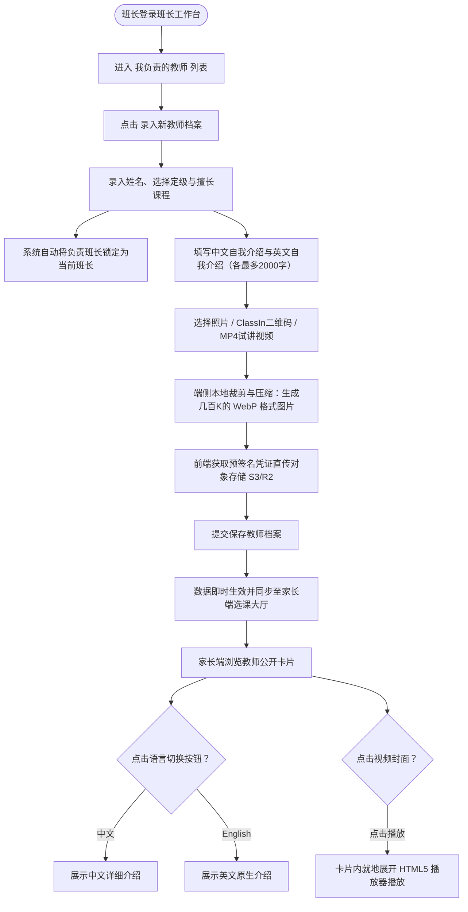
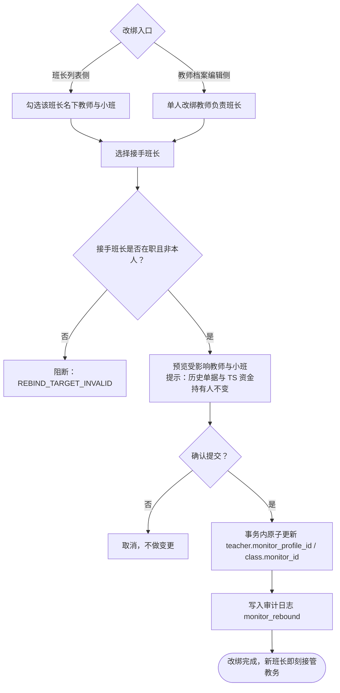
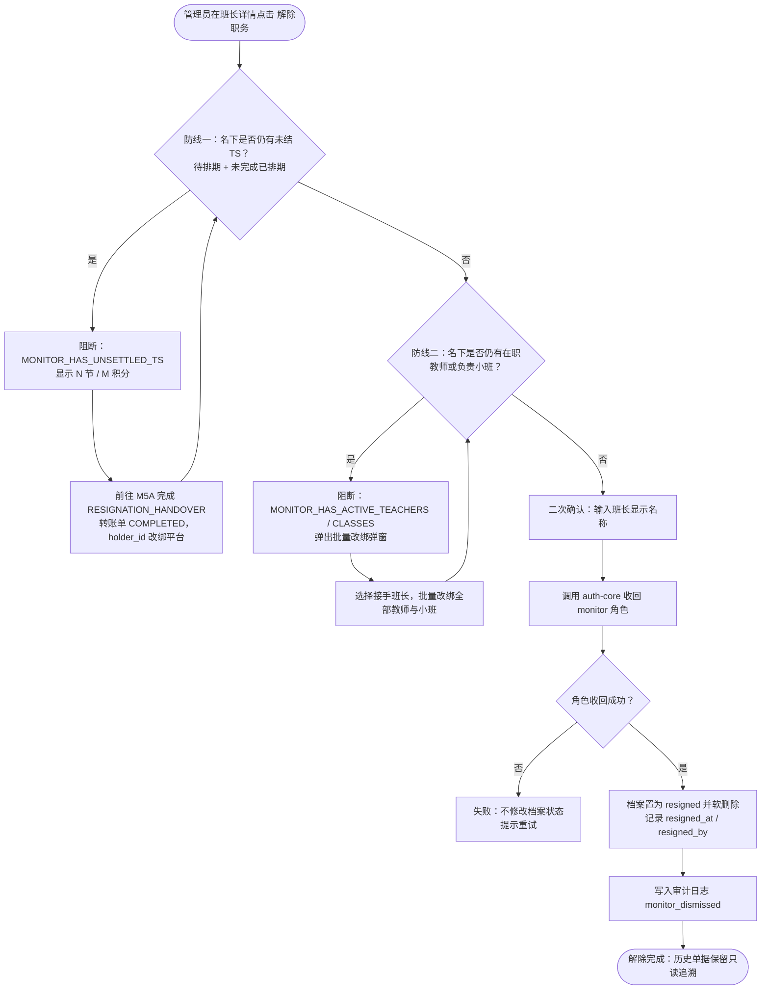
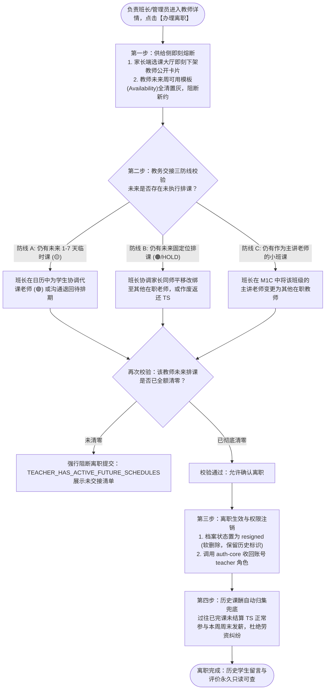

/** (c) 2024-2026 Topee (https://topee.top). All rights reserved. Proprietary and confidential. */

# 产品需求文档 (PRD) — 子模块 1B：教师与班长档案管理 (Teacher & Monitor Profiles)

| 元数据项 | 说明 / 内容 |
|---|---|
| **模块代号** | `m1b` |
| **所属模块** | 模块一：教学教务基座与主数据 (Master Data & Profiles) |
| **文档状态** | 已批准 (Approved) |
| **关联顶层 PRD** | [Prd-v5.md](../Prd-v5.md) |
| **创建与更新日期** | 2026-11-07 |

---

## 1. 概述与执行摘要 (Executive Summary)

教师与班长档案管理（`m1b`）是 Dream 系统的教学供给侧与教务经纪人主数据子模块。本子模块涵盖两大核心领域：一是**班长（Monitor）全生命周期管理**，支持平台管理员查看全量班长列表及实时负荷指标（所辖外教数、负责小班数、托管未结课次资产），通过已注册邮箱检索委任新班长、批量/单人改绑所辖教师与小班，以及在解除班长职务（离职注销）时执行“资金清算 + 教务交接”双防线强校验阻断；二是**外教团队多媒体电子档案与全生命周期管控**，确立**“负责班长 1:1 强绑定责任制”**，支持中英双语自我介绍、试讲视频就地播放与 ClassIn 扫码添加，并在外教离职时执行“公开供给即刻下架 + 存量排课清零交接三防线 + 历史课酬正常周结”闭环，同时承载全平台的课程类型字典与教师定级字典。当前阶段：MVP 正式功能迭代。

---

## 2. 问题定义与背景 (Problem Statement)

- **痛点 1：班长权责生命周期缺乏闭环管控，离职易引发托管资金与外教失管**：班长既负责管理外教团队与小班课，又是前端代收款的资金托管人。若缺乏统一的班长委任、负荷监控与离职前置拦截机制，一旦班长离职时直接撤销权限，会导致其名下未上完的课次托管款成为无主坏账，所辖外教和小班课无人接管。
- **痛点 2：教师履历薄弱导致选课转化低**：传统纯文字教务简历无法真实呈现外教口音、肢体语言与教学亲和力，家长选课试听决策成本高。
- **痛点 3：教师责任人割裂与跨国协调困难**：外教多为海外远程办公，若没有固定的中方班长作为第一责任人，一旦发生缺课、请假或教学争议，家校协调极易脱节。
- **痛点 4：中文家长阅读障碍与英文原汁原味表达的冲突**：仅提供英文简介对国内低龄家长不够友好；仅提供中文翻译又难以展现外教本人的英文写作与教学风格。
- **痛点 5：外教离职缺乏教务交接机制导致未来排课断崖式空转**：外教若突然离职或解聘，若无系统级离职清零防线，未来已排好的固定位和临时课将无人授课，家长上课时面临空堂；主讲小班课停滞；同时过往已完课课酬若缺乏自动归集结算，易引发跨国劳资纠纷。

---

## 3. 目标用户与角色画像 (Users & Personas)

### 3.1 角色一：平台管理员（Sarah，中央统筹与人事管理方）
- **职责与诉求**：在管理员后台查看全平台所有班长名册及其实时业务负荷（负责多少老师、多少小班、手里还托管着多少未结课次积分）；通过检索已注册用户的邮箱快速委任新班长；在日常人事调动或班长离职时，一键将外教团队批量或单人改绑给其他在职班长；在解除班长职务前由系统自动校验资金与教务是否交割完毕，安全收回班长权限。

### 3.2 角色二：教务服务经纪人（Leo，中方班长）
- **职责与诉求**：管理所辖 10-15 位固定外教团队；在班长工作台代录外教履历，上传外教高清试讲视频、专业头像与 ClassIn 二维码；确保信息对外准确展示。

### 3.3 角色三：选课出资家长（Amy，家长）
- **诉求**：在选课列表直观浏览外教照片与定级标签；就地原位观看 1-3 分钟试讲视频；自由一键切换中文介绍与英文介绍；点击放大查看 ClassIn 二维码扫码加好友。

### 3.4 角色四：一线授课教师（David，母语外教）
- **诉求**：档案由负责班长统一代录与维护，个人仅需提供中英简介素材与试讲视频，免除复杂后台录入负担。

---

## 4. 核心业务流程 (Workflows)

### 4.1 教师档案录入与家长浏览流程



### 4.2 管理员委任新班长流程


> **一致性要求**：角色授予与档案创建必须最终一致。档案创建失败时，回滚本次新授予的 `monitor` 角色；若账号原本已具备 `monitor` 角色，则不得误收回。已离职档案再次委任时复用原档案，保留历史单据关联。

### 4.3 教师与小班批量/单人改绑流程



> **字段边界**：教师改绑变更的是 `teacher_profile.monitor_profile_id`，小班改绑变更的是 `class.monitor_id`；TS 的 `holder_id` 是资金持有人，只有 M5A 的周度转账或离职移交会变更，二者不可混用。批量改绑必须全量成功或全量回滚。

### 4.4 班长解除职务（离职注销）两道强防线流程



> **防线一范围**：`holder_id = 该班长账号 ID` 且状态为 `待排期` 或 `已排期`（未完成）的 TS。`已结课(待结算)` 不在本防线内，由 M5A 周度转账跟踪；只有 M5A `RESIGNATION_HANDOVER` 转账单 `COMPLETED` 且 `holder_id` 已改绑平台后，防线一才通过。
>
> **防线二范围**：该班长名下未软删除的教师，以及状态为 `recruiting` 或 `active` 且未软删除的小班。接手班长必须为在职、非本人、未软删除。
>
> **解除后**：仅收回 `monitor` 角色，账号不删除；兼任家长的账号仍可登录家长端；历史单据原班长名只读展示；已离职班长不可再被选为接手班长，也不可新增教师、小班或收款。

### 4.5 教师离职与存量教务清零流程 (Teacher Resignation Flow)



---

## 5. 用户故事 (User Stories)

- **US-1B-01（班长 1:1 负责制）**：作为一个班长，我想要为我负责的外教录入档案并自动绑定责任人，以便于权责对位与后续课酬结算。
- **US-1B-02（双语平滑切换）**：作为一个家长，我想要在教师卡片上一键切换【中文 / English】介绍，以便于快速读懂教师履历的同时感受外教表达风格。
- **US-1B-03（就地视频试讲）**：作为一个家长，我想要在卡片内直接点击播放外教试讲视频，以便于在不跳出页面的情况下感受教师口音与互动风格。
- **US-1B-04（ClassIn 快速建联）**：作为一个家长，我想要点击放大教师的 ClassIn 二维码图片，以便于用手机快速扫码添加上课联系人。
- **US-1B-05（弱网离线浏览）**：作为一个家长，我想要在网络较弱的环境下也能顺畅浏览已缓存的教师公开列表与卡片。
- **US-1B-06（邮箱检索委任）**：作为平台管理员，我想要通过已注册邮箱检索并委任班长，录入显示名称与联系电话，以便于快速开通班长权限且不产生重复账号。
- **US-1B-07（负荷监控）**：作为平台管理员，我想要在班长列表看到所辖外教数、负责小班数与托管未结课次资产，以便于及时发现超负荷或资金风险。
- **US-1B-08（批量改绑）**：作为平台管理员，我想要把离职班长名下的教师与小班批量改绑给接手班长，以便于教务不中断、外教不失管。
- **US-1B-09（离职双防线）**：作为平台管理员，我想要在解除班长职务前被系统强制拦截未结资金与未交接教务，以便于避免托管款烂尾和教师无人负责。
- **US-1B-10（离职后家长端不受影响）**：作为兼任家长的班长，我想要在离职后仍能登录家长端查看自己孩子的课表，以便于个人家庭事务不受职务变动影响。
- **US-1B-11（教师离职排课清零防线）**：作为负责班长，我想要在为外教办理离职时被系统强制拦截未交接的排课任务，以便于防止出现学生进教室后空堂无人授课。
- **US-1B-12（离职教师课酬正常结算）**：作为一个已离职教师，我想要即使离职后我此前已完课的课酬依然能准时在周结单中发放，以便于保障我的劳动报酬权益。
- **US-1B-13（任课教师离职平稳过渡）**：作为一个出资家长，我想要在孩子的固定位外教离职时，由班长主动协助平移换绑至同级别的其他在职老师或全额退还课次，以便于学习进度不被中断。

---

## 6. 验收标准清单 (Acceptance Criteria)

### 6.1 责任班长强绑定与权限隔离
- **AC-1B-01**：每位教师档案**必须且只能绑定 1 位负责班长**（`monitor_profile_id` 不可为空）。
- **AC-1B-02**：班长在【班长工作台】仅能查看、新建与编辑归属于自己名下的教师档案；跨班长访问强制阻断并抛出 `404 TEACHER_NOT_IN_SCOPE`。管理员拥有全量教师的调配与改绑权限。

### 6.2 中英双语档案规范
- **AC-1B-03**：教师档案中文字介绍（`intro_zh`）与英文介绍（`intro_en`）**均为必填项**，每项长度上限为 2000 字符。
- **AC-1B-04**：家长端教师公开卡片顶部提供 `[中文简介] | [English]` 切换控件，点击平滑无刷新切换展示文本。

### 6.3 多媒体直传与播放体验
- **AC-1B-05**：教师个人照片（头像）与 ClassIn 二维码图片**在用户选择原图时不限制初始文件大小**。由前端在浏览器本地（Canvas）完成区域裁剪与画质压缩，统一生成体积约为几百 KB（通常 100KB - 500KB）的标准 **WebP 格式**文件；随后通过预签名凭据直传 S3/R2，数据库仅存储 `.webp` 相对 Key。
- **AC-1B-06**：教师介绍视频**严格限定为 MP4 格式 (H.264 + AAC 编码)**，文件体积上限为 **50MB**，时长建议 1-3 分钟。**严禁采用 WebM 格式**，确保在 iOS Safari 及各类安卓移动端浏览器中 100% 原生硬件加速播放且绝无黑屏兼容问题。
- **AC-1B-07**：家长端卡片默认展示视频封面与半透明播放图标；点击后**卡片内就地展开**原生 HTML5 播放器自动播放，播放器右下角必须支持全屏切换控件。
- **AC-1B-08**：ClassIn 二维码图片支持在手机端点击放大为全屏浮层查看，便于扫码识别。

### 6.4 基础字典与脱敏展示
- **AC-1B-09**：课程类型字典（如少儿英语、生活口语、KET 等）与教师定级字典（如 Senior、Standard 等）由管理员维护，支持软停用（`is_active = false`）。
- **AC-1B-10**：家长端/公共端的教师公开 API 输出**强制物理脱敏**，严禁透传教师个人真实邮箱、登录账号 ID、底薪课酬等敏感字段。

### 6.5 端侧缓存分级 (PWA L3)
- **AC-1B-11**：教师公开脱敏列表数据遵循 **L3 缓存策略**（IndexedDB `NetworkFirst with Cache Fallback`），弱网或断网时支持降级读取上一次本地快照。

### 6.6 班长全量列表与负荷监控
- **AC-1B-12**：班长管理列表仅对管理员开放。列表字段必须包含：显示名称、绑定邮箱、联系电话、委任日期、在职状态（在职 / 已离职）；支持按姓名/邮箱/电话搜索、按状态筛选、分页（默认 20 条/页）。班长与教师访问返回 `403 FORBIDDEN`。
- **AC-1B-13**：列表实时展示三大负荷指标，口径如下：
  - **所辖外教数** = `teacher_profile.monitor_profile_id = 该班长档案 ID` 且 `deleted_at IS NULL` 的教师数；
  - **负责小班数** = `class.monitor_id = 该班长档案 ID` 且 `class.status IN ('recruiting', 'active')` 且 `deleted_at IS NULL` 的小班数；
  - **托管未结课次资产** = `TS.holder_id = 该班长 account_id` 且 `TS.status IN ('待排期', '已排期')` 的节数，以及这些 TS 的“单节实付总积分”快照之和，展示为 `N 节 / M 积分`。
- **AC-1B-14**：已离职班长的三项指标恒为 `0`（解除前已被两道防线强制清零）。指标数字必须可下钻到对应教师/小班/TS 明细，下钻列表的汇总值必须与列表数字一致；`已结课(待结算)` TS 不计入“托管未结课次资产”，由 M5A 周度转账跟踪。
- **AC-1B-15**：列表默认按“在职优先、委任日期倒序”排序；空态显示“暂无班长”；加载失败显示重试；任何非管理员访问都必须被服务端拒绝，不得只依赖前端隐藏。

### 6.7 班长委任与账号角色授权
- **AC-1B-16**：委任表单必填：已注册邮箱、显示名称、联系电话。邮箱去空格并转小写后校验；显示名称 1-50 字符；电话按 11 位手机号或 E.164 格式校验。
- **AC-1B-17**：提交时必须先调用 `@topeetop/auth-core` 校验账号：账号不存在返回 `ACCOUNT_NOT_FOUND`；账号已有在职班长档案返回 `MONITOR_ALREADY_EXISTS`。校验通过后授予 `monitor` 角色并创建班长档案（`account_id`、`display_name`、`phone`、`appointed_at`、`appointed_by`、`status='active'`），写入审计日志 `monitor_appointed`。
- **AC-1B-18**：角色授予与档案创建必须最终一致；档案创建失败时回滚本次新授予的 `monitor` 角色。重复提交必须幂等，不得产生重复档案。已离职档案再次委任时复用原档案并恢复在职，保留历史单据关联。

### 6.8 教师与小班批量/单人改绑机制
- **AC-1B-19**：提供双入口：① 班长列表侧勾选该班长名下教师与小班，批量改绑给一个接手班长；② 教师档案编辑侧单人改绑负责班长。接手班长必须为在职、非本人、未软删除，否则返回 `REBIND_TARGET_INVALID`。
- **AC-1B-20**：批量改绑在单事务内执行，全部成功或全部回滚；任一条目失败则整批失败。成功后写入审计日志 `monitor_rebound`，记录操作人、原班长、接手班长、教师/小班 ID 列表。
- **AC-1B-21**：改绑只变更 `teacher_profile.monitor_profile_id` 与 `class.monitor_id`，**不得变更**历史购课单、已生成 TS 的 `holder_id`、原收款方与资金归属。历史单据中的原班长名保持只读；未来排课与教务沟通由新班长接管，资金结算仍按 M5 规则执行。

### 6.9 解除班长职务两道强防线
- **AC-1B-22（防线一：资金清算）**：解除前校验该班长 `holder_id` 名下是否存在 `待排期` 或 `已排期`（未完成）TS。存在则阻断并返回 `MONITOR_HAS_UNSETTLED_TS`，展示节数与积分，提供跳转 M5A 离职资产移交。只有 M5A `RESIGNATION_HANDOVER` 转账单 `COMPLETED` 且相关 TS `holder_id` 已改绑平台后，校验才通过。
- **AC-1B-23（防线二：教务交接）**：解除前校验该班长名下是否存在未软删除教师，或 `status IN ('recruiting','active')` 且未软删除的小班。存在则阻断并返回 `MONITOR_HAS_ACTIVE_TEACHERS` / `MONITOR_HAS_ACTIVE_CLASSES`，展示数量，强制在弹窗中选择在职接手班长批量改绑全部教师与小班；数量归零后方可解除。
- **AC-1B-24（解除执行）**：两道防线通过后，要求二次确认（输入班长显示名称）。调用 auth-core 收回 `monitor` 角色；成功后档案置 `status='resigned'`、`deleted_at=now()`，记录 `resigned_at` 与 `resigned_by`，写入审计日志 `monitor_dismissed`。角色收回失败时不得软删除档案，提示重试；重复解除必须幂等。
- **AC-1B-25（解除后表现）**：仅收回 `monitor` 角色，账号不删除；兼任家长的账号仍可登录家长端并正常约课；历史购课单、TS、转账单中的原班长名只读展示；已离职班长不可再被选为接手班长，不可新增教师/小班/收款；无其他角色的账号登录后进入无权限页并提示联系管理员。

### 6.10 教师离职解约与存量教务交接强防线 (Teacher Resignation)
- **AC-1B-26（离职触发与供给熔断）**：负责班长或平台管理员办理教师离职时，系统在事务内原子将教师状态更新为 `inactive`，家长端选课大厅与约课日历立即将其下架隐藏，同时将该教师未来所有周常规可用模板（Availability）全部清空置为 ⚪【休息/不可约】，排他阻断任何新预约。
- **AC-1B-27（教务清零强制阻断防线）**：系统执行前置排课校验，若该教师未来日期中存在以下任意一项有效业务实体，**强制阻断离职提交**并返回 `409 TEACHER_HAS_ACTIVE_FUTURE_SCHEDULES`，展示未交接清单：
  - ① 未来 1~7 天内仍有状态为 `已排期` 的 1v1 临时课（🟡）；
  - ② 未来仍有处于 `已排期` 或 `续费预占(HOLD)` 的 1v1 固定位（🟠）；
  - ③ 处于 `recruiting` 或 `active` 状态且指定该教师为主讲人的小班课；
  - ④ 该教师被指派且未执行的代课任务（🟣）。
- **AC-1B-28（教务交接协同规范）**：负责班长必须完成以下交接后方可通过防线：
  - 针对临时课与固定位：在日历中通过 M3B 指派代课老师（代课老师视角染色为 🟣），或在家长协商一致后将固定位平移换绑至其他在职教师，或作废排期退回待排期 TS 资产；
  - 针对小班课：在 M1C 中将班级主讲老师改绑为其他在职教师。
- **AC-1B-29（课酬结算与历史归档规范）**：
  - 课酬正常发放：教师处于 `已结课(待结算)` 的所有 TS 课次，**不受离职影响**，准时纳入当周周末的【教师周课酬单】（M5B），由平台管理员统一核算线下发薪；
  - 权限收回与档案软删除：教务清零通过后，系统调用 `@topeetop/auth-core` 收回账号的 `teacher` 角色，档案标记为 `status='resigned', deleted_at=now()`；
  - 历史数据不可篡改：该教师历史完课的 TS、历史周课酬单、以及此前在学生留言板发布的公开/内部评价文本**永久保留只读展示**。

---

## 7. 范围外清单 (Out of Scope - 本期明确不做)

- **暂不提供服务端视频转码与切片**：V1 阶段依赖客户端上传符合标准的 MP4 格式，暂不搭建云端转码与 HLS 分段切片流水线。
- **暂不提供防盗链动态视频签名**：教师公开介绍视频为公开宣传资料，V1 走 CDN 公开加速读取，不增加时效防盗签名。
- **暂不提供教师端自主申请修改档案功能**：教师资料统一由中方负责班长或管理员录入，外教无需登录后台操作简历。
- **不提供班长或教师自主注销**：解除职务必须由管理员或负责班长发起，并完成前置交接阻断校验。
- **不提供班长组织架构或跨区域调拨**：本期以“班长 → 教师/小班”的单层归属为准，不引入多级组织树。
- **不提供班长绩效评分或佣金分成**：班长收益仍仅限小班课自负盈亏，不在 M1B 范围内核算。
- **不提供账号物理删除**：解除职务仅收回对应角色并软删除档案，自然人账号保留，其他角色不受影响。

---

## 8. 界面线框与布局规范 (Wireframe Level)

### 8.1 家长端教师公开卡片组件
```
+--------------------------------------------------------------------------+
|  [照片] David Miller            [Senior 徽标]   负责班长: Leo            |
|  擅长: [少儿英语] [KET备考] [自然拼读]                                   |
|                                                                          |
|  +--------------------------- 切换栏 ---------------------------------+  |
|  | [中文简介 (*)]    [English]                                        |  |
|  +--------------------------------------------------------------------+  |
|  David 老师拥有 8 年少儿英语教学经验，擅长通过游戏化教学调动低龄学员...     |
|                                                                          |
|  +-------------------------- 试讲视频 --------------------------------+  |
|  |  [▶ 点击播放试讲视频 (01:45)]  (卡片内展开 HTML5 播放器，带全屏)   |  |
|  +--------------------------------------------------------------------+  |
|                                                                          |
|  [ClassIn 扫码添加 (点击放大)]                 [立即预约排课 / 购课]     |
+--------------------------------------------------------------------------+
```

### 8.2 管理员端班长管理列表与委任弹窗

**班长管理列表**
```
+----------------------------------------------------------------------------------+
| 班长管理                                              [搜索姓名/邮箱/电话] [状态 v] |
|  [ + 委任班长 ]                                                                  |
+----------------------------------------------------------------------------------+
| 姓名   | 邮箱             | 电话        | 委任日期   | 状态   | 外教 | 小班 | 托管未结 |
|--------|------------------|-------------|------------|--------|------|------|----------|
| Leo    | leo@example.com  | 138 0000 01 | 2026-03-01 | 在职   | 12   | 3    | 18节/1,240积分 |
| Tom    | tom@example.com  | 139 0000 02 | 2025-08-11 | 已离职 | 0    | 0    | 0节/0积分 |
| ...                                                                              |
+----------------------------------------------------------------------------------+
| [批量改绑教师/小班]    [解除职务]                        [上一页] 1/4 [下一页]   |
+----------------------------------------------------------------------------------+
```

**委任新班长弹窗**
```
+--------------------------------------------+
| 委任新班长                            [x]  |
|--------------------------------------------|
| 已注册邮箱 *  [ leo@example.com         ]  |
| ✓ 匹配账号：Leo (leo@example.com)           |
| 显示名称 *    [ Leo                    ]  |
| 联系电话 *    [ 138 0000 0000           ]  |
|--------------------------------------------|
| 授予 monitor 角色，可进入班长工作台         |
| 并管理所辖教师、小班与托管课次。            |
|--------------------------------------------|
|                    [取消]  [确认委任]       |
+--------------------------------------------+
```

### 8.3 批量改绑弹窗与解除职务前置阻断弹窗

**批量改绑教师与小班**
```
+--------------------------------------------------------------+
| 批量改绑教师与小班                                      [x]  |
|--------------------------------------------------------------|
| 原班长：Leo                                                  |
| 接手班长 * [ 选择在职班长 v ]                                 |
|--------------------------------------------------------------|
| [x] 教师 David        [x] 教师 Amy        [x] 教师 Chris      |
| [x] 小班 KET 冲刺班   [ ] 小班 自然拼读班                     |
|--------------------------------------------------------------|
| ⚠ 仅变更教务管辖；历史购课单与 TS 资金持有人不变。             |
|--------------------------------------------------------------|
|                              [取消]  [确认改绑]               |
+--------------------------------------------------------------+
```

**解除职务前置阻断**
```
+------------------------------------------------------------------+
| 解除班长职务：Leo                                            [x]  |
|------------------------------------------------------------------|
| 防线一 · 资金清算   ✗  仍有 18 节 / 1,240 积分未结 TS             |
|   → 请先前往 M5A 完成离职资产移交                  [去处理]      |
|------------------------------------------------------------------|
| 防线二 · 教务交接   ✗  12 位外教 · 3 个小班未改绑                 |
|   → 请选择接手班长并批量改绑                        [去改绑]      |
|------------------------------------------------------------------|
| 两道防线均通过后方可解除。解除后仅收回 monitor 角色，             |
| 档案软删除，历史单据保留只读追溯。                                |
|------------------------------------------------------------------|
|                              [取消]  [确认解除（禁用）]           |
+------------------------------------------------------------------+
```

### 8.4 教师办理离职教务交接阻断弹窗

```
+------------------------------------------------------------------+
| 办理教师离职：David Miller (Senior)                          [x]  |
|------------------------------------------------------------------|
| ⚠ 该教师尚有未来未执行教务，必须全部交接清零后方可办理离职：       |
|                                                                  |
| [✗] 未来 1-7 天临时课：3 节 (🟡)                  [去调配代课]   |
|     · 2026-11-12 18:00 AliceZ12 (待指派代课)                     |
|     · 2026-11-13 19:30 BobZ10   (待指派代课)                     |
|                                                                  |
| [✗] 正在履约的四周固定位：2 名学员 (🟠)            [去协调换师]   |
|     · AliceZ12 每周二/四 19:00 (本轮剩余 6 节)                   |
|                                                                  |
| [✗] 担任主讲人小班课：1 个班                      [去变更主讲]   |
|     · KET 考前冲刺小班 (周六 10:00)                              |
|------------------------------------------------------------------|
| 离职处理说明：                                                   |
| 1. 点击处理将就地引导至日历指派代课或协调换师平移；              |
| 2. 清零后，教师档案软删除，选课大厅下架，过往已完课课酬正常发薪。 |
|------------------------------------------------------------------|
|                              [取消]  [确认办理离职（禁用）]       |
+------------------------------------------------------------------+
```

---

## 9. 待确认事项 (Open Questions)

- **再次委任已离职班长**：本文默认复用原班长档案并恢复在职，保留历史单据关联；如产品要求新建档案，需要同步调整历史单据展示口径。
- **解除操作人**：本文默认允许管理员（包括被解除人本人）发起，但要求二次确认输入显示名称；是否需要强制双人复核，待产品确认。
- **负荷指标口径**：本文默认“托管未结课次资产”只统计 `待排期 + 未完成已排期`，不含 `已结课(待结算)`；后者由 M5A 周度转账跟踪。
- **离职时的已结课待结算资金**：防线一与 M5A 离职移交目前均只覆盖 `待排期 + 未完成已排期`；`已结课(待结算)` 的托管款是否需要在离职前单独走一次周度转账或纳入离职移交包，待产品与财务确认。
- **批量改绑拆分**：本文默认一次选择一个接手班长统一承接教师与小班；如需把教师和小班分别指派给不同班长，先在单人改绑中拆分处理。
