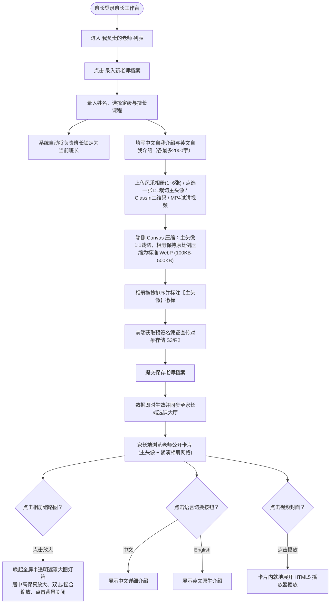
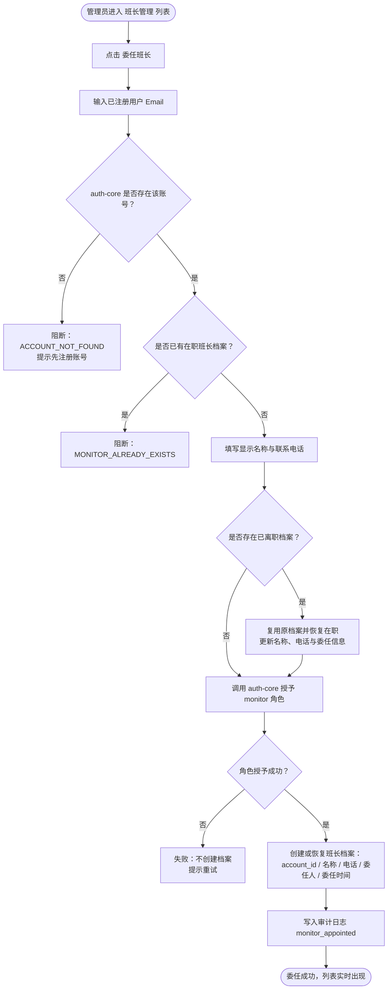
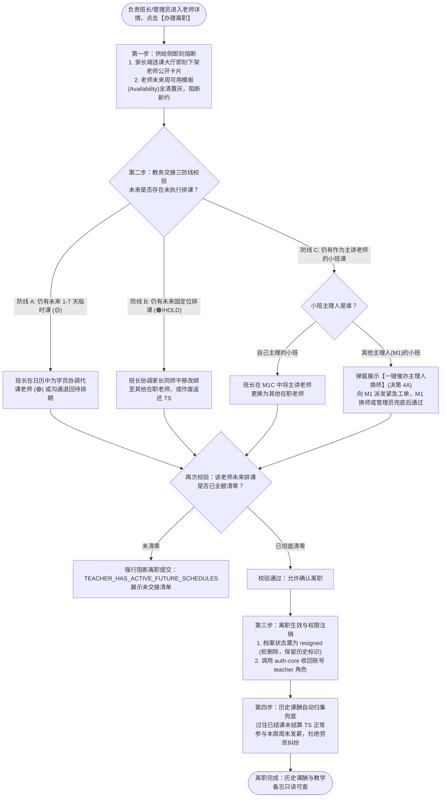
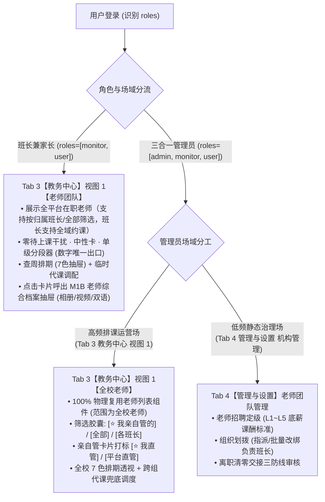
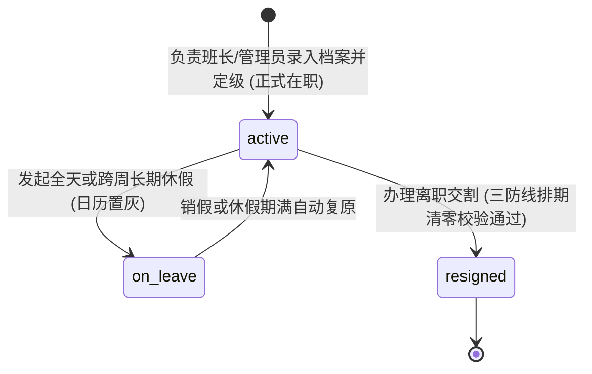

/** (c) 2024-2026 Topee (https://topee.top). All rights reserved. Proprietary and confidential. */

# 产品需求文档 (PRD) — 子模块 1B：老师与班长档案管理 (Teacher & Monitor Profiles)

| 元数据项 | 说明 / 内容 |
|---|---|
| **模块代号** | `m1b` |
| **所属模块** | 模块一：教学教务基座与主数据 (Master Data & Profiles) |
| **文档状态** | 已批准 (Approved) |
| **关联顶层 PRD** | [Prd-v5.md](../Prd-v5.md) |
| **创建与更新日期** | 2026-11-07 (创建) / 2026-11-10 (重大架构修订：1. 列表去花哨与去数字重复铁律：彻底移除顶部 KPI 色块卡片，单级分段器为数字唯一事实出口，纯白底色卡片；2. 班长端 100% 物理复用 Tab 3【教务中心】负责老师视图，严禁自建第二套老师列表；3. 管理员端 Tab 3 高频排课与 Tab 4 静态治理分流复用；4. 确立三合一管理员直管老师筛选机制：班长筛选胶囊置顶【⭐ 我亲自管的】快捷切片与【⭐ 我直管】专属卡片徽标)；2026-11-12 卡片视觉改为只声明卡片类型，色值统一引用 DESIGN.md 2.2.1 |

---

## 1. 概述与执行摘要 (Executive Summary)

老师与班长档案管理（`m1b`）是 Dream 系统的教学供给侧与教务经纪人主数据子模块。本子模块涵盖两大核心领域：一是**班长（Monitor）全生命周期管理**，支持平台管理员查看全量班长列表及实时负荷指标（所辖老师数、负责小班数、托管未结课次资产），通过已注册邮箱检索委任新班长、批量/单人改绑所辖老师与小班，以及在解除班长职务（离职注销）时执行“资金清算 + 教务交接”双防线强校验阻断；二是**老师团队多媒体电子档案与全生命周期管控**，确立**“负责班长 1:1 强绑定责任制”**，支持**风采相册多图管理（1~6 张，支持自由拖拽排序并点选一张 1:1 独立裁切为主头像；家长/学员端以紧凑网格缩略呈现并支持全屏画廊灯箱无损放大查看）**、中英双语自我介绍、试讲视频就地播放与 ClassIn 扫码添加，并在老师离职时执行“公开供给即刻下架 + 存量排课清零交接三防线 + 历史课酬正常周结”闭环，同时承载全平台的课程类型字典与老师定级字典。当前阶段：MVP 正式功能迭代。

---

## 2. 问题定义与背景 (Problem Statement)

- **痛点 1：班长权责生命周期缺乏闭环管控，离职易引发托管资金与老师失管**：班长既负责管理老师团队与小班课，又是前端代收款的资金托管人。若缺乏统一的班长委任、负荷监控与离职前置拦截机制，一旦班长离职时直接撤销权限，会导致其名下未上完的课次托管款成为无主坏账，所辖老师和小班课无人接管。
- **痛点 2：老师履历薄弱导致选课转化低**：传统纯文字教务简历无法真实呈现老师口音、肢体语言与教学亲和力，家长选课试听决策成本高。
- **痛点 3：老师责任人割裂与跨国协调困难**：老师多为海外远程办公，若没有固定的中方班长作为第一责任人，一旦发生缺课、请假或教学争议，家校协调极易脱节。
- **痛点 4：中文家长阅读障碍与英文原汁原味表达的冲突**：仅提供英文简介对国内低龄家长不够友好；仅提供中文翻译又难以展现老师本人的英文写作与教学风格。
- **痛点 5：老师离职缺乏教务交接机制导致未来排课断崖式空转**：老师若突然离职或解聘，若无系统级离职清零防线，未来已排好的固定位和临时课将无人授课，家长上课时面临空堂；主讲小班课停滞；同时过往已结课课酬若缺乏自动归集结算，易引发跨国劳资纠纷。

---

## 3. 目标用户与角色画像 (Users & Personas)

### 3.1 角色一：平台管理员（Sarah，中央统筹与人事管理方）
- **职责与诉求**：在管理员后台查看全平台所有班长名册及其实时业务负荷（负责多少老师、多少小班、手里还托管着多少未结课次积分）；通过检索已注册用户的邮箱快速委任新班长；在日常人事调动或班长离职时，一键将老师团队批量或单人改绑给其他在职班长；在解除班长职务前由系统自动校验资金与教务是否交割完毕，安全收回班长权限。

### 3.2 角色二：教务服务经纪人（Leo，中方班长）
- **职责与诉求**：管理所辖 10-15 位固定老师团队；在班长工作台代录老师履历，上传老师 1~6 张生活与教学风采相册、自主点选并 1:1 独立裁切主头像、自由拖拽调整相册展示顺序，上传老师高清试讲视频与 ClassIn 二维码；确保信息对外准确展示。

### 3.3 角色三：选课出资家长与学员（Amy，家长 / 学员）
- **诉求**：在选课列表直观浏览老师 1:1 主头像、定级标签与紧凑风采相册；点击相册中任意单张照片唤起全屏大图灯箱，无损放大并查看老师教学与生活细节；就地原位观看 1-3 分钟试讲视频；自由一键切换中文介绍与英文介绍；点击放大查看 ClassIn 二维码扫码加好友。

### 3.4 角色四：一线授课老师（David，母语老师）
- **诉求**：档案由负责班长统一代录与维护，个人仅需提供中英简介素材与试讲视频，免除复杂后台录入负担。

---

## 4. 核心业务流程 (Workflows)

### 4.1 老师档案录入与家长浏览流程



### 4.2 管理员委任新班长流程



> **一致性要求**：角色授予与档案创建必须最终一致。档案创建失败时，回滚本次新授予的 `monitor` 角色；若账号原本已具备 `monitor` 角色，则不得误收回。已离职档案再次委任时复用原档案，保留历史单据关联。

### 4.3 老师与小班批量/单人改绑流程


> **字段边界**：老师改绑变更的是 `teacher_profile.monitor_profile_id`，小班改绑变更的是 `class.monitor_id`；TS 的 `holder_id` 是资金持有人，只有 M5A 的周度转账或离职移交会变更，二者不可混用。批量改绑必须全量成功或全量回滚。

### 4.4 班长解除职务（离职注销）两道强防线流程


> **防线一范围**：`holder_id = 该班长账号 ID` 且状态为 `待排期` 或 `已排期`（未完成）的 TS。`已结课(待结算)` 不在本防线内，由 M5A 周度转账跟踪；只有 M5A `RESIGNATION_HANDOVER` 转账单 `COMPLETED` 且 `holder_id` 已改绑平台后，防线一才通过。
>
> **防线二范围**：该班长名下未软删除的老师，以及状态为 `recruiting` 或 `active` 且未软删除的小班。接手班长必须为在职、非本人、未软删除。
>
> **解除后**：仅收回 `monitor` 角色，账号不删除；兼任家长的账号仍可登录家长端；历史单据原班长名只读展示；已离职班长不可再被选为接手班长，也不可新增老师、小班或收款。

### 4.5 老师离职与存量教务清零流程 (Teacher Resignation Flow)



### 4.6 老师列表复用与三合一管理员直管筛选架构 (Teacher List Component Reuse & Admin Direct Filter)

针对老师列表在班长与管理员端的组件复用，系统实施统一的物理收敛与切片过滤机制：



---

### 4.7 实体生命周期与状态机 (Entity Lifecycles & State Machines)

M1B 负责老师档案与教务管理梯队，闭环管理以下 2 大核心实体的生命周期：

#### 1. 老师档案实体 (TeacherProfile)
- **生命周期状态机**：



- **状态转移规则与离职防线**：
  | 状态跃迁 | 触发角色 | 前置条件与防线守卫 | 伴随副作用与系统行为 |
  | :--- | :--- | :--- | :--- |
  | `[*] -> active` | 班长 / 管理员 | 录入国籍、英文名、定级 L1~L5、技能标签及绑定班长 | 档案生效；选课大厅上架展示；开放日历排期与临时约课。 |
  | `active -> on_leave` | 老师 / 班长 | 老师因病假或假期发起长期休假 | 日历对应区间置为灰色不可约；选课大厅标注暂不接新约。 |
  | `active -> resigned` | 班长 / 管理员 | **排课三防线清零强校验**：<br>1. 未来 1-7 天临时课已协调代课或退回；<br>2. 未来固定位已改绑平移其他老师；<br>3. 小班课已完成主理人换师或解散。<br>未清零强阻断：`TEACHER_HAS_ACTIVE_FUTURE_SCHEDULES` | 1. 选课大厅即刻下架卡片；<br>2. 释放全部可用时段模板；<br>3. 调用 auth-core 收回 teacher 角色；<br>4. 历史结课 TS 正常进入周末结算发薪；<br>5. 历史档案永久只读存照。 |

#### 2. 班长职务档案 (MonitorProfile)
- **生命周期状态机**：
  - `active`（在职履职）：正常管辖老师团队、主理小班课与每周资金归集；
  - `resigned`（解职注销）：通过两道强防线校验后解除职务：
    - 防线一：名下未结 TS 全额打包完成 M5A `RESIGNATION_HANDOVER` 移交转账并置 `COMPLETED`；
    - 防线二：名下在职老师与负责小班 100% 批量改绑至接手班长；
    - 校验通过后收回 `monitor` 角色，账号保留家长端功能，历史经办单据永久留痕。

---

## 5. 用户故事 (User Stories)

- **US-1B-01（班长 1:1 负责制）**：作为一个班长，我想要为我负责的老师录入档案并自动绑定责任人，以便于权责对位与后续课酬结算。
- **US-1B-02（双语平滑切换）**：作为一个家长，我想要在老师卡片上一键切换【中文 / English】介绍，以便于快速读懂老师履历的同时感受老师表达风格。
- **US-1B-03（就地视频试讲）**：作为一个家长，我想要在卡片内直接点击播放老师试讲视频，以便于在不跳出页面的情况下感受老师口音与互动风格。
- **US-1B-03a（风采相册与主头像指定）**：作为一个负责班长，我想要为老师上传 1~6 张风采生活/教学照片，并可自由点选其中任意一张独立裁切为 1:1 正方形主头像，以便于全面展现老师的专业素养与亲和力。
- **US-1B-03b（相册拖拽排序与主头像降级保护）**：作为一个负责班长，我想要自由拖拽调整相册照片的前后展示顺序；当我删除当前作为主头像的照片时，系统自动将剩余第一张照片升为主头像（保留最后 1 张照片禁止删除），以便于保障首页与列表头像始终完备。
- **US-1B-03c（家长学员大图灯箱放大浏览）**：作为一个出资家长或学员，我想要在老师详情卡片中通过紧凑网格浏览老师全部风采照片，点击任意单张可唤起全屏大图灯箱高保真放大查看细节，以便于全方位审视老师形象。
- **US-1B-04（ClassIn 快速建联）**：作为一个家长，我想要点击放大老师的 ClassIn 二维码图片，以便于用手机快速扫码添加上课联系人。
- **US-1B-05（弱网离线浏览）**：作为一个家长，我想要在网络较弱的环境下也能顺畅浏览已缓存的老师公开列表与卡片。
- **US-1B-06（邮箱检索委任）**：作为平台管理员，我想要通过已注册邮箱检索并委任班长，录入显示名称与联系电话，以便于快速开通班长权限且不产生重复账号。
- **US-1B-07（负荷监控）**：作为平台管理员，我想要在班长列表看到所辖老师数、负责小班数与托管未结课次资产，以便于及时发现超负荷或资金风险。
- **US-1B-08（批量改绑）**：作为平台管理员，我想要把离职班长名下的老师与小班批量改绑给接手班长，以便于教务不中断、老师不失管。
- **US-1B-09（离职双防线）**：作为平台管理员，我想要在解除班长职务前被系统强制拦截未结资金与未交接教务，以便于避免托管款烂尾和老师无人负责。
- **US-1B-10（离职后家长端不受影响）**：作为兼任家长的班长，我想要在离职后仍能登录家长端查看自己孩子的课表，以便于个人家庭事务不受职务变动影响。
- **US-1B-11（老师离职排课清零防线）**：作为负责班长，我想要在为老师办理离职时被系统强制拦截未交接的排课任务，以便于防止出现学员进教室后空堂无人授课。
- **US-1B-12（离职老师课酬正常结算）**：作为一个已离职老师，我想要即使离职后我此前已结课的课酬依然能准时在课酬单中发放，以便于保障我的劳动课酬权益。
- **US-1B-13（任课老师离职平稳过渡）**：作为一个出资家长，我想要在孩子的固定位老师离职时，由班长主动协助平移换绑至同级别的其他在职老师或全额退还课次，以便于学习进度不被中断。

---

## 6. 验收标准清单 (Acceptance Criteria)

### 6.1 责任班长归属管理与全域约课放开
- **AC-1B-01**：每位老师档案**必须且只能归属 1 位负责班长**（用于人事管理与离职交接归口）。
- **AC-1B-02**：班长在【班长工作台】仅可新建与编辑归属自己名下老师的人事档案（跨班长编辑人事信息返回 `404 TEACHER_NOT_IN_SCOPE`）；但在**约课与排课调度层面，班长具备全域约课权限**，可查看全平台在职老师的空闲日历并为学员预约任意老师课程。管理员拥有全量老师的调配与改绑权限。

### 6.2 中英双语档案规范
- **AC-1B-03**：老师档案中文字介绍（`intro_zh`）与英文介绍（`intro_en`）**均为必填项**，每项长度上限为 2000 字符。
- **AC-1B-04**：家长端老师公开卡片顶部提供 `[中文简介] | [English]` 切换控件，点击平滑无刷新切换展示文本。

### 6.3 多媒体直传、风采相册与播放体验
- **AC-1B-05（相册容量上限与端侧 WebP 压缩）**：老师档案支持上传 **1 ~ 6 张**风采照片，**必须包含至少 1 张照片**。前端在用户选择原图时不限制初始文件体积，由浏览器本地（Canvas）等比压缩为标准 WebP 格式（单张体积约为 100KB - 500KB，上限严格锁定为 1MB），随后通过预签名凭据直传 S3/R2，数据库存储相册相对 Key 列表（`photo_keys`）与主头像 Key（`avatar_key`）。ClassIn 二维码图片同样执行端侧 Canvas 压缩至 WebP 直传。
- **AC-1B-05a（主头像指定与 1:1 独立裁切）**：班长可在相册已上传照片中自由点选任意一张【设为主头像】（默认第 1 张为主头像）；系统为该照片提供独立的 1:1 正方形裁切框（支持缩放与平移构图），仅主头像生成并保存 1:1 裁切版本用于列表、日程卡片与日历网格展示；相册其余展示照片保持原始拍摄纵横比（支持 4:3 / 16:9 横竖构图），无需强制正方形裁切。主头像在相册缩略图中附带高亮【主头像 / Avatar】徽标。
- **AC-1B-05b（相册拖拽排序与顺序落盘）**：班长在编辑相册时，支持通过鼠标拖拽卡片或点击左右移动按钮自由调整照片的前后展示次序；保存老师档案时，系统按当前展示顺序将照片 Key 数组持久化落盘，确保对外展示顺序可控。
- **AC-1B-05c（主头像删除自动降级与最少 1 张校验）**：
  - 当班长删除的照片正好是“主头像”时，系统自动将剩余列表中排在首位的第 1 张照片自动晋升为新主头像；
  - 当相册中仅剩下最后 1 张照片时，该照片的【删除】按钮强制置灰禁用，系统提示“老师档案必须保留至少 1 张照片作为主头像”，排他阻断无头像的空档案保存。
- **AC-1B-05d（家长端紧凑缩略图网格与全屏大图灯箱）**：
  - **卡片紧凑展示**：家长端老师公开卡片以 **2x2 或 3x3 紧凑网格**平铺展示相册缩略图（单图正方形微卡片，若相册照片超过网格容量显示 `+N` 遮罩）；
  - **点击全屏放大**：点击网格中任意照片，立即弹出**全屏半透明遮罩大图画廊灯箱 (Lightbox Modal)**；
  - **灯箱交互规格**：居中无损展示原图大图；移动端支持双指捏合缩放与双击放大/还原；支持点击右上角关闭按钮或点击暗色背景一键退出灯箱。
- **AC-1B-06**：老师介绍视频**严格限定为 MP4 格式 (H.264 + AAC 编码)**，文件体积上限为 **50MB**，时长建议 1-3 分钟。**严禁采用 WebM 格式**，确保在 iOS Safari 及各类安卓移动端浏览器中 100% 原生硬件加速播放且绝无黑屏兼容问题。
- **AC-1B-07**：家长端卡片默认展示视频封面与半透明播放图标；点击后**卡片内就地展开**原生 HTML5 播放器自动播放，播放器右下角必须支持全屏切换控件。
- **AC-1B-08**：ClassIn 二维码图片支持在手机端点击放大为全屏浮层查看，便于扫码识别。

### 6.4 基础字典与脱敏展示
- **AC-1B-09**：课程类型字典（如少儿英语、生活口语、KET 等）与老师定级字典（如 Senior、Standard 等）由管理员维护，支持软停用（`is_active = false`）。
- **AC-1B-10**：家长端/公共端的老师公开 API 输出**强制物理脱敏**，严禁透传老师个人真实邮箱、登录账号 ID、底薪课酬等敏感字段。
- **AC-1B-10a（家长端绝对去技术与去脱敏自白痕迹）**：脱敏逻辑由后端 Service 静默完成，前端家长端界面**绝对禁止向用户展示任何“公开履历已脱敏”、“不展示老师邮箱与课酬”、“离线快照”、“公开履历”等研发术语、技术自白或系统自明性提示文案**；页面标题与描述统一采用自然亲和的用户语言（如“选老师”、“为 [孩子名] 挑选合适的老师”、“老师介绍”）。

### 6.5 端侧缓存分级 (PWA L3)
- **AC-1B-11**：老师公开脱敏列表数据遵循 **L3 缓存策略**（IndexedDB `NetworkFirst with Cache Fallback`），弱网或断网时支持降级读取上一次本地快照。

### 6.6 班长全量列表与负荷监控
- **AC-1B-12**：班长管理列表仅对管理员开放。列表字段必须包含：显示名称、绑定邮箱、联系电话、委任日期、在职状态（在职 / 已离职）；支持按姓名/邮箱/电话搜索、按状态筛选、分页（默认 20 条/页）。班长与老师访问返回 `403 FORBIDDEN`。
- **AC-1B-13**：列表实时展示三大负荷指标，口径如下：
  - **所辖老师数** = `teacher_profile.monitor_profile_id = 该班长档案 ID` 且 `deleted_at IS NULL` 的老师数；
  - **负责小班数** = `class.monitor_id = 该班长档案 ID` 且 `class.status IN ('recruiting', 'active')` 且 `deleted_at IS NULL` 的小班数；
  - **托管未结课次资产** = `TS.holder_id = 该班长 account_id` 且 `TS.status IN ('待排期', '已排期')` 的节数，以及这些 TS 的“单节实付总积分”快照之和，展示为 `N 节 / M 积分`。
- **AC-1B-14**：已离职班长的三项指标恒为 `0`（解除前已被两道防线强制清零）。指标数字必须可下钻到对应老师/小班/TS 明细，下钻列表的汇总值必须与列表数字一致；`已结课(待结算)` TS 不计入“托管未结课次资产”，由 M5A 周度转账跟踪。
- **AC-1B-15**：列表默认按“在职优先、委任日期倒序”排序；空态显示“暂无班长”；加载失败显示重试；任何非管理员访问都必须被服务端拒绝，不得只依赖前端隐藏。

### 6.7 班长委任与账号角色授权
- **AC-1B-16**：委任表单必填：已注册邮箱、显示名称、联系电话。邮箱去空格并转小写后校验；显示名称 1-50 字符；电话按 11 位手机号或 E.164 格式校验。
- **AC-1B-17**：提交时必须先调用 `@topeetop/auth-core` 校验账号：账号不存在返回 `ACCOUNT_NOT_FOUND`；账号已有在职班长档案返回 `MONITOR_ALREADY_EXISTS`。校验通过后授予 `monitor` 角色并创建班长档案（`account_id`、`display_name`、`phone`、`appointed_at`、`appointed_by`、`status='active'`），写入审计日志 `monitor_appointed`。
- **AC-1B-18**：角色授予与档案创建必须最终一致；档案创建失败时回滚本次新授予的 `monitor` 角色。重复提交必须幂等，不得产生重复档案。已离职档案再次委任时复用原档案并恢复在职，保留历史单据关联。

### 6.8 老师与小班批量/单人改绑机制
- **AC-1B-19**：提供双入口：① 班长列表侧勾选该班长名下老师与小班，批量改绑给一个接手班长；② 老师档案编辑侧单人改绑负责班长。接手班长必须为在职、非本人、未软删除，否则返回 `REBIND_TARGET_INVALID`。
- **AC-1B-20**：批量改绑在单事务内执行，全部成功或全部回滚；任一条目失败则整批失败。成功后写入审计日志 `monitor_rebound`，记录操作人、原班长、接手班长、老师/小班 ID 列表。
- **AC-1B-21**：改绑只变更 `teacher_profile.monitor_profile_id` 与 `class.monitor_id`（仅当明确选择改绑班长名下小班时），**不得变更**历史购课单、已生成 TS 的 `holder_id`、原收款方与资金归属。历史单据中的原班长名保持只读；未来排课与教务沟通由新班长接管，资金结算仍按 M5 规则执行。小班仅认小班主理人（`class.monitor_id`），老师人事归属班长变更不再联动修改任何他人承包的小班或发送小班协同通知。

### 6.9 解除班长职务两道强防线
- **AC-1B-22（防线一：资金清算）**：解除前校验该班长 `holder_id` 名下是否存在 `待排期` 或 `已排期`（未完成）TS。存在则阻断并返回 `MONITOR_HAS_UNSETTLED_TS`，展示节数与积分，提供跳转 M5A 离职资产移交。只有 M5A `RESIGNATION_HANDOVER` 转账单 `COMPLETED` 且相关 TS `holder_id` 已改绑平台后，校验才通过。
- **AC-1B-23（防线二：教务交接）**：解除前校验该班长名下是否存在未软删除老师，或 `status IN ('recruiting','active')` 且未软删除的小班。存在则阻断并返回 `MONITOR_HAS_ACTIVE_TEACHERS` / `MONITOR_HAS_ACTIVE_CLASSES`，展示数量，强制在弹窗中选择在职接手班长批量改绑全部老师与小班；数量归零后方可解除。
- **AC-1B-24（解除执行）**：两道防线通过后，要求二次确认（输入班长显示名称）。调用 auth-core 收回 `monitor` 角色；成功后档案置 `status='resigned'`、`deleted_at=now()`，记录 `resigned_at` 与 `resigned_by`，写入审计日志 `monitor_dismissed`。角色收回失败时不得软删除档案，提示重试；重复解除必须幂等。
- **AC-1B-25（解除后表现）**：仅收回 `monitor` 角色，账号不删除；兼任家长的账号仍可登录家长端并正常约课；历史购课单、TS、转账单中的原班长名只读展示；已离职班长不可再被选为接手班长，不可新增老师/小班/收款；无其他角色的账号登录后进入无权限页并提示联系管理员。

### 6.10 老师离职解约与存量教务交接强防线 (Teacher Resignation)
- **AC-1B-26（离职触发与供给熔断）**：负责班长或平台管理员办理老师离职时，系统在事务内原子将老师状态更新为 `inactive`，家长端选课大厅与约课日历立即将其下架隐藏，同时将该老师未来所有周常规可用模板（Availability）全部清空置为 ⚪【休息/不可约】，排他阻断任何新预约。
- **AC-1B-27（教务清零强制阻断防线）**：系统执行前置排课校验，若该老师未来日期中存在以下任意一项有效业务实体，**强制阻断离职提交**并返回 `409 TEACHER_HAS_ACTIVE_FUTURE_SCHEDULES`，展示未交接清单：
  - ① 未来 1~7 天内仍有状态为 `已排期` 的 1v1 临时课（🟡）；
  - ② 未来仍有处于 `已排期` 或 `续费预占(HOLD)` 的 1v1 固定位（🟠）；
  - ③ 处于 `recruiting` 或 `active` 状态且指定该老师为主讲人的小班课；
  - ④ 该老师被指派且未执行的代课任务（🟣）。
- **AC-1B-28（教务交接协同规范与小班催办）**：负责班长必须完成以下交接后方可通过防线：
  - 针对临时课与固定位：在日历中通过 M3B 指派代课老师（代课老师视角染色为 🟣），或在家长协商一致后将固定位平移换绑至其他在职老师，或作废排期退回待排期 TS 资产；
  - 针对小班课（方案 2：提前结课解散）：
    - 若该小班为主理人本人负责（`M1 == M2`），在 M1C 中对该小班执行【提前结课解散】（未来排期自动批量取消释放并完成结案）；若需由新老师接续授课，在线下微信群向家长核算多退少补后重新创建新小班；
    - 若该小班为主理人其他人负责（`M1 != M2`），负责班长无权直接操作小班，系统在阻断清单中明确展示 `[班级名] (主理人: M1)` 并提供 **【一键催办主理人提前结课解散】** 动作（向主理人发送站内提醒与催办通知，告知老师离职事实并催促解散原班，同时提供管理员兜底解散通道）；主理人执行提前结课解散后，该老师关联的小班未来排期全量清零并放行离职。
- **AC-1B-29（课酬结算与历史归档规范）**：
  - 课酬正常发放：老师处于 `已结课(待结算)` 的所有 TS 课次，**不受离职影响**，准时纳入当周周末的【老师周课酬单】（M5B），由平台管理员统一核算线下发薪；
  - 权限收回与档案软删除：教务清零通过后，系统收回账号的老师角色并标记档案已离职；
  - 历史数据不可篡改：该老师历史结课的 TS、历史周课酬单及教学备忘**永久保留只读展示**。

### 6.11 老师列表去花哨、去重复数字与组件复用验收标准 (De-cluttering & Reuse Standards)
- **AC-1B-30（老师数去重复与视觉去花哨验收标准）**：
  1. **彻底废除顶部 KPI 统计大色块卡片**：严禁在老师列表页面顶部放置大色块卡片展示老师数、今日课次数、待处理数等指标，首屏 100% 空间释放给搜索与列表内容；
  2. **数字单一事实出口铁律 (Single Source of Truth for Counts)**：老师总数与各状态数量**必须且仅允许在单级分段器（Segmented Filter）标签文字后展示一次**（如 `[ 全部 (15) ]`、`[ 正常可约 (13) ]`、`[ 请假/代课中 (2) ]`）；某状态数量为 0 时隐藏括号数字；全页面其他任何区域（标题副标题、额外统计块）严禁二次复读该数字；
  3. **中性卡与微型状态徽章**：卡片统一采用 [DESIGN.md Section 2.2.1](../DESIGN.md) 规定的【中性卡】样式，严禁使用彩色大边框、侧边加粗彩条等杂乱装饰；状态仅采用微型语义小徽章（如 `[在职正常]`、`[闭麦请假]`）；
  4. **剥离无关的今日课次大数字**：教务中心看老师的核心诉求是“看档案、查全周排期、代调代课”，今日上课次数由首页与日历专属承载，在老师档案列表页彻底剥离今日课次大统计。
- **AC-1B-31（班长与管理员端列表 100% 物理复用铁律）**：
  1. **班长端严禁自建第二套老师列表页**：班长端所有的负责老师团队浏览、即时检索与风采档案维护，**100% 物理统一收敛于 Tab 3【教务中心】的视图 1【负责老师】**（遵循 [m0_workspace_and_home.md](./m0_workspace_and_home.md) 6.2.5 规约）；
  2. **管理员端高频排课复用**：管理员在 Tab 3【教务中心】查看【全校老师】时，复用同一个老师列表组件（数据范围扩大为全校认证老师，增加班长筛选切片器）；
  3. **“卡片即教务排期，抽屉即多媒体档案”复用模型**：
     - **列表卡片层**：展示老师英文名、定级 (L1~L5)、技能标签、ClassIn 教室号、当周授课负荷（如 `26/30 节`），提供 `[ 📅 查看外教周排期 ]`（唤起 7 色全周排期抽屉）与 `[ 🔄 临时代课调配 ]` 高频动作；
     - **多媒体档案抽屉层**：点击卡片主体或 `[ 档案/风采 ↗ ]`，直接呼出 **[M1B 老师综合档案抽屉 (Teacher Profile Drawer)]**，集中管理风采相册 (1~6 张及 1:1 主头像裁切)、试讲视频就地播放、中英双语自我介绍、ClassIn 二维码上传、教学技能标签维护及纯文本【教学备忘录 (Notes)】。
- **AC-1B-32（三合一管理员直管老师筛选与专属徽标规范）**：
  1. **筛选胶囊置顶专属切片**：在 Tab 3【教务中心】全校老师列表的 `[ 全部班长 ▾ ]` 下拉胶囊中，置顶提供 **`[ ⭐ 我亲自管的 (N) ]`** 专属快捷切片（聚合管理员兼任班长直管的老师团队 + 平台直管/未划拨公共老师）；并保留 `[ 全部教师 (N) ]`、`[ 平台未划拨 (N) ]` 及各下级班长选项；
  2. **专属归属徽标区分**：卡片右上角通过微型文字徽标直观标明归属关系：
     - 管理员亲自管的老师：标注 **`[ ⭐ 我直管 ]`**（或 `[ 平台直管 ]`）；
     - 下级班长管辖的老师：标注对应班长名称，如 **`[ Leo 班 ]`**。

---

## 7. 范围外清单 (Out of Scope - 本期明确不做)

- **不提供超过 6 张的照片相册上传**：风采相册严格限制 1~6 张，不支持无上限图库或大批量图片存储。
- **不提供服务端图片鉴黄机审流水线**：相册图片内容合规由负责班长与管理员在上传时进行人工审核与把关，本期不接入第三方机审 API。
- **不提供原图无压缩直传**：所有相册照片必须由前端 Canvas 统一压缩为 WebP（$\le 1\text{MB}$）后直传，防止超大原图浪费用户流量与带宽。
- **暂不提供服务端视频转码与切片**：V1 阶段依赖客户端上传符合标准的 MP4 格式，暂不搭建云端转码与 HLS 分段切片流水线。
- **暂不提供防盗链动态视频签名**：老师公开介绍视频为公开宣传资料，V1 走 CDN 公开加速读取，不增加时效防盗签名。
- **暂不提供老师端自主申请修改档案功能**：老师资料统一由中方负责班长或管理员录入，老师无需登录后台操作简历。
- **不提供班长或老师自主注销**：解除职务必须由管理员或负责班长发起，并完成前置交接阻断校验。
- **不提供班长组织架构或跨区域调拨**：本期以“班长 → 老师/小班”的单层归属为准，不引入多级组织树。
- **不提供班长绩效评分或佣金分成**：班长收益仍仅限小班课自负盈亏，不在 M1B 范围内核算。
- **不提供账号物理删除**：解除职务仅收回对应角色并软删除档案，自然人账号保留，其他角色不受影响。

---

## 8. 界面线框与布局规范 (Wireframe Level)

### 8.1 家长端老师公开卡片组件 (带 1:1 主头像与紧凑相册网格)
```
+--------------------------------------------------------------------------+
|  [1:1主头像] David Miller       [Senior 徽标]   负责班长: Leo            |
|  擅长: [少儿英语] [KET备考] [自然拼读]                                   |
|                                                                          |
|  +--- 教师风采相册 (共 5 张，点击查看大图) -----------------------------+  |
|  |  +-------+  +-------+  +-------+  +-------+  +-------+               |  |
|  |  | [图1] |  | [图2] |  | [图3] |  | [图4] |  | [图5] |  (紧凑网格)   |  |
|  |  +-------+  +-------+  +-------+  +-------+  +-------+               |  |
|  +--------------------------------------------------------------------+  |
|                                                                          |
|  +--------------------------- 简介切换栏 -----------------------------+  |
|  | [中文简介 (*)]    [English]                                        |  |
|  +--------------------------------------------------------------------+  |
|  David 老师拥有 8 年少儿英语教学经验，擅长通过游戏化教学调动低龄学员...     |
|                                                                          |
|  +-------------------------- 试讲视频 --------------------------------+  |
|  |  [▶ 点击播放试讲视频 (01:45)]  (卡片内展开 HTML5 播放器，带全屏)   |  |
|  +--------------------------------------------------------------------+  |
|                                                                          |
|  [ClassIn 扫码添加 (点击放大)]                 [立即预约排课 / 购课]     |
+--------------------------------------------------------------------------+
```

### 8.1b 家长端全屏大图画廊灯箱组件 (Lightbox Modal)
```
+--------------------------------------------------------------------------+
|  [X 关闭]                            [ 2 / 5 ]               [放大/还原] |
|--------------------------------------------------------------------------|
|                                                                          |
|                     +-----------------------------+                      |
|                     |                             |                      |
|                     |                             |                      |
|                     |        高保真居中大图       |                      |
|                     |     (支持双击/双指捏合缩放)  |                      |
|                     |                             |                      |
|                     |                             |                      |
|                     +-----------------------------+                      |
|                                                                          |
|               [ < 上一张 ]                   [ 下一张 > ]                 |
|--------------------------------------------------------------------------|
|  提示：点击暗色背景或按 Esc 键即可退出大图查看                           |
+--------------------------------------------------------------------------+
```

### 8.1c 班长端老师风采相册编辑抽屉组件 (Photo Album Drawer)
```
+------------------------------------------------------------------+
| 编辑教师多媒体档案：David Miller                             [x]  |
|------------------------------------------------------------------|
| 教师风采相册 (最少 1 张，最多 6 张，当前: 4/6)                   |
| 提示：可拖拽调整前后顺序；点选【设为主头像】并可执行 1:1 裁切。  |
|                                                                  |
| +-----------+  +-----------+  +-----------+  +-----------+  +--+ |
| | [★主头像] |  |           |  |           |  |           |  |+ | |
| |  缩略图 1 |  |  缩略图 2 |  |  缩略图 3 |  |  缩略图 4 |  |上| |
| |-----------|  |-----------|  |-----------|  |-----------|  |传| |
| | [裁切1:1] |  | [设为头像]|  | [设为头像]|  | [设为头像]|  +--+ |
| | [ < ] [ >]|  | [ < ] [ >]|  | [ < ] [ >]|  | [ < ] [ >]|  新 | |
| | [  删除  ]|  | [  删除  ]|  | [  删除  ]|  | [  删除  ]|  图 | |
| +-----------+  +-----------+  +-----------+  +-----------+  +--+ |
|                                                                  |
| ClassIn 二维码图片：                                             |
| [二维码预览卡片]  [重新上传并裁切]                               |
|                                                                  |
| MP4 试讲视频 (≤50MB)：                                           |
| [视频预览]  david_intro.mp4 (18.2MB)  [重新上传]                 |
|------------------------------------------------------------------|
|                              [取消]  [保存档案]                  |
+------------------------------------------------------------------+
```

### 8.2 管理员端班长管理列表与委任弹窗

**班长管理列表**
```
+----------------------------------------------------------------------------------+
| 班长管理                                              [搜索姓名/邮箱/电话] [状态 v] |
|  [ + 委任班长 ]                                                                  |
+----------------------------------------------------------------------------------+
| 姓名   | 邮箱             | 电话        | 委任日期   | 状态   | 外教 | 小班 | 托管未结 |
|--------|------------------|-------------|------------|--------|------|------|----------|
| Leo    | leo@example.com  | 138 0000 01 | 2026-03-01 | 在职   | 12   | 3    | 18节/1,240积分 |
| Tom    | tom@example.com  | 139 0000 02 | 2025-08-11 | 已离职 | 0    | 0    | 0节/0积分 |
| ...                                                                              |
+----------------------------------------------------------------------------------+
| [批量改绑教师/小班]    [解除职务]                        [上一页] 1/4 [下一页]   |
+----------------------------------------------------------------------------------+
```

**委任新班长弹窗**
```
+--------------------------------------------+
| 委任新班长                            [x]  |
|--------------------------------------------|
| 已注册邮箱 *  [ leo@example.com         ]  |
| ✓ 匹配账号：Leo (leo@example.com)           |
| 显示名称 *    [ Leo                    ]  |
| 联系电话 *    [ 138 0000 0000           ]  |
|--------------------------------------------|
| 授予 monitor 角色，可进入班长工作台         |
| 并管理所辖教师、小班与托管课次。            |
|--------------------------------------------|
|                    [取消]  [确认委任]       |
+--------------------------------------------+
```

### 8.3 批量改绑弹窗与解除职务前置阻断弹窗

**批量改绑老师与小班**
```
+--------------------------------------------------------------+
| 批量改绑教师与小班                                      [x]  |
|--------------------------------------------------------------|
| 原班长：Leo                                                  |
| 接手班长 * [ 选择在职班长 v ]                                 |
|--------------------------------------------------------------|
| [x] 教师 David        [x] 教师 Amy        [x] 教师 Chris      |
| [x] 小班 KET 冲刺班   [ ] 小班 自然拼读班                     |
|--------------------------------------------------------------|
| ⚠ 仅变更教务管辖；历史购课单与 TS 资金持有人不变。             |
|--------------------------------------------------------------|
|                              [取消]  [确认改绑]               |
+--------------------------------------------------------------+
```

**解除职务前置阻断**
```
+------------------------------------------------------------------+
| 解除班长职务：Leo                                            [x]  |
|------------------------------------------------------------------|
| 防线一 · 资金清算   ✗  仍有 18 节 / 1,240 积分未结 TS             |
|   → 请先完成离职资产移交                          [去处理]      |
|------------------------------------------------------------------|
| 防线二 · 教务交接   ✗  12 位外教 · 3 个小班未改绑                 |
|   → 请选择接手班长并批量改绑                        [去改绑]      |
|------------------------------------------------------------------|
| 两道防线均通过后方可解除。解除后仅收回 monitor 角色，             |
| 档案软删除，历史单据保留只读追溯。                                |
|------------------------------------------------------------------|
|                              [取消]  [确认解除（禁用）]           |
+------------------------------------------------------------------+
```

### 8.4 老师办理离职教务交接阻断弹窗

```
+------------------------------------------------------------------+
| 办理教师离职：David Miller (Senior)                          [x]  |
|------------------------------------------------------------------|
| ⚠ 该教师尚有未来未执行教务，必须全部交接清零后方可办理离职：       |
|                                                                  |
| [✗] 未来 1-7 天临时课：3 节 (🟡)                  [去调配代课]   |
|     · 2026-11-12 18:00 AliceZ12 (待指派代课)                     |
|     · 2026-11-13 19:30 BobZ10   (待指派代课)                     |
|                                                                  |
| [✗] 正在履约的四周固定位：2 名学员 (🟠)            [去协调换师]   |
|     · AliceZ12 每周二/四 19:00 (本轮剩余 6 节)                   |
|                                                                  |
| [✗] 担任主讲人小班课：1 个班                      [去变更主讲]   |
|     · KET 考前冲刺小班 (周六 10:00)                              |
|------------------------------------------------------------------|
| 离职处理说明：                                                   |
| 1. 点击处理将就地引导至日历指派代课或协调换师平移；              |
| 2. 清零后，教师档案软删除，选课大厅下架，过往已完课课酬正常发薪。 |
|------------------------------------------------------------------|
|                              [取消]  [确认办理离职（禁用）]       |
+------------------------------------------------------------------+
```

### 8.5 班长与管理员端极简去噪老师列表与档案抽屉复用线框 (Clean Wireframe)

```
====================== Tab 3【教务中心 · 负责外教 / 全校教师】列表卡片 ======================
+---------------------------------------------------------------------------------------+
| ◀ 全校教师团队 (Tab 3 视图 1)                                   [ + 代录/新建外教 ] |
+---------------------------------------------------------------------------------------+
| [ 🔍 搜索外教英文名 / 拼音 / 技能 / ClassIn 账号               ] (即时搜索)        |
|                                                                                       |
| [ ⭐ 我亲自管的 ▾ ] (班长筛选胶囊)   [ 全部 (15) ]  [ 正常可约 (13) ]  [ 请假/代课中 (2) ] |
+---------------------------------------------------------------------------------------+
|                                                                                       |
| +-----------------------------------------------------------------------------------+ |
| | [主头像] David Miller (L4 · 资深名师)                        [ ⭐ 我直管 ] [26/30节]| |
| | 擅长领域: 少儿英语、KET 冲刺、自然拼读                       ClassIn: 98234123     | |
| | 教学风采: 📷 4张风采照 · 🎬 试讲视频就地播放                                       | |
| | [ 📅 查周排期 (7色抽屉) ]     [ 🔄 临时代课调配 ]     [ 档案与风采详情 ↗ (点卡片打开) ] |
| +-----------------------------------------------------------------------------------+ |
|                                                                                       |
| +-----------------------------------------------------------------------------------+ |
| | [主头像] Elena Rostova (L3 · 骨干教师)                      [ Leo 班 ]   [18/25节] | |
| | 擅长领域: 少儿口语、PET 语法突破                             ClassIn: 87123991     | |
| | 教学风采: 📷 3张风采照 · 🎬 试讲视频就地播放                                       | |
| | [ 📅 查周排期 (7色抽屉) ]     [ 🔄 临时代课调配 ]     [ 档案与风采详情 ↗ (点卡片打开) ] |
| +-----------------------------------------------------------------------------------+ |
+---------------------------------------------------------------------------------------+
                                            │
                                            ▼ 点击呼出（半屏/全屏抽屉）
+---------------------------------------------------------------------------------------+
| ◀ 外教综合档案与多媒体风采：David Miller                                          [X]  |
+---------------------------------------------------------------------------------------+
| 【基本资料与资质】                                                                    |
| · 英文名: David Miller     · 教师定级: L4 (资深名师)     · 所属班长: [⭐ 我直管]       |
| · 国籍/时区: 英国 (GMT+0)  · ClassIn: 98234123 [扫码预览]                             |
| · 教学技能标签: [少儿英语] [KET备考] [自然拼读]                                       |
|---------------------------------------------------------------------------------------|
| 【风采相册 (4/6 张)】 [管理相册 (拖拽排序 / 设为主头像 / 1:1裁切) ↗]                   |
| [★主头像图]  [教学生活照2]  [证书展示照3]  [课堂活动照4]                               |
|---------------------------------------------------------------------------------------|
| 【试讲视频 (MP4 · 01:30)】                                                            |
| [ ▶ 就地播放 HTML5 试讲视频 ]  [重新上传 ↗]                                           |
|---------------------------------------------------------------------------------------|
| 【中英双语介绍】 [编辑介绍 ↗]                                                          |
| [中文介绍] "David 老师拥有 8 年少儿英语教学经验，擅长互动式教学..."                   |
| [English]  "Hello! I am David. With over 8 years of teaching young learners..."       |
|---------------------------------------------------------------------------------------|
| 【履约动态 (Activity Stream)】                                                        |
| · [🟣代上课] 接单代课 11-14 16:00 (学员: AliceZ12 · 原师: David · 计入课酬) (2天前)   |
| · [🔵被代课] 11-08 19:00 因家庭停电报备，由 Elena 老师代课 (不计课酬)        (5天前)   |
| · [🔴请假] 11-01 14:00-16:00 空闲时段闭麦请假 (已正常恢复)                   (1周前)   |
|   [查看该外教完整动态时间轴 ➔]                                                        |
+---------------------------------------------------------------------------------------+
```

---

## 9. 待确认事项 (Open Questions)

- **老师风采相册数量与带宽平衡**：本期明确锁定 1~6 张上限，采用端侧 Canvas 压缩为 WebP 格式（100KB-500KB）。未来若老师风采展示诉求扩大至 9 张（九宫格），需综合评估 CDN 流量成本与移动端弱网加载性能。
- **再次委任已离职班长**：本文默认复用原班长档案并恢复在职，保留历史单据关联；如产品要求新建档案，需要同步调整历史单据展示口径。
- **解除操作人**：本文默认允许管理员（包括被解除人本人）发起，但要求二次确认输入显示名称；是否需要强制双人复核，待产品确认。
- **负荷指标口径**：本文默认“托管未结课次资产”只统计 `待排期 + 未完成已排期`，不含 `已结课(待结算)`；后者由 M5A 周度转账跟踪。
- **离职时的已结课待结算资金**：防线一与 M5A 离职移交目前均只覆盖 `待排期 + 未完成已排期`；`已结课(待结算)` 的托管款是否需要在离职前单独走一次周度转账或纳入离职移交包，待产品与财务确认。
- **批量改绑拆分**：本文默认一次选择一个接手班长统一承接老师与小班；如需把老师和小班分别指派给不同班长，先在单人改绑中拆分处理。
