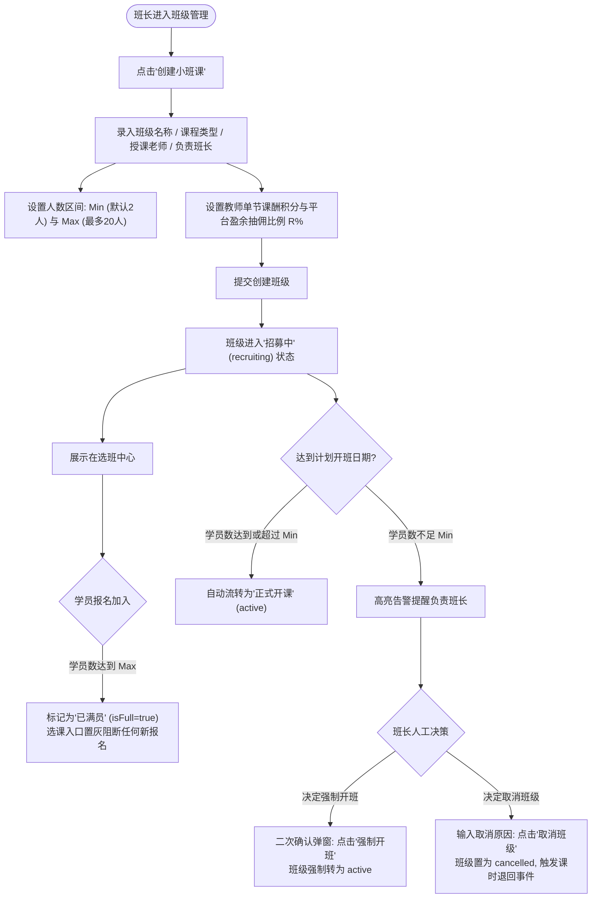

/** (c) 2024-2026 Topee (https://topee.top). All rights reserved. Proprietary and confidential. */

# 产品需求文档 (PRD) — 子模块 1C：统一班级与招生管控 (Classes & Capacity Engine)

| 元数据项 | 说明 / 内容 |
|---|---|
| **模块代号** | `m1c` |
| **所属模块** | 模块一：教学教务基座与主数据 (Master Data & Profiles) |
| **文档状态** | 已批准 (Approved) |
| **关联顶层 PRD** | [Prd-v5.md](../Prd-v5.md) |
| **创建与更新日期** | 2026-11-04 |

---

## 1. 概述与执行摘要 (Executive Summary)

统一班级与招生管控（`m1c`）是 Dream 系统的班级载体与容量约束引擎。系统将授课形态统一收敛为“班级实体”，并实施两级分流策略：
1. **1v1 个人班**：在购课或首次排课时由系统在后台**静默自动建班**，在家长端与教师端全流程物理屏蔽“班级”概念（仅呈现“意向老师 + 课程类型”）；
2. **小班课（Small Group）**：由班长/管理员显式创建并自主招生运营（自负盈亏），内置最少开班人数（Min）与最大容纳人数（Max）的刚性边界保护、满员自动截流与未达 Min 人数时的二次确认【强制开班】机制。

---

## 2. 问题定义与背景 (Problem Statement)

- **痛点 1：1v1 与小班课数据模型割裂**：传统系统常将 1v1 与班课做成两套完全平行的数据库表，导致后续排课、代课、请假配额与财务结算逻辑大量重复分裂。
- **痛点 2：1v1 场景强推班级概念造成认知负担**：对 1v1 家长而言，其认知模型是“找某位外教约课”，若界面强行展示“班级编号/班级名称”，极易产生困惑。
- **痛点 3：小班课超卖与开班边界失控**：多人小班课在家长集中选课时极易发生并发超卖破坏师生比；当未达最低人数时若无确定性流程管控，易导致开课前夕纠纷。

---

## 3. 目标用户与角色画像 (Users & Personas)

### 3.1 角色一：小班课负责人（Leo，中方班长）
- **诉求**：自主发起小班课并负责招生运营（自负盈亏）；配置开班人数区间（如 2-4 人）、教师课酬底分与平台抽佣比例；在报名人数达到 Max 时系统自动封顶截流；若开班前仅有 1 人报名，能根据实际情况决定“强制开班”或“取消班级”。

### 3.2 角色二：选班出资家长（Amy，家长）
- **诉求**：选小班课时清晰掌握当前招生进度（如 `3/4人 (招募中)`）；当班级满员时入口明确提示“已满员”置灰，防止误操作。

### 3.3 角色三：平台管理员（Sarah）
- **诉求**：统筹全平台小班课开设状态与抽佣比例合规性；监控 1v1 班级后台健康度。

---

## 4. 核心业务流程 (Workflows)



---

## 5. 用户故事 (User Stories)

- **US-1C-01（1v1 静默建班）**：作为一个 1v1 家长，我想要直接选择老师和课程类型排课，而无需感知任何班级概念，以便于保持极简约课体验。
- **US-1C-02（小班课参数配置）**：作为一个小班负责人，我想要设定班级的 Min/Max 人数与抽佣比例，以便于清晰测算班级自负盈亏成本。
- **US-1C-03（满员防超卖）**：作为一个小班负责人，我想要在班级满额时系统自动锁死报名入口，以保障小班互动教学品质。
- **US-1C-04（未达标强制开班）**：作为一个小班负责人，我想要在开班人数不足时根据师生实际意愿自主选择强制开班，以便于灵活兼顾招生成本与老学员体验。
- **US-1C-05（取消班级退课流转）**：作为一个小班负责人，我想要在招生失败时一键取消班级，由系统自动通知家长并联动处理后续课时返还。

---

## 6. 验收标准清单 (Acceptance Criteria)

### 6.1 1v1 班级静默建班规范
- **AC-1C-01**：1v1 课程购课或首次排课时，系统在后台领域服务层自动静默创建或复用 `1v1` 班级实体。
- **AC-1C-02**：在家长端与教师端的所有展示界面中，**严禁出现“班级”、“1v1班”等字样或实体卡片**，统一呈现为“意向授课老师 + 课程类型”。

### 6.2 小班课创建与参数边界
- **AC-1C-03**：创建小班课时，参数边界校验规则如下：
  - 人数区间：$1 \le Min \le Max$ 且 $Max \le 20$（默认 $Min = 2, Max = 4$）；
  - 平台净盈余抽佣比例 $R\%$：取值区间为 $[0.00, 100.00]$，支持 2 位小数；
  - 教师单节课酬积分：必须为非负整数。
- **AC-1C-04**：小班课责任班长物理绑定创建者本人；管理员可指定任意班长为责任人。

### 6.3 满员保护与选课截流
- **AC-1C-05**：小班课有效报名学员数（`enrolled` 状态）达到 $Max$ 时，选班中心该班级状态立即标记为【已满员】（`isFull = true`），前端操作按钮置灰禁用，后端并发请求通过排他锁坚决阻断超卖。

### 6.4 未达 Min 人数流转（强制开班 / 取消班级）
- **AC-1C-06**：若到达计划开课日期（`planned_start_date`）且当前报名人数 $< Min$：
  - 班长工作台呈现高亮警示提示；
  - 负责人点击【强制开班】时，系统呼出二次确认弹窗（明确提示当前人数与盈亏自负风险），确认后班级状态由 `recruiting` 流转为 `active`，记录操作人与强制开班时间戳（`force_started_at`）。
- **AC-1C-07**：若负责人决定取消班级，点击【取消班级】并录入取消原因，班级状态变更为 `cancelled`，系统产生 `ClassCancelledEvent` 领域事件通知下游单据系统执行课时退回。

---

## 7. 范围外清单 (Out of Scope - 本期明确不做)

- **暂不实现自动候补队列 (Waitlist)**：满员后直接阻止选课，不设计学员排队与自动递补机制。
- **暂不在本模块执行退费与扣款计算**：取消班级后，本模块只负责班级状态变更为 `cancelled`，实际课时回退与单据变更由模块二（购课/退款单）承接。

---

## 8. 界面线框与布局规范 (Wireframe Level)

### 8.1 班长端小班课看板卡片
```
+--------------------------------------------------------------------------+
|  KET 冲刺精讲小班 (4人班)                  [招募中 (2/4人)]  负责班长: Leo |
|  授课老师: David Miller                    课程类型: KET备考             |
|  人数区间: Min 2人 - Max 4人               单节课酬: 30积分 / 抽佣: 10%  |
|  计划开课: 2026-11-15                                                    |
|                                                                          |
|  报名学员: [头像] AliceZ12, [头像] BobW10                                |
|  ----------------------------------------------------------------------  |
|  [强制开班] (人数未达标时高亮)      [取消班级]               [查看详情]  |
+--------------------------------------------------------------------------+
```
