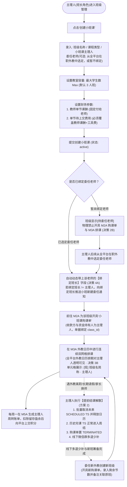
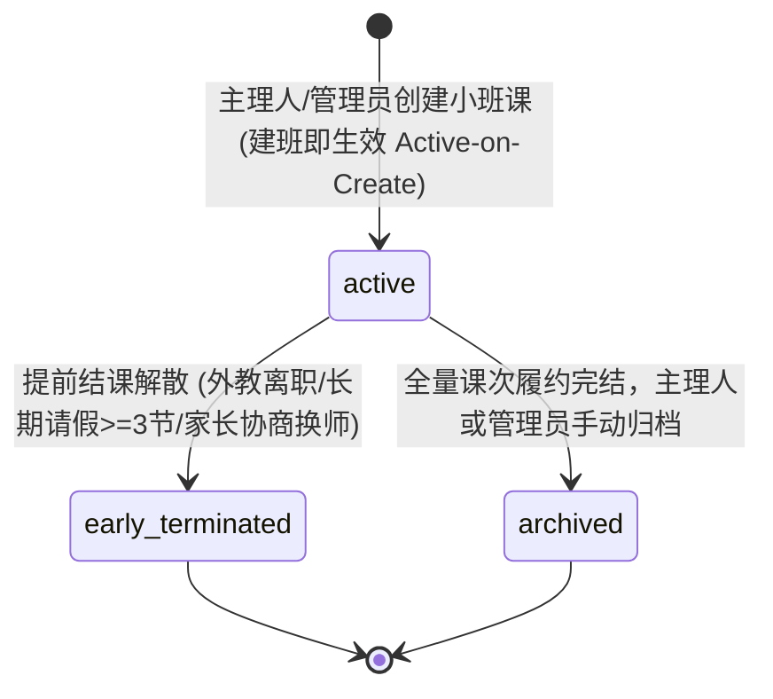

/** (c) 2024-2026 Topee (https://topee.top). All rights reserved. Proprietary and confidential. */

# 产品需求文档 (PRD) — 子模块 1C：统一班级与小班课管控 (Classes & Group Class Engine)

| 元数据项 | 说明 / 内容 |
|---|---|
| **模块代号** | `m1c` |
| **所属模块** | 模块一：教学教务基座与主数据 (Master Data & Profiles) |
| **文档状态** | 已批准 (Approved) |
| **关联顶层 PRD** | [Prd-v5.md](../Prd-v5.md) |
| **关联规范文档** | [BUSINESS_RULES.md](../BUSINESS_RULES.md) ｜ [DESIGN.md](../DESIGN.md) |
| **创建与更新日期** | 2026-11-04 初稿；2026-11-09 重构为“主理人承包自负盈亏制（免学生建档与免家长注册）”；2026-11-10 升级为“小班课主理人体系、全平台跨班长直接委任外教、换师方案 2（提前结课解散清算 + 线下多退少补 + 委任新师新建班级）”；2026-11-12 卡片视觉改为只声明卡片类型，色值统一引用 DESIGN.md 2.2.1 |

---

## 1. 概述与执行摘要 (Executive Summary)

统一班级与小班课管控（`m1c`）是 Dream 系统的班级载体与小班自负盈亏约束引擎。系统将授课形态收敛为两级分流：
1. **1v1 个人班**：在购课或首次排课时由系统在后台**静默自动建班**，在家长端与教师端全流程物理屏蔽“班级”概念（仅呈现“意向老师 + 课程类型”）；
2. **小班课（Small Group，小班课主理人承包制）**：全面采用**“小班课主理人”**（简称**“主理人”**）术语取代原“小班课班长/小班负责人”。主理人赋予系统 `monitor`（班长）角色（在 M1B 新建班长时创建即自动拥有班长权限，名下可绑定外教也可不绑定外教），在后台创建小班并实行**自负盈亏独立承包**。主理人委任主讲老师或代课老师时**可选全平台全体在职外教**（直接委任制），选定后自动关联带出该外教的【绑定班长】字段，供绑定班长只读查看小班信息与修改日志并在跨班长时接收协同通知。**小班课学生完全不支持家长注册与学生建档**，线下招生收款与家长沟通完全由主理人在私域自闭环，每周向平台上交结算积分。

---

## 2. 问题定义与背景 (Problem Statement)

- **痛点 1：强迫小班家长注册建档导致招生转化极低**：在少儿多人小班拼班场景中，家长习惯微信群内接龙交费；若强制要求所有家长下载、注册、建档、绑定孩子，门槛极高，极易造成客源流失。
- **痛点 2：权责利不对等与财务结算割裂**：小班课由主理人自负盈亏承担招不满赔钱的风险。原方案既要求主理人承担全盘盈亏，又在系统中维护散客名单与个人请假，造成业务权责混乱。
- **痛点 3：私域外教孤岛限制小班开班产能**：部分擅长小班招生运营的主理人名下未直接管辖外教（或名下外教时段/课型不匹配），若限制只能选自己名下的外教，会导致有生源的主理人无法开班；而放开全平台选师后，又需要保障外教原绑定班长的排期知情权与日志追溯权。
- **痛点 4：无主学生数据与空档案堆积**：小班学员若录入档案但家长不注册，会导致数据库产生大量无关联账号的“孤儿学生档案”，增加维护与合规成本。

---

## 3. 目标用户与角色画像 (Users & Personas)

### 3.1 角色一：小班课主理人（Leo，赋予班长角色）
- **定位**：小班课自主承包商与自负盈亏第一责任人（拥有系统 `monitor` 班长角色，名下可绑定具体外教，也可不绑定任何外教）。
- **诉求**：可先创建小班（支持建班时直接从全平台在职外教中委任老师，也支持暂不绑定老师待后续委任）；委任老师后在线下招募 2~6 人拼班收款、在系统内开具小班购课单并排课；每周上交扣除留存盈余后的积分；支持全平台委任换师与指派代课；遇节假日一键暂停待排。

### 3.2 角色二：委任外教的绑定班长（Emma，外教日常经纪人）
- **定位**：被委任外教的 1:1 归属管理班长（当与小班课主理人非同一人时触发跨班长协同）。
- **诉求**：当自己管辖的外教被其他主理人委任为小班主讲或代课时，第一时间收到新建、编辑、换师、代课、改期补排等操作通知；能在自己工作台看到该小班课的主理人是谁、排期占用了哪些时段，并能只读查看该小班的信息与修改日志。

### 3.3 角色三：平台管理员（Sarah）
- **定位**：平台统筹与工具费/其他结余监管方。
- **诉求**：监督全平台开设的小班课合规性；查看每个小班的主理人与外教绑定班长；确保每节小班课严格按容量上限 $Max \times 6$ 积分扣减平台工具费；按底线覆盖原则监管周度转账归集。

### 3.4 角色四：选课家长（Amy）
- **定位**：线下参班出资人。
- **边界说明**：小班课对家长端完全透明，家长无需注册系统账号，无需维护学生档案，所有沟通、请假与补课由小班课主理人在私域闭环服务。

---

## 4. 核心业务流程 (Workflows)



---

### 4.2 班级实体生命周期与状态机 (Class Entity Lifecycle & State Machine)

班级实体由 M1C 负责全生命周期闭环管辖，严格收敛为以下状态转移矩阵：



- **班级状态转移规则与操作防线**：

| 初始状态 | 目标状态 | 触发角色 | 前置条件与守卫防线 | 伴随数据与财务副作用 |
| :--- | :--- | :--- | :--- | :--- |
| `[*]` | `active` (正式生效) | 小班课主理人 / 超级管理员 | 录入班级名称、课程类型、容量 Max 与财务参数 | 班级实体落盘；若暂未绑定老师，显示 `[待委任老师]` 并物理阻断排课与开单。 |
| `active` | `early_terminated` (提前结课) | 小班课主理人 / 超级管理员 (外教绑定班长只读阻断) | 必须选择解散原因枚举；必须勾选线下退费免责承诺框 | 1. 事务内批量作废未来所有 `SCHEDULED` TS 并原子释放外教日历双网格；<br>2. 历史完课 TS 锁定进入 M5A 周度结算；<br>3. 原小班购课单标记为 `TERMINATED`；<br>4. 10 秒内向委任外教的绑定班长推送解散知情通知。 |
| `active` | `archived` (正常结案归档) | 小班课主理人 / 超级管理员 | 该班级无未来未上的 `SCHEDULED` TS，历史账目已结清 | 班级进入只读归档态；物理禁止新开小班购课单与日历排课；历史数据永久可追溯。 |

---

## 5. 用户故事 (User Stories)

- **US-1C-01（1v1 静默建班）**：作为一个 1v1 家长，我想要直接选择老师和课程类型排课，而无需感知任何班级概念，以便于保持极简约课体验。
- **US-1C-02（主理人建班与全平台选师）**：作为一个小班课主理人（即使我名下没有直接管辖的老师），我想要创建小班并从全平台在职外教中委任授课老师（或先建班后续再绑定老师），并在完成老师绑定后开展购课录单、日历排课与每周积分上交，以便于高效开展小班运营。
- **US-1C-02a（绑定班长知情与日志追溯）**：作为委任外教的绑定班长，当其他主理人委任了我名下的老师上小班课时，我想要自动收到新建/编辑/代课/换师/改期补排通知，并在列表中查看该小班的主理人、班级详情与修改日志，以便于掌握名下外教的排期去向。
- **US-1C-03（容量上限绑定工具费）**：作为一个平台管理员与主理人，我期望设定班级容量上限（Max），以便于系统依据 $Max \times 6$ 积分精确测算平台固定工具费基准。
- **US-1C-04（免学生录入与零幽灵档案）**：作为一个系统运维人员，我期望小班课无需录入学生档案与关联家长，以便于保持全平台学生档案库的绝对纯净。
- **US-1C-05（暂停待排自闭环）**：作为一个小班课主理人，我期望在公众假期或突发事件时一键暂停待排，以便于自主在群内与家长协调后续补排时段。
- **US-1C-06（按授课外教精准检索与数据下钻）**：作为一个小班课主理人、外教绑定班长或全平台管理员，我期望能够按授课老师快速过滤小班课列表，并查看对应主理人、绑定班长、排课节数与分成数据。

---

## 6. 验收标准清单 (Acceptance Criteria)

### 6.1 1v1 班级静默建班规范
- **AC-1C-01**：1v1 课程购课或首次排课时，系统在后台领域服务层自动静默创建或复用 `1v1` 班级实体。
- **AC-1C-02**：在家长端与教师端的所有展示界面中，**严禁出现“班级”、“1v1班”等字样或实体卡片**，统一呈现为“意向授课老师 + 课程类型”。

### 6.2 小班课创建与参数录入规范（免录学生、全平台选师与暂不绑定规约）
- **AC-1C-03**：创建小班课时，录入字段收敛如下：
  1. `班级名称`（`class_name`）：1-64 字符（如 `KET考前冲刺周六班`）；
  2. `小班课主理人`（`owner_monitor_profile_id`）：绑定小班自负盈亏责任人（默认为创建班长本人，管理员可指定任一在职班长）；
  3. `课程类型`（`course_type_id`）：绑定教学大纲分类；
  4. `授课老师`（`teacher_profile_id`，**选填/支持暂不绑定**）：
     - 主理人可直接从**全平台全体在职外教**（`status == 'ACTIVE'` 且技能匹配该班级课程类型）中点选委任，实行**直接委任制**（无需前置审批，选定即委任 · 决策 1-A）；
     - 也支持选择【暂不绑定老师】（待委任状态），班级创建后状态显示为 `[待委任老师]`；
  5. `外教绑定班长`（`teacher_monitor_profile_id`，**系统自动动态带出** · 决策 4A）：
     - 当选定委任老师时，系统通过 `teacher_profile.monitor_profile_id` 自动动态关联带出该外教当前的管辖班长；
     - 若该外教后续在 M1B 被管理员改绑给新班长，小班课关联的外教绑定班长自动实时跟随同步更新，并写入班级修改日志；
  6. `最大学生数 (Max)`：整数，范围限制在 $2 \le Max \le 20$（**默认 $Max = 3$**，契合实际大多数小班为 3 人的现状）；**系统取消最少人数 Min 字段**；
  7. `教师单节课酬积分`：非负整数，每节课固定付给老师的课酬底金（建班时输入）；
  8. `单节待上交费用积分`（`lesson_points`）：该班级单节实际上交平台的总积分（主理人录入多少就上交多少，系统停用平台分成与自留利润计算）；
  9. **底线覆盖与字段停用规则**：
     - 系统强制要求：$\text{单节待上交费用} \ge \text{教师单节课酬} + Max \times 6$ 积分。若录入值低于底线成本，系统前置报错并物理阻断提交；
     - 录入费用超出“教师课酬 + 工具费”部分，页面文案统一显示为**“其他结余”**（沉淀在平台，不可退）；
     - 彻底停用并移除原 `platform_commission_rate`（平台抽佣比例）、`commission_points`（抽佣积分）与 `monitor_retained_points`（主理人自留收益）字段，先不执行平台分成。
- **AC-1C-03a（暂不绑定老师的前置双阻断铁律 · 决策 2B）**：
  - 若小班课处于“暂未绑定老师”状态，系统**同时物理禁止开具 M2A 小班购课单与执行 M3A 日历排课**；
  - 主理人在班级卡片点击【为本班购课】或【班级排课】时，系统强行弹出拦截提示：“该小班尚未委任授课老师，请先点击【委任老师】选定主讲外教后再录单收款与排课”；
  - 必须由主理人从全平台在职外教中委任具体老师后，方可解除限制，放行购课单录入与日历排课。
- **AC-1C-04**：**彻底废弃学生名单录入**：小班课**严禁**关联任何 `student_profile_id`，数据库不维护 `class_students` 关系表；家长端全域不展示小班课选课中心。
- **AC-1C-05**：**建班即生效 (Active-on-Create)**：小班课创建成功后，班级状态直接置为 `active`（正式生效），无需流转 `recruiting`（招募中）状态，取消满员自动截流与强制开班流程。

### 6.3 小班课停办与提前结课解散规范
- **AC-1C-06**：班级生命周期结束后，主理人或管理员可在后台点击【归档班级】，班级状态转为 `archived`，不再允许新开购课单。
- **AC-1C-07（小班课提前结课解散规范 · 方案 2）**：
  - 当因外教离职、长期请假（$\ge 3$ 节）、排期冲突或全班家长协商换师导致无法继续原班授课时，主理人或超级管理员可在班级详情页执行【提前结课解散】；
  - 班级状态转为 `early_terminated`（提前结课归档），物理禁止追加排课、开具购课单或委任外教；
  - **原子清算动作**：
    1. 未来所有处于 `SCHEDULED`（已排期）状态的 TS 课次在单事务内批量变更为 `CANCELLED`，原子释放对应外教日历双单元格为 🟢【空闲可约】；
    2. 历史处于 `COMPLETED`（已结课）或 `SUBSTITUTED`（已代课）的 TS 课次保持原样锁定，按既定标准正常计入 M5A 周度转账单归集，课酬发给实际授课老师；
    3. 未上课次绝不产生任何未来平台工具费（$Max \times 6$ 积分）与其他结余义务，系统内无挂账与退款单流程；
    4. 联动 M2A 将原小班购课单标记为 `TERMINATED`，快照记录已消耗节数（`consumed_lessons`）与作废节数（`voided_lessons`）。

### 6.4 班级列表双重视角、外教筛选与只读日志追溯规范
- **AC-1C-08**：**班长工作台小班课双重视角划分**：
  - **Tab 1【我主理的班级】**：展示当前登录班长作为主理人（`owner_monitor_profile_id == current_monitor_id`）的所有班级，享有完整的写操作权限（委任老师、开单、排课、暂停待排、提前结课解散、归档）；
  - **Tab 2【我名下外教参与的班级】（只读共享 · 决策 4A / 5A）**：
    - 展示当前登录班长管辖的外教（`teacher_profile.monitor_profile_id == current_monitor_id`）被其他主理人委任主讲或代课的小班课列表；
    - 卡片明确展示 `小班主理人: [Leo]`、`当前主讲: [David]`；
    - **严格只读控制**：外教绑定班长在此 Tab 下仅具备【查看详情】、【查看排期】与【查看修改日志】权限；所有写操作按钮（开单、排课、暂停待排、提前结课解散、异常回退）物理隐藏，严禁越权干预主理人的班级运营。
- **AC-1C-08a（班级修改日志追溯）**：系统对小班课的关键变更操作（新建班级、委任老师、提前结课解散、外教改绑联动、暂停待排、补排、指派代课、异常回退）强制写入审计日志 `dream.audit_logs`；主理人与外教绑定班长在班级详情页可随时展开【班级操作与修改日志】时间轴，查看操作人、操作时间、变动前后快照。
- **AC-1C-09**：**授课外教复合检索与数据联动下钻**：
  - 教师筛选器展示全平台参与过小班课授课的在职外教；
  - 教师筛选器与状态分段条（全部 / 正式开课 / 已归档 / 已提前解散）遵循逻辑 **AND（与）复合检索**；
  - 切换特定外教后，列表大盘指标（正式开课数、未来排课总节数、待上交总积分/其他结余）实时联动重算。
- **AC-1C-10**：移动端列表顶部常驻水平横向滑动教师胶囊条（Pill Tabs），展示外教姓名及关联班级数量；切换后若无符合班级，展示友好空状态提示与重置入口。

### 6.5 小班课换师方案 2：提前结课解散、线下多退少补与新建班级规范
- **AC-1C-11（解散弹窗强约束与双流向清算规范）**：
  - 仅允许小班课主理人或超级管理员操作；外教绑定班长为纯只读权限，严禁越权解散；
  - 点击【提前结课解散】时，系统弹窗强阻断，要求必选【解散原因枚举】：
    - `TEACHER_RESIGNED`（主讲外教离职/长期请假）；
    - `SCHEDULE_CONFLICT`（班级排期重大冲突）；
    - `STUDENTS_REQUEST_CHANGE`（家长集体协商要求换师）；
    - `OTHER`（其他客观原因）；
  - **必选后续处置流向（`disposition_type`）**：
    - **流向 A【结转新班 (REOPEN_NEW_CLASS)】**：用于中途更换外教场景。剩余课时学费在线下多退少补，后续由主理人委任新外教创建新班级承接；
    - **流向 B【彻底解散退费，不开新班 (PERMANENT_TERMINATE)】**：用于因生源流失、排期不合彻底停办小班场景。
      - 系统在弹窗内动态呈现【线下退费清算参考面板】：自动根据 $\text{剩余未上课时} \times \text{单节待上交费用}$ 测算并展示建议退还全班总额及人均应退学费（仅供主理人对账参考，系统不参与线上划扣与垫付）；
      - 主理人必填【退费说明及审计备注】（如“已于微信群向全班4人家长原路结清剩余学费，班级彻底终止不再开班”）；
      - 支持选填上传 1~3 张微信群打款截图凭证（JPG/PNG）；
      - 系统**严禁向 M2B 派发系统退款单**，班级状态置为 `early_terminated` 并标注 `[已退费结案]`，彻底闭环结案；
  - 弹窗必须包含免责告知勾选框：`“我已确认：所有剩余学费已在线下微信群向家长核算完成（多退少补或原路结清），自愿承担客诉与履约责任”`。未勾选时物理禁止提交。
- **AC-1C-12（解散操作审计与跨班长协同通知 · 决策 4A）**：
  - 解散成功后，系统向 `dream.audit_logs` 写入变更日志（记录操作人、原班级 ID、完课节数、作废节数、解散原因、处置流向及备注凭证）；
  - 若原授课外教的绑定班长与主理人非同一人，系统在 10 秒内向该外教绑定班长推送三级通知（站内信 + 邮件抄送），告知班级因故提前解散及外教未来排期已全量释放。
- **AC-1C-13（委任新外教创建新班级规范）**：
  - 主理人更换新老师时，在系统内执行标准的【创建小班课】流程：
    1. 从全平台在职外教中点选新主讲外教（直接委任制）；
    2. 系统自动带出新外教当前的定级标准课酬（如 Senior 为 40 积分/节）；
    3. 录入班级定员 Max（默认 3 人，可调）；
    4. 录入多退少补后重新核算的【单节待上交费用】（必须覆盖新老师课酬与工具费底线）；
    5. 提交后新班级进入 `active` 正式开课状态。
- **AC-1C-14（新班承接购课单录入与穿透对账备注）**：
  - **单据物理绝对独立铁律**：原班购课单已终态 `TERMINATED` 封存归档，新班级**严禁复用或继承原购课单**，必须开具一张全新的独立购课单；
  - 主理人在 M2A 为新班级开具专属小班购课单：
    1. `购买课时数`：录入新班实际要上的剩余节数（如原班上完 4 节余 8 节，则录入 8 节）；
    2. `整班总上交积分`：录入新班实际待上交总额（满足底线覆盖要求）；
    3. 表单提供选填字段【关联结转原班级】（`source_class_id`，下拉仅列出当前主理人名下已解散的班级）与【业务备注】（`remarks`）；
    4. 主理人录入备注（例如：“承接原班级 [KET周六A班] 剩余 8 节，委任新外教 Sarah，学费差额已在微信群结清”）；
    5. 若因老生优惠导致实收积分与系统期望积分不一致，触发 `force_submit=true`，上述备注自动作为财务免责审计凭证，管理员周二核算时直接放行。
- **AC-1C-15（临时代课与长期换师边界防线）**：
  - **短期应急代课（1~2 节，$\ge 3$h 报备）**：严禁解散班级，必须走 M3B 小班代课指派流程，代课老师享受原既定课酬快照平移结算，不影响班级生命周期与原购课单；
  - **长期/永久无法授课（$\ge 3$ 节或外教离职）**：严禁在原班级硬换外教，必须且只能走方案 2：【提前结课解散】$\rightarrow$ 线下多退少补 $\rightarrow$ 【新建班级】。
- **AC-1C-15a（外教突发停电与紧急停课闭环规约）**：
  - **突发停电告警与待办派发**：外教开课前突发停电勾选“不可抗力”发起紧急报备时，系统豁免 3h 锁死，10 秒内向对应小班主理人派发置顶红标告警待办与邮件；
  - **路径 A 紧急代课（开课前 $\ge 15\text{min}$）**：主理人可在全平台在职外教中指派具备资质且连续双时段空闲的外教代课，课酬平移结算；
  - **路径 B 暂停待排兜底（开课前 $< 15\text{min}$ 或无人代课）**：触发小班课暂停待排安全兜底：
    1. 课次 TS 状态流转为 `CANCELLED`，原子退回该班级待排池（`Class_Pending_TS`，绑定 `class_id`）；
    2. **100% 豁免扣减学员课时与请假配额**，不计发外教课酬，免收平台 $Max \times 6$ 工具费；
    3. 主理人工作台生成置顶补排待办并在私域微信群内闭环通告全班家长协调择期补排（点击待办【立即补排】带参直达 [m3d_course_scheduling.md Section 4.6.2](./m3d_course_scheduling.md) 单节补排模式选位落盘）；
    4. **系统绝对禁止向小班家长发送短信或邮件**（小班家长免注册、免建档、系统无其联系方式）。
- **AC-1C-16（小班课实体卡片设计系统合规标准）**：
  - 小班课看板列表与卡片 100% 遵照 [DESIGN.md Section 2.2.1](../DESIGN.md) 的【中性卡】规范；
  - 严禁使用整卡大面积彩底背景；
  - 首行展示班级全名、班型规格与当前状态胶囊（如 `[正式开课]`）；
  - 主体采用属性网格呈现主讲外教、绑定班长、规模、课酬与工具费，文字层级与对比度统一遵循 DESIGN.md；
  - 底部操作栏按操作频次提供次要按钮，视觉轻量去噪。

---

## 7. 范围外清单 (Out of Scope - 明确不做)

- **严禁小班课学生注册与建档**：本期小班课学生完全不接入系统账号体系，不分配学生档案，不建立家校公开留言。
- **不做系统级招募大厅与家长自主选班**：选班与拼班 100% 由主理人在线下私域完成。
- **不做学生个人请假与个人考勤**：小班课仅支持主理人发起的【暂停待排】，不接受单名学生的系统级请假与退费。
- **外教绑定班长无小班课写操作权**：被委任外教的绑定班长对该小班仅享有只读知情权与日志查看权，系统严格阻断外教绑定班长对此小班的任何开单、排课、改期或异常回退操作。
- **严禁在原班级实体上中途直接更换主讲外教**：小班课生命周期强绑定单任主讲老师，不支持在原班级内直接更换主讲老师；长期换师必须且只能走方案 2：【提前结课解散】$\rightarrow$ 线下多退少补 $\rightarrow$ 【新建班级】。

---

## 8. 界面线框与布局规范 (Wireframe Level)

- **设计系统锚定**：小班课实体卡片 100% 遵照 [DESIGN.md Section 2.2.1](../DESIGN.md) 的【中性卡】规范，无大面积彩底，属性排版与对比度统一遵循 DESIGN.md。

### 8.1 主理人端小班课看板卡片 (精简承包态)
```
+--------------------------------------------------------------------------+
|  KET 冲刺精讲小班 (4人班)                  [正式开课 (ACTIVE)] 主理人: Leo   |
|  授课外教: David Miller (Senior)           课程类型: KET备考             |
|  外教归属: Emma (绑定班长)                  班级规模: Max 4人规格         |
|  单节实收: 50 积分/节                      平台固定工具费: 24 积分 (4×6) |
|  单节课酬: 30 积分/节                      平台分成比例: 10%             |
|                                                                          |
|  [为本班购课]  [班级排课]  [提前结课解散]  [暂停待排]  [修改日志]  [归档]    |
+--------------------------------------------------------------------------+
```

### 8.2 班长端小班课双视角看板列表 (移动端优先)
```
+--------------------------------------------------------------------------+
|  小班课中心                                            [ + 创建小班课 ]   |
|--------------------------------------------------------------------------|
|  [ 我主理的班级 (5) ]          [ 我名下外教参与的班级 (3) · 只读 ]        |
|--------------------------------------------------------------------------|
|  👨‍🏫 授课外教: [ 全部老师 (8) ]  [ David Miller (3) ]  [ Linda Chen (2) ] … |
|--------------------------------------------------------------------------|
|  [ 全部 8 ]        [ 正式开课 5 ]        [ 已归档 2 ]        [ 已取消 1 ]  |
|--------------------------------------------------------------------------|
|  ┌────────────────────────────────────────────────────────────────────┐  |
|  │ KET 冲刺精讲小班 (4人班)                    [正式开课] 主理人: Leo    │  |
|  │ 授课外教: David Miller (归属班长: Emma)     未来待授课: 8 节          │  |
|  │ 班级规模: Max 3人规格                      单节待上交: 48 积分/节    │  |
|  │ 教师课酬: 30积分/节 (其他结余: 0)         平台工具费: 18 积分(3×6)  │  |
|  │                                                                    │  |
|  │ [为本班购课]  [班级排课]  [提前结课解散]  [暂停待排]  [修改日志]  [归档] │  |
|  └────────────────────────────────────────────────────────────────────┘  |
+--------------------------------------------------------------------------+
```
