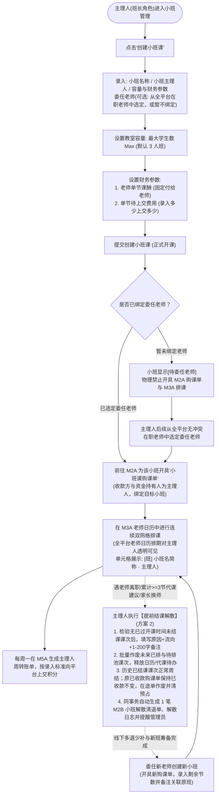
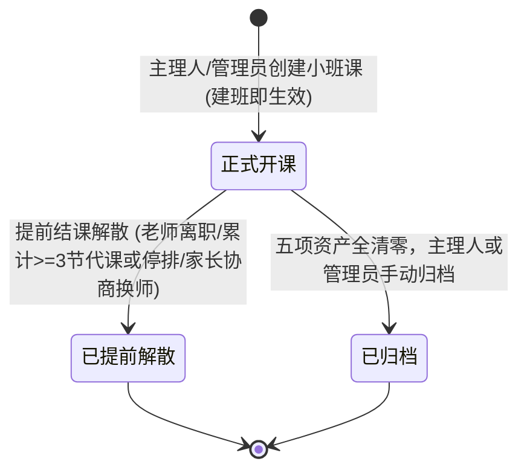

/** (c) 2024-2026 Topee (https://topee.top). All rights reserved. Proprietary and confidential. */

# 产品需求文档 (PRD) — 子模块 1C：统一小班与小班课管控 (Classes & Group Class Engine)

| 元数据项 | 说明 / 内容 |
|---|---|
| **模块代号** | `m1c` |
| **所属模块** | 模块一：教学教务基座与主数据 (Master Data & Profiles) |
| **文档状态** | 已批准 (Approved) |
| **关联顶层 PRD** | [Prd-v5.md](../Prd-v5.md) |
| **关联规范文档** | [BUSINESS_RULES.md](../BUSINESS_RULES.md) ｜ [DESIGN.md](../../DESIGN.md) |
| **创建与更新日期** | 2026-11-04 初稿；2026-11-09 重构为“主理人承包自负盈亏制（免学员建档与免家长注册）”；2026-11-10 升级为“小班主理人体系、全平台跨班长直接委任老师、换师方案 2（提前结课解散清算 + 线下多退少补 + 委任新师新建小班）”；2026-11-12 卡片视觉改为只声明卡片类型，色值统一引用 DESIGN.md 2.2.1；2026-11-21 补全【提前结课解散】闭环：作废待排池与未来已排未上 TS、作废在途小班单与 `G-HOLD`、增设已开课未结课守卫、双流向均强制填写 1–200 字解散备注（无截图上传），原「已付款」购课单保持不变 + 同事务唯一驱动生成 1 笔 M2B 小班解散课次清退单；2026-11-22 正式废除“1v1 静默个人班”概念（`m1c` 纯化为 `1vN` 小班专属引擎），接入 `m1e` 在学课件与 2000 字 `Process Note`（进度备注）双端教学协作闭环；同日完成 Red-Team 审查闭环修订；2026-11-22 (**SSOT 归口与合规清洗**：升级 `§4.2` 小班四支柱生命周期、字段锁定、留痕与留存及第 2 层跨实体同事务联动清单/宿主入边索引，同步消除 `AC-1C-14(5)` 与 `M2A` 不设期望积分的残余冲突及 `US-1C-06` 过期“分成数据”表述，全篇清零英文枚举及技术实现词汇) |

---

## 1. 概述与执行摘要 (Executive Summary)

统一小班与小班课管控（`m1c`）是 Dream 系统的小班载体与小班自负盈亏约束引擎。系统对班型采取物理分流原则：
1. **1v1 个人课直连模式（彻底取消虚拟班级）**：1v1 课程直接由【学员档案 + 购课单 + 最小课次枢纽 (`TS`)】闭环承载，**后台不创建、不维护任何“1v1 个人班 / 1v1 虚拟班级”实体**；家长端、老师端与班长端在 1v1 场景下仅呈现授课老师、价位与学员信息，彻底隔离小班概念；
2. **小班课（Small Group，本模块唯一管辖主体 · 小班主理人承包制）**：全面采用**“小班主理人”**（简称**“主理人”**）术语取代原“小班课班长/小班负责人”。谁持有资金谁创建小班并作为小班主理人；主理人须拥有在职「班长」业务身份（由 [M1B](./m1b_teacher_profile.md) 在本地委任创建，非认证中心角色，名下可绑定老师也可不绑定老师），在后台创建小班并实行**自负盈亏独立承包**。小班课与 1v1 固定位类似，以 **4 周为一个履约轮次 (4-Week Cycle)** 滚动持续运营，主理人每轮购课一次；小班实体作为长期教学容器，在「正式开课」状态下跨轮次持续滚动，无需每轮重复建班，并可直接绑定 **1～6 门 M1E 在学课件、修读级别与 2000 字符进度备注 (`Process Note`)** 支撑备课、代课交接与授课历史追溯。主理人委任主讲老师或代课老师时**可选全平台全体在职老师**（直接委任制），不再关联老师的【绑定班长】（无跨班长只读共享或协同通知）。**小班课学员完全不支持家长注册与学员建档**，线下招生收款与家长沟通完全由主理人在私域自闭环，每周向平台上交结算积分。

---

## 2. 问题定义与背景 (Problem Statement)

- **痛点 1：强迫小班家长注册建档导致招生转化极低**：在少儿多人小班拼班场景中，家长习惯微信群内接龙交费；若强制要求所有家长下载、注册、建档、绑定孩子，门槛极高，极易造成客源流失。
- **痛点 2：权责利不对等与财务结算割裂**：小班课由主理人自负盈亏承担招不满赔钱的风险。原方案既要求主理人承担全盘盈亏，又在系统中维护散客名单与个人请假，造成业务权责混乱。
- **痛点 3：私域老师孤岛限制小班开班产能**：部分擅长小班招生运营的主理人名下未直接管辖老师（或名下老师时段/课型不匹配），若限制只能选自己名下的老师，会导致有生源的主理人无法开班；因此谁持有资金即可创建小班并作为主理人，直接从全平台在职老师中选师开班。
- **痛点 4：无主学员数据与空档案堆积**：小班学员若录入档案但家长不注册，会导致数据库产生大量无关联账号的“孤儿学员档案”，增加维护与合规成本。

---

## 3. 目标用户与角色画像 (Users & Personas)

### 3.1 角色一：小班主理人（Leo，在职班长）
- **定位**：小班课自主承包商与自负盈亏第一责任人（拥有在职「班长」业务身份，名下可绑定具体老师，也可不绑定任何老师）。
- **诉求**：可先创建小班（支持建班时直接从全平台在职老师中委任老师，也支持暂不绑定老师待后续委任）；委任老师后在线下招募常规 2~6 人拼班收款、在系统内开具小班购课单并排课；每周按录入标准上交积分（盈亏自负）；支持全平台委任老师与指派临时代课；遇节假日一键暂停待排。

### 3.2 角色二：平台管理员（Sarah）
- **定位**：平台统筹与小班合规监管方。
- **诉求**：监督全平台开设的小班课合规性；查看每个小班的主理人与授课老师；按“主理人录入多少上交多少”原则监管周度转账归集（已取消小班固定工具费）。

### 3.3 角色三：选课家长（Amy）
- **定位**：线下参班出资人。
- **边界说明**：小班课对家长端完全透明，家长无需注册系统账号，无需维护学员档案，所有沟通、请假与补课由小班主理人在私域闭环服务。

---

## 4. 核心业务流程 (Workflows)



---

### 4.2 小班实体唯一归口：四支柱生命周期、字段锁定、留痕与跨实体联动 (Entity & Log SSOT)

> **【实体生命周期、字段与日志唯一归口声明】**：**小班**（`1vN` 多人小班专属教学容器；1v1 不创建虚拟班级）的生命周期状态机、分阶段字段可编/锁定规则、状态流转与操作修改/解散残值留痕规则及数据留存策略 100% 统一且唯一由本 PRD 管辖与定义；其余文档仅作单向指针引用。全局中枢 **TS（课次）** 的状态机与四类跨端日志分工以 [BUSINESS_RULES.md §3.2](../BUSINESS_RULES.md) 为唯一统领基线。

#### 4.2.1 生命周期状态机与转移矩阵（含跨模块宿主入边）



| 初始状态 | 目标状态 | 触发角色 / 驱动源 | 前置条件与守卫防线 | 伴随数据与跨实体副作用 |
| :--- | :--- | :--- | :--- | :--- |
| **`[*]`** | **正式开课** | 小班主理人 / 平台管理员 | 录入小班名称（1–64 字）、容量上限（$2 \le \text{Max} \le 20$，默认 3）、老师单节课酬积分与单节待上交费用积分 | 小班实体生效；若暂未委任老师，标为 `[待委任老师]` 并物理阻断开具 M2A 购课单与 M3A/M3D 排课 |
| **正式开课** | **正式开课** *(主理人改绑/教学与补排入边)* | ① **[M1B 改绑](./m1b_teacher_profile.md)**；<br>② **[M3A](./m3a_calendar_grid.md)/[M3B](./m3b_attendance_substitution.md)/[M3D](./m3d_course_scheduling.md)** | ① M1B 管理员批量改绑或班长解职防线二改绑至非冻结在职接手班长；<br>② 课格抽屉/请假交接改课件与 `Process Note`，或单节补排落盘 | ① 新主理人承接后续新购课单与新课次盈亏，**历史已收款单与已裂变 TS 资金持有人保持不变**；<br>② 教学字段更新与补排待办核销同事务写入【小班操作与修改日志】 |
| **正式开课** | **已提前解散** | 小班主理人 / 平台管理员 | **前置防误作废守卫**：不存在开课时间 $\le$ 当前时刻且未结课/待考勤的已排课次；必选解散原因与处置流向（结转新班 / 彻底解散退费）、必填 **1–200 字解散备注**并勾选免责声明（免传截图凭证） | 单事务原子清算（触发方联动详见 `§4.2.5`）：<br>1. 批量作废未来已排与待排池 TS（释放日历双格但保留老师自身 🔴 请假，取消挂起代课待办）；<br>2. 历史已结课 TS 锁定照常进入 M5A 周结（标 `[已提前解散]`）；<br>3. 在途「待付款确认」小班单与 `G-HOLD` 批量作废；原「已付款」单据保持不变；<br>4. 同事务唯一驱动生成 1 笔 [M2B](./m2b_refund_orders.md#L53) 小班解散清退记录、写入解散日志与结案残值卡，并向管理员发中性卡提醒、向原授课老师发排期释放通知与邮件（绝不通知家长） |
| **正式开课** | **已归档** | 小班主理人 / 平台管理员 | **五项资产全清零守卫**：① 无未来「已排期」TS；② 小班待排池为空（无「待排期」TS）；③ 无在途「待付款确认」小班单及 `G-HOLD` 预占；④ 无已过开课时间未结课/待考勤课次；⑤ 无待处理异常回退 | 小班转为永久只读「已归档」态；**自动停用 4 周自动续费单生成**，物理禁止新开小班购课单与日历排课；历史数据永久可追溯 |

#### 4.2.2 分阶段关键字段可编与锁定规则矩阵（唯一归口定义）

「正式开课」状态按是否已产生有效购课单或 TS 分为 **阶段 ①②③**（其中 M2A 创建首笔「待付款确认」购课单即锁定进入阶段 ③；若该在途单最终作废且全班历史至今零已收款单且零 TS 产出，则允许回退阶段 ②；一旦存在任意「已付款」购课单或 TS 即不可逆永久锁定为阶段 ③）；「已归档」与「已提前解散」统一为永久只读的 **阶段 ④**：

| 业务字段 | 阶段 ①：正式开课（待委任老师） | 阶段 ②：正式开课（已委任老师，**无有效单且零 TS**） | 阶段 ③：正式开课（已委任老师，**有在途/已收款单或 TS**） | 阶段 ④：已归档 / 已提前解散 |
| :--- | :---: | :---: | :---: | :---: |
| **班级名称** | ✅ 可改（主理人/管理员） | ✅ 可改（主理人/管理员） | ✅ **可改**（核心基础字段） | 🔒 全字段永久只读 |
| **在学课件配置（增删 0~6 门）** | ✅ 可配（主理人/管理员） | ✅ 可配（主理人/管理员） | ✅ **可配**（主理人/管理员，不随财务锁定） | 🔒 全字段永久只读 |
| **课件级别与进度备注 (`Process Note`)** | ✅ 可改（主理人/管理员） | ✅ 可改（主理人/管理员/主讲） | ✅ **可改**（主理人/管理员/主讲/当节代课老师） | 🔒 全字段永久只读 |
| **最大学生数 (Max)** | ✅ 可改 ($2\sim 20$) | ✅ 可改 ($2\sim 20$) | 🔒 锁定（已锚定招生规模与购课单） | 🔒 全字段永久只读 |
| **老师单节课酬积分** | ✅ 可改（非负整数） | ✅ 可改（非负整数） | 🔒 锁定（已锚定课酬底金与 M2A 快照继承） | 🔒 全字段永久只读 |
| **单节待上交费用积分** | ✅ 可改（非负整数） | ✅ 可改（非负整数） | 🔒 锁定（已锚定购课单上交预期） | 🔒 全字段永久只读 |
| **授课老师** | ✅ 可委任（避让已设离职日 `D` 老师） | ✅ 可改选（避让已设离职日 `D` 老师） | 🔒 锁定（长期换师须走【提前结课解散 + 新建小班】） | 🔒 全字段永久只读 |
| **小班主理人** | 🔒 仅管理员在 [M1B](./m1b_teacher_profile.md) 改绑 | 🔒 仅管理员在 [M1B](./m1b_teacher_profile.md) 改绑 | 🔒 仅管理员在 [M1B](./m1b_teacher_profile.md) 改绑 | 🔒 全字段永久只读 |

#### 4.2.3 状态流转、修改与解散残值留痕规则（唯一归口定义）

1. **状态流转与操作修改日志**：
   - 小班每次生命周期状态跃迁（「正式开课」/「已提前解散」/「已归档」）必须在同一事务内追加写入只读状态流转记录（原状态、目标状态、操作人、流转时间与原因/备注）；
   - 小班新建、编辑关键字段（仅字段值实际变化时）、委任老师、主理人改绑、**在学课件增删及级别/进度备注 (`Process Note`) 更新**、以及单节补排核销，必须在同一事务内追加写入只读【小班操作与修改日志】（含操作人、时间及 `字段名: 旧值 -> 新值` 快照）。
2. **提前结课解散专用结案残值快照（退款与承接新班唯一依据）**：执行【提前结课解散】时，【小班操作与修改日志】与详情页【解散结案依据卡】必须在同一事务内不可篡改固化 4 项要素：① **操作与结论**（解散时间、经办人、解散原因、处置流向、1–200 字解散备注原文）；② **剩余节数汇总**（实际已结课节数、本次作废总节数并拆明 `未来已排 X1 节 + 待排池 X2 节`）；③ **剩余积分数精确快照**（按各被作废 TS 单节待上交积分快照求和，不含已作废待付款单）；④ **剩余未上课 TS 逐节明细清单**（编号、来源形态、所属原购课单号及单节待上交积分快照）。
3. **静默零打扰与家长物理不可见**：老师日常更新小班课件级别或 `Process Note` 不向主理人发弹窗/站内提醒打扰（仅在老师请假交接时随 [M3B](./m3b_attendance_substitution.md) 待办包高亮透传）；全部小班主数据、课件进度及日志对家长端 **100% 物理不可见**。

#### 4.2.4 数据留存与清理策略

- 严格禁止对小班实体及其日志执行任何物理删除；
- 进入**「已归档」**与**「已提前解散」**的小班档案、解散结案依据残值快照、在学课件与进度历史、状态流转日志及【小班操作与修改日志】均**长期只读审计留存、严禁物理清理**，保障历史 `M2A` 购课单、`M2B` 解散清退记录、`M5A` 周转账单及新班承接单向追溯永久完整，不受老师或主理人离职影响。

#### 4.2.5 第 2 层 · 跨实体同事务联动清单与宿主入边索引

- **A. 触发方同事务联动清单（M1C 主动驱动下游，单事务原子提交或整体回滚）**：

| 联动序号 | M1C 触发动作 | 驱动目标实体与结果方向 | 单向归口指针（M1C 不复述对方细则） |
| :---: | :--- | :--- | :--- |
| **1** | 小班【提前结课解散】 | ① **TS 全局中枢**：未来已排与待排池未上 TS 批量置「已取消」，已结课 TS 保持锁定照常周结（标 `[已提前解散]`）；<br>② **M3A & M3B**：释放老师日历双格（维持老师自身 🔴 请假），取消挂起代课调度工单；<br>③ **M2A 购课单**：在途「待付款确认」小班单（含自动续费）批量置「已作废」并清 `G-HOLD`；「已付款」单据主状态不变，只读挂载清退明细；<br>④ **M2B 课次清退记录**：存在 $\ge 1$ 节已付款未上 TS 时，**唯一驱动生成 1 笔**小班解散清退记录；<br>⑤ **M4 站内提醒与邮件**：向管理员发中性卡提醒，向原授课老师发排期释放通知与邮件（严禁通知家长） | [BUSINESS_RULES §3.2](../BUSINESS_RULES.md)、[M3A](./m3a_calendar_grid.md)、[M3B](./m3b_attendance_substitution.md)、[M2A](./m2a_course_orders.md)、[M2B §4.2–4.3](./m2b_refund_orders.md#L53)、[M4](./m4_notification.md) |
| **2** | 配置/更新小班在学课件与进度 | 同事务落盘 **M1E 在学课件绑定** 关系与改级/变更审计事件（日常静默，不触发主理人或家长打扰） | [M1E](./m1e_courseware.md) |
| **3** | 小班【归档】 | 五项全清零守卫通过后，同事务关停 **M2A 自动续费配置** 后续生成 | [M2A](./m2a_course_orders.md) |
| **4** | 连续 2 轮自动续费未确认且无未来排课 | 驱动 **M4 站内提醒** 向主理人发送中性卡提醒引导确认归档或提前解散 | [M4 §4.2](./m4_notification.md) |

- **B. 宿主方跨模块入边索引（外部模块同事务驱动 M1C，M1C 不复述对方细则）**：
  1. **[M1B 老师与班长档案](./m1b_teacher_profile.md)**：管理员改绑小班或班长解职防线二改绑同事务变更小班主理人及后续新开单盈亏归属；老师预约离职日 `D` 催办/前置阻断主讲小班；
  2. **[M2A 小班购课](./m2a_course_orders.md)**：创建首笔在途或已付款购课单驱动小班锁定进入阶段 ③（在途单作废且历史 0 已收款/0 TS 则回退阶段 ②）；新班承接开单时只读引用原解散残值卡；
  3. **[M3A 日历抽屉](./m3a_calendar_grid.md)** & **[M3B 请假交接](./m3b_attendance_substitution.md)**：老师或主理人更新小班在学课件级别或 `Process Note` 时，同事务回写小班教学字段并写入【小班操作与修改日志】；
  4. **[M3D 单节补排](./m3d_course_scheduling.md)**：小班单节补排落盘同事务核销补排待办并写入【小班操作与修改日志】。

---

## 5. 用户故事 (User Stories)

- **US-1C-01（1v1 无虚拟班级直连原则）**：作为一个 1v1 家长或排课管理员，1v1 课程直接基于学员档案、购课单与 TS 课次流转，系统不为 1v1 创建任何后台虚拟班级，保持模型纯粹与约课极简体验。
- **US-1C-02（主理人建班与全平台选师）**：作为一个小班主理人（即使我名下没有直接管辖的老师），我想要创建小班并从全平台在职老师中委任授课老师（或先建班后续再绑定老师），并在完成老师绑定后开展购课录单、日历排课与每周积分上交，以便于高效开展小班运营。
- **US-1C-02a（小班在学课件与进度协同）**：作为一个小班主理人或小班授课/代课老师，我想要为小班配置 1～6 门在学课件与当前级别，并随时查看与更新最多 2000 字符的进度备注（`Process Note`），以便于课前备课、请假代课交接与授课历史连续衔接。
- **US-1C-03（设置小班容量上限）**：作为一个平台管理员与主理人，我期望设定小班容量上限（Max），以便于控制每个小班的招生人数规模。
- **US-1C-04（免学员录入与零幽灵档案）**：作为一个系统运维人员，我期望小班课无需录入学员档案与关联家长，以便于保持全平台学员档案库的绝对纯净。
- **US-1C-05（暂停待排自闭环）**：作为一个小班主理人，我期望在公众假期或突发事件时一键暂停待排，以便于自主在群内与家长协调后续补排时段。
- **US-1C-06（按授课老师精准检索与数据下钻）**：作为一个小班主理人或平台管理员，我期望能够按授课老师快速过滤小班课列表，并查看对应主理人、排课次数与待上交积分数据。

---

## 6. 验收标准清单 (Acceptance Criteria)

### 6.1 1v1 无虚拟班级直连规范（彻底废除 1v1 静默个人班）
- **AC-1C-01（禁止后台隐式建班）**：1v1 课程购课、固定位周期排课、临时约课、更换上课学员与同家庭划转均**直接基于学员档案、购课单与 TS 课次闭环执行**，系统严禁在后台为 1v1 隐式创建或维护任何“1v1 个人班 / 静默虚拟班级”实体；`m1c` 模块仅专职管控 `1vN` 小班课。
- **AC-1C-02（全端概念物理屏蔽）**：在 1v1 相关的家长端、老师端、班长端与管理员端界面中，**严禁出现“1v1 个人班”、“1v1 虚拟班”或“1v1 静默实体”等概念、卡片或统计计数**，统一呈现为授课老师（+ 价位）及学员信息。

### 6.2 小班课创建与参数录入规范（免录学员、全平台选师与离职避让规约）
- **AC-1C-03**：创建小班课次，录入字段收敛如下：
  1. `班级名称`：1-64 字符（如 `KET考前冲刺周六班`）；
  2. `小班课主理人`：绑定小班自负盈亏责任人（默认为创建班长本人，管理员可指定任一非冻结的在职班长）；
  3. `授课老师`（**选填/支持暂不绑定，含预约离职避让**）：
     - 主理人可直接从**全平台全体在职老师**（不设课程类型过滤）中点选委任，实行**直接委任制**；**凡已在 M1B 设置预约离职日 `D` 的老师在委任下拉列表中必须置灰禁用并显式标注 `将于 MM-DD 离职`**，防止新开班随即触发解散；
     - 若小班先选定了老师、后老师被设置了预约离职日 `D`，则在 M2A 为该班开具小班购课单时，只要预期 4 周授课范围跨及 `>= D` 日期即**强行阻断开单并提示**（同时自 `D` 轮次起不再生成小班自动续费单）；
     - 也支持选择【暂不绑定老师】（待委任状态），小班创建后状态显示为 `[待委任老师]`；
  4. `最大学生数 (Max)`：整数，范围限制在 $2 \le Max \le 20$（**默认 $Max = 3$**，常规线下拼班为 $2\sim 6$ 人；**仅作招生规模参考展示，系统不录入学员名单也不校验实际参班人数**）；**系统取消最少人数 Min 字段**；
  5. `老师单节课酬积分`：非负整数，每节课固定付给老师的课酬底金（建班时输入）；
  6. `单节待上交费用积分`：该小班单节实际上交平台的总积分（主理人录入多少就上交多少，系统停用平台分成与自留利润计算）；
  7. **极简上交与字段停用规则**：
     - 系统取消小班固定工具费（$Max \times 6$）与底线覆盖强阻断；主理人录入多少`单节待上交费用积分`，周转账单即按多少积分上交；
     - 彻底停用并移除原平台抽佣比例、抽佣积分与主理人自留收益计算。
- **AC-1C-03a（暂不绑定老师的前置双阻断铁律）**：
  - 若小班课处于“暂未绑定老师”状态，系统**同时物理禁止开具 M2A 小班购课单与执行 M3A 日历排课**；
  - 主理人在小班卡片点击【为本班购课】或【小班排课】时，系统强行弹出拦截提示：“该小班尚未委任授课老师，请先点击【委任老师】选定主讲老师后再录单收款与排课”；
  - 必须由主理人从全平台无离职预约的在职老师中委任具体老师后，方可解除限制，放行购课单录入与日历排课。
- **AC-1C-04**：**彻底废弃学员名单录入**：小班课**严禁**关联任何学员档案，系统完全不录入也不存储任何小班学员名单；家长端全域不展示小班课选课中心。
- **AC-1C-05**：**建班即生效**：小班课创建成功后，小班状态直接置为**「正式开课」**，无需流转“招募中”状态，取消满员自动截流与强制开班流程。

### 6.2.1 小班课信息编辑与字段锁定规范
- **AC-1C-05a（编辑入口与角色权限）**：
  - 仅当前小班主理人或平台管理员可在处于「正式开课」状态的小班卡片或详情页点击【编辑小班】；
  - 「已归档」与「已提前解散」终态下隐藏/禁用【编辑小班】入口，全字段物理只读。
- **AC-1C-05b（分阶段字段锁定与界面提示校验）**：
  - 「正式开课」状态严格按 **`§4.2.2` 分阶段字段锁定矩阵（SSOT）** 管控阶段 ①②③④ 的读写权限；
  - 处于**阶段 ③** 时，编辑弹窗内被锁定的字段（容量、财务参数、授课老师）置灰只读展示，并附带明确的锁态说明（如：`已存在购课单或排课记录，容量、财务参数与授课老师已锁定；如需长期换师请走【提前结课解散】`）；**小班的在学课件与进度备注 (`Process Note`) 属于高频教学演进信息，阶段 ①②③ 全程保持可编辑**；当在途「待付款确认」单据作废且全班历史至今零已收款单且零 TS 产出时，允许回退阶段 ② 解锁字段。
- **AC-1C-05c（编辑校验与审计留痕）**：
  - **字段合法性校验**：在阶段 ①/② 修改`最大学生数 (Max)`、`老师单节课酬积分`或`单节待上交费用积分`时，校验均为合法整数；
  - **审计日志写入**：提交编辑时，仅在字段值实际发生变更的情况下向【小班操作与修改日志】追加字段级变更快照（按 `字段名: 旧值 → 新值` 记录操作人、操作时间与变更明细）。

### 6.2.2 小班在学课件与进度备注 (`Process Note`) 协同规范（复用 M1E · 零额外班级备注）
- **AC-1C-05d（复用 M1E 双元配置与单轨纯粹性）**：
  - **复用 M1E 体系**：小班实体直接复用 [m1e_courseware.md](./m1e_courseware.md) 课件主库与绑定规则，每个小班可配置 **0～6 门**同课件不重复的在学课件，每门包含：**关联平台课件** + **当前级别** + **进度备注 (`Process Note`)**；
  - **严格单轨（不单设额外班级备注）**：小班课程教学进度与交接信息**统一且唯一**通过各在学课件下的 `Process Note` 承载（**多行纯文本，上限 2000 字符**，输入框明确提示 **“请尽量填写英文，便于老师看懂”**，保留追加式常用英文格式胶囊），不额外设置脱离课件的独立纯文本`班级备注`字段；
  - **展示与折叠规则（零重复编辑按钮）**：小班详情页「在学课件与进度」区块顶部设唯一 **`[ 配置课件 ]`** 按钮（纯增删教材，新增时可选初始级别），每门在学课件卡片内设唯一 **`[ 更新进度 ]`** 按钮（唤起 M1E `§9.2a` 轻量抽屉统一切换当前级别与修改 2000 字 `Process Note`）；单卡（M0 老师首页 6+6 `[G]` 卡 / M3B 授课历史 `[G]` 卡）默认折叠 **`1 行 / ≤36~40 字符`**，抽屉（M3A 日历抽屉 / M3B 待办包）默认折叠 **`2 行 / ≤64 字符`**，点击可展开全文；记录并展示**最后更新人、更新时间、主力更新老师及 `近 6 个月没有更新`（仅计老师角色更新）标签**。
- **AC-1C-05e（角色权限边界、阶段放行与隐私物理隔离）**：
  - **谁能增删课件 (`[ 配置课件 ]`)**：仅限**本小班主理人**与**平台管理员**可增删小班绑定的在学课件；主讲老师与代课老师不可增删小班课件目录；
  - **谁能更新级别与 `Process Note` (`[ 更新进度 ]`)**：**本小班主理人、平台管理员、当前委任主讲老师**以及**当节处于待上/刚结课窗口的代课老师**均可直接修改级别与 2000 字 `Process Note`；
  - **阶段 ① 预配与终态只读**：在 **阶段 ①（待委任老师）** 时主理人/管理员即可预配在学课件与初始进度备注，进入 **阶段 ②/③** 持续可编，**阶段 ④（已归档 / 已提前解散）** 全量只读；
  - **审计与零打扰静默原则**：老师/主理人/管理员每次变更课件绑定、级别或 `Process Note` 均追加写入【小班操作与修改日志】；老师日常更新级别或 `Process Note` **不向主理人发送额外弹窗/站内信打扰**（仅在老师请假补录交接信息时随 [M3B](./m3b_attendance_substitution.md) 应急调度待办包同步高亮透传）；
  - **家长端物理零暴露**：小班课件配置与 `Process Note` 对全平台**家长账号与学员侧 100% 物理不可见**，严禁因任何小班课件或备注修改向家长触发站内通知或邮件。

### 6.3 小班课停办与提前结课解散规范
- **AC-1C-06（五项全清零归档守卫与连续未续费提醒）**：
  - 当小班生命周期结束后（如本轮 4 周履约完成且不再续购下一轮），主理人或管理员可在后台点击【归档小班】。提交时系统强制执行**五项全清零前置校验**：① 无未来「已排期」TS；② **小班待排池为空（无「待排期」TS）**；③ **名下无在途「待付款确认」购课单或小班续费预占（`G-HOLD`）**；④ 无已过开课时间但尚未结课/待确认考勤的课次；⑤ 无待处理的异常回退。任一不满足即拦截并提示“名下尚有未排/待处理资产，请先完成排课/清退，或改走【提前结课解散】”；
  - 归档成功后小班转为只读**「已归档」**态，**系统自动停用该小班的 4 周自动续费单生成**，物理禁止新开购课单与排课；
  - **长期未确认续费提醒**：若小班连续 2 轮自动生成的续费待收款单均未确认收款且名下无未来已排课次，系统向主理人发送 1 条端内中性卡提醒，引导确认是否执行【归档小班】或【提前结课解散】（仅提醒，不自动归档）。
- **AC-1C-07（小班课提前结课解散规范 · 方案 2）**：
  - 当因老师离职、当轮累计需代课/暂停待排达 3 节及以上（含老师突发无法继续稳定履约）、排期冲突或全班家长协商换师导致无法继续原班授课时，主理人或超级管理员可在小班详情页执行【提前结课解散】；
  - **已开课未结课前置防误作废守卫**：系统先校验是否存在“开课时间 $\le$ 当前时刻”且尚未完成结课（或待考勤核销）的已排课次；若存在，**强制拦截并提示**“当前存在已开课待结课或待确认考勤的课次，请先完成考勤处置或等待次日 02:00 结课后再解散（若实际未上请先撤排退回待排池）”，严禁误吞已授课时与老师课酬；
  - 小班状态转为**「已提前解散」**，全字段物理只读，禁止追加排课、开具购课单或委任老师；
  - **单事务原子清算动作**：
    1. **未上课 TS 全量作废**：将该小班名下**全部未来已排期 TS 与待排池中未排 TS（含未排完及暂停待排退回散课）**在单事务内批量作废为「已取消」，同步原子释放对应老师日历双单元格（若原老师当日该时段自身仍处于请假状态 🔴，则维持请假态不变，不误放绿）并取消关联未履约的代课调度待办；
    2. **已结课 TS 锁定结算**：历史已结课的 TS 课次（含经由代课完结履约的课次）保持原态锁定不变，按既定标准正常计入 `M5A` 周度转账单归集（标记 `[已提前解散]`），课酬发给实际授课老师；
    3. **免上交与单向驱动 M2B 清退记录（跨实体联动）**：作废的未上课次绝不产生任何未来上交义务，与周转账单（`M5A`）零耦合；只要本次解散存在至少 1 节被作废的已付款未上课 TS，本流程在同一事务内**唯一驱动生成 1 笔 [M2B 小班解散清退记录](./m2b_refund_orders.md#L53)**（具体记录归属、状态、核销待上交积分口径、改绑后按原资金持有人逐节拆列及不可变规则详见 M2B `§4.2–4.3`）；
    4. **购课单与续费预占联动**：
       - **处于「已付款」的小班购课单主状态保持「已付款」不变**（购课单仅记录历史收款事实，不设终止态）；卡片轻标 `[小班已解散]`，详情页自动挂载上述 M2B 解散清退记录与作废 TS 残值明细；
       - 处于 **「待付款确认」（含第 4 周自动生成的续费单及未付款手工单）** 的关联购课单在同一事务内批量作废，同步清除日历小班预占（未收款单据不计入已收剩余积分，也不生成 M2B 清退单）。

### 6.4 小班列表、老师筛选与日志追溯规范
- **AC-1C-08（小班列表权限范围与班长改绑盈亏归属）**：
  - **班长视角**：仅展示当前登录班长作为主理人创建并持有的全部小班，享有完整的写操作权限（编辑小班、委任老师、开单、排课、暂停待排、提前结课解散、归档）；不再向其他班长提供“我名下老师参与的小班”只读列表；
  - **管理员视角**：可查看全校全部小班，支持按**主理人（`[ 全部主理人 ]` / `[ ⭐ 我亲自管的 ]` / `[ 各主理人 ]`）** 与 **授课老师** 组合过滤；在【已提前解散】分页下支持按**作废剩余积分数降序**排序，方便管理员事后抽查线下退费与结转情况；
  - **改绑后的盈亏归属边界（与 M1B/M5A 联动，具体结算公式以 `BUSINESS_RULES` 为准）**：在 `M1B` 由管理员将小班改绑给接手班长生效后，该小班新开具的购课单与新产生课次的自负盈亏归属接手主理人；此前已收款购课单产生的课次资金持有人保持不变（日常改绑仍由原收款班长周结；离职场景下已按 M5A 先全额移交给平台，由平台直接周结），不随小班改绑发生资金转移。
- **AC-1C-08a（小班修改日志、解散残值明细留痕与状态流转追溯）**：
  - 小班每次生命周期状态跃迁（「正式开课」/「已提前解散」/「已归档」）同步追加只读状态流转记录（原状态、目标状态、操作人、流转时间与原因/备注）；小班关键字段修改（新建小班、编辑小班字段、委任老师、**在学课件增删与级别/进度备注 `Process Note` 更新**、提前结课解散等）强制写入只读【小班操作与修改日志】；
  - **提前结课解散专用残值快照留痕（退款与重开新班依据）**：执行【提前结课解散】时，【小班操作与修改日志】与已解散小班详情页顶部的【解散结案依据卡】必须在同一事务内不可篡改地固化记录 `§4.2.3(2)` 所列的全部 4 项要素（操作结论、剩余节数汇总、剩余积分数精确快照及逐节 TS 明细清单），支持随时展开只读查验与核账。
- **AC-1C-09**：**授课老师复合检索与数据联动下钻**：
  - 班长端老师筛选器仅展示**本人名下小班曾授课或正在授课的在职老师**；管理员端展示全校曾参与小班授课的在职老师（配合主理人筛选器联动收敛）；
  - 老师筛选器与状态分段条（全部 / 正式开课 / 已归档 / 已提前解散）遵循逻辑 **AND（与）复合检索**；
  - 切换特定老师后，列表大盘指标（正式开课数、未来排课总节数、待上交总积分）实时联动重算。
- **AC-1C-10**：移动端列表顶部常驻水平横向滑动老师胶囊条（Pill Tabs），展示老师姓名及关联小班数量，并配置**按小班名称快捷搜索框**；切换或搜索后若无符合小班，展示友好空状态提示与重置入口。
- **AC-1C-10a（小班列表默认排序规范）**：小班列表默认按**待委任老师（告警置顶） → 正式开课（有待排/待补排课次优先，其次按剩余课次升序） → 已提前解散 / 已归档沉底**排序，同级按小班名称字母序/创建时间倒序排列。

### 6.5 小班课换师方案 2：提前结课解散、线下多退少补与新建小班规范
- **AC-1C-11（解散弹窗强约束、统一必填备注与双流向残值清算规范）**：
  - 仅允许小班主理人或超级管理员操作；若存在开课时间已过但尚未完成结课的课次，前置拦截禁止弹出或提交解散；
  - 点击【提前结课解散】时，弹窗顶部自动按即将作废的全部未上课 TS（`未来已排期 + 待排池`）精确测算并展示**剩余未上课总节数**、**剩余未上课总积分数**（按各 TS 单节待上交积分快照求和）及参考明细，要求必选【解散原因枚举】：
    - 老师离职或当轮累计缺席/待代课达 3 节及以上；
    - 小班排期重大冲突；
    - 家长集体协商要求换师；
    - 其他客观原因；
  - **必选后续处置流向与统一必填备注（取消截图上传 · 自动生成 M2B 清退单）**：
    - **流向 A【结转新班】**：用于中途更换老师场景。原小班残值课次与积分同事务自动记入 1 笔 `M2B` 课次清退单（来源标为 `小班解散-结转新班`）实现原班账户归零；后续由主理人委任新老师创建新小班并在 `M2A` 开具全新独立购课单承接，微信群线下多退少补；
    - **流向 B【彻底解散退费，不开新班】**：用于因生源流失、排期不合彻底停办小班场景。小班状态置为「已提前解散」并标注 `[已退费结案]`，同事务自动生成 1 笔 `M2B` 课次清退单（来源标为 `小班解散-退费`、不进 M5A 冲抵），线下微信原路退费闭环；
    - **统一强制填写【解散备注（1–200 字）】**：无论选择流向 A 还是流向 B，均**强制必填 1–200 字解散备注**（如记录“余 6 节共 300 积分，已微信多退少补后筹备新班”或“余 4 节共 200 积分，已微信原路退清全班家长”），空白或超限禁止提交；**无需上传任何截图凭证**；
  - 弹窗必须包含免责告知勾选框：`“我已确认：所有剩余学费已在线下微信群向家长核算完成（多退少补或原路结清），自愿承担客诉与履约责任”`。未勾选时物理禁止提交。
- **AC-1C-12（解散操作审计、M2B 同事务驱动、日志依据与管理员知情提醒）**：
  - 解散成功后，系统在同一事务内写入只读解散操作日志、小班状态流转历史，并**按 [M2B §4.2–4.3](./m2b_refund_orders.md#L53) 规约同事务唯一驱动生成 1 笔小班解散清退记录**，作为后续线下退费复核或重开新班的唯一官方核对依据；并向原授课老师发送排期释放提醒与邮件；
  - **管理员知情提醒（无需审批）**：解散成功后同步向**平台管理员**发送 1 条中性卡端内提醒（`M4`：含小班名称、主理人、处置流向及作废节数与积分快照，点击直达【已提前解散】列表核对）。
- **AC-1C-13（委任新老师创建新小班规范 · 含原班课件与进度一键带入）**：
  - 主理人更换新老师时，在系统内执行标准的【创建小班课】流程：
    1. 支持可选勾选【关联结转原已解散小班】（下拉仅列出当前主理人名下处于「已提前解散」状态的原小班）：选中后，系统**默认一键复制带入原小班的在学课件列表（1～6 门）、各自当前级别与最新进度备注 (`Process Note`)**（主理人创建后仍可按需微调，原小班历史课件与日志保持只读封存不受影响）；
    2. 从全平台无离职预约的在职老师中点选新主讲老师（直接委任制）；
    3. 由主理人**参考原班课酬及与新老师的协商约定手工填写新老师单节课酬**（非负整数，系统不按所谓“定级”自动套用标准课酬）；
    4. 录入小班定员 Max（默认 3 人，可调）；
    5. 录入多退少补后重新核算的【单节待上交费用】；
    6. 提交后新小班进入「正式开课」状态。
- **AC-1C-14（新班承接购课单录入与穿透对账备注）**：
  - **单据物理绝对独立铁律**：原小班已解散且残值已通过自动伴生 M2B 清退单核销归零，原已收款购课单仅作为历史收款凭证封存，新小班**严禁复用或继承原购课单**，必须开具一张全新的独立购课单；
  - 主理人在 M2A 为新小班开具专属小班购课单：
    1. `购买课时数`：录入新班实际要上的剩余节数（如原班上完 4 节余 8 节，则录入 8 节）；
    2. `整班总上交积分`：按多退少补后主理人实际核算录入的待上交总额提交（录入多少即按多少上交，取消旧版底线覆盖强阻断）；
    3. 表单提供选填字段【关联结转原小班】（下拉仅列出当前主理人名下「已提前解散」的小班，选中后**自动只读带出原班解散日志中的“剩余未上 N 节 · 剩余 Y 积分 · 解散原因与备注”**作为开单核对依据）与【业务备注】；
    4. 主理人录入备注（例如：“承接原小班 [KET周六A班] 剩余 8 节，委任新老师 Sarah，学费差额已在微信群结清”）；
    5. **不设期望积分、不触发改价强提**：对齐 [M2A `AC-2A-03` / `AC-2A-19b`](./m2a_course_orders.md)，小班购课单不设期望积分也不触发改价特批阻断；主理人直接录入按老生优惠/多退少补核算后的待上交总积分（正整数）即可，所填业务备注自动留痕并作为周二财务对账核验依据。
- **AC-1C-15（临时代课、累计缺课提醒与收尾阶段边界）**：
  - **短期应急代课（当轮累计 1~2 节）**：严禁解散小班，必须走 M3B 小班代课指派流程，代课老师享受原既定课酬快照平移结算，不影响小班生命周期与原购课单；
  - **当轮累计 ≥ 3 节需代课/暂停待排轻提示**：同一小班在当前 4 周轮次内需要被代课或暂停待排的课次**累计达到 3 节及以上**时，系统向主理人弹出“当前轮次累计待代课/停排已达 3 节，建议评估是否走【提前结课解散 + 重开新班】”轻提示（**仅提示不强制锁死**）；
  - **收尾阶段兜底（剩余 $\le 4$ 节）**：若小班当前轮次剩余待上课次 **$\le 4$ 节**，允许主理人继续指派临时代课平稳上完本轮（除非老师已确认离职且覆盖了后续日期），不强迫在收尾阶段走整套解散与重开流程；
  - **确定长期不再授课或老师离职（$\ge D$ 不可排）**：严禁在原小班直接改绑换老师，必须且只能走方案 2：【提前结课解散】$\rightarrow$ 线下多退少补 $\rightarrow$ 【新建小班】。
- **AC-1C-15a（老师突发停电与紧急停课闭环规约）**：
  - **突发请假告警与待办派发**：老师发起紧急请假报备时，系统无时间拦截，立即向对应小班主理人派发置顶紧急待办并按 [M4](./m4_notification.md) 规约触发端内提醒（`<3 小时` 呈浅红紧急卡）与邮件；
  - **路径 A 紧急代课（开课前 $\ge 15\text{min}$）**：主理人可在全平台在职老师中指派连续双时段空闲的老师代课，课酬平移结算；
  - **路径 B 暂停待排兜底（开课前 $< 15\text{min}$ 或无人代课）**：触发小班课暂停待排安全兜底：
    1. 取消本次排期释放老师日历双单元格（按 [M3A](./m3a_calendar_grid.md) 老师原因标 🔴 不可约），并将原课次 TS 资产状态退回为「待排期」归入该小班待排池等待后续补排（不作废课次资产）；
    2. **100% 豁免扣减课次资产**，不计发老师课酬，不计入周转账上交；
    3. 主理人工作台生成置顶补排待办并在私域微信群内闭环通告全班家长协调择期补排（点击待办【立即补排】直达 [m3d_course_scheduling.md Section 4.6.2](./m3d_course_scheduling.md) 单节补排模式选位落盘）；
    4. **系统绝对禁止向小班家长发送短信或邮件**（小班家长免注册、免建档、系统无其联系方式）。
- **AC-1C-15b（常规一键暂停待排指针 · 对齐 M3A/M3B/M3D）**：
  - 主理人在节假日或停课周对未来已排小班课执行【一键暂停待排】时，直接在课格动作抽屉内触发；关于操作后的日历释放染色（红/绿分流）、待排池退回与单节补排选位规则，统一以 [M3A](./m3a_calendar_grid.md)、[M3B](./m3b_attendance_substitution.md) 与 [M3D](./m3d_course_scheduling.md) 为准，本模块不重复定义。
- **AC-1C-16（小班课实体卡片设计系统合规标准）**：
  - 小班课看板列表与卡片 100% 遵照 [DESIGN.md Section 2.2.1](../../DESIGN.md) 的【中性卡】规范；
  - 严禁使用整卡大面积彩底背景；
  - 首行展示小班全名、班型规格与当前状态胶囊（如 `[正式开课]`）；
  - 主体采用属性网格呈现主讲老师、小班主理人、规模、单节待上交与单节课酬，文字层级与对比度统一遵循 DESIGN.md；
  - 底部操作栏按操作频次提供次要按钮，视觉轻量去噪。

---

## 7. 范围外清单 (Out of Scope - 明确不做)

- **严禁小班课学员注册与建档**：本期小班课学员完全不接入系统账号体系，不分配学员档案。
- **不做系统级招募大厅与家长自主选班**：选班与拼班 100% 由主理人在线下私域完成。
- **不做学员个人请假与个人考勤**：小班课仅支持主理人发起的【暂停待排】，不接受单名学员的系统级请假与退费。
- **不做小班绑定老师归属班长联动**：小班只认创建并持有资金的【小班主理人】，不关联老师的日常绑定班长，无跨班长只读共享与协同通知。
- **不设独立纯文本“班级备注”与家长端通知**：小班教学备注统一复用 M1E 在学课件下的 `Process Note`（2000 字符），不新增脱离课件的独立班级备注栏；小班在学课件与 `Process Note` 对家长端物理不可见且不发送任何通知。
- **严禁在已开单或已排课的小班实体上中途直接更换主讲老师或篡改容量/费用**：仅允许在“无有效购课单且零排课/待排 TS”阶段直接编辑修正小班参数与授课老师；一旦产生购课单或 TS（待付款单作废且零 TS 时除外），除`班级名称`与教学课件/进度外全部容量、财务与授课老师字段锁定，长期换师必须且只能走方案 2：【提前结课解散】$\rightarrow$ 线下多退少补 $\rightarrow$ 【新建小班】。

---

## 8. 界面线框与布局规范 (Wireframe Level)

- **设计系统锚定**：小班课实体卡片 100% 遵照 [DESIGN.md Section 2.2.1](../../DESIGN.md) 的【中性卡】规范，无大面积彩底，属性排版与对比度统一遵循 DESIGN.md。

### 8.1 主理人端小班课看板卡片 (精简承包态)
```
+--------------------------------------------------------------------------+
|  KET 冲刺精讲小班 (4人班)                        [正式开课] 主理人: Leo   |
|  授课老师: David Miller (21积分)                                            |
|  小班规模: Max 4人规格                                                   |
|  单节待上交: 50 积分/节                    单节课酬: 30 积分/节           |
|  在学课件: KET Sprint · Level B1 · Unit 6 · Page 14… (1行折叠 / 点击展开) |
|                                                                          |
|  [为本班购课] [小班排课] [配置课件] [更新进度] [编辑小班] [提前解散] [归档]  |
+--------------------------------------------------------------------------+
```

### 8.2 班长与管理员端小班课看板列表 (移动端优先)
```
+--------------------------------------------------------------------------+
|  我主理的小班 / 全校小班 (管理员展示主理人筛选)          [ + 创建小班课 ]   |
|--------------------------------------------------------------------------|
|  (管理员专属) 主理人: [ 全部 ] [ ⭐ 我亲自管的 ] [ Leo ] [ Amy ] …         |
|  👨‍🏫 授课老师: [ 全部老师 (5) ]  [ David Miller (3) ]  [ Linda Chen (2) ] … |
|--------------------------------------------------------------------------|
|  [ 全部 5 ]        [ 正式开课 3 ]        [ 已归档 1 ]    [ 已提前解散 1 ]  |
|--------------------------------------------------------------------------|
|  ┌────────────────────────────────────────────────────────────────────┐  |
|  │ KET 冲刺精讲小班 (4人班)                    [正式开课] 主理人: Leo    │  |
|  │ 授课老师: David Miller                      未来待授课: 8 节          │  |
|  │ 小班规模: Max 3人规格                      单节待上交: 48 积分/节    │  |
|  │ 老师课酬: 30积分/节   (已提前解散时显示: 余课作废 6 节 / 288 积分 · 解散依据 ↗) │  |
|  │ 在学课件: KET Sprint (B1) · Unit 6 · Page 14… [展开]  (+1门)        │  |
|  │                                                                    │  |
|  │ [为本班购课] [小班排课] [配置课件] [更新进度] [编辑] [提前解散] [归档]  │  |
|  └────────────────────────────────────────────────────────────────────┘  |
+--------------------------------------------------------------------------+
```
