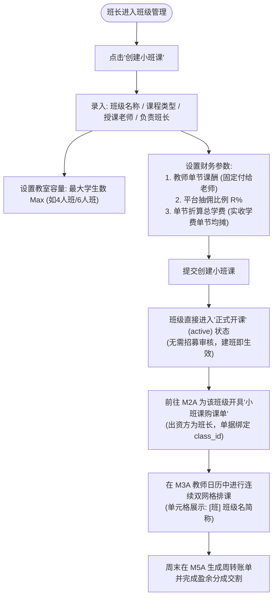

/** (c) 2024-2026 Topee (https://topee.top). All rights reserved. Proprietary and confidential. */

# 产品需求文档 (PRD) — 子模块 1C：统一班级与小班课管控 (Classes & Group Class Engine)

| 元数据项 | 说明 / 内容 |
|---|---|
| **模块代号** | `m1c` |
| **所属模块** | 模块一：教学教务基座与主数据 (Master Data & Profiles) |
| **文档状态** | 已批准 (Approved) |
| **关联顶层 PRD** | [Prd-v5.md](../Prd-v5.md) |
| **关联规范文档** | [BUSINESS_RULES.md](../BUSINESS_RULES.md) ｜ [DESIGN.md](../DESIGN.md) |
| **创建与更新日期** | 2026-11-04 初稿；2026-11-09 重构为“班长承包自负盈亏制（免学生建档与免家长注册）” |

---

## 1. 概述与执行摘要 (Executive Summary)

统一班级与小班课管控（`m1c`）是 Dream 系统的班级载体与小班自负盈亏约束引擎。系统将授课形态收敛为两级分流：
1. **1v1 个人班**：在购课或首次排课时由系统在后台**静默自动建班**，在家长端与教师端全流程物理屏蔽“班级”概念（仅呈现“意向老师 + 课程类型”）；
2. **小班课（Small Group，班长承包制）**：由班长/管理员在后台显式创建并实行**班长自负盈亏独立承包**。**小班课学生完全不支持家长注册与学生建档**，招生与收费完全由班长在私域（微信群等）自闭环；系统内以“班级实体”为核心进行购课、双网格排课、整班停课与周度财务分成结算。

---

## 2. 问题定义与背景 (Problem Statement)

- **痛点 1：强迫小班家长注册建档导致招生转化极低**：在少儿多人小班拼班场景中，家长习惯微信群内接龙交费；若强制要求所有家长下载、注册、建档、绑定孩子，门槛极高，极易造成客源流失。
- **痛点 2：权责利不对等与财务结算割裂**：小班课由班长自负盈亏承担招不满赔钱的风险。原方案既要求班长承担全盘盈亏，又在系统中维护散客名单与个人请假，造成业务权责混乱。
- **痛点 3：无主学生数据与空档案堆积**：小班学员若录入档案但家长不注册，会导致数据库产生大量无关联账号的“孤儿学生档案”，增加维护与合规成本。

---

## 3. 目标用户与角色画像 (Users & Personas)

### 3.1 角色一：小班课负责人（Leo，中方班长）
- **定位**：小班课自主承包商与自负盈亏责任人。
- **诉求**：在线下自主招募 2~6 人拼班并收取学费；在系统内直接创建班级并配置外教、课程类型、班级规模（Max）、外教单节课酬及平台抽佣比例；以班级主体为单位购课、排课；若遇节假日或突发事件一键整班停课，免去散客逐一请假的烦恼。

### 3.2 角色二：平台管理员（Sarah）
- **定位**：平台统筹与工具费/抽佣监管方。
- **诉求**：监督全平台开设的小班课合规性；确保每节小班课严格按容量上限 $Max \times 6$ 积分扣减平台工具费；按分账公式监管周度转账归集。

### 3.3 角色三：选课家长（Amy）
- **定位**：线下参班出资人。
- **边界说明**：小班课对家长端完全透明，家长无需注册系统账号，无需维护学生档案，所有沟通、请假与补课由班长在私域闭环服务。

---

## 4. 核心业务流程 (Workflows)



---

## 5. 用户故事 (User Stories)

- **US-1C-01（1v1 静默建班）**：作为一个 1v1 家长，我想要直接选择老师和课程类型排课，而无需感知任何班级概念，以便于保持极简约课体验。
- **US-1C-02（班长承包建班即生效）**：作为一个小班负责人，我想要录入班级名称、授课外教与核心财务参数后班级立即生效，以便于极速开展购课与排课，无需等待系统招募审批。
- **US-1C-03（容量上限绑定工具费）**：作为一个平台管理员与班长，我期望设定班级容量上限（Max），以便于系统依据 $Max \times 6$ 积分精确测算平台固定工具费基准。
- **US-1C-04（免学生录入与零幽灵档案）**：作为一个系统运维人员，我期望小班课无需录入学生档案与关联家长，以便于保持全平台学生档案库的绝对纯净。
- **US-1C-05（整班停课自闭环）**：作为一个小班负责人，我期望在公众假期或突发事件时一键整班停课退期待排，以便于自主在群内与家长协调后续补排时段。

---

## 6. 验收标准清单 (Acceptance Criteria)

### 6.1 1v1 班级静默建班规范
- **AC-1C-01**：1v1 课程购课或首次排课时，系统在后台领域服务层自动静默创建或复用 `1v1` 班级实体。
- **AC-1C-02**：在家长端与教师端的所有展示界面中，**严禁出现“班级”、“1v1班”等字样或实体卡片**，统一呈现为“意向授课老师 + 课程类型”。

### 6.2 小班课创建与参数录入规范（免录学生）
- **AC-1C-03**：创建小班课时，录入字段收敛且必填项如下：
  1. `班级名称`（`class_name`）：1-64 字符（如 `KET考前冲刺周六班`）；
  2. `授课老师`（`teacher_profile_id`）：绑定在职外教；
  3. `课程类型`（`course_type_id`）：绑定教学大纲分类；
  4. `负责班长`（`monitor_profile_id`）：绑定小班自负盈亏责任人（默认为创建班长本人，管理员可指定任一在职班长）；
  5. `最大学生数 (Max)`：整数，范围限制在 $2 \le Max \le 20$（默认 $Max = 4$）；**系统取消最少人数 Min 字段**；
  6. `教师单节课酬积分`：非负整数，每节课固定付给老师的课酬底金；
  7. `平台盈余抽佣比例 R%`：取值区间 $[0.00, 100.00]$，支持 2 位小数；
  8. `单节折算总学费积分`：该班级折算到单节课的实际实收学费总和（用于后续净盈余核算）。
- **AC-1C-04**：**彻底废弃学生名单录入**：小班课**严禁**关联任何 `student_profile_id`，数据库不维护 `class_students` 关系表；家长端全域不展示小班课选课中心。
- **AC-1C-05**：**建班即生效 (Active-on-Create)**：小班课创建成功后，班级状态直接置为 `active`（正式生效），无需流转 `recruiting`（招募中）状态，彻底取消满员自动截流与强制开班流程。

### 6.3 小班课停办与归档规范
- **AC-1C-06**：班级生命周期结束后，负责班长或管理员可在后台点击【归档班级】，班级状态转为 `archived`，不再允许新开购课单。
- **AC-1C-07**：若因特殊原因需提前解散班级，必须确保名下处于 `SCHEDULED`（已排期）的未来 TS 为 0；点击【解散取消班级】后状态置为 `cancelled`，名下结余的未排期 TS 联动退回。

---

## 7. 范围外清单 (Out of Scope - 明确不做)

- **严禁小班课学生注册与建档**：本期小班课学生完全不接入系统账号体系，不分配学生档案，不建立家校公开留言。
- **不做系统级招募大厅与家长自主选班**：选班与拼班 100% 由班长在线下私域完成。
- **不做学生个人请假与个人考勤**：小班课仅支持班长发起的【整班请假停课】，不接受单名学生的系统级请假与退费。

---

## 8. 界面线框与布局规范 (Wireframe Level)

### 8.1 班长端小班课看板卡片 (精简承包态)
```
+--------------------------------------------------------------------------+
|  KET 冲刺精讲小班 (4人班)                  [正式开课 (ACTIVE)] 负责班长: Leo |
|  授课外教: David Miller (Senior)           课程类型: KET备考             |
|  班级规模: Max 4人规格                     单节课酬: 30积分 / 平台分成: 10%|
|  单节实收: 50 积分/节                      平台固定工具费: 24 积分 (4×6) |
|                                                                          |
|  [为本班购课 (M2A)]     [班级排课 (M3A)]     [整班停课 (M3B)]     [归档] |
+--------------------------------------------------------------------------+
```
