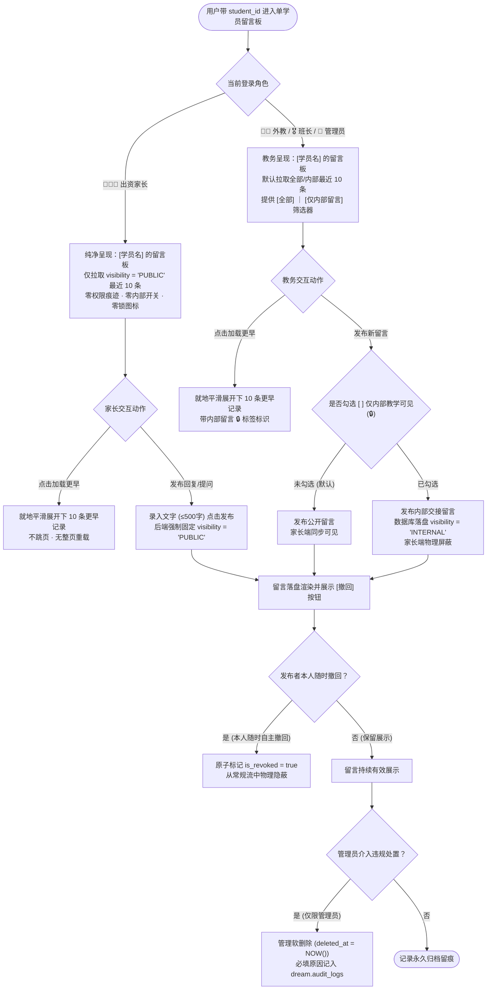
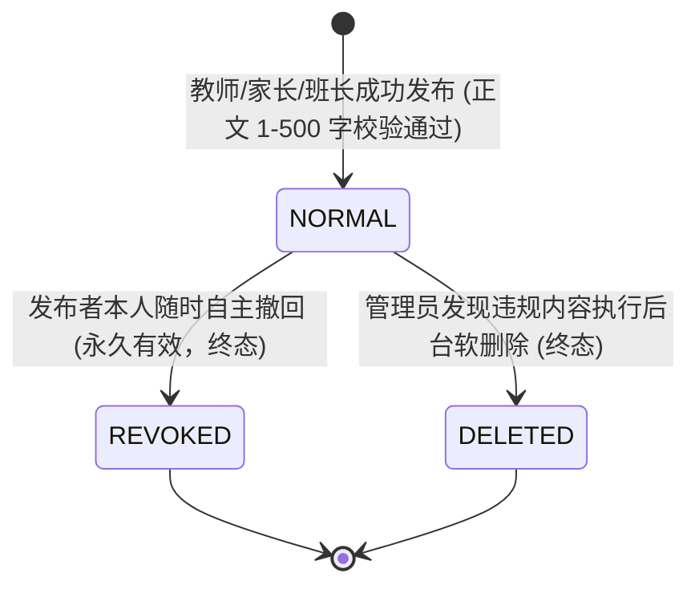

/** (c) 2024-2026 Topee (https://topee.top). All rights reserved. Proprietary and confidential. */

# 产品需求文档 (PRD) — 子模块 1D：学员留言板 (Profile Messages)

| 元数据项 | 说明 / 内容 |
|---|---|
| **模块代号** | `m1d` |
| **所属模块** | 模块一：教学教务基座与主数据 (Master Data & Profiles) |
| **文档状态** | 方案演进定稿版 (Architecture Evolution & Final PRD) |
| **关联顶层 PRD** | [Prd-v5.md](../Prd-v5.md) ｜ [CODING_STANDARDS.md](../CODING_STANDARDS.md) ｜ [BUSINESS_RULES.md](../BUSINESS_RULES.md) |
| **创建与更新日期** | 2026-11-04 (创建) ｜ 2026-11-10 (升级：去除家长端权限痕迹、默认近10条分页、全角色带 student_id 入口全景盘点、防 IDOR 越权闭环)；2026-11-12 卡片视觉改为只声明卡片类型，色值统一引用 DESIGN.md 2.2.1；统一全站术语为“留言板”与“留言”，杜绝“教学交流/备忘/评语”混用；废除 5 分钟 (300秒) 撤回时限，改为发布者本人可永久自主撤回 |

---

## 1. 概述与执行摘要 (Executive Summary)

学员留言板（`m1d`）是挂载于学员档案上的轻量级流式家校教学沟通与成长记录中心。本子模块承载**单学员专属留言板、公开课后留言互动、教师内部代课交接留言、发布者本人永久自主撤回**以及**全角色带 `student_id` 穿透查阅**等核心功能。

本方案确立以下三大核心体验与架构红线：
1. **家长端绝对去权限化与去技术痕迹 (Zero Permission Artifacts for Parent)**：对家长而言，页面是纯净自然的【学员留言板】；**严禁展示“双权限隔离”、“家长不可发布内部留言”、“师生公开视图”等技术术语、权限单选框或加锁图标 🔒**，消除家长心理猜疑；
2. **默认显示近 10 条与就地平滑加载 (Default 10 Items + Seamless Pagination)**：默认展示最近 10 条留言，底部提供一键“加载更早留言”原地展开，杜绝整页重载与长列表搓屏卡顿；
3. **单学员聚焦与后端防 IDOR 越权安全铁律 (Strict IDOR Defense)**：页面严格围绕单个 `student_id` 展开，不混杂其他学员；后端 Service 层在 SQL 查询与写入前执行严格的查看人/操作人与目标学员物理绑定鉴权，在数据库层物理过滤内部留言，坚决防御 IDOR 越权与网络抓包篡改。

---

## 2. 问题定义与背景 (Problem Statement)

- **痛点 1：界面暴露研发与权限痕迹破坏家校信任**：原界面若向家长展示“双权限隔离”、“师生公开视图”、“家长不可发布内部留言”等提示，极易引发家长对“老师是否背着我偷偷说了什么”的心理焦虑与信任危机；
- **痛点 2：缺少快速代课交接阵地**：教师请假后，代课外教若无法在学员档案中快速查阅原任课教师留下的真实学情与性格特点，难以无缝衔接上一节课的教材进度；
- **痛点 3：手滑误发或信息过时缺乏自主纠错机制**：教师或家长录入留言后，若出现打字错别字、选错可见性或后续信息过时，若受限于短时窗口则无法自主撤回清理，需要支持发布者本人随时永久撤回；
- **痛点 4：一次性全量加载导致性能瓶颈**：学员长期在读累积上百条留言时，一次性全量拉取造成首屏慢查询与移动端搓屏负担；
- **痛点 5：IDOR 越权与隐私数据泄露隐患**：若后端未在 Service 层对 `student_id` 施加严格物理归属与角色鉴权，可能导致恶意家长通过篡改 URL 或网络抓包窥探其他学员隐私甚至窃取内部教务备忘。

---

## 3. 目标用户与角色画像 (Users & Personas)

### 3.1 角色一：出资家长（Amy，家长）
- **核心诉求**：在家长工作台随时查阅外教为孩子发布的公开课后反馈与学习建议；支持就地回复老师、表达感谢或提问；界面纯净自然，**完全不感知任何内部教务备忘或权限机制**。
- **预期成果**：高频、透明且有温度的家校日常沟通体验。

### 3.2 角色二：授课外教（David，正课老师 / 代课老师）
- **核心诉求**：
  - 结课后公开发布学生本节课完成的教材单元与表扬反馈，供家长查阅；
  - 在代课或日常教学中，记录孩子的情绪波动、性格特点或发音弱点并勾选【仅内部教学可见】，供自己复习或代课同事查阅；
  - 发布后本人可随时永久自主撤回修正。
- **预期成果**：兼顾公开教学成效与内部隐私交接，备课省心。

### 3.3 角色三：带班班长（Leo，中方教务）
- **核心诉求**：随时进入所辖学员留言板查阅内部备忘，协调教师教学进度；在调配代课或处理客诉时查验历史交接记录。
- **预期成果**：教学过程留痕透明，突发代课交接 100% 顺畅。

### 3.4 角色四：平台管理员（Sarah）
- **核心诉求**：全平台全域穿透审计；在发生违规言论或客诉纠纷时执行后台软删除并留存审计日志。
- **预期成果**：平台内容合规与数据安全可控。

---

## 4. 核心业务流程与架构详规 (Workflows & Architecture)

### 4.1 全角色带 `student_id` 穿透入口全景盘点 (Role-Based Entry Points Matrix)

页面采用**单学员专属聚焦模式**，URL 统一携带目标学员短 ID（如 `/students/:student_id/messages` 或独立抽屉组件）。顶栏 Banner 动态呈现 `< 返回 [学员名] 的留言板`。**页面 100% 聚焦该单个学员的留言历史，严禁显示多个学员的名字或混杂数据**。

全平台 4 大角色进入该页面的入口全景如下表所示：

| 操作角色 | 所在工作台 / 模块 | 具体入口与交互触发路径 | 携带参数 | 页面标题与视角模式 |
| :--- | :--- | :--- | :--- | :--- |
| **👨‍👩‍👧 出资家长** | **主页【刚结课记录卡片】** | 点击已完课条目下方的 `[ 💬 留言板 / 回复 ]` 按钮 | `student_id` | `[学员名] 的留言板`（纯净师生公开流） |
| **👨‍👩‍👧 出资家长** | **Tab 2【学生课表】课程抽屉** | 点击排课单元格滑出的课程详情抽屉中的 `[ 💬 留言板 ]` | `student_id` | `[学员名] 的留言板`（纯净师生公开流） |
| **👨‍👩‍👧 出资家长** | **Tab 4【我的】孩子档案** | 在多孩档案中选定具体孩子，点击详情页卡片 `[ 💬 留言板 ]` | `student_id` | `[学员名] 的留言板`（纯净师生公开流） |
| **👨‍🏫 授课外教** | **主页【未来授课 / 刚结课】** | 学员条目操作区点击 `[ 💬 留言板 ]`（未写时高亮 `[ 📝 方便写留言 ]`） | `student_id` | `[学员名] 的留言板`（双重视图与内部开关） |
| **👨‍🏫 授课外教** | **Tab 2【课表看板】单元格** | 点击已排 1v1 或 🟣 代上课网格，弹窗中点击 `[ 💬 留言板 ]` | `student_id` | `[学员名] 的留言板`（双重视图与内部开关） |
| **👨‍🏫 授课外教** | **课后写留言流程** | 点击【写留言】弹窗时，提供 `[ ↗ 查阅历史留言 ]` 链接 | `student_id` | `[学员名] 的留言板`（双重视图与内部开关） |
| **🎖️ 带班班长** | **Tab 3【教务中心】视角 B** | 所辖学员名单卡片操作区点击 `[ 💬 留言板 ]` 按钮 | `student_id` | `[学员名] 的留言板`（双重视图与内部开关） |
| **🎖️ 带班班长** | **管辖外教日历 / 代课抽屉** | 点击排课网格或突发请假待办抽屉中的 `[ 💬 学员留言板 ]` | `student_id` | `[学员名] 的留言板`（双重视图与内部开关） |
| **🎖️ 带班班长** | **学员专属周课表看板** | 学员专属课表顶栏或课程抽屉中点击 `[ 💬 留言板 ]` | `student_id` | `[学员名] 的留言板`（双重视图与内部开关） |
| **👑 管理员** | **Tab 4【管理与设置】学员档案** | 学员档案管理列表中检索学员，点击卡片 `[ 💬 留言板与审计 ]` | `student_id` | `[学员名] 的留言板`（全量可见 + 管理软删除） |
| **👑 管理员** | **全景排班大看板** | 点击排班网格 TS 详情抽屉中的 `[ 💬 查看学员留言板 ]` | `student_id` | `[学员名] 的留言板`（全量可见 + 管理软删除） |

### 4.2 核心业务流转与默认近 10 条就地分页 (Message Flow & Default 10 Items)



### 4.3 后端防越权与防 IDOR 鉴权安全闭环 (Backend Authorization & Strict IDOR Defense)

所有针对学员留言板的 HTTP API 请求必须在后端 Service 层执行严格的查看人/操作人与目标学员物理绑定鉴权，严禁仅依靠前端路由拦截：

1. **查看人权限鉴权 (`GET /api/v1/students/:student_id/messages`)**：
   - **家长身份鉴权**：系统提取当前会话 `current_user_id`，查询 `dream.student_profiles` 物理比对 `parent_user_id`。若 `student.parent_user_id != current_user_id`，直接阻断并抛出 `403 FORBIDDEN`，彻底防御家长修改 URL 中的 `student_id` 越权查看他人孩子隐私；
   - **家长端数据物理隔离铁律**：当请求者为家长时，系统在数据查询层必须强制限定仅检索公开可见且未被撤回的有效留言实体。**绝对禁止在 API 响应数据包中包含任何 `INTERNAL` 类型的留言实体或其内部字段**，100% 杜绝网络抓包泄露内部备忘；
   - **外教身份鉴权**：外教查阅学员留言板时，系统严格校验该外教是否为该学员的绑定主讲教师、当前授课教师或排课履约历史中曾为其授课的关联教师，防止无教学关联的外教跨权窥探；
   - **班长身份鉴权**：校验该学员是否为该班长直接所辖学员，或该学员排期中的教师属于该班长管辖外教；
   - **管理员身份鉴权**：放行全平台审计查阅。
2. **发布防篡改铁律 (`POST /api/v1/students/:student_id/messages`)**：
   - 同样前置执行上述操作人与 `student_id` 的绑定鉴权，严禁越权给无关学员提交留言；
   - **家长发布防篡改**：若操作人身份为家长，后端 Service 层**物理强制将入参 `visibility` 覆写为 `'PUBLIC'`**，即使攻击者恶意篡改 HTTP Request Body 传入 `visibility: "INTERNAL"`，后端坚决拒绝越权并统一落盘为公开；
   - **内部留言发布专属性**：仅当操作人持有在职外教、班长或管理员身份时，才允许传入并落盘 `visibility = 'INTERNAL'`。
3. **撤回权限鉴权 (`POST /api/v1/profile-messages/:id/revoke`)**：
   - 系统原子校验 `message.author_user_id == current_user_id`（严格限本人撤回，严禁跨账号撤回）；
   - **永久有效无时限**：系统不再限制 300 秒（5分钟）窗口，发布者本人在任意时间均拥有自主撤回权；非本人操作直接阻断并抛出 `403 FORBIDDEN`。
4. **管理软删除鉴权 (`DELETE /api/v1/profile-messages/:id`)**：
   - 严格限定仅平台超级管理员（`role = 'admin'`）拥有调用权限；
   - 强制入参校验 `reason` 必填（$\ge 10$ 字符），操作原子标记 `deleted_at = NOW()`，并在同一事务内将操作人 ID、被删留言快照及审核原因写入 `dream.audit_logs`。

---

### 4.4 实体生命周期与状态机 (Entity Lifecycles & State Machines)

M1D 负责管理挂载于学员档案上的流式家校教学沟通，闭环管理核心实体——**学员留言 (ProfileMessage)** 的生命周期：

#### 学员留言 (ProfileMessage) 状态机



- **状态转移规则与时效防线**：

| 初始状态 | 目标状态 | 触发角色 | 前置守卫条件与时限熔断 | 伴随副作用与数据落盘 |
| :--- | :--- | :--- | :--- | :--- |
| `[*]` | `NORMAL` (正常) | 家长 / 教师 / 班长 | 1. 目标学生 ID 合法；<br>2. 正文 1~500 字符；<br>3. 家长发布强制落盘为 `PUBLIC`；教务可勾选 `INTERNAL`。 | 留言实体落盘；前端流式插入顶部并就地滚动渲染；若为教师课后留言，触发刚结课卡片消红。 |
| `NORMAL` | `REVOKED` (已撤回) | 留言原作者 (严格限本人) | **权限守卫**：严格限原作者本人 (`author_user_id == current_user_id`)；<br>**永久有效**：支持随时自主撤回（已去除 5 分钟 / 300 秒时限约束）。 | 1. 标记 `is_revoked = true`；<br>2. 正文对常规视图隐藏，替换呈现浅灰占位文本：“`[该留言已被作者撤回]`”；<br>3. 无法再次恢复。 |
| `NORMAL` | `DELETED` (已软删除) | 平台超级管理员 (独享) | 发现违规、涉密或引发重大客诉的留言内容；强制录入 $\ge 10$ 字删除原因。 | 1. 标记 `deleted_at = now()`；<br>2. 全端全角色完全物理下架不展示；<br>3. 快照与原因全链路写入 `dream.audit_logs` 供合规留痕。 |

---

## 5. 用户故事 (User Stories)

- **US-1D-01（家长纯净留言板）**：作为一个家长，我想要在孩子档案下看到外教清晰正向的课后留言并能便捷回复老师，界面没有任何多余的权限标签与锁图标，以便于建立良好的家校互信。
- **US-1D-02（内部代课交接与学情记录）**：作为一个教师，我想要记录孩子的性格弱点或教学注意事项且仅限老师和教务可见，以便于代课同事因材施教且不引发家长焦虑。
- **US-1D-03（发布者永久自主撤回）**：作为一个教师或家长，我想要对自己已发布的留言随时一键撤回，不受 5 分钟时限约束，以便于修正错别字、调整表述或清理已过时的沟通记录。
- **US-1D-04（默认近 10 条与就地平滑翻页）**：作为一个使用者，我想要进入页面时先看到最近 10 条高价值交流，并能在底部一键平滑加载更早历史记录，以便于快速阅读且不搓屏卡顿。
- **US-1D-05（全角色单学员穿透查阅）**：作为一个班长或外教，我想要从排课日历、结课卡片或学员名单中带学生 ID 1 键直达该学生的留言板，不用在多学员间切换，以便于高效聚焦单生教学。
- **US-1D-06（管理审计与争议处置）**：作为一个管理员，我想要对违规或引发客诉的留言执行后台下架并留存审计记录，以保障平台运营合规。

---

## 6. 验收标准清单 (Acceptance Criteria)

### 6.1 家长端去权限痕迹与 SQL 物理过滤铁律
- **AC-1D-01（家长端绝对纯净与去权限痕迹规范）**：
  - 页面标题全端统一呈现为 **`[学员名] 的留言板`**（如 `Alice 的留言板`，外教/英文态为 `Messages · Alice`）；
  - **严禁向家长端展示任何“双权限隔离”、“双权限”、“家长不可发布内部留言”、“师生公开视图”、“公开/内部”、“权限标签”等技术词汇与权限说明**；
  - 家长端界面**严禁出现可见性单选框、下拉框，严禁展示任何锁图标（🔒）**；输入框提示文案为自然亲和的“向老师留言或反馈孩子上课情况...”；
  - 留言卡片上仅展示发信人真实身份标签（如 `授课外教 David`、`班长 Leo`、`家长 (我)`）、发布时间与正文内容，**绝对不带 `[公开]`、`[师生公开]` 等多余徽标**。
- **AC-1D-02（家长端 SQL 物理层绝对过滤铁律）**：
  - 当查看者为家长角色时，数据访问层（Mapper）执行的 SQL 查询必须**显式且物理级追加 `AND visibility = 'PUBLIC' AND is_revoked = false AND deleted_at IS NULL`**；
  - 服务端向家长端下发的 API 响应 DTO 中，**绝对禁止包含任何 `INTERNAL` 类型的留言实体或其内部标记字段**，100% 杜绝通过浏览器开发者工具审查网络请求抓包泄露内部交接信息。

### 6.2 教务端双重视图与内部交接留言规范
- **AC-1D-03（教师/班长/管理员端功能视图规范）**：
  - 外教、班长、管理员端页面标题同样统一呈现为 **`[学员名] 的留言板`**（如 `Alice 的留言板`）；
  - 顶部操作栏提供轻量视图切换分段器：`[ 全部留言 (N) ]` ｜ `[ 仅内部留言 🔒 (M) ]`；
  - 内部留言卡片采用【中性卡】样式，并以微锁徽标 **`🔒 内部留言`** 标识内部可见范围（视觉规范见 DESIGN.md）；
  - 录入区下方提供复选框：**`[ ] 仅内部教学可见 (🔒)`**（默认不勾选，发布为公开留言；勾选后落盘 `visibility = 'INTERNAL'`，专供教师内部代课交接与学情记录）。

### 6.3 默认近 10 条展示与就地平滑加载机制
- **AC-1D-04（默认近 10 条与原地展开分页规范）**：
  - 用户带 `student_id` 进入留言板时，首屏默认仅拉取并展示**最近 10 条**有效留言（按创建时间倒序排布，最新在最上方）；
  - 留言列表最底部提供常驻操作条：**`[ 加载更早留言 (还有 N 条) ▾ ]`**（若总条数 $\le 10$ 则不展示）；
  - 用户轻触操作条后，系统基于当前最后一条留言的 `created_at` 游标（Cursor），在底部**就地平滑展开下 10 条更早记录**；**绝对禁止触发整页重载或分页跳页**；
  - 当更早历史记录全部加载完毕时，底部显示温和居中提示：`— 已展示全部历史留言记录 —`；若学员名下暂无留言，展示友好的空状态卡片。

### 6.4 全角色单学员穿透入口与页面聚焦
- **AC-1D-05（全角色单学员聚焦与 URL 携带 student_id 规范）**：
  - 页面严格围绕单个具体学员展开，URL 统一携带 `student_id`（如 `/students/:student_id/messages` 或独立滑动抽屉）；
  - 页面 **100% 仅展示当前单个学员的交流记录，绝对不展示多个学员的姓名列表或混杂数据**；
  - 顶栏左侧常驻 **`<` 返回按钮**，点击平滑返回来源页面（如课表看板、教务中心学员名单或孩子档案页），并保留来源页面的滚动位置与搜索条件。

### 6.5 后端防 IDOR 越权与查看人/操作人鉴权闭环
- **AC-1D-06（后端防 IDOR 越权查看人鉴权铁律）**：
  - `GET /api/v1/students/:student_id/messages` 必须在 Service 层强制执行查看人与目标 `student_id` 的物理归属鉴权：
    1. **家长角色**：必须满足 `student.parent_user_id == current_user_id`（必须是自己的孩子档案），否则直接抛出 `403 FORBIDDEN`，彻底防御修改 URL 中 `student_id` 越权窥探他人孩子隐私；
    2. **外教角色**：必须满足该外教为学员绑定主讲外教，或在 `dream.teaching_sessions` 中存在排课/代课履约历史记录，防止无关联外教跨权窥探；
    3. **班长角色**：必须满足该学员为该班长直接所辖学员，或该学员排期中的教师属于该班长管辖外教；
    4. **管理员角色**：放行全平台审计查阅。
- **AC-1D-07（发布防篡改与操作人鉴权铁律）**：
  - `POST /api/v1/students/:student_id/messages` 必须校验当前操作人对目标 `student_id` 的关联权限，严禁越权给无关学员发留言；
  - **家长发布防篡改**：若操作人身份为家长，服务端**物理强制将入参 `visibility` 覆写为 `'PUBLIC'`**，杜绝恶意抓包篡改 Payload 越权发布内部留言；
  - **内部留言专属性**：仅当操作人持有在职外教、班长或管理员身份时，才允许传入并落盘 `visibility = 'INTERNAL'`。

### 6.6 发布者永久自主撤回与管理审计软删除
- **AC-1D-08（发布者本人永久自主撤回规范）**：
  - **无时间限制**：留言发布成功后，发布者本人随时（永久有效，彻底废除 300 秒 / 5 分钟时限与倒计时限制）可在该留言卡片右上角查看并点击 `[ 撤回 ]` 按钮；
  - **身份专属展示**：仅发布者本人能够看到并操作 `[ 撤回 ]` 按钮；其他角色浏览他人留言时不展示该按钮；
  - **后端原子鉴权**：接口 `POST /api/v1/profile-messages/:id/revoke` 强制校验 `message.author_user_id == current_user_id`，非本人操作直接阻断抛出 `403 FORBIDDEN`；
  - **撤回落盘与隐藏**：执行撤回后，该条留言原子标记为 `is_revoked = true`，从所有端内常规流式查询中物理隐藏；数据库保留记录用于运营合规留痕。
- **AC-1D-09（管理员软删除与操作审计）**：
  - 严格限定仅平台超级管理员（`role = 'admin'`）拥有终极删除权限；
  - 删除操作必须提供理由（`reason`，$\ge 10$ 字符），数据库执行软删除（`deleted_at = NOW()`），并在同一事务内将操作人 ID、目标留言快照及删除原因写入 `dream.audit_logs`。
- **AC-1D-10（字数规格约束）**：
  - 单条留言正文字数限制在 1 至 1000 字符；单层线性时间倒序流，不支持嵌套盖楼。

---

## 7. 范围外清单 (Out of Scope - 本期明确不做)

- **暂不支持富文本排版与图片视频附件**：本期留言板统一采用纯文本，暂不支持插入图片附件、Markdown 渲染或表情包。
- **暂不支持留言点赞或盖楼式多级嵌套评论**：采用单层线性时间倒序流，不设计多级树状评论盖楼机制。
- **暂不支持跨学员留言批量合并查看**：留言板物理绑定单个 `student_id`，不提供跨多学员的多合一留言聚合瀑布流。

---

## 8. 界面线框与布局规范 (Wireframe Level)

### 8.1 家长端视角 — 纯净师生公开留言板 (Parent View Wireframe)
- **特征**：零权限痕迹、零内部开关、零加锁图标、单学员聚焦、默认近 10 条 + 加载更早。

```text
+--------------------------------------------------------------------------+
| < 返回                   Alice 的留言板                          [ 🔔 2 ]|
+--------------------------------------------------------------------------+
|  +--------------------------------------------------------------------+  |
|  | [输入框: 向老师留言或反馈孩子上课情况... (最多 500 字)]            |  |
|  +--------------------------------------------------------------------+  |
|                                                            [ 发送留言 ]  |
+--------------------------------------------------------------------------+
|  -------------------------- 历史记录 ----------------------------------  |
|  👨‍🏫 David 老师 (授课外教)            2026-11-10 19:30   [ 撤回 ]        |
|  完成了 Unit 4 Lesson 2 课文精读，单词拼读非常准确，课堂互动十分积极！    |
|  ----------------------------------------------------------------------  |
|  👧 家长 (我)                         2026-11-09 18:20                   |
|  谢谢老师，孩子最近很喜欢看这套绘本，今晚课后会陪她一起复习新单词。      |
|  ----------------------------------------------------------------------  |
|  🎖️ Leo (带班班长)                    2026-11-05 14:10                   |
|  Alice 妈妈您好，下周固定位排课已为您确认完毕，请准时进 ClassIn 教室。   |
+--------------------------------------------------------------------------+
|                 [ 加载更早留言 (还有 4 条) ▾ ]                           |
+--------------------------------------------------------------------------+
|  [ 🏠 首页 ]       [* 📅 学生课表 *]     [ 💬 消息 ]         [ 👤 我的 ] |
+--------------------------------------------------------------------------+
```

### 8.2 教师/班长/管理员端视角 — 内部交接与留言看板 (Staff View Wireframe)
- **特征**：单学员聚焦、带内部留言筛选器、输入框支持勾选仅内部可见、内部留言醒目标记。

```text
+--------------------------------------------------------------------------+
| < 返回                   Alice 的留言板                          [ 🔔 2 ]|
| 筛选: [ 全部留言 (14) ]  ｜  [ 仅内部留言 🔒 (3) ]                         |
+--------------------------------------------------------------------------+
|  +--------------------------------------------------------------------+  |
|  | [输入框: 录入本节课留言或内部交接备忘... (最多 1000 字)]             |  |
|  +--------------------------------------------------------------------+  |
|  [ ] 仅内部可见 (🔒)                                       [ 发布留言 ]  |
+--------------------------------------------------------------------------+
|  -------------------------- 历史记录 ----------------------------------  |
|  👨‍🏫 David Miller (正课外教)          2026-11-10 19:30   [ 撤回 ]        |
|  完成了 Unit 4 Lesson 2 课文精读，单词拼读非常准确，课堂互动十分积极！    |
|  ----------------------------------------------------------------------  |
|  🔒 内部留言 · 👨‍🏫 David Miller        2026-11-10 19:32                   |
|  [内部] 孩子今日拼读长元音 ea/ee 稍有混淆，下次代课或正课前建议重点抽查。|
|  ----------------------------------------------------------------------  |
|  🔒 内部留言 · 🎖️ Leo (负责班长)      2026-11-04 11:20                   |
|  [内部] 家长作息调整，优先排晚间 19:00；二宝家庭，续费前建议微信提前沟通|
+--------------------------------------------------------------------------+
|                 [ 加载更早留言 (还有 4 条) ▾ ]                           |
+--------------------------------------------------------------------------+
|  [ 🏠 首页 ]       [ 📅 学生课表 ]     [* 👥 教务中心 *]     [ 👤 我的 ] |
+--------------------------------------------------------------------------+
```
