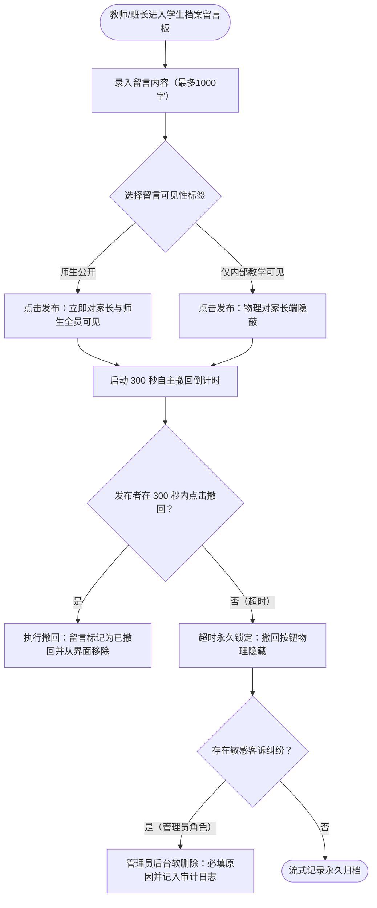

/** (c) 2024-2026 Topee (https://topee.top). All rights reserved. Proprietary and confidential. */

# 产品需求文档 (PRD) — 子模块 1D：双权限教学留言板 (Profile Messages & Feedback)

| 元数据项 | 说明 / 内容 |
|---|---|
| **模块代号** | `m1d` |
| **所属模块** | 模块一：教学教务基座与主数据 (Master Data & Profiles) |
| **文档状态** | 已批准 (Approved) |
| **关联顶层 PRD** | [Prd-v5.md](../Prd-v5.md) |
| **创建与更新日期** | 2026-11-04 |

---

## 1. 概述与执行摘要 (Executive Summary)

双权限教学留言板（`m1d`）是挂载于学员档案上的轻量级流式家校教学沟通中心。针对少儿教务中“日常学习反馈需透明”与“教师内部代课交接需保护学员隐私”的双重诉求，本子模块实现**“师生公开”与“仅内部教学可见”两级物理权限隔离**，并提供**发布者 5 分钟（300秒）内自主撤回**机制与管理员审计删除功能，为一线教学提供兼具透明度与隐私防线的家校互动通道。

---

## 2. 问题定义与背景 (Problem Statement)

- **痛点 1：内部教学评语外泄引发客诉矛盾**：代课老师代课前需了解学员的真实水平底子、情绪习惯或家庭特殊偏好。若将这些内部教学备忘毫无保留地展示给家长，极易引发家长的焦虑或服务客诉。
- **痛点 2：缺少快速代课交接阵地**：教师请假后，代课外教往往由于缺乏前情提要，难以无缝衔接上一节课的教材进度与注意事项。
- **痛点 3：手滑误发缺乏补救窗口**：教师在刚上完课匆忙打字或选错公开/内部标签时，若无法即时撤回，容易造成不可挽回的误会。

---

## 3. 目标用户与角色画像 (Users & Personas)

### 3.1 角色一：授课外教（David，正课老师 / 代课老师）
- **诉求**：
  - 课后公开发布学生本节课完成的教材单元与表扬反馈，供家长查阅；
  - 记录孩子的情绪波动或薄弱点，设置为“仅内部教学可见”，供自己复习或代课老师查阅；
  - 打错字或选错权限标签后，能在 5 分钟内一键撤回重新编辑。

### 3.2 角色二：带班班长（Leo，中方教务）
- **诉求**：随时查看名下学员的内部留言，协调教师教学进度；在学员发生客诉时查验历史交接记录。

### 3.3 角色三：出资家长（Amy，家长）
- **诉求**：在家长工作台随时查阅教师发布的公开课后反馈与作业建议；支持回复公开留言与老师互动；完全不感知任何内部教务评语。

### 3.4 角色四：平台管理员（Sarah）
- **诉求**：全局查看所有留言；在发生敏感争议时可执行终极软删除，并记录操作原因与审计日志。

---

## 4. 核心业务流程 (Workflows)



---

## 5. 用户故事 (User Stories)

- **US-1D-01（公开教学反馈）**：作为一个教师，我想要公开发布本节课的课堂表现与作业，以便于家长清晰掌握孩子的学习成效。
- **US-1D-02（内部代课交接）**：作为一个教师，我想要记录孩子的性格弱点且仅限老师之间可见，以便于代课老师因材施教且不引发家长焦虑。
- **US-1D-03（5分钟手滑撤回）**：作为一个教师，我想要在发布后的 5 分钟内一键撤回错误内容，以便于修正错别字或调整可见性设置。
- **US-1D-04（家长端绝对隐私隔离）**：作为一个家长，我想要在孩子档案下看到清晰正向的学习建议，完全免受内部复杂沟通的干扰。
- **US-1D-05（管理审计与争议处置）**：作为一个管理员，我想要对违规或引发客诉的留言执行后台下架并留存审计记录，以保障平台运营合规。

---

## 6. 验收标准清单 (Acceptance Criteria)

### 6.1 双权限可见性与物理隔离
- **AC-1D-01**：留言可见性分为两级：
  - `public_teacher_student`（师生公开）：全员可见（家长、学生、正课老师、代课老师、班长、管理员）；
  - `internal_teaching_only`（仅内部教学可见）：仅教师、代课教师、班长、管理员可见。
- **AC-1D-02**：家长角色发布的留言**强制固定为【师生公开】**，系统严禁家长选择或发布内部教学留言。
- **AC-1D-03**：在家长端的所有 API 请求与视图中，**系统在 SQL 查询层物理过滤 `visibility = 'public_teacher_student'`**，绝对不向下透传任何内部留言数据。

### 6.2 300 秒原子撤回时效
- **AC-1D-04**：留言发布成功后，发布者在 **300 秒（5分钟）内**，该条留言卡片展示【撤回】操作项（附倒计时提示，如 `撤回 (240s)`）。
- **AC-1D-05**：超过 300 秒后，撤回按钮物理隐藏；若发布者通过接口强行提交撤回，服务端依据数据库 `created_at` 校验，超时拒绝并抛出 `403 MESSAGE_REVOKE_WINDOW_EXPIRED`。
- **AC-1D-06**：执行撤回后，该条留言标记为 `is_revoked = true`，从所有常规流式查询中物理隐藏。

### 6.3 管理员软删除与操作审计
- **AC-1D-07**：管理员在管理工作台拥有终极删除权限；删除时必须提供理由（`reason`，2-200字）。
- **AC-1D-08**：删除操作为软删除（`deleted_at = NOW()`），并在 `dream.audit_logs` 表中完整记录操作人、目标留言 ID、删除原因与原始内容快照。

### 6.4 规格约束
- **AC-1D-09**：单条留言正文字数限制在 1 至 1000 字符。
- **AC-1D-10**：流式展示按留言创建时间倒序排布（新留言在最上），支持基于游标（Cursor-based）的分页加载。

---

## 7. 范围外清单 (Out of Scope - 本期明确不做)

- **暂不支持富文本排版与图片视频附件**：本期留言板统一采用纯文本，暂不支持插入图片附件、Markdown 渲染或表情包。
- **暂不支持留言点赞或盖楼式多级嵌套评论**：采用单层线性时间倒序流，不设计多级树状评论盖楼机制。

---

## 8. 界面线框与布局规范 (Wireframe Level)

### 8.1 留言板组件线框
```
+--------------------------------------------------------------------------+
|  学员留言板: AliceZ12                                                    |
|                                                                          |
|  +--------------------------------------------------------------------+  |
|  | [输入框: 记录本节课教学反馈或内部交接备忘... (最多 1000 字)]       |  |
|  +--------------------------------------------------------------------+  |
|  可见性: (*) 师生公开   ( ) 仅内部教学可见(🔒)            [发布留言]     |
|                                                                          |
|  -------------------------- 历史记录 ----------------------------------  |
|  [正课老师] David Miller               2026-11-04 14:00    [撤回 (180s)] |
|  [公开] 完成了 Unit 3 课文精读，单词拼读非常准确，课后练习完成良好！    |
|                                                                          |
|  [班长] Leo (🔒 仅内部教学可见)        2026-11-04 11:20                  |
|  [内部] 孩子今日注意力稍有不集中，下次课前建议用互动小游戏暖场。         |
+--------------------------------------------------------------------------+
```
