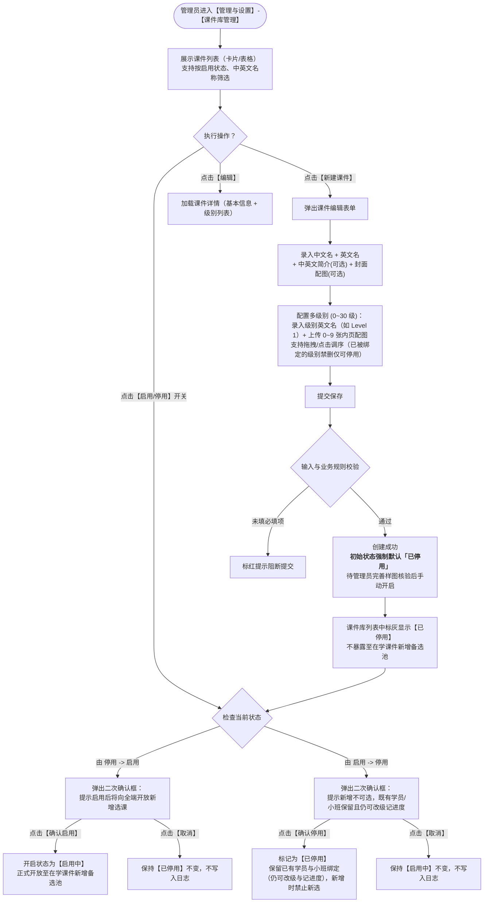
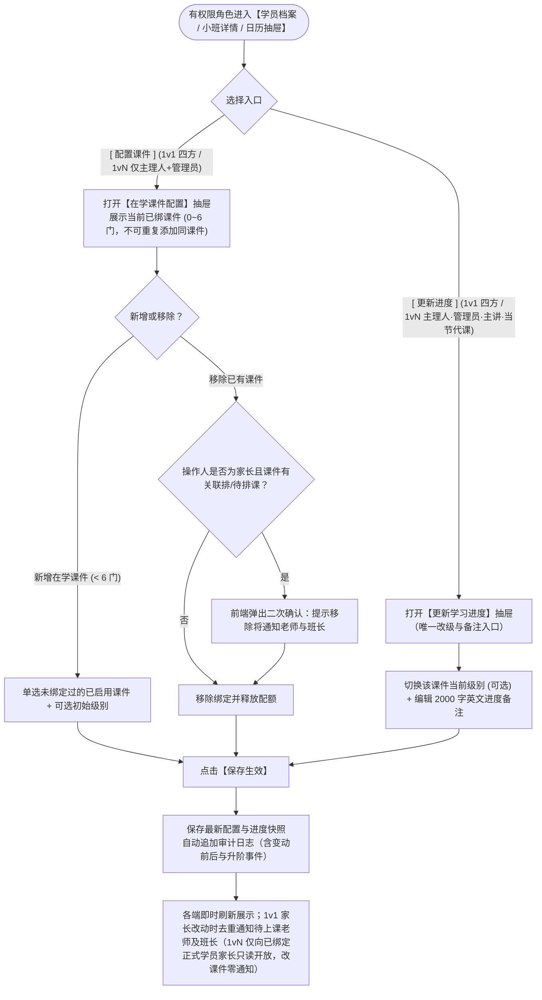
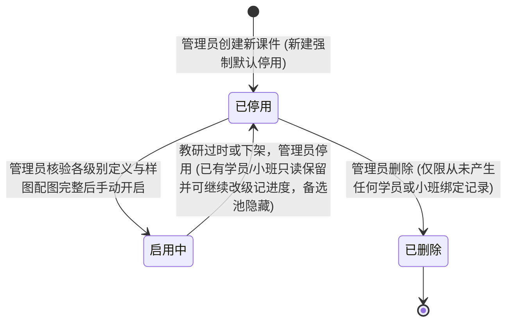
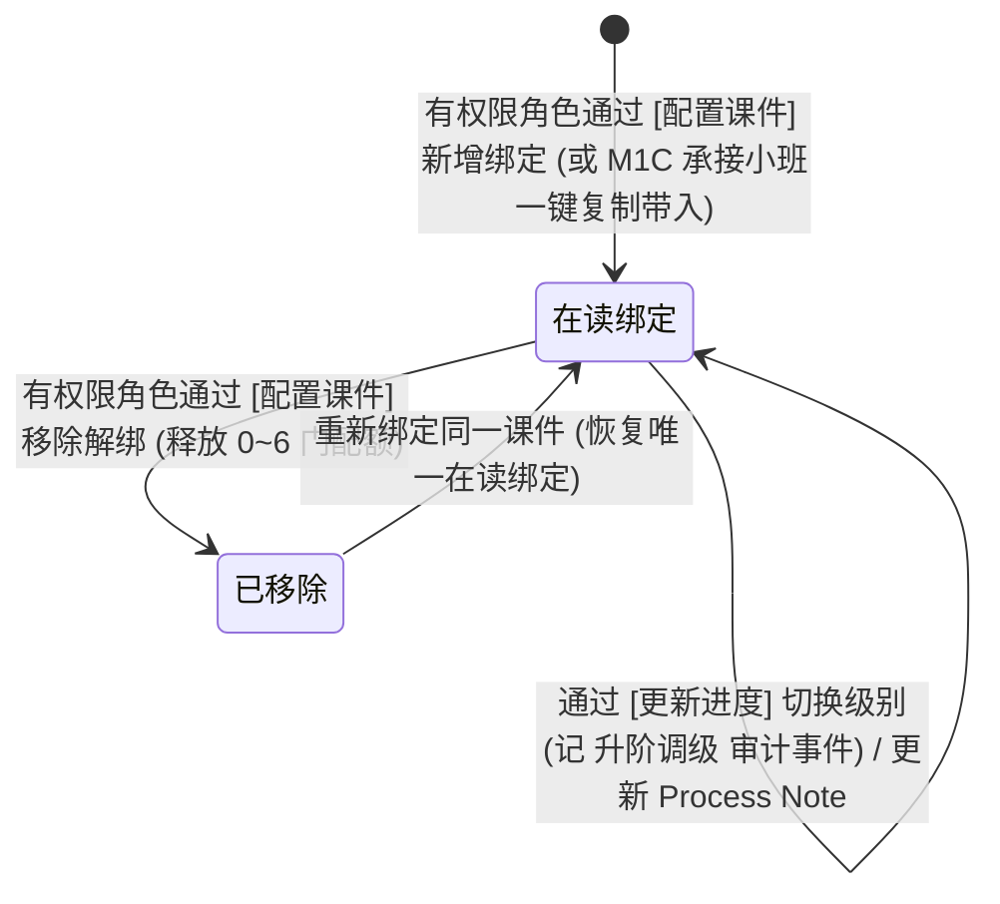
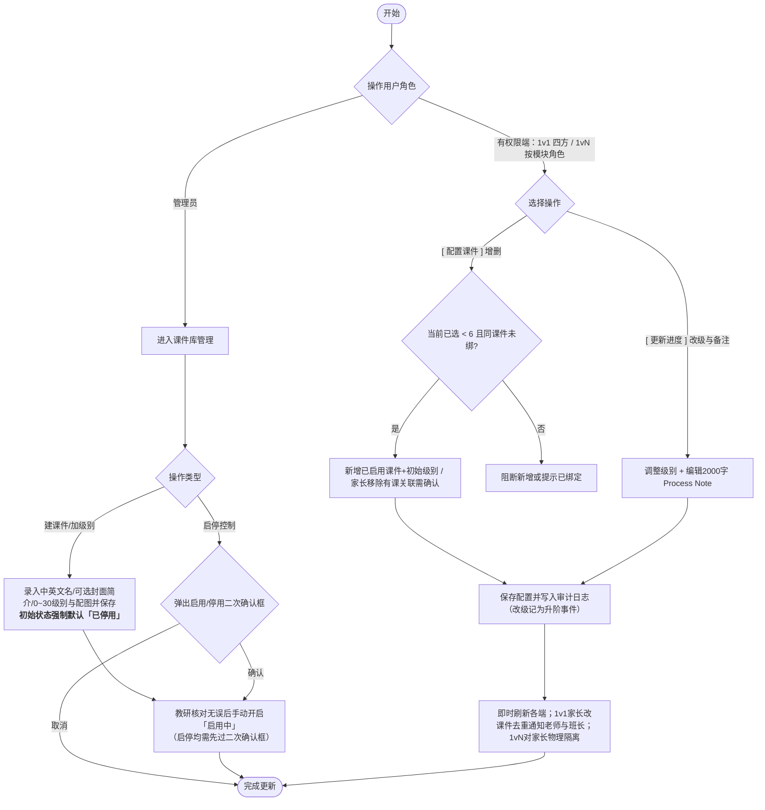

/** (c) 2024-2026 Topee (https://topee.top). All rights reserved. Proprietary and confidential. */

# 产品需求文档 (PRD) — 子模块 1E：课件库与学员在学课件管理 (Courseware Management)

| 元数据项 | 说明 / 内容 |
|---|---|
| **模块代号** | `m1e` |
| **所属模块** | 模块一：教学教务基座与主数据 (Master Data & Profiles) |
| **文档状态** | 待评审 (Draft) |
| **关联顶层 PRD** | [Prd-v5.md](../Prd-v5.md) ｜ [CODING_STANDARDS.md](../CODING_STANDARDS.md) ｜ [BUSINESS_RULES.md](../BUSINESS_RULES.md) |
| **关联子模块** | [m1a_student_profile.md](./m1a_student_profile.md), [m1b_teacher_profile.md](./m1b_teacher_profile.md), [m1c_classes.md](./m1c_classes.md), [m3a_calendar_grid.md](./m3a_calendar_grid.md), [m3d_course_scheduling.md](./m3d_course_scheduling.md) |
| **创建与更新日期** | 2026-11-09 (创建) ｜ 2026-11-10 (升级：新建课件默认停用规则) ｜ 2026-11-21 (对齐动态关联班长编辑权限与家长改课件后的“授课老师+老师所属负责班长/待排托管班长”提醒路由) ｜ 2026-11-22 (进度备注 `Process Note` 上限升级为 2000 字符多行纯文本；快捷胶囊改追加式；卡片默认折叠 1–2 行可点击展开；入口去重；同步扩展支持 1vN 小班复用同一套在学课件与 2000 字 `Process Note` 协同机制；完成 Red-Team 审查闭环修订 D1–D8 + H2/M4/L1–L6) ｜ 2026-11-22 (**SSOT 归口与合规清洗**：升级 `§4.3` 课件主实体与在学课件绑定四支柱生命周期、字段锁定、留痕与留存及第 2 层跨实体联动清单/宿主入边索引，补充未绑定空白课件删除路径以对齐 `AC-1E-03a`，全篇清零英文枚举及技术实现词汇；全篇统一“样课”为“样图”与「查看样图」操作文案；补充课件启用与停用必须弹出二次确认框规范) ｜ 2026-11-23 (**小班绑定正式学员家长只读查看**：开放当前已绑定至「正式开课」小班的「正式在读」学员所属家长只读查看该小班在学课件、级别、样图与 2000 字 `Process Note`，严禁编辑或触发通知，并同步在编辑框增设隐私提示) ｜ 2026-11-23 (**协同 M1C 红队 D2-B & 归档三方只读收口**：① 小班保存 `Process Note` 前置强制执行他生姓名/昵称/联系方式敏感扫描技术拦截与必勾隐私确认；② 明确 1v1「已归档」学员与 1vN「已归档 / 已提前解散」小班的 `Process Note` 及在学课件对所属家长〔含 1v1 归档宝贝及 1vN 随班归档只读留存〕、曾执教/代课老师、关联/主理班长与管理员全员长期保留只读历史回看权，禁编辑) ｜ 2026-11-23 (**M1E 策略红队全量收口 D1–D7 & L-1～L-8**：① **D1-A** 确立小班 `Process Note` 隐私扫描分级策略〔英文全词边界 $\ge 2$ 字符忽略大小写、中文 $\ge 2$ 字、联络特征硬阻断、同名绑定词支持二次确认正常教学用词放行并留痕〕；② **D2-A** 换师承接复制 `Process Note` 带出至草稿区触发并集再扫描与主理人复核确认；③ **D3/L-8** 对齐 `M1C §4.2.1` `随班归档只读留存` 指针及「正式在读或已归档」精确语义；④ **D4-B** 增加 1v1 家长切换级别与全部移除课件二次确认；⑤ **D5** 1v1 家长改课件通知改为「待上授课老师+负责班长 ∪ 待排资金持有人」并集去重；⑥ **D6** 量化授权老师实时编辑权截止于次日 `02:00 UTC+8` 结课前，已结课仅走 `M3B 授课历史` 补录；⑦ **D7/L-2** 补齐多方并发版本校验防静默覆盖；⑧ **L-1~L-7** 补齐中英文名全库唯一、级别显式排序、主力老师有效更新计数、未更新 180 天时钟起点、前 3 张样图取序及全级别停用兜底) |

---

## 1. 概述与执行摘要 (Executive Summary)

课件库与在学课件管理（`m1e`）是 Dream 系统的教学主数据核心能力之一。通过结构化的分级课件目录（中英文名称、中英文简介、封面配图及多级英文分级配图），为全平台教学活动提供标准化的教具元数据索引。

同时，子模块为 **1v1 学员档案** 与 **1vN 小班**统一构建了**“在学课件”与进度备注 (`Process Note`) 精细化配置通道**（每对象均支持关联 **0～6 门**同课件不重复的在学课件、当前修读级别与 **2000 字符**多行进度备注，并明确 `[ 配置课件 ]` 负责增删教材、`[ 更新进度 ]` 统一收敛“切换级别 + 更新进度备注”）：
- **1v1 学员档案**：由管理员、关联班长、授权授课老师（有待上或未结课次）及所属学生家长四方共同增删课件、调整级别与更新进度备注（每次调整均记录审计日志，家长移除有排课关联课件时二次确认，修改后去重提醒待上课老师与对应负责/关联班长）；
- **1vN 小班**：由小班主理人与平台管理员通过 `[ 配置课件 ]` 增删教材，并由主理人、管理员、本班主讲老师及当节代课老师通过 `[ 更新进度 ]` 共同维护课件级别与 `Process Note`（保存 `Process Note` 必过他生隐私扫描拦截与强确认；在读及`随班归档只读留存`的正式学员家长、曾执教/代课老师、主理班长与管理员在「正式开课」及「已归档 / 已提前解散」终态均只读可见，阶段 ①②③ 可编，阶段 ④ 不可编辑且改课件零通知，换师新建承接班支持一键带入）。

全面替代传统外部表格的低效分散管理，保障 1v1 与小班教学进度的精准衔接与延续性。

---

## 2. 问题定义与背景 (Problem Statement)

- **痛点 1：课件数据依赖外部表格，协同割裂且无法穿透**：
  此前系统课件目录主要依赖外部表格维护，老师在备课与上课前无法从教务日历中秒级获知当前学员或小班正在使用的具体课件及级别；若遇临时代课，代课老师需在线下群反复询问班长，极易发生“拿错课件、讲错单元”的教学事故。
- **痛点 2：学员学习阶段跃迁缺乏结构化档案承载**：
  少儿老师辅导具有长周期性与多阶段性（如从 Raz 分级阅读入门，逐步叠加 Reach Higher 或 Wonders 精读，后期备考 KET/PET）。学员名下若无明确的“在学课件与级别”标识，班长与老师难以直观把握学员的整体学习画像。
- **痛点 3：课件展示缺乏多维度视觉参考**：
  家长咨询或学员选课次，往往需要直观预览某套课件的真实内页、分级难度及封面与样图。纯文字列表无法满足教学预览诉求。

---

## 3. 目标用户与角色画像 (Users & Personas)

### 3.1 角色一：平台管理员（Admin）
- **角色定位**：全平台课件资产的统一配置方与维护者。
- **核心诉求**：统一录入课件中英文信息、封面配图，并按级别（如 Stage 1, Stage 2 / Level K, Level 1）上传样图配图并灵活调序；按需启用或停用课件。
- **预期成果**：课件库数据严谨规范，禁止非合规的物理删除引发历史数据孤岛。

### 3.2 角色二：带班班长（Monitor）
- **角色定位**：教学服务经纪人、学员阶段规划师。
- **核心诉求**：在学员初次建档分配班长后，或学员完成某一阶段学习升阶时，在学员档案中便捷勾选/调整该学员的“在学课件与修读级别”（最多 6 个）；查看历史升阶调整日志。
- **预期成果**：老师课表能自动同步最新在学课件，减少线下群反复沟通成本。

### 3.3 角色三：授课老师（Teacher）
- **角色定位**：教学执行主体。
- **核心诉求**：在老师个人课表及即将上课的日程详情中，一目了然看到当前学员或小班正在学习的 0~6 门课件名称及级别标签，点击 `[ 查看样图 ]` 快速预览该级别样图内页，随时在 `[ 更新进度 ]` 抽屉调整级别并更新 `Process Note`，确保课前精准备课。
- **预期成果**：课前备课时间缩短，代课 0 摩擦无缝衔接。

### 3.4 角色四：出资家长（Parent）
- **角色定位**：出资人与学习进度共建者。
- **核心诉求**：在家长端切换孩子档案时，能清晰查看并按需自助配置或调整孩子当前绑定的在学课件与修读级别（最多 6 门，从平台已启用课件库中选择），配合老师与班长及时同步进度备注（`Process Note`）。

---

## 4. 核心业务流程 (Workflows)

### 4.1 课件资产管理全生命周期流 (Admin Courseware Lifecycle)

### 4.2 在学课件配置（增删）与进度/级别更新流 (1v1 & 1vN Unified Flow)

---

### 4.3 课件与在学绑定唯一归口：四支柱生命周期、字段锁定、留痕与跨实体联动 (Entity & Log SSOT)

> **【实体生命周期、字段与日志唯一归口声明】**：**课件主实体（含分级级别定义）**与**在学课件绑定（统一适用于 1v1 学员与 1vN 小班）**的生命周期状态机、字段可编/锁定规则、变更留痕与数据留存策略 100% 统一且唯一由本 PRD 管辖与定义；其余文档仅作单向指针引用。

#### 4.3.1 生命周期状态机与转移矩阵（含跨模块宿主入边）

##### 1. 课件主实体（含分级级别定义）

- **课件主实体与分级级别守卫**：
  - 课件创建强制初始为「已停用」，杜绝未完工样图暴露；
  - 产生任意 **1v1 学员档案或 1vN 小班** 绑定记录（含历史已移除记录）后，全端物理禁止删除，仅允许停用；同理，课件下的具体级别（`0~30` 级）一旦被任何学员或小班当前/历史绑定过，禁止物理删除，仅允许停用（对新选隐藏，既有绑定仍可切换至其他启用级别并更新 `Process Note`）。

##### 2. 在学课件绑定（统一适用于 1v1 学员与 1vN 小班）

- **双态收敛与跨模块入边**：
  - **「在读绑定」**：同一学员或同一小班下按课件实体全局唯一（0～6 门，禁止同对象重复绑定同一课件），记录当前关联课件、可选当前级别及 2000 字符 `Process Note`；切换级别时**恒维持「在读绑定」状态不变**，仅追加一条 `升阶调级` 审计事件；含 [M1A 试课认领继承](./m1a_student_profile.md)、[M1C 换师新建承接一键复制](./m1c_classes.md) 及 [M3A](./m3a_calendar_grid.md)/[M3B](./m3b_attendance_substitution.md) 抽屉更新入边；
  - **「已移除」**：由有权限角色移除解绑并释放 6 门配额（家长移除存在待上或待排课次关联的课件时前端弹出二次确认），历史变更与进度审计永久留痕。

#### 4.3.2 关键字段可编与锁定规则矩阵

| 所属实体 | 业务字段 | 创建 / 绑定后可编性 | 操作角色与防线边界 | 锁定与禁止修改规则 |
| :--- | :--- | :--- | :--- | :--- |
| **课件主实体** | **中英文名称（各 $\le 64$ 字）、中英文简介、封面图（1 张）** | 随时可编辑 | 仅平台管理员 | 不引入“课件类型”字段；已被绑定的课件严禁物理删除 |
| **课件主实体** | **启用状态（`已停用` / `启用中`）** | 可随时切换 | 仅平台管理员（新建默认「已停用」） | 「已停用」课件对新增备选池隐藏，既有绑定仍可展示 `[已停用]` 并继续切换级别与记进度 |
| **课件分级级别** | **级别英文名（$\le 32$ 字）、样图内页图（0~9 张）、排序与启停** | 可编辑、调序与启停 | 仅平台管理员（0~30 级） | **已被任一学员或小班绑定过的级别禁止删除**，仅可停用对新选隐藏 |
| **在学课件绑定** | **绑定课件、当前级别、进度备注 (`Process Note` $\le 2000$ 字)** | • 增删绑定由 `[配置课件]` 负责； • 改级别与 `Process Note` 唯一由 `[更新进度]` 负责（**并发版本校验防静默覆盖**） | • **1v1 学员**：管理员、关联班长（含多位动态关联班长）、授权授课老师（仅限有待上或 `02:00 UTC+8` 结课前未结课次的在职授课/已接单代课老师）、所属家长（在读可编，改级别及移除均需二次确认；**「已归档」后所属家长、曾执教老师、关联班长与管理员仍全员保留只读历史回看权限**）； • **1vN 小班**：增删仅限主理人与管理员；改级与进度按 [M1C §4.2.2](./m1c_classes.md) 阶段 ①②③ 放行（保存小班 `Process Note` 必过分级隐私扫描拦截与强确认）；**当前在读及`随班归档只读留存`的正式学员所属家长、曾执教/代课老师、主理班长与管理员均可只读查看（含名称、级别、样图与 2000 字 `Process Note`），家长严禁编辑或增删** | 同一对象禁止重复绑定同课件；**多方并发保存须过修改版本校验，先提交后被覆盖方弹窗提示刷新核对**；**1v1 已归档/已删除学员与 1vN 阶段 ④（已归档/已提前解散）小班全字段永久只读锁定（仅只读历史回看，严禁写入）**；未绑定小班及同班同学/人数/费用信息对家长物理不可见 |
| **派生统计指标** | **最后更新人、主力更新老师、近 6 个月未更新（$>180$ 天）** | 系统自动聚合计算 | 只读统计，**不可手工编辑** | **主力更新老师与近 6 个月未更新时钟仅统计老师角色有效更新**（不含家长/班长/管理员改动；空保存不计数） |

#### 4.3.3 状态流转与变更留痕规则（唯一归口定义）

1. **平台课件库字典审计日志**：管理员新建课件、编辑中英文元数据、增删/调序/停用级别、切换「启用中/已停用」或删除零绑定空白课件时，必须在同一事务内追加写入只读审计日志（操作人、时间、操作类型及变更前后快照）。
2. **在学课件绑定与进度审计日志**：每次在学课件的新增绑定、移除解绑（含家长二次确认移除）、切换级别（事件类型标为 `升阶调级`）以及编辑更新 `Process Note`（进度备注，含小班命中学员词二次确认放行标记），必须在同一事务内通过版本校验防并发静默覆盖并追加写入只读审计日志（操作人、目标对象、操作类型及变更前后快照）；其中 1v1 同步归口记入 [M1A 档案变动日志](./m1a_student_profile.md)，1vN 同步归口记入 [M1C 小班操作与修改日志](./m1c_classes.md)。
3. **静默与隐私边界**：1vN 小班课件与 `Process Note` 日常调整静默落盘不打扰主理人与家长（仅老师请假交接时随 `M3B` 待办包透传；在读与遵循 [M1C §4.2.1](./m1c_classes.md) `随班归档只读留存` 规则的正式学员家长可在详情抽屉/在学课件区只读查阅最新进度），且内部变更审计日志对家长端隐藏。

#### 4.3.4 数据留存与清理策略

- 严格禁止物理删除任何产生过学员或小班绑定记录（含历史「已移除」记录）的课件主实体及分级级别；
- 全量历史在学课件绑定记录（含「已移除」）、`升阶调级` 事件、`Process Note` 变更前后快照及课件库字典审计日志均**长期只读审计留存、严禁物理清理**，不因 1v1 学员删除/归档、家长账号注销或 1vN 小班归档/提前解散而抹除；
- 仅从未产生过任何绑定记录的空白课件与空白级别允许由管理员物理删清。

#### 4.3.5 第 2 层 · 跨实体同事务联动清单与宿主入边索引

- **A. 触发方同事务联动清单（M1E 主动驱动下游，单事务原子提交或整体回滚）**：

| 联动序号 | M1E 触发动作 | 驱动目标实体与结果方向 | 单向归口指针（M1E 不复述对方细则） |
| :---: | :--- | :--- | :--- |
| **1** | 1v1 学员在学课件新增、移除、改级或更新 `Process Note` | ① 写入 **M1A 学员【档案变动日志】**； ② 若操作人为**家长**，单次保存合并去重为单条通知事件触发 **M4 站内中性卡提醒（不发 Email）**（并集去重推送**名下有未来待上 TS 的授课老师及其负责班长**以及**持有待排期 TS 的资金托管班长/直管管理员**） | [M1A](./m1a_student_profile.md)、[M4](./m4_notification.md) |
| **2** | 1vN 小班在学课件新增、移除、改级或更新 `Process Note` | 写入 **M1C【小班操作与修改日志】**；日常静默不打扰主理人与家长（仅同步刷新在读及按 [M1C §4.2.1](./m1c_classes.md) `随班归档只读留存` 规则具备回看权家长的只读小班课件视图） | [M1C §4.2](./m1c_classes.md) |

- **B. 宿主方跨模块入边索引（外部模块同事务驱动 M1E，M1E 不复述对方细则）**：
  1. **[M1A 试课档案认领转正](./m1a_student_profile.md)**：试课学员认领后，既有在学课件绑定与进度无缝继承至目标家长可查看/可调整视角；
  2. **[M1C 换师新建承接小班](./m1c_classes.md)**：新建小班勾选关联已提前解散原班时，一键带入原小班在学课件与当前级别，并将原最新 `Process Note` 预填为待复核草稿（按新班已绑定与原班历史绑定学员并集重跑隐私扫描并须由主理人勾选隐私确认后方能随新班保存，亦支持一键清空）；
  3. **[M3A 日历抽屉](./m3a_calendar_grid.md)** & **[M3B 请假交接 / 授课历史补录](./m3b_attendance_substitution.md)**：在课格抽屉、老师请假交接或课后授课历史补录点击 `[ 更新进度 ]` 提交时，同事务更新 M1E 在学课件当前级别与 `Process Note` 并触发对应审计与透传。

---

## 5. 用户故事 (User Stories)

- **US-1E-01 (课件创建与级别配置)**：作为一个平台管理员，我想要录入课件的中英文名称、中英简介、封面配图及多个英文级别与内页配图，以便于为全平台沉淀标准化教具索引。
- **US-1E-02 (课件状态管控与安全停用)**：作为一个平台管理员，我想要灵活启用或停用某些过时课件，但系统严禁物理删除已有学员或小班绑定的课件，以便于保障历史教学记录的完整性与安全性。
- **US-1E-03 (学员与小班在学课件维护)**：作为一个带班班长或小班主理人，我想要为学员或小班配置 0~6 门不重复的在学课件，并在教学过程中通过 `[ 更新进度 ]` 调整就读级别与进度备注（`Process Note`），以便于精确衔接教学阶段。
- **US-1E-04 (老师上课精准备课)**：作为一个授课老师，我想要在个人日程及待上课卡片中直观查看该学员或小班的在学课件名称与级别，并能点击 `[ 查看样图 ]` 预览该级别样图并直接更新级别和进度备注，以便于在上课前 100% 准备好对应课件。
- **US-1E-05 (家长端学习画像透明化与自助调整)**：作为一个出资家长，我想要在孩子档案中清晰查看并自助调整当前正在学习的课件（增删及更新级别/进度备注），以便于同步孩子的进度备注（`Process Note`），并在调整后自动通知班长与授课老师。
- **US-1E-06 (升阶变更审计追溯)**：作为一个教务主管，我想要查阅学员历次在学课件的调整人与调整时间记录，以便于核实学员升阶轨迹与责任归属。

---

## 6. 验收标准清单 (Acceptance Criteria)

### 6.1 课件主实体管理 (Courseware Master)
- **AC-1E-01 (必填字段、名称全库唯一与中立性)**：课件创建与编辑必须包含中文名（最长 64 字符）与英文名（最长 64 字符）。**中文名（去首尾空格）与英文名（去首尾空格、忽略大小写）在全平台课件库（含「启用中」与「已停用」）内各自强制唯一**，重名时阻断提交并提示“已存在同名课件《{名称}》，请直接编辑原课件”。
- **AC-1E-02 (可选元数据)**：中文简介、英文简介、封面配图为选填字段，封面配图限 1 张；本期不引入“课件类型”字段。
- **AC-1E-03 (新建课件默认停用铁律)**：
  - **默认停用初始化**：新建课件在创建提交时，其初始状态**必须且强制默认为「已停用」**，严禁新建即自动启用；
  - **教研与安全缓冲机制**：课件通常包含封面、简介及多级别样图内页图上传，设立“默认停用”机制以确保未完工、未校验或待教研验收的半成品课件不会过早暴露，杜绝在学员或小班档案中误选；
  - **主动手动开启**：管理员录入并核验各级别定义与样图配图完整无误后，必须在课件列表页或编辑页手动开启为**「启用中」**，课件方可正式生效并同步至在学课件新增备选池。
- **AC-1E-03a (停用/启用二次确认弹窗、既有绑定编辑规则与防物理删除)**：
  - **状态切换必须弹出二次确认弹窗（严禁一触即改）**：管理员在课件库列表页或详情页操作切换课件的「启用 / 停用」开关时，系统必须先弹出二次确认框：
    - **启用确认**：提示“确认启用《{课件名}》吗？启用后该课件将立即开放至全端学员与小班的新增在学课件备选池”，提供 `[ 取消 ]` 与 `[ 确认启用 ]`；
    - **停用确认**：提示“确认停用《{课件名}》吗？停用后新增配置时将不可再选，但已绑定的学员与小班仍保留展示，并可继续调级与更新进度备注”（若当前存在在读绑定，同步展示当前受影响学员/小班数量提示），提供 `[ 取消 ]` 与 `[ 确认停用 ]`；
    - 点击 `[ 取消 ]` 时立即关闭弹窗，开关与数据状态保持原样不变且**不写入审计日志**；仅点击确认后方执行落盘与写入 `AC-1E-10a` 审计日志；
  - **物理删除防护（覆盖 1v1 学员与 1vN 小班）**：从未被任何学员档案或小班绑定过的课件，支持管理员执行删除；一旦产生任何学员或小班绑定记录（含历史绑定），全端物理禁止删除，仅允许停用；
  - **停用后表现与既有绑定可编辑性（含全级别停用兜底）**：课件停用后，在所有新增在学课件选择下拉列表中自动隐藏该课件；已绑定该课件的学员档案或小班中继续展示并醒目标注【已停用】灰色标签，且**允许有权限角色继续在既有绑定项上切换该课件既有启用级别与更新 2000 字 `Process Note`（若该课件下所有级别均已停用或无任何启用级别可切换，级别字段保留当前已选只读展示并标 `[已停用]`，下拉提示“暂无可用新级别可切”，仍可正常更新 `Process Note`）**。

### 6.2 级别体系与配图规格 (Courseware Levels)
- **AC-1E-04 (多级别定义、显式排序与上限)**：一个课件可包含 **0~30 个**级别（如未分级可不建级别）。新增级别默认按录入创建先后顺序排列，并严格以管理员通过上移/下移/拖拽调整保存后的**显式顺序序号**作为全端级别列表与升阶下拉的统一展示顺序；每个级别必须录入级别英文名（如 `Stage 1`, `Level K`, `Starter`），最长 32 字符。
- **AC-1E-05 (级别配图数量、调序与绑定禁删守卫)**：
  - 每个级别支持上传 0~9 张样图内页配图；
  - 支持在表单内通过上移/下移或拖拽直观调整级别内配图的显示顺序，以及调整级别本身的前后显示顺序；
  - **已绑定级别禁删守卫与启停确认（仅停用对新选隐藏）**：凡已被任何学员或小班当前/历史绑定过的级别，系统物理禁止删除（防止出现悬空引用），仅允许管理员将其停用；切换已保存级别的启用/停用状态时同样弹出轻量二次确认弹窗（停用提示“停用后新配置或切换级别时不再可选，已绑定学员与小班保留展示并可切至其他启用级别”，启用提示“确认恢复该级别为可选状态吗？”），取消则维持原状态；已停用级别在新增绑定或切级下拉中对未选用对象隐藏，已选对象保留展示且可切换至其他启用级别或更新 `Process Note`。
- **AC-1E-06 (前端图片上传规范)**：
  - 配图格式限定为 `JPG`, `PNG`, `WEBP`；
  - 由浏览器本地执行等比例压缩（最长边不超过 1920px，单张压缩后体积不超过 2MB）并直传至云端加密存储，禁止未经压缩上传超大原图。

### 6.3 学员与小班在学课件绑定及 `Process Note` (Courseware Binding)
- **AC-1E-07 (数量上限与同课件唯一去重控制)**：
  - 单个 1v1 学员档案或 1vN 小班名下允许绑定 **0~6 门**在学课件（新档案初始为 0 门）；
  - **按课件实体全局唯一（禁止重复绑定同课件）**：同一学员或同一小班下，同一门课件仅允许绑定 1 条记录（不可把同一课件以不同级别重复添加两次）；下拉备选池自动置灰或标示当前已绑定的课件；如需切换级别，直接在既有绑定项通过 `[ 更新进度 ]` 修改；
  - 当已绑数量达到 6 门时，**`[ 添加在学课件 ]`** 按钮自动置灰并展示提示：“最多支持配置 6 门在学课件”。
- **AC-1E-08 (粒度与可选级别 + 进度备注)**：绑定项粒度为【课件实体 + 所选级别 + 进度备注 (`Process Note`)】。若所选课件未定义级别，级别项显示为“标准/无分级”；若定义了多级，下拉提供可选启用级别（允许暂不选择级别，仅选课件）。
- **AC-1E-08a (进度备注追踪、最后更新人与仅计老师的 6 个月未更新判定)**：
  - **业务定位**：进度备注（`Process Note`）用于记录每门在学课件当前上到的单元、页码与教学衔接记录（界面上**严禁展示“单行坐标，区别于……”等技术类或研发解释性提示文字**，不暴露内部字段名）；
  - **独立抽屉交互、入口收敛与 2000 字多行填写规范**：每门在学课件独立挂载选填 `Process Note`（**多行纯文本，上限 2000 字符**）；各端列表/卡片默认仅以折叠只读摘要展示文本（单学生/单小班列表卡 **`1 行 / ≤36~40 字符`**，详情抽屉 **`2 行 / ≤64 字符`**，先把换行折叠为空格，超出或含换行显示 `… [ 展开 ▾ ]`，点击后按原换行展开全文并支持 `[ 收起 ▴ ]`）。**修改级别与更新进度备注统一且唯一收敛由每门课件行内唯一的 `[ 更新进度 ]` 按钮唤起独立轻量抽屉（`§9.2a`）完成，与只负责增删教材的 `[ 配置课件 ]` 彻底解耦**；抽屉内使用多行文本框、提供实时字数统计（`0/2000`），常用英文格式胶囊（如 `Unit 3 · Page 24`、`Lesson 5`、`Review Unit 2`）**为空时直接填入，已有内容时在换行后追加插入，绝不覆写已有长记录**，并在输入区明确提示**“请尽量填写英文，便于老师看懂”**（引导英文录入而不做硬性拦截）；
  - **1v1 四方更新与提醒**：管理员、关联班长（本人创建试课 / 组内老师有课 / 持有其未结课次；多名关联班长并发操作时遵循乐观版本校验）、授权授课老师及所属家长（本人名下「正式在读」孩子）均可更新；家长改动时同步按 `AC-1E-10` 并集去重提醒；
  - **最后更新人与时间**：展示姓名、角色标签与相对时间（如 `最后更新：Elena (老师) · 3天前`）；
  - **主力更新老师**：**按每一门在学课件分别统计**，**仅统计老师角色有效更新次数**（仅当该门绑定课件的级别或 `Process Note` 内容发生实际变更时计数 `+1`，空保存或无改动重复提交不计数；其中主讲与代课老师以老师身份更新均计入），取更新次数最多者（次数相同时取最近更新者；暂无老师更新过时显示 `暂无老师更新记录`），如 `主力更新老师：David (12次)`；
  - **近 6 个月未更新提示（仅统计老师角色）**：**仅统计老师角色**（不含家长、班长、管理员）对该门课件进度的有效更新记录；若最近一次老师更新距今 **$> 180$ 天（6 个月）**（或**从未有老师更新过且距离起算基准超 180 天**——全新绑定自最新生效绑定日起算〔移出后重新绑定重算时钟〕；若属 1v1 试课认领继承或 M1C 换师承接且带出原最后老师更新时间，则沿用该原最后老师更新时间），在卡片上展示 **`近 6 个月没有更新`** 提醒标签，避免家长或班长改动掩盖老师长期未记录的问题。
- **AC-1E-09 (权限边界、阶段控制、分级隐私扫描与并发版本防覆盖)**：
  - **课件主库字典**：仅平台管理员具备新建、编辑元数据、配置与停用级别、启用/停用及删清未绑定课件权限；
  - **1v1 学员在学课件授权与家长二次确认守卫**：
    - **`[ 配置课件 ]`（增删教材，新增时可选初始级别）** 与 **`[ 更新进度 ]`（修改级别与 2000 字 `Process Note`）**：**平台管理员、关联班长（`AC-1E-08a` 口径）、授权授课老师（实时档案/课格编辑权严格限定为当前对该生存在「待上」或「尚未完成结课——含已过开课时间至次日 `02:00 UTC+8` 自动结课批处理完成前或挂起待核销当节」课次的在职主讲或已接单代课老师；一旦代课撤销/改派或课次进入「已结课」/「已取消」且无其他未结课次，实时编辑权立即收回；已实际授课且正常「已结课」的历史补录仅可经 [M3B 授课历史](./m3b_attendance_substitution.md#411-授课历史老师端流水列表页产品规范-teaching-history) 对应课节卡片进入，且进入「已归档 / 已删除」后一律全员只读）以及所属家长（仅限本人名下「正式在读」孩子操作，归档后仅保留只读回看；严禁越权操作他人档案）**四方均可操作；
    - **家长移除与改级别二次确认守卫**：当所属家长在 `[ 配置课件 ]` 中**点击移除任意一门在学课件**（无论当前是否有待上/待排课次）或在 `[ 更新进度 ]` 中**修改/切换课件当前级别**时，前端均必须弹出二次确认弹窗（移除提示“移除后将同步通知负责授课的老师与班长，确认移除吗？”；切级提示“修改级别将同步通知授课老师按新级别备课，确认将《{课件名}》调整为《{新级别}》吗？”），家长确认后方可执行保存；
  - **1vN 小班在学课件绑定与阶段守卫（详见 [M1C §4.2.2 / §6.2.2](./m1c_classes.md)）**：
    - **`[ 配置课件 ]`（增删小班绑定教材）**：仅限**本小班主理人**与**平台管理员**可操作，在在营阶段 ①（待委任老师）/ ② / ③ 全程开放，终态 ④（已归档 / 已提前解散）全量只读；主讲老师与代课老师不可增删小班课件目录；
    - **`[ 更新进度 ]`（修改级别与 2000 字 `Process Note`）**：阶段 ① 开放给主理人/管理员，阶段 ② 开放给主理人/管理员/主讲老师，**阶段 ③ 开放给本小班主理人、平台管理员、当前委任主讲老师以及当前对该班拥有待上或 `02:00 UTC+8` 结课前未结课次的已接单代课老师（已结课且本人实际代课课次在终态 ④ 前仅限经 M3B 授课历史卡片补录）**，阶段 ④ 全量只读；
    - **静默审计、三方只读回看与分级隐私扫描门禁**：小班课件或进度修改统一写入小班操作与修改日志；老师日常更新不向主理人或家长发弹窗/消息打扰（仅请假交接时随待办包透传）；小班不设独立纯文本 `班级备注`；**当前在读及`随班归档只读留存`（小班已归档/已提前解散且该生在 M1A 处于「正式在读」或「已归档」，明确排除「已删除」）的正式学员所属家长、本班曾委任/授课/代课老师、小班主理班长与平台管理员均可在各自权限内只读查看该小班在学课件（含名称、当前级别、样图预览及 2000 字 `Process Note`），其中家长端严禁出现 `[ 配置课件 ]`、`[ 更新进度 ]` 或任何编辑按钮，终态 ④ 全员严禁编辑，且严禁透出同班其他学员姓名、人数或费用**；老师/主理人/管理员在小班 `[ 更新进度 ]` 抽屉保存 `Process Note` 前必须通过两道隐私门禁：
      1. **分级隐私扫描拦截与防误伤放行**：系统自动比对文本是否命中**本小班当前及历史曾绑定学员（在读 / 已移除 / 随班留存）**的中文姓名/小名（长度 $\ge 2$ 字连续匹配）、英文姓名/规范英文名/英文小名（**长度 $\ge 2$ 字符、忽略大小写并按独立英文全词边界匹配**，单字母小名不参与词面扫描以防全局误伤）及**手机号码/电子邮箱等个人联络特征**；其中**命中个人联络特征一律硬阻断禁止提交**；命中上述学员词面时弹窗高亮标明冲突词并默认阻断保存，引导优先改写脱敏——若确认确属正常英文教学用词或教材书名（如月份词 `May` 或书名含 `Alice`），允许操作人点击 **`[ 确认为正常教学用词 · 仍要保存 ]`** 二次确认放行（审计日志同步记入`敏感词二次确认放行`标记）；**同时明确声明：系统自动扫描范围严格限定上述已绑定学员集合及联络特征，未绑定线下学员隐私由下述必勾免责框兜底，不承诺穷举拦截非绑定姓名**；
      2. **必选确认框**：勾选 **`[ ] 我已确认：本进度备注对已绑定学员家长只读可见，未填写任何其他学员个人姓名、联系方式或隐私信息`** 后方可保存；
      3. **换师新建承接小班跨班复制再校验**：在 [M1C](./m1c_classes.md) 新建承接小班勾选关联原已解散小班时，一键带入原班在学课件与级别，并将原最新 `Process Note` 预填至待复核草稿区，提交创建前自动按**（新班已绑定学员 ∪ 原班历史绑定学员）并集**执行上述第 ① 项扫描并强制要求主理人勾选第 ② 项隐私确认（支持主理人脱敏修改或一键清空备注仅承接课件与级别）；
  - **多方并发修改版本校验防静默覆盖**：1v1 四方、多位关联班长或 1vN 多方同时打开 `[ 配置课件 ]` / `[ 更新进度 ]` 编辑同一绑定记录时，提交瞬间必须执行**乐观版本校验**：若期间已被他人先行提交更新，拒绝静默覆盖并提示“配置/进度刚刚已被 [操作人] 更新，请刷新加载最新内容核对后再保存”。
- **AC-1E-10 (变更审计与家长修改并集去重提醒)**：
  - **全量变更审计**：每次在学课件的**新增、移除、修改级别（记为升阶/调级审计事件）以及修改 `Process Note`（进度备注）**，均在同一事务内强制写入只读审计日志（1v1 记入学员档案变动日志，1vN 记入小班操作与修改日志），记录操作人、目标对象、操作类型（含小班词面冲突二次确认放行标）及变更前后快照；
  - **家长修改并集去重提醒（1v1）**：当家长在 1v1 档案提交一次保存（含新增、移除课件、切换级别或修改 `Process Note`）时，系统将当次提交的所有变动**合并去重为单条通知事件**，按并集推送至以下全部关联责任人（同一账号若兼任多项仅推 1 条站内中性卡，不发 Email）：**① 该生名下当前存在未开课已排期课次（未来待上 TS）的授课老师及各自负责班长；② 该生名下当前存在「待排期」TS 的全部资金持有人（对应班长或直管管理员）**，消除“同时存在待上与待排时漏通知待排持有人”的盲区。
- **AC-1E-10a (平台课件库字典变更审计)**：管理员在课件库新建、编辑课件元数据、调整/停用级别或执行启用/停用切换时，必须在同一事务内追加写入只读变更审计日志（记录操作人、操作时间及变更前后快照）。

### 6.4 跨端消费与视图联动 (Downstream Consumers)
- **AC-1E-11 (老师备课课表与首页卡片多课件展示)**：
  - 在老师日历/课表待上课课程详情抽屉中，聚合展示该学员或小班绑定的在学课件（展示课件英文名 + 级别标签 + 最新 `Process Note` 折叠摘要，默认 `2 行 / ≤64 字`，点击可展开全部 2000 字），并内联展示**最后更新人**、**主力更新老师**及 **`近 6 个月没有更新`** 提醒（若有），每门课件卡片提供唯一 `[ 更新进度 ]` 按钮，点击弹出独立轻量【更新学习进度】抽屉（`§9.2a`）完成切换级别与多行快速更新；
  - 当学员同时绑定多门在学课件（2～6 门）时，老师首页单学生卡片摘要**默认折叠**透出**主力更新老师为当前老师本人**（代课时优先取原任老师主力课件，其次取最近更新过进度的一门）的那门课件进度（`1 行 / ≤36~40 字`），末尾附 **`+N门`** 微标，点击摘要可展开全文、点击 `[ 📚 进度备注 ]` 抽屉完整展示全部课件并将该门默认排在首位；
  - 悬停或点击卡片或 `[ 查看样图 ]` 按钮可唤起浮层预览课件封面及该级别样图配图，点击支持全屏放大查看；
  - 课件展示作为备课参考标签，**不与单节预约排课执行强阻断校验**（保持约课流程极简轻量）。
- **AC-1E-12 (家长端与班长端展示)**：
  - 家长工作台：在顶部多孩档案卡片、首页课件入口及学员资料 Tab 中，对 1v1 在学课件以标签徽章或微型图文卡片呈现当前在学课件、最新 `Process Note`（默认折叠为 `1–2 行 / ≤40~64 字`，点击可展开完整 2000 字）、最后更新人、主力更新老师与 6 个月未更新提示；并遵循 [M1A 零重复编辑按钮规范](./m1a_student_profile.md)，1v1 区块顶部 **`[ 配置课件 ]`**（纯负责增删课件）与每门课件行内唯一的 **`[ 更新进度 ]`**（唤起 `§9.2a` 抽屉修改级别与进度备注）职责彻底分离，禁止重复设置进度或级别编辑入口（**1v1 孩子进入 Tab 4【已归档宝贝】后，家长仍可只读回看该生历史在学课件与 `Process Note`**）；**若当前孩子已绑定至「正式开课」`1vN` 小班或属「已归档 / 已提前解散」`随班归档只读留存`，在 Tab 2 `[G]` 小班课格抽屉及孩子在学课件页下方分组「小班在学课件（仅查看 / 历史只读）」中以纯只读模式呈现对应小班课件名称、级别、样图预览与 2000 字 `Process Note`（可点击展开全文，物理隐藏全部增删与编辑按钮，绝不透出同班同学、人数与费用）**；
  - 班长工作台：在所辖学员列表（仅显示/搜索**规范英文名**，单学生卡默认折叠为 `1 行 / ≤36~40 字`）及 M1A 学员档案卡片详情（`2 行 / ≤64 字` 可展开，按 M1A 权限可看小名）中直观呈现 `Process Note` 与 6 个月未更新状态，支持按在学课件筛选学员（本期不设按未定义的“课件类型”筛选）；
  - **老师端底部导航一致性**：老师从首页、Tab 3【我的学员】或课格进入课件进度查看/更新二级页时，若渲染底部导航栏，必须严格遵循 [m0_workspace_and_home.md §6.1](./m0_workspace_and_home.md) 老师端 4-Tab 规范（`首页 / 课表 / 我的学员 / 我的`）。

---

## 7. 本期范围外清单 (Out of Scope)

- ❌ **不做课件源文件上传与在线阅读器**：本期明确不支持上传完整的 PDF/PPT/Word 等电子课件大文件，亦不提供在线课件白板翻页/点读/音频播放器。本期核心聚焦于课件元数据索引与分级样图预览。
- ❌ **不做单元级消课自动打卡进阶**：本期课件级别调整由管理员、负责班长、授课老师及所属家长根据实际教学进度手动维护，系统不自动按结课次数推算或自动跳级。
- ❌ **不做约课流程中的强制课件单选阻断**：预约 1v1 或临时课次，不强制家长或代约人必须指定“本节课讲哪一本课件的哪一课”，课件信息作为学员维度的静态参考。

---

## 8. 约束条件 (Constraints)

### 8.1 业务与规格约束
- 单个学员或单个小班最多绑定 6 门同课件不重复的在学课件（0~6 门）；
- 单个课件最多支持录入 30 个分级级别（0~30 级）；
- 单个级别最多支持上传 9 张样图配图；
- 单张配图经浏览器本地等比压缩后体积不超过 2MB，格式限 JPG/PNG/WEBP。

### 8.2 安全与审计约束
- 课件、级别定义及绑定数据须符合全平台唯一身份标识、英文诊断异常与中英文双语自适应规范（具体结构与技术契约归口技术设计文档）；
- 涉及在学课件、级别及 `Process Note` 的所有配置变更必须全量记录不可篡改的审计日志。

---

## 9. UI/UX 界面线框说明 (Wireframe Level)

### 9.1 管理员端：课件库管理列表与编辑模态窗
- **列表页**：
  - 顶部操作栏：`[ + 新建课件 ]` 按钮、搜索框（中/英文名）、状态下拉（全部/启用中/已停用）；列表默认按**启用中在前、已停用在后**排序（同状态按英文名 `A → Z` 或更新时间倒序）。
  - 列表呈现：网格卡片流，每张卡片展示【封面缩略图】、【中文名 / 英文名】、【包含级别数（如 8 个级别）】、【启用/停用开关（点击先弹出对应二次确认框，含启用开放提示 / 停用影响提示，点取消维持原状）】、【编辑/删清按钮（仅无绑定课件显示删除）】。
- **编辑弹窗/抽屉**：
  - **区块 1：基础信息**：中文名（必填）、英文名（必填）、封面上传区（拖拽上传，支持裁剪预览）、中英文简介（多行文本框）；
  - **区块 2：分级级别列表 (0~30 级)**：
    - 点击 `[ + 添加新级别 ]`，新增一行；
    - 每行包含：拖拽手柄、级别英文名输入框（如 `Stage 1`）、样图配图缩略图列表（最多 9 张，展示小缩略图，支持点击加号上传或点击叉号删除，支持单级别内配图左右调序）、停用开关（切换已保存级别启停同样弹出轻量二次确认弹窗）或删除按钮（已绑定过学员或小班的级别隐藏删除、仅支持停用）；
  - **区块 3：状态与教研发布提示**：新建课件时状态开关默认处于【已停用】，表单底部带辅助说明小字：“新建课件默认处于停用状态；待完善各级别样图配图并核对无误后，可在列表或详情中手动开启启用”。

### 9.2 学员/小班【在学课件配置】抽屉（纯负责增删 · 不设改级与进度输入框）
- **职责边界（零重复按钮）**：本抽屉纯粹用于**新增在学课件（最多选 6 门且同课件不重复，新增时可选初始级别）与移除在学课件**，抽屉内**不提供**修改已选课件级别的下拉框、进度备注输入框或 `[ 更新进度 ]` 按钮，所有改级与进度文字维护统一收敛由主页面每门课件行内唯一的 `[ 更新进度 ]` 唤起 `§9.2a` 抽屉。
- **权限差异**：1v1 学员面向管理员、关联班长、授权授课老师与所属家长四方开放（家长移除有关联排/待排课次的课件时弹出二次确认）；1vN 小班仅面向本小班主理人与管理员开放，在营阶段 ①②③ 可编辑，终态 ④ 只读。
- **抽屉结构**：
  - 顶部信息：学员规范昵称或小班名称、当前已选计数（如 `在学课件 (3/6)`）；
  - 已选列表区：多列卡片，每张卡片显示课件封面、中英文名、当前所选级别只读徽章（若课件已停用标示 `[已停用]`）、`[ 移除 ]` 按钮；
  - 新增行：若计数 < 6，显示虚线边框卡片 `[ + 添加在学课件 ]`，点击展开弹窗单选未绑定过的已启用课件，并可附带选定初始启用级别；
  - 底部动作：`[ 取消 ]`、`[ 保存生效 ]`；
  - 底部可展开折叠区：【历史升阶与变更日志】（时间、操作人、变更前后明细，仅内部或合规视角按需展开）。

### 9.2a 单门课件【更新学习进度】轻量抽屉（唯一改级与 `Process Note` 入口）
- **触发入口**：各端在学课件列表卡片、老师备课日程详情、老师首页 `[ 📚 进度备注 ]` 或小班/学员综合档案每门课件行内唯一的 `[ 更新进度 ]` 按钮。
- **抽屉结构**：
  - 顶部上下文：学员规范昵称（或小班名称）+ 课件中英文名；
  - **切换当前级别（可选）**：提供当前课件已启用的级别下拉框，支持直接完成升阶/调级（若所绑级别已停用，仍保留当前展示并标 `[已停用]` 可切换至其他启用级别；**若该课件下所有级别均已停用或无任何启用级别，提示“暂无可用新级别可切”并允许继续更新 `Process Note`**；已停用课件同样允许调整其已有可用级别；家长切级提交前弹出二次确认）；
  - 元数据提示区：展示该门课件的**最后更新人（含角色与相对时间）**与**主力更新老师**统计（若距最近一次老师角色更新已超 180 天，同步展示 `近 6 个月没有更新` 提示）；
  - 进度输入区：**多行纯文本框**（支持换行，上限 **2000 字符**，带实时字数统计 `0/2000` 与清空按钮，占位与提示文案明确引导**“请尽量填写英文，便于老师看懂”**）+ 常用英文格式快捷追加胶囊（如 `Unit 3 · Page 24`、`Lesson 5`、`Review Unit 2`；**仅在空值时填入，已有内容时换行追加在末尾，绝不覆盖已有记录**）；若编辑对象为 **1vN 小班**，提交前强制按 `AC-1E-09` 分级隐私策略扫描已绑定当前及历史学员姓名/规范英文名/小名（中文 $\ge 2$ 字、英文 $\ge 2$ 字符按词边界忽略大小写）与手机/邮箱等联络特征（命中联络特征硬阻断，命中学员词面高亮冲突词并支持确认正常教学用词放行），并须勾选**必选隐私确认框**方可保存；
  - 底部动作：`[ 取消 ]`、`[ 保存进度 ]`（点击保存执行乐观版本校验防并发覆盖后落盘，不设回车即提交防打断换行；同步写入审计日志；若 1v1 操作人为家长，保存提示同步明确已并集去重通知待上/待排相关老师与班长；1vN 对家长零通知）。

### 9.3 老师端：日历待上课详情卡片中的课件展示
- 在右侧课程详情弹窗中，于学员或小班基础信息下方展示专属区块：
  - 标题：`Current Courseware (在学课件)`；
  - 内容：水平排列的课件胶囊徽章（如 `📘 Wonders (Grade 1)`、`📗 Raz-Kids (Level F)`）；
  - 交互：鼠标悬浮或点击徽章或 `[ 查看样图 ]`，弹出浮层展示该课件封面、简介及**按该级别内管理员显式保存顺序排列的前 3 张**样图内页缩略图，点击任一缩略图全屏放大灯箱预览并支持左右切换浏览该级别全部 `0~9` 张配图。

---

## 10. 用户流程图 (User Flow Diagram)

---

## 11. 待定事项与补充说明 (Further Notes)

1. **二期演进考虑**：后续若机构教务需要更进一步按课件单元自动消课追踪，可在本模块结构化分级基础上扩展单元与章节层级，并在结课时提供勾选项，本期保持敏捷轻量。
2. **多语言与国际化**：课件名称与简介天然支持中英文双语存储，前端老师端默认优先呈现英文名称与英文简介，中文家长端默认优先呈现中文名称与中文简介。
3. **新建课件默认停用机制**：课件创建落盘初始状态强制为「已停用」，给予教研和管理员核验各级别定义与样图配图的教研缓冲期，确认无误后手动切换为「启用中」，避免未就绪的半成品课件被误选入学员或小班档案。
