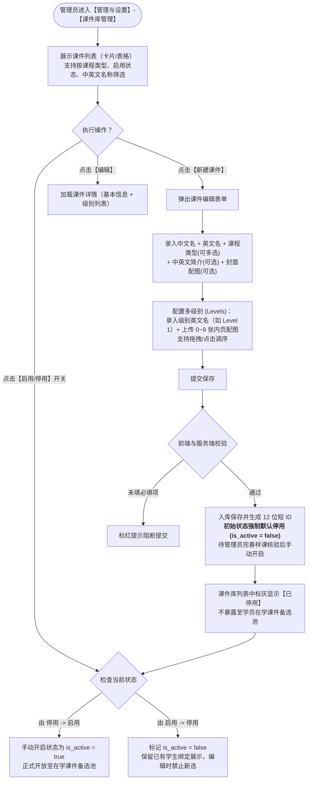
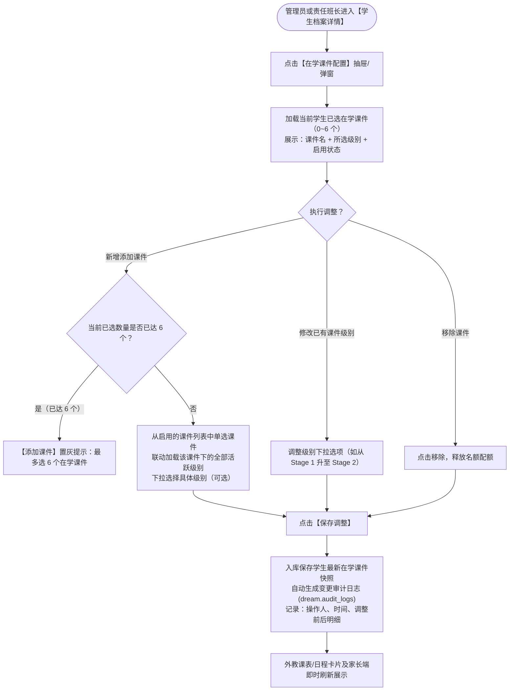
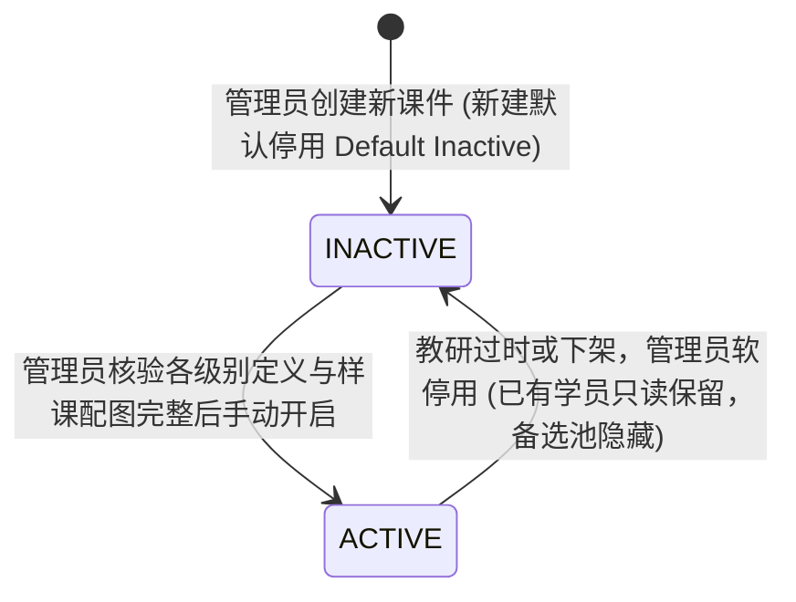
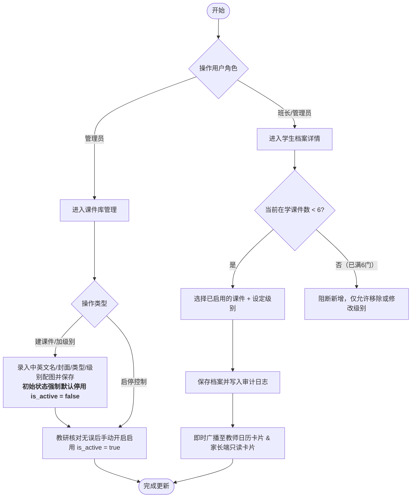

/** (c) 2024-2026 Topee (https://topee.top). All rights reserved. Proprietary and confidential. */

# 产品需求文档 (PRD) — 子模块 1E：课件库与学员在学课件管理 (Courseware Management)

| 元数据项 | 说明 / 内容 |
|---|---|
| **模块代号** | `m1e` |
| **所属模块** | 模块一：教学教务基座与主数据 (Master Data & Profiles) |
| **文档状态** | 待评审 (Draft) |
| **关联顶层 PRD** | [Prd-v5.md](../Prd-v5.md) ｜ [CODING_STANDARDS.md](../CODING_STANDARDS.md) ｜ [BUSINESS_RULES.md](../BUSINESS_RULES.md) |
| **关联子模块** | [m1a_student_profile.md](./m1a_student_profile.md), [m1b_teacher_profile.md](./m1b_teacher_profile.md), [m3a_calendar_grid.md](./m3a_calendar_grid.md), [m3d_course_scheduling.md](./m3d_course_scheduling.md) |
| **创建与更新日期** | 2026-11-09 (创建) ｜ 2026-11-10 (升级：新建课件默认停用规则) |

---

## 1. 概述与执行摘要 (Executive Summary)

课件库与学员在学课件管理（`m1e`）是 Dream 系统的教学主数据核心能力之一。通过结构化的分级课件目录（中英文名称、中英文简介、封面配图、归属课程类型及多级英文分级配图），为全平台教学活动提供标准化的教具元数据索引。

同时，子模块在学员档案中构建了**“在学课件（Current Courseware）”精细化配置通道**（支持关联课件及当前修读级别，上限 6 门）。由管理员或责任班长在学员初学入读或阶段升阶时动态维护，贯通外教课表备课、家长端档案展示与班长端学员洞察，全面替代传统外部腾讯文档的低效分散管理，保障教学进度的精准衔接与延续性。

---

## 2. 问题定义与背景 (Problem Statement)

- **痛点 1：教材课件依赖外部表格，协同割裂且无法穿透**：
  此前系统教材目录主要依赖外部腾讯文档维护，外教在备课与上课前无法从教务日历中秒级获知当前学生正在使用的具体教材及级别；若遇临时代课，代课老师需在线下群反复询问班长，极易发生“拿错教材、讲错单元”的教学事故。
- **痛点 2：学生学习阶段跃迁缺乏结构化档案承载**：
  少儿外教辅导具有长周期性与多阶段性（如从 Raz 分级阅读入门，逐步叠加 Reach Higher 或 Wonders 精读，后期备考 KET/PET）。学生名下若无明确的“在学课件与级别”标识，班长与教师难以直观把握学生的整体学习画像。
- **痛点 3：课件展示缺乏多维度视觉参考**：
  家长咨询或学员选课时，往往需要直观预览某套课件的真实内页、分级难度及封面样课。纯文字列表无法满足教学预览诉求。

---

## 3. 目标用户与角色画像 (Users & Personas)

### 3.1 角色一：平台管理员（Admin）
- **角色定位**：全平台课件资产的统一配置方与维护者。
- **核心诉求**：统一录入教材课件中英文信息、封面配图、归属课程类型（如少儿英语、KET、分级阅读等），并按级别（如 Stage 1, Stage 2 / Level K, Level 1）上传样课预览配图并灵活调序；按需启用或停用课件。
- **预期成果**：课件库数据严谨规范，与课程类型字典无缝匹配，禁止非合规的物理删除引发历史数据孤岛。

### 3.2 角色二：带班班长（Monitor）
- **角色定位**：教学服务经纪人、学员阶段规划师。
- **核心诉求**：在学员初次建档分配班长后，或学员完成某一阶段学习升阶时，在学生档案中便捷勾选/调整该学员的“在学课件与修读级别”（最多 6 个）；查看历史升阶调整日志。
- **预期成果**：外教课表能自动同步最新在学教材，减少线下群反复沟通成本。

### 3.3 角色三：授课外教（Teacher）
- **角色定位**：教学执行主体。
- **核心诉求**：在教师个人课表及即将上课的日程详情中，一目了然看到当前学员正在学习的 1~6 门课件名称及级别标签，点击可快速查看样课内页图示，确保课前精准备课。
- **预期成果**：课前备课时间缩短，代课时 0 摩擦无缝衔接。

### 3.4 角色四：出资家长（Parent）
- **角色定位**：出资人与学习进度关注者。
- **核心诉求**：在家长端切换孩子档案时，能清晰查看孩子当前绑定的在学课件封面与级别标签（只读），了解孩子的系统化学习路径。

---

## 4. 核心业务流程 (Workflows)

### 4.1 课件资产管理全生命周期流 (Admin Courseware Lifecycle)

### 4.2 学员在学课件配置与阶段调整流 (Student Current Courseware Flow)

---

### 4.3 实体生命周期与状态机 (Entity Lifecycles & State Machines)

M1E 负责全平台课件教材资产与学员修读画像，闭环管理以下 2 大核心实体的生命周期：

#### 1. 课件教材主实体 (Courseware)
- **生命周期状态机**：

- **防物理删除与停用守卫**：
  - 课件创建强制初始为 `INACTIVE`，杜绝未完工样课暴露；
  - 产生任何学生绑定记录后，全端物理禁止删除；仅允许软停用 (`is_active = false`)。

#### 2. 学员在学课件绑定 (StudentCoursewareBinding)
- **生命周期流转**：
  - `ENROLLED`（在读绑定）：班长或管理员在学生档案绑定课件及起始级别（单学员上限 6 门）；
  - `LEVEL_ADVANCED`（升阶跃迁）：学员修读晋级，班长更新所属 `level_id`，系统写入升阶审计日志 `dream.audit_logs`；
  - `REMOVED`（解绑结业）：学员修毕或更换教材，班长移除绑定并释放 6 门配额名额。

---

## 5. 用户故事 (User Stories)

- **US-1E-01 (课件创建与级别配置)**：作为一个平台管理员，我想要录入课件的中英文名称、中英简介、封面配图、归属课程类型及多个英文级别与内页配图，以便于为全平台沉淀标准化教具索引。
- **US-1E-02 (课件状态管控与安全停用)**：作为一个平台管理员，我想要灵活启用或停用某些过时课件，但系统严禁物理删除已有学员绑定的课件，以便于保障历史教学记录的完整性与安全性。
- **US-1E-03 (学生档案在学课件维护)**：作为一个带班班长，我想要在学生档案中为学员配置 1~6 门在学课件及具体就读级别，并在学员升阶时便捷调整，以便于精确把控学员的学习阶段。
- **US-1E-04 (外教上课精准备课)**：作为一个授课教师，我想要在个人日程及待上课卡片中直观查看该学员的在学课件名称与级别，并能点击查看样课配图，以便于在上课前 100% 准备好对应教材。
- **US-1E-05 (家长端学习画像透明化)**：作为一个出资家长，我想要在孩子档案中清晰查看到当前正在学习的教材封面与级别标签（只读），以便于了解孩子的学习规划并辅导预习。
- **US-1E-06 (升阶变更审计追溯)**：作为一个教务主管，我想要查阅学员历次在学课件的调整人与调整时间记录，以便于核实学员升阶轨迹与责任归属。

---

## 6. 验收标准清单 (Acceptance Criteria)

### 6.1 课件主实体管理 (Courseware Master)
- **AC-1E-01 (必填字段与中立性)**：课件创建必须包含中文名 (`name_cn`，最长 64 字符)、英文名 (`name_en`，最长 64 字符)、至少勾选 1 个归属课程类型 (`course_type_ids`)。
- **AC-1E-02 (可选元数据)**：中文简介 (`description_cn`)、英文简介 (`description_en`)、封面配图 (`cover_url`) 为选填字段。封面配图限 1 张。
- **AC-1E-03 (新建课件默认停用铁律 · Default Inactive)**：
  - **默认停用初始化**：新建课件在创建提交入库时，其状态字段**必须且强制默认为停用 (`is_active = false`)**，严禁新建即自动启用；
  - **教研与安全缓冲机制**：课件通常包含封面、简介及多级别（Levels）样课内页图上传，设立“默认停用”机制以确保未完工、未校验或待教研验收的半成品课件不会过早暴露，杜绝班长/管理员在学员档案中误选；
  - **主动手动开启**：管理员录入并核验各级别定义与样课配图完整无误后，必须在课件列表页主动开启 Switch 开关或在编辑页手动切换为【启用】(`is_active = true`)，课件方可正式生效并同步至学员在学课件备选池。
- **AC-1E-03a (软停用与防物理删除)**：
  - 管理员可随时切换课件状态为 `active` 或 `inactive`；
  - **物理删除防护**：系统严禁提供物理删除操作（防止已有学生档案外键孤岛与排课历史割裂）。若课件从未被任何学生绑定过，支持管理员执行物理清理；一旦产生绑定记录，仅允许软停用 (`is_active = false`)。
  - 停用后，在学生档案新增选择在学课件时，下拉列表中自动隐藏该课件；名下已绑定的学生档案中继续展示，并醒目标注【已停用】灰色标签。

### 6.2 级别体系与配图规格 (Courseware Levels)
- **AC-1E-04 (多级别定义)**：一个课件可包含 0~N 个级别（如未分级可不建级别；若分级则按升阶顺序排列）。每个级别必须录入级别英文名 (`level_name`，如 `Stage 1`, `Level K`, `Starter`)，最长 32 字符。
- **AC-1E-05 (级别配图数量与调序)**：
  - 每个级别支持上传 0~9 张内页样章配图；
  - 支持在表单内通过上移/下移或拖拽直观调整级别内配图的显示顺序 (`sort_order`)；
  - 支持调整级别本身的前后显示顺序。
- **AC-1E-06 (前端图片规范与直传)**：
  - 配图格式限定为 `JPG`, `PNG`, `WEBP`；
  - 遵循系统已有上传规范：浏览器端采用 Canvas 进行等比例智能压缩（最长边不超过 1920px，单张压缩后体积 ≤ 2MB），通过 S3 预签名直传通道直传至对象存储，返回不可变 URL 存库。

### 6.3 学员在学课件配置 (Student Profile Courseware Binding)
- **AC-1E-07 (数量上限控制)**：单名学生档案名下最多绑定 **6 个**在学课件。当已选数量达到 6 时，【添加课件】按钮自动置灰并展示 Tooltip：“每个学员最多支持配置 6 门在学课件”。
- **AC-1E-08 (粒度与可选级别)**：绑定项粒度为【课件实体 + 所选级别】。若所选课件未定义级别，级别项显示为“标准/无分级”；若定义了多级，下拉提供可选级别；支持暂不选择级别（仅选课件）。
- **AC-1E-09 (权限隔离铁律)**：
  - **配置写权限**：仅限平台管理员（Admin）与该学生的责任班长（Monitor）有权在学生档案详情页中增删改在学课件；
  - **家长端只读**：出资家长在家长工作台仅可查看名下学员的在学课件列表与级别，无修改权限。
- **AC-1E-10 (变更审计沉淀)**：每次保存在学课件的调整（新增、移除、升阶变更级别），系统强制写入操作审计日志表 (`dream.audit_logs`)，记录 `operator_id`、`student_profile_id`、`action = UPDATE_STUDENT_COURSEWARE`、变更前快照与变更后快照，确保升阶轨迹可查。

### 6.4 跨端消费与视图联动 (Downstream Consumers)
- **AC-1E-11 (外教备课课表卡片)**：
  - 在教师日历/课表待上课课程详情抽屉中，聚合展示该学生绑定的在学课件（展示课件英文名 + 级别标签，如 `Oxford Reading Tree (Stage 3)`）；
  - 悬停或点击卡片可唤起浮层预览课件封面及该级别样章配图，点击支持全屏放大查看；
  - 课件展示作为备课参考标签，**不与单节预约排课执行强阻断校验**（保持约课流程极简轻量）。
- **AC-1E-12 (家长端与班长端展示)**：
  - 家长工作台：在顶部多孩档案卡片与学员资料 Tab 中，以标签徽章或微型图文卡片呈现当前在学课件；
  - 班长工作台：在负责学员列表及学员卡片详情中直观呈现，支持按在学课件类型筛选学员。

---

## 7. 本期范围外清单 (Out of Scope)

- ❌ **不做课件源文件上传与在线阅读器**：本期明确不支持上传完整的 PDF/PPT/Word 等电子教材大文件，亦不提供在线课件白板翻页/点读/音频播放器。本期核心聚焦于课件元数据索引与分级样课图文预览。
- ❌ **不做单元级消课自动打卡进阶**：本期课件级别调整由管理员或班长根据实际教学进度手动维护，系统不自动按完课节数推算或自动跳级。
- ❌ **不做约课流程中的强制课件单选阻断**：预约 1v1 或临时课时，不强制家长或代约人必须指定“本节课讲哪一本课件的哪一课”，课件信息作为学员维度的静态参考。

---

## 8. 约束条件 (Constraints)

### 8.1 业务与规格约束
- 单个学员最多绑定 6 个在学课件；
- 单个课件最多支持录入 30 个分级级别 (Levels)；
- 单个级别最多支持上传 9 张样课配图；
- 单张配图前端压缩后体积 ≤ 2MB，格式限 JPG/PNG/WEBP。

### 8.2 安全与审计约束
- 课件库单表数据必须遵循单 Schema `dream` 规约，实体主键统一采用 12 位短 ID；
- 课件信息完全多语言中立，入参校验英文诊断码，前端通过中英名字段多语言自适应展示；
- 涉及在学课件的所有配置变更必须全量记录审计日志。

---

## 9. UI/UX 界面线框说明 (Wireframe Level)

### 9.1 管理员端：课件库管理列表与编辑模态窗
- **列表页**：
  - 顶部操作栏：`[ + 新建课件 ]` 按钮、搜索框（中/英文名）、课程类型下拉筛选、状态下拉（全部/启用中/已停用）；
  - 列表呈现：网格卡片流，每张卡片展示【封面缩略图】、【中文名 / 英文名】、【课程类型标签】、【包含级别数（如 8 个级别）】、【启用/停用 Switch 开关】、【编辑按钮】。
- **编辑模态窗/抽屉**：
  - **区块 1：基础信息**：中文名（必填）、英文名（必填）、归属课程类型（Tag 选择器，多选必填）、封面上传区（拖拽上传，支持裁剪预览）、中英文简介（Textarea）；
  - **区块 2：分级级别列表 (Levels)**：
    - 点击 `[ + 添加新级别 ]`，新增一行；
    - 每行包含：拖拽手柄、级别英文名输入框（如 `Stage 1`）、样课配图缩略图列表（最多 9 张，展示小缩略图，支持点击加号上传或点击叉号删除，支持单级别内配图左右调序）、删除该级别按钮；
  - **区块 3：状态与教研发布提示**：新建课件时状态开关默认处于【停用 (Off)】，表单底部带辅助说明小字：“新建课件默认处于停用状态；待完善各级别样课配图并核对无误后，可在列表或详情中手动开启启用”。

### 9.2 班长/管理员端：学生档案【在学课件配置】抽屉
- **抽屉结构**：
  - 顶部信息：学生规范昵称、当前已选计数（如 `在学课件 (3/6)`）；
  - 已选列表区：3 列或 2 列卡片，每张卡片显示课件封面、中英文名、当前所选级别下拉框（可直接切换级别）、`[ 移除 ]` 按钮；
  - 新增行：若计数 < 6，显示虚线边框卡片 `[ + 添加在学课件 ]`，点击展开下拉弹窗，单选平台已启用的课件库，并联动展示该课件的级别供选择；
  - 底部动作：`[ 取消 ]`、`[ 保存生效 ]`；
  - 底部可展开折叠区：【历史升阶与变更日志】（时间、操作人、变更前后明细）。

### 9.3 教师端：日历待上课详情卡片中的课件展示
- 在右侧课程详情弹窗中，于学生基础信息下方展示专属区块：
  - 标题：`Current Courseware (在学课件)`；
  - 内容：水平排列的课件胶囊徽章（如 `📘 Wonders (Grade 1)`、`📗 Raz-Kids (Level F)`）；
  - 交互：鼠标悬浮或点击徽章，弹出 Popover 展示该课件封面、简介及该级别的前 3 张样课内页缩略图，点击缩略图全屏放大灯箱预览。

---

## 10. 用户流程图 (User Flow Diagram)

---

## 11. 待定事项与补充说明 (Further Notes)

1. **二期演进考虑**：后续若机构教务需要更进一步按课件单元自动消课追踪，可在本模块结构化 Levels 基础上扩展 `Units / Chapters` 字段，并在结课时提供勾选项，本期保持敏捷轻量。
2. **多语言与国际化**：课件名称与简介天然支持中英文双语存储，前端外教端默认优先呈现 `name_en` 与 `description_en`，中文家长端默认优先呈现 `name_cn` 与 `description_cn`。
3. **新建课件默认停用机制**：课件创建落盘初始状态强制为停用（`is_active = false`），给予教研和管理员核验各级别定义与样课配图的教研缓冲期，确认无误后手动切换为启用，避免未就绪的半成品课件被误选入学员档案。
