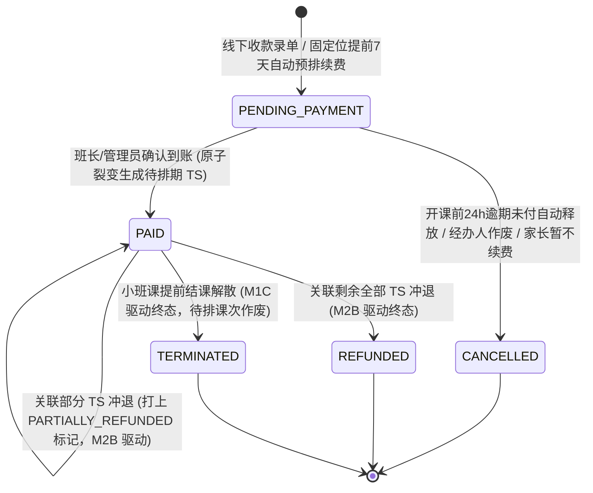
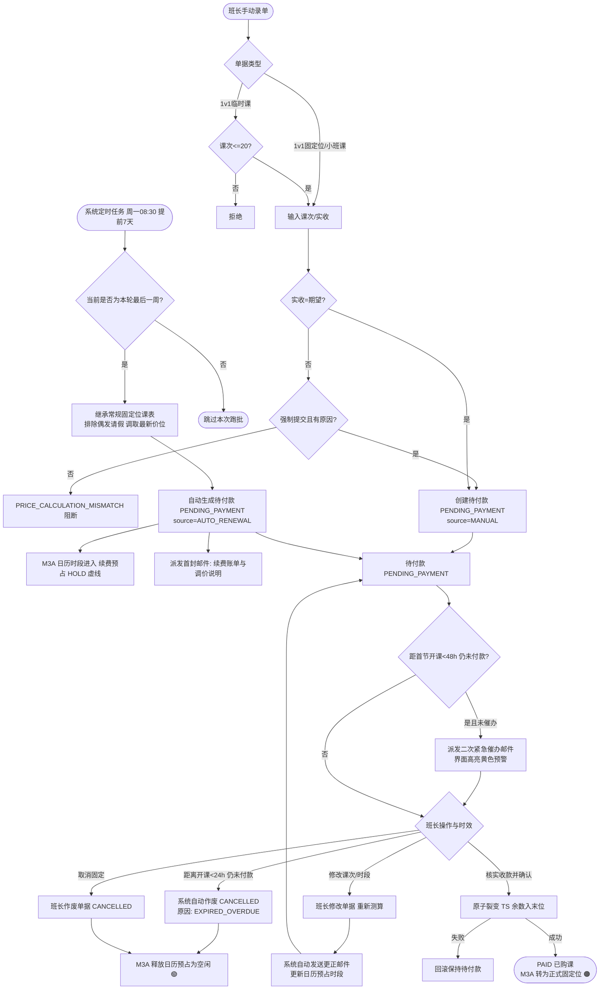

/** (c) 2024-2026 Topee (https://topee.top). All rights reserved. Proprietary and confidential. */

# 产品需求文档 (PRD) — 子模块 2A：购课录单、防呆校验与 TS 裂变引擎 (Course Orders)

| 元数据项 | 说明 / 内容 |
|---|---|
| **模块代号** | `m2a` |
| **所属模块** | 模块二：购课单与资金单据 (Course Orders & Funds) |
| **文档状态** | 待评审 (Draft) |
| **关联顶层 PRD** | [Prd-v5.md](../Prd-v5.md) |
| **关联模块划分** | [system_modules_overview.md](../system_modules_overview.md) |
| **创建与更新日期** | 2026-11-04（2026-11-11 更新看板首行轻量待办规范，精简统计卡片；卡片视觉确立“常态纯白、仅待办微黄底”高清晰度对比度方案，彻底消除字底同色与低对比度模糊字；2026-11-12 卡片视觉改为只声明卡片类型，色值统一引用 DESIGN.md 2.2.1） |

---

## 1. 概述与执行摘要 (Executive Summary)

购课录单子模块（`m2a`）面向班长与管理员，将线下（微信/转账）收款事实录入系统，生成**购课单**，经“确认收款”后原子化裂变为可排课的 **TS（课次）** 单元。本子模块覆盖 1v1 固定位购课（含**每轮固定位到期提前 7 天（最后一周周一 08:30）系统自动预排续费单与阶梯催办**）、1v1 临时课购课、小班课整班购课（**同样以 4 周为标准履约周期，每轮购课一次，课次为 4 的倍数，到期支持主理人工作台自动续费预排**）三类单据，内置防呆定价校验、老师调级涨价透明透出与换师协调引导、凭证上传，并保证 TS 积分快照之和严格等于订单总积分。当前阶段：MVP 正式功能迭代。反向课次核销（课次清退与财务备注）归属 M2B，不在本文范围。

---

## 2. 问题定义与背景 (Problem Statement)

- **痛点 1：手工算价易错**：价位与备课费叠加规则需实时核算，班长手算录单时常出现少收/多收，事后对账成本高。
- **痛点 2：收款与生效不同步**：家长声明已付款但班长未核实到账时，若立即生成可排课课次，会造成“未收款先上课”的资金风险。
- **痛点 3：总额与课次拆分不一致**：订单总积分除以课次数常有余数，若各课次快照取整后之和与总额不符，课酬单核算将出现无法对平的尾差。
- **痛点 4：请假额度口径不一**：请假额度靠口头约定，没有统一的取整规则，产生纠纷。
- **现状**：班长在线下表格计算价格并手工登记课次，无凭证留痕、无防呆校验。

---

## 3. 目标用户与角色画像 (Users & Personas)

### 3.1 角色一：班长（Leo）
- **诉求**：快速录入购课单，系统自动算出应收积分并提示异常；核实到账后一键确认收款生成课次。
- **预期成果**：录单零计算错误，收款与课次生成可追溯。

### 3.2 角色二：平台管理员（Sarah）
- **诉求**：可录入或作废任一班长名下的购课单，审计凭证。
- **预期成果**：全部购课单状态与资金归属清晰。

### 3.3 角色三：出资家长（Amy）
- **诉求**：付款后能在家长工作台看到购课单状态（待付款确认 / 已购课 / 已作废）及获得的课次数。
- **预期成果**：确认收款后立即看到可约课次。

---

## 4. 核心业务流程 (Main Flows)

### 4.1 1v1 固定位购课（人工手动录单）
1. 班长选择学员档案，**必选计价价位档位**（如 `16积分`/`18积分`/`21积分` 等，**意向老师选填**；若选择意向老师则自动带出其当前价位），勾选固定位，输入课次数与实收积分，可勾选“含额外备课费”。
2. 系统按所选价位实时计算期望积分并展示请假额度。
3. 若课次数不是 4 的倍数，系统弱提醒（可继续提交）。
4. 若实收积分与期望积分不一致，系统阻断并提示 `PRICE_CALCULATION_MISMATCH`；班长可勾选强制提交（`force_submit`）并填写原因后继续。
5. 提交后单据状态为 `PENDING_PAYMENT`，单据来源标记为 `MANUAL`，可上传支付凭证。
6. 班长核实到账，点击“确认收款”，状态转 `PAID`，系统原子化裂变对应数量且携带价位快照的待排 TS。

### 4.1a 固定位与小班课到期自动续费生成与预排单核销流程 (Auto-Renewal Flow)
1. **触发时机与自动扫描（提前 7 天）**：
   - 每周一上午 08:30，系统后台定时批处理自动扫描名下存在有效固定位排课的学员以及处于固定开课状态的小班课小班，判断当前周（自然周周一至周日）是否为其当前 4 周周期的最后一周（第 4 周）。
   - 若判定为最后一周，系统提前整整 7 天自动为下一轮周期（未来 4 周）启动预排出单与日历预占保护。
2. **预排提取与智能算价规则**：
   - **常规排期继承**：系统以该学员或小班本轮有效排期为基准（按本轮最后一周课表还原，**排除单次偶发请假干扰**，完整继承常规上课时段）；
   - **课次数计算**：按下一轮（4 周标准周期）完整计算总课次数（例：每周二、四各 1 节，一轮共 8 节；小班课每周 1 节双格为 4 节）；
   - **价位取价与调价边界**：新建或新触发生成的购课单，系统自动调取授课老师**当前最新价位积分**（`16积分`/`18积分`/`21积分`）核算总积分。若老师在本轮期间发生价位调整（如 `16积分` 调整为 `18积分`），**已生成的购课单先不调整金额**（可能线下补差），新生成的单据按最新价位计算并在单据及通知中清晰展示当前价位，提示班长可协助协调其他老师或线下补差；
   - **生成待付款单据与日历预占（提前 7 天强锁 HOLD）**：
     - **1v1 固定位**：系统自动创建状态为 `PENDING_PAYMENT` 的购课单（`source = AUTO_RENEWAL`）；联动 M3A 在老师日历上将对应未来 4 周目标时段立即标记为 **“🟠 续费保护期预占（HOLD / 预占）”** 微虚线卡片，全域排他阻断他人抢约；自动向家长注册邮箱派发首封账单提醒邮件与消息；开课前 48h 追加临期紧急催办；
     - **小班课 (56px 连续双格)**：系统自动创建该小班的待付款购课单（`source = AUTO_RENEWAL`，绑定 `class_id` 与主理人 `holder_id`）；联动 M3A 在老师日历上将对应未来 4 周目标时段立即标记为 **“🟩 小班续费预占（G-HOLD）”** 青绿虚线双格卡片，排他阻断他人抢约；**系统严格物理阻断向家长发送任何通知邮件/短信**（小班家长免建档免注册），仅向**小班主理人工作台**派发【小班下一轮待收款确认】待办与端内提醒；
3. **班长/主理人确认收款与核销闭环**：
   - 班长/主理人在工作台“购课单列表”中筛选查看，核实到账后（1v1 家长线上/线下转账；小班主理人完成私域微信群收款），点击“确认收款”；
   - 确认收款后，单据跃迁至终态 `PAID`，系统原子化裂变生成对应数量的 TS，联动 M3A 将日历上的预占网格原子更新为正式排课（1v1 转正式 🟠 固定位；小班课转正式 🟩 实线双格带 `[G]` 标）。
4. **确认前修改购课单与家长自助意向处理**：
   - **家长侧自助操作（仅限 1v1 固定位 `AUTO_RENEWAL` 待付款单；小班课对家长端依然完全不可见）**：
     - **【上传付款凭证】**：家长可上传或追加付款截图/凭证（单文件 $\le 10\text{MB}$，最多 5 张；改价补差时可追加补款凭证）。单据主状态保持 `PENDING_PAYMENT`，系统标出 **`已传凭证待核`** 并即时通知班长核实收款；
     - **【暂不续费】**：家长点击并完成二次确认后，单据**立即流转至 `CANCELLED`**（作废原因：`PARENT_DECLINED` 家长主动放弃续费），**立即原子释放未来 4 周 `HOLD` 预占网格**为 🟢【空闲可约】，并即时通知班长免除后续催办；
     - **【申请调整】**：家长勾选诉求标签（`更换上课时段` / `更换授课老师` / `调整每周课次` / `其他说明`，可多选）并填写补充说明后提交。提交后**单据主状态保持 `PENDING_PAYMENT`，暂不释放原有 4 周 `HOLD` 预占**（防止协商期间原保底时段被他人抢走）；单据记录协商状态 `adjustment_status = PENDING_HANDLE`（`待班长处理`）、诉求标签、留言摘要与提交时间，并在班长教务中心待办流置顶与购课单列表高亮提醒；
   - **班长侧编辑与闭环（【修改购课单】）**：
     - 在确认收款前，负责班长或小班主理人有权在后台点击【修改购课单】，支持**调整上课时段、增减课次（4 的倍数）、更换授课老师（仅 1v1，同步选择新老师未来 4 周空闲时段）及修改实收金额**；
     - 系统按当前最新老师价位与课次数重新测算期望积分（若跨价位换师或调课次导致实收 $\ne$ 期望，需填写 `force_submit` 原因，或在家长线下补退差价后按新实收保存）；保存后单事务释放旧时段/旧老师 `HOLD`、锁定新时段/新老师 `HOLD`，向家长重发更正通知邮件，并将 `adjustment_status` 自动置为 `RESOLVED`（已处理）；
     - 若沟通后维持原方案不改单，班长可点击【标为已沟通】（将协商状态置为 `RESOLVED`）或核实到账后直接【确认收款】；若不再续课，点击【取消固定并作废】释放日历网格。
5. **开课前 24 小时逾期未付自动释放红线**：
   - 截至距离下一轮首节开课前 24 小时整，只要单据仍处于 `PENDING_PAYMENT` 且班长未确认收款（**即使家长此前已上传付款凭证或提交了【申请调整】**），系统仍严格执行自动作废，将单据置为终态 `CANCELLED`（原因：`EXPIRED_OVERDUE` 已逾期自动作废），并原子解除未来 4 周日历预占，网格全额释放为 🟢【空闲可约】，防止教学产能被无限期占坑。

### 4.2 1v1 临时课购课（多价位组合按节直出 TS + 含待认领试课学员录单）
1. **常规 1v1 临时课按节购课（支持同一单选多个价位，直接生成待排临时 TS）**：
   - **多价位明细组合（1～20 节）**：选定学员后，可在同一张购课单内添加 **1～N 条价位明细**（每行选定一个计价价位档位 + 课次数 $\ge 1$，例如 `18积分 × 1 节` + `21积分 × 1 节`，同一价位不可重复添加；所有明细行课次数之和限制为 **1～20 节**）。
   - **无优惠、禁止改价**：1v1 临时课期望总积分 = $\sum (\text{明细节数}_i \times \text{明细价位}_i)$，**不支持任何优惠或 `force_submit` 强行改价**；实收积分严格锁定等于期望总积分。
   - **零跨班长持有冲突**：每节临时 TS 独立绑定收款人 `holder_id`；任何班长或平台直收均可随时为同一家长开具临时课购课单，互不阻断、无需移交。
   - **确认收款原子裂变 TS**：核实到账点击【确认收款】后，单据状态转 `PAID`，系统按明细行逐行裂变生成 $N$ 节 `PENDING_SCHEDULE` 待排临时 TS（每节固化 `holder_id`、所购 `price_tier` 与等额积分快照）。后续在 M3A 家长自助约临时课时**严格同价位匹配**对应待排临时 TS（不向下兼容；亦支持班长在 M3A 约课抽屉内同步录单并立即排课）。
2. **待认领试课学员（UNBOUND）录单规范**：
   - **班长与管理员**均可针对状态为 `UNBOUND` 的试课学员档案开具 1v1 临时课购课单（资金持有人 `holder_id` 锁定为实际收款人：当前班长或平台）；
   - 课次数范围：严格遵循常规临时课 1~20 节限制；
   - 收费模式：严格按所选价位标准计价收费，**不允许改价**；
   - 归属标记：初始单据的 `account_id` 标记为平台公共托管占位，`student_profile_id` 锁定该试课档案；
   - 认领归集生效：当该档案被家长成功认领绑定（转为 `ACTIVE`）时，系统自动在单一事务内将该购课单的 `account_id` 原子更新为该家长账号，单据添加归集日志标签并在家长端“购课单列表”中完整呈现。

### 4.3 小班课整班购课（主理人录多少交多少，停用分成与自留）
1. 小班主理人选择小班（`class_id`），输入整班待上交总积分（`total_points`）。系统遵循“主理人录入多少就上交多少积分”，小班课购课单直接绑定【小班 ID】与【小班主理人】，**完全不关联任何家长账号和学员档案**，系统不介入主理人其他盈余计算。
2. **4 周标准周期与课次数规范**：小班课与 1v1 固定位类似，以 **4 周为一个标准履约周期，每轮购课一次**。购买课次数标准为 **4 的倍数**（标准为 4 节或 8 节；若每周 1 节双格为 4 节，每周 2 节双格为 8 节）；录单界面提供快捷课次胶囊。
3. **前置老师委任校验（决策 2B）**：开具小班课购课单时，该小班必须已完成授课老师委任（`classes.teacher_profile_id IS NOT NULL`）。若小班处于“暂未绑定老师”状态，系统物理拦截并禁止提交，强制要求主理人先在小班管理中完成老师委任。
4. **待上交总积分录入**：主理人直接录入整班待上交总积分（须为正整数，可参考覆盖预设老师单节课酬，**不再收取 $Max \times 6$ 固定工具费**，主理人录入多少即按多少上交）。
5. 确认收款后裂变 N 个小班专属 TS，进入该小班待排期池（资金持有人 `holder_id` 锁定为小班主理人），对家长端完全不可见。TS 财务快照记录单节待上交费用与预设老师课酬，**全面停用并移除工具费、`commission_points`（平台抽佣）和 `monitor_retained_points`（主理人自留收益）字段**。
6. **新建承接小班购课单规范（方案 2）**：当小班课因更换主讲老师（方案 2）由主理人创建新承接小班时，开单支持选填【关联结转原小班】（`source_class_id`）与【业务备注】（`remarks`）；购买课次数录入剩余未上课次数，录入重新核算后满足底线覆盖的待上交总积分。若有特殊情况需调整，主理人勾选 `force_submit=true` 并附带备注留痕，周二财务审核时作为直接放行凭证。

### 4.4 作废、课次清退与小班提前结课流转
1. **常规单据作废与课次清退**：`PENDING_PAYMENT` 状态下，班长/管理员可作废单据，状态转 `CANCELLED`，不产生 TS。`PAID` 单据不可整单作废；若需退课，可通过子模块 M2B 执行【课次清退/扣减】作废部分或全部待排期 TS 并填写财务备注。全额清退后主单流转为 `REFUNDED` 终态，部分清退时保持 `PAID` 并打上 `PARTIALLY_REFUNDED` 标识。
2. **小班课提前结课解散单据联动终态（方案 2）**：
   - 当对应小班课在 M1C 执行【提前结课解散】时，系统在单事务内联动将原小班购课单置为终态 `TERMINATED`（提前终止），不可再用于排课；
   - 单据记录快照：`consumed_lessons`（实际已完成课次数）、`voided_lessons`（作废未上课时数）；
   - 未消耗课次直接作废，**不向系统产生退款单（Refund Order）**，未完成课次绝不进入周转账单；剩余学费在主理人私域微信群内由主理人向家长进行多退少补闭环。

### 4.5 异常分支
- 重复点击确认收款：幂等，仅第一次生效。
- 裂变过程任一步失败：整体回滚，单据保持 `PENDING_PAYMENT`。
- 凭证上传失败：不影响单据创建，可重试上传。

### 4.6 购课单全生命周期状态机与 TS 裂变规则矩阵 (Course Purchase Order Lifecycle)

> **【实体生命周期 SSOT 归口声明】**：`CoursePurchaseOrder`（购课单）的生命周期状态机与流转规则 100% 统一由本 PRD 管辖与维护。后续任何涉及购课单状态枚举、跃迁约束或副作用的修改，必须且只能修改本文档。

#### 状态转移与守卫规则矩阵 (State Transition Matrix)

| 当前状态 | 目标状态 | 触发事件 / 动作 | 操作人 / 驱动源 | 前置守卫条件与时限熔断 | 伴随副作用与资产流转 |
| :--- | :--- | :--- | :--- | :--- | :--- |
| **`[*]`** | `PENDING_PAYMENT` (待付款确认) | 手动录入购课单 / 固定位续费预排跑批 | 班长 / 管理员 / `dream-worker` | 输入实收积分 $\ge 0$；若有价差需满足 `force_submit=true`；小班课必须已委任老师 | 创建购课单主记录；若是固定位续费预排，联动 M3A 锁定 72h HOLD 网格并发送通知 |
| `PENDING_PAYMENT` | `PAID` (已付款生效) | 确认核实收款到账 | 班长 / 管理员 | 单据处于 `PENDING_PAYMENT`；资金已实际线下入账 | 原子裂变生成 $N$ 节待排期 TS；根据尾差吸收算法固化各 TS 财务快照；锁定资金持有方 `holder_id`；若是固定位续费单，清除 HOLD 标志正式锁定 |
| `PENDING_PAYMENT` | `CANCELLED` (已作废) | 经办人作废 / 家长暂不续费 (`PARENT_DECLINED`) / 逾期自动释放 (`EXPIRED_OVERDUE`) | 班长 / 管理员 / 家长 / `dream-worker` | 未确认收款前；家长主动放弃需二次确认；或距下一轮首节开课前 24h 逾期未付 | 单据置为已作废并记录作废原因；若关联固定位续费预排，联动 M3A 立即原子释放未来预占日历网格为 🟢【空闲可约】，家长放弃时即时通知班长 |
| `PAID` | `PAID` (部分清退标记) | 关联部分待排课次清退成功 | M2B 课次清退驱动 | 经办人通过 M2B 扣减部分待排 TS 并填写备注 | 单据主体保持 `PAID`，打上 `PARTIALLY_REFUNDED` 标识 |
| `PAID` | `REFUNDED` (全额清退) | 关联剩余有效 TS 全部清退 | M2B 课次清退驱动 | 经办人通过 M2B 将该单下所有剩余有效 TS 完成清退 | 单据流转为终态 `REFUNDED`；该购课单下所有课次资产彻底清零闭环 |
| `PAID` | `TERMINATED` (提前终止) | 小班课提前结课解散 | M1C 小班管理驱动 | 小班主理人在 M1C 执行【提前结课解散】 | 单据流转为终态 `TERMINATED`；单据记录已结课与作废课次快照；未结课 TS 批量注销且不产生退款单 |

---

## 5. 用户故事 (User Stories)

- **US-2A-01**：作为一个班长，我想要录入 1v1 固定位购课单并获得系统自动算价，以便于避免手算错误。
- **US-2A-02**：作为一个班长，我想要在实收与期望不符时被阻断并可附原因强制提交，以便于处理优惠等特殊情形且留痕。
- **US-2A-03**：作为一个班长，我想要在核实到账后再确认收款，以便于避免未收款先生成课次。
- **US-2A-04**：作为一个班长，我想要对整个小班录入一张购课单，以便于小班课统一管理收款。
- **US-2A-05**：作为一个管理员，我想要作废错录的待付款单据，以便于保持数据干净。
- **US-2A-06**：作为一个家长，我想要查看名下学员的购课单状态，以便于确认课次是否到账。
- **US-2A-07**：作为一个家长，我想要无法访问他人的购课单，以便于保护隐私（权限场景）。
- **US-2A-08**：作为一个班长，我想要无法操作非本人名下老师/学员的单据，以便于权责清晰（权限场景）。
- **US-2A-09**：作为一个出资家长，我想要在每轮固定位最后一周周一 08:30（提前 7 天）收到系统自动生成的下一轮续费账单与邮件，并在开课前 48 小时收到防遗忘临期提醒，以便于充裕知晓应付账单并锁定心仪老师的时间。
- **US-2A-10**：作为一个出资家长，我想要在授课老师调级涨价时看清调价原因与差额明细，并能联系班长协调其他老师，以便于明白消费、自主决策。
- **US-2A-11**：作为一个班长，我想要在确认到账前能够修改自动生成的购课单（调整次数与时间）或取消固定（作废），以便于灵活应对家长的挪位与退订诉求。
- **US-2A-12**：作为一个系统风控机制，我想要在开课前 24 小时自动作废未付款的续费单并释放日历，以便于防止教学时间资产被无意或恶意长期占位。
- **US-2A-13**：作为一个平台管理员，我想要为待认领试课档案录入 1v1 临时课购课单，以便于在家长免注册阶段即合规生成可排课的课次资产。
- **US-2A-14**：作为一个试课转正家长，我想要在认领孩子档案后能在账单中心看到此前的试课购课单，以便于账目清晰、明白消费。

---

## 6. 验收标准清单 (Acceptance Criteria)

### 6.1 定价与防呆校验
- **AC-2A-01**：1v1 固定位期望积分 = 课次数 × (所选价位 + 额外备课费 10〔仅勾选时〕)（**教师价位即家长单节应付积分，非老师课酬，且已彻底取消工具费**）；1v1 临时课支持多价位明细组合，期望积分 = $\sum (\text{明细节数}_i \times \text{明细价位}_i)$；小班课单独填写单节积分，不绑定老师 1v1 价位字典。
- **AC-2A-02**：1v1 价位字典首期内置 `16积分`、`18积分`、`21积分`（可由管理员在字典配置中维护），不再使用旧版 `JUNIOR 25 / STANDARD 30 / SENIOR 40 / MASTER 50` 课酬换算公式。
- **AC-2A-02a**：老师调价边界规范：管理员调整老师价位后，**已生成的购课单（含已生成待确认续费单）系统内先不调整金额**（可能线下补差）；新触发生成的续费单按老师最新价位计价，并在单据及通知中标明当前价位，附加文案提示家长“若需更换授课老师，请联系负责班长协助协调”。
- **AC-2A-03**：小班课取消固定工具费（$Max \times 6$）与底线覆盖强阻断，主理人录入多少待上交积分即按多少上交；彻底停用并移除工具费、`commission_points` 与 `monitor_retained_points`。
- **AC-2A-03a（小班购课单前置委任老师强阻断 · 决策 2B）**：开具小班课购课单时，系统校验目标小班必须已绑定有效的委任授课老师（`classes.teacher_profile_id IS NOT NULL` 且状态为 `ACTIVE`）。若小班处于“待委任老师”状态，开单接口物理阻断并返回错误码 `400 CLASS_TEACHER_NOT_ASSIGNED`，界面提示“该小班尚未委任授课老师，请先委任老师后再录单收款”；单据收款人与资金持有人（`holder_id`）锁定为小班主理人。
- **AC-2A-04**：实收积分 ≠ 期望积分时，1v1 固定位/小班课不带 `force_submit` 的提交被拒绝，返回错误码 `PRICE_CALCULATION_MISMATCH`；**1v1 临时课不允许改价或使用 `force_submit`**，实收积分必须严格等于明细汇总期望积分。
- **AC-2A-05**：仅 1v1 固定位/小班课带 `force_submit=true` 且填写原因（1-200 字）时允许特批改价提交，原因随单据保存；原因为空或用于 1v1 临时课时拒绝。
- **AC-2A-06**：实收积分必须为正整数，非正数或小数被拒绝。
- **AC-2A-07**：1v1 固定位及小班课购课单课次数非 4 的倍数时，界面显示弱提醒文案，提交不受阻。
- **AC-2A-08**：常规 1v1 临时课支持同一单内添加多条价位明细（如 `18积分×1 + 21积分×1`，同一价位不可重复行），所有明细节数之和限制为 **1～20 节**正整数；禁止改价；确认收款后逐行裂变为对应价位 `price_tier` 的 `PENDING_SCHEDULE` 待排临时 TS 并锁定 `holder_id`，无跨班长持有人校验阻断。
- **AC-2A-08b**：待认领试课购课单约束：针对 `UNBOUND` 档案开具的临时课购课单，课次数上限同样受 1~20 次刚性约束；可由班长或平台管理员开单与确认收款（锁定各自为资金持有人）；严格按所选价位计价，不允许改价。

### 6.2 请假额度
- **AC-2A-09**：请假额度 = ⌊总课次数 × 0.125⌋（向下取整）；例：20 课次 → 2，7 课次 → 0。
- **AC-2A-10**：录单页课次数变更后额度在 300ms 内更新展示。

### 6.3 单据生命周期与自动续费
- **AC-2A-11**：常规 M2A 新建单据状态为 `PENDING_PAYMENT`，此时不产生任何 TS；**特例：由 M3A 约课抽屉【2 步合 1 步快速录单】发起并经班长/管理员强制勾选确认已收款的 1v1 临时课单，单事务直接落盘为 `PAID` 并同步生成已排期 `SCHEDULED` TS**（无需再回 M2A 二次确认收款，仍可在 M2A 列表与详情页查看及补传凭证）。单据来源 `source` 区分 `MANUAL`（人工新建）与 `AUTO_RENEWAL`（系统自动续费）。
- **AC-2A-11a**：自动续费生成与预排提醒规范（提前 7 天）：每周一上午 08:30，系统后台自动扫描并识别处于固定周期最后一周（第 4 周）的 1v1 学员及固定开课小班；自动生成下一轮（4 周周期）预排购课单（`source = AUTO_RENEWAL`，状态为 `PENDING_PAYMENT`）；排期规则按本轮常规有效位继承；联动 M3A 在老师日历上同步对未来 4 周目标时段打上“续费预占”排他锁定标记（1v1 挂载 🟠 HOLD，小班课挂载 🟩 G-HOLD 双格）；1v1 向家长派发首封账单提醒邮件与消息，小班课严格阻断向家长发信，仅向小班主理人工作台派发待办。
- **AC-2A-11a2**：开课前 48h 临期二次催办规范：距离下一轮首节开课前 48 小时，若单据仍处于 `PENDING_PAYMENT`，系统自动向家长追加推送临期紧急催办通知（警示距离自动作废与释放日历仅剩 24 小时），并在家长首页与班长购课单列表中高亮展示黄色紧急预警标签。
- **AC-2A-11b**：自动续费单草稿编辑与原单换师规范：处于 `PENDING_PAYMENT` 状态的 `AUTO_RENEWAL` 单据，在确认收款前允许班长编辑（调整课次数、上课时间段、更换 1v1 授课老师并重选新老师 4 周固定时段，以及修改实收金额）；更换老师或课次后系统按最新老师价位与课次数重新测算期望积分（实收 $\ne$ 期望时强制要求填写 `force_submit` 原因）；修改保存后单事务释放旧 `HOLD` 并锁定新 `HOLD`，自动向家长派发更正通知邮件，并将 `adjustment_status`（若有）自动置为 `RESOLVED`。
- **AC-2A-11c**：逾期自动作废规范：截至距离下一轮首节开课前 24 小时，只要单据仍未确认收款（含家长已上传付款凭证或已提交【申请调整】但班长尚未确认/处理的场景），系统均严格自动将单据状态置为 `CANCELLED`（原因：`EXPIRED_OVERDUE`），联动 M3A 自动释放对应的日历预占时段为 🟢【空闲可约】。
- **AC-2A-11d**：家长端 1v1 自动续费单自助操作规范：
  1. 仅限家长名下 `source = AUTO_RENEWAL` 且 `status = PENDING_PAYMENT` 的 1v1 购课单展示【上传付款凭证】、【申请调整】、【暂不续费】操作（小班课单据对家长端依然完全不可见）；
  2. 点击【暂不续费】并完成二次确认后，单据立即置为 `CANCELLED`（原因：`PARENT_DECLINED`），未来 4 周 `HOLD` 预占立即释放为 🟢【空闲可约】，并即时通知负责班长；
  3. 点击【申请调整】并勾选诉求标签（`更换上课时段`/`更换授课老师`/`调整每周课次`/`其他说明`）及填写说明提交后，单据保持 `PENDING_PAYMENT` 与原有 4 周 `HOLD` 不变，写入 `adjustment_status = PENDING_HANDLE`、标签与留言摘要，即时通知班长并在班长教务中心待办流与购课单列表置顶高亮；班长保存改单、点击【标为已沟通】或【确认收款】后协商状态闭环为 `RESOLVED`。
- **AC-2A-12**：确认收款后状态变 `PAID`，TS 数量 = 课次数（小班课 = 小班课次数 N，如 4 节或 8 节）；日历预占网格原子更新为正式排课（1v1 转正式 🟠【固定位】，小班课转正式 🟩【小班课】双格实线微卡片带 `[G]` 标）。
- **AC-2A-13**：确认收款与 TS 裂变在同一事务内完成；任一失败则全部回滚，状态保持 `PENDING_PAYMENT`。
- **AC-2A-14**：对已 `PAID` 单据重复确认收款，不重复生成 TS，返回当前状态。
- **AC-2A-15**：`PENDING_PAYMENT` 单据可作废转 `CANCELLED`（班长点击取消固定时触发）；`PAID` 与 `CANCELLED` 单据作废请求被拒绝（注：`PAID` 单据后续仅可通过子模块 M2B 课次清退流转至 `REFUNDED` 终态或打上 `PARTIALLY_REFUNDED` 标识）。

### 6.4 TS 积分快照
- **AC-2A-16**：TS 快照为整数积分，基础值 = ⌊订单总积分 ÷ 课次数⌋。
- **AC-2A-17**：除不尽的余数全部加到最后一个 TS，使全部 TS 快照之和 = 订单总积分（例：100 积分 / 3 课次 → 33、33、34）。
- **AC-2A-18**：TS 资金持有方在裂变时锁定为收款班长（或平台），之后不随改派变更。
- **AC-2A-19**：小班课购课单与裂变 TS 完全绑定小班实体（`class_id`）与负责班长，不关联学员档案，对家长端完全不可见，仅班长与管理员可见。
- **AC-2A-19a（小班课提前结课解散单据联动）**：当对应小班在 M1C 转为 `EARLY_TERMINATED` 时，关联购课单在单事务内原子变更为 `TERMINATED`，`consumed_lessons` 记录实消节数，`voided_lessons` 记录作废节数，单据正式结案，不可再进行任何排课操作；系统不对作废课次出具退款单，未结课次不进入周转账单。
- **AC-2A-19b（新班承接购课单独立开具与单向追溯规范）**：
  - **物理绝对独立**：原班购课单已终态封存，承接新班必须开具全新独立的购课单（新单号、重新裂变专属 TS、绑定新老师与新课酬），**严禁复用或继承原单据**；
  - **单向审计关联**：主理人录单时支持选填 `source_class_id`（关联前序解散小班）与 `remarks`（结转说明）；
  - **穿透核验与豁免**：管理端可在新单据详情一键穿透查看原小班的解散档案；若因老生优惠导致实收积分与期望不符触发 `force_submit=true` 时，该备注自动作为审计对账豁免凭据，周二财务审核时直接放行。

### 6.5 凭证上传
- **AC-2A-20**：凭证支持 JPG/PNG/PDF，单文件 ≤ 10MB，每单最多 5 个；超限提示“文件大小不能超过 10MB”或“最多上传 5 个凭证”。
- **AC-2A-21**：`PENDING_PAYMENT` 与 `PAID` 状态均可由班长/管理员追加凭证；`PENDING_PAYMENT` 状态的 1v1 `AUTO_RENEWAL` 单据亦允许所属家长上传/追加付款凭证（如改价后追加补款凭证，总数仍受每单最多 5 个限制），上传后单据标出 `已传凭证待核` 并通知班长；`CANCELLED` 不可上传。

### 6.6 权限隔离
- **AC-2A-22**：班长仅可创建/查看/确认/作废自己负责老师或小班的单据；越权请求返回无权限。
- **AC-2A-23**：家长严禁手动新建购课单、严禁自行【确认收款】转为 `PAID`、严禁修改非 `AUTO_RENEWAL` 单据或任意非本人名下订单；仅允许对本人名下处于 `PENDING_PAYMENT` 的 1v1 `AUTO_RENEWAL` 单据执行【上传付款凭证】、【申请调整】、【暂不续费】三项自助操作，其余购课单保持只读。
- **AC-2A-23a**：档案认领单据归集：当 `UNBOUND` 试课档案被家长认领绑定（转为 `ACTIVE`）时，系统自动将该档案名下历史已完成（`PAID`）的试课购课单 `account_id` 同步原子更新为家长账号，家长对该单据具备只读查阅权限，单据状态与积分明细保持原貌。

### 6.7 界面交互与极简看板视觉规范
- **AC-2A-24（首行待办轻量提示，精简统计数字卡片）**：班长及管理端购课单列表首行仅保留“待确认收款 X 单”核心待办数字，不设“待确认/已购课/已作废” 3 块平铺式统计卡片；已购课与已作废历史单据的检索与浏览 100% 由状态分段选择器（Tabs）直接承接，杜绝视觉冗余。
- **AC-2A-25（单据列表卡片类型映射与极简四行密度）**：
  购课单列表卡片严格遵循 [DESIGN.md Section 2.2.1] 的三种卡面与排版底线，PRD 不重复定义底色、边框与文字颜色：
  1. **待办**：处于 `PENDING_PAYMENT`（待确认收款）的单据使用【浅黄提醒卡】；
  2. **常态**：已购课（`PAID`）单据使用【中性卡】，不整卡染色；
  3. **失效**：已作废（`CANCELLED`）单据使用【归档卡】（虚线边框 + 降透明度），安静沉底；
  4. **操作层级**：待办主确认动作使用主按钮，次要操作使用次要按钮；业务属性标签使用中性微标签；
  5. **可读性**：卡内文字层级与对比度统一遵循 DESIGN.md 的可读性硬红线；
  6. **四行极简控高**：列表卡片目标高度 **`120–148px`**（常态卡 3 行，待办/异常卡最多 4 行），一屏（`390×812`）支持浏览 3–4 张。严禁在卡内堆叠三列统计子块（课次/实收/请假额度）、4 周 HOLD 网格或多行调价/强提原因长文本；**请假额度、4 周 HOLD 网格、原新价对比、调价说明及强制提交原因全文**统一下沉至单据详情页展示。
- **AC-2A-26（购课单状态流转历史与时间轴）**：购课单每次状态跃迁（包括新建 `PENDING_PAYMENT`、确认收款 `PAID`、作废 `CANCELLED`、部分清退标记 `PARTIALLY_REFUNDED`、全额清退 `REFUNDED` 及小班提前终止 `TERMINATED`）必须在同一事务内追加只读状态流转记录（含原状态、目标状态、操作人/系统、流转时间与原因/备注）；单据详情页底部展示【状态流转历史】只读时间轴供班长与管理员核对追溯（家长端仅展示常规收款/作废/清退节点与时间，隐藏内部强制提交原因）。
- **AC-2A-27（自动续费单确认收款前编辑留痕）**：班长或管理员对处于 `PENDING_PAYMENT` 状态的自动续费单（`AUTO_RENEWAL`）修改课次数、排课时段或实收积分金额时，必须在同一事务内追加写入只读变更审计日志（记录操作人、操作时间及变更前后快照）。

---

## 7. 本期范围外清单 (Out of Scope)

- **课次清退与退费备注**：归属 M2B。
- **排课与约课**：归属模块三，本模块仅生成 TS。
- **在线支付网关**：不接入微信/支付宝，仅线下收款人工确认。
- **虚拟余额池/预存款**：不支持。
- **购课单修改**：常规手工单创建后不可直接编辑金额（需作废重录）；系统自动生成的 `AUTO_RENEWAL` 预排单在确认收款前允许班长编辑调整（调整课次、时段与实收金额），修改后遵循防呆重新算价并触发更正邮件。
- **批量导入购课单**：不支持。
- **更换实际上课学员**：归属模块三日历课格操作，原购课单资金归属不变。

---

## 8. 约束条件 (Constraints)

### 8.1 业务与合规约束
- 资金持有方一经裂变永久锁定，直至周结转账单归集。
- 财课分离：购课单费用归属方不随更换实际上课学员变更。
- 所有积分金额为整数，禁止小数。

### 8.2 功能与规格限制
| 项目 | 限制 |
|---|---|
| 临时课课次数 | 1-20 |
| 固定位课次数 | ≥ 1，建议 4 的倍数 |
| 强制提交原因 | 1-200 字 |
| 凭证格式 | JPG / PNG / PDF |
| 凭证大小 / 数量 | ≤ 10MB / ≤ 5 个每单 |

### 8.3 外部文档与参照依据
| 文档名称 | 存放路径 | 使用场景说明 |
|---|---|---|
| 顶层 PRD v5 | docs/Prd-v5.md | 定价与分账规则原始来源 |
| 核心业务规则与财务分账规约 | docs/BUSINESS_RULES.md | 资金持有人锁定与尾差吸收算法 |
| 工程与编码规范 | docs/CODING_STANDARDS.md | 凭证 S3 预签名直传规范 |

---

## 9. UI/UX 界面线框说明 (Wireframe Level)

### 9.1 班长工作台 — 购课单列表
- **结构与布局**：
  - **首行轻量待办栏**：左侧展示身份上下文与待办提示“**待确认收款 X 单**”（仅保留核心待办数字微徽章，取消平铺展示的‘待确认/已购课/已作废’ 3 个数字统计大卡片，降低视觉干扰与空间占用），右侧常驻【+ 录入购课单】主按钮；
  - **状态与来源筛选**：紧随其下为状态分段选择器（全部 / 待确认 / 已购课 / 已作废，承接历史单据与状态切换，替代传统统计块）、来源筛选胶囊（全部来源 / 人工录入 / 自动续费）、学员昵称/单号快捷搜索输入框；
  - **单据卡片极简四行结构（严格遵循 [DESIGN.md Section 2.2.1]）**：
    - **第 1 行（对象 + 核心标签 + 状态）**：学员档案名/小班名 + 最多 2 个中性微标签（课程模式 `1v1固定`/`1v1临时`/`小班` 及来源 `自动续费`；`承接原班`/`平台托管` 下沉至详情页），右侧为状态胶囊（`待确认收款` / `已购课` / `已作废`）；
    - **第 2 行（价位/老师 + 核心钱课 + 凭证状态）**：授课老师名或价位档位（如 `16积分`；多价位临时课单展示紧凑汇总如 `18积分×1 + 21积分×1`） + **`N 节 · 实收/待上交 X 积分`**，右侧轻量展示凭证状态（`已传凭证(N)` / `待补凭证`）；
    - **第 3 行（单行异常/待办提示条 · 仅按需出现，常态 `PAID` 卡省略）**：将临期预警（距开课不足 `48h` / `24h`）、逾期自动释放、家长申请调整（`adjustment_status = PENDING_HANDLE`）、调价或强提标记收敛为**最多 1 行单行截断提示条**（不折行）；4 周 HOLD 预占网格、调价原因与强制提交原因全文均在点击卡片进入详情页后查看；
    - **第 4 行（资金归属 + 紧凑操作）**：左侧展示 **`资金持有班长 [姓名]`**（平台托管时展示 `资金持有 平台`）及精简创建时间；右侧最多保留 **2 个**紧凑按钮防折行。
- **交互与行为**：
  - 待付款行操作：显示**【作废】**（次要按钮）与**【确认收款】**（主按钮）2 个紧凑按钮；`AUTO_RENEWAL` 自动续费单的【修改排课/金额】与家长调整诉求【标为已沟通】入口统一下沉至**点击卡片打开的单据详情页/抽屉**内高亮承接；
  - 已购课行显示“课次明细”（次要按钮）；已作废行安静沉底，整卡点击查看只读详情。
- **空状态**：“暂无购课单，点击新建”。
- **加载态**：列表骨架屏。
- **错误态**：加载失败显示重试按钮。

### 9.2 新建购课单页/弹窗
- **结构**：单据类型切换（1v1 固定位 / 1v1 临时课 / 小班课）→ 学员或小班选择 → （1v1 固定位：计价价位必选 + 意向老师选填，输入课次数与备课费勾选；1v1 临时课：动态多价位明细行 `[ 价位选择 ▾ ] × [ 节数 ]` + `[ + 添加价位档 ]`，总节数 1～20 节，实收积分自动锁定等于明细汇总且不可改价）→ 实收积分 → 实时测算区 → 凭证上传区 → 提交。
- **交互**：课次数、老师、勾选变化即时刷新测算区；1v1 固定位/小班课实收与期望不符时测算区显示差额警示，提交后弹出确认框含“强制提交”勾选与原因输入；**1v1 临时课不显示强制提交入口，实收严格等于测算总额**。
- **错误态**：字段级红字提示（课次超限、积分非整数、原因为空）。
- **加载态**：提交按钮 loading，防重复点击。

### 9.2a 自动续费预排单修改抽屉 (Edit Pre-scheduled Order Drawer)
- **结构**：
  - 头部：学员档案名、当前授课老师与价位（如 `18积分` / `18 Pts`）、调价说明条（若新单价较上轮变化，标明最新价位与差额说明）；若家长已提交【申请调整】，顶部置顶展示家长诉求标签与留言原文卡片；
  - 中部排课调整区：支持**更换授课老师**（仅 1v1，下拉切换所辖/全校老师后联动刷新可选固定时段）、调整未来 4 周上课时段（下拉变更时间）、增减课次节数（4的倍数）、修改实收积分；
  - 底部防呆测算区：展示按新老师价位与课次数重新测算的期望积分；若修改后金额不符，提示录入强制提交原因（或提示家长线下补退差价后按新实收保存）；
  - 底部按钮：【取消】、【保存并更正账单】（保存后单事务释放旧 `HOLD`、锁定新 `HOLD`、向家长重发更新邮件并自动闭环协商状态为 `RESOLVED`）、【取消固定并作废】（直接作废单据并释放日历）。

### 9.3 确认收款弹窗
- 展示单据摘要、凭证缩略图、将生成 TS 数量；按钮“确认收款”。点击后 loading，成功 Toast“已确认收款，生成 N 个课次，日历正式锁定”；失败 Toast 提示并保持原状态。

### 9.4 家长工作台 — 我的购课单
- 按当前选中学生档案过滤，采用与班长端一致的**极简 3–4 行列表卡片**（展示学员、授课老师、`N 节 · 实收 X 积分`、状态胶囊及经办班长信息；请假额度、4 周预占网格、调价说明全文及**收款/负责班长微信二维码 `[ 💬 微信二维码 ]` 按钮（已上传时显示，点击唤起大图灯箱）**统一下沉至点击卡片后的详情页）；空状态“该学员暂无购课记录”。
- **1v1 自动续费待付款单专属交互**（仅当 `source = AUTO_RENEWAL` 且 `status = PENDING_PAYMENT` 时显示，其余单据保持只读；小班课单据对家长完全不可见）：
  - 第 3 行按需展示单行 `24h 自动释放倒计时` 或 `已提交调整申请，待班长联系处理` 状态提示；
  - 第 4 行底部保留最多 **2 个**高频操作：**【申请调整】**（弹出诉求标签多选 + 说明弹窗，提交时不释放原预占）与**【上传付款凭证】**（支持追加补款凭证，最多 5 张）；**【暂不续费】**（二次确认后作废单据并释放 4 周 `HOLD`）收进单据详情页底部操作区，防止列表中误触并保持卡片高度紧凑。

---

## 10. 用户流程图 (User Flow Diagram)

---

## 11. 智能体/系统决策行为规范 (系统自动化决策)

- **系统允许自动执行**：
  - 每周一 08:30 自动按常规课表扫描识别固定位最后一周学员，提前 7 天生成待付款续费单并联动 M3A 挂载日历 HOLD 虚线锁定；
  - 自动向家长派发首封续费账单与调价明细通知邮件；
  - 开课前 48 小时自动对未付款单据追加推送临期紧急催办通知；
  - 距离开课前 24 小时对未付款续费单自动执行超时作废并联动释放日历预占网格；
  - 期望积分测算、请假额度计算、TS 裂变与余数分配、重复确认的幂等拦截。
- **系统绝对禁止**：
  - 在未经人工点击“确认收款”时自动将单据置为 `PAID`；
  - 在无强制提交与原因的情况下放行价格不符单据；
  - 自动在开课前 24 小时外提前粗暴作废有效续费单；
  - 自动变更已锁定的资金持有方。
- **无法判定时**：定价基线缺失（老师未绑定价位、小班未填写单节积分或无最大人数）时阻断提交并提示补全主数据，由人工处理。

---

## 12. 待定事项与补充说明 (Further Notes)

- **已确认决策**：
  - A1: 两步生命周期；
  - A2: 小班课整班单；
  - A3: 余数入末位 TS；
  - A4: 临时课老师仅作定价基线；
  - A5: 标准课酬字典 25/30/40/50；
  - A6: 固定位到期前提前 7 天（最后一周周一 08:30）系统自动预排生成续费单（`source = AUTO_RENEWAL`）并挂载日历 HOLD 虚线锁定；开课前 48 小时触发二次临期紧急提醒；
  - A7: 续费计算继承常规排期，排除最后一周偶发请假；
  - A8: 老师调级时按最新标准自动计价，并在单据及邮件中明确说明涨价原因与换师协调提示；
  - A9: 自动续费单在班长确认前允许调整课次、时段与金额，重新算价并触发更正邮件；
  - A10: 开课前 24 小时逾期未付系统自动作废单据并释放日历预占；
  - A11: 购课单看板采用极简首行设计与卡片类型映射模型：
    - 首行仅保留“待确认收款 X 单”轻量待办提示，去除冗余的 3 个统计卡片（已购课/已作废通过状态分段器过滤）；
    - 常态单据使用【中性卡】；
    - 待确认单据使用【浅黄提醒卡】；
    - 卡内文字层级与对比度统一遵循 DESIGN.md，不重复定义具体色值。
- **待定 1**：强制提交是否需管理员二次审批（本期默认班长自行提交，仅留痕）。
- **待定 2**：固定位课次数非 4 倍数的提醒文案，待产品确认。
- **待定 3**：确认收款后是否向家长发送消息，待与通知模块对齐。
