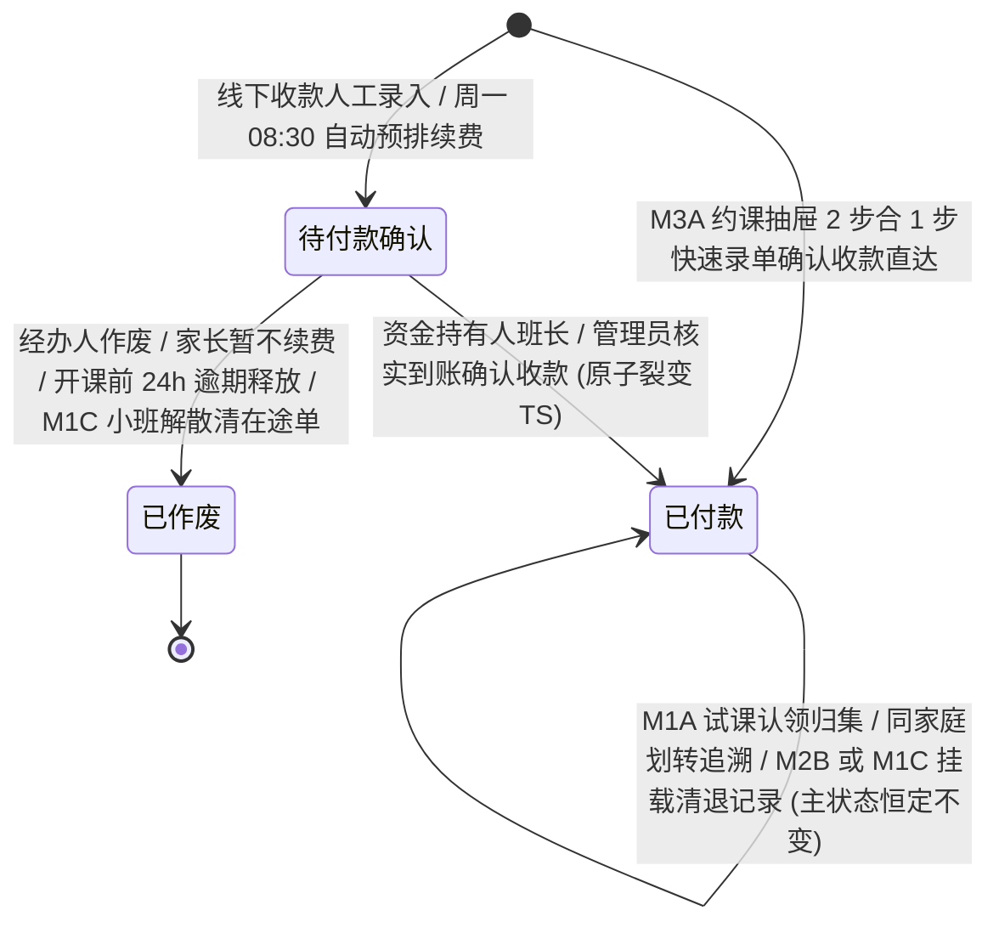
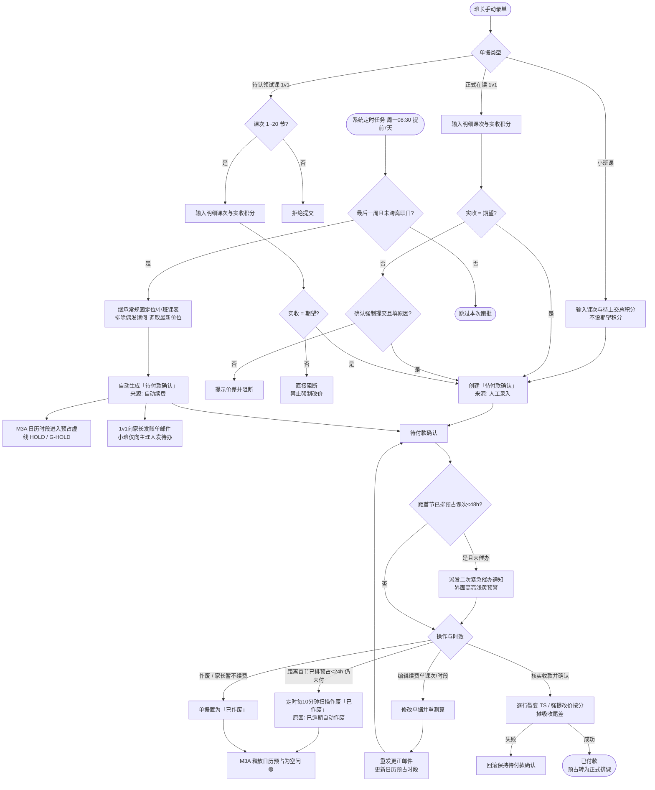

/** (c) 2024-2026 Topee (https://topee.top). All rights reserved. Proprietary and confidential. */

# 产品需求文档 (PRD) — 子模块 2A：购课录单、防呆校验与 TS 裂变引擎 (Course Orders)

| 元数据项 | 说明 / 内容 |
|---|---|
| **模块代号** | `m2a` |
| **所属模块** | 模块二：购课单与资金单据 (Course Orders & Funds) |
| **文档状态** | 待评审 (Draft) |
| **关联顶层 PRD** | [Prd-v5.md](../Prd-v5.md) |
| **关联模块划分** | [system_modules_overview.md](../system_modules_overview.md) |
| **创建与更新日期** | 2026-11-04（2026-11-11 更新看板首行轻量待办规范；2026-11-12 卡片视觉改为只声明卡片类型；2026-11-19 合并 1v1 固定/临时购课单为统一 `1v1 课次购课单`；2026-11-20 优化自动续费排课调整穿透复用 M3D/M3A；2026-11-21 新增同家庭 1v1 待排课次划转，收敛主状态为 3 态；2026-11-22 红队与 SSOT 收口封板：按双层实体/日志唯一归口铁律补全 `§4.5` 四支柱及第 2 层跨实体同事务联动清单与宿主入边索引，清零英文枚举及非纯积分/禁用术语漏出，对齐 `M4` 通知边界与 `BUSINESS_RULES §5` 定时扫描口径；收紧 1v1 自动续费修改换师/调时段按老师归属拦截：普通班长仅可换回本人负责老师或由老师现负责班长/管理员调改非本人老师时段） |

---

## 1. 概述与执行摘要 (Executive Summary)

购课录单子模块（`m2a`）面向班长与管理员，将线下（微信/转账）收款事实录入系统，生成**购课单**，经“确认收款”后原子化裂变为可排课的 **TS（课次）** 单元。本子模块覆盖 **1v1 课次购课**（统一合并原固定位与临时课录单：支持单/多价位明细，购课生成的待排 TS 不分固定与临时；另含**每轮 1v1 固定位到期提前 7 天自动预排续费单**）与 **小班课整班购课**（4 周标准周期，主理人录入多少待上交积分即按多少上交，到期支持自动续费预排）两类核心单据，内置防呆定价校验、老师调整价位涨价透明透出与换师协调引导、凭证上传，并保证 TS 积分快照之和严格等于订单实收总积分。当前阶段：MVP 正式功能迭代。反向课次核销（课次清退与财务备注）归属 M2B，不在本文范围。

---

## 2. 问题定义与背景 (Problem Statement)

- **痛点 1：手工算价易错**：价位与备课费叠加规则需实时核算，班长手算录单时常出现少收/多收，事后对账成本高。
- **痛点 2：收款与生效不同步**：家长声明已付款但班长未核实到账时，若立即生成可排课课次，会造成“未收款先上课”的资金风险。
- **痛点 3：总额与课次拆分不一致**：订单总积分除以课次数常有余数，若各课次快照取整后之和与总额不符，课酬单核算将出现无法对平的尾差。
- **痛点 4：请假额度口径不一**：请假额度靠口头约定，没有统一的取整规则，产生纠纷。
- **现状**：班长在线下表格计算价格并手工登记课次，无凭证留痕、无防呆校验。

---

## 3. 目标用户与角色画像 (Users & Personas)

### 3.1 角色一：班长（Leo）
- **诉求**：快速录入购课单，系统自动算出应收积分并提示异常；核实到账后一键确认收款生成课次。
- **预期成果**：录单零计算错误，收款与课次生成可追溯。

### 3.2 角色二：平台管理员（Sarah）
- **诉求**：可录入或作废任一班长名下的购课单，审计凭证。
- **预期成果**：全部购课单状态与资金归属清晰。

### 3.3 角色三：出资家长（Amy）
- **诉求**：付款后能在家长工作台看到购课单状态（待付款确认 / 已购课 / 已作废）及获得的课次数。
- **预期成果**：确认收款后立即看到可约课次。

---

## 4. 核心业务流程 (Main Flows)

### 4.1 1v1 课次购课（统一待排课次 · 含多价位组合与待认领试课单）
1. **统一 1v1 录单规则（购买不分固定与临时）**：
   - 班长或管理员选择学员档案（默认列表优先呈现动态关联学员，同时支持按规范昵称/英文名即时搜索全校「正式在读」学员与本人创建的「待认领试课」学员），添加 **1～N 条价位明细**（每条选定一个计价价位档位 + 课次数 $\ge 1$，例如单条 `16积分 × 8 节`，或组合 `18积分 × 1 节 + 21积分 × 1 节`）；**意向老师选填**（若选择意向老师则自动带出其当前价位）；可按需勾选整单级 **“含额外备课费（`+10积分/节`）”**（一经勾选即作用于该订单内全部明细行）。
   - **排课时才定性**：确认收款后按明细行逐行裂变生成对应价位与单节积分快照的「待排期」TS，**此时不区分固定和临时**，统一进入该学员的 1v1 待排期课次池（仅固化原价位档位、含备课费标记、资金持有人与单节实付积分快照）。后续排入 M3D 4 周固定位时才标记为固定课（🟠）；家长在 M3A 未来 1～7 天自助约课时标记为临时课（🟡）；请假或撤排退回时重置回统一待排池。
   - **零跨班长持有冲突与 1v1 分层授权**：每节 TS 独立锁定收款人为资金持有人；任何班长或平台直收均可随时为同一家长开具 1v1 购课单，互不阻断、无需移交。1v1 购课单实行**分层授权**：确认收款、作废、续费修改与待排课次划转仅限**该单资金持有人或平台管理员**操作；只读查看权同时向资金持有人、管理员及该学员当前关联授课/意向老师的负责班长开放（若未填写意向老师，则仅资金持有人与管理员可见）。
2. **「正式在读」学员与「待认领试课」学员差异约束**：
   - **正式在读学员**：不限 20 节上限；若总课次数不是 4 的倍数，界面显示弱提醒（允许正常提交）；若实收积分与按明细测算的期望积分不一致，系统阻断并提示差额警示与标准算式，班长可勾选“强制提交”并填写原因（1–200 字）后特批落盘。
   - **待认领试课学员**：班长与管理员均可开单（资金持有人锁定为实际收款人）；**总课次数严格限制为 1～20 节正整数**；严格按所选价位计价，**禁止使用强制提交改价**；初始归属家长账号标为“平台公共待认领占位”，锁定关联该试课档案；当该档案在 [M1A 学员档案](./m1a_student_profile.md) 被家长成功认领绑定（转为正式在读）时，作为宿主入边在同一事务内将该购课单归集更新至该家长账号名下，单据添加归集日志标签并在家长端“购课单列表”中完整呈现。
3. **提交与裂变生效**：
   - 提交后单据状态为「待付款确认」，单据来源标记为「人工录入」，可上传支付凭证。
   - 班长核实到账点击【确认收款】，状态转「已付款」，系统按明细行逐行原子化裂变对应数量、携带价位与实付积分快照及资金持有人的待排 1v1 TS（亦支持班长在 [M3A](./m3a_calendar_grid.md) 约课抽屉内【2 步合 1 步快速录单】直接落盘「已付款」并按临时课立即排入日历，详见 `AC-2A-11`）。

### 4.1a 固定位与小班课到期自动续费生成与预排单核销流程 (Auto-Renewal Flow)
1. **触发时机与自动扫描（提前 7 天）**：
   - 每周一上午 08:30，系统后台定时批处理自动扫描名下存在有效固定位排课的学员以及处于**「正式开课」**状态的小班，判断当前周（自然周周一至周日）是否为其当前 4 周周期的最后一周（第 4 周）。
   - 若判定为最后一周，系统提前整整 7 天自动为下一轮周期（未来 4 周）启动预排出单与日历预占保护。**离职避让约束**：若目标 4 周预计授课日期跨及授课老师在 [M1B](./m1b_teacher_profile.md) 已设预约离职日 `D` 及之后（含 1v1 固定位与小班课，小班口径见 [m1c_classes.md](./m1c_classes.md) `AC-1C-03`），系统不生成该跨 `D` 轮次的自动续费单与预占，并提醒负责班长/主理人协商换师或解散处理；若小班连续 2 轮自动续费单未确认收款且无未来排课，按 M1C `AC-1C-06` 提醒主理人确认是否归档或解散。
2. **预排提取与智能算价规则**：
   - **常规排期继承**：系统以该学员或小班本轮有效排期为基准（按本轮最后一周课表还原，**排除单次偶发请假干扰**，完整继承常规上课时段）；
   - **课次数计算**：按下一轮（4 周标准周期）完整计算总课次数（例：每周二、四各 1 节，一轮共 8 节；小班课每周 1 节双格为 4 节）；
   - **价位取价与调价边界**：新建或新触发生成的购课单，系统自动调取授课老师**当前最新价位积分**（`16积分`/`18积分`/`21积分`）核算总积分（小班课直接沿用该班建班锁定的`单节待上交费用积分` × 节数，不受 1v1 老师调价影响）。若老师在本轮期间发生价位调整（如 `16积分` 调整为 `18积分`），**已生成的购课单先不调整原单实付积分**（可能线下补差），新生成的单据按最新价位计算并在单据及通知中清晰展示当前价位，提示班长可协助协调其他老师或线下补差；
   - **生成待付款单据与日历预占（提前 7 天强锁续费预占 · 遇冲突跳过并发邮件通知补约）**：
     - **1v1 固定位**：系统自动创建状态为「待付款确认」的购课单（来源：「自动续费」）；联动 [M3A](./m3a_calendar_grid.md) 在老师日历上将未来 4 周中**空闲无冲突的周次**标记为 **“🟠 续费保护期预占（HOLD / 预占）”** 微虚线卡片，全域排他阻断他人抢约；**若 4 周中存在部分周次被占/老师请假，系统直接跳过冲突周（仅预占可用周次），在单据注明跳过周次与待补约节数，并向该订单对应的资金托管班长（平台直收时向管理员）发送邮件及站内紧急待办提醒其确认收款后人工补约**；自动向家长注册邮箱派发首封账单提醒邮件与消息；距下一轮首节已排预占课次开课前 48h 追加临期紧急催办；
     - **小班课 (56px 连续双格)**：系统自动创建该小班的待付款购课单（来源：「自动续费」，绑定目标小班与主理人为资金持有人）；联动 M3A 在老师日历上将未来 4 周中空闲无冲突的双格周次标记为 **“🟩 小班续费预占（G-HOLD）”** 青绿虚线双格卡片（若遇部分周冲突同样跳过该周并邮件通知主理人确认后人工补排）；**系统严格物理阻断向家长发送任何通知邮件/短信**（小班家长免建档免注册），仅向**小班主理人工作台**派发【小班下一轮待收款确认】待办与端内提醒；
3. **班长/主理人确认收款与核销闭环**：
   - 班长/主理人在工作台“购课单列表”中筛选查看，核实到账后（1v1 家长线上/线下转账；小班主理人完成私域微信群收款），点击“确认收款”；
   - 确认收款后，单据跃迁至「已付款」，系统原子化裂变生成对应数量的 TS：已挂载 `HOLD` / `G-HOLD` 的周次原子转为正式排课（1v1 转正式 🟠 固定位；小班课转正式 🟩 实线双格带 `[G]` 标）；**因冲突跳过未预占的剩余节数自动进入待排期池，供班长/主理人后续人工补约**。
4. **确认前修改购课单与家长自助意向处理**：
   - **家长侧自助操作（仅限 1v1 固定位自动续费待付款确认单；小班课对家长端依然完全不可见）**：
     - **【上传付款凭证】**：家长可上传或追加付款截图/凭证（单文件 $\le 10\text{MB}$，最多 5 张；改价补差时可追加补款凭证）。单据主状态保持「待付款确认」，系统标出 **`已传凭证待核`** 并即时通知班长核实收款；
     - **【暂不续费】**：家长点击并完成二次确认后，单据**立即流转至「已作废」**（作废原因：家长主动放弃续费），**立即原子释放未来 4 周 `HOLD` 预占网格**为 🟢【空闲可约】，并即时通知班长免除后续催办；
     - **【申请调整】**：家长勾选诉求标签（`更换上课时段` / `更换授课老师` / `调整每周课次` / `其他说明`，可多选）并填写补充说明后提交。提交后**单据主状态保持「待付款确认」，暂不释放原有 4 周 `HOLD` 预占**（防止协商期间原保底时段被他人抢走）；单据记录协商状态为 **`待班长处理`**、诉求标签、留言摘要与提交时间，并在班长教务中心待办流置顶与购课单列表高亮提醒；
   - **班长侧编辑与闭环（【修改购课单】· 课表可视化联动）**：
     - 在确认收款前，负责该单的资金持有人班长（或小班主理人、平台管理员）有权在后台点击【修改购课单】，支持**调整购买课次数（4 的倍数）、修改实收积分，以及通过跳转复用 M3D/M3A 可视化课表调整授课老师（仅 1v1）与未来 4 周预占时段**（废除抽屉内下拉框选时段）：
       - 点击 **`[ 📅 在课表上调整时段 ]`** 直接进入当前老师在 M3A 的周课表（续费预排调课模式，锁定 `连续 4 周批量`，支持第 1 周模板穿透 + 后 3 周逐周手工微调）；点击 **`[ 🔍 更换老师并选时段 ]`**（仅 1v1 可见）先进入 M3D 教师空闲大盘选新师，再进入其 M3A 周课表复选 4 周。**按师归属硬边界**：普通班长点击 `[ 🔍 更换老师并选时段 ]` 时，**仅允许更换并锁定「本人负责的在职老师」**的 4 周固定位（平台管理员全校可选）；若原老师已在 [M1B](./m1b_teacher_profile.md) 改绑给其他班长 B，原资金持有人班长 A 仅保留该旧续费单的收款与作废权，**禁止自行改占该非本人负责老师的 4 周新时段**（若需维持原非本人负责老师并调时段，须由该老师现负责班长 B 或平台管理员协调处理；或由班长 A 通过 `[ 🔍 更换老师并选时段 ]` 换回本人负责老师）；
       - **草稿带回与节数校验**：允许 4 周选中格子数少于购买总节数 `N`（差额标注为确认收款后进入待排池 `N - X` 节）；若选中格数超过 `N`，课表端提示同步上调购买节数或取消多余格子。点击课表底部 `[ ✓ 确认排期并返回 ]` 后**暂不改写正式 `HOLD`**，仅将新老师与 4 周排期草稿带回 M2A 修改抽屉（若中途取消，原 `HOLD` 零损保留）；
     - 回到修改抽屉后，1v1 订单按新老师当前最新价位与课次数重新测算期望积分（若跨价位换师或调课次导致实收 $\ne$ 期望，需填写强制提交原因，或在家长线下补退差价后按新实收积分保存；小班课不校验期望积分，按主理人录入的新实收上交总积分直存）；点击 **`[ 保存并更正账单 ]`** 后，单事务释放旧时段/旧老师 `HOLD`、锁定新时段/新老师 `HOLD`、更新订单并向家长重发更正通知邮件（小班不发家长邮件），同时将协商状态（若有）自动置为 **已处理**；
     - 若沟通后维持原方案不改单，班长可点击【标为已沟通】（将协商状态置为 **已处理**）或核实到账后直接【确认收款】；若不再续课，点击【取消固定并作废】释放日历网格。
5. **开课前 24 小时逾期未付自动释放红线**：
   - 截至距离下一轮**首节已排预占课次开课前 24 小时整**（若 4 周全部冲突跳空无已排预占格，则以新轮次首日周一 `00:00` 前 24 小时即周日 `00:00` 为准；后台按每 10 分钟精度轮询扫描执行逾期释放，对齐 [BUSINESS_RULES.md §5](../BUSINESS_RULES.md)），只要单据仍处于「待付款确认」且班长未确认收款（**即使家长此前已上传付款凭证或提交了【申请调整】**），系统仍严格执行自动作废，将单据置为终态「已作废」（作废原因：已逾期自动作废），并原子解除未来 4 周日历预占，网格全额释放为 🟢【空闲可约】，防止教学产能被无限期占坑。

### 4.1b 同家庭 1v1 待排课次划转流程 (Sibling Credit Reallocation · SSOT)
1. **角色权限边界（仅限班长或平台管理员操作）**：
   - **家长端与老师端物理不开放**：家长端与老师端不提供待排课次划转操作入口，仅可只读查看划转结果与记录；家长需将名下某一孩子的待排课次划给其他孩子时，在线下联系负责班长或管理员办理。
   - **班长权限（按资金持有人精准授权）**：因为待排期 1v1 课次尚未绑定任何老师、且正式学员不强绑单一班长，**班长仅可划出本人作为收款资金持有人托管的待排期 1v1 课次**（同家庭下若该孩子同时持有其他班长或平台托管的待排课次，对当前班长仅展示只读总余额，不开放划出）；目标接收方必须是**同一家长账号下的其他「正式在读」孩子**。
   - **平台管理员权限**：可对全校任意同一家长账号下的「正式在读」孩子之间操作划转。
2. **可划转范围与禁止情形**：
   - **允许划转**：划出方孩子名下当前处于「待排期」的全部 1v1 课次（无论来自人工购课、自动续费确认、请假退回、撤排退回或异常未上课补生）。
   - **严禁划转**：
     1. 「已排期」课次（须走日历课格【更换实际上课学员】，或先请假退回待排期后再划转）；
     2. 续费预占 `HOLD` 及尚未确认收款的「待付款确认」单据；
     3. 「已结课」或「已取消」课次；
     4. 小班课课次（小班课不绑定任何学员档案）；
     5. 「待认领试课」档案与「已归档」/注销档案：试课档案必须先由家长认领转为「正式在读」后，方可参与同家庭课次划转。
3. **分价位选择、价位匹配预检与必填备注**：
   - 经办人从 [M1A 学员综合档案抽屉](./m1a_student_profile.md) 资产区（或档案注销阻断引导）发起【课次划转】，选定接收孩子后，按**价位档位及是否含额外备课费**分组展示可用节数，分别输入本次划转节数（支持多组同时划转，录入 0 节的分组行提交时自动忽略，合计 $\ge 1$ 节，提供一键【全部划出】），并**强制填写划转备注（1–200 字，记录家长沟通依据）**。
   - **价位匹配预检轻提示（非阻断）**：选定接收孩子及待划价位后，若系统检测到接收孩子当前常约/固定位老师名下均不含该价位档位，弹窗自动呈现温和提示（不强行阻断）：“接收孩子当前常约老师无该价位，建议划转后为其预约其他同价位老师，或改对原单走 M2B 课次清退补差重买”。
4. **单事务按 FIFO 原子划转、请假额度迁移与财课分离铁律**：
   - 确认提交后，系统在单一事务内按各所选分组、按生成时间先后（先购先扣 / FIFO）校验并锁定可用待排 1v1 课次。若提交瞬间因家长刚自助约课或另有清退导致可用节数不足，事务整体回滚并提示“可用待排课次已变更，请刷新后重试”。
   - **五项核心属性 100% 保持不变**：所划转课次的**价位档位、单节积分快照（含折后尾差）、额外备课费标记、资金持有人及原购课单号与出资人**全部保持不变，接收孩子后续须按原价位预约匹配老师；若接收孩子日后申请清退该批课次，仍遵循 [m2b_refund_orders.md](./m2b_refund_orders.md) 由原资金持有人办理。
   - **请假参考额度随课次迁移**：课次划转成功后，**对应可请假参考额度随有效课次一并迁移至接收孩子名下**（划出方按划出后实际持有的有效课次重算额度，接收方按实际持有的有效课次重算并增补额度），避免“课次全部划走、额度仍留原单”导致的失衡。
   - **跨班长预约课酬与周结路径**：当接收孩子日后使用划入课次预约了其他班长名下的授课老师并完成上课，依据财课分离铁律，该 TS **资金持有人仍锁定为原收款班长（或平台）**，结课后仍纳入**原资金持有人**在 [M5A](./m5a_transfer_collection.md) 的周度转账单归集列支，并由平台在 [M5B](./m5b_weekly_settlement.md) 统一向实际授课老师核算发薪。
5. **留痕、购课单回显与通知**：
   - 原子写入 TS 状态流转历史（同状态划转）、[m3b_attendance_substitution.md](./m3b_attendance_substitution.md) 【经办记录】（动作类型：`课次划转`）、双方学员综合档案履约流水及**原购课单详情只读划转记录**（家长端查看原购课单时同样可只读看到“已从 X 划转 N 节给 Y”）；
   - 通过 [m4_notification.md](./m4_notification.md) 向**所属家长**发送 1 条常规中性卡端内提醒（不发邮件）；因正式学员采用动态关联、且跨班长约课不转移资金持有人、周结仍由原持有人归集，无需额外向其他班长广播跨组通知。
   - **改错纠偏**：系统不单设“撤销划转”特殊状态；若误操作，直接对接收孩子发起一次反向【课次划转】即可闭环留痕。

### 4.2 小班课整班购课（不设期望积分 · 录多少交多少）
1. 小班主理人选择目标小班，系统直接带出该小班在 [M1C](./m1c_classes.md) 建班或改定阶段预设并锁定的「单节待上交费用积分」与「老师单节课酬积分」作为参考，由主理人确认或输入整班待上交总积分。系统遵循“**不设期望积分与改价强阻断，主理人录入多少正整数就上交多少**”，小班课购课单直接绑定【小班】与【小班主理人】，**完全不关联任何家长账号和学员档案**，系统不介入主理人其他盈余计算。
2. **4 周标准周期与课次数规范**：小班课与 1v1 固定位类似，以 **4 周为一个标准履约周期，每轮购课一次**。购买课次数标准为 **4 的倍数**（标准为 4 节或 8 节；若每周 1 节双格为 4 节，每周 2 节双格为 8 节）；录单界面提供快捷课次胶囊。
3. **前置老师委任与离职避让校验**：开具小班课购课单时，该小班必须已完成授课老师委任；若小班处于“暂未绑定老师”状态，或对应小班 4 周预计授课日期跨及该老师在 M1B 已设预约离职日 `D` 及之后（以 [m1c_classes.md](./m1c_classes.md) `AC-1C-03` 为准），系统物理拦截并禁止提交；小班课到轮自动续费同理对跨 `D` 老师不再生成续费单。
4. **待上交总积分录入**：主理人直接录入整班待上交总积分（须为正整数，可参考小班单节老师课酬，**不再收取固定工具费，也不设期望积分差额强阻断或强制提交改价流程**，主理人录入多少即按多少上交）。
5. **TS 裂变与继承 M1C 老师单节课酬快照**：确认收款后裂变 N 个小班专属 TS，进入该小班待排期池（资金持有人锁定为小班主理人），对家长端完全不可见。小班 TS 财务快照固化记录单节待上交费用，并**直接继承该小班在 M1C 建班/承接时由主理人手工录入的「老师单节课酬积分」**（不从 1v1 老师价位字典带出，也不在 M2A 重复录入），供 M3B 临时代课课酬平移、M5A 周转账单对账参照与 M5B 管理员发薪试算使用；**全面停用并移除工具费、平台抽佣与主理人自留收益字段**。
6. **新建承接小班购课单规范（方案 2）**：当小班课因更换主讲老师（方案 2）由主理人创建新承接小班时，开单支持选填【关联结转原小班】与【业务备注】；购买课次数录入剩余未上课次数，按多退少补后主理人实际核算总额直接录入待上交总积分（不触发强制改价阻断，备注自动作为周二财务核对依据）。

### 4.3 作废、课次清退与小班提前结课流转
1. **常规单据作废与课次清退**：「待付款确认」状态下，资金持有人班长或管理员可作废单据，状态转「已作废」，不产生 TS。「已付款」单据聚焦“钱已收妥”事实，不可整单作废；若需退课，可通过 [M2B 课次清退](./m2b_refund_orders.md) 执行【课次清退/扣减】作废部分或全部待排期 TS 并填写财务备注——**清退后购课单主状态始终保持「已付款」不变**（不设已退费主状态），仅在列表轻标 `含清退`、在单据详情挂载 M2B 清退记录与明细。
2. **小班课提前结课解散单据与 M2B 清退联动（单写方明确）**：
   - 当对应小班课在 [M1C](./m1c_classes.md) 执行【提前结课解散】时，购课单始终聚焦“是否收款”的本质职责：全部**「已付款」**小班购课单主状态保持「已付款」不变（购课单全站收敛为 3 态），详情页只读自动挂载关联的已结课/作废 TS 统计及伴生 M2B 清退记录；
   - 全部在途**「待付款确认」**小班购课单（含未确认的自动续费单及未付款手工单）同一事务内置为「已作废」并清除日历 `G-HOLD` 双格预占；
   - **唯一生成方声明**：只要解散存在被作废的已付款未上课 TS，系统仅由 **[M1C](./m1c_classes.md) 提前解散流程在同一事务内唯一负责创建 1 笔 [M2B](./m2b_refund_orders.md) 小班解散课次清退记录**（M2A 不重复建单，仅做状态联动与详情只读挂载）；作废课次绝不进入周转账单，解散前已结课节数照常进入周转账单（标记 `[已提前解散]`）。

### 4.4 异常分支
- 重复点击确认收款：幂等，仅第一次生效。
- 裂变过程任一步失败：整体回滚，单据保持「待付款确认」。
- 凭证上传失败：不影响单据创建，可重试上传。

### 4.5 购课单唯一归口：四支柱生命周期、字段锁定、留痕与跨实体联动 (Entity & Log SSOT)

> **【实体生命周期、字段与日志唯一归口声明】**：**购课单**（1v1 课次购课单与小班课整班购课单，含人工录入与自动续费来源）的生命周期状态机、字段可编/锁定规则、状态流转与改单留痕规则及数据留存策略 100% 统一且唯一由本 PRD 管辖与定义；其余文档仅作单向指针引用。全局中枢 **TS（课次）** 的状态机与四类跨端日志分工以 [BUSINESS_RULES.md §3.2](../BUSINESS_RULES.md) 为唯一统领基线。

#### 4.5.1 生命周期状态机与转移矩阵（含跨模块宿主入边）

| 当前状态 | 目标状态 | 触发事件 / 动作 | 操作人 / 驱动源 | 前置守卫条件与时限熔断 | 本实体落盘与原子副作用 |
| :--- | :--- | :--- | :--- | :--- | :--- |
| **`[*]`** | **待付款确认** | 手动录入购课单 / 自动续费预排扫描 | 班长 / 管理员 / 定时任务 | 实收积分为正整数；1v1「正式在读」若有价差需确认强制提交并填 1–200 字原因（「待认领试课」限 1–20 节且禁强提；小班不设期望积分）；小班须已委任「在职」老师且 4 周不跨预约离职日 `D` | 创建购课单主记录并锁定资金持有人（来源标为 `人工录入` 或 `自动续费`）；若是自动续费预排，联动 [M3A](./m3a_calendar_grid.md) 锁定未来 4 周 `HOLD` / `G-HOLD` 预占并按 [M4](./m4_notification.md) 派发提醒/邮件 |
| **`[*]`** | **已付款** | 【2 步合 1 步快速录单】确认收款直达 *(宿主入边)* | 班长 / 管理员（经 [M3A](./m3a_calendar_grid.md) 约课抽屉驱动） | 仅限 1v1；严格复用相同定价防呆、强制提交及「待认领试课」1–20 节约束 | 单事务直落为 `已付款`（来源记 `人工录入`），原子裂变生成「已排期（临时课 🟡）」TS 并占用日历；支持后续在 M2A 查看与补传凭证 |
| **待付款确认** | **已付款** | 确认核实收款到账 | 资金持有人班长 / 平台管理员 | 单据处于「待付款确认」；资金已实际线下入账（重复点击保持幂等） | 原子跃迁至「已付款」；按明细行逐行裂变生成 $N$ 节「待排期」TS 并固化实付/待上交与小班课酬快照；若是续费单，联动 M3A 将 `HOLD`/`G-HOLD` 转为正式排课（冲突跳过节数留待排池） |
| **待付款确认** | **已作废** | ① 经办人作废； ② 家长暂不续费； ③ 开课前 24h 逾期释放； ④ 小班提前解散清在途单 *(宿主入边)* | ① 资金持有人班长/管理员； ② 1v1 家长（二次确认）； ③ 系统定时任务（每 10 分钟）； ④ [M1C](./m1c_classes.md) 提前解散驱动 | 未确认收款前；距次轮首节已排预占课次开课前 24h 整仍未确认收款（无论是否已传凭证或申请调整）；或目标小班执行提前解散 | 单据置为终态「已作废」并固化作废原因；若关联续费预排，联动 [M3A](./m3a_calendar_grid.md) 立即原子释放未来 4 周 `HOLD` / `G-HOLD` 预占为 🟢 空闲可约；家长放弃时即时通知班长 |
| **已付款** | **已付款** | ① 试课档案认领归集 *(宿主入边)*； ② 1v1 课次清退挂载 *(宿主入边)*； ③ 小班解散伴生清退挂载 *(宿主入边)*； ④ 同家庭待排课次划转追溯 | ① [M1A](./m1a_student_profile.md) 试课认领转正； ② [M2B](./m2b_refund_orders.md) 1v1 手动清退； ③ [M1C](./m1c_classes.md) 小班提前解散； ④ 本模块 `§4.1b` 划转 | 仅限「已付款」单据；原单禁止整单作废或反改主状态 | **购课单主状态恒定保持「已付款」不变**：① 试课单原子归集至家长账号并记归集标签；②/③ 只读挂载 M2B 清退记录（列表轻标 `含清退` 或 `小班已解散`）；④ 详情只读追加划转记录与去向说明 |

#### 4.5.2 关键字段可编与锁定规则矩阵

| 阶段 / 形态 | 允许新增或修改的字段 / 操作 | 操作角色 | 永久只读锁死字段 |
| :--- | :--- | :--- | :--- |
| **待付款确认（人工录入）** | 仅允许**追加/删除付款凭证**（最多 5 个），或执行【确认收款】/【作废】 | 资金持有人班长 / 平台管理员 | 单据类型（1v1/小班）、来源、学员/小班归属、价位明细、课次数、备课费勾选、资金持有人、实收/待上交积分、强提原因创建后不可编辑（改价或错录须作废重录） |
| **待付款确认（自动续费）** | • **经办编辑**：调整课次数（4 的倍数）、未来 4 周预占时段、1v1 授课老师、实收/待上交积分，以及【标为已沟通】； • **家长交互**（仅 1v1）：上传/追加凭证（标为`已传凭证待核`）、提交【申请调整】（写协商状态`待班长处理`、标签与留言）、点击【暂不续费】； • 资金持有人/管理员可追加凭证 | 资金持有人班长 / 小班主理人 / 平台管理员（家长仅限本人 1v1 凭证、申请调整与暂不续费） | 订单来源（`自动续费`）、资金持有人、原绑定学员或小班归属不可改绑；小班自动续费单对家长端物理隐藏不可见 |
| **已付款（含挂载追溯态）** | • **仅允许追加付款凭证**（上限仍为每单 5 个）； • **同事务只读挂载**：试课认领后变更家长归属并记归集标签、追加同家庭划转追溯明细、只读挂载 M2B 清退记录与汇总条 | 资金持有人班长 / 管理员（追加凭证）；系统事务挂载（认领/划转/清退/解散） | **全部交易与财务核心字段永久锁死**：主状态、购课明细、单节实付/待上交积分、老师单节课酬快照、资金持有人、强提原因与原裂变 TS 清单严禁删改或整单撤销 |
| **已作废（终态）** | 无（全周期终结） | — | **全字段（含作废原因、操作人、作废时间与历史附件）永久只读冻结**，禁止上传凭证、编辑、恢复或删除 |

#### 4.5.3 状态流转与字段修改留痕规则（唯一归口定义）

1. **状态流转时间轴日志**：购课单每次创建与状态跃迁（人工建单/自动预排进入「待付款确认」、2 步合 1 步直达或确认收款进入「已付款」、手动/家长放弃/逾期 24h/小班解散进入「已作废」）必须在同一数据库事务内追加写入只读状态流转记录，明确记载**原状态、目标状态、操作人/定时任务、流转时间与原因说明**，并在单据详情页【状态流转历史】按时间轴只读展示。
2. **字段修改与协同留痕规则**：
   - **自动续费单确认前编辑审计**：班长/主理人/管理员编辑「待付款确认」自动续费单的课次数、1v1 授课老师、预占时段或实收/待上交积分时，必须在同一事务内追加只读审计记录（操作人、时间及变更前后字段快照）；
   - **协商、凭证与强提留痕**：家长提交【申请调整】诉求标签与留言、班长【标为已沟通】状态闭环、付款凭证上传追加、1v1「正式在读」强制提交原因（1–200 字）、以及试课单被家长认领归集时间与归属变更均须同步留痕；
   - **同家庭划转与清退追溯**：划转在原单详情只读记录划出/接收学员、节数、价位与时间；M2B 手动清退与 M1C 小班解散清退以只读卡片形式挂载至原「已付款」单据详情页。
3. **跨端脱敏边界**：家长端【状态流转历史】与单据详情仅展示常规收款/作废节点、凭证、1v1 划转记录与 1v1 清退明细汇总条，**物理隐藏班长内部强制提交原因**；全部小班购课单及关联日志/清退挂载对家长端 **100% 物理不可见**。

#### 4.5.4 数据留存与清理策略

- 平台全部购课单主记录、明细快照、付款凭证附件、状态流转时间轴、改单变更快照及划转/清退挂载追溯记录，均作为不可篡改的财务与税务法定审计凭据，**长期只读审计留存、严禁物理删除**；
- 购课单历史资产与留痕记录**不因** M1A 学员删档/归档、M0A 家长账号注销停用、M1C 小班归档/提前解散，或 M1B 老师/班长离职而发生级联清理或抹除。

#### 4.5.5 第 2 层 · 跨实体同事务联动清单与宿主入边索引

- **A. 触发方同事务联动清单（M2A 主动驱动下游，单事务原子提交或整体回滚）**：

| 联动序号 | M2A 触发动作 | 驱动目标实体与结果方向 | 单向归口指针（M2A 不复述对方细则） |
| :---: | :--- | :--- | :--- |
| **1** | 确认收款（含 2 步合 1 步快速录单） | ① 驱动 **TS 全局中枢** 按明细逐行裂变生成 $N$ 节「待排期」（或 2 步合 1 步「已排期」）TS 并固化快照与资金持有人； ② 若为自动续费单，驱动 **M3A 时段覆盖记录** 原子清除对应 `HOLD`/`G-HOLD` 预占并转为正式排课 | [BUSINESS_RULES.md §3.2](../BUSINESS_RULES.md)、[M3A](./m3a_calendar_grid.md) |
| **2** | 自动续费预排、确认前改单保存、手动/家长作废及 24h 逾期释放 | 驱动 **M3A 时段覆盖记录** 在未来 4 周老师日历上原子新增、重锁或释放 `HOLD` / `G-HOLD` 续费预占覆盖态（释放后恢复 🟢 空闲可约） | [M3A §4.10](./m3a_calendar_grid.md#410-实体生命周期与状态机-entity-lifecycles--state-machines) |
| **3** | 同家庭 1v1 待排课次划转 | ① 驱动 **TS 全局中枢** 按 FIFO 切换选定待排 TS 归属学员并迁移请假参考额度（资金持有人与原单号不变）； ② 追加双方 **M1A 学员档案** 履约流水； ③ 写入 **M3B 【经办记录】**（类型：`课次划转`） | [BUSINESS_RULES.md §3.2](../BUSINESS_RULES.md)、[M1A](./m1a_student_profile.md)、[M3B §4.10](./m3b_attendance_substitution.md) |
| **4** | 自动续费出单/48h 催办/改单重发、家长传凭证/申请调整/暂不续费、冲突周跳过补约及课次划转 | 驱动 **M4 站内提醒与关键邮件** 生成对应角色端内卡片或投递关键邮件（小班严禁向家长生成通知/邮件；手动确认收款不单独发信） | [M4](./m4_notification.md) |

- **B. 宿主方跨模块入边索引（外部模块同事务驱动 M2A，详见 §4.5.1 状态矩阵）**：
  1. **[M3A 约课抽屉](./m3a_calendar_grid.md)**：【2 步合 1 步快速录单】同事务新建并直达「已付款」；
  2. **[M1A 试课档案认领](./m1a_student_profile.md)**：试课学员认领转正时，同事务归集历史购课单至目标家长账号；
  3. **[M2B 课次清退](./m2b_refund_orders.md)**：1v1 手动清退后，在原「已付款」购课单只读挂载清退记录与汇总条；
  4. **[M1C 小班提前解散](./m1c_classes.md)**：同事务作废该小班全部在途「待付款确认」单据，并在「已付款」小班单只读挂载由 M1C 唯一触发生成的 M2B 解散清退记录。

---

## 5. 用户故事 (User Stories)

- **US-2A-01**：作为一个班长，我想要录入 1v1 固定位购课单并获得系统自动算价，以便于避免手算错误。
- **US-2A-02**：作为一个班长，我想要在实收与期望不符时被阻断并可附原因强制提交，以便于处理优惠等特殊情形且留痕。
- **US-2A-03**：作为一个班长，我想要在核实到账后再确认收款，以便于避免未收款先生成课次。
- **US-2A-04**：作为一个班长，我想要对整个小班录入一张购课单，以便于小班课统一管理收款。
- **US-2A-05**：作为一个管理员，我想要作废错录的待付款单据，以便于保持数据干净。
- **US-2A-06**：作为一个家长，我想要查看名下学员的购课单状态，以便于确认课次是否到账。
- **US-2A-07**：作为一个家长，我想要无法访问他人的购课单，以便于保护隐私（权限场景）。
- **US-2A-08**：作为一个班长，我想要仅能操作本人托管资金的 1v1 单据或本人主理的小班单据，以便于权责清晰（权限场景）。
- **US-2A-09**：作为一个出资家长，我想要在每轮固定位最后一周周一 08:30（提前 7 天）收到系统自动生成的下一轮续费账单与邮件，并在开课前 48 小时收到防遗忘临期提醒，以便于充裕知晓应付账单并锁定心仪老师的时间。
- **US-2A-10**：作为一个出资家长，我想要在授课老师调整价位涨价时看清调价原因与差额明细，并能联系班长协调其他老师，以便于明白消费、自主决策。
- **US-2A-11**：作为一个班长，我想要在确认到账前能够修改自动生成的购课单（调整次数与时间）或取消固定（作废），以便于灵活应对家长的挪位与退订诉求。
- **US-2A-12**：作为一个系统风控机制，我想要在开课前 24 小时自动作废未付款的续费单并释放日历，以便于防止教学时间资产被无意或恶意长期占位。
- **US-2A-13**：作为一个平台管理员，我想要为待认领试课档案录入 1v1 课次购课单，以便于在家长免注册阶段即合规生成可排课的课次资产。
- **US-2A-14**：作为一个试课转正家长，我想要在认领孩子档案后能在账单中心看到此前的试课购课单，以便于账目清晰、明白消费。
- **US-2A-15**：作为一个班长，我想要在家长微信沟通希望把大宝多余的待排 1v1 课次转给二宝使用时，直接在系统内完成同家庭课次划转并保留原收款人和积分不变，以便于无需“先排课再逐节换人”或退费重买。
- **US-2A-16**：作为一个出资家长，我想要在原购课单详情和端内提醒里清楚看到班长帮我办理的待排课次划转去向与节数，以便于明白账目变动、放心用课。

---

## 6. 验收标准清单 (Acceptance Criteria)

### 6.1 定价与防呆校验
- **AC-2A-01**：1v1 课次购课单支持单条或多条价位明细，**额外备课费（`+10积分/节`）为整单级单一勾选，作用于该订单下全部明细行**，期望积分 = $\sum_i \text{明细节数}_i \times (\text{明细价位}_i + \text{整单额外备课费 10〔仅勾选时〕})$（**教师价位即家长单节应付积分，非老师课酬，且已彻底取消工具费**）；小班课单独填写整班待上交积分，不绑定老师 1v1 价位字典，也不设期望积分基准。
- **AC-2A-02**：1v1 价位字典首期内置 `16积分`、`18积分`、`21积分`（可由管理员在字典配置中维护），不再使用旧版阶梯课酬换算公式。
- **AC-2A-02a（老师预约调价与自动续费取价边界）**：
  1. 老师待生效调价严格限定在未来某全局 4 周轮次首日（周一 `00:00`）生效，且**必须在目标轮次自动续费跑批（前一周周一 `08:30`）之前设置完成**；
  2. 周一 `08:30` 系统自动生成固定位续费单（来源：`自动续费`）时，统一取**该续费单所覆盖新轮次首日（生效日）的老师价位**计价（而非生成单据当天价位），并在单据及通知中标明当前/新轮次价位，附加文案提示家长“若需更换授课老师，请联系负责班长协助协调”；
  3. 临时约课快捷直购统一取**目标上课日期当天**的老师生效价位计价；**已生成的待付款确认单据（含已生成自动续费单）系统内不调整原单实付积分**；已购未排期 TS 保留原购买价位不变（调价日前可约该老师，调价日后按新价位校验，旧价 TS 可约其他同价位老师或由班长走 M2B 清退补差）。
- **AC-2A-03**：小班课取消固定工具费与底线覆盖强阻断，**不设期望积分也不触发改价特批**，主理人录入多少待上交积分（正整数）即按多少上交；彻底停用并移除工具费、平台抽佣与主理人自留收益计算；确认收款后直接继承该小班在 M1C 建班或承接时手工录入的「老师单节课酬积分」写入 TS 快照。
- **AC-2A-03a（小班购课单前置委任老师与离职避让强阻断）**：开具小班课购课单时，系统校验目标小班必须已委任「在职」授课老师，且预期 4 周授课日期不跨及该老师在 M1B 已设预约离职日 `D` 及之后。若小班处于“待委任老师”状态或跨及离职日 `D`，开单动作物理阻断并分别提示“该小班尚未委任授课老师，请先委任老师后再录单收款”或“所选授课老师已预约于 MM-DD 离职，禁止开具跨离职日续期订单”；单据收款人与资金持有人锁定为小班主理人。
- **AC-2A-04**：实收积分 ≠ 期望积分时，**仅「正式在读」学员 1v1 购课单**在不勾选“强制提交”时被拒绝并展示差额警示与标准算式；**「待认领试课」学员 1v1 购课单禁止改价或强制提交**，实收积分必须严格等于明细汇总期望积分；**小班课购课单不设期望积分**，不触发本校验阻断。
- **AC-2A-05**：仅「正式在读」学员 1v1 购课单勾选“强制提交”且填写原因（1-200 字）时允许特批改价提交，原因随单据保存；原因为空或用于「待认领试课」单时拒绝。
- **AC-2A-06**：实收积分必须为正整数，非正数或小数被拒绝。
- **AC-2A-07**：「正式在读」学员 1v1 购课单及小班课购课单总课次数非 4 的倍数时，界面显示弱提醒文案，提交不受阻。
- **AC-2A-08**：1v1 购课单支持同一单内添加多条价位明细（如 `18积分×1 + 21积分×1`，不限制同一价位重复添行或由系统自动按需汇总）；确认收款后逐行裂变为对应价位档位的「待排期」1v1 TS（不区分固定与临时）并锁定资金持有人，无跨班长持有人校验阻断。
- **AC-2A-08b**：待认领试课购课单约束：针对「待认领试课」档案开具的 1v1 购课单，总课次数受 **1～20 节**刚性约束；可由班长或平台管理员开单与确认收款（锁定各自为资金持有人）；严格按所选价位计价，不允许强制提交改价。

### 6.2 请假额度
- **AC-2A-09**：单笔订单参考请假额度 = ⌊总课次数 × 0.125⌋（向下取整）；例：20 课次 → 2，7 课次 → 0。**若发生同家庭待排课次划转，请假可用参考额度随课次迁移**（划出方与接收方分别按当前各自实际持有的有效课次重新核算可用额度）。
- **AC-2A-10**：录单页课次数变更后额度在 300ms 内更新展示。

### 6.3 单据生命周期与自动续费
- **AC-2A-11**：常规 M2A 新建单据状态为「待付款确认」，此时不产生任何 TS；**特例：由 M3A 约课抽屉【2 步合 1 步快速录单】发起并经班长/管理员确认已收款的 1v1 购课单**，仍须遵循相同 1v1 定价防呆校验（含「待认领试课」1～20 节与禁止改价约束），确认后单事务直接落盘为「已付款」并同步生成「已排期」TS（**排课形态标记为临时课 🟡**，无需再回 M2A 二次确认收款，仍可在 M2A 列表与详情页查看及补传凭证）。单据来源区分「人工录入」与「自动续费」。
- **AC-2A-11a**：自动续费生成与预排提醒规范（提前 7 天）：每周一上午 08:30，系统后台自动扫描并识别处于固定周期最后一周（第 4 周）的 1v1 学员及**「正式开课」**小班（若目标 4 周跨及老师在 M1B 已设预约离职日 `D` 及之后，跳过出单并提醒班长/主理人处理；若小班连续 2 轮自动续费单未确认且无未来排课，按 M1C `AC-1C-06` 发送提醒）；自动生成下一轮（4 周周期）预排购课单（来源：「自动续费」，状态为「待付款确认」）；排期规则按本轮常规有效位继承；联动 M3A 在老师日历上同步对未来 4 周目标时段打上“续费预占”排他锁定标记（1v1 挂载 🟠 `HOLD`，小班课挂载 🟩 `G-HOLD` 双格）；1v1 向家长派发首封账单提醒邮件与消息，小班课严格阻断向家长发信，仅向小班主理人工作台派发待办。
- **AC-2A-11a2**：开课前 48h 临期二次催办规范：定时扫描距离下一轮**首节已排预占课次开课前 48 小时**（若 4 周全部冲突跳空无已排格，则以新轮次首日周一 `00:00` 前 48 小时即周六 `00:00` 为基准），若单据仍处于「待付款确认」，系统自动向家长追加推送临期紧急催办通知（警示距离自动作废与释放日历仅剩 24 小时），并在家长首页与班长购课单列表中高亮展示浅黄紧急预警标签。
- **AC-2A-11b**：自动续费单草稿编辑与原单换师规范：处于「待付款确认」状态的「自动续费」单据，在确认收款前允许**资金持有人班长（或小班主理人、管理员）**编辑（调整课次数、上课时间段、更换 1v1 授课老师并重选新老师 4 周固定时段，以及修改实收积分）。**按师归属约束**：1v1 固定位仅限老师所属负责班长或平台管理员调整——普通班长执行 `[ 🔍 更换老师并选时段 ]` 时**仅允许换选本人负责的在职老师**；若原老师已在 M1B 改绑给其他班长 B，原资金持有人班长 A 不可自行改占该非本人负责老师的 4 周新时段（由老师现负责班长 B 或管理员调整，或由班长 A 换回本人负责老师）；管理员可全校跨组换师调整。1v1 更换老师或课次后按最新老师价位与课次数重新测算期望积分（实收 $\ne$ 期望时强制要求填写特批改价原因），小班直接按录入的新待上交总积分保存；修改保存后单事务释放旧 `HOLD`/`G-HOLD` 并锁定新预占，1v1 单据自动向家长派发更正通知邮件（小班不发家长邮件），并将协商状态（若有）自动置为已处理。
- **AC-2A-11c**：逾期自动作废规范：后台定时扫描（每 10 分钟精度，对齐 `BUSINESS_RULES §5`）截至距离下一轮**首节已排预占课次开课前 24 小时**（无已排预占格时以周日 `00:00` 为准），只要单据仍未确认收款（含家长已上传付款凭证或已提交【申请调整】但班长尚未确认/处理的场景），系统均严格自动将单据状态置为「已作废」（作废原因：已逾期自动作废），联动 M3A 自动释放对应的日历预占时段为 🟢【空闲可约】。
- **AC-2A-11d**：家长端 1v1 自动续费单自助操作规范：
  1. 仅限家长名下来源为自动续费且处于「待付款确认」的 1v1 购课单展示【上传付款凭证】、【申请调整】、【暂不续费】操作（小班课单据对家长端依然完全不可见）；
  2. 点击【暂不续费】并完成二次确认后，单据立即置为「已作废」（作废原因：家长主动放弃续费），未来 4 周 `HOLD` 预占立即释放为 🟢【空闲可约】，并即时通知负责班长；
  3. 点击【申请调整】并勾选诉求标签（`更换上课时段`/`更换授课老师`/`调整每周课次`/`其他说明`）及填写说明提交后，单据保持「待付款确认」与原有 4 周 `HOLD` 不变，写入 **`待班长处理`** 协商状态、标签与留言摘要，即时通知班长并在班长教务中心待办流与购课单列表置顶高亮；班长保存改单、点击【标为已沟通】或【确认收款】后协商状态闭环为 **已处理**。
- **AC-2A-12**：确认收款后状态变「已付款」，TS 数量 = 课次数（小班课 = 小班课次数 N，如 4 节或 8 节）；日历预占网格原子更新为正式排课（1v1 转正式 🟠【固定位】，小班课转正式 🟩【小班课】双格实线微卡片带 `[G]` 标）。
- **AC-2A-13**：确认收款与 TS 裂变在同一事务内完成；任一失败则全部回滚，状态保持「待付款确认」。
- **AC-2A-14**：对「已付款」单据重复确认收款，不重复生成 TS，返回当前状态。
- **AC-2A-15**：「待付款确认」单据可由资金持有人或管理员作废转「已作废」（如取消固定时触发）；「已付款」与「已作废」单据作废请求被拒绝（注：「已付款」单据聚焦“钱已收妥”事实，后续仅可通过子模块 M2B 课次清退扣减关联未上 TS 并挂载清退明细，主状态始终保持「已付款」）。

### 6.4 TS 积分快照
- **AC-2A-16（1v1 逐行独立快照与强提改价分摊规则）**：TS 单节积分快照恒为整数：
  - **正常无强提改价（1v1 实收 = 明细汇总期望）**：**按各价位明细行独立裂变固化**，每条明细生成的每节 TS 快照严格等于 `该行明细价位 + 整单额外备课费 10〔仅勾选时〕`（如 `18积分×1 + 21积分×1` 裂变为 `18` 与 `21` 两个 TS，天然整数无尾差，严禁用全单均摊覆盖破坏原价位快照）；
  - **存在 1v1 强提改价（实收 ≠ 期望）**：单条价位明细直接取 `⌊订单实收积分 ÷ 课次数⌋`；多条价位明细组合时，先按各明细行期望积分占订单期望总积分的比例向下取整分配各行实收总积分（余数归入最后一条明细行），再对每行内 TS 按 `⌊该行分配实收 ÷ 该行节数⌋` 固化基础快照；
  - **小班课 TS 快照**：每节单节待上交费用 = `⌊整班待上交总积分 ÷ 小班课次数⌋`（若有余数入末位）；每节老师单节课酬直接继承该小班在 M1C 建班或承接时手工录入并锁定的「老师单节课酬积分」。
- **AC-2A-17（尾差吸收入末位）**：存在整除余数时，余数全部计入对应分组（或该单/该小班）最后一个 TS，确保全部裂变 TS 的实付/待上交积分快照之和 100% 严格等于订单实收/待上交总积分（例：改价实收 `100` 积分 / `3` 课次 → `33、33、34`）。
- **AC-2A-18**：TS 资金持有方在裂变时永久锁定为收款班长（或平台），之后不随排课、代课或同家庭划转变更。
- **AC-2A-19**：小班课购课单与裂变 TS 完全绑定小班实体与主理人，不关联任何家长与学员档案，对家长端完全不可见，仅主理人与管理员可见。
- **AC-2A-19a（小班课提前结课解散单据与 M2B 清退联动 · 单写方归属 M1C）**：当对应小班在 M1C 转为「已提前解散」时，同一事务内：① 全部「已付款」小班购课单**主状态继续保持「已付款」不变**（购课单全站仅保留 3 态），详情页自动只读挂载关联 TS 实消/作废统计与 M1C 伴生生成的 M2B 清退记录（列表卡片轻标 `[小班已解散]`）；② 若解散作废了至少 1 节已付款未上 TS，**由 M1C 提前解散流程在同一事务内唯一创建 1 笔 [M2B](./m2b_refund_orders.md) 小班解散课次清退记录**（M2A 不重复创建，零 M5A 周转账冲抵、对家长不可见），解散前已结课节数照常周结；③ 所有在途「待付款确认」小班单（含自动续费单）置为「已作废」并释放日历 `G-HOLD` 预占。
- **AC-2A-19b（新班承接购课单独立开具与单向追溯规范）**：
  - **物理绝对独立**：原小班残值已随提前解散在 M2B 记账核销归零，原「已付款」购课单仅作为历史收款凭据保留，承接新班必须开具全新独立的购课单（新单号、重新裂变专属 TS、继承新小班在 M1C 委任的新老师与手工录入的新单节课酬），**严禁复用或继承原单据**；
  - **单向审计关联与残值回显**：主理人录单时支持选填关联前序解散小班与业务备注；选中已解散原班后，**表单自动只读回显该原班解散日志记录的“作废剩余节数 · 剩余总积分数 · 解散原因与解散备注”**，供主理人与管理员对照核验；
  - **穿透核验与自由录入**：管理端可在新单据详情一键穿透查看原小班的解散档案与残值明细；因小班不设期望积分也不触发改价强提，主理人按老生优惠/多退少补后实际核算总额直接录入待上交积分即可，业务备注自动留痕供周二财务对账查阅。

### 6.5 凭证上传
- **AC-2A-20**：凭证支持 JPG/PNG/PDF，单文件 ≤ 10MB，每单最多 5 个；超限提示“文件大小不能超过 10MB”或“最多上传 5 个凭证”。
- **AC-2A-21**：「待付款确认」与「已付款」状态均可由资金持有人班长/管理员追加凭证；「待付款确认」状态的 1v1 自动续费单据亦允许所属家长上传/追加付款凭证（如改价后追加补款凭证，总数仍受每单最多 5 个限制），上传后单据标出 `已传凭证待核` 并通知班长；「已作废」不可上传。

### 6.6 权限隔离
- **AC-2A-22（1v1 分层授权与小班主理人专属权限）**：
  - **1v1 购课单**：创建单据面向所有在职班长与管理员开放（零跨班长持有冲突）；**确认收款、作废、确认前修改、待排课次划转及上传班长侧凭证**仅限**该单资金持有人班长或平台管理员**操作，越权请求拒绝并返回无权限；**只读查看**向该单资金持有人、平台管理员以及该学员当前关联授课/意向老师的负责班长双通道开放（未填意向老师时仅资金持有人与管理员可见）；
  - **小班购课单**：仅限**目标小班的主理人本人**或**平台管理员**创建、查看、编辑、确认收款及作废。
- **AC-2A-23**：家长严禁手动新建购课单、严禁自行【确认收款】转为「已付款」、严禁修改非自动续费单据或任意非本人名下订单；仅允许对本人名下处于「待付款确认」的 1v1 自动续费单据执行【上传付款凭证】、【申请调整】、【暂不续费】三项自助操作，其余购课单保持只读。
- **AC-2A-23a**：档案认领单据归集：当「待认领试课」档案被家长认领绑定（转为「正式在读」）时，系统自动将该档案名下历史已完成（「已付款」）的试课购课单归集更新至该家长账号名下，家长对该单据具备只读查阅权限，单据状态与积分明细保持原貌。

### 6.7 界面交互与极简看板视觉规范
- **AC-2A-24（首行待办轻量提示，精简统计数字卡片）**：班长及管理端购课单列表首行仅保留“待确认收款 X 单”核心待办数字，不设“待确认/已购课/已作废” 3 块平铺式统计卡片；已购课与已作废历史单据的检索与浏览 100% 由状态分段选择器（Tabs）直接承接，杜绝视觉冗余。
- **AC-2A-25（单据列表卡片类型映射与极简四行密度）**：
  购课单列表卡片严格遵循 [DESIGN.md Section 2.2.1] 的三种卡面与排版底线，PRD 不重复定义底色、边框与文字颜色：
  1. **待办**：处于「待付款确认」的单据使用【浅黄提醒卡】；
  2. **常态**：处于「已付款」的已购课单据使用【中性卡】，不整卡染色；
  3. **失效**：处于「已作废」的单据使用【归档卡】（虚线边框 + 降透明度），安静沉底；
  4. **操作层级**：待办主确认动作使用主按钮，次要操作使用次要按钮；业务属性标签使用中性微标签；
  5. **可读性**：卡内文字层级与对比度统一遵循 DESIGN.md 的可读性硬红线；
  6. **四行极简控高**：列表卡片目标高度 **`120–148px`**（常态卡 3 行，待办/异常卡最多 4 行），一屏（`390×812`）支持浏览 3–4 张。严禁在卡内堆叠三列统计子块（课次/实收/请假额度）、4 周 HOLD 网格或多行调价/强提原因长文本；**请假额度、4 周 HOLD 网格、原新价对比、调价说明、强制提交原因全文，以及小班提前解散关联的伴生 M2B 清退明细**统一下沉至单据详情页展示。
- **AC-2A-26（购课单状态流转历史与时间轴）**：购课单每次状态跃迁（进入「待付款确认」、确认收款转「已付款」、作废转「已作废」）必须在同一事务内追加只读状态流转记录（含原状态、目标状态、操作人/系统、流转时间与原因/备注）；发生 1v1 课次清退或小班提前解散后，原「已付款」购课单主状态保持不变，详情页顶部资产对账区同步展示 **`原始实收/待上交总积分 · 已清退积分（N 节）· 当前剩余有效积分/待排节数`** 汇总条（均为纯积分，不显示币种），下方挂载对应的 M2B 清退记录卡片（含清退/作废节数、积分与备注）；单据详情页底部展示【状态流转历史】只读时间轴供班长与管理员核对追溯（家长端仅展示常规收款/作废节点与 1v1 清退只读记录与汇总条，隐藏内部强制提交原因）。
- **AC-2A-27（自动续费单确认收款前编辑留痕）**：资金持有人班长、小班主理人或管理员对处于「待付款确认」状态的自动续费单修改课次数、排课时段、1v1 授课老师或实收/待上交积分时，必须在同一事务内追加写入只读变更审计日志（记录操作人、操作时间及变更前后快照）。
- **AC-2A-28（修改购课单穿透课表可视化调排与草稿带回）**：班长与管理员的购课单列表页面中，处于「待付款确认」的可编辑自动续费单据卡片操作区必须直接展示 **`[ 修改 ]`** 按钮入口，点击后直接打开修改抽屉（常规人工录入待付款单不开放改单，仍展示 `[ 作废 ]` 与 `[ 确认收款 ]`）；在自动续费待付款单修改抽屉中，禁止使用下拉框选择固定时段；班长点击 `[ 📅 在课表上调整时段 ]`（仅老师当前负责班长/主理人/管理员可调改，非本人负责老师时段对普通班长置灰禁用）或 `[ 🔍 更换老师并选时段 ]`（仅 1v1 可见；普通班长仅允许换选本人负责在职老师，管理员全校可选）进入 M3D/M3A 续费预排调课模式完成未来 4 周选格并点击 `[ ✓ 确认排期并返回 ]` 后，排期结果以草稿态带回 M2A 抽屉并即时重算期望积分与差额（小班不重算期望积分），原 `HOLD` 在点击 `[ 保存并更正账单 ]` 前保持不动；确认保存后单事务完成旧预占释放、新预占锁定、订单更新及更正邮件发送（1v1）。

### 6.8 同家庭课次划转规则 (Credit Reallocation)
- **AC-2A-29（操作角色与家庭/资金持有人范围隔离）**：仅**班长**（仅限划出本人作为资金持有人托管的 1v1 待排期课次）与**平台管理员**（全校任意学员含平台直收课次）可执行【课次划转】；家长端与老师端物理隐藏且拒绝无权限划转请求。划出方与接收方必须是**同一家长账号下的两个不同「正式在读」学员档案**；当家长账号名下「正式在读」孩子不足 2 个或当前账号在该孩子名下没有任何本人托管的待排课次时，禁止划转且入口隐藏或置灰提示；目标为「待认领试课」档案或「已归档」档案时强行拒绝。
- **AC-2A-30（可划转范围、分组维度与 `0` 值防呆）**：仅可划转划出方名下处于「待排期」的 1v1 课次（严禁划转已排期课次、续费预占 `HOLD`、小班课次及已结课/已取消课次）。按**价位档位（区分含/不含额外备课费）**分组展示可用待排节数，支持在单次操作内同时为多个分组录入划转节数 $n_i$（非负整数且不超过该组当前可用待排节数），合计总节数 $\sum n_i \ge 1$，提交时**自动忽略输入 `0` 节的分组行**，并提供一键 `[ 全部划出 ]`；**划转备注强制必填（1–200 字）**，空白或超限禁止提交。
- **AC-2A-31（并发防呆与事务原子性）**：确认提交后在单事务内按各所选分组先购先扣（FIFO）校验并锁定待排课次完成归属切换；若操作提交瞬间可用待排节数已不足所选节数，事务整体回滚，提示“可用待排课次已变更，请刷新后重试”，不得产生部分划转成功。
- **AC-2A-32（财课分离属性锁定、价位预检与请假额度迁移）**：划转后被转移课次的**价位档位、单节积分快照、含备课费标记、资金持有人及原购课单出资人**必须 100% 保持原值不变；划转提交前弹窗对接收孩子当前常约/固定老师价位做软预检（若无匹配价位则温和提示“建议预约同价位老师或改走 M2B 清退补差”，不阻断提交）；划转成功后**请假可用参考额度随有效课次一并迁移给接收孩子**（双方按最新持有有效课次重算额度）；若接收孩子日后预约其他班长名下老师上课，结课后仍从**原资金持有人**的 M5A 周转账单归集列支；日后清退该批课次仍遵循 M2B `AC-2B-05` 由原资金持有人办理。
- **AC-2A-33（多端只读追溯与账目透明）**：划转成功后必须在同一事务内写入 TS 状态流转历史与 M3B 【经办记录】（类型：`课次划转`），并在双方学员综合档案履约流水及**原购课单详情页（含家长端只读视图）**中追加只读划转去向与明细（如 `11-21 从 AliceZ12 划转 4 节（16积分×4）给 BobZ10`）。
- **AC-2A-34（站内提醒联动）**：划转成功后即时向**所属家长**发送 1 条中性卡站内提醒（不发送邮件；无需向其他班长发送跨组通知）。

---

## 7. 本期范围外清单 (Out of Scope)

- **课次清退与退费备注**：归属 M2B。
- **排课与约课**：归属模块三，本模块仅生成 TS。
- **在线支付网关**：不接入微信/支付宝，仅线下收款人工确认。
- **虚拟余额池/预存款**：不支持。
- **购课单修改**：常规人工录入单据创建后不可直接编辑积分（需作废重录）；系统自动生成的「自动续费」预排单在确认收款前允许班长编辑调整（调整课次、时段、老师与实收积分），修改后遵循防呆重新算价并触发更正邮件。
- **批量导入购课单**：不支持。
- **更换实际上课学员**：归属模块三日历课格操作，原购课单资金归属不变。
- **家长自助课次划转与跨家长待排课次划转**：同家庭待排课次划转仅限班长或平台管理员在后台办理，暂不开放家长端或老师端自助划转入口；不同家长账号之间不支持划转待排课次（跨家庭调课仅支持对已排期课次在日历课格执行【更换实际上课学员】）。

---

## 8. 约束条件 (Constraints)

### 8.1 业务与合规约束
- 资金持有方一经裂变永久锁定，直至周结转账单归集。
- 财课分离：购课单费用归属方不随更换实际上课学员变更。
- 所有积分数值为正整数，禁止小数，界面统一使用纯积分口径。

### 8.2 功能与规格限制
| 项目 | 限制 |
|---|---|
| 「待认领试课」单课次数 | 1-20 节（且禁止改价） |
| 「正式在读」1v1 / 小班课课次数 | ≥ 1，非 4 的倍数弱提醒 |
| 强制提交原因 | 1-200 字 |
| 凭证格式 | JPG / PNG / PDF |
| 凭证大小 / 数量 | ≤ 10MB / ≤ 5 个每单 |

### 8.3 外部文档与参照依据
| 文档名称 | 存放路径 | 使用场景说明 |
|---|---|---|
| 顶层 PRD v5 | docs/Prd-v5.md | 定价与分账规则原始来源 |
| 核心业务规则与财务分账规约 | docs/BUSINESS_RULES.md | 资金持有人锁定、尾差吸收算法与定时扫描口径 |
| 工程与编码规范 | docs/CODING_STANDARDS.md | 凭证直传安全合规规范 |

---

## 9. UI/UX 界面线框说明 (Wireframe Level)

### 9.1 班长工作台 — 购课单列表
- **结构与布局**：
  - **首行轻量待办栏**：左侧展示身份上下文与待办提示“**待确认收款 X 单**”（仅保留核心待办数字微徽章，取消平铺展示的‘待确认/已购课/已作废’ 3 个数字统计大卡片，降低视觉干扰与空间占用），右侧常驻【+ 录入购课单】主按钮；
  - **状态与来源筛选与默认排序**：紧随其下为状态分段选择器（全部 / 待确认 / 已购课 / 已作废，承接历史单据与状态切换，替代传统统计块）、来源筛选胶囊（全部来源 / 人工录入 / 自动续费）、学员昵称/单号快捷搜索输入框；列表默认按 **「待付款确认」置顶（其中 `家长申请调整` 与 `距开课 <48h` 临期单最靠前，其余按创建时间倒序） → 「已付款」已购课按创建时间倒序 → 「已作废」沉底** 排序；
  - **单据卡片极简四行结构（严格遵循 [DESIGN.md Section 2.2.1]）**：
    - **第 1 行（对象 + 核心标签 + 状态）**：学员档案名/小班名 + 最多 2 个中性微标签（课程模式 `1v1` / `小班` 及来源 `自动续费` / `含清退` / `小班已解散`；`承接原班`/`平台托管` 下沉至详情页），右侧为状态胶囊（`待付款确认` / `已购课` / `已作废`）；
    - **第 2 行（价位/老师 + 核心钱课 + 凭证状态）**：授课老师名或价位档位（如 `16积分`；多价位组合单展示紧凑汇总如 `18积分×1 + 21积分×1`） + **`N 节 · 实收/待上交 X 积分`**，右侧轻量展示凭证状态（`已传凭证(N)` / `待补凭证`）；
    - **第 3 行（单行异常/待办提示条 · 仅按需出现，常态「已付款」卡省略）**：将临期预警（距开课不足 `48h` / `24h`）、逾期自动释放、家长申请调整（待班长处理）、调价或强提标记收敛为**最多 1 行单行截断提示条**（不折行）；4 周 HOLD 预占网格、调价原因与强制提交原因全文均在点击卡片进入详情页后查看；
    - **第 4 行（资金归属 + 紧凑操作）**：左侧展示 **`资金持有班长 [姓名]`**（平台托管时展示 `资金持有 平台`）及精简创建时间；右侧最多保留 **3 个**紧凑按钮防折行。
- **交互与行为**：
  - 待付款确认行操作：显示**【作废】**（次要按钮）、**【修改】**（次要按钮，面向可编辑的自动续费待付款确认单，点击直达 `§9.2a` 修改抽屉，仅资金持有人或管理员可操作）与**【确认收款】**（主按钮，仅资金持有人或管理员可操作）；家长调整诉求【标为已沟通】入口保留在点击卡片打开的单据详情页/抽屉内承接；
  - 已购课行显示“课次明细”（次要按钮）；已作废行安静沉底，整卡点击查看只读详情。
- **空状态**：“暂无购课单，点击新建”。
- **加载态**：列表骨架屏。
- **错误态**：加载失败显示重试按钮。

### 9.2 新建购课单页/弹窗
- **结构**：单据类型切换（`1v1 课次` / `小班课`）→ 学员或小班选择 → （`1v1 课次`：意向老师选填 + 动态价位明细行 `[ 价位选择 ▾ ] × [ 节数 ]` + `[ + 添加价位档 ]` + 整单级可选“含额外备课费 +10积分”；「待认领试课」学员自动限制总节数 1～20 且隐藏强制改价入口；`小班课`：默认带出 M1C 预设`单节待上交费用`与`老师单节课酬`作参照，直接输入课次与整班待上交总积分）→ 实收/待上交积分 → 实时测算/汇总区 → 凭证上传区 → 提交。
- **交互**：课次数、老师、勾选变化即时刷新测算区；**仅「正式在读」学员 1v1 购课单**实收与期望不符时测算区显示差额警示，提交后弹出确认框含“强制提交”勾选与原因输入；**「待认领试课」单不显示强制提交入口，实收严格等于测算总额**；**小班课不设期望积分也不弹出改价确认框**，正整数直存。
- **错误态**：字段级红字提示（课次超限、积分非整数、原因为空、小班未委任老师或跨老师离职日）。
- **加载态**：提交按钮加载中状态，防重复点击。

### 9.2a 自动续费预排单修改抽屉 (Edit Pre-scheduled Order Drawer)
- **结构**：
  - 头部：学员档案名/小班名、当前授课老师与价位（如 `18积分` / `18 Pts`）、调价说明条（若新单价较上轮变化，标明最新价位与差额说明）；若家长已提交【申请调整】，顶部置顶展示家长诉求标签与留言原文卡片；
  - 中部排课调整区（可视化课表联动，无下拉框）：展示当前（或草稿带回的）未来 4 周预占摘要卡片（老师姓名与价位、每周已选时段、冲突/待补节数；若刚从课表带回变更则高亮 `待保存新排期` 徽标），并提供 **`[ 📅 在课表上调整时段 ]`** 与 **`[ 🔍 更换老师并选时段 ]`**（仅 1v1）入口；下方保留购买课次调整（4 的倍数）与实收积分输入框；
  - 底部防呆测算区：1v1 展示按当前/新老师价位与课次数重新测算的期望积分（若修改后积分不符，提示录入强制提交原因或提示家长线下补退差价后按新实收积分保存）；小班不校验期望积分；
  - 底部按钮：【取消】（放弃草稿，原预占不变）、【保存并更正账单】（保存后单事务释放旧预占、锁定新预占、向 1v1 家长重发更新邮件并自动闭环协商状态为已处理）、【取消固定并作废】（直接作废单据并释放日历）。

### 9.3 确认收款弹窗
- 展示单据摘要、凭证缩略图、将生成 TS 数量；按钮“确认收款”。点击后展示加载状态，成功提示“已确认收款，生成 N 个课次，日历正式锁定”；失败提示原因并保持原状态。

### 9.4 家长工作台 — 我的购课单
- 按当前选中学生档案过滤，采用与班长端一致的**极简 3–4 行列表卡片**（展示学员、授课老师、`N 节 · 实收 X 积分`、状态胶囊及经办班长信息；请假额度、4 周预占网格、调价说明全文及**该订单资金托管班长微信二维码 `[ 💬 微信二维码 ]` 按钮（已上传时显示，点击唤起大图灯箱；平台直收订单无班长二维码时隐藏）**统一下沉至点击卡片后的详情页）；空状态“该学员暂无购课记录”。
- **1v1 自动续费待付款确认单专属交互**（仅当为自动续费单且处于「待付款确认」状态时显示，其余单据保持只读；小班课单据对家长完全不可见）：
  - 第 3 行按需展示单行 `24h 自动释放倒计时` 或 `已提交调整申请，待班长联系处理` 状态提示；
  - 第 4 行底部保留最多 **2 个**高频操作：**【申请调整】**（弹出诉求标签多选 + 说明弹窗，提交时不释放原预占）与**【上传付款凭证】**（支持追加补款凭证，最多 5 张）；**【暂不续费】**（二次确认后作废单据并释放 4 周 `HOLD`）收进单据详情页底部操作区，防止列表中误触并保持卡片高度紧凑。

### 9.5 同家庭课次划转弹窗与购课单回显 (Credit Reallocation Modal & Order Trace)
- **弹窗入口**：从 M1A 学员综合档案抽屉【课次资产与排课总览】右上角 **`[ ↔️ 划转给同家庭孩子 ]`** 按钮或档案注销阻断弹窗引导进入（仅班长与管理员可见）。
- **弹窗结构**：
  - **接收孩子单选区**：仅列出与当前孩子同属一位家长的其他「正式在读」孩子（展示头像、规范昵称、小名、年龄、当前待排余额）；选定后若检测到接收孩子当前常约/固定老师无待划转价位，顶部出现非阻断温和提示引导“建议约同价位老师或走 M2B 清退补差”；
  - **分价位节数录入区**：按**价位档位（区分含/不含额外备课费）**分组展示**当前可由操作人划转的待排 1v1 节数**（班长视角仅计入本人作为资金持有人托管的待排课次；其他班长托管的待排课次仅以只读灰字标注 `另有 Y 节由其他班长/平台托管`），支持各组分别输入划转节数（输入 0 节的分组提交时自动忽略）或点击右上角 **`[ 全部划出 ]`** 自动填满本人可划待排节数；
  - **划转备注与确认区**：必填输入框（1–200 字）记录家长沟通依据；底部汇总展示本次划转总节数与接收孩子姓名，点击 **`[ 确认划转 ]`** 并弹出二次确认后单事务落盘。
- **购课单详情只读回显**：凡发生过待排课次划转的购课单，在单据详情页（含班长/管理员端与家长端只读视图）的资产流水区追加展示只读划转记录（时间、划出学员 → 接收学员、价位 × 节数），避免账目理解歧义。

---

## 10. 用户流程图 (User Flow Diagram)

---

## 11. 智能体/系统决策行为规范 (系统自动化决策)

- **系统允许自动执行**：
  - 每周一 08:30 自动按常规课表扫描识别固定位及「正式开课」小班最后一周（未跨及老师预约离职日），提前 7 天生成「待付款确认」续费单并联动 M3A 挂载日历虚线预占；
  - 1v1 自动向家长派发首封续费账单与调价明细通知邮件（小班物理阻断向家长发信）；
  - 距次轮首节已排预占课次开课前 48 小时自动对未付款单据追加推送临期紧急催办通知；
  - 定时扫描（每 10 分钟）并在距离开课前 24 小时对未付款续费单自动执行超时作废并联动释放日历预占网格；
  - 期望积分测算、请假额度计算、TS 裂变与余数分配、重复确认的幂等拦截。
- **系统绝对禁止**：
  - 在未经人工点击“确认收款”时自动将单据置为「已付款」；
  - 在无强制提交与原因的情况下放行「正式在读」1v1 价格不符单据，或允许「待认领试课」单改价；
  - 自动在开课前 24 小时外提前粗暴作废有效续费单；
  - 自动变更已锁定的资金持有方。
- **无法判定时**：主数据或必填定价参数缺失（如 1v1 老师未绑定价位、小班尚未委任授课老师、或主理人未填写待上交总积分）时阻断提交并提示补全，由人工处理。

---

## 12. 待定事项与补充说明 (Further Notes)

- **已确认决策**：
  - A1: 两步生命周期（收款 3 态：`待付款确认` / `已付款` / `已作废`）；
  - A2: 小班课整班单（不设期望积分、录入多少正整数即上交多少，继承 M1C 手工预设老师单节课酬）；
  - A3: 1v1 按价位明细行逐行独立快照；仅强提改价时按占比分摊并用余数入末位吸收尾差；
  - A4 *(已合并演进)*: 原“临时课/固定课拆分”已于 2026-11-19 合并为统一 `1v1 课次购课单`，排课时再定性；
  - A5 *(已废止)*: 原 `25/30/40/50` 课酬字典已废除，统一改用 `16/18/21 积分` 1v1 价位字典（与家长实付口径对齐，非老师课酬）；
  - A6: 固定位与活跃小班到期前提前 7 天（最后一周周一 08:30）系统自动预排生成续费单并挂载日历预占锁定；开课前 48 小时触发二次临期紧急提醒；
  - A7: 续费计算继承常规排期，排除最后一周偶发请假；
  - A8: 老师调整价位时按新轮次首日生效价位自动计价，并在单据及邮件中明确说明涨价原因与换师协调提示；
  - A9: 自动续费单在确认收款前允许资金持有人班长/主理人调整课次、时段与实收/待上交积分，1v1 重新算价并触发更正邮件；
  - A10: 开课前 24 小时逾期未付系统自动作废单据并释放日历预占；
  - A11: 购课单看板采用极简首行设计与卡片类型映射模型（仅保留待确认数字提醒，全面使用 DESIGN.md 三种卡面）；
  - A12 *(2026-11-22 红队封板)*: 1v1 实行分层授权（资金持有人操作、持有人+关联老师班长双通道只读查看）；划转请假额度随有效课次迁移、提供价位匹配软预检、跨班长约课仍由原资金持有人在 M5A 归集；备课费为整单级勾选；M2B 小班解散清退单由 M1C 唯一创建；
  - A13 *(2026-11-22 与 M4 及总纲对齐收口)*: 人工【确认收款】不额外触发 M4 邮件或站内提醒（家长已在购课单与首页资产卡即时可见最新可约课次与「已付款」单据）；24h 逾期自动释放定时扫描频率统一对齐 `BUSINESS_RULES §5` 为每 10 分钟；全篇按双层实体/日志 SSOT 铁律完成 `§4.5` 四支柱及跨实体同事务联动清单与宿主入边收口。
- **待定 1**：1v1 「正式在读」强制提交是否需管理员二次审批（本期默认班长自行提交，仅留痕）。
- **待定 2**：1v1 课次数非 4 倍数的提醒文案，待产品确认。
