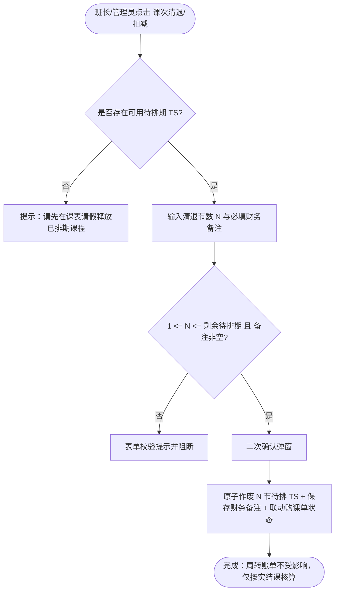

/** (c) 2024-2026 Topee (https://topee.top). All rights reserved. Proprietary and confidential. */

# 产品需求文档 (PRD) — 子模块 2B：课次清退与财务备注 (Credit Deduction & Refund Notes)

| 文档属性 | 内容 |
| :--- | :--- |
| **文档版本** | v2.0（精简重构版） |
| **所属模块** | 模块二：订单与资金流转 (Orders & Payments) |
| **关联子模块** | `m2a_course_orders.md`（购课单与 TS 资产）｜ `m1a_student_profile.md`（学员档案资产卡）｜ `m5a_transfer_collection.md`（周转账单） |
| **创建与更新日期** | 2026-11-05（创建） / 2026-11-13（按精简方案重构为「课次清退/扣减 + 财务备注」，移除独立电商级退款审批流、10% 违约金公式与 M5A 冲抵核算） / 2026-11-19（支持单次多价位课次联合清退、实时展示剩余未排课次与本次退款总积分汇总） |

---

## 1. 概述与执行摘要 (Executive Summary)
课次清退与财务备注子模块（`m2b`）面向班长与平台管理员，解决学员因故停课或退费时的剩余待排课时核销问题。少儿教务退费均由收款方（班长或管理员）在线下微信/支付宝直接向家长转账，因此本模块不设复杂审批流、违约金比例公式及线上冲抵对账；仅在学员档案资产卡与购课单详情提供 **【课次清退/扣减】** 动作，扣减或清零剩余待排期课次并记录财务备注留痕。当前阶段：MVP 正式功能迭代。

---

## 2. 问题定义与背景 (Problem Statement)
- **低频退款与线下协商现实**：少儿英语培训中途退费极少，且 100% 为班长/校长与家长在微信协商后线下直接转账退款。
- **重审批与固定公式摩擦**：此前设计的电商级退款单、10% 阶梯违约金自动计算及 M5A 违约金追缴冲抵流转过重，且与线下实际协商金额经常不一致，反而增加了对账负担。

---

## 3. 目标用户与角色画像 (Users & Personas)

### 3.1 角色一：班长 / 平台管理员（经办人）
- **核心诉求**：在线下与家长结清退费转账后，在系统里快速把该学员剩余待排课时扣减掉，并留下一句清晰的财务备注（如退了多少钱、微信转账时间）。
- **预期成果**：几秒内完成课次核销，防止家长继续约课；同时周转账单只按实际已结课计算应交金额，账目清爽。

### 3.2 角色二：出资家长（只读查看方）
- **核心诉求**：在购课记录或资产变动列表中能看到课次被核销的节数与经办备注，确认账目一致。

---

## 4. 核心业务流程 (Main Flows)

### 4.1 学员课次清退/扣减主流程 (Happy Path)
1. **发起入口**：班长或管理员打开学员综合档案的【课次资产与排课总览】，或打开对应已付款购课单，点击 **【课次清退/扣减】**。
2. **输入清退信息**：
   - 系统按价位与资金持有人分组展示当前可清退的**剩余待排期课次数量**（如 `16积分：剩余 4 节未排`、`18积分：剩余 1 节未排`、`21积分：剩余 1 节未排`，及小班待排 TS）；
   - 操作人可在**同一次清退中同时为多个价位分别输入清退节数** $n_i$（各价位 $0 \le n_i \le \text{该价位剩余待排节数}$，且总清退节数 $\sum n_i \ge 1$），或点击一键 `[ 全部清零 ]` 自动填满全部可清退价位；界面实时汇总展示**本次清退总节数**、**清退后剩余未排节数**及**退款总积分**（按各价位实扣节数 $\times$ 单节积分汇总），并必填**财务备注**（1–200 字，例如：`线下退费微信转账 ¥600，家长因移居停课`）；可选上传线下转账截图凭证。
3. **前置防呆校验**：
   - 若学员仍有未取消的**未来已排期课次**，提示操作人先在日历中将对应课次请假退回待排期池，再执行清退（或提供一键将未开始排期退回后再清退的提示）。
4. **确认落盘**：
   - 操作人点击确认后，系统将对应 $N$ 节待排期 TS 置为 `CANCELLED`（已取消）；
   - 若关联购课单的所有剩余有效 TS 均已清退，购课单状态更新为 `REFUNDED`；若部分清退，购课单保留 `PAID` 并标记 `PARTIALLY_REFUNDED`；
   - 生成一条不可篡改的**课次清退记录 (`CreditDeduction`)** 挂载在购课单与学员资产明细下方供只读查验。

### 4.2 课次清退记录生命周期 (`CreditDeduction`)
- 本模块不设多级待审批流转，提交即生效（`EFFECTIVE`）：
  - `[*] -> EFFECTIVE`：班长或管理员填写清退节数与财务备注并确认提交，立即原子扣减对应待排 TS 并写入财务备注记录。
  - 清退记录一经生成不可物理删除，供后续财务审计追溯。

---

## 5. 用户故事 (User Stories)
- **US-2B-01（快速课次清退）**：作为一个班长，我想要在线下微信退费给家长后，直接在学员资产卡上输入清退节数和退款备注完成扣减，以便于快速锁定剩余课次不再被预约。
- **US-2B-02（一键全部清零注销）**：作为一个班长，当学员彻底停课退学并申请注销档案时，我想要一键清零其名下所有剩余待排课时，以便于让学员顺利通过注销资产清零校验。
- **US-2B-03（备注留痕追溯）**：作为一个平台管理员，我想要在购课单详情页和学员资产明细中查看每一笔课次清退的操作人、时间和财务备注，以便于核对历史退课原因。
- **US-2B-04（与周转账单解耦）**：作为一个班长，我期望退费不产生额外的违约金追缴单或冲抵计算，每周只需按实际已上完的课次上交积分，以便于避免线下协商金额与系统公式打架。

---

## 6. 验收标准清单 (Acceptance Criteria)

### 6.1 课次清退校验及扣减
- **AC-2B-01（多价位联合清退与数量校验）**：支持单次清退同时选择多个价位（及小班待排 TS，购课后 1v1 待排 TS 不分固定/临时）；每个价位输入的清退节数 $n_i$ 必须为非负整数且不得大于该价位当前 `PENDING_SCHEDULE`（待排期）剩余节数，合计清退节数 $\sum n_i \ge 1$；超限或总数为 0 时阻断并明确提示“该价位最多可清退 N 节待排期课次”或“请至少输入 1 节清退课次”。界面实时展示各价位及总计的**当前剩余未排节数**、**退后剩余未排节数**与**本次退款总积分**（按各档对应 TS 单节实付积分汇总）。
- **AC-2B-02（已排期前置提示）**：若学员名下存在未来 `SCHEDULED`（已排期）课次且待排期不足以扣减时，提示操作人先在课表将课次释放回待排期池，不得直接强行作废已排期课格。
- **AC-2B-03（财务备注必填）**：执行清退必须填写 1–200 字的财务备注（记录线下退款金额、渠道与原因），未填写禁止提交。
- **AC-2B-04（原子作废与状态联动）**：提交成功后，系统原子将对应的 $N$ 节待排期 TS 置为 `CANCELLED`；当该购课单无任何有效剩余 TS（既无待排期也无未完结排期）时，购课单自动更新为 `REFUNDED`，否则打上 `PARTIALLY_REFUNDED` 标识。

### 6.2 权限与结算边界
- **AC-2B-05（资金持有人强校验与管理员兜底规则）**：
  1. **持有人本人操作**：仅该笔待排期 TS 的**当前资金持有人（`holder_id` 对应的班长，或资金由平台持有时的平台管理员）**可直接执行清退；非持有人的其他班长物理禁止操作，接口与界面阻断并提示“该课次资金当前由 [持有人姓名] 持有，请由资金持有人操作清退”。
  2. **管理员紧急兜底代清退**：当资金持有人为某班长时，平台管理员保留紧急兜底代清退权限，但**必须强制上传至少 1 张（最多 5 张）线下退款/转账截图凭证**并填写原因，未上传凭证禁止提交；同时向原持有人班长发送只读通知。家长与老师端无操作入口，家长仅可只读查看清退节数与备注记录。
- **AC-2B-06（周结算零耦合）**：已清退作废的 TS 绝对不进入 `M5A` 周转账单和 `M5B` 老师周课酬单；系统不计算任何违约金拆分，周转账单严格按实际结课 TS 核算。

---

## 7. 本期范围外清单 (Out of Scope)
- **不支持线上原路自动资金退回**：所有资金退还均在线下微信/支付宝完成，系统仅做课次扣减与备注留痕。
- **不支持多级退款审批流**：取消提交→初审→终审→打款确认的多阶段状态机，班长/管理员确认即生效。
- **不支持 10% 违约金自动拆分公式与 M5A/M5B 违约金冲抵**：停用违约金比例拆账与影子补偿结算。

---

## 8. 约束条件 (Constraints)
- **不可逆提示**：课次清退确认前需弹出二次确认提示（“将作废 N 节待排期课次，操作不可撤销，请确认已完成线下沟通与核算”）。
- **凭证大小与必填限制**：普通持有人本人清退时线下转账截图凭证为**选填**；**管理员代班长兜底清退时为必填（1～5 张）**。单张上限 5MB，支持 JPG / PNG / WebP。

---

## 9. UI/UX 界面线框说明 (Wireframe Level)
- **触发位置**：
  - **独立清退记录列表页**：由首页金刚位 `↩️ 课次清退` 或 Tab 3【教务中心】`↩️ 退款管理/课次清退` 进入（右上角常驻 **`[ + 发起课次清退 ]`** 快捷入口，选定存在待排课次的学员后直接呼出清退抽屉）；
  - **上下文内嵌入口**：学员综合档案【课次资产】区右上角 `[ 课时清退/扣减 ]` 文字链按钮，或 M2A 购课单详情页底部操作区。
- **课次清退记录列表页（排序、搜索与筛选规范）**：
  - **权限范围**：班长展示本人作为资金持有人（`holder_id == 本人`）或本人经办的清退记录；管理员展示全校清退记录；
  - **默认排序**：默认按**清退操作时间倒序**排列（最新一笔清退置顶）；
  - **搜索与筛选**：
    - **即时搜索框**：支持按**学员规范昵称（含前 1–2 字母）/ 小名、关联购课单号、或财务备注关键词**即时检索；
    - **轻量筛选**：时间范围（`近 30 天` / `近 90 天` / `全部`）；管理端额外提供 **`[ 全部持有人 ▾ ]`**（置顶 `[ ⭐ 我经办/直管 ]`）及清退方式筛选（`全部` / `持有人自清退` / `管理员兜底代清退`）。
- **清退确认抽屉**：
  - **顶部资产总览条**：显式展示该学员当前**总剩余未排课次**（如 `当前共剩余 6 节未排 (合计 103 积分)`）及一键快捷操作 `[ 全部清零 ]`；
  - **多价位明细输入行**：按价位/持有人逐行列出所有可清退资产（如 `16积分 · 剩余 4 节未排`、`18积分 · 剩余 1 节未排`、`21积分 · 剩余 1 节未排`），每行右侧独立提供步进器/输入框录入本次清退节数（默认 `0`，支持同时填写多行），并实时标注退后余量（如 `退后余 2 节`）；非当前操作人持有的价位行置灰标注持有人姓名（管理员可通过兜底流程解锁）；
  - **实时汇总条**：在输入框下方高亮汇总展示 **`本次清退：共 3 节 ｜ 退款总积分：50 积分 ｜ 退后剩余未排：3 节`**；
  - 文本域：`财务备注`（占位提示：`例如：线下微信退费 ¥600，家长因故停课`）；
  - 持有人本人操作时：`选填 · 上传线下退款截图凭证`；管理员代班长兜底清退时：`必填 · 上传线下退款/转账截图凭证（1～5 张）`；
  - 底部按钮：`[ 取消 ]` + `[ 确认清退课时 ]`（Danger/Primary 确认）。
- **内嵌历史记录展示**：在购课单详情与学员资产卡片底部按**操作时间倒序**展示只读列表：`[2026-11-13] 清退 4 节 · 经办人: Leo · 备注: 线下退费微信转账 ¥600`。

---

## 10. 用户流程图 (User Flow Diagram)

