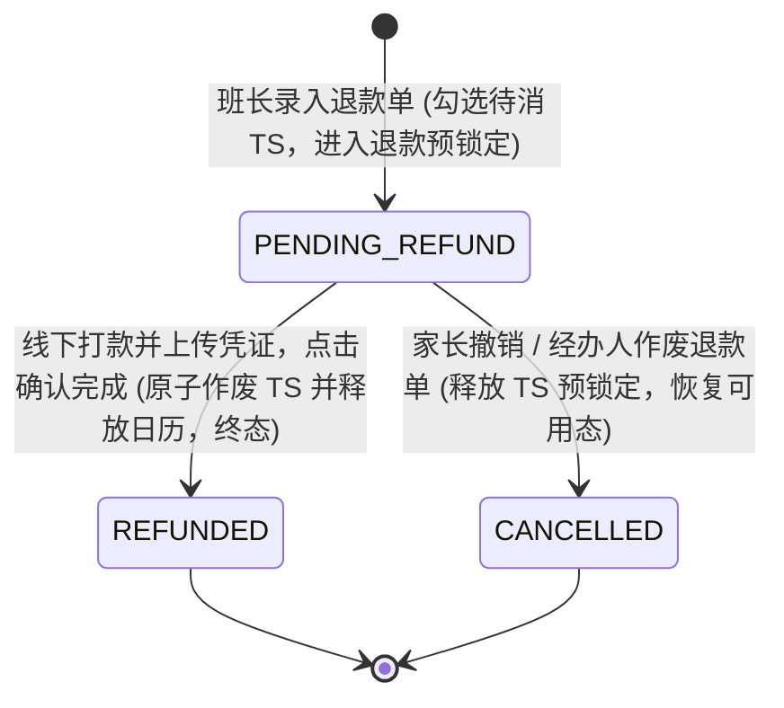
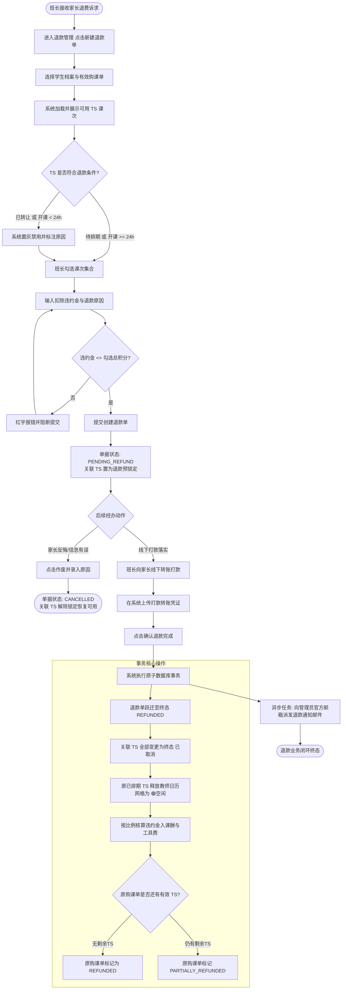

/** (c) 2024-2026 Topee (https://topee.top). All rights reserved. Proprietary and confidential. */

# 产品需求文档 (PRD) — 子模块 2B：退款单与课时冲退核算 (Refund Orders & TS Cancellation)

| 元数据项 | 说明 / 内容 |
|---|---|
| **模块代号** | `m2b` |
| **所属模块** | 模块二：购课单与资金单据 (Course Orders & Funds) |
| **文档状态** | 待评审 (Draft) |
| **关联顶层 PRD** | [Prd-v5.md](../Prd-v5.md) |
| **关联模块划分** | [system_modules_overview.md](../system_modules_overview.md) |
| **创建与更新日期** | 2026-11-05 |

---

## 1. 概述与执行摘要 (Executive Summary)

退款单与课时冲退核算子模块（`m2b`）是 Dream 系统的逆向资金流与风控中枢。针对少儿教务中途退课、家庭变故或课时不适配等业务场景，本模块提供**退费前置合规保障**、**未消 TS 课次勾选锁定**、**违约金双向拆分核算**、**线下打款凭证上传**、**日历空闲网格释放**与**课时原子冲退**全链路功能。单据经负责班长线下打款并确认后直接生效，系统自动触发向平台管理员发送退款审计邮件，保证账实一致与资金归属闭环。当前阶段：MVP 正式功能迭代。

---

## 2. 问题定义与背景 (Problem Statement)

- **痛点 1：私下退款导致“幽灵课时”继续上课**：以往家长退课时班长线下转账，由于缺乏系统级课时核销闭环，原单生成的排期课次依然有效，学生仍能正常上课甚至转让给他人，给平台和教师造成经济损失。
- **痛点 2：违约金扣减标准混乱与分账失衡**：退课产生违约金时，班长人肉扣款缺乏拆分标准，无法公平核算教师的排课空置补偿与平台的工具运营成本。
- **痛点 3：已排期退费与教师日历割裂**：学生中途退课若涉及未来已排期课次，若无法自动清空并释放教师日历网格，会导致其他学生无法预约该时段，造成教学产能浪费。
- **痛点 4：跨家长转让后课次被原家长误退**：已转让给其他学生的课次若缺乏防退校验，原出资家长退费时会连带注销新学生的已排课程，引发严重纠纷。
- **痛点 5：部分退款后配额与单据状态混乱**：退款后原购课单状态是否完结、已固化的请假配额是否变动口径不一，易引发系统计算死锁。

---

## 3. 目标用户与角色画像 (Users & Personas)

### 3.1 角色一：负责班长（Leo）
- **角色定位**：退款业务的第一线沟通人与执行经办人。
- **核心诉求**：引导家长优先挪位或转让；若必须退费，在后台快速勾选有效 TS，输入协商好的违约金，系统自动算出实际应退积分；线下完成打款并上传转账截图后确认单据，课时自动核销。
- **预期成果**：退款过程有据可查，违约金拆分明确，课时同步清退零滞留。

### 3.2 角色二：平台管理员（Sarah）
- **角色定位**：全平台资金风控与中央审计人。
- **核心诉求**：退款单无需前置阻断式审批，但班长确认退款后系统必须即时向管理员发送包含明细的邮件通知；可在全平台看板查阅任意退款单、凭证截图与审计日志。
- **预期成果**：全域资金流向 100% 透明受控，兼顾一线经办效率与中央风控。

### 3.3 角色三：出资家长（Amy）
- **角色定位**：退费发起方与收款人。
- **核心诉求**：在线下协商退款后，可在家长工作台只读查阅退款单详情、实退积分、已扣违约金及对应已核销的课次明细。
- **预期成果**：账单透明清晰，已退课次不再显示在待排课列表。

---

## 4. 核心业务流程 (Main Flows)

### 4.1 1v1 课时退款单录入与课时预锁定 (Happy Path)
1. 班长在班长工作台进入“退款管理”，点击“新建退款单”。
2. 班长选择学生档案及对应的原有效购课单（`PAID` 状态）。
3. 系统列出该购课单下所有**允许退款的 TS 课次**（仅限 `待排期` 以及 **距开课 $\ge 24$ 小时的 `已排期`** TS）。
4. 班长勾选拟退款的 TS 集合（支持单选或全选），系统展示勾选课次总数与勾选总实付积分。
5. 班长输入“扣除违约金积分”（选填，默认 0，上限为勾选总实付积分）与“退款原因”。
6. 系统实时计算出“实际应退积分 = 勾选总实付积分 - 违约金积分”，并按 TS 财务快照比例实时展示违约金在“教师课酬补偿”与“平台工具费”中的拆分明细。
7. 班长提交退款单，系统创建单据并置为 `PENDING_REFUND`（待打款确认）；同时将勾选的 TS 标记为退款预锁定状态（禁止排课、挪位与转让）。

### 4.2 线下打款、凭证上传与确认退款闭环
1. 原收款资金持有方（原班长或平台）根据退款单上的“实际应退积分”，按 1 积分 = 1 元线下打款给家长（微信/支付宝/银行卡）。
2. 班长在退款单详情页上传打款凭证截图（JPG/PNG/PDF）。
3. 班长点击【确认退款完成】。
4. 系统在数据库事务内执行以下原子操作：
   - 退款单状态跃迁为终态 `REFUNDED`（已退款）；
   - 关联被勾选的 TS 状态统一原子变更为终态 `已取消`；
   - 若被退 TS 中包含 `已排期` 课次，系统自动解除对应教师排课占用，日历网格恢复为 🟢【空闲可约】；
   - 检查原购课单剩余有效 TS 数量：若有效 TS 归零，原购课单状态变更为 `REFUNDED`；若仍有剩余有效 TS，原购课单保持 `PAID` 并打上 `PARTIALLY_REFUNDED` 标签；原购课单请假配额保持原值不缩减；
   - 违约金拆分金额分别记入对应的教师课酬待补偿池与平台工具费待归集池；
   - 记录全链路操作审计日志。
5. 系统自动触发异步任务，向平台管理员官方邮箱派发退款确认通知邮件。

### 4.3 待退款单作废流程 (Cancel Flow)
1. 在 `PENDING_REFUND` 状态下，若家长撤销退课申请或退款信息录入有误，班长或管理员可点击【作废退款单】。
2. 经办人填写作废原因（必填，1-200 字）。
3. 退款单状态变更为终态 `CANCELLED`（已作废）。
4. 系统解除关联 TS 的退款预锁定状态，TS 恢复原有的 `待排期` 或 `已排期` 正常可用状态。

### 4.4 异常分支与安全校验拦截
- **距开课不足 24 小时已排期课次拦截**：若 TS 距开课 $< 24$ 小时，系统置灰禁用勾选，勾选框旁提示“开课前不足 24 小时不可退费，仅可同师改期或转让”。
- **跨家长已转让课次拦截**：若 TS 已被转让给其他家长的学生上课（`是否已转让 = True` 且转入方学生属于外部家长），系统置灰禁用勾选，提示“该课次已跨家长转让，不可原路退款”。
- **违约金超限拦截**：若输入的违约金积分 $>$ 勾选 TS 总实付积分，输入框红字报错并阻断提交。
- **并发重复确认幂等保障**：对已处于 `REFUNDED` 或 `CANCELLED` 的单据再次提交操作，系统拒绝处理并返回当前状态。

### 4.5 学员退学离场“存量课时一键打包退款清退”流程 (Student Churn Full Refund Flow)
1. 家长向负责班长提出孩子不再在平台上课的退学诉求。
2. 班长在退款管理页选择该学员档案，开启【学员退学全量清退】模式。
3. 系统自动跨越该学员名下的所有有效购课单，一键聚合勾选所有符合退费资格的有效 TS（全量 `待排期` TS + 距开课 $\ge 24$h 的 `已排期` TS）。
4. 系统汇总计算总实付积分，班长根据退学协议录入统一违约金，生成全局清退退款单。
5. 原收款方线下打款并上传凭证后，班长点击【确认退款完成】。
6. 系统在单一事务内执行：
   - 将这批 TS 涉及的未来日历预约全额释放为 🟢【空闲可约】；
   - 所有被退 TS 状态原子变更为终态 `已取消`；
   - 涉及的所有原购课单全部跃迁为 `REFUNDED` 终态；
   - 该学员名下有效 TS 资产与未来排课即刻彻底清零，无缝满足 M1A 档案注销/归档的前置安全条件。

### 4.6 退款单全生命周期状态机与课时冲退流转矩阵 (Refund Order Lifecycle)

> **【实体生命周期 SSOT 归口声明】**：`RefundOrder`（退款单）的生命周期状态机与冲退守卫规则 100% 统一由本 PRD 管辖与维护。后续任何涉及退款单状态枚举、流转守卫与违约金拆分约束的修改，必须且只能修改本文档。

#### 状态转移与守卫规则矩阵 (State Transition Matrix)

| 当前状态 | 目标状态 | 触发事件 / 动作 | 操作人 / 驱动源 | 前置守卫条件与时限熔断 | 伴随副作用与资产流转 |
| :--- | :--- | :--- | :--- | :--- | :--- |
| **`[*]`** | `PENDING_REFUND` (待退款确认) | 班长新建退款单并勾选 TS | 负责班长 / 管理员 | 原购课单处于 `PAID`；勾选 TS 仅限待排期或距开课 $\ge 24$h；禁止勾选跨家长转让课次；违约金 $\le$ 勾选总实付积分 | 创建退款单主记录；所勾选 TS 进入 `REFUND_LOCKED` 预锁定（禁止排课/挪位/转让）；实时按快照比例测算违约金拆分 |
| `PENDING_REFUND` | `REFUNDED` (已退款生效) | 线下打款并点击确认退款完成 | 负责班长 / 管理员 | 单据处于 `PENDING_REFUND`；必须上传打款凭证截图；资金持有方已完成转账 | 单据跃迁为终态 `REFUNDED`；关联被退 TS 原子变更为 `CANCELLED` 并全量释放未来日历网格为 🟢；联动更新原购课单状态（`REFUNDED` 或打上 `PARTIALLY_REFUNDED`）；异步向管理员发送审计邮件 |
| `PENDING_REFUND` | `CANCELLED` (已作废) | 经办人作废退款单 | 负责班长 / 管理员 | 单据处于 `PENDING_REFUND` 未打款；必须填写 1-200 字作废原因 | 单据跃迁为终态 `CANCELLED`；解除关联 TS 的预锁定标记，TS 恢复原可用状态（`待排期` 或 `已排期`）可正常排课约课 |

---

## 5. 用户故事 (User Stories)

- **US-2B-01**：作为一个班长，我想要根据学生档案筛选有效购课单并勾选未消 TS，以便于精确核算退款课次。
- **US-2B-02**：作为一个班长，我想要录入扣除违约金并由系统自动按 TS 课酬与工具费比例拆分，以便于公正补偿教师与平台。
- **US-2B-03**：作为一个班长，我想要在退款确认后自动释放已排期 TS 占用的教师日历，以便于该时段能立即重新开放给其他学生预约。
- **US-2B-04**：作为一个班长，我想要在上传线下打款凭证后一键确认退款并自动通知管理员，以便于快速结单且无需等待繁琐的后台人工审批。
- **US-2B-05**：作为一个班长，我想要在打款前作废误创建的退款单，以便于释放被锁定的课次资产恢复正常约课。
- **US-2B-06**：作为一个管理员，我想要在全平台退款发生后收到即时邮件通知并审计凭证，以便于全局掌控逆向资金风控。
- **US-2B-07**：作为一个家长，我想要在个人工作台只读查验已退款单据明细与已核销课次，以便于清晰掌握退款账目。
- **US-2B-08**：作为一个系统风控机制，我想要物理阻断跨家长已转让课次与不足 24 小时的排期课次退款，以便于防止纠纷与恶意逃单。
- **US-2B-09（退学一键全量清退）**：作为一个负责班长，我想要在家长决定退学时能跨购课单一键打包勾选该孩子的所有剩余未消课次并完成退款，以便于快速清空其名下资产完成退学交割。

---

## 6. 验收标准清单 (Acceptance Criteria)

### 6.1 退款资格与课次勾选规则
- **AC-2B-01**：系统仅允许对处于 `PAID` 状态的 1v1 原购课单创建退款单；非 `PAID` 状态购课单不可发起退款。
- **AC-2B-02**：仅以下两类 TS 允许被勾选退款：① 处于 `待排期` 状态的 TS；② 处于 `已排期` 状态且**距开课时间严格 $\ge 24$ 小时**的 TS。
- **AC-2B-03**：距开课时间 $< 24$ 小时的 `已排期` TS 必须物理置灰禁用，无法勾选；悬浮提示“开课前 24 小时内禁止退款”。
- **AC-2B-04**：已被跨家长转让的 TS（即 `actual_student_profile_id` 归属非原购课家长账号的档案）必须物理置灰禁用，无法勾选；悬浮提示“已转让课次不可退款”。
- **AC-2B-05**：处于 `已结课`、`已结算`、`已取消` 或已被其他未完结退款单锁定的 TS，严禁进入可选列表。
- **AC-2B-06**：单笔退款单至少必须勾选 1 节合格 TS，未勾选任何 TS 时提交按钮置灰禁用。
- **AC-2B-06a（退学全量一键勾选规范）**：退款录单页提供【学员退学全量清退】选项，勾选后系统跨购课单自动批量选中该学员名下所有满足 AC-2B-02 的有效 TS（排除不足 24h 及已转让课次），支持单一退款单合并清退多笔历史购课单的剩余资产，并在确认退款后将这些购课单全部置为 `REFUNDED` 终态。

### 6.2 金额计算与违约金拆分
- **AC-2B-07**：勾选 TS 总实付积分 = $\sum_{i=1}^M \text{TS}_i.\text{total\_points}$。
- **AC-2B-08**：扣除违约金积分必须为 $\ge 0$ 的整数，且必须 $\le$ 勾选 TS 总实付积分；输入负数、小数或超额数值时系统报错阻断。
- **AC-2B-09**：实际应退积分 = 勾选 TS 总实付积分 - 扣除违约金积分。
- **AC-2B-10**：违约金拆分算法：
  - 勾选课次的教师课酬基准总额 $S_{teacher} = \sum \text{TS}_i.\text{teacher\_salary\_points} + \sum \text{TS}_i.\text{extra\_prep\_fee\_points}$；
  - 勾选课次的工具费基准总额 $S_{tool} = \sum \text{TS}_i.\text{tool\_fee\_points}$；
  - 教师课酬违约金分摊 $P_{teacher} = \lfloor \text{违约金} \times \frac{S_{teacher}}{S_{teacher} + S_{tool}} \rfloor$；
  - 平台工具费违约金分摊 $P_{tool} = \text{违约金} - P_{teacher}$（确保 $P_{teacher} + P_{tool} = \text{违约金}$ 严格对平，不留除法尾差）。

### 6.3 单据生命周期与课时原子冲退
- **AC-2B-11**：新建退款单成功后，单据初始状态为 `PENDING_REFUND`；关联的所有被勾选 TS 状态置为 `REFUND_LOCKED`（退款锁定），此时 TS 不可被排课、挪位、请假或转让。
- **AC-2B-12**：处于 `PENDING_REFUND` 状态的退款单，经办班长或管理员点击【确认退款完成】前必须已上传至少 1 张打款凭证截图；未上传凭证时确认按钮置灰阻断。
- **AC-2B-13**：确认退款成功后，单据状态跃迁为 `REFUNDED`，关联的 TS 原子化全部变更为终态 `已取消`。
- **AC-2B-14**：若被取消的 TS 包含原 `已排期` 课次，系统在事务内自动释放该排课占用，将对应的教师日历网格恢复为 🟢【空闲可约】。
- **AC-2B-15**：确认退款完成后，系统在 5 秒内自动触发邮件任务，向全平台管理员通知邮箱派发邮件，邮件内容包含：退款单号、原购课单号、学员昵称、经办班长、退款课节数、应退积分、扣除违约金及凭证链接。
- **AC-2B-16**：处于 `PENDING_REFUND` 状态的退款单允许被经办班长或管理员执行【作废】操作（必须填写 1-200 字作废原因）；作废后单据状态变为 `CANCELLED`，关联的 TS 立即解除 `REFUND_LOCKED` 锁定并恢复为退款前的原状态。
- **AC-2B-17**：对已处于 `REFUNDED` 或 `CANCELLED` 终态的退款单，任何【确认】或【作废】请求均被拒绝（HTTP 409 幂等拦截）。

### 6.4 原购课单状态联动与请假配额保护
- **AC-2B-18**：若本次退款后，原购课单下的所有 TS 均已处于 `已取消` 终态（无任何剩余有效可用 TS），原购课单状态更新为 `REFUNDED`（已全额退款）。
- **AC-2B-19**：若本次退款后原购课单仍有部分有效 TS，原购课单状态保持 `PAID`，并在单据上打上 `PARTIALLY_REFUNDED` 标识。
- **AC-2B-20**：退款无论退回多少课时，原购课单已计算固化的 `允许直接取消次数上限`（请假配额）绝对保持原值不变，严禁反向扣减缩编。

### 6.5 凭证规范与权限控制
- **AC-2B-21**：退款打款凭证支持 JPG、PNG、PDF 格式，单文件大小 $\le 10$MB，每笔退款单最多支持上传 5 个凭证附件。
- **AC-2B-22**：班长仅可对【自己作为初始资金持有方（`holder_id`）】的购课单发起退款与确认；非资金持有方班长无权经办（越权操作返回 403 权限拒绝），必须由原收款班长或平台管理员操作。
- **AC-2B-23**：家长端对退款单具有且仅具有只读权限（仅可查看名下学生档案已绑定的退款单），严禁在家长端提供退款单创建、编辑、确认或作废接口。
- **AC-2B-24**：所有退款单创建、凭证上传、确认打款、作废操作必须强制记录系统审计日志（记录操作人账号 ID、角色、时间戳、IP、变更前数据快照与变更后数据）。

### 6.6 界面交互与极简列表卡片视觉规范 (Standard 1 待办聚焦模型)
- **AC-2B-24a（首行待办轻量提示，精简统计数字卡片）**：班长及管理端退款单列表首行仅保留“待打款确认 X 单”核心待办微提示条，不设“待打款/已退款/已作废” 3 块平铺式统计卡片；已退款与已作废历史单据的检索与浏览 100% 由状态分段选择器（Tabs）直接承接，杜绝视觉冗余。
- **AC-2B-25（单据列表卡片视觉规范 · 方案 3 待办聚焦模型）**：
  退款单列表卡片与信息展示严格遵循 [DESIGN.md Section 2.2.1]「标准一：批量列表型单据卡片（方案 3 待办聚焦模型）」：
  1. **待办聚焦**：处于 `PENDING_REFUND`（待打款确认）的单据采用浅黄微底衬与高亮状态胶囊，形成视觉强吸附；
  2. **常态纯白**：占 80% 的已退款（`REFUNDED`）常态单据采用 100% 纯白基底与中性灰状态徽标，杜绝整卡染色；
  3. **失效沉底**：已作废（`CANCELLED`）单据采用微灰底与半透明降级沉底，安静归档；
  4. **高清晰度中性字**：全卡文本严格满足 WCAG AA 4.5:1 对比度要求，主标题及积分核心数字纯黑加粗，表头与辅助信息深青灰清晰可读，杜绝字底同色与低对比弱灰字；
  5. **操作与标签收敛**：待打款主确认动作使用高饱和主色按钮，次要操作为白底中性按钮；业务属性标签收敛为中性浅灰微胶囊。

---

## 7. 本期范围外清单 (Out of Scope)

- **小班课退款冲退**：小班课为班长自负盈亏整班核算模式，单人中途退费属于班长与家长的线下私约事项，系统本期物理不支持小班课退款单录入。
- **第三方在线原路退款网关**：系统不直连微信支付商户或支付宝退款 API，所有退款金额均由经办人通过线下转账渠道支付并上传凭证核销。
- **未付款购课单退款**：处于 `PENDING_PAYMENT` 状态的未付款购课单不产生 TS，退课时直接作废购课单即可，无需也不允许走退款单流程。
- **家长端线上自主退费申请入口**：本期不开放家长自助提交退款申请功能，统一由班长或管理员在沟通协调后线下代录。
- **已结课/已结算课次的事后退款**：已结课 TS 的课酬已进入核算或已发放给教师，严禁通过退款单反向追回；若因教师未到岗导致异常结课，统一走模块三的“异常未上课回退补生待排期 TS”逻辑。

---

## 8. 约束条件 (Constraints)

### 8.1 业务与合规约束
- **资金持有人负责制**：退款必须由该购课单最初收款的资金持有方（原班长或平台）承担线下打款责任；跨班长代课或临时挪位不改变资金持有归属。
- **24 小时开课风控红线**：距开课 $< 24$ 小时的排期课程严禁退款，保障教师基本收入与日历稳定性。
- **财课分离与转让排他性**：已被转让给外部家长的课次严禁原出资家长申请退款，资产已发生权益交割。

### 8.2 功能与规格限制
| 约束项 | 指标规格 / 限制值 |
|---|---|
| 适用业务类型 | 仅限 1v1 课程（固定位与临时课） |
| 单笔退款课时上限 | 不超过该原购课单当前剩余有效 TS 总数（1-200 节） |
| 违约金扣减范围 | 正整数，范围 $0 \le \text{违约金} \le \text{勾选TS总实付积分}$ |
| 退款凭证格式 | JPG / PNG / PDF |
| 凭证文件上限 / 数量 | 单文件 $\le 10$MB / 单单最多 5 张凭证 |
| 作废原因字符数 | 1 - 200 个字符 |
| 邮件通知时限 | 确认退款完成后 5 秒内触发派发 |

### 8.3 外部文档与参照依据
| 文档名称 | 存放路径 / 链接 | 使用场景说明 |
|---|---|---|
| 教务排班与分账 PRD v5.1 | docs/Prd-v5.md | 逆向退款、转让与异常回退规则基准 |
| 核心业务规则与财务分账规约 | docs/BUSINESS_RULES.md | 违约金拆分、退款审计与资金持有人归集规约 |
| 工程与编码规范 | docs/CODING_STANDARDS.md | 退款打款凭证直传与归档规范 |

---

## 9. UI/UX 界面线框说明 (Wireframe Level)

### 9.1 班长工作台 — 退款管理看板
- **界面结构与布局**：
  - **首行轻量待办微提示与操作区**：首行展示“资金持有人 Leo · 待打款确认 X 单”微提示徽标，右侧配置【+ 新建退款单】主操作按钮；不设冗余的 3 块平铺数字卡片，保持首屏呼吸感。
  - **状态分段选择器 (Tabs)**：全部 / 待打款 `PENDING_REFUND` / 已退款 `REFUNDED` / 已作废 `CANCELLED` 四态切换，100% 承接单据分类筛选。
  - **搜索框**：支持退款单号、学生档案昵称、原购课单号即时搜索。
  - **单据卡片流 (移动端单列卡片 / 平板双列网格)**：严格遵循 [DESIGN.md Section 2.2.1]「标准一：批量列表型单据卡片」方案 3 待办聚焦模型：
    - 待打款单：浅黄微底衬聚焦，右上角琥珀黄状态胶囊，操作区配置高饱和【上传凭证与确认】主按钮与白底【作废】按钮；
    - 已退款单：纯白基底与中性浅灰状态徽标，操作区配置【查看详情】按钮；
    - 已作废单：浅灰底搭配半透明降级沉底；
    - 卡内文字：全中性深黑灰阶梯，满足 WCAG AA 4.5:1 高清晰度对比度。
- **交互元素与行为**：
  - 待打款行操作列显示【上传凭证与确认退款】、【作废】按钮；
  - 已退款/已作废行仅显示【查看详情】按钮；
  - 点击卡片或“查看详情”，滑出/展示详情抽屉展示 TS 冲退明细与打款凭证大图。
- **空状态**：“暂无退款单记录”。
- **加载态**：骨架屏 Skeleton。
- **错误态**：网络异常展示错误警告条与“点击重试”按钮。

### 9.2 新建退款单抽屉 (Create Refund Drawer)
- **界面结构与布局**：
  - **步骤一：选择源单**：学生档案下拉选择器 $\rightarrow$ 联动带出该学生名下处于 `PAID` 状态的有效购课单列表（展示购课类型、总课时、剩余可用课时）。
  - **步骤二：勾选待退课次 (TS 勾选穿梭列表)**：表格罗列该原单下所有 TS。列表默认按课次序号倒序排列（LIFO，优先推荐从未排期或末尾含余数的 TS 开始勾选）。每行清晰展示：复选框、TS 序号、单节实付快照积分（含尾差明确标明）、当前状态（`待排期` / `已排期`）、已排授课教师、上课时间段。
    - 针对距开课 $< 24$ 小时或已转让的 TS，复选框置灰禁用，旁边标注醒目红/黄警示标签。
  - **步骤三：违约金与核算汇总面板**：
    - 勾选课时总计：实时显示 `已选 M 节`，`实付积分小计 X 积分`；
    - 扣除违约金输入框：数字步进器（默认 0，上限 X 积分）；
    - 实际应退积分卡片：大字高亮显示 `X - 违约金 积分`；
    - 违约金拆分明细提示条（当违约金 $> 0$ 时展开）：显示“教师课酬补偿：$P_{teacher}$ 积分，平台工具费扣留：$P_{tool}$ 积分”；
  - **步骤四：退款原因与提交**：多行文本框（必填，退款原因），底部常驻【取消】与【创建退款单】按钮。
- **交互与校验行为**：
  - 勾选变动实时重算积分小计与应退总额；
  - 违约金超过小计值时输入框红字报错：“违约金不能大于勾选课次的总实付积分”。

### 9.3 确认退款与凭证上传弹窗 (Confirm Refund Modal)
- **界面结构与布局**：
  - 头部：单据摘要（退款单号、学生、应退金额）；
  - 中部：收款人信息提醒（提示班长线下向家长账号打款）、打款凭证上传控件（支持拖拽上传图片/PDF，最多 5 张，支持就地缩略预览与删除）；
  - 确认提示：“确认已完成线下打款？确认后所选课次将立即核销作废并释放排课日历，此操作不可撤销。”
  - 底部操作按钮：【暂存凭证】、【确认退款完成】（未上传凭证时置灰禁用）。
- **加载态**：点击确认后按钮呈现 Loading 状态，阻断重复点击。

### 9.4 家长工作台 — 我的退款记录 (只读视图)
- **界面结构与布局**：
  - 位于家长工作台“账单中心”下的二级标签页【退款记录】；
  - 仅显示当前顶部全局选中的学生档案关联的退款单；
  - 列表卡片展示：退款完成时间、退款课节数、实际已退积分、扣除违约金、关联购课单号；
  - 点击展开折叠面板，可查看具体的已退课次明细（上课时段、教师级别）。
- **权限与交互限制**：无任何编辑、发起或取消操作入口，纯只读展示。

---

## 10. 用户流程图 (User Flow Diagram)

---

## 11. 智能体/系统决策行为规范 (System Decision Rules Engine)

- **系统允许自动执行 (Allowed Operations)**：
  - 自动依据开课时差（24 小时红线）与转让标记过滤不可退款课次；
  - 实时精确计算实际应退积分与违约金双向拆分金额（带余数归入平台消除尾差）；
  - 确认退款时，自动在事务内原子级完成 TS 状态冲退、教师日历网格释放与原购课单状态同步更新；
  - 确认退款完成后，自动触发邮件网关向平台管理员派发退款审计通知；
  - 拦截重复确认与作废请求，确保接口幂等安全。
- **系统绝对禁止 (Strictly Forbidden Operations)**：
  - **严禁**允许退款距开课 $< 24$ 小时的排期课程；
  - **严禁**允许退款已被跨家长转让的课程；
  - **严禁**反向扣减原购课单已固化的 12.5% 请假配额上限；
  - **严禁**未上传任何打款凭证即放行确认退款完成；
  - **严禁**在无人工介入下由系统定时器或算法自动发起退款。
- **无法判定/异常时的退避与人工兜底逻辑**：
  - 当教师日历处于异常冻结状态无法释放网格时，事务整体回滚，单据保持 `PENDING_REFUND` 并报错提示经办人联系技术人员处理；
  - 若管理员通知邮件派发失败，退款落盘事务不回滚，系统将邮件任务压入重试队列（指数退避重试 3 次），避免因外部邮件服务抖动阻断核心退款业务。

---

## 12. 待定事项与补充说明 (Further Notes)

- **本期已敲定并落盘决策**：
  1. 经办制：班长在后台直接录单，无需管理员前置审批，确认退款后通过邮件通知管理员审计。
  2. 课时范围：仅支持 `待排期` 与距开课 $\ge 24$ 小时的 `已排期` TS；确认后已排期自动释放日历为 🟢 空闲；严禁退 $< 24$ 小时及已转让课次。
  3. 违约金：手动输入违约金，按 TS 课酬与工具费快照比例自动拆分并自动平账。
  4. 两阶段流转：`PENDING_REFUND`（TS 预锁定） $\rightarrow$ 上传凭证并确认 $\rightarrow$ `REFUNDED`（TS 原子置为已取消） / `CANCELLED`（TS 解锁）。
  5. 主单联动：全退置为 `REFUNDED`，部分退置为 `PAID + PARTIALLY_REFUNDED`；请假配额上限严格保持原值不缩减。
  6. 范围界限：本期 M2B 仅限 1v1 课程退费；小班课退费明确列入 Out of Scope。
  7. 视觉规范收敛：全面对齐 DESIGN.md 2.2.1「标准一：批量列表型单据卡片」，严格执行方案 3（待办聚焦浅黄底 + 常态单据 100% 纯白 + 彻底淘汰 low-contrast text-slate-400 浅灰字）。
- **后续版本演进考量 (Future Backlog)**：
  - 二期若引入家长线上退款申请流程，可将当前班长录单流程升级为“家长提交申请 $\rightarrow$ 班长复核打款 $\rightarrow$ 确认核销”的三步流；
  - 跨国退款若产生外汇汇率兑换损耗或银行跨境手续费，后续可考虑在违约金项之外增加“手续费抵扣项”独立建账。
