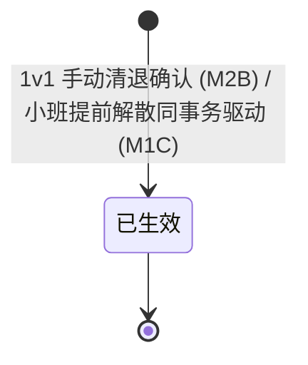
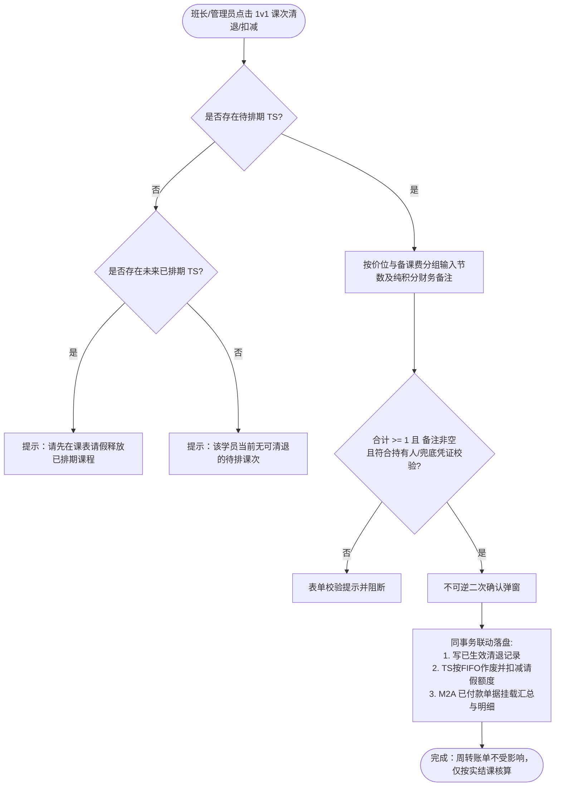

/** (c) 2024-2026 Topee (https://topee.top). All rights reserved. Proprietary and confidential. */

# 产品需求文档 (PRD) — 子模块 2B：课次清退与财务备注 (Credit Deduction & Refund Notes)

| 文档属性 | 内容 |
| :--- | :--- |
| **文档版本** | v2.0（精简重构版） |
| **所属模块** | 模块二：订单与资金流转 (Orders & Payments) |
| **关联子模块** | [m2a_course_orders.md](./m2a_course_orders.md)（购课单与 TS 资产）｜ [m1a_student_profile.md](./m1a_student_profile.md)（学员档案资产卡）｜ [m5a_transfer_collection.md](./m5a_transfer_collection.md)（周转账单） |
| **创建与更新日期** | 2026-11-05（创建） / 2026-11-13（精简重构为「课次清退/扣减 + 财务备注」） / 2026-11-19（支持单次多价位联合清退） / 2026-11-21（对齐动态关联，打通 M1C 小班提前解散伴生清退记录） / 2026-11-22（红队封板与 SSOT 归口收口：明确纯积分口径禁用人民币/元、学员手动清退仅限 1v1、按价位含备课费分组 FIFO 作废与实付积分逐节求和、小班改绑按原资金持有人逐节标注、确立课次清退记录唯一实体归口与跨实体联动清单，清零英文枚举并同步 M2A `§4.5` 指针） |

---

## 1. 概述与执行摘要 (Executive Summary)
课次清退与财务备注子模块（`m2b`）面向班长与平台管理员，解决学员停课退费或小班提前结课解散时的剩余未上课时核销问题。全平台退费与结转严格统一按**纯积分**核算（默认 1:1 业务认知，全模块不出现“人民币”、“元”或币种符号），少儿教务退费由收款方（班长/主理人或管理员）在线下微信直接向家长核算退还，不设复杂审批流、违约金公式及线上周转账冲抵；本模块作为**课次清退记录的唯一归口 (SSOT)**，统一沉淀两类来源的不可篡改核销凭据：① **本模块主动触发的 1v1 手动【课次清退/扣减】**（仅限 1v1 待排期 TS）；② **由 [M1C 小班提前结课解散](./m1c_classes.md#L214) 同事务单向驱动的伴生清退记录**（记录作废节数、按 TS 快照求和核销的待上交积分、解散原因、流向与备注，对家长端不可见）。当前阶段：MVP 正式功能迭代。

---

## 2. 问题定义与背景 (Problem Statement)
- **低频退款与线下协商现实**：少儿英语培训中途退费极少，且 100% 为班长/校长与家长在微信协商后线下直接结清退还。
- **重审批与固定公式摩擦**：此前设计的电商级退款单、10% 阶梯违约金自动计算及 M5A 违约金追缴冲抵流转过重，且与线下实际协商金额经常不一致，反而增加了对账负担。

---

## 3. 目标用户与角色画像 (Users & Personas)

### 3.1 角色一：班长 / 平台管理员（经办人）
- **核心诉求**：在线下与家长结清退费后，在系统里快速把该学员剩余 1v1 待排课时扣减掉，并留下一句清晰的纯积分财务备注。
- **预期成果**：几秒内完成课次核销，防止家长继续约课；同时周转账单只按实际已结课计算应交积分，账目清爽。

### 3.2 角色二：出资家长（只读查看方）
- **核心诉求**：在购课记录或资产变动列表中能看到课次被核销的节数、退款实付积分与经办备注，确认账目一致（小班解散清退记录对家长端物理不可见）。

---

## 4. 核心业务流程 (Main Flows)

### 4.1 1v1 学员课次手动清退/扣减主流程 (Happy Path · 仅限 1v1)
1. **发起入口（严格仅限 1v1 课次）**：班长或管理员打开学员综合档案的【课次资产与排课总览】，或打开对应已付款 1v1 购课单，点击 **【课次清退/扣减】**（小班待排 TS 无学员归属，不出现在学员资产卡入口，小班退课唯一路径为 [M1C 提前结课解散](./m1c_classes.md#L214)）。
2. **分组输入与纯积分实时测算**：
   - 系统按**「价位档位（区分含/不含额外备课费 `+10积分`）+ 资金持有人」**分组展示该学员当前可清退的 **1v1 剩余待排期课次数量**（含通过 M2A 同家庭划转流入该学员名下的待排 TS，如 `16积分（不含备课费）：剩余 4 节未排`、`16积分（含备课费 +10）：剩余 2 节未排`）；
   - 操作人可在**同一次清退中同时为多个分组分别输入清退节数** $n_i$（各组 $0 \le n_i \le \text{该组剩余待排节数}$，且总清退节数 $\sum n_i \ge 1$），或点击一键 `[ 全部清零 ]` 自动填满本人可清退分组；
   - **FIFO 预览与逐节快照求和**：系统在同一分组内按 TS 生成时间先后（**FIFO**）预先锁定拟作废的 TS，界面实时汇总展示**本次清退总节数**、**清退后剩余未排节数**及**`1v1 退款实付积分`**（严格按拟作废 TS 自身固化的单节实付积分快照逐节求和，含 `+10` 额外备课费及强提折后尾差；**全界面与全字段统一使用“积分”，严禁显示“人民币”或“元”**）；操作人须必填**财务备注**（1–200 字，例如：`线下退费微信转账 160 积分，家长因移居停课`）；持有人本人操作时线下转账截图凭证选填，管理员越级代班长兜底清退时必填 1～5 张凭证。
3. **前置防呆校验**：
   - 若该学员名下**无任何待排期 TS 且无未来已排期 TS**，禁止发起并友好提示“该学员当前无可清退的待排课次”；
   - 若该学员名下仍存在**未来「已排期」1v1 课次**，提示操作人先在日历课表中将未来已排课次请假退回待排期池，再行清退。
4. **确认落盘与跨实体同事务联动清单**：
   - 经二次确认后，系统在同一事务内原子完成本实体落盘（写入生效「课次清退记录」）并执行以下 **跨实体联动**（任一步失败则整体回滚）：
     1. **驱动 [TS 全局规则 (`BUSINESS_RULES §3.2`)](../BUSINESS_RULES.md#L103)**：按各分组 FIFO 将对应的 $N$ 节「待排期」1v1 TS 置为终态「已取消」，同步重算扣减 M2A `AC-2A-09` 对应的可用请假参考额度；
     2. **驱动 [M2A 购课单](./m2a_course_orders.md#L136)**：原「已付款」购课单**主状态恒定保持「已付款」不变**（不设已退费主状态，列表轻标 `含清退`），详情页只读挂载本笔清退明细及原始/已清退/剩余对账汇总条（具体状态与展示归口 M2A）；
     3. **写入资产流水与触发通知**：同步写入 [M1A 学员综合档案](./m1a_student_profile.md) 资产变动流水；若属平台管理员替班长兜底代清退，通过 [M4](./m4_notification.md) 向原资金持有人班长发送 1 条只读通知。

### 4.2 小班提前结课解散伴生清退流程（M1C 单向驱动 · 宿主入边）
- **触发边界与单写方声明**：小班待排与未来已排 TS 的作废清退**唯一入口为 [M1C 小班提前结课解散](./m1c_classes.md#L214)**（主理人/管理员无需也不允许在 M2B 手动新建小班清退单）。当 M1C 执行【提前结课解散】且存在至少 1 节被作废的已付款未上课 TS 时，由 M1C 在同一事务内**单向驱动本模块生成 1 笔生效「课次清退记录」（小班解散清退记录）**；弹窗前置拦截、原因枚举、免责勾选与日历释放逻辑均归口 M1C，本模块不重复定义。
- **伴生固化数据与资金归属拆分（含小班改绑场景）**：
  - 本模块落盘固化：关联小班与当前主理人、关联「已付款」购课单、来源标签（`小班解散-退费` 或 `小班解散-结转新班`）、作废总节数（拆明未来已排 + 待排池）、**`小班核销待上交积分`**（严格按被作废 TS 自身固化的单节待上交积分快照精确求和，**与 1v1 家长实付退费积分语义严格隔离**，仅供核销主理人免交积分与财务核对）、解散原因与 1–200 字解散备注、以及**逐节按原 TS 资金持有人归属拆列明细**（若该小班曾在 M1B 改绑过主理人且名下同时存在原主理人收款与新主理人收款的未上 TS，当前主理人可一并解散，但清退记录内必须按各节 TS 原锁定资金持有人分别标注归属节数与核销积分）。
  - 小班解散清退记录对家长端 100% 物理不可见，且不上传额外截图凭证。

### 4.3 课次清退记录专属实体生命周期、字段锁定与留存规则 (Entity & Log SSOT)
> **【实体生命周期与日志唯一归口声明】**：**课次清退记录**（1v1 手动清退与小班解散伴生清退）的状态枚举、触发入边、字段不可变规则、审计留痕与数据留存策略 100% 统一且唯一由本 PRD 管辖与定义；其余文档只做单向引用。

| 当前状态 | 目标状态 | 触发事件 / 动作 | 触发方 / 驱动源 | 前置条件 | 本实体落盘与留痕规则 |
| :--- | :--- | :--- | :--- | :--- | :--- |
| **`[*]`** | **已生效** *(唯一终态)* | ① 1v1 手动清退确认； ② 小班提前结课解散伴生 | ① 本模块（资金持有人班长 / 管理员兜底）； ② **宿主入边**：[M1C 提前结课解散](./m1c_classes.md#L214) | ① 总清退节数 $\ge 1$、填 1–200 字备注（管理员兜底须传 1–5 张凭证）； ② M1C 解散存在 $\ge 1$ 节已付款未上 TS | 单事务创建不可篡改记录；固化逐节被作废 TS 明细、原资金持有人归属、积分合计（`1v1 退款实付积分` 或 `小班核销待上交积分`）、操作人、时间、备注与附件快照 |

- **全字段永久只读与不可逆规则**：清退记录一经落盘即进入终态「已生效」，**全部字段永久只读锁定**（不设管理员或经办人撤销、改积分或删改备注通道，依赖提交前二次确认兜底防范误操作）。
- **留痕边界与数据留存策略**：本记录本身即为永久只读财务核销审计凭据（一经生效永不流转改写，免设独立草稿/审批历史流水表），**长期只读审计留存、严禁物理删除**（不随学员删档/归档、家长注销或小班归档/解散级联抹除）；与 [M5A 周转账单](./m5a_transfer_collection.md) 及 [M5B 老师周课酬单](./m5b_weekly_settlement.md) 保持物理零耦合（已清退作废 TS 绝不计入周度转账与发薪）。

---

## 5. 用户故事 (User Stories)
- **US-2B-01（快速课次清退）**：作为一个班长，我想要在线下微信退费给家长后，直接在学员资产卡上输入清退节数和纯积分退款备注完成扣减，以便于快速锁定剩余课次不再被预约。
- **US-2B-02（一键全部清零注销）**：作为一个班长，当学员彻底停课退学并申请注销档案时，我想要一键清零其名下所有剩余 1v1 待排课时，以便于让学员顺利通过注销资产清零校验。
- **US-2B-03（备注与实付积分留痕追溯）**：作为一个平台管理员，我想要在购课单详情页和清退台账中查看每一笔课次清退的操作人、逐节快照合计的退款实付积分、原资金持有人及财务备注，以便于核对历史退课账目。
- **US-2B-04（与周转账单解耦）**：作为一个班长，我期望退费不产生额外的违约金追缴单或冲抵计算，每周只需按实际已上完的课次上交积分，以便于避免线下协商口径与系统公式打架。

---

## 6. 验收标准清单 (Acceptance Criteria)

### 6.1 课次清退校验及扣减
- **AC-2B-01（仅限 1v1、备课费分组、FIFO 作废与划转可退校验）**：学员资产卡发起的手动清退**严格仅限 1v1「待排期」TS**（包含通过 M2A 同家庭划转流入该孩子名下的待排 1v1 TS，不混入小班 TS）；界面按**「价位档位（区分含/不含额外备课费 `+10积分`）+ 资金持有人」**分组展示当前可用待排节数。支持单次为多个分组同时录入清退节数 $n_i$（非负整数且不超过该组可用待排节数，合计 $\sum n_i \ge 1$，录入 `0` 节的分组自动忽略）。同一分组内严格按 TS 生成时间先购先扣（FIFO）顺序作废；界面实时汇总展示各组及总计的**当前剩余未排节数**、**退后剩余未排节数**与 **`1v1 退款实付积分`**（按本次被作废 TS 自身固化的单节实付积分快照含 `+10` 逐节求和）。超限或总数为 0 时阻断并明确提示。
- **AC-2B-02（已排期与空资产前置拦截提示）**：若学员名下**仍存在未来「已排期」1v1 课次**（无论当前待排期池是否足够本次扣减），提交或发起清退前均须提示操作人先在课表将已排课次请假释放回待排期池，不得直接强行作废未来已排课格；若学员既无待排也无未来已排课次，阻断并提示“该学员当前无可清退的待排课次”。
- **AC-2B-03（财务备注必填与纯积分口径约束）**：执行手动清退必须填写 1–200 字的财务备注（记录退费原因与线下结清情况），未填写禁止提交；**全界面、表单占位符与报表统一仅展示“积分”，严禁显示“人民币”、“元”或 `¥` 符号**。
- **AC-2B-04（跨实体原子联动与小班归属拆分）**：
  1. **1v1 手动清退**：确认后同事务驱动 TS 置为「已取消」并按 M2A `AC-2A-09` 重算扣减请假额度，写入生效「课次清退记录」并挂载至原购课单与学员资产明细；**关联「已付款」购课单主状态始终保持「已付款」不变**，并在购课单详情展示清退对账汇总条；
  2. **M1C 小班提前解散伴生清退（宿主入边）**：仅由 [M1C【提前结课解散】](./m1c_classes.md#L214) 同事务单向触发落盘，来源标为 `小班解散-退费` 或 `小班解散-结转新班`；按被作废 TS 待上交快照精确求和记录 **`小班核销待上交积分`**（与 1v1 退款实付积分语义严格区分），并**逐节按被作废 TS 原锁定资金持有人拆列归属**（即使小班在 M1B 改绑过主理人，历史 TS 归属亦不随改绑迁移）；原「已付款」小班购课单主状态保持「已付款」不变，对家长端物理不可见。

### 6.2 权限与结算边界
- **AC-2B-05（资金持有人强校验与管理员兜底规则）**：
  1. **持有人本人操作**：仅该笔待排期 TS 的**当前资金持有人（对应的收款班长，或资金由平台持有时的平台管理员）**可直接执行 1v1 手动清退；非持有人的其他班长物理禁止操作，系统阻断并提示“该课次资金当前由 [持有人姓名] 持有，请由资金持有人操作清退”。小班解散触发则由当前接手主理人（或管理员）在 M1C 发起，但清退记录归属仍按原 TS 持有人标注。
  2. **管理员紧急兜底代清退**：当资金持有人为某班长时，平台管理员保留紧急兜底代清退权限，但**必须强制上传至少 1 张（最多 5 张）线下转账截图凭证**并填写原因，未上传凭证禁止提交；同时向原持有人班长发送只读通知。家长与老师端无操作入口，家长仅可只读查看 1v1 清退节数、退款实付积分与备注记录。
- **AC-2B-06（周结算零耦合）**：已清退作废的 TS 绝对不进入 `M5A` 周转账单和 `M5B` 老师周课酬单；系统不计算任何违约金拆分，周转账单严格按实际结课 TS 核算。

---

## 7. 本期范围外清单 (Out of Scope)
- **不支持线上原路自动资金退回**：所有资金退还均在线下微信/支付宝完成，系统仅做课次扣减与备注留痕。
- **不支持多级退款审批流**：取消提交→初审→终审→打款确认的多阶段状态机，班长/管理员确认即生效。
- **不支持 10% 违约金自动拆分公式与 M5A/M5B 违约金冲抵**：停用违约金比例拆账与影子补偿结算。

---

## 8. 约束条件 (Constraints)
- **不可逆提示**：课次清退确认前需弹出二次确认提示（“将作废 N 节待排期课次，操作不可撤销，请确认已完成线下沟通与核算”）。
- **凭证大小与必填限制**：普通持有人本人清退时线下转账截图凭证为**选填**；**管理员代班长兜底清退时为必填（1～5 张）**。单张上限 5MB，支持 JPG / PNG / WebP。

---

## 9. UI/UX 界面线框说明 (Wireframe Level)
- **触发位置**：
  - **独立清退记录列表页**：由首页金刚位 `↩️ 课次清退` 或 Tab 3【教务中心】`↩️ 退款管理/课次清退` 进入（右上角常驻 **`[ + 发起课次清退 ]`** 快捷入口：班长视角选人弹窗**仅列出本人名下托管有待排 1v1 课次的学员**，管理员视角可搜全校有待排 1v1 课次学员，选定后直接呼出清退抽屉）；
  - **上下文内嵌入口**：学员综合档案【课次资产】区右上角 `[ 课时清退/扣减 ]` 文字链按钮，或 M2A 购课单详情页底部操作区。
- **课次清退记录列表页（排序、搜索与筛选规范）**：
  - **权限范围与记录呈现**：班长展示本人作为资金持有人（含改绑前收款的小班旧课次）或本人经办的清退记录（含本人当前主理小班解散伴生的清退记录）；管理员展示全校全部 1v1 与小班清退记录；列表卡片同时支持展示**学员**（呈现`1v1 退款实付积分`）与**小班**（首行展示 `🏫 [小班名称]` 与来源徽标 `小班解散-退费` / `小班解散-结转新班`，呈现`核销待上交积分`与各原持有人拆列）两类主体，**全页绝不展示任何人民币或元单位**；
  - **默认排序**：默认按**清退操作时间倒序**排列（最新一笔清退置顶）；
  - **搜索与筛选**：
    - **即时搜索框**：支持按**学员规范昵称（含前 1–2 字母）/ 小名、小班名称、关联购课单号、或财务/解散备注关键词**即时检索；
    - **轻量筛选**：时间范围（`近 30 天` / `近 90 天` / `全部`）；管理端额外提供 **`[ 全部持有人 ▾ ]`**（置顶 `[ ⭐ 我经办/直管 ]`）及清退类型筛选（`全部` / `1v1 手动清退` / `小班解散清退` / `管理员兜底代清退`）。
- **1v1 清退确认抽屉**：
  - **顶部资产总览条**：显式展示该学员当前**总剩余 1v1 未排课次**（如 `当前共剩余 6 节未排 (合计 113 积分)`）及一键快捷操作 `[ 全部清零 ]`；
  - **多分组明细输入行**：按**「价位档位（区分含/不含额外备课费）+ 资金持有人」**逐行列出所有可清退 1v1 资产（如 `16积分（不含备课费）· 剩余 4 节未排`、`16积分（含备课费 +10）· 剩余 1 节未排`、`21积分（不含备课费）· 剩余 1 节未排`），每行右侧独立提供步进器/输入框录入本次清退节数（默认 `0`，提交时忽略 `0` 值），并实时标注退后余量（如 `退后余 2 节`）；非当前操作人持有的分组行置灰标注持有人姓名（管理员可通过兜底流程解锁）；
  - **实时汇总条**：在输入框下方高亮汇总展示 **`本次清退：共 3 节 ｜ 退款实付积分：58 积分 ｜ 退后剩余未排：3 节`**；
  - 文本域：`财务备注`（占位提示：`例如：线下微信退费 160 积分，家长因故停课`）；
  - 持有人本人操作时：`选填 · 上传线下退款截图凭证`；管理员代班长兜底清退时：`必填 · 上传线下退款/转账截图凭证（1～5 张）`；
  - 底部按钮：`[ 取消 ]` + `[ 确认清退课时 ]`（确认前弹出二次确认提示不可撤销）。
- **内嵌历史记录展示**：在购课单详情与学员资产卡片底部按**操作时间倒序**展示只读列表：`[2026-11-13] 清退 4 节（64 积分） · 经办人: Leo · 备注: 线下退费微信转账 64 积分`。

---

## 10. 用户流程图 (User Flow Diagram)

