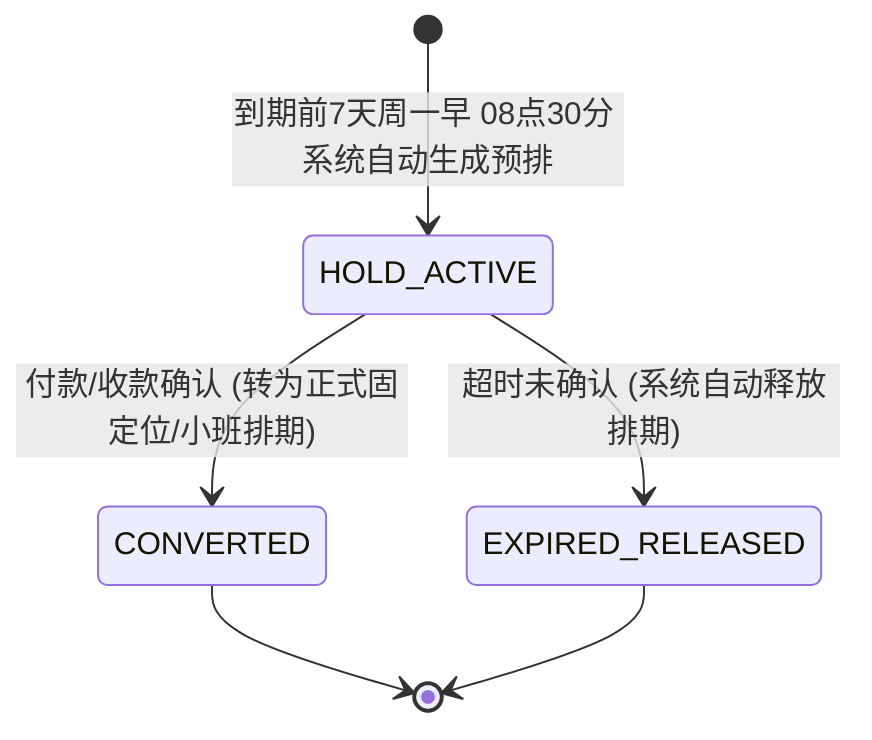

/** (c) 2024-2026 Topee (https://topee.top). All rights reserved. Proprietary and confidential. */

# 产品需求文档 (PRD) — 子模块 3A：7色周度日历看板与全场景动作中枢 (7-Color Weekly Calendar Grid & Action Center)

| 元数据项 | 说明 / 内容 |
|---|---|
| **模块代号** | `m3a` |
| **所属模块** | 模块三：7色智能日历、排课与考勤调度 (Calendar & Scheduling) |
| **文档状态** | 待评审 (Draft) |
| **关联顶层 PRD** | [Prd-v5.md](../Prd-v5.md) |
| **关联规范文档** | [DESIGN.md](../DESIGN.md) ｜ [BUSINESS_RULES.md](../BUSINESS_RULES.md) |
| **关联子模块** | **[m3d_course_scheduling.md](./m3d_course_scheduling.md)** (全场景排课与约课调度引擎) ｜ [m3b_attendance_substitution.md](./m3b_attendance_substitution.md) (考勤、请假与代课) |
| **创建与更新日期** | 2026-11-05（更新于 2026-11-11，升级为查改一体控制台；2026-11-13 按精简方案移除 M3C 独立转让与 3h/24h 硬熔断，新增「更换实际上课学员」与温和提示） |

---

## 1. 概述与执行摘要 (Executive Summary)

7 色周度日历看板与全场景动作中枢（`m3a`）是 Dream 系统的教学时间资产可视化展示底座与核心人机交互控制台。针对少儿教务中“老师常规作息集中于 08:00-20:00、全量 36 行死板网格导致首尾大片无意义休息格与手机端搓屏疲劳”的现实痛点，本子模块确立了以 30 分钟为标准颗粒度的时间资产展示底盘，并创新引入**“智能外接时间窗（Dynamic Bounding Box）”与“日间长空档自动折叠（Gap Folding）”**，日历网格告别生硬全量渲染 06:00-24:00，自动根据老师周模板与实际排课动态裁切首尾非营业时段，将纵向页面高度大幅压缩 35%~50%，并在移动端将单元格行高紧凑优化至 **28px 高密度 Excel 网格**以实现单屏横向尽览全周 7 天。

本版本确立了**“课表即控制台（Calendar as Workbench）· 课格即动作引擎（Cell as Action Sheet Drawer）”**的重大工程哲学升级：
1. **高频操作 100% 就地闭环**：日常 90% 的高频教务事务——**临时约课（30/60min）、请假退期待排、临时挪位/挪位、更换实际上课学员、代课委任、考勤打卡、进入教室、加开时段**——彻底告别割裂的二级功能页面与表单，全部收敛在日历单元格底部抽屉（Bottom Sheet Drawer）内原地闭环；
2. **多视角物理隔离与自适应呈现**：
   - **出资家长端（学员专属课表）**：常驻多孩档案切换器，以孩子为唯一实体聚合全周所有老师课程，**绝不按老师切换**；单元格直接显示任课老师名字；代课课次 100% 合并呈现（代课蓝 🔵 及 `[SUB]` 标识）；点击课格滑出家长动作抽屉（进教室、请假、挪位、课件）；点击空闲绿格即刻预约 1~2 节临时课；顶栏常驻资产胶囊卡 `[ 👧 Alice · 剩余: 5 TS ▾ ]`；
   - **班长/老师端（老师专属课表）**：带负荷透视的多老师状态卡 + 底部切换抽屉（Bottom Sheet），单触即查各老师排课负荷；同网格 100% 混排 1v1 固定位（单格 28px 🟠）与小班课（双格 56px 🟩）；点击课格滑出班长管理抽屉（代课委任、考勤核销、退排还课）；点击灰色休格就地【加开时段 (Open Slot)】；
3. **顶栏聚焦重度长周期排课**：日历顶栏打造“4周一轮”极速分段导航条，并保留 `[+ 批量固定位排课]` 入口，仅当需要跨 4 周批量排课（1v1 固定位或小班整班）时，顺畅呼起 **[m3d_course_scheduling.md](./m3d_course_scheduling.md)** 专用排课引擎。

---

## 2. 问题定义与背景 (Problem Statement)

- **痛点 1：全量 36 行死板网格导致首尾无意义废格过多与视口过度拉长**：原方案固定展示全天 06:00-24:00 共 36 行（高度超 1200px），而 90% 以上老师授课集中在 08:00-20:00，早晨与深夜充斥大量无意义的 ⚪ 灰色“休”废格，用户在移动端必须频繁上下滑动 2 整屏；且家长查看孩子个人周课表时，在 36 行大表中查找 2-3 节课犹如大海捞针，查阅效率低下。
- **痛点 2：班长管理 3 个以上老师时横向排版溢出与负荷盲切**：班长通常管辖 3~10 位在职老师，原有简易横排药丸按钮在手机端无法容纳多师，且切换时看不到各老师当前周的排课负荷（不知谁满谁空），导致调度效率低下。
- **痛点 3：4 周一轮固定位排课查课次逐周翻页繁琐疲劳**：固定位排课以“4 周一轮（买4排4）”为核心业务单元，用户查阅或对比第 4 周排期时，必须连点 3 次“下一周”等待 3 次刷新，回看第 1 周又需连点 3 次“上一周”，操作链路长且极易迷失当前所处轮次位置。
- **痛点 4：代课多重分裂与信息丢失**：被代课老师、实际代课老师与出资家长各执一词，传统课表或各记一套或互相覆盖，导致家长看课表不知谁来上课、教室号在哪找。
- **痛点 5：日历小格过度承载排课长文字导致视觉灾难**：在 42px 宽的微型格子里强行塞入排课向导与连贯度打分长文字，导致界面拥挤闪烁乱码，必须将查课看板（M3A）与排课工作台（M3D）进行物理级解耦。

---

## 3. 目标用户与核心诉求 (Users & Personas)

### 3.1 一线授课老师（David）
- **核心诉求**：在个人日历上仅看到自己设定的可授课区间与排课全貌，早晚无课休息时段自动隐去；格内一眼看清学员英文昵称；轻触课格直达 ClassIn 教室与教学备忘。

### 3.2 负责班长（Leo）
- **核心诉求**：
  1. **多师统筹**：管辖 $\ge 3$ 位老师时，通过顶部老师负荷状态卡与底部抽屉 1 触切换老师，并在切换时一眼透视各老师的本周排课量与剩余空额；
  2. **4 周极速切换**：通过“4 周一轮”分段胶囊按钮 1 键直达第 1~4 周，或通过轮次按钮一键跨 4 周平移；
  3. **四周固定位与小班课同网格统筹**：在老师单张周日历中，1v1 固定位（单格 28px 橙色）与小班课（双格 56px 青绿色）100% 混排呈现，查课零盲区；
  4. **发起排课**：顶栏点击 `[+ 快捷排课 ▾]` 顺畅直达 [m3d_course_scheduling.md](./m3d_course_scheduling.md) 沉浸式排课工作台。

### 3.3 出资家长（Amy）
- **核心诉求**：
  1. **看孩课表**：查看孩子周课表时，**默认且唯一呈现孩子专属的单屏 7 列周度日历网格（彻底废除 Agenda 清单流与双视图切换）**；课表以孩子为唯一中心，聚合全周所有任课老师的课程，**绝不按老师切换**；
  2. **代课知情**：若发生代课，原任老师与代课老师**100% 在日历单元格内合并呈现**（代课蓝 🔵 + `[SUB]` 标识），点击格子弹出抽屉直览双方老师姓名、ClassIn 教室号与教学备忘。

---

## 4. 日历看板视觉与交互规约 (Calendar Grid Specs)

### 4.1 7 色日历 Design Tokens 与卡片层级规范
全面对齐 [DESIGN.md Section 2.3](../DESIGN.md#23-7-色课表日历高可读性规范-calendar-exception)，采用**浅底 + 深字 + 语义边框**，绝对严禁刺眼实心满铺深色色块：

| 课次/时段类型 | 语义色彩 | Tailwind CSS 样式代号 | 视觉表现与格内内容展示标准 |
| :--- | :---: | :--- | :--- |
| **1v1 固定位** | 🟠 橙色 | `bg-amber-50 border-amber-300 text-amber-900` | 细实线边框微卡片，格内居中展示**学员真实英文名/昵称**（如 `Alice`、`BobZ`） |
| **1v1 续费预占 (HOLD)** | 🟠 虚线 | `bg-amber-50/70 border border-dashed border-amber-400 text-amber-900` | 微虚线边框微卡片，格内显示学员名缩写并标注【预】字徽标 |
| **1v1 临时课** | 🟡 黄色 | `bg-yellow-50 border-yellow-300 text-yellow-900` | 细实线边框微卡片，格内居中展示学员英文名 |
| **1v1 被代课** | 🔵 蓝色 | `bg-blue-50 border-blue-300 text-blue-900` | 原任老师请假被代课，右上方标注 `[SUB]` 微型徽标 |
| **1v1 代上课** | 🟣 紫色 | `bg-purple-50 border-purple-300 text-purple-900` | 替其他老师代课，右上方标注 `[代上]` 微型徽标 |
| **1vN 小班课** | 🟩 青绿 | `border-2 border-teal-400 bg-teal-50 text-teal-950` | **双倍高度 56px 贯穿合并单元格**，左上角标注 `[G]` 徽标，首行展示小班简称，次行展示在读人数（如 `3/4人`） |
| **请假时段** | 🔴 红色 | `bg-rose-50 border-rose-300 text-rose-800` | 显示“假”字，标注请假原因简写 |
| **不可约/休息** | ⚪ 灰色 | `bg-slate-100 border-slate-200 text-slate-600` | 显示“休”字，低对比中性底色 |
| **空闲可约** | 🟢 绿色 | `bg-emerald-50 border-emerald-200 text-emerald-800` | 显示“约”字，呼吸感浅绿底色 |

---

### 4.2 单屏 7 列高密度 Excel 网格架构 (Single-Screen 7-Col Excel Grid)
1. **单屏横向容纳 7 天**：
   - 首列时间轴（Time Axis）物理冻结 40px，纵向标注半小时刻度（如 `08:00`、`08:30`）；
   - 周一至周日 7 列等宽均分屏幕剩余宽度（手机 390px 下每列约 48px），**单屏无需横向滑动即可尽览整周全貌**；
2. **28px 紧凑行高与极简姓名显示**：
   - 移动端每个 30 分钟单元格物理高度收敛至 **28px**（适配 Tailwind `h-7`）；
   - 1v1 排课格 100% 直接显示学员英文名或缩写（截取前 4~5 字符），**彻底告别“固定位”、“正课”等抽象通用词盲盒**；老师一眼叫出学员大名，班长两秒定位学员排期。

---

### 4.3 智能外接时间窗与长空档自动折叠 (Bounding Box & Gap Folding)
1. **智能外接裁剪 $[T_{\min}, T_{\max}]$**：
   - 系统动态扫描该老师（或该学员）本周所有排课与周模板开放时段；
   - 自动提取最早有效时段 $T_{\min}$ 与最晚有效时段 $T_{\max}$，首尾非营业时段物理剔除，默认直接自最早时段渲染至最晚时段（页面纵向高度缩短 35%~50%）；
2. **日间长空档折叠条**：
   - 若日间存在连续 $\ge 2$ 小时的全休时段（如 11:30 - 17:00 中午无课），系统自动将其折叠为 22px 高度的浅灰折叠条：
     `┄┄┄┄┄┄┄┄┄┄ 11:30 - 17:00 日间休息 (已折叠) [点击展开] ┄┄┄┄┄┄┄┄┄┄`
   - 轻触折叠条可就地展开该时段，再次轻触收起。

---

### 4.4 “4周一轮”双层极速导航条 (4-Week Cycle Fast Nav)
针对固定位以 4 周为业务单元的周期特征，日历顶栏打造双层极速导航组件：
1. **外层轮次控制**：
   `[ ◀ 上一轮 (4周) ]  ｜  本轮：第 46 ~ 49 周 (11.09 - 12.06)  ｜  [ 下一轮 (4周) ▶ ]`
2. **内层 4 周等宽分段胶囊**：
   横向平铺 4 个等宽胶囊卡片：`[ 第1周 11/09 ]` ｜ `[● 第2周 11/16]` ｜ `[ 第3周 11/23 ]` ｜ `[ 第4周 11/30 ]`；
   - 单键盲点直达目标周，当前浏览周次高亮选中；右上角带有业务状态微指示点。

---

### 4.5 班长管辖多老师调度与负荷透视 (Multi-Teacher Load Switcher)
1. **吸顶状态卡**：日历顶部常驻当前老师状态卡：`[ 👨‍🏫 David Miller (管辖) · 本周已排 18/24 节 ▾ ]`；
2. **底部半屏切换抽屉 (Bottom Sheet)**：
   - 点击状态卡平滑滑出半屏老师选择抽屉；
   - 每位老师条目高度 56px，包含头像、中英文名、定级徽标及**本周负荷统计条**（已排节数 / 空闲节数，直观进度条呈现）；
   - 轻触目标老师条目，抽屉自动收起，日历网格在 100ms 内局部刷新为目标老师排期，当前周次与视口位置保持不变。

---

### 4.6 出资家长端孩子专属周课表 (Child-Centric Schedule Grid)
1. **多孩全局档案切换器**：顶栏常驻 `[ 👧 Alice (大宝) ▾ ]`，多孩一秒切换；
2. **以孩子为中心全周聚合**：日历聚合该孩子全周名下所有老师的课程，**绝不按老师切换**；彻底取消旧版 Agenda 清单流；
3. **原任与代课合并呈现**：
   - 普通课次：显示任课老师名字（如周二 19:00 `🟠 David`，周六 10:00 `🟩 [G]KET1`）；
   - 代课课次：背景色渲染为代课蓝 🔵 **BLUE**（`bg-blue-50 border-blue-300 text-blue-900`），标注 `[SUB]` 徽标；
   - 轻触单元格滑出课程详情抽屉，展示：原任老师、代课老师、ClassIn 教室号（带复制按钮）及教学备忘。

---

### 4.7 快捷排课、排课复选态与 M3D 空闲大盘衔接 (Integration with M3D)
1. **统一入口收敛**：日历看板顶栏右侧常驻 **`[ + 批量固定位排课 ]`**（点击原地开启本页「排课复选态」）与 **`[ 🔍 空闲大盘 ]`**（无参跳转至 [m3d_course_scheduling.md](./m3d_course_scheduling.md) 比较其他老师空闲）；
2. **复用老师当周课表作为 M3D Step 2（排课复选态）**：
   - 从 M3D 教师空闲大盘点击某位老师下方的 `[ 选取 ]`（携带 `?teacherId=...&mode=schedule_select`，可选带 `studentId` / `classId`）后，直接复用本页老师当周课表并开启**「排课复选态」**；
   - **复选与打通 4 周**：排课复选态下，点击空闲绿格（🟢）支持多时段复选，自动按 1v1 单格或小班连续双格（56px）实时校验未来 4 周全通性；无参进入时支持在顶部补选学员或小班（未选对象禁止提交）；
   - **单事务确认与成果反馈**：底部吸底汇总扣减课次，确认后单事务落盘并退出排课复选态，刚排定的**全部时段单元格同时执行轻柔淡色微闪烁 1 秒（Success Flash）**，实线微卡片即时呈现。

---

### 4.8 课表单元格动作抽屉引擎 (Action Sheet Drawer Engine)
为终结零散功能页割裂跳转与列表找课盲盒痛点，系统确立“课表即控制台”原则，所有围绕单节或当前课次的高频操作**100% 收敛在日历单元格底部抽屉（Bottom Sheet Drawer）内就地闭环**：

> **页面职责边界**：M3A 只提供课格/资产卡上的快捷入口。请假释放、同师挪位、更换实际上课学员、代课调度与开课前 3h 温和提示规则以 [m3b_attendance_substitution.md](./m3b_attendance_substitution.md) 为唯一规则来源。M3A 不维护第二套业务规则，也不展示单价/公开私密/发布大池。

#### 4.8.1 学员专属课表视角（出资家长端）
1. **轻触【已有排课单元格】（固定位 🟠 / 临时课 🟡 / 代课 🔵 / 小班课 🟩）**：
   从屏幕底部平滑滑出【课次动作抽屉 (Lesson Action Sheet)】：
   - **基础信息区**：课程类型徽标、时间段（如 `周二 18:30 - 19:00 (30min)`）、任课老师（若发生代课则同时展示原任 David 与实际代课 Elena）；
   - **教室与课件区**：ClassIn 教室号（带一键复制口令按钮）+ `[ 直达 ClassIn 教室 ↗ ]` 大按钮；课件当前进度（如 Oxford Discover 2 Unit 3）；
   - **班型动态动作按钮组**：
     - **班型动作隔离（小班课红线）**：若当前单元格为 **1vN 小班课 (🟩)**，抽屉内**仅展示【直达 ClassIn 教室】与【查看课件】**，【请假退期待排】、【同师挪位】按钮物理隐藏（单人缺席由主理人线下处理）；
     - **【请假退期待排】（1v1 课次均可用）**：
       - **家长 `<24h` 限制 + 班长不锁**：取消 `12.5%` 请假配额；家长端距开课 `< 24h` 禁用自助请假并提示联系班长处理；班长/管理员不受时间限制，请假即将已排 TS 释放变回 `待排期`，日历格恢复为 🟢 空闲；
       - **班长 `< 3h` 温和提示**：班长/管理员在距开课不足 3 小时操作时，弹出温和确认弹窗：**“距开课不足 3 小时，老师可能已进入备课状态，请确认已与老师沟通”**，点击确定即放行（并在 M5B 课酬单出勤流水中透出标记）；
     - **【临时挪位 / 挪位】（1v1 课次均可用）**：
       - **同师平移与防撞课**：目标格限定为原任课老师的空闲绿格，且**自动排除该学员在同一时间已在其他老师处有排课的冲突时段**（置灰并提示“学员该时段已有其他课程”）；若当前课次为代课课次（🔵），挪位时目标老师仍为原任老师，挪位成功后自动解除原代课委任；
       - **家长 `<3h` 限制 + 班长不锁**：家长端距开课 `< 3h` 禁用自助挪位并提示联系班长处理；班长/管理员端不锁，不足 3 小时时弹出温和确认提示后放行；
     - **【更换实际上课学员】（班长 / 管理员专属，替代原转让模块）**：
       - 班长或管理员点击课格后，可直接点击 **【更换实际上课学员】**，下拉选择另一位学员档案（无需校验是否同家庭）；原购课单与资金归属保持不变；
     - **【学员备注与课件】**：查看在学课件进度与学员备忘。
2. **轻触【空闲可约单元格】（绿色‘约’）**：
   滑出【临时预约单抽屉 (Quick Single Booking)】：
   - 默认选中当前点击的时间段与对应老师；
   - **时长选择器**：`[ ● 30分钟 (1节 TS) ｜ ○ 60分钟 (连约2节 TS) ]`；
   - 若勾选 60 分钟，系统自动向后探查后半小时是否空闲，若空闲则双格联动框选，一次性扣减 2 节 TS；
   - 点击 `[ 确认预约 ]`，单元格秒级变为黄色 🟡 临时课，抽屉关闭，全流程耗时 $<3$ 秒。
3. **顶栏常驻资产胶囊卡 `[ 👧 Alice · 剩余: 5 TS ▾ ]`**：
   - 点击滑出【学员课次资产明细抽屉】，透视当前剩余待排期 TS 课次与待上课程数，并提供班长/管理员【课次清退/扣减】快捷入口。

#### 4.8.2 老师与班长课表视角（老师端 / 班长端 / 管理端）
**权限边界与纯网格就地交互原则**：
- **完全去顶栏冗余按钮**：取消顶栏常驻的批量功能大按钮，全系统请假、代课、挪位、异常报备 **100% 收敛为“点击课格 ➔ 抽屉内时段 Checkbox 勾选 ➔ 批量/合并提交”** 的统一交互范式；
- **角色权限隔离**：老师仅可查看课表、进入 ClassIn、考勤打卡、加开时段、以及**在抽屉内发起单节或当天时段批量请假报备**；代学员约课、代课委任、撤排/退回课次、代学员请假/挪位、更换实际上课学员仅班长与管理员可见（且班长可全域约课，不受老师归属限制）。

1. **老师端课表交互（镜像复用 `renderPairBox` 模型 · 当天时段 Checkbox 选单）**：
   - **轻触【已有排课单元格】（有课格 🟡/🟠/🟩）**：
     滑出老师教学管理抽屉：
     - **考勤打卡 / 补签**：标记“正常出勤”、“学员旷课”、“老师旷课”；
     - **进入 ClassIn**：直达在线教室；
     - **【申请请假 / 突发状况报备】**：
       - 抽屉顶部展示 **【当天时段 Checkbox 连选卡片】**（复用并扩展家长端 `renderPairBox` 模型）：
         - 默认勾选当前点击的时段 `[x] 当前时段`；
         - 下方列出当天该老师名下所有课格（带 Checkbox，标明“空闲”或“排课”）；
         - 老师自由勾选 1~12 节课（累计最长 6 小时）；
         - 选择不可抗力标签（家庭突发停电/断网、突发急病就医、设备故障、常规事假）并点击提交；
         - 系统自动分流：空闲格原子置红 🔴，排课格生成代课待办包派发给班长/主理人。
   - **轻触【空闲单元格】（绿色‘约’）**：
     - 滑出老师空闲时段抽屉：
       - 提供 **`[ 🔴 申请请假 / 设为不可约 ]`**，同样唤起上述时段 Checkbox 选单，支持将该空闲格连同其他时段一起置红请假，排他阻断后续预约；
       - 明确提示：“代学员约课请联系负责班长操作”。
   - **轻触【休息单元格】（灰色‘休’）**：
     - 老师可点击 `[ 加开时段 (Open Slot) ]` 恢复为绿色可约格，或同样唤起请假报备。

2. **班长 / 管理员端课表交互（3 层紧凑抽屉 + 状态互斥 + 二级面板闭环）**：
   为了消除菜单项平铺堆积、多入口语义重叠与小班常驻警告噪音，班长/管理员点击已有排课格时，底部抽屉严格采用 **3 层紧凑布局**（100% 消除重复的“异常处理”跳转入口）：
   - **第 1 层 · 课次与对象摘要卡**：
     - 展示课型徽标、时段、任课老师（若已代课则同时展示原任与实际代课老师）、学员昵称（右侧轻量入口直达【学员档案】与【课次资产】），以及带一键复制的 **ClassIn 教室号**；
     - **连堂课轻量勾选**：当检测到同日连续 2 节（60 分钟）时，仅在摘要卡底部展示一行轻量开关 **`[☑] 连带操作下一节 HH:MM - HH:MM (共 2 节)`**（默认全选，支持取消勾选改为单节操作），**取消抽屉顶部单独堆积的 3 个合并大按钮**；下方第 2/3 层动作自动按当前勾选范围（1 节或 2 节）生效。
   - **第 2 层 · 高频教务动作（2×2 紧凑宫格）**：
     - **【请假 / 同师挪位】**：合并入口，点击进入抽屉内二级面板（展示当前生效范围 1/2 节及 `<3h` 提示），二选一执行：
       - **请假退期待排**：释放时段变回 🟢 空闲，TS 退回待排期池；`<3h` 弹出温和确认弹窗（按 `m3b` 规约支持【通融退回】与【按学员旷课扣 1 节】二选一）；固定位连选 2 节时置灰提示仅支持单节请假；
       - **同师挪位**：点击后立即收起抽屉，日历网格高亮原任老师空闲绿格（自动置灰学员同时段撞课时段），点选目标绿格确认完成平移（`<3h` 弹出温和确认提示；若原为代课课次则自动解除原代课委任）。
     - **【指派代课】（1v1 为 `指派代课`，小班为 `代课 / 暂停待排`）**：点击进入抽屉内二级面板：
       - **1v1 课次**：按第 1 屏勾选的 **1 ~ N 个具体 TS 时间段**过滤出全时段空闲 🟢 的在职有资质老师，按 **① 曾教过该学员 → ② 同定级 / 相近定级 → ③ 当周已排负荷较少** 排序，显性标注 `教过该学员`、定级差异与 `本周已排 X 节`；支持按老师姓名搜索，不符合条件时置灰提示具体冲突时段；支持 `<3h` 温和确认；若当前已处于代课状态（🔵），面板顶部提供 **`[ 撤销代课指派 ]`**；
       - **小班课（🟩）**：将原常驻在第一屏的应急处置包收拢至此二级面板，不再平时常驻红色大框。面板内分流展示：**路线 A（指派临时代课）**（按同上 3 级排序筛出连续双格空闲且具备小班资质的老师，标注 `教过本班`、定级差异与 `本周已排 X 节`，支持姓名搜索与冲突置灰提示，课酬按原快照平移）；**路线 B（暂停待排）**（区分“老师原因停电/请假 → 原网格标红不可约”与“节假日/全班调休 → 原网格释放为绿色可约”，确认后 TS 退回小班待排池，并附带直达 M3D 单节补排入口）。
     - **【考勤 / 旷课标记】**：系统默认于次日凌晨 02:00 自动结课（正常扣课发酬），日常无需手动点“正常出勤”；点击进入二级面板后展示当前状态“正常（自动结课）”，仅提供 **`[ 标为学员旷课 ]`** 与 **`[ 标为老师旷课 ]`**；**仅当该课次已被误标为旷课时**，才在面板内提供 **`[ 恢复为正常出勤 ]`** 纠偏按钮。
     - **【换上课学员】（1v1 专属，小班课物理隐藏）**：支持**按唯一昵称检索**在读/试课学员（无需校验同家庭）；结果行展示**唯一昵称、在读/试课徽标、姓名、年龄、所属家长**，若目标学员在当前时段已有其他排课则标出 `⚠️ 该时段已有课` 提醒（不展示新学员课次余额与购课金额；原购课单出资方与资金归属保持不变）。
   - **第 3 层 · 低频与危险操作收口（按结课状态互斥显示）**：
     - **未结课（正常排期中）**：仅展示 **`[ 撤排退回课次 ]`**（释放时段并退回学员 1 节或 2 节 TS），**不显示**异常回退入口，防止对未上课次误操作；
     - **已结课（且尚未完成周转账归集）**：仅展示 **`[ 异常未上课回退补生 ]`**（作废原 TS、剔除课酬并补生全新待排 TS），同时第 2 层的【请假/挪位】、【指派代课】、【换上课学员】自动置灰禁用（仅保留【考勤/旷课标记】纠偏）。

---

### 4.9 连续课程合并操作与非连续转让规约

#### 4.9.1 连续课程合并操作 (Consecutive Lessons Batching)
1. **同日连续 2 节（60分钟连堂课）**：
   - 当学员在同日连续排有 2 节课（如 19:00-19:30 + 19:30-20:00）时，点击其中任意一节，抽屉顶部自动检测并呈现连续时段联动选择区：
     `[☑] 周二 19:00 - 19:30 David (第1节)`
     `[☑] 周二 19:30 - 20:00 David (第2节)`
   - 默认全选；**固定位连续两节不支持合并请假**，仅提供 **`[ 合并调课 (2节) ]`**；临时课连续两节可合并请假（按 M3B 配额/时限）。亦支持取消勾选其中 1 节单独操作。合并请假/合并挪位均由 M3B 统一校验，M3A 只负责勾选与提交。
2. **固定位跨周调整（不支持请假）**：
   - 固定位为 4 周契约，不提供批量跨周请假；
   - 需要调整时，逐周使用【同师挪位】、【请假退期待排】或【更换实际上课学员】；
   - 临时课请假仅按单次处理，不提供跨周批量请假。

#### 4.9.2 更换实际上课学员入口 (替代原 M3C 转让)
在日历课格动作抽屉中，班长/管理员可直接点击 **【更换实际上课学员】**，下拉选择另一位学员档案（无需校验是否同家庭），原购课单出资人与资金归属完全不变，课表即时生效；线下家长如何结算由线下自闭环。

---

### 4.10 实体生命周期与状态机 (Entity Lifecycles & State Machines)

M3A 作为日历人机控制台，闭环管理以下 2 大调度流转实体的生命周期：

#### 1. 72h 续费预占锁 (RenewalHoldLease)
- **定位**：固定位或小班课到期前 7 天，系统自动为原学员或原小班在下一轮（未来 4 周）对应时段生成的排期保护租约。
- **生命周期状态机**：

- **状态转移规则与时效守卫**：
  | 状态跃迁 | 触发事件 / 角色 | 前置条件与时限规则 | 伴随副作用与日历视觉 |
  | :--- | :--- | :--- | :--- |
  | `[*] -> HOLD_ACTIVE` | 周期跑批 (`dream-worker`) | 4 周固定位或小班课到期前 7 天（最后一周周一 08:30） | • **1v1 固定位**：日历渲染为**橙黄虚线预占卡** (`border-dashed border-amber-400`)，锁定网格，生成待付款续费单并邮件提醒家长； • **小班课 (56px 双格)**：日历渲染为**青绿虚线双格预占卡** (`border-dashed border-teal-400 bg-teal-50/50` 带 `[G-HOLD]`)，锁定双格网格，生成小班续费单并定向通知主理人（免发家长）。 |
  | `HOLD_ACTIVE -> CONVERTED` | 家长付款 / 班长/主理人确认 | 保护窗口期内确认收款 | 虚线转为正式实线（1v1 转 🟠 实线固定位，小班课转 🟩 56px 实线双格带 `[G]`）；TS 属性 `is_hold` 转为 `false`；全额锁定下轮 4 周排期。 |
  | `HOLD_ACTIVE -> EXPIRED_RELEASED` | 系统定时器超时 | 距离下轮首节开课前 24h 仍未付款确认 | 自动作废预占 TS，日历网格全额恢复为 🟢【空闲可约】放行其他学员抢位；续费单标记逾期作废。 |

#### 2. 同师同格平移挪位 (RescheduleEvent) — 权能边界与指针引用
- **权能边界定位**：M3A 仅作为日历网格的人机交互控制台，负责在单元格抽屉内承接【挪位/挪位】的点击交互，并在日历上高亮候选的 🟢 空闲格；
- **单一事实源 (SSOT)**：同师挪位、请假退期待排与开课前 `< 3h` 温和提示的业务规则 **100% 由 [m3b_attendance_substitution.md](./m3b_attendance_substitution.md)** 统一管辖，M3A 绝不重复定义校验规则。

### 4.11 日维度应急调度网格（今日调度）
- **业务定位与页面纯洁度铁律**：
  - 专为**教务班长**与**超级管理员**打造的高频日度应急调度页面（家长端与老师端无此页面）；
  - **100% 聚焦课表调度（请假、代课、同屏找人）**：严禁在本页混入任何购课单、转账单、课酬单或财务风控信息。
- **入口与公私隔离**：
  - **入口一（首页金刚位）**：班长首页 8 金刚位 / 管理员首页 12 金刚位教务调度行的 **`📅 今日调度`**（存在当日异常时右上角亮红点角标）；
  - **入口二（Tab 3 顶栏）**：Tab 3【教务中心】顶栏快捷入口 **`[ 📅 日调度 ]`**；
  - **归属隔离**：进入教务日调度专属页面后，底部导航保持归属教务或提供左上角返回教务中心，**绝对不与 Tab 2【学员课表】（自家孩子纯私域课表）发生串扰**。
- **极简日期切换（前 1 后 3 共 5 天）**：
  - 顶部日期栏固定展示 **5 天快捷胶囊**：**`昨天` ｜ `今天 (默认)` ｜ `明天` ｜ `后天` ｜ `大后天`**（即前 1 天至后 3 天），一排点选即切；
  - **动态当前时间线**：当天垂直时间轴展示一条当前时间水平红线（标注当前时分如 `14:25`），随时间实时下移；已过去时段自动轻度置灰；
  - **单日轻量展示**：仅加载所选自然日当天的有效 TS、授课老师与实际上课学员。
- **单行控制条与核心调度能力**：
  1. **视角切换**：`按老师` ｜ `按学员`（水平多列竖条并排展示，支持横向平滑滑动）；
  2. **极速搜人**：支持按**老师姓名**或**学员小名 / 规范昵称**即时搜索，1 秒只保留目标人物当天那一列，点击课格呼出底部动作抽屉就地**代老师 / 代学员办理临时请假**；无匹配时展示“未找到匹配的老师或学员”并提供一键清空；
  3. **异常过滤开关**：`全部` ｜ `今日异常 (N)`（切至非今天时显示 `当日异常 (N)`），仅保留存在以下 **2 类纯粹调度异常** 的列，并按最临近开课时间从左到右置顶；若当天异常为 0，展示“今日暂无待处理调度异常”空状态并支持一键切回 `全部`：
     - **① 请假待代课**：所选日期内已发起请假、尚未指派代课老师的已排课次；
     - **② `<3h` 临期请假/变动**：所选日期内发生过距离开课不足 `3` 小时的老师或学员临时请假/临期代课。
  4. **三层极简视觉展示（不撑高 28px 单元格）**：
     - **列头红点微标**：老师/学员列头姓名旁显示当天异常计数微角标（如 `🔴 2`），一眼锁定出事对象；
     - **28px 格内零撑高展示**：① 请假待代课复用红底 **`🔴 待代`** 警示格；② `<3h` 临期变动在紫色 **`🟣 代课`** 格（或已释放回 **`🟢 空闲`** 格）的右上角叠加极小 **`⚡`** 微角标，不换行、不撑高格子；
     - **底部动作抽屉**：点击异常格滑出底部动作抽屉，顶部 1 行展示异常明细（如 `⚡ 距开课 1.5h 学员临时请假 · 已退回待排期`），并直达操作按钮。
  5. **同屏找当天代课联动（仅 `按老师` 视角）**：
     - 点击某老师待代课课格时，底部抽屉除展示推荐空闲代课老师外，提供 **`[ 🔍 同屏对照空闲老师 ]`** 开关（也可通过 `空闲时段 ▾` 主动挑选时段）：开启后，左侧固定保留出事老师列，右侧紧挨着只展开**同一时段完全空闲可接手**的其他老师列（按 **① 曾教过该学员 → ② 同/相近定级 → ③ 当周已排负荷较少** 排序，列头标注 `教过`、定级差异与 `本周已排 X 节`），班长可同屏看清前后时段负荷后一键指派代课；若在顶部搜人框检索到同时段无空闲的老师，明确提示具体冲突时段；若全平台该时段均无空闲老师，提示“该时段暂无全部空闲的可接手老师”；
  6. **管辖范围切换**：`仅看我管的` ｜ `全平台老师`（找代课时支持一键切换全平台）。
- **【本期不做 (Out of Scope)】**：
  - 明确不做“按时间点筛选空闲学员并抓来临时补课”；
  - 明确不做超过前 1 天、后 3 天之外的多周/跨月日调度翻页；
  - 明确不展示任何购课单、转账单、课酬单或财务逾期预警。

---

## 5. 验收标准 (Acceptance Criteria, AC)

| 编号 | 验收项 | 验收操作与输入 | 预期输出与量化断言 |
| :--- | :--- | :--- | :--- |
| **AC-3A-01** | **单屏 7 列 Excel 网格排版** | 手机 390px 视口下打开任意日历看板 | 单屏横向完整呈现首列 40px 冻结时间轴与周一至周日 7 列，无需横向滚动条；单元格行高严格为 28px。 |
| **AC-3A-02** | **智能外接裁剪与空档折叠** | 老师周模板开放区间为 09:00-19:00，中午 12:00-15:00 无课 | 日历顶部自动从 09:00 开始渲染，19:00 截断；日间 12:00-15:00 自动折叠为 22px 浅灰折叠条，点击可平滑展开。 |
| **AC-3A-03** | **7 色 Design Tokens 视觉标准** | 查看包含各类课程与状态的周网格 | 固定位呈浅底橙边深字 `amber-50`；临时课呈浅底黄边 `yellow-50`；被代课呈浅底蓝边 `blue-50` 带 `[SUB]`；小班课呈 56px 双格 Teal 边框带 `[G]`；无刺眼满铺深色块，文字对比度 $\ge 4.5:1$。 |
| **AC-3A-04** | **4 周一轮极速导航** | 点击顶栏 4 周胶囊条中的【第 3 周】 | 日历在 100ms 内局部平滑刷新至第 3 周，无需连点 2 次下一周；外层点击【下一轮】一键快进 4 周。 |
| **AC-3A-05** | **多老师切换抽屉与负荷** | 班长点击顶部老师状态卡 | 底部滑出抽屉，显示每位管辖老师姓名与已排/空闲负荷条；轻触另一位老师，日历在 100ms 内刷新且视口位置不变。 |
| **AC-3A-06** | **家长端代课合并展示** | 家长查看周四有代课的 Alice 课表 | 对应单元格以代课蓝呈现 Elena 老师与 `[SUB]` 徽标；轻触弹出抽屉，完整展示原任 David 与实际代课 Elena 双信息。 |
| **AC-3A-07** | **排课工作台联动与成果闪烁** | 点击顶栏 `[+ 批量固定位排课]`，在 M3D 选中多个时段并确认 | 页面带参进入 M3D 专用排课工作台；排课确认返回后，全部新排定时段的单元格同时执行 1 秒轻微柔和高亮闪烁。 |
| **AC-3A-08** | **课表空格临时预约抽屉闭环** | 家长点击周五 19:00 绿色空闲格 | 底部滑出预约抽屉，选择 30min 或 60min（后格联动校验）；点击确认预约后立即扣减 TS 并在日历呈现黄色 🟡 临时课，抽屉关闭，全流程原地完成无需跳转。 |
| **AC-3A-09** | **1v1 课次合并请假退期待排** | 家长点击连续 2 节课程中的第一节 | 抽屉自动展示两节课连带复选框；点击【请假退期待排】，无配额/时间硬拦截（`<3h` 弹出温和确认提示）；确认后两节课格同步释放为 🟢 空闲，TS 退回待排期池。 |
| **AC-3A-10** | **课表内挪位/挪位平移** | 家长点击周二已排课并点击【挪位/挪位】 | M3A 仅限原任老师空闲绿格进入呼吸态（`<3h` 弹出温和确认提示）；点击目标格并确认，原格释放、目标格落盘，视口保持当前周。 |
| **AC-3A-11** | **课格直接更换实际上课学员** | 班长点击已排课课格并选择【更换实际上课学员】 | 抽屉下拉选择新学员档案，确认后课格展示新学员昵称；原购课单出资人与资金归属不变。 |
| **AC-3A-12** | **班长代课委任与老师加开时段** | 班长点击生病老师的课格，或老师点击灰色休格 | 班长 1 键委任代课老师（连带课次支持多选合并委派）；老师轻触休格点击【加开时段】，休格即时激活为绿色‘约’。 |
| **AC-3A-13** | **老师纯网格触发请假与时段集群 Checkbox 连选** | 老师点击周五 19:00 绿色空闲格或有课格 | 不弹出拒绝吐司，抽屉顶部自动拉出当天时段复选框列表（标明‘空闲’与‘排课’），支持勾选 1~12 节课并填写原因提交；空闲格置红 🔴，排课格生成代课待办包；顶栏无冗余大按钮。 |
| **AC-3A-14** | **班长连堂轻量连选与 3 层抽屉收敛** | 班长点击连续 2 节课程中的任意一节 | 抽屉摘要卡底部展示一行轻量连选开关（默认选中 2 节，取消可单节操作），顶部不堆叠重复的合并大按钮；第 2 层以 2×2 宫格展示高频动作，点击【请假 / 同师挪位】或【指派代课】进入抽屉二级面板完成操作。 |
| **AC-3A-21** | **抽屉去重与结课状态互斥控制** | 班长分别点击“未结课”与“已结课未归集”的 1v1 课格，并查看考勤面板 | 抽屉内无重复的“异常处理”跳转入口；未结课时第 3 层仅显示【撤排退回课次】，已结课未归集时仅显示【异常未上课回退补生】且第 2 层排课类动作置灰；考勤面板默认提示次日 02:00 自动结课，仅在已标旷课时才出现【恢复为正常出勤】。 |
| **AC-3A-18** | **日调度入口隔离与前 1 后 3 日期胶囊** | 班长/管理员点击首页 `📅 今日调度` 金刚位或 Tab 3 顶栏 `[ 📅 日调度 ]` | 跳转至教务日调度页（绝不跳入 Tab 2 自家孩子课表），页面零财务/购课/转账单元素；顶部固定显示昨天/今天(默认)/明天/后天/大后天 5 个胶囊，点选即切。 |
| **AC-3A-19** | **日调度 2 类异常过滤与 28px 三层展示** | 开启 `今日异常(N)`，查看有请假待代课及 `<3h` 临期变动的列 | 仅保留命中上述 2 类异常的老师/学员列且列头带 `🔴 N` 微标；28px 格内仅渲染 `🔴 待代` 或右上角 `⚡` 微角标（严格维持 28px 行高不撑破），点击格后在底部抽屉顶部展示 1 行异常说明。 |
| **AC-3A-20** | **日调度快搜代请假与同屏找当天代课** | 切 `按学员` 搜小名办请假；或点击待代课格开启 `[ 🔍 同屏对照空闲老师 ]` | 搜人 1 秒仅保留目标列并支持抽屉办临时请假；开启同屏对照后，左侧固定出事老师列，右侧只展开同时段空闲的其他老师列并按“熟客 → 同/相近定级 → 当周已排负荷较少”排序（列头标注 `教过`、定级差异与 `本周已排 X 节`），支持同屏对比负荷一键指派代课。 |

---

## 6. 架构决策与设计系统对齐 (Architecture Decisions)

- **决策 1：课表即控制台与高频动作就地闭环（Calendar as Action Workbench）**：彻底破除“看课一个页面、改课跳另一个页面”的割裂模式，将 90% 的单次/轻量事务收敛在日历单元格底部抽屉（Bottom Sheet Drawer）内完成，极大降低学习成本与失误率；
- **决策 2：看排解耦与批量排课分离（Separation of Single Actions & Bulk Engine）**：日常单节/连续约课在 M3A 抽屉内秒级闭环，仅当需要跨 4 周进行批量排课（1v1 固定位或小班整班）时，才由顶栏入口引导进入 M3D 引擎；
- **决策 3：网格优先与单屏尽览**：取消移动端横向滚动，严格通过 28px 紧凑行高、智能首尾裁剪与长空档折叠，实现手机端单屏尽览 7 天；
- **决策 4：100% Tailwind CSS 合规**：微卡片与动作抽屉严禁手写 CSS，全面收敛至 DESIGN.md 规范。

---

## 7. 待定事项与后续演进 (TODO & Future Backlog)

暂无（原 `§7.1` 日维度应急调度网格已于 2026-11-14 正式升格纳入正文 `§4.11` 与 `AC-3A-18~20`）。
