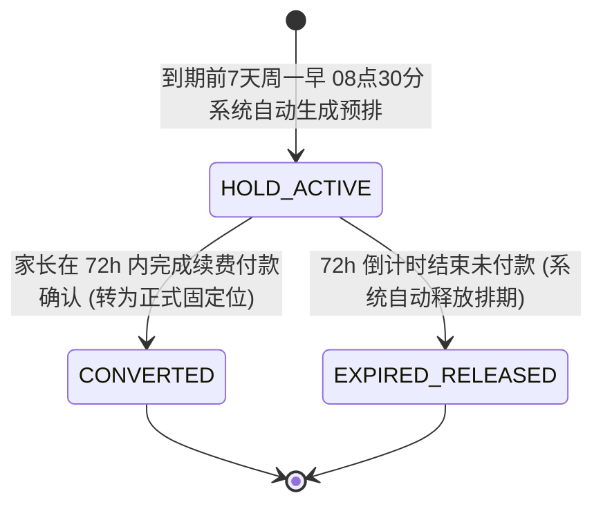

/** (c) 2024-2026 Topee (https://topee.top). All rights reserved. Proprietary and confidential. */

# 产品需求文档 (PRD) — 子模块 3A：7色周度日历看板与全场景动作中枢 (7-Color Weekly Calendar Grid & Action Center)

| 元数据项 | 说明 / 内容 |
|---|---|
| **模块代号** | `m3a` |
| **所属模块** | 模块三：7色智能日历、排班、考勤与课程转让 (Calendar & Scheduling) |
| **文档状态** | 待评审 (Draft) |
| **关联顶层 PRD** | [Prd-v5.md](../Prd-v5.md) |
| **关联规范文档** | [DESIGN.md](../DESIGN.md) ｜ [BUSINESS_RULES.md](../BUSINESS_RULES.md) |
| **关联子模块** | **[m3d_course_scheduling.md](./m3d_course_scheduling.md)** (全场景排课与约课调度引擎) ｜ [m3b_attendance_substitution.md](./m3b_attendance_substitution.md) (考勤与代课) ｜ [m3c_course_transfer.md](./m3c_course_transfer.md) (转让与交割) |
| **创建与更新日期** | 2026-11-05（更新于 2026-11-11，升级为查改一体控制台，内敛临时约课/请假/调课/转让/代课动作抽屉）；2026-11-12 灰色日历格文字对比度对齐 DESIGN.md |

---

## 1. 概述与执行摘要 (Executive Summary)

7 色周度日历看板与全场景动作中枢（`m3a`）是 Dream 系统的教学时间资产可视化展示底座与核心人机交互控制台。针对少儿教务中“外教常规作息集中于 08:00-20:00、全量 36 行死板网格导致首尾大片无意义休息格与手机端搓屏疲劳”的现实痛点，本子模块确立了以 30 分钟为标准颗粒度的时间资产展示底盘，并创新引入**“智能外接时间窗（Dynamic Bounding Box）”与“日间长空档自动折叠（Gap Folding）”**，日历网格告别生硬全量渲染 06:00-24:00，自动根据教师周模板与实际排课动态裁切首尾非营业时段，将纵向页面高度大幅压缩 35%~50%，并在移动端将单元格行高紧凑优化至 **28px 高密度 Excel 网格**以实现单屏横向尽览全周 7 天。

本版本确立了**“课表即控制台（Calendar as Workbench）· 课格即动作引擎（Cell as Action Sheet Drawer）”**的重大工程哲学升级：
1. **高频操作 100% 就地闭环**：日常 90% 的高频教务事务——**临时约课（30/60min）、请假登记、临时调课/挪位、课程转让、代课委任、考勤打卡、进入教室、加开时段**——彻底告别割裂的二级功能页面与表单，全部收敛在日历单元格底部抽屉（Bottom Sheet Drawer）内原地闭环；
2. **多视角物理隔离与自适应呈现**：
   - **出资家长端（学生专属课表）**：常驻多孩档案切换器，以孩子为唯一实体聚合全周所有外教课程，**绝不按老师切换**；单元格直接显示任课外教名字；代课课次 100% 合并呈现（代课蓝 🔵 及 `[SUB]` 标识）；点击课格滑出家长动作抽屉（进教室、请假、调课、转让、课件）；点击空闲绿格即刻预约 1~2 节临时课；顶栏常驻资产胶囊卡 `[ 👧 Alice · 剩余: 5 TS ▾ ]`，一键唤起纯自由 TS 课时自由转让；
   - **班长/外教端（教师专属课表）**：带负荷透视的多教师状态卡 + 底部切换抽屉（Bottom Sheet），单触即查各外教排课负荷；同网格 100% 混排 1v1 固定位（单格 28px 🟠）与小班课（双格 56px 🟩）；点击课格滑出班长管理抽屉（代课委任、考勤核销、退排还课）；点击灰色休格就地【加开时段 (Open Slot)】；
3. **顶栏聚焦重度长周期排课**：日历顶栏打造“4周一轮”极速分段导航条，并保留 `[+ 批量固定位排课]` 入口，仅当需要跨 4 周或 16 周进行大纵深批量排课时，顺畅呼起 **[m3d_course_scheduling.md](./m3d_course_scheduling.md)** 专用排课引擎。

---

## 2. 问题定义与背景 (Problem Statement)

- **痛点 1：全量 36 行死板网格导致首尾无意义废格过多与视口过度拉长**：原方案固定展示全天 06:00-24:00 共 36 行（高度超 1200px），而 90% 以上教师授课集中在 08:00-20:00，早晨与深夜充斥大量无意义的 ⚪ 灰色“休”废格，用户在移动端必须频繁上下滑动 2 整屏；且家长查看孩子个人周课表时，在 36 行大表中查找 2-3 节课犹如大海捞针，查阅效率低下。
- **痛点 2：班长管理 3 个以上外教时横向排版溢出与负荷盲切**：班长通常管辖 3~10 位在职外教，原有简易横排药丸按钮在手机端无法容纳多师，且切换时看不到各外教当前周的排课负荷（不知谁满谁空），导致调度效率低下。
- **痛点 3：4 周一轮固定位排课查课时逐周翻页繁琐疲劳**：固定位排课以“4 周一轮（买4排4）”为核心业务单元，用户查阅或对比第 4 周排期时，必须连点 3 次“下一周”等待 3 次刷新，回看第 1 周又需连点 3 次“上一周”，操作链路长且极易迷失当前所处轮次位置。
- **痛点 4：代课多重分裂与信息丢失**：被代课老师、实际代课老师与出资家长各执一词，传统课表或各记一套或互相覆盖，导致家长看课表不知谁来上课、教室号在哪找。
- **痛点 5：日历小格过度承载排课长文字导致视觉灾难**：在 42px 宽的微型格子里强行塞入排课向导与连贯度打分长文字，导致界面拥挤闪烁乱码，必须将查课看板（M3A）与排课工作台（M3D）进行物理级解耦。

---

## 3. 目标用户与核心诉求 (Users & Personas)

### 3.1 一线授课外教（David）
- **核心诉求**：在个人日历上仅看到自己设定的可授课区间与排课全貌，早晚无课休息时段自动隐去；格内一眼看清学员英文昵称；轻触课格直达 ClassIn 教室与教学备忘。

### 3.2 负责班长（Leo）
- **核心诉求**：
  1. **多师统筹**：管辖 $\ge 3$ 位外教时，通过顶部外教负荷状态卡与底部抽屉 1 触切换外教，并在切换时一眼透视各外教的本周排课量与剩余空额；
  2. **4 周极速切换**：通过“4 周一轮”分段胶囊按钮 1 键直达第 1~4 周，或通过轮次按钮一键跨 4 周平移；
  3. **四周固定位与小班课同网格统筹**：在教师单张周日历中，1v1 固定位（单格 28px 橙色）与小班课（双格 56px 青绿色）100% 混排呈现，查课零盲区；
  4. **发起排课**：顶栏点击 `[+ 快捷排课 ▾]` 顺畅直达 [m3d_course_scheduling.md](./m3d_course_scheduling.md) 沉浸式排课工作台。

### 3.3 出资家长（Amy）
- **核心诉求**：
  1. **看孩课表**：查看孩子周课表时，**默认且唯一呈现孩子专属的单屏 7 列周度日历网格（彻底废除 Agenda 清单流与双视图切换）**；课表以孩子为唯一中心，聚合全周所有任课老师的课程，**绝不按老师切换**；
  2. **代课知情**：若发生代课，原任老师与代课老师**100% 在日历单元格内合并呈现**（代课蓝 🔵 + `[SUB]` 标识），点击格子弹出抽屉直览双方教师姓名、ClassIn 教室号与教学备忘。

---

## 4. 日历看板视觉与交互规约 (Calendar Grid Specs)

### 4.1 7 色日历 Design Tokens 与卡片层级规范
全面对齐 [DESIGN.md Section 2.3](../DESIGN.md#23-7-色课表日历高可读性规范-calendar-exception)，采用**浅底 + 深字 + 语义边框**，绝对严禁刺眼实心满铺深色色块：

| 课次/时段类型 | 语义色彩 | Tailwind CSS 样式代号 | 视觉表现与格内内容展示标准 |
| :--- | :---: | :--- | :--- |
| **1v1 固定位** | 🟠 橙色 | `bg-amber-50 border-amber-300 text-amber-900` | 细实线边框微卡片，格内居中展示**学员真实英文名/昵称**（如 `Alice`、`BobZ`） |
| **1v1 续费预占 (HOLD)** | 🟠 虚线 | `bg-amber-50/70 border border-dashed border-amber-400 text-amber-900` | 微虚线边框微卡片，格内显示学员名缩写并标注【预】字徽标 |
| **1v1 临时课** | 🟡 黄色 | `bg-yellow-50 border-yellow-300 text-yellow-900` | 细实线边框微卡片，格内居中展示学员英文名 |
| **1v1 被代课** | 🔵 蓝色 | `bg-blue-50 border-blue-300 text-blue-900` | 原任外教请假被代课，右上方标注 `[SUB]` 微型徽标 |
| **1v1 代上课** | 🟣 紫色 | `bg-purple-50 border-purple-300 text-purple-900` | 替其他外教代课，右上方标注 `[代上]` 微型徽标 |
| **1vN 小班课** | 🟩 青绿 | `border-2 border-teal-400 bg-teal-50 text-teal-950` | **双倍高度 56px 贯穿合并单元格**，左上角标注 `[G]` 徽标，首行展示班级简称，次行展示在读人数（如 `3/4人`） |
| **请假时段** | 🔴 红色 | `bg-rose-50 border-rose-300 text-rose-800` | 显示“假”字，标注请假原因简写 |
| **不可约/休息** | ⚪ 灰色 | `bg-slate-100 border-slate-200 text-slate-600` | 显示“休”字，低对比中性底色 |
| **空闲可约** | 🟢 绿色 | `bg-emerald-50 border-emerald-200 text-emerald-800` | 显示“约”字，呼吸感浅绿底色 |

---

### 4.2 单屏 7 列高密度 Excel 网格架构 (Single-Screen 7-Col Excel Grid)
1. **单屏横向容纳 7 天**：
   - 首列时间轴（Time Axis）物理冻结 40px，纵向标注半小时刻度（如 `08:00`、`08:30`）；
   - 周一至周日 7 列等宽均分屏幕剩余宽度（手机 390px 下每列约 48px），**单屏无需横向滑动即可尽览整周全貌**；
2. **28px 紧凑行高与极简姓名显示**：
   - 移动端每个 30 分钟单元格物理高度收敛至 **28px**（适配 Tailwind `h-7`）；
   - 1v1 排课格 100% 直接显示学员英文名或缩写（截取前 4~5 字符），**彻底告别“固定位”、“正课”等抽象通用词盲盒**；外教一眼叫出学生大名，班长两秒定位学员排期。

---

### 4.3 智能外接时间窗与长空档自动折叠 (Bounding Box & Gap Folding)
1. **智能外接裁剪 $[T_{\min}, T_{\max}]$**：
   - 系统动态扫描该教师（或该学员）本周所有排课与周模板开放时段；
   - 自动提取最早有效时段 $T_{\min}$ 与最晚有效时段 $T_{\max}$，首尾非营业时段物理剔除，默认直接自最早时段渲染至最晚时段（页面纵向高度缩短 35%~50%）；
2. **日间长空档折叠条**：
   - 若日间存在连续 $\ge 2$ 小时的全休时段（如 11:30 - 17:00 中午无课），系统自动将其折叠为 22px 高度的浅灰折叠条：
     `┄┄┄┄┄┄┄┄┄┄ 11:30 - 17:00 日间休息 (已折叠) [点击展开] ┄┄┄┄┄┄┄┄┄┄`
   - 轻触折叠条可就地展开该时段，再次轻触收起。

---

### 4.4 “4周一轮”双层极速导航条 (4-Week Cycle Fast Nav)
针对固定位以 4 周为业务单元的周期特征，日历顶栏打造双层极速导航组件：
1. **外层轮次控制**：
   `[ ◀ 上一轮 (4周) ]  ｜  本轮：第 46 ~ 49 周 (11.09 - 12.06)  ｜  [ 下一轮 (4周) ▶ ]`
2. **内层 4 周等宽分段胶囊**：
   横向平铺 4 个等宽胶囊卡片：`[ 第1周 11/09 ]` ｜ `[● 第2周 11/16]` ｜ `[ 第3周 11/23 ]` ｜ `[ 第4周 11/30 ]`；
   - 单键盲点直达目标周，当前浏览周次高亮选中；右上角带有业务状态微指示点。

---

### 4.5 班长管辖多教师调度与负荷透视 (Multi-Teacher Load Switcher)
1. **吸顶状态卡**：日历顶部常驻当前教师状态卡：`[ 👨‍🏫 David Miller (管辖) · 本周已排 18/24 节 ▾ ]`；
2. **底部半屏切换抽屉 (Bottom Sheet)**：
   - 点击状态卡平滑滑出半屏教师选择抽屉；
   - 每位教师条目高度 56px，包含头像、中英文名、定级徽标及**本周负荷统计条**（已排节数 / 空闲节数，直观进度条呈现）；
   - 轻触目标教师条目，抽屉自动收起，日历网格在 100ms 内局部刷新为目标教师排期，当前周次与视口位置保持不变。

---

### 4.6 出资家长端孩子专属周课表 (Child-Centric Schedule Grid)
1. **多孩全局档案切换器**：顶栏常驻 `[ 👧 Alice (大宝) ▾ ]`，多孩一秒切换；
2. **以孩子为中心全周聚合**：日历聚合该孩子全周名下所有外教的课程，**绝不按老师切换**；彻底取消旧版 Agenda 清单流；
3. **原任与代课合并呈现**：
   - 普通课次：显示任课外教名字（如周二 19:00 `🟠 David`，周六 10:00 `🟩 [G]KET1`）；
   - 代课课次：背景色渲染为代课蓝 🔵 **BLUE**（`bg-blue-50 border-blue-300 text-blue-900`），标注 `[SUB]` 徽标；
   - 轻触单元格滑出课程详情抽屉，展示：原任外教、代课外教、ClassIn 教室号（带复制按钮）及教学备忘。

---

### 4.7 快捷排课与调度工作台入口衔接 (Integration with M3D)
1. **统一入口收敛**：日历看板顶栏右侧常驻 **`[ + 批量固定位排课 ]`** 快捷入口，并提供轻量下拉项：
   - `1v1 固定位批量排课 (连续4周)`
   - `1vN 小班课整班排课 (连续16周)`
   - `1vN 小班课单节补排 (停课退期待排 TS 补排)`
2. **上下文参数传递**：点击批量排课选项，系统携带当前外教 ID（如 `?teacherId=tea_david&mode=batch_fixed`）平滑跳转至 **[m3d_course_scheduling.md](./m3d_course_scheduling.md)** 专用的沉浸式批量排课工作台；
3. **排课成果回写反馈**：在 M3D 完成排课确认后，页面自动回跳至 M3A 日历看板，刚排定的**全部时段单元格同时执行轻柔淡色微闪烁 1 秒（Success Flash）**，实线微卡片即时呈现。

---

### 4.8 课表单元格动作抽屉引擎 (Action Sheet Drawer Engine)
为终结零散功能页割裂跳转与列表找课盲盒痛点，系统确立“课表即控制台”原则，所有围绕单节或当前课次的高频操作**100% 收敛在日历单元格底部抽屉（Bottom Sheet Drawer）内就地闭环**：

> **页面职责边界（2026-11-11 收敛）**：M3A 只提供课格/资产卡上的快捷入口。请假、挪位的配额、24h/3h 时限、同师窗口、`reschedule_count`、通知与审计以 [m3b_attendance_substitution.md](./m3b_attendance_substitution.md) 为唯一规则来源；转让的固定位范围、跨家长昵称核验、二次转让、财课分离、退款闭环与审计以 [m3c_course_transfer.md](./m3c_course_transfer.md) 为唯一规则来源。M3A 不维护第二套业务规则，也不展示单价/公开私密/发布大池。

#### 4.8.1 学生专属课表视角（出资家长端）
1. **轻触【已有排课单元格】（固定位 🟠 / 临时课 🟡 / 代课 🔵 / 小班课 🟩）**：
   从屏幕底部平滑滑出【课次动作抽屉 (Lesson Action Sheet)】：
   - **基础信息区**：课程类型徽标、时间段（如 `周二 18:30 - 19:00 (30min)`）、任课外教（若发生代课则同时展示原任 David 与实际代课 Elena）；
   - **教室与课件区**：ClassIn 教室号（带一键复制口令按钮）+ `[ 直达 ClassIn 教室 ↗ ]` 大按钮；教材当前进度（如 Oxford Discover 2 Unit 3）；
   - **班型与时限动态动作按钮组（严格对齐 M3B/M3C 裁决铁律）**：
     - **班型动作隔离（小班课红线）**：若当前单元格为 **1vN 小班课 (🟩)**，系统严格遵循 Prd-v5 规约，抽屉内**仅展示【直达 ClassIn 教室】与【查看课件】**，**【请假登记】、【同师挪位】、【转让此课】三项按钮全部物理隐藏**（单人缺席由主理人线下处理，系统不记录个人考勤）；
     - **【请假登记】（仅 1v1 临时课可用；固定位/被代课不支持）**：
       - **固定位 / 被代课（fixed/sub）**：请假按钮物理置灰，提示“固定位为 4 周契约，不支持请假；请使用【同师挪位】或【转让此课】”；
       - **临时课 $\ge 24\text{h}$**：按钮正常可用，提示当前剩余请假配额；确认后扣减 1 次配额，TS 退回待排期，课格恢复为 🟢 空闲；
       - **$3\text{h} \sim 24\text{h}$**：临时课请假按钮强制置灰禁用，提示“距开课不足 24h 不支持退课请假，请使用【同师挪位】或【转让此课】”；
       - **$< 3\text{h}$**：按钮锁死，提示“开课前 3 小时内进入授课准备保障期，禁止请假，缺席正常结课扣除课时”；
       - **配额用尽**：临时课请假按钮置灰，提示“请假配额已用完，仅支持同师挪位”。
     - **【临时调课 / 挪位】（仅 1v1 课程且 `reschedule_count == 0` 可用）**：
       - **时限与资格**：距开课 $\ge 3\text{h}$ 且历史未挪位过时可用；$< 3\text{h}$ 锁定；
       - **同师平移窗口**：固定位锁定本轮 4 周周期内，临时课锁定前后 7 天内；目标格**严格限定为原任课教师的空闲绿格**；
       - **代课课次挪位归属**：若当前课次为代课课次（🔵），家长挪位时**目标教师依然严格为原任外教**，挪位成功后系统自动原子解除代课老师委任；
     - **【转让此课】（仅 1v1 固定位且未二次转让可用）**：
       - **班型过滤**：**仅 1v1 固定位（🟠）展示该入口**；临时课（🟡）、小班课（🟩）及代课（🔵）**物理隐藏转让按钮**；
       - **二次转让拦截**：若该课次为受让课次（右上角带 `[转]` 标），按钮置灰并提示“受让课次不可二次转让”；
       - 点击后带参跳转 M3C 转让模块（`tsId`、`studentId`、`from=calendar`）；
     - **【查看课前课后反馈】**：查看外教留言与课后作业。
2. **轻触【空闲可约单元格】（绿色‘约’）**：
   滑出【临时预约单抽屉 (Quick Single Booking)】：
   - 默认选中当前点击的时间段与对应外教；
   - **时长选择器**：`[ ● 30分钟 (1节 TS) ｜ ○ 60分钟 (连约2节 TS) ]`；
   - 若勾选 60 分钟，系统自动向后探查后半小时是否空闲，若空闲则双格联动框选，一次性扣减 2 节 TS；
   - 点击 `[ 确认预约 ]`，单元格秒级变为黄色 🟡 临时课，抽屉关闭，全流程耗时 $<3$ 秒。
3. **顶栏常驻资产胶囊卡 `[ 👧 Alice · 剩余: 5 TS ▾ ]`**：
   - 点击滑出【学生课时资产明细抽屉】，透视当前剩余自由 TS 课时与待上课程数；
   - 抽屉顶部常驻 **`[ 课时转让 / 赠送好友 ]`** 快捷按键；M3A 只做入口，带参跳转 M3C 纯课时转让页；仅支持账户内未排课的自由 TS 课时按节数划转；接收方核验、单向划转、财课分离与退款防线由 M3C 闭环。

#### 4.8.2 教师与班长课表视角（教师端 / 班长端 / 管理端）
**权限边界与纯网格就地交互原则**：
- **完全去顶栏冗余按钮**：取消顶栏常驻的批量功能大按钮，全系统请假、代课、调课、异常报备 **100% 收敛为“点击课格 ➔ 抽屉内时段 Checkbox 勾选 ➔ 批量/合并提交”** 的统一交互范式；
- **角色权限隔离**：外教仅可查看课表、进入 ClassIn、考勤打卡、加开时段、以及**在抽屉内发起单节或当天时段批量请假/不可抗力报备**；代学员约课、代课委任、撤排/退回课时、代学员请假/调课、代办转让仅班长与管理员可见。

1. **外教端课表交互（镜像复用 `renderPairBox` 模型 · 当天时段 Checkbox 选单）**：
   - **轻触【已有排课单元格】（有课格 🟡/🟠/🟩）**：
     滑出教师教学管理抽屉：
     - **考勤打卡 / 补签**：标记“正常出勤”、“学员旷课”、“外教旷课”；
     - **进入 ClassIn**：直达在线教室；
     - **【申请请假 / 突发状况报备】**：
       - 抽屉顶部展示 **【当天时段 Checkbox 连选卡片】**（复用并扩展家长端 `renderPairBox` 模型）：
         - 默认勾选当前点击的时段 `[x] 当前时段`；
         - 下方列出当天该外教名下所有课格（带 Checkbox，标明“空闲”或“排课”）；
         - 外教自由勾选 1~12 节课（累计最长 6 小时）；
         - 选择不可抗力标签（家庭突发停电/断网、突发急病就医、设备故障、常规事假）并点击提交；
         - 系统自动分流：空闲格原子置红 🔴，排课格生成代课待办包派发给班长/主理人。
   - **轻触【空闲单元格】（绿色‘约’）**：
     - 滑出外教空闲时段抽屉：
       - 提供 **`[ 🔴 申请请假 / 设为不可约 ]`**，同样唤起上述时段 Checkbox 选单，支持将该空闲格连同其他时段一起置红请假，排他阻断后续预约；
       - 明确提示：“代学员约课请联系负责班长操作”。
   - **轻触【休息单元格】（灰色‘休’）**：
     - 外教可点击 `[ 加开时段 (Open Slot) ]` 恢复为绿色可约格，或同样唤起请假报备。

2. **班长 / 管理员端课表交互（镜像连带操作 + 全流程代办）**：
   - **【代学员请假 / 调课】**：
     - 抽屉顶部**镜像展示学员连续课节 Checkbox 卡片**（与家长端 `renderPairBox` 100% 一致）；
     - 临时课连续 2 节支持 `[ 协助合并请假 (2节) ]` 或 `[ 协助合并调课 (2节) ]`；严格校验学员剩余请假配额；
     - 固定位契约红线：固定位请假按钮严格置灰禁用，仅支持协助同师调课或代办转让；
   - **【通道 B：非常规特批请假（仅管理员可见）】**：
     - 当临时课距开课 $< 3\text{h}$（常规通道已锁死）且学员突发急病时，管理员抽屉透出 **`[ 🔴 通道 B：非常规特批急病请假 ]`**；
     - 突破时限与配额，必填 $\ge 10$ 字特批原因，勾选“是否给老师补偿课酬（默认不补）”，强制写 `dream.audit_logs`；
   - **【代课委任 (Assign Substitute)】**：外教临时请假时，班长在此格一键指派代课教师；若涉及连续排课，同样支持 Checkbox 连选合并指派；课格变蓝标 `[SUB]`；代课课酬 100% 结算给代课外教；
   - **【撤排 / 退回课时】**：上课前发生退班或调班，班长点击撤排，物理释放该格并自动给学员回退 1 节 TS；
   - **【代办转让】**：班长/管理员对固定位课次可点击【代办转让】，带参进入 M3C，严格受距开课 $\ge 3\text{h}$、未二次转让约束；
   - **【小班主理人应急停电处置包与暂停待排】**：
     - **路径 A（指派临时代课）**：距开课 $\ge 3\text{h}$（停电不可抗力放宽至 $\ge 15\text{m}$），主理人可从全平台在职外教中指派连续双单元格空闲的老师代课，课酬快照平移结算；
     - **路径 B（暂停待排）**：若无代课老师，主理人一键点击【暂停待排】，TS 自动退回班级待排期池，**100% 豁免扣除学生课时与配额**；
     - **时段释放区分**：若因外教原因（停电/请假）暂停待排，原网格标记为 🔴【已请假 / 停电待补排】（不可再约）；若因法定节假日或主理人/全班调休（外教无请假），原网格自动释放为 🟢【空闲可约】（支持全平台再次预约）；
     - **手工补排**：主理人工作台待办常驻【立即补排】按钮，点击带参直达 M3D 单节补排模式，在日历上单次点选连续双格即可完成补排落盘。
   - **【单节异常仲裁与批量回退】**：
     - 遇连续 2 节外教缺席旷课，抽屉支持连带勾选，一键 `[ 确认异常未上课回退补生 (2节) ]`，一次性补生 2 节待排 TS。

---

### 4.9 连续课程合并操作与非连续转让规约

#### 4.9.1 连续课程合并操作 (Consecutive Lessons Batching)
1. **同日连续 2 节（60分钟连堂课）**：
   - 当学员在同日连续排有 2 节课（如 19:00-19:30 + 19:30-20:00）时，点击其中任意一节，抽屉顶部自动检测并呈现连续时段联动选择区：
     `[☑] 周二 19:00 - 19:30 David (第1节)`
     `[☑] 周二 19:30 - 20:00 David (第2节)`
   - 默认全选；**固定位连续两节不支持合并请假**，仅提供 **`[ 合并调课 (2节) ]`**；临时课连续两节可合并请假（按 M3B 配额/时限）。亦支持取消勾选其中 1 节单独操作。合并请假/合并调课均由 M3B 统一校验，M3A 只负责勾选与提交。
2. **固定位跨周调整（不支持请假）**：
   - 固定位为 4 周契约，不提供批量跨周请假；
   - 需要调整时，逐周使用【同师挪位】（本轮 4 周内）或【转让此课】；
   - 临时课请假仅按单次处理，不提供跨周批量请假。

#### 4.9.2 转让入口与职责边界 (Transfer Entry & Ownership)
M3A 只保留两个入口；转让的资格校验、昵称核验、二次确认、交割、通知、审计与历史统一由 [m3c_course_transfer.md](./m3c_course_transfer.md) 承接。M3A 不展示单价、公开/私密、发布大池，也不本地扣减课时。本期不做公开转让大池/集市/线上支付，家长线下自行匹配受让方并结算。

| 转让类型 | 业务场景 | M3A 入口 | M3C 承接 |
| :--- | :--- | :--- | :--- |
| **场景 A：固定位课次转让 (Slot Transfer)** | 家长名下有固定位排期，想转让第 1 周和第 3 周（第 2 周、第 4 周自己上） | 课格抽屉 `[转让此课]`，带 `tsId`、`studentId`、`from=calendar` 跳转 M3C | M3C 列出未来待上课次勾选（可跳选第 1、3 周）；同家庭多孩或跨家长精确昵称回显 + 二次确认；校验仅固定位、距开课 ≥3h、未结课/未结算/未退款锁定、未二次转让；原子变更实际上课学生，财课分离；通知教师与受让方；写转让审计。 |
| **场景 B：纯自由 TS 课时转让 (Pure TS Transfer)** | 账户沉淀有未排课的自由 TS 课时（如 5 节散 TS），无固定时间，想转出 3 节 | 资产胶囊 `[课时转让]`，带 `studentId`、`from=calendar` 跳转 M3C | M3C 输入转让节数（如 `3` 节）；同家庭/跨家长接收方核验；单向即时划转；财课分离；退款防线；审计。 |

---

### 4.10 实体生命周期与状态机 (Entity Lifecycles & State Machines)

M3A 作为日历人机控制台，闭环管理以下 2 大调度流转实体的生命周期：

#### 1. 72h 续费预占锁 (RenewalHoldLease)
- **定位**：固定位到期前 7 天，系统自动为原学员在下一轮对应时段生成的排期保护租约。
- **生命周期状态机**：

- **状态转移规则与时效守卫**：
  | 状态跃迁 | 触发事件 / 角色 | 前置条件与时限规则 | 伴随副作用与日历视觉 |
  | :--- | :--- | :--- | :--- |
  | `[*] -> HOLD_ACTIVE` | 周期跑批 (`dream-worker`) | 4 周固定位到期前 7 天（最后一周周一 08:30） | 日历渲染为**橙黄虚线预占卡** (`border-dashed border-amber-400`)，锁定网格；生成处于 `PENDING_PAYMENT` 的续费单。 |
  | `HOLD_ACTIVE -> CONVERTED` | 家长付款 / 班长确认 | 72h 保护窗口期内付款成功 | 虚线转为正式实线 🟠 固定位；TS 属性 `is_hold` 转为 `false`；全额锁定下轮 4 周排期。 |
  | `HOLD_ACTIVE -> EXPIRED_RELEASED` | 系统定时器超时 | 72h 倒计时归零且仍未付款 | 自动解散预占 TS，日历网格恢复为 🟢【空闲可约】放行其他家长抢位；续费单标记逾期作废。 |

#### 2. 同师同格平移挪位 (RescheduleEvent) — 权能边界与指针引用
- **权能边界定位**：M3A 仅作为日历网格的人机交互控制台，负责在单元格抽屉内承接【调课/挪位】的点击交互，并在日历上高亮候选的 🟢 空闲格；
- **单一事实源 (SSOT)**：同师挪位的业务实体定义、状态流转、时限熔断（距开课 $\ge 3\text{h}$）、轮次范围限制及配额记账 **100% 由 [m3b_attendance_substitution.md Section 4.2 / 4.10](./m3b_attendance_substitution.md)** 统一管辖与权威校验，M3A 绝不重复定义挪位状态机与校验规则。

---

## 5. 验收标准 (Acceptance Criteria, AC)

| 编号 | 验收项 | 验收操作与输入 | 预期输出与量化断言 |
| :--- | :--- | :--- | :--- |
| **AC-3A-01** | **单屏 7 列 Excel 网格排版** | 手机 390px 视口下打开任意日历看板 | 单屏横向完整呈现首列 40px 冻结时间轴与周一至周日 7 列，无需横向滚动条；单元格行高严格为 28px。 |
| **AC-3A-02** | **智能外接裁剪与空档折叠** | 外教周模板开放区间为 09:00-19:00，中午 12:00-15:00 无课 | 日历顶部自动从 09:00 开始渲染，19:00 截断；日间 12:00-15:00 自动折叠为 22px 浅灰折叠条，点击可平滑展开。 |
| **AC-3A-03** | **7 色 Design Tokens 视觉标准** | 查看包含各类课程与状态的周网格 | 固定位呈浅底橙边深字 `amber-50`；临时课呈浅底黄边 `yellow-50`；被代课呈浅底蓝边 `blue-50` 带 `[SUB]`；小班课呈 56px 双格 Teal 边框带 `[G]`；无刺眼满铺深色块，文字对比度 $\ge 4.5:1$。 |
| **AC-3A-04** | **4 周一轮极速导航** | 点击顶栏 4 周胶囊条中的【第 3 周】 | 日历在 100ms 内局部平滑刷新至第 3 周，无需连点 2 次下一周；外层点击【下一轮】一键快进 4 周。 |
| **AC-3A-05** | **多教师切换抽屉与负荷** | 班长点击顶部教师状态卡 | 底部滑出抽屉，显示每位管辖教师姓名与已排/空闲负荷条；轻触另一位教师，日历在 100ms 内刷新且视口位置不变。 |
| **AC-3A-06** | **家长端代课合并展示** | 家长查看周四有代课的 Alice 课表 | 对应单元格以代课蓝呈现 Elena 老师与 `[SUB]` 徽标；轻触弹出抽屉，完整展示原任 David 与实际代课 Elena 双信息。 |
| **AC-3A-07** | **排课工作台联动与成果闪烁** | 点击顶栏 `[+ 批量固定位排课]`，在 M3D 选中多个时段并确认 | 页面带参进入 M3D 专用排课工作台；排课确认返回后，全部新排定时段的单元格同时执行 1 秒轻微柔和高亮闪烁。 |
| **AC-3A-08** | **课表空格临时预约抽屉闭环** | 家长点击周五 19:00 绿色空闲格 | 底部滑出预约抽屉，选择 30min 或 60min（后格联动校验）；点击确认预约后立即扣减 TS 并在日历呈现黄色 🟡 临时课，抽屉关闭，全流程原地完成无需跳转。 |
| **AC-3A-09** | **临时课合并请假** | 家长点击连续 2 节临时课中的第一节 | 抽屉自动展示两节课连带复选框；点击【合并请假】，M3A 调 M3B 校验配额/时限；仅当校验通过时两节课格同步变红并释放时段，配额扣减与审计由 M3B 落账。 |
| **AC-3A-09a** | **固定位请假禁用** | 家长点击 1 节固定位/被代课课格 | 请假按钮置灰，提示“固定位为 4 周契约，不支持请假”；同师挪位/转让入口可用；不会出现红标“假”。 |
| **AC-3A-10** | **课表内调课/挪位平移** | 家长点击周二已排课并点击【调课/挪位】 | M3A 调 M3B 校验同师、固定位本轮 4 周/临时课前后 7 天、`reschedule_count=0`、距开课 ≥3h；仅校验通过时空闲绿格进入呼吸态；点击目标格并确认，原格释放、目标格落盘，视口保持当前周；`reschedule_count` 与审计由 M3B 更新。 |
| **AC-3A-11** | **转让入口与 M3C 承接** | 家长点击周二固定位课格选择【转让此课】，或点击资产胶囊【课时转让】 | M3A 仅带参跳转 M3C；M3C 完成固定位课次勾选/纯 TS 节数、同家庭或跨家长精确昵称回显与二次确认；M3A 不出现单价/公开私密/发布大池，不本地扣减课时。 |
| **AC-3A-12** | **班长代课委任与外教加开时段** | 班长点击生病外教的课格，或外教点击灰色休格 | 班长 1 键委任代课外教（连带课次支持多选合并委派）；外教轻触休格点击【加开时段】，休格即时激活为绿色‘约’并通知意向学员。 |
| **AC-3A-13** | **外教纯网格触发请假与时段集群 Checkbox 连选** | 教师点击周五 19:00 绿色空闲格或有课格 | 不弹出拒绝吐司，抽屉顶部自动拉出当天时段复选框列表（标明‘空闲’与‘排课’），支持勾选 1~12 节课并选择不可抗力分类提交；空闲格置红 🔴，排课格生成代课待办包；顶栏无冗余大按钮。 |
| **AC-3A-14** | **班长代办请假/调课连带 Checkbox 镜像规范** | 班长点击学员课表中连续 2 节临时课 | 抽屉镜像展示与家长端一致的【连带 2 节 Checkbox 卡片】，支持协助合并请假或调课，受配额与时限严格守卫；固定位严禁请假。 |
| **AC-3A-15** | **管理员通道 B 非常规特批请假就地闭环** | 管理员在开课前 $<3\text{h}$ 点击临时课课格 | 抽屉专属透出【通道 B：非常规特批急病请假】，突破时限与配额，录入 $\ge 10$ 字特批原因并勾选外教课酬补偿项，TS 退回待排期，强制记审计日志。 |

---

## 6. 架构决策与设计系统对齐 (Architecture Decisions)

- **决策 1：课表即控制台与高频动作就地闭环（Calendar as Action Workbench）**：彻底破除“看课一个页面、改课跳另一个页面”的割裂模式，将 90% 的单次/轻量事务收敛在日历单元格底部抽屉（Bottom Sheet Drawer）内完成，极大降低学习成本与失误率；
- **决策 2：看排解耦与大长周期分离（Separation of Single Actions & Bulk Engine）**：日常单节/连续约课在 M3A 抽屉内秒级闭环，仅当需要跨 4 周/16 周的大画布排期时，才由顶栏入口引导进入 M3D 引擎；
- **决策 3：网格优先与单屏尽览**：取消移动端横向滚动，严格通过 28px 紧凑行高、智能首尾裁剪与长空档折叠，实现手机端单屏尽览 7 天；
- **决策 4：100% Tailwind CSS 合规**：微卡片与动作抽屉严禁手写 CSS，全面收敛至 DESIGN.md 规范。
