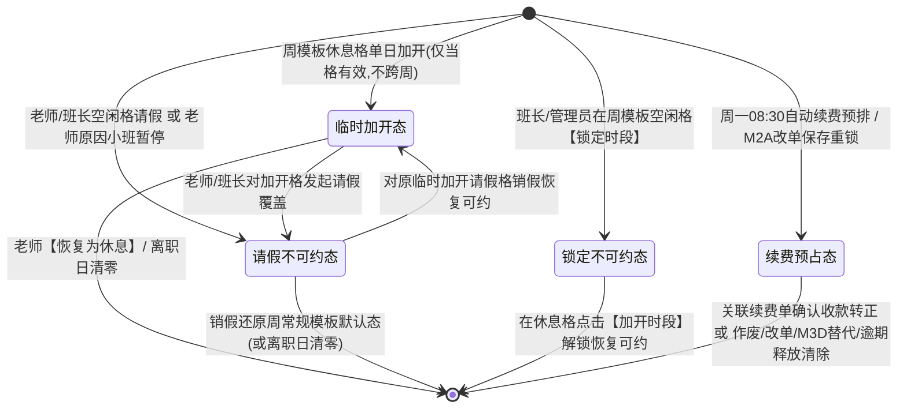

/** (c) 2024-2026 Topee (https://topee.top). All rights reserved. Proprietary and confidential. */

# 产品需求文档 (PRD) — 子模块 3A：7色周度日历看板与全场景动作中枢 (7-Color Weekly Calendar Grid & Action Center)

| 元数据项 | 说明 / 内容 |
|---|---|
| **模块代号** | `m3a` |
| **所属模块** | 模块三：7色智能日历、排课与考勤调度 (Calendar & Scheduling) |
| **文档状态** | 待评审 (Draft) |
| **关联顶层 PRD** | [Prd-v5.md](../Prd-v5.md) |
| **关联规范文档** | [DESIGN.md](../../DESIGN.md) ｜ [BUSINESS_RULES.md](../BUSINESS_RULES.md) |
| **关联子模块** | **[m3d_course_scheduling.md](./m3d_course_scheduling.md)** (全场景排课与约课调度引擎) ｜ [m3b_attendance_substitution.md](./m3b_attendance_substitution.md) (考勤、请假与代课) |
| **创建与更新日期** | 2026-11-05（更新于 2026-11-11，升级为查改一体控制台；2026-11-13 按精简方案移除 M3C 独立转让与 3h/24h 硬熔断，新增「更换实际上课学员」与温和提示；2026-11-20 新增 4 周批量排课后 3 周逐周手工调整与周状态标识；2026-11-21 对齐模式 Z 与 2-1 动态关联：明确跨班长已排课格只读门禁、家长端受阻 `[联系班长微信]` 按授课老师所属负责班长路由，以及日调度跨组查空只读边界；2026-11-22 同步 `Student Note` 与 `Process Note` 2000 字符多行与英文填写提示、M1A 规范英文名校验引述；同日完成 Red-Team 审查与双层 SSOT 收口：家长端移除小班展示与抽屉、固定位与临时课均开放同日连续 2～4 节同师同学员合并请假、补充代约跨价位软预检、统一纯积分与「价位」口径、完成去技术化及【统一时段覆盖记录】4 支柱与跨实体同事务联动清单收口；正式增补从 M1B 老师卡片【预约】穿透进入的单师可约课表二级视图规则与「样图」术语统一；补充排课复选态模式切换与工具按钮图标及高对比度显眼展示规范；收紧 1v1 4 周固定位批量排课为仅限老师所属负责班长或平台管理员（非本人负责老师课表仅开放 1v1 批量临时约课或本人主理小班排课）；补充模式 Z `<3h` 跨班长紧急驰援豁免口径，并将 `§4.11`【今日调度】正式升级支持 `[G]` 小班课双格展示、小班连续双格同屏筛师及 `按学员与小班` 视角；2026-11-23 正式新增 `§4.8.3`【小班专属周课表视角】与 `AC-3A-24～25`，对齐 M1C 小班列表/详情与 M3A 抽屉直达入口及底栏锁定规范；同日补充【小班绑定正式学员个人课表投影】规则：自绑定起展示未来 `[G]` 双格，与 1v1 任意重叠整节退让只显 1v1〔严禁半节小班〕、家长端小班格抽屉纯只读含课件与 `Process Note`，且 1v1 约课/挪位禁止占用已有小班时段，新增 `AC-3A-26`；2026-11-23 **协同 M1C 红队 D1-B/D2-B 收口**：① 明确非本班主理人查看老师周课表/日调度 `>=3h` 他人小班格时实行**半脱敏**仅显 `[G] 小班名简称`、隐藏主理人姓名，并同步收紧 `§4.8.3` 跨组只读浏览（仅本班主理人、管理员与 `<3h` 跨组紧急驰援例外开放）；② 明确家长、老师与主理班长在「已归档 / 已提前解散」后对历史 `[G]` / `1v1` 格抽屉内 `Process Note` 的只读回看权限；2026-11-23 **M3A 策略红队全面收口 (`D1-A / D2-A / D3-A / D4-B / D5-C / D6–D10 / L-1–L-8`)**：① `D1-A` 明确取消 `12.5%` 请假配额仅指取消硬拦截、保留 M2A/M1A 非阻断 `0.125` 软参考；② `D2-A` 确立 1v1 退让隐藏后「**视觉隐藏 ≠ 时段释放**」规则，未重叠小班半格渲染 `⚪ 不可约（小班占）` 并全域拦截约课与挪位；③ `D3-A` 补充指向 `M1C §4.2.1`「随班归档只读留存」SSOT；④ `D4-B` 跨家庭【更换实际上课学员】强制填 `1–200 字` 协调备注写日志并向原出资家长发 M4 站内知会；⑤ `D5-C` 保留 `<3h` 跨班长急救写权限（全量写【经办记录】+ 发 M4 知会，遇争议凭日志线下处置）；⑥ `D6–D10` 补齐【统一时段覆盖记录】Mermaid 状态机与 6 列转移矩阵、老师请假 `1～12 个 30 分钟格 / 6h 网格跨度`、`>4 节`按每 4 节自然切段、清理`冲突候补锁定`残留词并明确日调度 `昨天` 胶囊仅只读复盘与考勤/未上课回退补生边界；2026-11-23 **协同 M3D 红队与新轮周一 01:00 清退方案收口**：① `§4.10` 对齐 1v1 未传凭证 `HOLD` 按 `min(T-24h, 新轮首日周一 01:00 UTC+8)` 清退、豁免 `已传凭证待核`，以及 M3D 待排池替代释放并同步作废原未传凭证续费单入边；② 对齐跨组临时代约向老师所属负责班长发 M4 中性知会卡，以及小班挪位/补排命中绑定学员 1v1 时向 1v1 负责班长与小班主理人发送 M4 冲突待协调卡；2026-11-24 **补全班长/管理员进入「老师周课表」的 6 条共源入口与穿透契约**：在 `§4.8.2` 明确 M1B `[ 📅 周排期 ]`/`[ 📅 查周排期 ]`、今日调度、空闲大盘、Tab 3 代课待办、经办记录与多师状态卡抽屉全量入口及来源 Tab 锁定规则，新增 `AC-3A-27`；2026-11-24 **一步代课 + 仅请假双出口与 `1v1` / `[G]` 小班连续合并升级**：升级 `§4.8.2`、`§4.8.3`、`§4.9.1`、`§4.11` 与对应 AC，支持 `1v1` 与 `[G]` 小班同日连续 `2～4` 节检测与「选连几次」快捷联动复选，将【请假 / 指派代课】升级为同事务一步代课并保留「仅请假不找代课」分支，仅作用于所选已排课次不锁当日其余空闲格，向各相关人汇总只发 1 条结论通知并同步对齐 `>=24h` 异常口径；**【今日调度】、管理端【学员周课表】抽屉全对齐与开课考勤门禁升级**：① 管理端穿透查看【学员周课表】（`§4.8.1`）1v1 课格全面切换挂载 `§4.8.2` 班长 3 层完整动作抽屉（按师归属与 `<3h` 驰援权限裁切），家长 Tab 2 保持纯自助隔离；② 全端【考勤 / 旷课标记】确立 `当前时间 >= 开课时间` 门禁（未开课置灰禁用）；③ `§4.11`【今日调度】补齐 `今天` 开课后考勤标记、`按老师` 与 `按学员与小班` 双视角抽屉第 2/3 层全对齐（含一步代课/仅请假/小班双格挪位/撤排/回退）、同师挪位跨天穿透与按学员视角当天空闲时段胶囊、`🟢 空闲格` 紧急代约与锁时段、`🔴 请假空闲格` 销假恢复、同屏对照支持一步代课及连选 `1～4` 节全匹配、`当日异常(N)` 纳入已标考勤异常（含学员旷课）及进入 `今天` 自动滚屏至当前时间红线前 1 小时，新增 `AC-3A-28`；**红队闭环 `RED-M3A-01~08` (`D1-A / D2-A / D3-A / D4-A / D5-A / D6-B`)**：① `D1-A/D2-A` 统一「异常未上课回退补生」三方操作人（原资金持有人班长 / 授课老师所属负责班长·小班主理人 / 平台管理员）与双重财务冻结门槛（未入「已完成入账」周转账单 **且** 未入「已打款」老师周课酬单）；② `D3-A` 小班补排/挪位撞绑定学员现有 1v1 时向该学员家长补发 `1` 条 M4 中性日程知会；③ `D4-A` 跨组半脱敏 `[G] 小班简称` 正式锚定 M1C 独立字段；④ `D5-A` 正文补明跨调价生效日同师挪位免补差理由；⑤ `D6-B` 移除老师端自标「老师旷课」入口（仅保留正常出勤 / 学员旷课）；⑥ 补全「当日生效价位」vs「原价位档位」双口径术语澄清并清理小班“平移不补退差价”残留；**精修 `§4.8.3` 与 `AC-3A-24`【小班专属周课表】网格对齐与窄格排版规范**：明确智能外接裁剪以「本班已排课 ∪ 主讲老师常规营业底盘」为准（严禁套用家长 06:00–24:00 全天可约底盘）、连续空闲双格防错位配对及禁跨已排/折叠边界铁律，以及 `48px` 超窄格内空闲双格 `约 1h` / 不可约 `休` 极简不撑高展示口径） |

---

## 1. 概述与执行摘要 (Executive Summary)

7 色周度日历看板与全场景动作中枢（`m3a`）是 Dream 系统的教学时间资产可视化展示底座与核心人机交互控制台。针对少儿教务中“老师常规作息集中于 08:00-20:00、全量 36 行死板网格导致首尾大片无意义休息格与手机端搓屏疲劳”的现实痛点，本子模块确立了以 30 分钟为标准颗粒度的时间资产展示底盘，并创新引入**“智能外接时间窗（Dynamic Bounding Box）”与“日间长空档自动折叠（Gap Folding）”**，日历网格告别生硬全量渲染 06:00-24:00，自动根据老师周模板与实际排课动态裁切首尾非营业时段，将纵向页面高度大幅压缩 35%~50%，并在移动端将单元格行高紧凑优化至 **28px 高密度 Excel 网格**以实现单屏横向尽览全周 7 天。

本版本确立了**“课表即控制台（Calendar as Workbench）· 课格即动作引擎（Cell as Action Sheet Drawer）”**的重大工程哲学升级：
1. **高频操作 100% 就地闭环**：日常 90% 的高频教务事务——**临时约课（1~4 节连约，每节 25 分钟含 5 分钟课间，占 1~4 个 30 分钟格）、请假退期待排、同师挪位、更换实际上课学员、代课委任、考勤打卡、进入教室、加开时段**——彻底告别割裂的二级功能页面与表单，全部收敛在日历单元格底部抽屉内原地闭环；
2. **多视角物理隔离与自适应呈现**：
   - **出资家长端（双入口视图严格隔离）**：
     - **Tab 2【自家课表】（主视图）**：常驻多孩档案切换器，以孩子为唯一实体聚合全周所有老师 1v1 课程及**该孩子当前在 [M1C](./m1c_classes.md) 已绑定的小班自绑定后未来已排 `[G]` 课次（与 1v1 发生任意重叠时整节退让隐藏、仅显 1v1，不出半节小班）**，**绝不按老师切换，且不展示 `G-HOLD`、待排池与同班同学/人数**；1v1 格直接显示任课老师名字（代课合并蓝色 `[SUB]`），小班双格仅支持只读信息抽屉（含只读小班课件/`Process Note` 与联系主理班长微信，物理隐藏请假与挪位）；顶栏常驻资产胶囊卡 `[ 👧 Alice · 剩余: 5 节 ▾ ]`（仅统计 1v1 待排课次）；
     - **单师可约课表（二级穿透视图 · 从 M1B 老师卡片 `[预约]` 跳转）**：展示目标老师本人周度可约时段底盘（`🟢 空闲可约` 未来 1~7 天，其余家庭已排格与老师请假/休格隐私脱敏为 `⚪ 不可约`），锁定当前老师与当前选中孩子就地约课，不设切老师控件，左上角提供 `< 返回选老师`，底栏高亮锁定 Tab 3【约课大厅】，严禁混跳 Tab 2【自家课表】；
   - **班长/老师端（老师专属课表）**：带负荷透视的多老师状态卡 + 底部切换抽屉，单触即查各老师排课负荷；同网格 100% 混排 1v1 固定位（单格 `28px` 🟠）与小班课（双格 `56px` 🟩）；点击课格滑出班长管理抽屉（代课委任、考勤核销、退排还课）；点击灰色休格就地【加开时段】；
   - **小班专属周课表视角（二级穿透视图 · 班长/主理人/管理员专属 · 对家长不可见）**：以单个 `1vN` 小班为唯一中心，跨越换代课老师连续聚合本班全周课次（🟩 / 🔵代课 / 🔴待代 / `G-HOLD`），并脱敏叠加主讲老师连续双格空闲绿格支持就地单节补排、同师双格挪位与「已提前解散/已归档」历史只读回看；由 M1C 小班列表/详情、M3A 日调度或老师周课表 `[G]` 格抽屉穿透进入，底栏锁定来源 Tab（Tab 3/4），绝不串扰家长 Tab 2。
3. **顶栏聚焦重度长周期排课**：日历顶栏打造“4周一轮”极速分段导航条，并保留 `[+ 批量固定位排课]` 入口，仅当需要跨 4 周批量排课（1v1 固定位或小班整班）时，顺畅呼起 **[m3d_course_scheduling.md](./m3d_course_scheduling.md)** 专用排课引擎。

---

## 2. 问题定义与背景 (Problem Statement)

- **痛点 1：全量 36 行死板网格导致首尾无意义废格过多与视口过度拉长**：原方案固定展示全天 06:00-24:00 共 36 行（高度超 1200px），而 90% 以上老师授课集中在 08:00-20:00，早晨与深夜充斥大量无意义的 ⚪ 灰色“休”废格，用户在移动端必须频繁上下滑动 2 整屏；且家长查看孩子个人周课表时，在 36 行大表中查找 2-3 节课犹如大海捞针，查阅效率低下。
- **痛点 2：班长管理 3 个以上老师时横向排版溢出与负荷盲切**：班长通常管辖 3~10 位在职老师，原有简易横排药丸按钮在手机端无法容纳多师，且切换时看不到各老师当前周的排课负荷（不知谁满谁空），导致调度效率低下。
- **痛点 3：4 周一轮固定位排课查课次逐周翻页繁琐疲劳**：固定位排课以“4 周一轮（买4排4）”为核心业务单元，用户查阅或对比第 4 周排期时，必须连点 3 次“下一周”等待 3 次刷新，回看第 1 周又需连点 3 次“上一周”，操作链路长且极易迷失当前所处轮次位置。
- **痛点 4：代课多重分裂与信息丢失**：被代课老师、实际代课老师与出资家长各执一词，传统课表或各记一套或互相覆盖，导致家长看课表不知谁来上课、找不到代课老师的 ClassIn 二维码。
- **痛点 5：日历小格过度承载排课长文字导致视觉灾难**：在 42px 宽的微型格子里强行塞入排课向导与连贯度打分长文字，导致界面拥挤闪烁乱码，必须将查课看板（M3A）与排课工作台（M3D）进行物理级解耦。

---

## 3. 目标用户与核心诉求 (Users & Personas)

### 3.1 一线授课老师（David）
- **核心诉求**：在个人日历上仅看到自己设定的可授课区间与排课全貌，早晚无课休息时段自动隐去；格内一眼看清学员英文昵称；轻触课格直览进度备注（`Process Note`）与学生备注（`Student Note`）。

### 3.2 负责班长（Leo）
- **核心诉求**：
  1. **多师统筹**：管辖 $\ge 3$ 位老师时，通过顶部老师负荷状态卡与底部抽屉 1 触切换老师，并在切换时一眼透视各老师的本周排课量与剩余空额；
  2. **4 周极速切换**：通过“4 周一轮”分段胶囊按钮 1 键直达第 1~4 周，或通过轮次按钮一键跨 4 周平移；
  3. **四周固定位与小班课同网格统筹**：在老师单张周日历中，1v1 固定位（单格 28px 橙色）与小班课（双格 56px 青绿色）100% 混排呈现，查课零盲区；
  4. **发起排课**：顶栏点击 `[+ 快捷排课 ▾]` 顺畅直达 [m3d_course_scheduling.md](./m3d_course_scheduling.md) 沉浸式排课工作台。

### 3.3 出资家长（Amy）
- **核心诉求**：
  1. **看孩课表**：查看孩子周课表时，**默认且唯一呈现孩子专属的单屏 7 列周度日历网格（彻底废除 Agenda 清单流与双视图切换）**；课表以孩子为唯一中心，聚合全周所有任课老师的课程，**绝不按老师切换**；
  2. **代课知情**：若发生代课，原任老师与代课老师**100% 在日历单元格内合并呈现**（代课蓝 🔵 + `[SUB]` 标识），点击格子弹出抽屉直览双方老师姓名、代课老师 ClassIn 二维码与学生备注（`Student Note`）。

---

## 4. 日历看板视觉与交互规约 (Calendar Grid Specs)

### 4.1 7 色日历视觉语义与卡片层级规范
全面对齐 [DESIGN.md Section 2.3](../../DESIGN.md#23-7-色课表日历高可读性规范-calendar-exception)，采用**浅底 + 深字 + 语义边框**，绝对严禁刺眼实心满铺深色色块（具体颜色规范见 `DESIGN.md §2.3`）：

| 课次/时段类型 | 语义色彩 | 卡片视觉层级与格内内容展示标准 |
| :--- | :---: | :--- |
| **1v1 固定位** | 🟠 橙色 | 浅底橙色细实线边框微卡片，格内居中展示**学员规范英文名**（如 `AliceZ12`、`BobZ10`，`48px` 超窄格超宽单行省略、点击抽屉完整展示，严禁露中文小名） |
| **1v1 续费预占** | 🟠 虚线 | 浅底橙色微虚线边框微卡片，格内显示学员**规范英文名**（窄格单行省略）并标注【预】字徽标 |
| **1v1 临时课** | 🟡 黄色 | 浅底黄色细实线边框微卡片，格内居中展示学员**规范英文名**（窄格单行省略，抽屉展示完整规范英文名） |
| **1v1 被代课** | 🔵 蓝色 | 浅底蓝色边框微卡片（原任老师请假被代课），右上方标注 `[SUB]` 微型徽标 |
| **1v1 代上课** | 🟣 紫色 | 浅底紫色边框微卡片（替其他老师代课），右上方标注 `[代上]` 微型徽标 |
| **1vN 小班课** | 🟩 青绿 | **双倍高度 `56px` 贯穿合并单元格**，青绿边框微卡片（**全端均不显示在读或上限人数**）：① 在老师周课表/日调度中标注 **`[G]`** 徽标与**小班简称**（指派代课时附注代课标识；**向非本班主理人班长半脱敏隐藏小班主理人姓名**，仅管理员与 `<3h` 紧急驰援例外展示主理人）；② 在【小班专属周课表】中展示**当前授课/代课老师英文名**（指派代课时标注 `[SUB]`，待代课渲染 🔴 待代，续费预占渲染青绿虚线 `[G-HOLD]`）；③ **在已绑定正式学员的个人周课表中**，仅投影自绑定后未作废的正式已排期双格（不显 `G-HOLD` 与待排池，不显同班同学），标注 `[G]` + 小班简称/授课老师（代课标 `[SUB]`）；**若与该生 1v1 存在任意重叠，整节小班双格退让隐藏仅显 1v1** |
| **请假时段** | 🔴 红色 | 浅底红色边框微卡片，显示“假”字，标注请假原因简写 |
| **不可约/休息** | ⚪ 灰色 | 浅灰低对比中性底色微卡片，显示“休”字 |
| **空闲可约** | 🟢 绿色 | 呼吸感浅绿底色微卡片，显示“约”字 |

> **「价位」双口径术语澄清 (`RED-M3A-07`)**：本模块严格区分两项价位概念——① **「当日生效价位」**：来自 [M1B 价位字典](./m1b_teacher_profile.md)，表示老师在目标上课日期当天的家长付费标准，专用于 1v1 约课价位匹配校验；② **「原价位档位」**：TS 购课裂变时永久固化的不可变字典档位快照，不随老师后续调价变更，专用于 M3B 智能筛师排序与 `[跨高档代课]` 预警判定。
> **「小班简称」来源澄清 (`D4-A`)**：跨组半脱敏与日历格内展示的 **`[G] 小班简称`** 统一读取 [M1C §4.2 / AC-1C-03](./m1c_classes.md) 定义的独立必填字段 `小班简称`（2–12 字符，全平台唯一且禁含学员隐私信息）。

---

### 4.2 单屏 7 列高密度 Excel 网格架构 (Single-Screen 7-Col Excel Grid)
1. **单屏横向容纳 7 天**：
   - 首列时间轴物理冻结 `40px`，纵向标注半小时刻度（如 `08:00`、`08:30`）；
   - 周一至周日 7 列等宽均分屏幕剩余宽度（手机 `390px` 视口下每列约 `48px`），**单屏无需横向滑动即可尽览整周全貌**；
2. **28px 紧凑行高与极简姓名显示**：
   - 移动端每个 30 分钟单元格物理高度收敛至 **`28px`**；
   - 1v1 排课格 100% 直接显示**学员规范英文名**（如 `AliceZ12`、`MarkL10`；在 `390px` 手机 `~48px` 窄格下超长时单行省略，点击课格抽屉第 1 层必须**完整展示规范英文名**；老师/班长端严禁展示中文小名），**彻底告别“固定位”、“正课”等抽象通用词盲盒**，避免同名歧义；老师一眼准确识别、班长两秒定位学员排期。

---

### 4.3 智能外接时间窗与长空档自动折叠 (Bounding Box & Gap Folding)
1. **智能外接裁剪 $[T_{\min}, T_{\max}]$**：
   - 系统动态扫描该老师（或该学员）本周所有排课与周模板开放时段；
   - 自动提取最早有效时段 $T_{\min}$ 与最晚有效时段 $T_{\max}$，首尾非营业时段物理剔除，默认直接自最早时段渲染至最晚时段（页面纵向高度缩短 35%~50%）；
2. **日间长空档折叠条**：
   - 若日间存在连续 $\ge 2$ 小时的全休时段（如 11:30 - 17:00 中午无课），系统自动将其折叠为 22px 高度的浅灰折叠条：
     `┄┄┄┄┄┄┄┄┄┄ 11:30 - 17:00 日间休息 (已折叠) [点击展开] ┄┄┄┄┄┄┄┄┄┄`
   - 轻触折叠条可就地展开该时段，再次轻触收起。

---

### 4.4 “4周一轮”双层极速导航条 (4-Week Cycle Fast Nav)
针对固定位以 4 周为业务单元的周期特征，日历顶栏打造双层极速导航组件：
1. **外层轮次控制**：
   `[ ◀ 上一轮 (4周) ]  ｜  本轮：第 46 ~ 49 周 (11.09 - 12.06)  ｜  [ 下一轮 (4周) ▶ ]`
2. **内层 4 周等宽分段胶囊**：
   横向平铺 4 个等宽胶囊卡片：`[ 第1周 11/09 ]` ｜ `[● 第2周 11/16]` ｜ `[ 第3周 11/23 ]` ｜ `[ 第4周 11/30 ]`；
   - 单键盲点直达目标周，当前浏览周次高亮选中；右上角带有业务状态微指示点。
3. **批量排课复选态周状态**：在 `连续 4 周批量` 排课复选态下，第 1 周胶囊显示 `模板周`，第 2~4 周胶囊分别显示 `跟随模板` / `已调整` / `冲突待补`；切换周次时保留各周已选状态，不因切换丢失手工调整，逐周规则以 [m3d_course_scheduling.md §4.3.6](./m3d_course_scheduling.md) 为唯一来源。

---

### 4.5 班长管辖多老师调度与负荷透视 (Multi-Teacher Load Switcher)
1. **吸顶状态卡**：日历顶部常驻当前老师状态卡：`[ 👨‍🏫 David Miller (管辖) · 本周已排 18/24 节 ▾ ]`；
2. **底部半屏切换抽屉**：
   - 点击状态卡平滑滑出半屏老师选择抽屉；
   - 每位老师条目高度 `56px`，包含头像、中英文名、价位徽标及**本周负荷统计条**（已排节数 / 空闲节数，直观进度条呈现）；
   - 轻触目标老师条目，抽屉自动收起，日历网格即时局部刷新为目标老师排期，当前周次与视口位置保持不变。

---

### 4.6 出资家长端孩子专属周课表 (Child-Centric Schedule Grid)
1. **多孩全局档案切换器**：顶栏常驻 `[ 👧 Alice (大宝) ▾ ]`，多孩一秒切换；
2. **以孩子为中心全周聚合（1v1 优先 + 绑定小班只读投影）**：日历聚合该孩子全周名下所有老师的 1v1 课程，**以及该孩子当前在 [M1C](./m1c_classes.md) 已绑定「正式在读」小班自绑定生效起之后的未来已排期 `[G]` 双格（`56px`，含未作废的历史当周已上格，绝不展示 `G-HOLD`、待排池、同班人数或同学名单）**，**绝不按老师切换**；彻底取消旧版清单流视图；
3. **1v1 绝对优先覆盖与「视觉隐藏 ≠ 时段释放」防撞规则**：当某节小班双格（`60` 分钟连续 2 格）的任意半小时格与该学员的 1v1 课次（或 `HOLD`）发生重叠时，**整节小班双格全部退让隐藏，仅显示 1v1 课次**，绝不裁切渲染“半节小班课”；**但视觉隐藏绝不等于时段释放**——原小班双格中被 1v1 挤退隐藏的另一半看似空闲的半小时格（如周日 `10:00–11:00` 小班因 `10:30–11:00` 有 1v1 而整节隐藏后剩余的 `10:00–10:30` 半格）仍属小班真实占用时段，在 Tab 2 渲染为 **`⚪ 不可约（小班占）`** 不可点击占位（提示 `该时段已被已绑定小班课占用`），严禁家长 1v1 约课、1~4 节跨格连约、M1B 单师约课或同师挪位占入该半格。
4. **原任与代课合并呈现**：
   - 普通 1v1 课次：显示任课老师名字（如周二 19:00 `🟠 David`）；
   - 代课课次（1v1 与已绑定小班同规则）：背景色渲染为代课蓝 🔵（浅底蓝边），标注 `[SUB]` 徽标；
   - 轻触 1v1 单元格滑出家长动作抽屉（进教室/二维码、请假、同师挪位、1v1 课件与 `Student Note`）；轻触 `[G]` 小班双格滑出**只读小班信息抽屉**（授课/代课老师、ClassIn 二维码、只读小班课件与 2000 字 `Process Note`、联系主理班长微信，**物理隐藏一切请假/挪位/换师按钮**）。

---

### 4.7 快捷排课、排课复选态与 M3D 空闲大盘衔接 (Integration with M3D)
1. **统一入口收敛与权限自适应**：日历看板顶栏右侧常驻 **`[ 🔍 空闲大盘 ]`**（无参跳转至 [m3d_course_scheduling.md](./m3d_course_scheduling.md) 比较其他老师空闲）与排课复选态入口——**当登录人为该老师所属负责班长、平台管理员或本人主理小班委任老师时展示 `[ 📅 + 批量固定位排课 ]`**；**当普通班长打开非本人负责老师周课表（且非本人主理小班关联）时，入口自动收敛为 `[ 🗓️ 批量临时约课 ]`**，点击原地开启本页「排课复选态」；
2. **复用老师当周课表作为 M3D 选格排课阶段（排课复选态）**：
   - 从 M3D 教师空闲大盘点击某位老师下方的 `[ 选取 ]`（携带选定老师与排课选格模式，可选带关联学员或小班信息）后，直接复用本页老师当周课表并开启**「排课复选态」**；
   - **默认模式、按师归属守卫与高对比图标分段按钮**：排课复选态顶部模式切换栏与辅助工具按钮统一配备前置语义图标并增强视觉权重（采用独立加高分段胶囊按钮组、清晰边框与高对比度选中态高亮填充，严禁使用小字号弱对比普通单选文案），让操作人首眼清晰分辨当前模式：
     - **`[ 🗓️ 仅排单周 / 临时课 ]`**：1v1 或无参进入**默认选中**（全平台在职老师均开放）；
     - **`[ 🔁 连续 4 周批量 ]`**：携带本人主理小班信息且小班待排 $\ge 4$ 节时**默认选中**；**若操作人为普通班长且当前目标为「非本人负责老师」（针对 1v1 学员或未选定小班），`[ 🔁 连续 4 周批量 ]` 按钮必须物理置灰禁用**（提示“仅该老师所属负责班长或管理员可排 1v1 固定位”），仅允许使用 `[ 🗓️ 仅排单周 / 临时课 ]`；仅当当前操作人为该老师所属负责班长、平台管理员，或操作人以小班主理人身份为本人主理且已委任该老师的小班排课时方允许切换启用；
     - 同排快捷筛选与操作按钮亦配清晰图标显眼呈现（如 **`[ 👁️ 仅看可约 ✓ ]`**、**`[ 📅 + 批量固定位排课 ]`** / **`[ 🗓️ 批量临时约课 ]`**、**`[ 🔍 空闲大盘 ]`**）。
   - **第 1 周模板穿透与后 3 周逐周调整**：切换至 `[ 🔁 连续 4 周批量 ]` 后，以本轮第 1 周为模板周（若当前不在第 1 周，自动定位到第 1 周）；1v1 按单格、小班按连续双格（56px）在模板周复选时段，系统默认把同星期/时段复制到第 2~4 周。复制时逐周校验：可用周标 `跟随模板`，冲突周留空标 `冲突待补`，不阻断整单；
   - **切周手工调整**：点击第 2~4 周胶囊切换周次，可在该周网格直接增删格子；增删只作用于当前周，并将该周标为 `已调整`，不再跟随模板。每个 `已调整` 周提供 `[ 恢复跟随第 1 周 ]`。第 1 周后续变动仅同步仍为 `跟随模板` 的周，不覆盖 `已调整` 周。逐周状态、扣减与事务规则以 [m3d_course_scheduling.md §4.3.6](./m3d_course_scheduling.md) 为唯一来源；
   - **无参补选**：无参进入时支持在顶部补选学员或小班（未选对象禁止提交）；
   - **单事务确认与成果反馈**：底部吸底汇总扣减课次，确认后单事务落盘并退出排课复选态，刚排定的**全部时段单元格同时执行轻柔淡色微闪烁 1 秒（Success Flash）**，实线微卡片即时呈现。

---

### 4.8 课表单元格动作抽屉引擎 (Action Sheet Drawer Engine)
为终结零散功能页割裂跳转与列表找课盲盒痛点，系统确立“课表即控制台”原则，所有围绕单节或当前课次的高频操作**100% 收敛在日历单元格底部抽屉内就地闭环**：

> **页面职责边界**：M3A 只提供课格/资产卡上的快捷入口。请假释放、同师挪位、更换实际上课学员、代课调度与开课前 3h 温和提示规则以 [m3b_attendance_substitution.md](./m3b_attendance_substitution.md) 为唯一规则来源。M3A 不维护第二套业务规则，也不展示单价/公开私密/发布大池。

#### 4.8.1 学员专属课表视角（出资家长端 Tab 2 及管理端【学员课表】）
> **双端抽屉隔离原则**：同一学员周课表网格底盘按登录进入场域动态切换动作抽屉——**家长端 Tab 2** 展示精简家长自助抽屉（受 `<24h` / `<3h` 约束，物理屏蔽老师侧与考勤入口）；**班长 / 管理员从教务列表或今日调度穿透进入管理端【学员课表】**时，点击 `1v1` 课格统一挂载 **`§4.8.2` 班长 3 层完整动作抽屉**（同样受按师归属与 `<3h` 跨班长紧急驰援权限校验，直接支持连选 `1～4` 节合并【代学员请假】、【代老师请假】、【请假 / 指派代课（一步代课或仅请假）】、【同师挪位】、【考勤 / 旷课标记】、【换上课学员】及第 3 层【撤排退回】/【异常未上课回退补生】），消除不同视角进入课表功能不一致的问题；点击 `[G]` 小班双格按下方 `1a` 提供跳转小班详情/专属周课表（仍物理隐藏 1v1 专属【代学员请假】与【换上课学员】）。

1. **轻触【1v1 已有排课单元格】（固定位 🟠 / 临时课 🟡 / 代课 🔵）**（管理端直接复用 `§4.8.2` 3 层抽屉，以下为家长端抽屉规范兼管理端基础信息展示）：
   从屏幕底部平滑滑出【课次动作抽屉】：
   - **基础信息区**：课型徽标、时间段（如 `周二 18:30 - 18:55 (25min)`，占用 18:30-19:00 网格含 5 分钟课间）、任课老师（若发生代课则同时展示原任 David 与实际代课 Elena）；
   - **二维码与课件区**：授课老师 `[ 📷 查看 ClassIn 二维码 ]` 入口（首次与该老师上课前扫码加好友，取消教室号展示）；在学课件当前进度（如 Oxford Discover 2 Unit 3）；
   - **动态动作按钮组与连堂识别**：
     - **连堂 2～4 节自动识别**：当同一天相邻无间隔排有同一原任老师、同一学员的 2～4 节未结课 1v1 课次（固定位与临时课均适用）时，抽屉自动按时间顺序列出该连续区间全部时段复选行，支持一键合并请假或合并同师挪位（详见 `§4.9.1`）；
     - **老师已请假待重排提示（1v1 固定课/临时课通用）**：若当前 1v1 课格处于“老师已请假·待重排”挂起态，抽屉顶部高亮提示“原授课老师已请假”；**距开课 $\ge 3\text{h}$** 时，提供 **`[ 换同价位老师代上 ]`**（触发代课调度工单流转为已指派且不重复计原老师异常，详见 [m3b_attendance_substitution.md §4.5.4 / §4.8.1](./m3b_attendance_substitution.md)）与 **`[ 退回待排期 ]`**（退回后可在未来 1～7 天自助重约）；**距开课 $< 3\text{h}$** 时，禁用自助换老师（防代课老师未在线），仅保留 **`[ 退回待排期 ]`** 与 **`[ 💬 联系班长微信 ]`**（此处固定读取**原任老师所属负责班长**的微信二维码；若未上传或平台直管则隐藏）；若到原定下课时间仍未处理，系统将自动退回为待排期课次。
     - **【请假退期待排】（1v1 课次均可用）**：
       - **家长 `<24h` 限制 + 按师归属班长不锁**：**取消 `12.5%` 请假配额硬拦截**（不对请假次数做超额阻断；[M2A `AC-2A-09`](./m2a_course_orders.md#L256) 与 M1A 展示的 `0.125` 额度仅作非阻断软参考提示）；家长端距开课 `< 24h` 禁用自助请假并提示联系班长处理（若**原任老师所属负责班长**已上传微信二维码，紧邻提示附 **`[ 💬 联系班长微信 ]`** 按钮一键唤起其二维码灯箱；连堂合并勾选跨 `24h` 临界时，仅置灰禁用不足 `24h` 的前序节次，其余 $\ge 24\text{h}$ 后序节次仍可保留勾选并一次性合并提交请假）；原任老师所属负责班长及平台管理员不受时间限制，请假即将已排 TS 释放变回待排期，日历格恢复为 🟢 空闲；
       - **班长 `< 3h` 温和提示**：原任老师负责班长/管理员在距开课不足 3 小时操作时，弹出温和确认弹窗：**“距开课不足 3 小时，老师可能已进入备课状态，请确认已与老师沟通”**，点击确定即放行（并在 M5B 课酬单出勤流水中透出标记）；
     - **【同师挪位】（1v1 课次均可用）**：
       - **同师平移、防撞课（含隐藏小班半格）与日期双边界合并**：目标格限定为原任课老师的空闲绿格，且**自动排除该学员在同一时间已在其他老师处有 1v1 排课、或已绑定小班原始占用的未来 `[G]` 双格（含半格重叠及虽因 1v1 退让隐藏但仍实际占用的半格）**（均置灰不可选并提示“学员该时段已有其他课程或已绑定小班课”）；**日期熔断合并规则：同师挪位仅熔断老师预约离职日 `D`（自 `D` 起禁止迁入），不熔断调价生效日（跨调价日平移直接生效、免补退差价——因已付款且已扣减的 TS 已固化原价位档位与实付积分快照，已购已排课次不因老师后续调价重新计价）**；若当前课次为代课课次（🔵），挪位时目标老师仍为原任老师，挪位成功后**自动解除原代课委任**（按 [M3B](./m3b_attendance_substitution.md) 向原代课老师发 M4 站内提醒与撤销代课 Email，且原代课老师在 M5B 计 `0 节 / 0 课酬`）；
       - **家长 `<3h` 限制 + 按师归属班长不锁**：家长端距开课 `< 3h` 禁用自助挪位并提示联系班长处理（同样附**原任老师所属负责班长**的 **`[ 💬 联系班长微信 ]`** 快捷二维码入口）；原任老师所属负责班长/管理员端不锁，不足 3 小时时弹出温和确认提示后放行；
     - **【更换实际上课学员】（班长 / 管理员专属，替代原转让模块）**：
       - 班长或管理员点击课格后，可直接点击 **【更换实际上课学员】**，按规范英文名检索选择另一位学员档案（无需校验是否同家庭）；原购课单与资金归属保持不变；**当目标新学员所属家长账号 $\ne$ 原出资家长账号（跨家庭换人）时，必须填写 `1–200 字`「跨家庭协调/结算备注」（写入 TS 流转记录与【经办记录】供核查）并确认已沟通双方家长，同事务向原出资家长与新学员家长（非待认领试课档案时，严格隐藏财务信息）各发送 1 条 [M4](./m4_notification.md) 站内中性卡知会（均不发 Email）**；
     - **【学生备注与课件】**：内联查看在学课件、课件级别、进度备注（`Process Note`）与学生备注（`Student Note`）——抽屉内各条默认折叠展示 **`2 行`（且不超过 `64 字符`**），超出或含换行可点击 `[ 展开全文 ▾ ]` 按原换行查看全部 2000 字符（并支持 `[ 收起 ▴ ]`）；支持编辑更新（2000 字符多行框，提示**“请尽量填写英文，便于老师看懂”**）。
1a. **轻触【已绑定小班双格 `[G]`】（家长 Tab 2 纯只读抽屉 · 严禁请假与挪位）**：
   - **家长端抽屉内容**：滑出只读信息抽屉，展示 `[G]` 小班徽标与小班名称、时间段（如 `周六 10:00–10:50 (50分钟)`，双格）、当前授课/代课老师（代课时标注原任与实际代课老师 `[SUB]`）、授课老师 **`[ 📷 查看 ClassIn 二维码 ]`** 入口、**该小班在学课件与 2000 字 `Process Note`（纯只读、默认折叠 `2 行 / ≤64 字` 可点展开全文，支持查看样图缩略预览，物理隐藏全部编辑/增删按钮）**，以及 **`[ 💬 联系主理班长微信 ]`**（唤起小班主理班长二维码灯箱，未上传则隐藏）；
   - **家长端物理隐藏一切写操作与他生隐私**：抽屉内**物理隐藏 `[ 请假 ]`、`[ 同师挪位 ]`、`[ 换老师代上 ]`、`[ 换上课学员 ]` 与 `[ 配置/更新课件 ]`**，底部固定提示文案：“小班课请假与调课请微信联系主理班长协商”；严禁透出同班同学昵称、人数或小班积分；
   - **管理端穿透学员课表时**：班长/管理员查看学员专属课表点击 `[G]` 格时，除上述只读信息外提供 `[ 查看小班详情 ]` / `[ 小班专属周课表 ]` 快捷跳转（仍物理隐藏 1v1 专属的 `[ 代学员请假 ]` 与 `[ 换上课学员 ]`）。
2. **轻触【空闲可约单元格】（未来 `1~7 天` · `06:00–24:00` 任意未排/未请假/未占小班格可约 + 智能折叠）**：
   - **任意空闲格开放与「隐藏≠释放」防撞规则**：在学生课表全天 `06:00–24:00` 底盘（共 `36` 个半小时格，最晚 `23:30–24:00`）上，**未来 `1~7 天` 窗口内只要孩子本人未排 1v1 课、未占用已绑定小班原始 `[G]` 课格（含因 1v1 重叠而被视觉退让隐藏的小班半格，`隐藏 ≠ 释放`）、未请假，所有格子一律开放为可点击预约格**（当天、超过 7 天及**孩子已有 1v1 或已绑定 `[G]` 小班原始占用时段**置灰不可约；其中被退让隐藏的小班未重叠半格同步渲染为 `⚪ 不可约（小班占）` 且禁止作为 1v1 约课起始或跨越连约格；当天及超期统一提示 **`仅开放7天内临约，当天及超期不可约，可联系班长固定约`**）。为保持手机端首屏紧凑，系统对学生课表实施**智能折叠**：**默认展开 `09:00 ~ 20:00` 时段以及本周孩子在 `09:00` 前或 `20:00` 后已有排课/小班课/请假的时段**，其余早间（如 `06:00–08:30`）与晚间（如 `20:30–23:30`）无课空闲区间默认合并为 `22px` 浅灰折叠条，点击折叠条即可就地展开并预约早晚时段。
   - 滑出【临时预约单抽屉】（时间窗复用 [m3d_course_scheduling.md §4.2](./m3d_course_scheduling.md#L132) 规则）：
   - **① 选择价位（按孩子可用待排 1v1 课次自动分组）**：读取当前孩子名下全部可用的**待排期 1v1 TS** 并按价位分组展示为紧凑选择胶囊（如 `[ 16积分 (余2节) ]`、`[ 18积分 (余4节) ]`）；若孩子仅有 1 种价位则自动默认选中；若无任何可用待排 TS，禁用【确认预约】并提示“暂无可用待排课次，请联系班长购课”，并补充提示 **`“如无可匹配价位时段，可联系负责班长协调选师或另行购课”`**（附 **`[ 💬 联系班长微信 ]`**）。**严格要求 `老师在目标上课日期当天的生效价位 == 所选价位`**（不向下兼容、不跨档折算，同价位内按先购先排扣减；若老师已设置下轮首日生效的新价位且未来 1～7 天窗口横跨该生效日，生效日前的日期按原价位匹配、生效日及之后的日期按新价位匹配；旧价位待排 TS 不可用于预约新价位日期）；
   - **日期双边界澄清**：已排定且已扣减 TS 的未来课次执行“同师挪位”时**不熔断调价生效日**（免补退差价直接平移）；但若老师已配置离职生效日期 $D$，自 **$D$ 起（含 $D$ 所在轮次剩余全部日期及后续周次）** 网格强制置为 ⚪ 不可约，严禁在该日起约课或挪位迁入；
   - **② 连约节数选择器（1~4 节）**：提供 `[ 1节 (25分钟) ｜ 2节 (50分钟) ｜ 3节 (75分钟) ｜ 4节 (100分钟) ]` 4 档分段选项（每节课 25 分钟 + 5 分钟课间，占用 1~4 个连续 30 分钟格子）：
     - **最大可连约节数上限** = $\min(4,\ \text{所选价位的可用待排 TS 节数},\ \text{孩子自身后续无 1v1 及已绑小班原始占格〔含退让隐藏半格〕的连续格数},\ \text{当日网格结束前剩余格数})$；
     - 切换价位或切换 2~4 节时，系统同步校验**该孩子在后续对应时段是否已有其他 1v1 排课或已绑定小班原始占格（含隐藏半格）**、**所选价位的待排 TS 是否足够 $N$ 节**以及**老师连续空闲状态**；任一条件不满足时，对应档位自动置灰禁用并给出简短原因（如 `该价位待排课次不足` / `19:30 孩子已有课` / `无连续 3 节空闲老师`）；
   - **③ 智能筛选空闲老师（随「价位 + 节数」实时重筛）**：
     - 学员课表不锁定单一默认老师；打开抽屉或切换「价位 / 1~4 节」后，系统实时筛选**目标日期生效价位 == 所选价位、且在所选起始时段及后续连续 $N$ 节内全程处于 🟢 空闲可约状态（未达离职日）**的在职老师，按**【教过该学员（熟客）优先 → 当周剩余空闲充足/已排负荷适中】**智能排序，默认预选首位推荐老师（标注 `教过` / `推荐` 轻量徽标）；
     - 抽屉内支持点选切换其他空闲老师，并提供 `[ 🔍 按老师姓名搜索 ]`；**默认列表直接过滤隐藏不符合当前价位或连续 $N$ 节空闲的老师**，仅当家长主动输入姓名搜索且命中不可约/不同价位老师时，才将匹配结果置灰展示并附 1 行简要原因（如 `价位不符` / `19:30 已有课` / `该时段休息`）；若当前价位+节数下无任何空闲老师，提示“该时段暂无该价位连续 $N$ 节空闲老师，可尝试调整节数、切换价位、另选时段，或 **`联系负责班长协调`**”；严禁展示老师邮箱、课酬等敏感信息；
     - 切换价位或连约节数（如 1 节切换为 3 节）时，可选老师列表实时联动重筛；若原已选老师不再满足条件，系统自动切换至首位满足条件的可约老师；
   - **扣减确认与原子落盘（含请假退回 TS）**：抽屉底部明确展示扣减汇总（如 `将消耗 18积分待排课 N 节，该价位剩余 Y 节`）；点击 `[ 确认预约 ]` 后单一事务内将对应同价位待排 TS 流转为已排期并标记为 `临时课`（保持原购课单锁定的资金持有人与价位档位），日历网格即时渲染为 $N$ 个黄色 🟡 临时课。后续该 TS 若提前 $\ge 24\text{h}$ 请假或撤排，统一重置排课形态标识并退回为绑定原资金持有人与原价位的待排期 1v1 课次。
3. **顶栏常驻资产胶囊卡 `[ 👧 Alice · 剩余: 5 节 ▾ ]`**：
   - 点击滑出【学员课次资产明细抽屉】，透视当前剩余待排期 1v1 TS 课次与待上课程数（不含小班），并提供班长/管理员【课次清退/扣减】快捷入口。
4. **从 M1B 老师卡片【预约】穿透进入的单师可约课表视图（二级约课页 · 纯隐私脱敏）**：
   - **入口与导航锁定**：仅当家长从 [M1B 家长端老师卡片 / 详情页](./m1b_teacher_profile.md#61-责任班长归属管理1v1-固定位归师与临时课全域放开) 点击 `[ 预约 ]` / `[ 立即预约 ]` 时进入；顶栏呈现 `[老师英文名] 可约课表`、价位徽标（含下轮调价预告若有）、当前选中孩子名与左上角 **`< 返回选老师`**，**不展示老师切换下拉框**，底部导航仍高亮锁定 **Tab 3【约课大厅】**（绝不跳去 Tab 2【自家课表】）；
   - **网格脱敏粒度与冲突提示**：按该老师 `06:00–24:00` 排班底盘与智能折叠规则呈现本周及下周课表；**仅未来 `1~7 天` 老师本人空闲可约时段渲染 `🟢 空闲可约`**（超出 `1~7 天` 窗口或当天置灰不可约，统一提示 **`仅开放7天内临约，当天及超期不可约，可联系班长固定约`**）；**他人已排 1v1 课格、他人 `[G]` 小班课格、老师休息/请假格及预约离职生效日 $\ge D$ 格统一纯脱敏渲染为 `⚪ 不可约`**（不透出任何他生/他班占用类型或原因，仅展示不可约状态）；当前选中孩子本人已与该老师排定的课次正常展示，若当前孩子同时段已在其他老师处有 1v1 课或已绑定小班原始占格（含因 1v1 退让隐藏的半格）则标注 **`⚠️ 撞课不可约`** 阻断禁约；
   - **就地约课闭环**：点击 `🟢 空闲可约` 格直接滑出 M3A【临时预约单抽屉】，**锁定该目标老师不可切换**，读取当前孩子名下匹配该老师目标上课日期生效价位的待排 1v1 TS 余额完成 `1~4 节` 连约；若无匹配价位可用待排 TS，禁用确认按钮并引导联系负责班长购课或协调（附 `[ 💬 联系班长微信 ]`）。

#### 4.8.2 老师与班长课表视角（老师端 / 班长端 / 管理端）
**共源入口与导航锁定（班长 / 管理员进入本视图的 6 条路径）**：
- ① **[M1B 老师列表与详情](./m1b_teacher_profile.md#611-老师列表去花哨去重复与合并收敛验收标准-de-cluttering--unified-list-standards)**：在老师列表卡片底栏点击 **`[ 📅 周排期 ]`**，或在老师综合档案详情底部点击 **`[ 📅 查周排期 ]`**（遵循 `AC-1B-31a`，携带目标老师与当前操作身份直达本页，禁止仅弹提示而不跳转）；
- ② **[§4.11 今日调度](./m3a_calendar_grid.md#411-日维度应急调度网格今日调度)**：`按老师` 视角点击任一 1v1 或 `[G]` 小班课格滑出抽屉 → 点击 **`[ 老师课表 ]`**（携带目标老师与当周参数进入）；
- ③ **[M3D 教师空闲大盘](./m3d_course_scheduling.md#32-step-2--复用-m3a-老师当周课表页排课复选态--打通-4-周)**：筛选并点击老师卡片 **`[ 选取 ]`**（复用本页排课复选态，退出复选即常规老师周课表）；
- ④ **[M0 Tab 3 全局待办](./m0_workspace_and_home.md#625-班长与管理员-tab-3教务中心架构顶部多维金刚位--主体全局待办流)**：`老师请假待代课` 待办卡点击 **`[ 指派代课 ]`** / **`[ 立即处理 ]`**（直达原任老师周课表并定位打开该课格【指派代课】二级面板）；
- ⑤ **[M3B 经办记录](./m3b_attendance_substitution.md#410-经办记录列表页产品规范)**：点击记录中的**课次 / 时段链接**（直达目标自然周周课表）；
- ⑥ **内部多师切换**：进入任一老师周课表后，点击顶部吸顶老师状态卡（`§4.5`）滑出底部抽屉切换所辖或全校其他老师。
- **导航与公私隔离**：从 Tab 3 / Tab 4 入口进入时底栏严格高亮锁定来源 Tab（Tab 3【教务中心】或 Tab 4【管理与设置】），左上角提供 `< 返回`，**严禁跳入家长 Tab 2【自家课表】**；「待绑定账号」与「已离职」老师禁止新建约课与 4 周批量排课（已离职仅可只读回看历史周课次）。

**权限边界与纯网格就地交互原则**：
- **完全去顶栏冗余按钮**：取消顶栏常驻的批量功能大按钮，全系统请假、代课、挪位、异常报备 **100% 收敛为“点击课格 ➔ 抽屉内时段多选勾选 ➔ 批量/合并提交”** 的统一交互范式；
- **角色权限隔离（模式 Z：1v1 临时约课放开 · 常规固定位/已排格按师归口 · `<3h` 跨班长紧急驰援豁免）**：
  - 老师仅可查看课表、查看学生备注（`Student Note`）与进度备注（`Process Note`）、考勤打卡、加开时段、以及**在抽屉内发起单节或当天时段批量请假报备**；
  - **空闲绿格代约 1v1 临时课（全域开放）**：班长可在全平台任意在职老师的空闲绿格 🟢 点击为学员代约 **1v1 临时课**（搜索全校在读正式学员 + 本人创建的待认领试课学员），不受老师归属限制；
  - **1v1 4 周固定位与 `>= 3h` 常规已排课格履约管控（严格按师归属，跨班长只读/半脱敏；回退补生三方同权例外）**：**1v1 4 周固定位批量排课**，以及课次距离开课 **$\ge 3$ 小时**时的**【代学员请假】、【同师挪位】、【代老师请假】、【指派/撤销代课】、【考勤/旷课/迟到早退标记】、【恢复出勤】、【撤排退回课次】**、全部时间段的**【换上课学员】**、小班基本信息修改/解散以及空闲/休息格【加开/锁定时段】，严格仅对该授课老师所属负责班长（1vN 小班由该小班主理人）与平台管理员可见可操作。**已结课【异常未上课回退补生】三方同权例外**：遵循 [BUSINESS_RULES.md §1.3](../BUSINESS_RULES.md) 与 [M5A §4.2](./m5a_transfer_collection.md)，仅限**该 TS 原资金持有人班长、授课老师所属负责班长（1vN 为小班主理人）或平台管理员**在未冻结前提下操作（当「原资金持有人班长 ≠ 授课老师所属负责班长」时，非老师负责班长的原资金持有人打开课格抽屉时第 2 层保持只读、**仅第 3 层解锁 `[ 异常未上课回退补生 ]`**，提交后向师负责班长发 M4 中性知会；严禁无关第三方班长及 `<3h` 跨组驰援操作）。当普通班长打开非本人负责老师课表（或从学员课表点击非本人负责老师课格）查看 **`>= 3h` 课次**时，系统**对 1v1 仅只读展示占位/老师与负责班长信息，对他组小班格仅半脱敏展示 `[G] 小班简称` 并隐藏小班主理人姓名与 `[ 查看小班周课表 ]` 穿透**，除上述原资金持有人第 3 层回退补生入口外，所有写操作按钮与 1v1 固定位批量入口物理隐藏/置灰，且拒绝跨班长调用；
  - **`< 3h` 跨班长紧急驰援豁免（统一急救例外通道 · 全量留痕事后线下追责）**：为保障全校班长可通过 Tab 3 浅红紧急待办或今日调度协同救火、防止 `< 3h` 即将开课出现空堂或老师白等，当任意 1v1 或 1vN 小班未结课课次处于**距开课 `< 3 小时`**（含刚开课未完成 `02:00` 结课且处于挂起或异常待处置状态的当节急救课次）时，全平台任一在职班长均可在该课格抽屉解锁执行当节应急处置：**【指派/撤销代课】、【`< 3h` 退回待排期（含通融退回与按学员旷课扣课） / 小班暂停待排】、【`< 3h` 代老师请假】、【`< 3h` 同师挪位】与【急救考勤（如未先请假直派代课、老师旷课、学员旷课）】**。跨组进入 `< 3h` 课格抽屉时顶部显性提示 **`跨组紧急驰援 · 原负责班长/主理人: [姓名]`**，提交前触发 `< 3h` 温和确认弹窗（**严格逐节校验 `< 3h` 边界：连堂合并若后续节次 $\ge 3\text{h}$，严禁跨组连带修改 $\ge 3\text{h}$ 节次**）；操作成功后不改变原资金持有人与老师归属，**完整写入操作人【经办记录】（标 `跨组紧急驰援`）与 TS 状态流转历史**并向原负责班长/主理人发送 [M4](./m4_notification.md) 站内中性知会，同时全校工作台同步消除对应浅红待办（**系统不在 `<3h` 设额外二次线上申诉流，若事后核对发现争议直接依据经办记录与状态日志留痕在线下及 M5B/管理员后台追责处置**）。

1. **老师端课表交互（当天时段复选单）**：
   - **轻触【已有排课单元格】（有课格 🟡/🟠/🟣/🟩）**：
     滑出老师教学管理抽屉：
     - **进度备注与学生备注直览（含小班与代课交接内联）**：抽屉内**直接内联展示**目标对象的每门**当前在学课件、课件级别、样图缩略预览、进度备注（`Process Note`）、最后更新人、主力更新老师（最多更新次数老师）及 6 个月未更新提示**（1v1 课次读取目标学员档案并额外展示 **`Student Note`**；`🟩`/`🟣` **小班课次**直接读取目标小班档案的在学课件与 `Process Note`，无 `Student Note` 项）——上述长文本在抽屉内**默认折叠为 `2 行 / ≤64 字符`**，点击 `[ 展开全文 ▾ ]` 按原文换行查看完整 **2000 字符**并支持 `[ 收起 ▴ ]`；若为 **🟣 代上课** 且原任老师请假时刚更新过进度备注/交接信息，显式高亮标注更新时间与原老师姓名（如 `Handover updated by David`），同时保留快捷多行编辑入口供老师课前/课后随时更新进度备注（1v1 可同时补充 `Student Note`，上限 2000 字符，提示尽量填写英文）；
     - **考勤打卡 / 补签**：仅当 **`当前时间 >= 开课时间`** 时开放标记“正常出勤（注：未标异常时系统亦于次日 `02:00` 自动正常结课）”与“学员旷课”（未开课未来课次置灰禁用并提示尚未到开课时间；**老师端不开放“老师旷课 / 老师迟到 / 老师早退”自标入口**——老师课前无法授课应走下方请假/报备流程，开课后老师缺勤、迟到或早退统一由负责班长、小班主理人或平台管理员核实后标记）；
     - **ClassIn 二维码**：核对本人名片二维码展示；
     - **【申请请假 / 突发状况报备】**：
       - 抽屉顶部展示 **【当天时段多选卡片】**：
         - 默认勾选当前点击的时段 `[x] 当前时段`；
         - 下方列出当天该老师名下所有课格（带复选框，标明“空闲”或“排课”）；
         - 老师自由勾选 `1～12 个` 30 分钟时段格（跨度最长 `6` 小时网格区间，每节含 25 分钟授课与 5 分钟课间）；
         - **交接信息顺带补录（选填）**：若勾选时段包含已排课次，按去重后的受影响 **1v1 学员**与 **`[G]` 小班**分别展示选填交接区，**优先展示更新进度备注 (`Process Note`，支持 2000 字符多行录入，提示尽量填写英文)**；1v1 学员可将补充学生备注 (`Student Note`) 折叠为次要选填项（小班无学生备注项），提交后同步更新对应档案/小班并透传给班长/主理人与代课老师；
         - 选择不可抗力标签（家庭突发停电/断网、突发急病就医、设备故障、常规事假）并点击提交；
         - 系统自动分流：空闲格原子置红 🔴，排课格生成「老师请假待代课」待办派发给班长/主理人（进入 Tab 3 全局待办流）。
   - **轻触【空闲单元格】（绿色‘约’）**：
     - 滑出老师空闲时段抽屉：
       - 提供 **`[ 🔴 申请请假 / 设为不可约 ]`**，同样唤起上述时段复选单，支持将该空闲格连同其他时段一起置红请假（写入日历请假覆盖态，不生成老师请假申请单），排他阻断后续预约；
       - **仅当该绿格为周模板外临时加开出来的格子时**，抽屉内额外提供轻量按钮 **`[ 恢复为休息 ]`**（一键清除临时加开状态变回 ⚪ 休，无需填写请假原因，不记请假）；常规周模板绿格不显示该按钮；
       - 明确提示：“代学员约课请联系负责班长操作”。
   - **轻触【休息单元格】（灰色‘休’，限今天及未来时段）**：
     - 老师可点击 **`[ 加开时段 ]`**，支持同日休息格多选（默认勾选当前时段，可连选当天其他休息格一次加开），提交后写入临时加开覆盖态并立即变为 🟢 可约格（不影响每周重复的周常规模板；被约生成课次后保留加开覆盖，若后续课次请假退回或挪走仍保持 🟢 可约），或同样唤起请假报备。历史已过去时段置灰不可加开。
   - **与 M1B「常规可约时段模板」独立页职责分流**：本页内的 `[ 加开时段 ]`、`[ 恢复为休息 ]` 与 `[ 申请请假 ]` 仅针对**具体某天某周**生效，绝不修改老师每周循环的营业模板；若需统一调整每周固定开放/休息时间，由老师首页 `⏰ 开放时段` 或班长档案抽屉前往 **[M1B 老师常规可约时段模板独立页](./m1b_teacher_profile.md#41b-老师常规可约时段模板配置流程m1b-独立设置页)**（纯 2 色、零学员名、禁止预约交互）完成维护。

2. **班长 / 管理员端课表交互（3 层紧凑抽屉 + 状态互斥 + 二级面板闭环）**：
   为了消除菜单项平铺堆积、多入口语义重叠与小班常驻警告噪音，班长/管理员点击已有排课格时，底部抽屉严格采用 **3 层紧凑布局**（100% 消除重复的“异常处理”跳转入口）：
   - **第 1 层 · 课次与对象摘要卡**：
     - 展示课型徽标、时段、任课老师（若已代课则同时展示原任与实际代课老师）、学员**完整规范英文名**/小班名称（严禁露出中文小名；右侧轻量入口直达【学员档案】/【课次资产】或【小班详情】；**当在老师周课表点击 `[G]` 小班课格时，同步提供 `[ 查看小班周课表 ]` 快捷跳转直达本班 `§4.8.3` 专属周课表**）；小班格同步以默认 `1–2 行` 折叠展示当前主课件、课件级别与最新进度备注 (`Process Note`，点击可展开全文)；
     - **连堂 2～4 节快捷“连几次”与复选行（覆盖 1v1 与 `[G]` 小班）**：当检测到同日连续 **2～4 节**（① **1v1 课次**：时间相邻无间隔，且为同一原任老师、同一实际上课学员的未结课 1v1 课次——**固定位与临时课均适用，含固定+临时混排及含代课节次的连续块**；② **`[G]` 小班课次**：连续 1 小时双格首尾紧邻无间隔、同一小班实体且同一原任主讲老师的未结课小班课次——含代课节次的连续块；以上两类若当日连续 `> 4` 节均按每 4 节自然切段）时，摘要卡底部按时间顺序展示**快捷连选次数胶囊（`[ 仅本节 ]` / `[ 连 2 节 ]` … `[ 全部 M 节 ]`，以当前点击课次起算向后连续或一键全选当前段）+ 逐节轻量复选框**双向联动（默认全选当前连续分段，可一键选“连几次”或逐格取消勾选），**取消抽屉顶部单独堆积的合并大按钮**；下方第 2/3 层动作自动按当前勾选的 $K$ 节生效（小班格物理隐藏【代学员请假】与【换上课学员】）。
   - **第 2 层 · 高频教务动作（2×2 紧凑宫格）**：
     - **【请假 / 同师挪位】**：合并入口，点击进入抽屉内二级面板（展示当前生效范围 1～4 节及 `<3h` 提示），支持以下处置：
       - **代学员请假（退期待排）**：**固定位与临时课同日连续 2～4 节（同原任老师且同学员）均开放一键合并请假退期待排**（同步解除关联代课指派）；勾选节次中最早开课一节距开课 `<3h` 时弹出 1 次温和确认弹窗（按 `m3b` 规约支持【通融退回待排期】整组退回，或【按勾选节数整节按学员旷课扣课】照常扣减并保障老师出勤）；释放时段变回 🟢 空闲，课次退回学员待排池；
       - **代老师请假（仅请假 · 暂不找代课，挂起 `🔴 待代` · 1v1 与 `[G]` 小班通用 · 当天及未来周次均开放）**：支持按第 1 层连选的 **`1～4` 节**合并提交（仅作用于所选已排课次，不封锁原任老师当日其余空闲格）；填写请假原因后将所选已排课次同事务挂起为 `🔴 待代`（老师已请假·待重排，退出 02:00 自动结课），只生成 `1` 张包含这 $K$ 节的老师请假申请单、按各节距开课提前时间记入原任老师《出勤异常记录》（标注班长/管理员代操作）、记 `1` 条汇总【经办记录】，并向受影响方各发 `1` 条汇总挂起通知；后续可随时继续指派代课；
       - **同师挪位**：点击后立即收起抽屉，日历网格高亮原任老师空闲绿格（1v1 多节连堂合并挪位时须连续 $K$ 格空闲，并自动置灰学员已有 1v1 与已绑定小班原始占格〔含半格重叠及虽因 1v1 退让隐藏的半格〕撞课时段；1vN 小班支持同师连续双格〔含连选 $K$ 节双格〕平移，仅在小班主理人/管理员或 `<3h` 跨组驰援下开放），点选目标起始绿格确认完成平移（`<3h` 弹出温和确认提示；**仅熔断老师预约离职日 `D` 禁迁入，跨调价生效日平移免补退差价——因已付款 TS 已固化原价位档位与实付积分快照，已购已排课次不重计价**；若原含代课课次则自动解除原代课委任，按 [M3B](./m3b_attendance_substitution.md) 向原代课老师发撤销通知且原代课在 M5B 计 `0 节 / 0 课酬`）。
     - **【请假 / 指派代课】（1v1 为 `请假 / 指派代课`，小班为 `请假 / 代课 / 暂停待排` · 一步到位兼可“只请假不找代课”）**：点击进入抽屉内二级面板：
       - **场景一 · 所选课次已处于 `🔴 待代`（先请假后指派代课）**：顶部展示原请假原因与连续时段范围，直接选定全时段空闲的代课老师完成指派；若已处于代课状态（🔵），面板顶部提供 **`[ 撤销代课指派 ]`**（撤销流向按原师请假/调剂归因以 [M3B](./m3b_attendance_substitution.md) 为准）；
       - **场景二 · 所选课次未先请假（支持「一步代课」与「只请假不找代课」双出口，1v1 与 `[G]` 小班对称）**：
         - **① 原因与责任归属（必选）**：勾选范围中距开课 `< 24h` 节次默认属老师原因；若**存在至少 1 节 `>= 24h` 课次**，强制单选 **`老师原因（代办请假）`** 或 **`教务/学员主动调剂（不计原师异常）`**（若连选跨越 `24h` 临界，不足 `24h` 的前序节次旁灰显提示`距开课不足24h，默认计老师非常规异常`），并填写原因说明；
         - **② 选择处理方式（选代课即一步到位，不选即只请假）**：默认展示全时段空闲 🟢 的可选在职代课老师，同时在顶部提供开关/选项 **`[ 仅老师请假（暂不指定代课，挂起 🔴 待代） ]`**（小班同步支持路线 B **`[ 暂停待排 ]`**）：
           - **选定具体代课老师（一步代课）**：同事务一并完成“记老师请假/调剂 + 绑定代课老师（🔵/🟣 双视角）+ 《出勤异常记录》按节精准记账（`<24h` 计非常规、`>=24h` 老师原因仅计请假频次不标红、调剂不记异常；选`老师原因`仅绑定所选课次请假标记以护航后续撤销不直接还课，不锁原师当天其余空闲格）+ Tab 3【经办记录】写 `1` 条汇总流水 + **按最终态向各受影响方（代课老师、1v1/小班家长、原任老师、非本人操作时的原负责方）各发唯一 `1` 条合并结论通知**”，绝不再先后发送“老师请假”与“指派代课”两条割裂消息；
           - **选「暂不指定代课（仅请假挂起 🔴 待代）」**：不绑定代课老师，直接按上方【代老师请假（仅请假）】挂起为 `🔴 待代`；
       - **1v1 智能筛师与风控守卫（按连选 `1～4` 节）**：按第 1 屏勾选的 **1 ~ 4 个具体课次时间段**过滤出全时段空闲 🟢 的在职老师，按 **① 曾教过该学员 → ② `同价位 → 低一档 → 高一档 → 其他档位`（严格以 TS 永久固化的 `原价位档位` 比对，`相近价位` 为相邻 `±1 档`） → ③ 当周已排负荷较少** 排序，显性标注 `教过该学员`、价位差异与 `本周已排 X 节`；支持按老师姓名搜索，不符合条件时置灰提示具体冲突时段（找不到能全包多节的老师时提示减少连选节数拆分指派或先选「仅请假挂起」）；支持 `<3h` 温和确认（跨组驰援严格逐节校验 `<3h`，严禁跨组连带 `>=3h` 节次）；**任意一节指派高于原 `原价位档位` $\ge 2$ 档老师时过浅黄成本预警并打标 `[跨高档代课]`（差额财务兜底与禁扣课酬规则详见 [BUSINESS_RULES.md §3.5](../BUSINESS_RULES.md#35-周度课酬结算单据-weekly-settlement-report)）**；
       - **小班课（🟩）**：支持按第 1 屏勾选的 **`1～4` 节连续小班双格**合并处置，将原常驻在第一屏的应急处置包收拢至此二级面板，不再平时常驻红色大框。面板内分流展示：**路线 A（指派临时代课 / 一步代课）**（支持同上责任归因单选、按同上 3 级排序筛出所选全部 `1～4` 节连续双格均全程空闲的在职老师，标注 `教过本班`、价位差异与 `本周已排 X 节`，支持姓名搜索与冲突置灰提示，结课后按节计入实际代课老师 M5B 周课酬单；或切换「仅请假不找代课」挂起 `🔴 待代`）；**路线 B（暂停待排）**（区分“老师原因停电/请假 → 原网格标红不可约”与“节假日/全班调休 → 原网格释放为绿色可约”，确认后所选课次退回小班待排池，并附带直达 M3D 单节补排入口）。
     - **【考勤 / 旷课标记】**：系统默认于次日凌晨 02:00 自动结课（正常扣课发酬），日常无需手动点“正常出勤”；**仅当 `当前时间 >= 开课时间`（且未完成周归集/发薪冻结）时开放点击标记**，未到开课时间的未来课次按钮/提交置灰禁用并提示“尚未到开课时间，如需取消请走请假、代课或撤排”；点击进入二级面板后展示当前状态“正常（自动结课）”，提供 **`[ 标为学员旷课 ]`**、**`[ 标为老师旷课 ]`**、**`[ 标为老师迟到 ]`** 与 **`[ 标为老师早退 ]`**（后三项及异常处置均须必填原因，其中老师迟到/早退保持正常结课与默认计薪节数并同步写入《出勤异常记录》与 M5B 出勤明细）；**仅当该课次已被误标为学员旷课、老师旷课、老师迟到或老师早退时**，才在面板内提供 **`[ 恢复为正常出勤 ]`** 纠偏按钮。
     - **【换上课学员】（1v1 专属，小班课物理隐藏，限原任老师所属负责班长及管理员）**：支持**仅按规范英文名检索**全校在读正式学员与本人创建待认领试课学员（无需校验同家庭）；结果行展示**规范英文名、在读/试课徽标、年龄、所属家长**（严禁露出中文小名；为保护家长资金隐私故意隐藏新学员课次余额与购课金额），若目标学员在当前时段已有其他排课则标出 `⚠️ 该时段已有课` 冲突兜底提醒（原购课单出资方与资金归属保持不变；**当目标新学员所属家长账号 $\ne$ 原出资家长账号〔跨家庭换人〕时，强制必填 `1–200 字`「跨家庭协调/结算备注」写入【经办记录】与 TS 状态流转历史并确认已沟通双方家长，同事务向原出资家长、新学员家长（非待认领试课档案时隐藏财务信息）及原任老师各发送 1 条 [M4](./m4_notification.md) 站内中性卡知会，均不发 Email**）。
   - **第 3 层 · 低频与危险操作收口（按结课状态互斥显示）**：
     - **未结课（正常排期中）**：仅展示 **`[ 撤排退回课次 ]`**（释放时段并退回学员对应 1～4 节待排课次），**不显示**异常回退入口，防止对未上课次误操作；
     - **已结课（且尚未纳入「已完成入账」周转账单，且尚未纳入「已打款」老师周课酬单的双重财务冻结前）**：面向**三方（该 TS 原资金持有人班长 / 授课老师所属负责班长 / 平台管理员）**展示 **`[ 异常未上课回退补生 ]`**（作废原课次、剔除课酬并补生全新待排课次；处于「待平台确认」在途周转账单时提示须先由永久主管理员驳回草稿后再操作；当资金持有人班长 ≠ 老师负责班长时提交后同步向另一方发 M4 中性知会；已归集入账或已打款发薪则置灰禁用并提示“已归集或已发薪，禁止回退”），同时第 2 层的【请假/挪位】、【请假 / 指派代课】、【换上课学员】自动置灰禁用（仅授课老师所属负责班长及管理员保留【考勤/旷课标记】纠偏）。
   - **轻触【空闲单元格】（绿色‘约’ ➔ 代学员约课抽屉）**：
     - **按规范英文名检索学员**：抽屉内提供 `[ 🔍 输入规范英文名搜索（如 MarkL10） ]` 即时搜索框，支持匹配**全校在读正式学员与本人创建的待认领试课学员**（隔离他人未认领试课学员，**禁止按中文小名搜索**）；结果行展示**规范英文名**、在读/试课徽标及当前可用待排期课次余额（不展示中文小名）；若目标学员在当前选定连续时段**已有其他 1v1 排课或已绑定小班未来 `[G]` 已排课（含半格重叠）**，右侧显式标记 `⚠️ 该时段已有课`；
     - **连约节数（1~4 节）与禁选撞课时段**：支持 `1~4 节` 连续预约（校验当前老师后续连续绿格与学员无 1v1 及已绑小班撞课，**禁止选择该学员已有 1v1 或已绑定小班 `[G]` 已排课的时段**，无连续空闲或存在撞课的档位自动置灰禁止提交）；
     - **班长 / 管理员使用已有待排课次跨价位代约（非阻断软预检）**：班长与管理员使用学员已有待排 1v1 课次代约时**不受同价位强阻断**；若所选已有待排课次的价位与目标老师当日生效价位不一致，允许继续提交但在确认前弹出**非阻断软预检提示**（对齐 `m2a` 划转价位预检：告知“所选课次价位为 X 积分，与老师当前价位 Y 积分不一致，继续代约仍按原购课单实付积分快照上交、不补退差价，老师周课酬仍按管理后台内部单价核算，请确认是否继续”）；
     - **班长 / 管理员复用 · 就地快速创建试课学员档案（与 Tab 3【所辖学员】/ Tab 4【试课建档】复用同一极简弹窗）**：
       - 搜索框旁及无匹配结果空态提供 **`+ 快速建试课档`**（无匹配时自动预填搜索词）；
       - 抽屉内原地展开极简 2 字段建档表单（不跳出当前页）：① **规范英文名**（必填，如 `MarkL10`，重名微调时在年龄前加 1–2 位小写字母如 `MarkLa10`，遵循 [m1a_student_profile.md](./m1a_student_profile.md) 的规范英文名格式规则与全平台大小写不敏感唯一性校验；**学员姓名或小名自动默认复制填入该规范英文名**）；② **家长联系方式**（必填，手机号或微信号，至少 4 位有效字符）；提交后立即创建待认领试课档案（班长创建时自动归属当前班长，管理员可管理全校所有试课档案）并自动选中；
     - **2 步合 1 步 · 快速录单并代约闭环（班长/管理员可用，非 0 积分免费课）**：当选中学员（含在读正式学员与管理员建档的待认领试课档案）可用待排期课次不足所选节数（如刚建档为 0 节），或班长主动切换为新购代约时，抽屉内展示 **`[☑] 同步录入 1v1 临时课购课单并确认收款`**（固定按本次代约节数 $N$ 节 × 当前授课老师价位计价，**无价位错配，且不允许改价**；若需一次多买或跨价位组合请引导至 M2A 完整录单页）：
       - **显性收款强提醒区（浅黄警示卡）**：醒目展示应付总额（如 `本次代约 N 节 × X 积分/节 = 应收总计 Y 积分`），并强制展示默认未勾选的确认框 **`[ ] 我已确认线下收到家长本次课次费用 Y 积分（提交后将直接生成已付款购课单并锁定为本人托管，结课后计入周转账单）`**——未勾选时主按钮保持禁用；支持顺手可选上传 1～5 张收款截图凭证；
       - **单事务合一落盘**：勾选确认后主按钮文案变为 **`[ 确认已收款并立即约课 ]`**，点击后单一事务内完成“生成已付款 1v1 购课单 + 裂变 $N$ 节已排期（临时课）课次（锁定资金持有人为当前收款人/平台）+ 锁定老师日历黄色 🟡 课格”；亦保留 **`[ 锁定时段 / 设为不可约 ]`** 快捷入口。

#### 4.8.3 小班专属周课表视角（班长 / 主理人 / 管理员专属 · 家长物理不可见）
1. **统一入口、权限矩阵与历史只读回看**：
   - **共源 4 个入口直达本视图**：① [M1C 小班列表与详情页](./m1c_classes.md) **`[ 📅 小班课表 ]`**；② 本模块 [§4.11 今日调度](./m3a_calendar_grid.md#411-日维度应急调度网格今日调度) `按学员与小班` 列抽屉 **`[ 小班课表 ]`**；③ 老师周课表 `[G]` 小班课格抽屉第 1 层 **`[ 查看小班周课表 ]`**；④ 日调度 `按老师` 视角 `[G]` 格抽屉附带的 **`[ 小班课表 ]`**（注：M1C 的 `[ 🗓️ 小班排课 ]` 入口单独直达 [M3D 小班排课/补排](./m3d_course_scheduling.md#46-1vn-小班课连续双格整班排课与单节补排规约-small-group-class-scheduling)，不再与看班表混用）；
   - **导航锁定与公私隔离**：顶栏显示 **`[G] [小班名称]`**、当前委任主讲老师（或`待委任老师`）、小班主理人与当前待排池余量胶囊（如 `待排: 2 节`），左上角常驻 `< 返回` 并支持轻触小班标题快速切换本人主理/全校其他小班；底部导航高亮**锁定来源 Tab（Tab 3 或 Tab 4）**，**对家长端 100% 物理不可见**且严禁串扰 Tab 2【自家课表】；
   - **角色权限与 `<3h` 跨组驰援**：
     - **小班主理人（本人主理的小班）与平台管理员**：拥有本班课表的完整查看与全部写操作权限（单节补排、同师双格挪位、代老师请假、指派代课、暂停待排、考勤标记、撤排与异常回退）；
     - **其他在职班长（跨组物理隔离 + 仅 `<3h` 急救放行）**：遵循 [M1C AC-1C-08](./m1c_classes.md) 物理隔离红线，**禁止跨班长浏览他班 `>= 3h` 小班专属周课表或跨师全周排期**（在老师周课表及日调度中查看他人 `>= 3h` `[G]` 格时仅半脱敏展示 `[G] 小班简称`，隐藏主理人名与小班课表穿透）；**仅当某节未结课课次处于距开课 `< 3 小时` 急救窗口时**，方可通过日调度/紧急待办解锁该节应急抽屉（同 `§4.8.2`「`<3h` 跨班长紧急驰援豁免」并显性标注 `原主理人: [姓名]`）；
     - **「已提前解散 / 已归档」小班（三方只读历史回看 · 对齐 [M1C §4.2.1](./m1c_classes.md#421-生命周期状态机与转移矩阵含跨模块宿主入边)）**：**本班主理班长、平台管理员及曾执教/代课老师**可只读回看历史轮次已结课课次、代课与考勤记录、在学课件及 **`Process Note`**（已作废的未来课格不再渲染，顶栏待排池显示 `0 节`，全部排课、补排与写操作入口物理隐藏或禁用）；**归档/解散时刻在 M1C 进入 `随班归档只读留存` 态且 M1A 未删档的正式学员所属家长**亦可在个人历史 `[G]` 课格抽屉及 M1E 历史区只读回看本班历史课件与 **`Process Note`**。
2. **以小班为中心的跨师聚合网格与脱敏空闲底盘（防错列与 `48px` 窄格防撑高规范）**：
   - **智能外接时间窗裁剪与长空档折叠（严格锚定主讲老师营业底盘）**：沿用 `40px` 冻结时间轴、单屏 7 列等宽（`390px` 手机视口下每列约 `48px`）与 `28px` 半小时行高、`56px` 双格行高；在正式开课且已委任主讲老师时，系统依据**本班当周已排/预占课次 ∪ 主讲老师周常规模板（含当周临时加开）**动态计算外接时间窗 $[T_{\min}, T_{\max}]$（保底显示不少于 6 小时，支持展开全天 `06:00–24:00`），并将日间连续 $\ge 2$ 小时既无本班排课也无主讲连续可约双格的全休区间自动折叠为 `22px` 折叠条（点击展开/收起）；**严禁套用家长端 `06:00–24:00` 全天约课底盘把主讲老师早晚休息时间渲染为空闲可约格**。「待委任老师」或「已提前解散 / 已归档」小班仅保留有历史课次覆盖（保底 6 小时）的极简底盘，不叠加任何老师空闲态；
   - **跨师连续双格全量聚合**：无论本班当周各节课次由原任主讲老师授课，还是某节被指派了其他代课老师，或处于 `🔴 待代` / 续费预占 `🟩 [G-HOLD]`，**均 100% 连续聚合呈现在同一张本班周课表中**（占 `56px` 双倍高度合并格，**严禁显示在读或上限人数**）：格内紧凑展示微徽标（`[G]` / `[G-HOLD]` / `🔴 待代`）与**当前授课/代课老师英文短名**（如 `David`、`Elena [SUB]`），一眼看清全班跨师代课接力状态；
   - **连续双格空闲对齐配对与脱敏单格防错位**：
     - 当小班处于「正式开课」且已委任主讲老师时，对于未被本班排课/预占占用且主讲老师未排其他课、未请假、未锁定、未达离职日 `D` 的连续空闲段：**按未被已排双格及折叠条切分的连续空闲区间，在满足整点 `:00` 起或连续 $\ge 2$ 个 30 分钟格时两两配对合并为 `56px` 空闲双格（`🟢`），且被双格合并覆盖的下半小时格绝对禁止再单独占位或重复渲染**，严禁跨已排课格、跨整小时碰撞或跨折叠条边界合并；剩余孤立的半小时空闲碎格、主讲老师已被其他 1v1 学员或他班占用的时段、休息格及请假格**统一渲染为单格 `28px` 不可约底格（`⚪`）**（绝不泄漏任何 1v1 学员姓名或其他小班名称）；
     - **48px 窄格极简文案防撑高（长文案下沉图例与抽屉）**：为杜绝窄列内汉字换行撑破行高或溢出截断，空闲可约双格（`56px`）仅紧凑显示 **`约`** + **`1h`**（挪位高亮目标显示 **`挪此`** + **`1h`**），不可约/脱敏/孤立半小时单格（`28px`）仅紧凑显示 **`休`**（灰色中性底；已归档/待委任空白单格显示 **`—`**），完整业务说明（“空闲双格 · 点击单节补排”、“不可约 / 脱敏 / 需连续 1 小时双格空闲”）统一展示在网格下方图例及点击后滑出的抽屉内。
3. **顶栏待排池、批量衔接与空闲双格就地单节补排**：
   - 顶栏右侧常驻 **`[ 待排: N 节 ]`**（点击可查看待排来源如暂停待排或新购待排）与 **`[ 📅 + 小班排课/补排 ]`** 主入口，点击携带当前小班上下文进入 [M3D 小班整班批量排课 / 单节补排](./m3d_course_scheduling.md#46-1vn-小班课连续双格整班排课与单节补排规约-small-group-class-scheduling)（主理人/管理员可见；已解散/已归档/待委任老师小班隐藏或置灰引导先委任老师）；
   - **空闲双格点击就地单节补排**：主理人或管理员在本页轻触主讲老师 **`🟢 空闲可约`** 起始格且后续连续 `1 小时`（连续 2 格）均为空闲 🟢 时，若小班待排池余量 $\ge 1$ 节，底部滑出【小班单节补排抽屉】（展示当前小班名、主讲老师、选定连续双格时段及待排池扣减说明：`消耗小班待排池 1 节，补排后剩余 Y 节`，不涉及额外收费或改价），确认后单事务将 1 节待排 TS 落盘为「已排期」小班双格课次（同步消解 `[小班课待补排]` 置顶待办并写入小班操作日志）；若点击单格后紧邻下一格非空闲或待排池为 `0`，置灰禁用确认并提示引导（如“待排池不足，请先在 M2A 为本班购课”或“需连续 1 小时双格空闲”）。
4. **小班双格 3 层动作抽屉与同师双格挪位**：
   - 轻触本班课表内任意已排双格（🟩 / 🔵代课 / 🔴待代 / `G-HOLD`）时，复用 `§4.8.2` 的 3 层紧凑抽屉：
     - **第 1 层**：展示 `[G]` 小班名称、上课时段（如 `周六 10:00–10:50`）、原主讲与实际代课老师、当前主课件/级别及 `2000` 字 `Process Note`（默认折叠 2 行可展开，主理人/管理员可就地编辑更新）；若同日紧邻存在 `2～4` 节同小班同原任主讲老师的未结课小班连续课次（超 4 节按每 4 节自然切段），底部同步展示**快捷“连几次”胶囊 + 逐节复选行**联动控制下方第 2/3 层动作作用域；跨组 `<3h` 进入时显性标注 **`跨组紧急驰援 · 原主理人: [姓名]`**；
     - **第 2 层**：物理隐藏 1v1 专属的【代学员请假】与【换上课学员】；提供 **`[ 请假 / 代课 / 暂停待排 ]`**（支持连选 `1～4` 节一步代课、`>=24h` 责任单选、以及勾选「仅请假不找代课」或「暂停待排」）、**`[ 代老师请假 ]`**（快捷仅请假挂起 `🔴 待代`）、（按同日紧邻 `1～4` 节或单节执行，遵循 `当前时间 >= 开课时间` 考勤门禁与仅计老师侧考勤规约）、**`[ 考勤 / 旷课标记 ]`** 与 **`[ 同师双格挪位 ]`**（点击 `[ 同师双格挪位 ]` 后立即收起抽屉，在本班网格内高亮当前授课老师连续空档〔支持连选 $K$ 节连续双格〕，点选目标起始双格确认完成平移，`<3h` 弹出温和确认提示，若原含代课则同步解除原代课委任，平移不改变小班单节待上交积分快照）；
     - **第 3 层**：未结课显示 **`[ 撤排退回待排池 ]`**，已结课且尚未完成周度归集（未入「已完成入账」周转账单）且尚未完成发薪冻结（未入「已打款」老师周课酬单）时，面向**三方（该 TS 原资金持有人、小班主理人及平台管理员）**显示 **`[ 异常未上课回退补生 ]`**（处于「待平台确认」在途周转账单时提示须先由永久主管理员驳回草稿后再操作；已归集入账或已打款发薪则置灰禁用）；`G-HOLD` 预占双格仅支持只读查看关联待付款续费单并跳转 M2A/M3D 调整，严禁直接在日历手工删改。

---

### 4.9 连续课程合并操作与非连续转让规约

#### 4.9.1 连续课程合并操作 (Consecutive Lessons Batching · 1v1 与 `[G]` 小班通用)
1. **同日连续 2～4 节（同原任老师且同学员/同小班连堂合并 · 超 4 节自然切段）**：
   - **适用边界与超 4 节切分规则**：覆盖同一自然日内网格时间首尾紧邻无间隔的 **2～4 节**未结课已排课次——① **1v1 课次**：同一原任老师、同一实际上课学员（固定位与临时课、含混排与已代课节次均适用；开放【代学员请假退期待排】、【代老师请假】、【一步代课 / 指派代课】与【同师挪位】）；② **`[G]` 小班课次**：同一小班实体、同一原任主讲老师（连续 1 小时双格之间无空档间隔；物理屏蔽学员侧请假与换人，开放【代老师请假】、【一步代课 / 指派代课】、【暂停待排】与【同师双格挪位】）；**确定性切段规则**：若同日同对象连续排课超过 4 节，统一**按开课时间先后每 `4` 节自然切分为一段，最后一段为余数 `1～4` 节**（例如连续 6 节切分为「前 4 节 + 后 2 节」，7 节切分为「前 4 节 + 后 3 节」；余数仅 1 节独段则按单节抽屉呈现）；点击任意一格仅聚合其所在分段，单次禁止跨段或超过 4 节合并提交。
   - **快捷“连几次”与抽屉连选展示**：点击连续分段内任意一节时，抽屉第 1 层自动按时间顺序列出该分段内的 `2～4` 节轻量复选行，并提供快捷**「选连几次」胶囊**（`[ 仅本节 ]` / `[ 连 2 节 ]` …，与复选框双向同步；默认全选当前分段或支持一键改选连上几节、单节）。
   - **合并请假、合并一步代课与合并同师挪位边界**：① **合并代学员请假 / 同师挪位**：固定位与临时课均开放一键合并提交（[M3B](./m3b_attendance_substitution.md#41-1v1-请假退回待排期家长-24h-限制--按师归属班长不锁) `24h/3h` 校验：**家长端逐节校验 `<24h`**，仅置灰禁用不足 `24h` 的前序节次，其余 $\ge 24\text{h}$ 后序节次仍可合并提交；班长端最早一节 `<3h` 仅弹 1 次温和确认；**跨班长 `<3h` 紧急驰援严禁连带跨越 $\ge 3\text{h}$ 的非本人负责老师后序节次**）；② **合并代老师请假 / 一步代课**：一次勾选 `1～4` 节仅生成 `1` 张包含全部 $K$ 节的请假/代课上下文，若跨越 `24h` 临界则在抽屉开放 `>=24h` 节次的责任归因单选并灰显标注 `<24h` 节次默认计非常规；**通知与【经办记录】严格按单次合并发 `1` 条汇总，而《出勤异常记录》与 M5B 课酬单按命中 `K` 节各自时间窗精准逐节记账**。校验与通知口径均以 M3B 为唯一来源。
2. **跨周及非连续课次红线**：
   - 无论固定位还是临时课，均**不支持跨周批量请假**，也不支持跨天或中间有休息/空档间隔的课程合并操作；
   - 需要调整其他周次时，逐周使用【同师挪位】、【请假退期待排】或【更换实际上课学员】。

#### 4.9.2 更换实际上课学员入口 (替代原 M3C 转让)
在日历课格动作抽屉中，原任老师所属负责班长或管理员可直接点击 **【更换实际上课学员】**，按规范英文名检索选择另一位学员档案（无需校验是否同家庭），原购课单出资人与资金归属完全不变，课表即时生效；**若目标新学员所属家长账号 $\ne$ 原出资家长账号（跨家庭换人），必须填写 `1–200 字`「跨家庭协调/结算备注」（记入【经办记录】与 TS 流转日志供对账追溯）并确认已沟通双方家长，同事务向原出资家长与新学员家长（非待认领试课档案时隐藏财务信息）各发 M4 站内中性卡知会（不发 Email）**，线下家长结算由线下自闭环。

---

### 4.10 实体生命周期与状态机 (Entity Lifecycles & State Machines)

#### 1. 【统一时段覆盖记录】生命周期、修改与留痕规范（M3A 为全站唯一归口 SSOT）
本实体按**「老师 + 日期 + 30 分钟时段」**记录单日单格偏离 [M1B 周常规模板](./m1b_teacher_profile.md#41b-老师常规可约时段模板配置流程m1b-独立设置页) 的临时覆盖态（无覆盖记录时默认遵循周常规模板，绝不自动延续至下周）。

1. **三层优先级、4 态正式状态机与转移规则矩阵**：
   - **日历渲染与查空优先级**：**`正式已排课次` > `统一时段覆盖记录` > `周常规可用模板`**。

   | 当前状态 | 目标状态 | 触发事件 / 动作 | 触发方 / 驱动源 | 前置条件与约束 | 落盘副作用与日历表现 |
   | :--- | :--- | :--- | :--- | :--- | :--- |
   | **`[*]`** *(无覆盖 · 跟随周模板)* | **临时加开态** (`🟢 可约`) | 点击休息格【加开时段】 | 老师 / 所属负责班长 / 管理员 | 仅限今天及未来未达离职日 `D`；**严格仅当选定自然日当格生效，绝不跨周自动延续**；不支持将非本人负责老师格加开 | 渲染 `🟢 空闲可约`；**后续被约生成课次再请假/挪走时本覆盖态继续保留为 `🟢 可约`** |
   | **`[*]`** | **锁定不可约态** (`⚪ 休`) | 点击空闲格【锁定时段】 | 老师所属负责班长 / 管理员 | 仅限今天及未来未达离职日 `D`；格内无已排课或续费预占 | 写入 Tab 3【经办记录】，网格渲染 `⚪ 不可约` |
   | **`[*]` / `临时加开态`** | **请假不可约态** (`🔴 假`) | 空闲格请假 / 老师原因小班暂停待排 | 老师 / 负责班长 / 管理员（`<3h`驰援班长仅小班暂停） | 必填请假原因；**纯空闲格请假不生成老师请假单，不记《出勤异常记录》** | 覆写原模板或临时加开态并记录来源，网格呈 `🔴 假` 排他不可约 |
   | **`[*]`** | **续费预占态** (`🟠虚线 / 🟩G-HOLD`) | ① 提前 7 天周一 `08:30 (UTC+8)` 自动续费预排； ② M2A 改单保存重锁 | 系统定时任务 / [M2A](./m2a_course_orders.md) / [M3D](./m3d_course_scheduling.md) | 关联 `待付款确认` 续费购课单，且目标时段无正式课及不可约冲突（冲突周跳过不锁） | 绑定关联续费单，网格呈现 `🟠 虚线` 或 `🟩 [G-HOLD]` 排他占格 |
   | **临时加开态** | **`[*]`** | 点击【恢复为休息】或老师到离职日 `D` | 老师 / 负责班长 / 管理员 / 离职定时任务 | 仅临时加开 `🟢` 格显示 `[恢复为休息]`；常规周模板格不可点此恢复 | 清除覆盖记录，网格还原为周模板默认 `⚪ 休`（无需写请假原因） |
   | **请假不可约态** | **`[*]` / `临时加开态`** | 点击 🔴 格【恢复可约 / 销假】 | 老师 / 负责班长 / 管理员 | 格内尚未关联已指派代课课次 | 清除请假覆盖，按原来源还原：周模板时段恢复 `[*]`，原临时加开时段还原 `临时加开态 (🟢)`；班长操作写【经办记录】 |
   | **锁定不可约态** | **`[*]`** | 点击被锁休息格【加开时段】解锁 | 老师所属负责班长 / 管理员 | 仅限今天及未来未达离职日 `D` | 清除锁定覆盖并写【经办记录】，还原周常规模板状态 |
   | **续费预占态** | **`[*]`** | ① 关联续费单确认收款转正； ② 家长暂不续费 / 班长作废 / 逾期释放（1v1 取 `min(T-24h, 周一 01:00 UTC+8)` 豁免`已传凭证待核`；小班取 `T-24h`） / 改单释放 / M3D 待排池替代作废（非已传凭证）/ 小班解散 | [M2A](./m2a_course_orders.md) / 逾期批处理 / [M3D](./m3d_course_scheduling.md) / [M1C](./m1c_classes.md) | 仅由关联续费购课单同事务驱动，严禁直接在日历手工删改 | 转正时同步清除预占态并写入正式已排期 TS；作废/改单/M3D 替代释放时清除覆盖，网格恢复 `🟢 空闲可约`（若 M3D 重叠占位则直接转为正式 🟠 固定位） |

2. **字段可编与锁定规则矩阵**：

   | 业务字段 | 创建后是否可编 | 变更角色与前置守卫 | 锁定与禁止修改场景 |
   | :--- | :--- | :--- | :--- |
   | **目标老师 / 日期 / 30 分钟时段** | 不可修改（仅新建或清除重建） | 仅允许操作今天及未来未达预约离职日 `D` 的时段 | 已过去的自然日时段、已达离职日 `D` 及之后的时段严格锁定，禁止加开/请假/解锁 |
   | **覆盖类型与原因说明** | 可按规则流转覆写 | 老师本人（加开/恢复休息/纯空闲请假与销假）；原师所属负责班长/管理员（全部覆盖态操作）；他组班长仅在 `<3h` 跨班长紧急驰援豁免下可触发当节急救请假/撤排覆写 | **续费预占态随关联续费购课单强锁定**，严禁老师或他人直接在课格手工覆盖或删改；跨班长对 `>= 3h` 非本人负责老师格及人工锁格/加开严禁修改 |
   | **关联续费购课单 / 小班** | 系统自动绑定，不可手工改绑 | 仅由 M2A 改单、M3D 续费预排调课或自动作废任务同步更新 | 关联购课单终态（已付款转正或已作废释放）后同步解除绑定与预占 |

3. **状态流转与修改日志触发规范**：
   - **班长 / 管理员代老师操作**：执行【锁定时段】、【代老师请假（含空闲格）】、【销假恢复可约】时，必须在同一事务内追加写入 Tab 3 **【经办记录】**（只读不可篡改，详见 [m3b_attendance_substitution.md §4.10](./m3b_attendance_substitution.md)）。
   - **老师本人轻量格子调整**：老师本人点击【加开时段】、【恢复为休息】或纯空闲格请假/销假时，仅更新当前时段覆盖状态并记录操作人、操作时间与请假原因，**不写入【经办记录】**，且纯空闲格请假**不生成老师请假申请单、不记《出勤异常记录》**。

4. **数据留存与清理策略（含续费预占态 90 天清理边界）**：
   - 早于 **90 天** 的历史过期单日时段覆盖记录由后台定期任务执行物理清理，避免日历底层碎片无限膨胀；
   - **续费预占态清理交互**：常规续费预占态在关联购课单确认收款转正、M3D 替代释放或各自逾期截点（1v1 `min(T-24h, 周一 01:00 UTC+8)`、小班 `T-24h`）自动作废释放时已即时清除；极少数因 `已传凭证待核` 豁免逾期作废导致超过开课时刻的历史遗留预占格，会在订单确认（过点格入待排池）或驳回作废时清除，若逾期长期未清除亦由 90 天定时任务安全清理历史过点网格占位；
   - 清理仅作用于已过去超过 90 天的单格临时覆盖状态，**绝不影响已生成的历史课程记录、购课单、授课历史与周结算对账档案**。

#### 2. 跨实体同事务联动清单（M3A 作为交互控制台入口）
M3A 日历课格抽屉触发的其他模块实体变更，全部遵守“动作归触发、状态与日志归宿主、单向指针引用”原则，M3A 不重复定义目标实体状态机与校验细则：

| 联动编号 | M3A 触发动作 | 驱动目标实体与结果方向 | 事务原子性与唯一归口 PRD |
| :---: | :--- | :--- | :--- |
| **1** | 家长自助临时约课（1~4 节）、班长代约（含跨价位软预检）、撤排退回课次 | ① 驱动【最小课次 TS】在 `待排期` 与 `已排期`（临时课）间同事务状态跃迁； ② **M4 通知与 Email**：约课落盘按**单次操作合并**向授课老师发站内提醒（`<3h` 浅红 / `3~24h` 浅黄 / `>=24h` 中性）+ **1 封汇总新排课 Email**（英文在前、零积分金额）；**若为跨组代约 1v1 临时课（非目标老师所属负责班长提交），同步按单次操作合并向目标老师所属负责班长发 1 条 M4 站内中性卡知会（不发 Email）**；撤排退回向原授课老师（及被同步解除的原代课老师）按时间窗发站内提醒 + **变动/撤销代课 Email**（家长侧不发邮件） | 单事务原子落盘；TS 全局状态机与四类日志分工以 [BUSINESS_RULES.md §3.2](../BUSINESS_RULES.md#32-ts-timeslot---最小课次流转枢纽) 为唯一归口；通知能力规范归口 [M4](./m4_notification.md) |
| **2** | 班长/管理员空闲格【2 步合 1 步快速录单并代约】 | 同事务新建 1 笔 `已付款` 1v1 临时课购课单 + 裂变并排定 `N` 节已排期课次；**同事务按单次操作合并向授课老师发站内提醒（`>=24h` 中性 / `3~24h` 浅黄 / `<3h` 浅红）+ 1 封汇总新排课 Email**（英文在前、零积分金额；跨组给非本人负责老师代约时同步向目标老师所属负责班长发 1 条 M4 站内中性卡知会，不向家长发通知/Email） | 单事务原子合一落盘；购课单与收款口径以 [m2a_course_orders.md](./m2a_course_orders.md) 与 [BUSINESS_RULES.md §3.2](../BUSINESS_RULES.md#32-ts-timeslot---最小课次流转枢纽) 为唯一归口 |
| **3** | 班长/管理员【+ 快速建试课档】或抽屉更新 1v1 学员备注/进度备注 | 同事务创建 `待认领试课` 学员档案或更新在读学员备注字段并写档案日志 | 与当次约课/请假交接同事务落盘；学员档案状态与日志规则以 [m1a_student_profile.md](./m1a_student_profile.md) 为唯一归口 |
| **4** | 老师/主理人在小班课格更新在学课件、级别或进度备注，或在小班专属周课表就地单节补排、同师双格挪位、撤排退回池 | ① 更新目标小班档案教学字段（课件/进度更新静默零通知）或消耗/退回待排池并写入小班操作修改日志（补排消解小班待补排待办）； ② **M4 通知与 Email**：**单节补排**按时间窗向授课老师发站内提醒 + **1 封新排课 Email**，并向已绑定正式学员家长按时间窗（`<3h` 浅红 / `3~24h` 浅黄 / `>=24h` 中性）发站内提醒（补排不发家长邮件）；**同师双格挪位/撤排退池**按时间窗向原授课老师（及被同时解除的原代课老师）发站内提醒 + **变动/撤销代课 Email**，并向已绑定正式学员家长按时间窗发站内提醒——其中**距开课 `<3h` 小班同师双格挪位与小班撤排退池停课同步向绑定家长发 Email**（均同家庭同班去重，严禁含费用/人数/同学名）；**若单节补排或双格挪位命中任一已绑正式学员现有 1v1 课次（含 HOLD），同事务向该 1v1 老师负责班长与本小班主理人各发 1 条 M4 冲突待协调提醒卡，并向该已绑定正式学员所属家长补发 `1` 条 M4 中性日程知会（提示所绑 `[G]` 小班排课与现有 1v1 时段重叠，期间个人课表优先展示 1v1、已转交班长协调；不发 Email，严禁透出同班同学、人数或积分）** | 与请假交接或课后记录/补排同事务落盘；小班实体状态与日志规则以 [m1c_classes.md](./m1c_classes.md) 与 [m3d_course_scheduling.md](./m3d_course_scheduling.md) 为唯一归口；通知规范归口 [M4](./m4_notification.md) |
| **5** | 家长/班长 1v1 请假（含同日连续 2~4 节合并请假）、1v1 与 `[G]` 小班连续 2~4 节合并代老师请假及【请假 / 指派代课】一步到位（含仅请假不找代课分支）、同师挪位、更换实际上课学员（含跨家庭备注与原出资家长知会）、家长 $\ge 3\text{h}$ 自助换代课、老师 1~12 格请假、指派/撤销代课、考勤标记与异常未上课回退补生 | 校验 `<24h` / `<3h` 门槛、驱动老师请假申请单 / 代课调度工单 / 最小课次 TS 跃迁，按节写入《出勤异常记录》并记 `1` 条汇总【经办记录】；**一步代课同事务按最终态向各相关方各发唯一 `1` 条合并通知（豁免操作班长本人）及全部 M4 站内提醒与 Email 精确触发口径（含跨家庭换学员知会、同师挪位解除代课计 0 节、`>=24h` 老师原因口径与撤销回退 `🔴 待代` 防线等）统一归口 M3B** | 单事务原子执行；全部业务校验、通知通道判定、代课工单/请假单状态机与异常流水规则以 [m3b_attendance_substitution.md](./m3b_attendance_substitution.md) 为唯一归口 |

### 4.11 日维度应急调度网格（今日调度）
- **业务定位与页面纯洁度铁律**：
  - 专为**教务班长**与**超级管理员**打造的高频日度应急调度页面（家长端与老师端无此页面）；
  - **100% 聚焦课表调度（请假、代课、同屏找人）**：严禁在本页混入任何购课单、转账单、课酬单或财务风控信息。
- **入口与公私隔离**：
  - **入口一（首页金刚位）**：班长首页 8 金刚位 / 管理员首页 12 金刚位教务调度行的 **`📅 今日调度`**（存在当日异常时右上角亮红点角标）；
  - **入口二（Tab 3 顶栏）**：Tab 3【教务中心】顶栏快捷入口 **`[ 📅 日调度 ]`**；
  - **归属隔离**：进入教务日调度专属页面后，底部导航保持归属教务或提供左上角返回教务中心，**绝对不与 Tab 2【自家课表】（自家孩子纯私域课表）发生串扰**。
- **极简日期切换（前 1 后 3 共 5 天 · `昨天` 只读复盘与考勤纠偏边界）**：
  - 顶部日期栏固定展示 **5 天快捷胶囊**：**`昨天` ｜ `今天 (默认)` ｜ `明天` ｜ `后天` ｜ `大后天`**（即前 1 天至后 3 天），一排点选即切；
  - **`昨天` 胶囊用途与操作权限硬边界**：昨天课次已于今日凌晨 `02:00 (UTC+8)` 自动结课（或由课程结束自动释放退池），因此切换至 **`昨天`** 时：① **默认用于只读复盘昨日履约全貌：尚未进入「已完成入账」周转账单且尚未进入「已打款」周课酬单时，【考勤 / 旷课标记】纠偏（含【恢复为正常出勤】）严格仅限原负责班长/小班主理人或管理员操作；【异常未上课回退补生】面向三方（该 TS 原资金持有人班长 / 原负责班长·小班主理人 / 管理员）开放，当资金持有人班长 ≠ 原负责班长时第 2 层保持只读、仅第 3 层解锁回退补生并向对方发 M4 中性知会**；② **物理禁用并隐藏 `[ 代老师请假 ]`、`[ 代学员请假 ]`、`[ 同师挪位 ]`、`[ 请假 / 指派代课 ]`、`[ 暂停待排 ]`、`[ 撤排退回课次 ]`、`🟢 空闲格代约/锁格`、`🔴 销假` 及 `[ 🔍 同屏对照空闲老师 ]`**；③ **不适用 `<3h` 跨班长紧急驰援**（严禁无关第三方班长操作昨日课次）；④ 昨日 `当日异常(N)` 筛选开关命中昨日历史上实际发生过的 **`<3h` 临期请假/变动** 与**昨日已标考勤异常（老师旷课/迟到/早退、学员旷课）** 记录（`请假待代课` 已于课程结束时释放，不挂留昨日）；
  - **动态当前时间线与自动定位**：当天垂直时间轴展示一条当前时间水平红线（标注当前时分如 `14:25`），随时间实时下移，已过去时段轻度置灰；**进入或切回 `今天` 视图时，纵向网格默认自动滚动锚定到「当前时间红线前 `1` 小时」位置**，免去从 `06:00` 长时间下划找课的麻烦；
  - **单日轻量展示**：同时加载所选自然日当天的 **1v1 有效 TS（授课老师 + 实际上课学员）** 与 **`[G]` 小班课有效 TS（主讲/代课老师 + 小班实体 + 小班主理人）**，完整覆盖全校两类班型的当日实时履约与调度。
- **单行控制条与核心调度能力**：
  1. **视角切换**：**`按老师` ｜ `按学员与小班`**（390px 窄屏分段器简写 **`按老师 ｜ 按学员/小班`**，遵循 [GLOSSARY.md](../GLOSSARY.md#1-角色与身份-roles--personas) 使用“学员”，水平多列竖条并排展示，支持横向平滑滑动）；
  2. **极速搜人 / 搜班**：支持按**老师姓名**、**学员规范英文名**或**小班名称**即时搜索（placeholder：`搜索老师 / 学员规范英文名 / 小班`，不再按中文小名搜索；列头与课格仅展规范英文名），1 秒只保留匹配列，点击课格呼出底部动作抽屉就地紧急处理；无匹配时展示“未找到匹配的老师、学员或小班”并提供一键清空；
  3. **异常过滤开关（3 类当日异常）**：`全部` ｜ `今日异常 (N)`（切至非今天时显示 `当日异常 (N)`），同步纳入 **1v1 与 `[G]` 小班课** 的以下 **3 类异常** 所在列（`昨天` 胶囊仅计第 ②、③ 类），并按紧急程度/开课时间从左到右置顶；若当天异常为 0，展示“今日暂无待处理调度异常”空状态并支持一键切回 `全部`：
     - **① 请假待代课**：所选日期内已发起请假、尚未指派代课老师的已排课次（1v1 单格或 `[G]` 小班连续双格均呈现 `🔴 待代`）；
     - **② `<3h` 临期请假/变动**：所选日期内发生过距离开课不足 `3` 小时的老师或学员临时请假/临期代课/小班暂停待排；
     - **③ 当日已标考勤异常**：所选日期内已被标记为**老师旷课、老师迟到、老师早退**或**学员旷课**的课次（便于日清日结核对与家长/老师回访）。
  4. **三层极简视觉展示（不撑高 28px 单元格 · 区分 1v1 与小班）**：
     - **列头识别与红点微标**：`按学员与小班` 视角下，1v1 学员采用普通列头，**`[G]` 小班列头带 `[G]` 小班徽标与小班名称**（如 `[G] KET 冲刺班`）；存在当日异常的老师/学员/小班列头姓名旁显示当天异常计数微角标（如 `🔴 2`），一眼锁定出事对象；
     - **格内零撑高展示**：1v1 维持 `28px` 单格，**`[G]` 小班维持 `56px` 连续双格（青绿边框带 `[G]` 与小班名）**；① 请假待代课复用红底 **`🔴 待代`** 警示格（小班占用连续双格）；② 代课态呈紫底 **`🟣 代课`** 格（小班占用连续双格）；③ `<3h` 临期变动在紫色 **`🟣 代课`** 格（或已释放回 **`🟢 空闲`** 格）右上角叠加极小 **`⚡`** 微角标；④ 已标考勤异常在课格右上角叠加极小 **`⚠️`** 微角标（均不换行、不撑高格子）；
     - **底部动作抽屉（100% 复用 `§4.8.2` 统一 3 层抽屉引擎 · 含连选 `1～4` 节快捷“连几次”、一步代课/只请假双出口、`>= 开课时间` 考勤门禁与第 3 层互斥 · 严禁无主语泛称与小班误显“代学员请假”）**：
       - **统一第 1 层（连选 2～4 节）**：`按老师` 与 `按学员与小班` 两条视角点击任一未结课 `1v1` 或 `[G]` 课格时，均自动检测同日同原任老师同学员/同小班的紧邻连续 `2～4` 节（超 4 节按 4 节分段），呈现快捷“连几次”胶囊与复选框；
       - **统一第 2 层 + 第 3 层（按 `1v1` vs `[G]`、权限与课程时间态裁切）**：
         - **`按老师` 视角 · 1v1 课格**：提供 **`[ 代老师请假 ]`**（仅请假不找代课，挂起 `🔴 待代`；`🔴` 时隐藏）、**`[ 代 [规范英文名] 请假 ]`**（退回待排池并释放 🟢）、**`[ 请假 / 指派代课 ]`**（支持连选 `1～4` 节一步代课或仅请假；`🔵` 时顶部含 `[ 撤销代课指派 ]`）、**`[ 同师挪位 ]`**（网格高亮**当天**原师可用绿格就地点选平移，同时提供 **`[ 挪到其他日期（去老师周课表） ↗ ]`** 跨天穿透）、**`[ 考勤 / 旷课标记 ]`**（仅 `当前时间 >= 开课时间` 开放：学员旷课/老师旷课/老师迟到/老师早退及误标恢复；未开课置灰禁用）、**`[ 换上课学员 ]`**（按师归属限原负责班长/管理员，禁跨组驰援）与第 3 层互斥（未结课 **`[ 撤排退回课次 ]`** / 已结课且未入已完成转账单与已打款课酬单 **`[ 异常未上课回退补生 ]`**，三方同权），附 **`[ 老师课表 ]`**；
         - **`按老师` 视角 · `[G]` 小班格**：**物理隐藏 `[ 代学员请假 ]` 与 `[ 换上课学员 ]`**；提供 **`[ 代老师请假 ]`**（仅请假挂起 `🔴 待代`；`🔴` 时隐藏）、**`[ 请假 / 代课 / 暂停待排 ]`**（支持连选 `1～4` 节一步代课、`>=24h` 责任单选、仅请假挂起或暂停待排；`🔵` 时顶部含 `[ 撤销代课 ]`）、**`[ 同师双格挪位 ]`**（高亮当天原师连续双格空闲点选平移，并附 **`[ 挪到其他日期（去小班周课表） ↗ ]`** 跨天穿透）、**`[ 考勤 / 旷课标记 ]`**（`当前时间 >= 开课时间` 开放，仅老师旷课/迟到/早退/恢复）与第 3 层互斥（未结课 **`[ 撤排退回待排池 ]`** / 已结课且未入已完成转账单与已打款课酬单 **`[ 异常未上课回退补生 ]`**，三方同权），附 **`[ 老师课表 ]`** / **`[ 小班课表 ]`** / **`[ 小班详情 ]`**；
         - **`按学员与小班` 视角 · 1v1 学员列**：全面补齐全时段（含 `>=3h` 与 `<3h`）抽屉动作——提供 **`[ 代 [规范英文名] 请假 ]`**、**`[ 代老师请假 ]`**、**`[ 请假 / 指派代课 ]`**（一步代课或仅请假）、**`[ 同师挪位 ]`**（因学员列不平铺老师空档，抽屉内**直接列出原任老师当天可用不撞课空闲时段胶囊供一键挪至今天**，并附 **`[ 去老师周课表跨天挪位 ↗ ]`**）、**`[ 考勤 / 旷课标记 ]`**（`>= 开课时间` 开放）、**`[ 换上课学员 ]`**、第 3 层互斥（撤排 / 未归集且未发薪时三方同权异常回退补生）与 **`[ 学员课表 ]`**（底栏锁定 Tab 3，严禁串扰家长 Tab 2）；
         - **`按学员与小班` 视角 · `[G]` 小班列**：**物理隐藏 `[ 代学员请假 ]` 与 `[ 换上课学员 ]`**；补齐提供 **`[ 代老师请假 ]`**、**`[ 请假 / 代课 / 暂停待排 ]`**、**`[ 同师双格挪位 ]`**（抽屉内列主讲老师当天可用连续双格空闲胶囊 + `[ 去小班周课表跨天挪位 ↗ ]`）、**`[ 考勤 / 旷课标记 ]`**（`>= 开课时间` 开放，仅老师侧）、第 3 层互斥（撤排回池 / 未归集且未发薪时三方同权异常回退补生）与 **`[ 小班详情 ]`** / **`[ 小班课表 ]`**（底栏锁定 Tab 3）；
       - **点击 `🟢 空闲格` 与 `🔴 请假空闲格` 的就地快操（`今天 ~ 大后天` · `按老师` 视角，限该老师所属负责班长及管理员）**：
         - **轻触 `🟢 空闲格`**（仅今天未过去及未来 `明天 ~ 大后天` 未达离职日 `D` 的空闲时段开放；已过去时段不可约）：支持 **`[ 代学员约课（含 2 合 1 快速录单代约） ]`**（不受家长 `<24h` 限制，可就地为全校正式及本人试课学员紧急代约当天或近期 1～4 节 1v1 临时课）与 **`[ 锁定时段 / 设为不可约 ]`**（写入时段覆盖记录并写【经办记录】）；
         - **轻触 `🔴 请假空闲格`**（未关联已排代课）：支持 **`[ 销假恢复可约 ]`**（恢复周模板或临时加开 🟢 可约并写【经办记录】；已指派代课课次不被空闲格销假解绑）。
  5. **同屏找当天代课联动（仅 `按老师` 视角，支持 `🔴 待代` 与「一步代课」，支持 1v1/小班连续 `1～4` 节）**：
     - 点击老师格选择指派代课（包括处理已挂起的 **`🔴 待代`** 格，或在未先请假时触发 **【请假 / 指派代课】一步代课**）时，底部抽屉除展示推荐空闲代课老师外，提供 **`[ 🔍 同屏对照空闲老师 ]`** 开关（也可通过 `空闲时段 ▾` 主动挑选时段）：开启后，左侧固定保留出事老师列，右侧紧挨着只展开**在所选 `1～4` 节全部连续时段均完全空闲可接手**的其他老师列——其中 **1v1 筛选所选 `1～4` 节半小时格全程空闲 🟢 的老师**（按 `① 曾教过该学员 → ② 同/相近价位 → ③ 当周已排负荷较少` 排序，列头标注 `教过`、价位差异与 `本周已排 X 节`），**`[G]` 小班严格筛选所选 `1～4` 节连续 `1 小时` 双格全程空闲 🟢 的老师**（仅空半小时不入选，按 `① 曾带过本班 → ② 同/相近价位 → ③ 当周已排负荷较少` 排序，列头标注 `教过本班`、价位差异与 `本周已排 X 节`），班长可同屏看清前后时段负荷后直接一键确认完成代课或一步代课；若在顶部搜人框检索到同时段无空闲（或部分冲突）的老师，明确提示具体冲突时段；若全平台该时段均无满足条件的空闲老师，提示“该时段暂无全部空闲的可接手老师”；
  6. **管辖范围切换与 `<3h` 跨组驰援（模式 Z · 含小班半脱敏 · 留痕线下兜底）**：**`仅看我管的`**（默认：`按老师` 视角包含本人负责老师及**本人主理小班当天授课老师列**；`按学员与小班` 视角包含当天在本人负责老师处有课的 1v1 学员及**本人主理且当天有课的 `[G]` 小班**，其中本人主理小班格主理人全时段可操作）｜ **`全平台老师`**（查空、找代课及全校紧急驰援支持一键切换全平台）。当班长在 `全平台老师` 下点击非本人负责老师且非本人主理小班的课格时：若距开课 **$\ge 3$ 小时**（及全部 `昨天` 已结课课次），1v1 格抽屉仅只读展示课程时段、老师及负责班长信息与课表入口，**他组 `[G]` 小班格在 `按老师` 网格上仅半脱敏展示 `[G] 小班简称`、隐藏小班主理人姓名并禁止跨组进入 `[ 小班课表 ]` / `[ 小班详情 ]` 且不在 `按学员与小班` 列平铺他组小班**，严格隐藏全部写操作按钮（**唯一例外**：若该节已结课且未入已完成转账单/已打款课酬单课次的「原资金持有人」即为当前操作班长本人，第 3 层解锁 `[ 异常未上课回退补生 ]` 并于提交后向师负责班长发 M4 中性知会）；若距开课 **`< 3 小时`**（含 `🔴 待代` 紧急格），触发 [BUSINESS_RULES.md §1.3](../BUSINESS_RULES.md)「`<3h` 跨班长紧急驰援豁免」，抽屉顶部显性标注 **`跨组紧急驰援 · 原负责班长/主理人: [姓名]`**，解锁当节 `<3h` 应急处置操作（全量记入【经办记录】与 TS 流转日志并知会原负责方，遇操作争议凭日志核查并在 M5B/线下兜底处置）。
- **【本期不做】**：
  - 明确不做“按时间点筛选空闲学员并抓来临时补课”；
  - 明确不做超过前 1 天、后 3 天之外的多周/跨月日调度翻页；
  - 明确不展示任何购课单、转账单、课酬单或财务逾期预警。

---

## 5. 验收标准 (Acceptance Criteria, AC)

| 编号 | 验收项 | 验收操作与输入 | 预期输出与量化断言 |
| :--- | :--- | :--- | :--- |
| **AC-3A-01** | **单屏 7 列 Excel 网格排版** | 手机 `390px` 视口下打开任意日历看板 | 单屏横向完整呈现首列 `40px` 冻结时间轴与周一至周日 7 列，无需横向滚动条；单元格行高严格为 `28px`。 |
| **AC-3A-02** | **智能外接裁剪与空档折叠** | 老师周模板开放区间为 09:00-19:00，中午 12:00-15:00 无课 | 日历顶部自动从 09:00 开始渲染，19:00 截断；日间 12:00-15:00 自动折叠为 `22px` 浅灰折叠条，点击可平滑展开。 |
| **AC-3A-03** | **7 色日历视觉标准** | 查看包含各类课程与状态的周网格 | 固定位呈浅底橙边深字；临时课呈浅底黄边；被代课呈浅底蓝边带 `[SUB]`；小班课呈 `56px` 双格青绿边框带 `[G]` 与小班简称/授课老师（**全端均不显示在读或上限人数如 `3/4人`**，对未绑定家长不可见）；色值对齐 [DESIGN.md §2.3](../../DESIGN.md#23-7-色课表日历高可读性规范-calendar-exception)，无刺眼满铺深色块，文字对比度 $\ge 4.5:1$。 |
| **AC-3A-04** | **4 周一轮极速导航** | 点击顶栏 4 周胶囊条中的【第 3 周】 | 日历在当前视口即时局部平滑刷新至第 3 周，无需连点 2 次下一周；外层点击【下一轮】一键快进 4 周。 |
| **AC-3A-05** | **多老师切换抽屉与负荷** | 班长点击顶部老师状态卡 | 底部滑出抽屉，显示每位管辖老师姓名、价位徽标与已排/空闲负荷条；轻触另一位老师，日历即时局部刷新且视口位置不变。 |
| **AC-3A-06** | **家长端代课合并展示（1v1 与已绑定小班）** | 家长查看周四有代课的 Alice 课表（含 1v1 与已绑 `[G]` 小班） | 家长课表以孩子为唯一中心聚合 1v1 与自绑定起已排 `[G]` 小班双格（1v1 优先覆盖）；对应代课单元格以代课蓝呈现 Elena 老师与 `[SUB]` 徽标；轻触 1v1 抽屉展示双方老师与动作，轻触 `[G]` 小班仅弹出纯只读信息抽屉（含双方老师、ClassIn 二维码、只读小班课件/`Process Note` 与联系主理班长微信）。 |
| **AC-3A-07** | **排课复选态模式切换、图标显性展示、固定位按师隔离与成果闪烁** | 分别以本人负责班长/管理员、及非本人负责班长打开老师周课表顶栏入口或从 M3D 进入排课复选态，观察入口文案、模式切换按钮并选中时段确认 | 1. 排课复选态顶部模式切换栏以**独立加高高对比分段按钮**显眼呈现 **`[ 🗓️ 仅排单周 / 临时课 ]`** 与 **`[ 🔁 连续 4 周批量 ]`**，工具开关呈现 **`[ 👁️ 仅看可约 ✓ ]`**，各按钮均配备前置语义图标，当前选中模式呈高对比高亮填充，一眼可辨； 2. 本人负责班长与管理员顶栏显示 `[ 📅 + 批量固定位排课 ]` 且双模式正常可用；普通班长进入非本人负责老师周课表时顶栏入口显示 `[ 🗓️ 批量临时约课 ]`，1v1 场景下 `[ 🔁 连续 4 周批量 ]` 物理置灰禁用并提示仅负责班长/管理员可排 1v1 固定位（本人主理已委任该老师小班除外）； 3. 排课确认单事务落盘返回后，全部新排定时段的单元格同时执行 1 秒轻微柔和高亮闪烁。 |
| **AC-3A-08** | **学生课表 `06:00–24:00` 任意格可约、智能折叠与选价位/1~4 节智能筛师** | 家长进入自家课表，查看 `06:00–24:00`（36 格）网格并点击未来 1~7 天内任一未排/未请假格（假设孩子有 `16积分×2`、`18积分×3` 待排 TS，周二 `07:30` 已排 1 节早课） | 1. **智能折叠**：默认展开 `09:00–20:00` 及周二 `07:30` 已约时段，`06:00–08:30` 其余无课早间与 `20:30–23:30` 晚间折叠为浅灰折叠条，点击折叠条可展开并预约早晚时段； 2. **任意未排格可约与窗口提示**：未来 1~7 天内除已排课/已请假格外，其余全部空闲格均可点击打开预约抽屉；当天与超过 7 天时段置灰不可约，界面及点击提示明确显示 **`仅开放7天内临约，当天及超期不可约，可联系班长固定约`**； 3. **选价位 + 1~4 节 + 智能筛师**：抽屉支持先选价位（`16积分` / `18积分`）与 `1~4 节`（选 `16积分` 时 `3/4 节` 置灰，选 `18积分` 时 `4 节` 置灰），老师列表按所选价位与连续空闲节数实时重筛（熟客优先）；无匹配老师时友好提示切换节数、价位或时段；确认后按先购先排扣减对应价位 TS 并渲染黄色 🟡 临时课。 |
| **AC-3A-08a** | **M1B 老师卡片预约直达该老师单师可约课表（脱敏 + 就地约课）** | 家长在 M1B【名师风采 / 约课大厅】点击老师卡片 `[ 预约 ]` 或详情页 `[ 为 {孩子名} 预约 {老师名} ]` | 1. 作为二级穿透页打开该老师周度可约课表，顶栏展示 `[老师英文名] 可约课表`、价位徽标与当前孩子名，左上角带 `< 返回选老师`，底栏锁定 Tab 3【约课大厅】，不切去 Tab 2【自家课表】也不提供切老师控件； 2. 仅未来 1~7 天老师空闲时段呈现 `🟢 空闲可约`（当天及超期置灰，提示 **`仅开放7天内临约，当天及超期不可约，可联系班长固定约`**）；**他人 1v1 已排格、他人 `[G]` 小班格及老师休息/请假/离职格统一纯脱敏渲染为 `⚪ 不可约`**（零他生/他班类型泄漏）；当前孩子在它处已有 1v1 或已绑定 `[G]` 小班原始占格（含被退让隐藏半格）的时段标 `⚠️ 撞课不可约` 禁选； 3. 点击 `🟢` 格直接滑出锁定该老师的【临时预约单抽屉】完成 1~4 节连约（若孩子无匹配价位待排 TS 则禁用提交并提示“如无可匹配价位时段，请联系负责班长协调选师或另行购课”，附 `[ 💬 联系班长微信 ]`）。 |
| **AC-3A-09** | **1v1 与 `[G]` 小班同日连续 2～4 节合并请假、一步代课与同师挪位（含超 4 节分段与跨临界校验）** | 家长或班长分别点击 1v1（固定位/临时课）与 `[G]` 小班（双格紧邻连排）同日连续 `2～4` 节或连续 `> 4` 节（如 6 节，同原任老师、同学员/同小班）中的任意一节 | 1. 同日连续 $\le 4$ 节自动展示快捷「选连几次」胶囊（`[ 仅本节 ]` / `[ 连 2 节 ]` …）与逐节复选行（双向同步，默认全选；小班物理隐藏学员侧请假与换人）；连续 $> 4$ 节严格按时间顺序每 `4` 节自然切段，严禁超 4 节或跨段/隔堂合并提交； 2. **家长端（1v1）逐节校验 `<24h`**：跨 `24h` 临界时仅置灰禁用不足 `24h` 的前序节次，其余 $\ge 24\text{h}$ 后序节次仍可合并退期待排；班长端勾选最早一节 `<3h` 仅触发 1 次温和确认弹窗（跨组驰援严格逐节校验 `<3h`）； 3. 班长合并执行【代老师请假（仅请假不找代课）】或【请假 / 指派代课（一步代课）】时，仅生成 `1` 条汇总【经办记录】与向各相关人各发 **`1` 条汇总通知**（注明连续时段与总节数），《出勤异常记录》按各自时间窗逐节记账；取消 `12.5%` 配额硬拦截（M2A/M1A 保留 `0.125` 非阻断软参考提示）。 |
| **AC-3A-10** | **课表内同师挪位平移（含防撞隐藏小班半格与离职/调价边界）** | 家长或班长点击周二已排 1v1 课并点击【同师挪位】 | M3A 仅限原任老师空闲绿格高亮可选（连堂合并挪位须连续 $K$ 格空闲，且自动置灰学员已有 1v1 与**已绑定 `[G]` 小班原始占格〔含半格重叠及虽因 1v1 重叠隐藏的半格〕**撞课时段；家长 `<3h` 禁用并提示联系原任老师所属负责班长，班长 `<3h` 弹出温和确认提示）；**同师挪位仅熔断老师预约离职日 `D`（`>= D` 禁迁入），不熔断调价生效日（跨调价日直接平移免补差——因已付款 TS 已固化原价位档位与实付积分快照，已购已排课次不重计价）**；点击目标格确认后原格释放、目标格落盘（若原含代课则同步解除原代课委任，按 M3B 发撤销通知且原代课老师计 `0 节 / 0 课酬`），视口保持当前周。 |
| **AC-3A-11** | **课格直接更换实际上课学员（跨家庭强制备注与双向家长知会）** | 班长分别在同一家庭与跨家庭场景下点击已排 1v1 课格并选择【更换实际上课学员】 | 抽屉**仅按规范英文名**检索选择新学员档案，结果行不展示中文小名、课次余额与金额（已有课标注 `⚠️ 该时段已有课`），确认后课格展示新学员规范英文名；原购课单出资人与资金归属不变；**若目标新学员所属家长账号 $\ne$ 原出资家长账号（跨家庭换人），必须填写 `1–200 字`「跨家庭协调/结算备注」写入【经办记录】与 TS 日志并确认已沟通双方家长，同事务向原出资家长、新学员家长（非待认领试课档案时隐藏财务信息）及原任老师各发 1 条 M4 站内中性卡知会（均不发 Email）**。 |
| **AC-3A-12** | **班长代课委任与老师加开时段** | 班长点击生病老师的课格，或老师点击灰色休格 | 班长 1 键委任代课老师（连带课次支持多选合并委派）；老师轻触休格点击【加开时段】，休格即时激活为绿色‘约’。 |
| **AC-3A-13** | **老师纯网格触发请假与时段集群复选** | 老师点击周五 19:00 绿色空闲格或有课格 | 不弹出拒绝吐司，抽屉顶部自动拉出当天时段复选卡片（标明‘空闲’与‘排课’），支持勾选 `1～12 个` 30 分钟时段格（跨度最长 `6` 小时，每节含 25 分钟授课与 5 分钟课间）并填写原因提交；空闲格置红 🔴，排课格生成「老师请假待代课」待办；顶栏无冗余大按钮。 |
| **AC-3A-14** | **班长连堂 2～4 节“连几次”复选、3 层抽屉收敛与一步代课/只请假双出口** | 班长点击同日连续 2～4 节（1v1 同师同学员，或 `[G]` 小班紧邻连排同班同师）课程中的任意一节，并在【请假 / 指派代课】面板分别执行「一步代课」与「仅请假挂起」 | 抽屉摘要卡底部展示**快捷“连几次”胶囊 + 逐节复选行**（默认全选，可一键切为连 1/2/3/4 节或逐格取消勾选，顶部不堆叠大按钮）；第 2 层点击【请假 / 指派代课】（小班为【请假 / 代课 / 暂停待排】）可在同一面板完成责任归因（`>=24h` 单选`老师原因` vs `教务/学员主动调剂`）并支持**选定代课老师一步提交**（同事务记原师请假锁定〔不锁当日其余空闲格〕+ 绑代课 + 发唯一 1 条汇总结论通知，豁免操作人本人），或**切换勾选「仅请假不找代课」**挂起 `🔴 待代`。 |
| **AC-3A-15** | **日调度入口隔离、自动滚屏锚定当前时刻与前 1 后 3 日期胶囊（含 `昨天` 只读/纠偏边界）** | 班长/管理员点击首页 `📅 今日调度` 金刚位或 Tab 3 顶栏 `[ 📅 日调度 ]` 进入 `今天`，并切换至 `昨天` 胶囊 | 跳转至教务日调度页（绝不跳入 Tab 2 自家孩子课表），页面零财务/购课/转账单元素；顶部固定显示昨天/今天(默认)/明天/后天/大后天 5 个胶囊，点选即切；**进入 `今天` 时纵向时间轴默认自动滚屏定位至当前时间红线前 `1` 小时**；**切至 `昨天` 时仅用于只读复盘昨日履约：未冻结前【考勤/旷课标记纠偏】严格限原负责班长/主理人或管理员；【异常未上课回退补生】向三方（原资金持有人班长 / 原负责班长·主理人 / 管理员，需同时未入已完成入账周转账单且未入已打款课酬单）开放并在资金持有人 ≠ 原负责班长时仅第 3 层解锁且知会对方；物理隐藏请假/挪位/代课/撤排/空闲格代约按钮并关闭跨组驰援**。 |
| **AC-3A-16** | **日调度 3 类异常过滤、小班双格呈现与 `28px/56px` 零撑高** | 开启 `今日异常(N)`，查看包含 1v1 与 `[G]` 小班请假待代课、`<3h` 临期变动及当日已标考勤异常（老师旷课/迟到/早退、学员旷课）的列（以及 `昨天` 胶囊下的异常计数） | 仅保留命中上述 3 类异常（含 1v1 与小班；`昨天` 计昨日 `<3h` 临期记录与昨日考勤异常）的老师/学员/小班列且列头带 `🔴 N` 微标（`按学员与小班` 视角小班列头带 `[G]` 徽标）；1v1 `28px` 单格与小班 `56px` 双格分别渲染 `🔴 待代`、`🟣 代课`、右上角 `⚡` 或 `⚠️` 微角标（严格不撑破行高），点击格后在底部抽屉顶部展示 1 行异常说明。 |
| **AC-3A-17** | **日调度快搜、双视角 3 层抽屉全对齐、当天+跨天挪位、空闲格快操、连选同屏筛师与 `<3h` 跨组驰援** | 分别在 `按老师` 与 `按学员与小班` 视角点击 1v1 与 `[G]` 已排课格（未开课 vs 已过开课时间）、`🟢 空闲格` 与 `🔴 请假空闲格`，在 `全平台老师` 点击 `>=3h` 与 `<3h` 他组格，并开启多节连选/一步代课的 `[ 🔍 同屏对照空闲老师 ]` | 1. 搜人/搜班支持老师姓名、**学员规范英文名**（不搜/不显中文小名）与**小班名称**，即时仅保留匹配列；严禁出现无主语“代请假”或“查看课表”，第 1 层统一支持同日连续 `2～4` 节快捷“连几次”与复选行； 2. **双视角 3 层抽屉全对齐**：`按老师` 与 `按学员与小班` 视角均复用 `§4.8.2` 第 2/3 层抽屉（仅按 1v1 vs `[G]`、管辖权限及 `>= 开课时间` 考勤门禁裁切：`按学员与小班 · 1v1` 全时段开放 `[ 请假 / 指派代课 ]`、`[ 代老师请假 ]`、`[ 换上课学员 ]` 与第 3 层撤排/回退；`[G]` 小班双视角均支持 `[ 代老师请假 ]`、`[ 同师双格挪位 ]` 与第 3 层撤排/回退，仍物理隐藏 `[ 代学员请假 ]` 与 `[ 换上课学员 ]`）； 3. **同师挪位（当天 + 跨天）**：`按老师` 高亮当天原师绿格点选并附 `[ 挪到其他日期 ↗ ]` 跨天穿透；`按学员与小班` 抽屉直接展示原任老师当天可用不撞课时段胶囊（小班为连续双格空闲胶囊）点选即挪，并附 `[ 去老师/小班周课表跨天挪位 ↗ ]`； 4. **空闲格 / 请假格快操（`今天 ~ 大后天`）**：点击 `🟢 空闲格` 可紧急代约当天/近期 1v1 临时课（含 2 合 1 快速录单，不受 `<24h` 限制）或 `[ 锁定时段 ]`；点击 `🔴 请假空闲格` 可 `[ 销假恢复可约 ]`； 5. **同屏对照与 `<3h` 跨组驰援**：处理 `🔴 待代` 或**一步代课**时开启 `[ 🔍 同屏对照空闲老师 ]`，自动筛选在所选 `1～4` 节全部连续时段均空闲 🟢 的老师列（`[G]` 严筛连续 2 格/节全空闲）支持同屏一键确认；切换 `全平台老师` 后他组 `>=3h` 保持只读，`<3h` 显性标出 `跨组紧急驰援 · 原负责班长/主理人: [姓名]` 并逐节严验 `<3h` 解锁急救。 |
| **AC-3A-18** | **抽屉去重与结课状态互斥控制** | 班长分别点击“未结课”与“已结课未归集”的 1v1 课格，并查看考勤面板 | 抽屉内无重复的“异常处理”跳转入口；未结课时第 3 层仅显示【撤排退回课次】，已结课且未入已完成入账周转账单及未入已打款课酬单时向三方（原资金持有人班长 / 师负责班长 / 管理员）显示【异常未上课回退补生】且第 2 层排课类动作置灰；考勤面板默认提示次日 02:00 自动结课，提供学员旷课、老师旷课、老师迟到、老师早退选项，仅在已被误标上述异常时才出现【恢复为正常出勤】。 |
| **AC-3A-19** | **代约课规范英文名搜索、快速试课建档、跨价位软预检与 2 合 1 快速录单闭环** | 班长/管理员点击老师课表空闲绿格 🟢，在【代学员约课】抽屉选中学员（或输入 `MarkL10` 点击 `+ 快速建试课档`） | 支持**仅按规范英文名**即时搜索全校在读正式与本人创建的待认领试课学员并标出规范英文名、可用课次与撞课提醒（不展露中文小名）；**班长与管理员均可见 `+ 快速建试课档`**（复用极简 2 字段弹窗即可创建待认领试课档案并自动选中）；使用**已有待排 TS 跨价位代约**时不强阻断，弹出非阻断软预检提示（确认仍按原实付积分上交、不补退差价）；当同步勾选【同步录入 1v1 临时课购课单并确认收款】时，固定按本次代约节数（1～4 节）× 当前老师价位计价（不可改价），抽屉内弹出浅黄警示卡显性提示应收总积分并要求强制勾选收款确认（纯积分文案，无货币符号；未勾选不可提交），主按钮显示 `确认已收款并立即约课`，点击后单事务完成已付款购课单落盘与 1~4 节已排临时课闭环。 |
| **AC-3A-20** | **临时加开时段批量勾选、单日作用域不跨周、恢复休息与被约保留** | 老师点击今天或未来的 ⚪ 休息格并勾选当天连续 2 个休息格提交加开；随后切换下一周同星期同时段并点击原临时加开的 🟢 格 | 加开时支持同日休息格复选框批量勾选，提交后**仅当选定自然日该格变为 🟢 可约，下一周同一星期/时段保持周常规模板 `⚪ 休` 绝不自动延续**；点击临时加开绿格时抽屉内出现 `[ 恢复为休息 ]`（常规周模板绿格不出现），点击后直接变回 ⚪ 休且不记请假；若临时加开格先被约生成课次、随后课次请假退回或挪走，该格仍自动保持 🟢 可约。 |
| **AC-3A-21** | **后 3 周逐周手工调整** | 在第 1 周模板选周二 19:00 与周四 18:00，切到第 2 周取消周二、改选周一 18:30 | 1. 第 2 周仅变为周四 + 周一，并标 `已调整`； 2. 第 1/3/4 周保持周二 + 周四，不被连带修改； 3. 切回第 1 周再切回第 2 周，第 2 周调整状态与选格仍保留； 4. 底部实扣按各周实际选中格子实时重算。 |
| **AC-3A-22** | **模板级联与恢复跟随** | 第 2 周已手工调整；回第 1 周取消周二、改选周三；随后在第 2 周点击 `[ 恢复跟随第 1 周 ]` | 1. 第 3/4 周仍为 `跟随模板`，自动从周二改为周三；第 2 周保持 `已调整`，不被模板覆盖； 2. 第 2 周恢复跟随后按模板复制周三 19:00 与周四 18:00，冲突则留空标 `冲突待补`； 3. 4 周胶囊状态点实时更新为 `跟随模板 / 已调整 / 冲突待补`。 |
| **AC-3A-23** | **多角色底部导航与老师 4-Tab 规范** | 分别以老师、家长、班长、管理员身份打开 M3A 周课表页，核对底部导航项与跳转目标 | 1. **老师端**严格渲染 **4 个底部 Tab**：`首页`（回老师首页）、`课表`（本页高亮）、`我的学员`（直达 M1A 所授学员列表）、`我的`（直达老师个人中心）；**严禁出现 `我的课表`、`学员档案` 等错误 Tab 命名**，且 `我的` 不得错链至班长/管理员页面； 2. **家长/班长/管理员端**底部 Tab 2 统一命名为 **`自家课表`**（不得继续使用 `学员课表` 或泛称 `课表`）。 |
| **AC-3A-24** | **小班专属周课表跨师聚合、智能裁剪、网格对齐、脱敏底盘与三方历史回看** | 分别由主理人、管理员、非主理人班长与家长尝试访问 `[G]` 小班专属周课表（含当周存在 Elena 代课、`🔴 待代`、`[G-HOLD]`、待委任老师及已提前解散/已归档小班） | 1. **入口与导航锁定**：从 M1C `[ 📅 小班课表 ]`、日调度 `[ 小班课表 ]` 或老师周课表 `[G]` 格 `[ 查看小班周课表 ]`（仅本班主理人、管理员或 `<3h` 紧急驰援显示）均直达同一小班专属周课表；底栏锁定来源 Tab（Tab 3/4），带 `< 返回`，对家长端 100% 物理不可见； 2. **智能裁剪与 48px 窄格整齐排版（零错位、零撑高）**：按「本班课次 ∪ 主讲老师周模板/临时加开」执行 $[T_{\min}, T_{\max}]$ 裁剪（保底 6 小时，支持展开全天）与日间 $\ge 2\text{h}$ 空档折叠（不得把主讲老师休息早晚段误渲染为全天可约）；已排/代课/待代/`[G-HOLD]` 与连续空闲双格严格占用 `56px` 合并双行，被覆盖下半格不重复占位，零跨列错位；格内均采用紧凑短标（空闲双格显示 `约 1h`、挪位目标显示 `挪此 1h`、不可约单格显示 `休`、归档/待委任留白 `—`），行高严格锁死 `28px` / `56px`、无换行撑高与横向溢出，严禁显示在读/上限人数； 3. **脱敏叠加主讲空闲底盘**：正式开课且已绑主讲时，仅连续 2 格空闲渲染 `🟢` 空闲双格，孤立半小时碎格及主讲他人 1v1/他班已排/休息/请假/离职格脱敏为 `⚪ 不可约`（`休`，零他生姓名泄漏）；待委任老师小班呈空白只读网格； 4. **跨组半脱敏隔离与三方历史回看（对齐 M1C §4.2.1）**：非主理人班长在老师周课表查看他组 `>= 3h` `[G]` 格仅显 `[G] 小班简称`、隐藏主理人名并禁止跨组浏览他班小班专属周课表（仅 `<3h` 急救开放当节抽屉，及原资金持有人对已结课未冻结课次解锁第 3 层回退补生）；「已提前解散 / 已归档」小班隐藏作废未来格与全部写/排课入口，**主理班长、管理员与曾执教/代课老师**可只读回看历史课次、考勤、课件与 `Process Note`（在 [M1C §4.2.1](./m1c_classes.md#421-生命周期状态机与转移矩阵含跨模块宿主入边) 进入`随班归档只读留存`且 M1A 未删档的家长亦可在历史 `[G]` 课格抽屉及 M1E 历史区只读回看）。 |
| **AC-3A-25** | **小班专属周课表顶栏待排池、就地单节补排、连堂双出口、同师双格挪位与 `<3h` 跨组驰援** | 主理人/管理员在正式开课小班课表点击 `🟢` 连续双格、点击已有 `[G]` 格（含紧邻连续 2 节）执行同师双格挪位/一步代课/只请假，以及非主理人班长点击 `<3h` 小班紧急格 | 1. **顶栏与就地单节补排**：顶栏显示 `[ 待排: N 节 ]` 与 `[ 📅 + 小班排课/补排 ]`（直达 M3D）；点击满足连续 1 小时双格的 `🟢` 格且待排池 $\ge 1$ 节时，滑出单节补排抽屉确认消耗 1 节待排池落盘为已排小班双格（联动消解小班待补排待办）；待排池为 `0` 或相邻下格非空闲时禁用提交并给出提示； 2. **小班双格抽屉与连堂/一步代课**：抽屉复用 3 层结构并物理隐藏【代学员请假】与【换上课学员】；若同日存在紧邻连续 `2～4` 节同班同师小班课，第 1 层支持快捷“连几次”与复选联动；第 2 层提供 `[ 请假 / 代课 / 暂停待排 ]`（支持连选 `1～4` 节一步代课、`>=24h` 责任单选、或切换「仅请假不找代课」）、`[ 代老师请假 ]`、`[ 考勤标记 ]`、`[ 撤排退回待排池 ]`、`[ 异常未上课回退补生 ]` 及 `[ 同师双格挪位 ]`（点击挪位后高亮当前授课老师连续双格空闲绿格，平移不改变小班单节待上交积分快照）； 3. **`<3h` 跨组紧急驰援**：非主理人班长进入 `<3h` 紧急小班格抽屉时显性标注 `跨组紧急驰援 · 原主理人: [姓名]`，解锁当节急救处置（逐节校验 `<3h`）并在提交后写经办记录与通知原主理人（争议凭日志线下处置）。 |
| **AC-3A-26** | **小班绑定正式学员的个人课表投影、1v1 退让「隐藏≠释放」拦截与家长纯只读抽屉** | 正式学员 Alice 绑定 `[G]` 小班（周六 `10:00–11:00` 已排 1 节、周日 `10:00–11:00` 已排 1 节且 `10:30–11:00` 已有 1v1 课；另有 `G-HOLD` 预占），以家长与班长分别查看 Alice 周课表并尝试在周六 `10:00`、周日 `10:00` 约 1v1 或挪位 | 1. **投影与截断隔离**：家长 Tab 2【自家课表】与管理端学员周课表展示绑定之后周六 `10:00–11:00` `[G]` 连续双格（`56px`，不显示 `G-HOLD`、待排池、同班同学与人数，绑定前历史课次不显示）； 2. **1v1 绝对优先覆盖与「视觉隐藏 ≠ 时段释放」**：周日 `10:30–11:00` 存在 1v1 时，周日 `10:00–10:30` 整节 `[G]` 双格完全退让隐藏，仅显示 `10:30–11:00` 1v1 课格（绝不呈现 `10:00–10:30` 半节小班课）；**被退让隐藏的周日 `10:00–10:30` 半格在 Tab 2 明确渲染为 `⚪ 不可约（小班占）`**，严禁呈现出可点击约课空白态；**若小班补排/挪位主动排定并与 Alice 已有 1v1 碰撞，同事务向该 1v1 负责班长与小班主理人各发 1 条 M4 冲突待协调提醒卡，并向 Alice 所属家长补发 1 条 M4 中性日程知会（提示重叠期间个人课表优先展示 1v1 并已交班长协调，不发 Email，严禁含同学/人数/积分；Alice 个人课表仍只显 1v1、小班独立计费履约；1v1 移走后小班双格自动恢复显现）**； 3. **1v1 约课与同师挪位严禁占用小班原始双格（含隐藏半格）**：在家长 Tab 2、M1B 单师可约课表、班长空闲绿格代约及 1v1 同师挪位时，周六 `10:00`/`10:30` 及**被退让隐藏的周日 `10:00–10:30` 半格**均视为“已有课冲突”置灰不可选，禁止作为 1v1 约课/挪位/1~4 节跨越连约目标（点击提示 `该时段已被已绑定小班课占用`）； 4. **家长纯只读抽屉（含已归档只读回看 · 对齐 M1C §4.2.1）**：家长点击周六 `[G]` 双格仅滑出只读抽屉（展示小班名、时段、授课/代课老师、ClassIn 二维码、**只读在学课件与经他生隐私校验后的 2000 字 `Process Note`** 及 `[ 💬 联系主理班长微信 ]`），物理隐藏全部请假/挪位/换师/编辑按钮并提示微信联系主理班长；**该小班后续「已归档 / 已提前解散」后，只要 Alice 在 M1C 进入 `随班归档只读留存` 且 M1A 未删档，家长点击历史 `[G]` 课格仍可只读回看历史课件与 `Process Note`**；管理端查看可跳转 `[ 小班详情 ]` / `[ 小班专属周课表 ]`（仍物理隐藏 1v1 专属【代学员请假】与【换上课学员】）。 |
| **AC-3A-27** | **班长 / 管理员多入口穿透 M3A 老师周课表与来源 Tab 锁定** | 分别以班长与管理员身份从 M1B 列表 `[ 📅 周排期 ]`、M1B 详情 `[ 📅 查周排期 ]`、今日调度 `[ 老师课表 ]`、Tab 3 代课待办 `[ 指派代课 ]`、经办记录时段及顶部多师状态卡进入或切换老师周课表（分别测试本人负责老师、非本人负责在职老师、`待绑定账号` 老师与 `已离职` 老师） | 1. **真实跳转与来源 Tab 锁定**：上述 6 类入口均直达 M3A 目标老师当周课表（其中 M1B 列表与详情双入口点击必须跳转，不得仅弹提示停留原页），左上角带 `< 返回` 返回来源页，底部导航严格锁定来源 Tab（Tab 3 或 Tab 4），绝不跳转家长 Tab 2； 2. **跨组与状态边界**：非本人负责老师的 `>=3h` 已排 1v1 格只读展示、他组 `[G]` 格半脱敏展示、`1v1 4周固定位` 入口置灰禁用，空闲 🟢 格支持 `1～7 天` 1v1 临时代约，`<3h` 紧急格解锁跨组驰援；`待绑定账号` 与 `已离职` 老师物理禁用全部新建约课与排课动作。 |
| **AC-3A-28** | **管理端【学员周课表】3 层抽屉全对齐与全端 `>= 开课时间` 考勤门禁** | ① 班长/管理员从所辖学员列表或今日调度 `[ 学员课表 ]` 穿透进入管理端【学员周课表】，分别点击未开课与已开课（未冻结）的 1v1 课格；② 在老师周课表/小班周课表/今日调度点击未来未开课课格的【考勤 / 旷课标记】 | 1. **管理端学员课表与老师周课表动作一致**：点击 1v1 课格完整展示 `§4.8.2` 3 层动作抽屉（按该课授课老师归属与 `<3h` 跨组驰援权限校验，直接可执行连选 `1～4` 节代学员请假、代老师请假、一步代课、同师挪位、换上课学员、考勤标记及第 3 层撤排/异常回退），继续保持家长端 Tab 2 仅限自助抽屉隔离； 2. **开课时间考勤防误标与老师端自标收口**：凡 `当前时间 < 开课时间` 的未来课次，全端抽屉内【考勤 / 旷课标记】入口（及老师端考勤打卡）均置灰禁用并提示尚未到开课时间；到达开课时间至未冻结前，管理端全面开放标记学员旷课、老师旷课、老师迟到、老师早退与误标恢复，**老师端仅开放「正常出勤 / 学员旷课」（不开放老师自标老师旷课）**。 |

---

## 6. 架构决策与设计系统对齐 (Architecture Decisions)

- **决策 1：课表即控制台与高频动作就地闭环**：彻底破除“看课一个页面、改课跳另一个页面”的割裂模式，将 90% 的单次/轻量事务收敛在日历单元格底部抽屉内完成，极大降低学习成本与失误率；
- **决策 2：看排解耦与批量排课分离**：日常单节/连续约课在 M3A 抽屉内即时闭环，仅当需要跨 4 周进行批量排课（1v1 固定位或小班整班）时，才由顶栏入口引导进入 M3D 引擎；4 周批量排课采用「第 1 周模板 + 后 3 周可编辑副本」，通过 `跟随模板 / 已调整 / 冲突待补` 三种周状态兼顾批量效率与逐周例外处理；
- **决策 3：网格优先与单屏尽览**：取消移动端横向滚动，严格通过 `28px` 紧凑行高、智能首尾裁剪与长空档折叠，实现手机端单屏尽览 7 天；
- **决策 4：统一视觉系统合规**：微卡片与动作抽屉色彩及样式规范全面收敛至 [DESIGN.md](../../DESIGN.md)，保持全端一致。

---

## 7. 待定事项与后续演进 (TODO & Future Backlog)

暂无（原 `§7.1` 日维度应急调度网格已于 2026-11-14 正式升格纳入正文 `§4.11` 与 `AC-3A-15~17`）。
