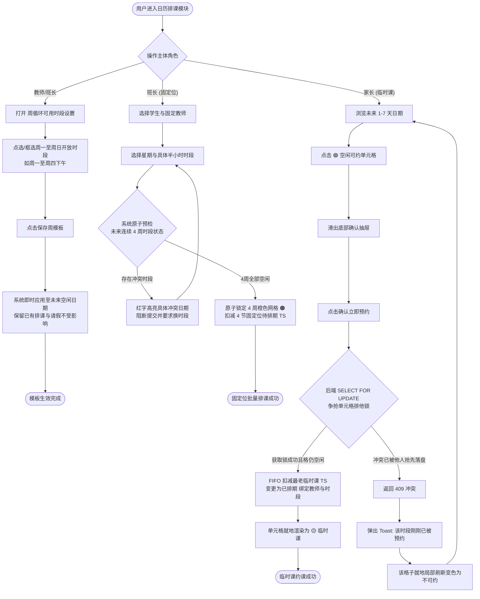

/** (c) 2024-2026 Topee (https://topee.top). All rights reserved. Proprietary and confidential. */

# 产品需求文档 (PRD) — 子模块 3A：7色日历网格与排班抢位引擎 (Calendar & Scheduling Engine)

| 元数据项 | 说明 / 内容 |
|---|---|
| **模块代号** | `m3a` |
| **所属模块** | 模块三：7色智能日历、排班、考勤与课程转让 (Calendar & Scheduling) |
| **文档状态** | 待评审 (Draft) |
| **关联顶层 PRD** | [Prd-v5.md](../Prd-v5.md) |
| **关联规范文档** | [DESIGN.md](../DESIGN.md) ｜ [BUSINESS_RULES.md](../BUSINESS_RULES.md) |
| **关联模块划分** | [system_modules_overview.md](../system_modules_overview.md) |
| **创建与更新日期** | 2026-11-05 |

---

## 1. 概述与执行摘要 (Executive Summary)

7色日历网格与排班抢位引擎（`m3a`）是 Dream 系统的教学时间资产调度与排课中枢。本子模块负责确立全系统标准时间网格体系（每日 06:00-00:00 共 36 个 30 分钟单元格），承载教师周循环常规可授课时段（Availability 模板）配置，驱动统一的 7 色日历状态渲染，并提供 **1v1 四周一轮固定位批量排课**、**1v1 临时课 1-7 天自主抢位预约** 及 **小班课连续双单元格整班排课** 功能。系统通过强一致性并发排他锁保障零超卖与零撞课，推动 TS 资产由 `待排期` 稳态流转至 `已排期`。当前阶段：MVP 正式功能迭代。

---

## 2. 问题定义与背景 (Problem Statement)

- **痛点 1：教师授课时段碎片化，缺少周期性模板**：教师工作时间不固定（如仅周一至周四下午开放），若依靠逐日手动设置，维护成本极高；若默认全天开放，极易导致教师休息时段被误预约。
- **痛点 2：固定位四周连排冲突频发**：固定位要求四周一轮连续锁位，人工逐周确认排期极易忽略中间某一周的休假或已有排课，导致排课中途卡死或产生数据不一致。
- **痛点 3：临时课抢位并发撞课与超卖风险**：多位家长在选课高峰期同时抢占名师热门时段时，若缺乏可靠的排他并发锁，极易产生“一格多排”引发家校纠纷。
- **痛点 4：班型时长不一与网格对齐困难**：1v1 为 25 分钟授课（占 1 格含 5 分钟课间），小班课为 50 分钟授课（连续占用 2 格共 1 小时），若无系统级网格约束，排期容易出现跨网格错位。
- **痛点 5：多端状态判断逻辑冗余割裂**：PC 管理端与移动移动端若各自编写日历染色逻辑，极易导致视觉状态呈现不一致。

---

## 3. 目标用户与角色画像 (Users & Personas)

### 3.1 角色一：一线授课教师（David）
- **角色定位**：教学产能供给方。
- **核心诉求**：在教师端便捷设置周度常规可授课时间模板（如：勾选周一至周四 14:00-18:00 为空闲可约，其余时段保持不可约）；在个人日历上清晰查看已排课程与空闲时段。
- **预期成果**：非开放时段绝对不会被外部排课打扰。

### 3.2 角色二：负责班长（Leo）
- **角色定位**：教学服务调度人与固定位排班执行人。
- **核心诉求**：为新购固定位学生批量锁定未来 4 周橙色时段，系统遇冲突能明确指出哪一周被占；为所辖小班课一键锁定全期连续 1 小时网格。
- **预期成果**：四周固定位一键排定，排期零冲突。

### 3.3 角色三：出资家长（Amy）
- **角色定位**：临时课自主约课人。
- **核心诉求**：提前 1-7 天直观浏览名师的 🟢 空闲可约时段；单手在手机端快速点击完成约课；若恰好被人抢占能获得即时明确提示。
- **预期成果**：课时资产秒级核销，课表即时呈现 🟡 黄色临时课。

### 3.4 角色四：平台管理员（Sarah）
- **角色定位**：全域教学产能监控人。
- **核心诉求**：全局巡视各教师的排课网格与负荷，确保并发排课底层数据绝对严谨，零超卖发生。

---

## 4. 核心业务流程 (Main Flows)

### 4.1 教师常规可用时段模板设置 (Weekly Availability Template)
1. 教师登录教师工作台（或班长登录班长工作台代办），进入【可授课时段设置】。
2. 界面展示标准的 7 天（周一至周日）× 36 单元格（06:00-00:00）网格矩阵，**系统默认全网格置灰为 ⚪【不可约/休息】状态**。
3. 用户根据真实作息，拖拽或点选需要开放的时段（如：勾选周一至周四 14:00 - 18:00 各半小时单元格），将其激活为 🟢【空闲可约】状态。
4. 点击【保存周模板】。
5. 系统立即将该模板规则应用至未来未被占用的所有自然日历网格中；
   - *保护规则*：未来日期中若已有已排期课程（🟠/🟡）或教师单日请假（🔴），原状态严格保留，周模板变更不覆盖已有排课与请假。

### 4.2 1v1 固定位四周一轮批量排课 (Fixed Slot Batch Scheduling)
1. 班长在班长工作台选择学生档案（名下需具备至少 4 节固定位 `待排期` TS 资产）与指定固定授课教师。
2. 班长在排课面板选择起始周、周几与具体时段（如：2026-11-10 起 每周二 19:00-19:30）。
3. 班长点击【批量排满 4 周】。
4. 系统在数据库事务内一次性校验未来连续 4 周（第 1 周、第 2 周、第 3 周、第 4 周）该时段的网格状态：
   - **分支 A（全时段空闲 - 成功）**：4 周网格全部为 🟢【空闲可约】。系统原子将未来 4 周网格锁定为 🟠【固定位】，并在原购课单下扣减 4 节固定位待排期 TS，将其状态原子更新为 `已排期` 并绑定具体的日期与时段。
   - **分支 B（局部周存在冲突 - 阻断）**：若其中任意一周该时段已被占用（如第 3 周已被临时课预约或教师标记休假），事务全部回滚，阻断提交并弹出明确冲突提示（如：“第 3 周 2026-11-24 19:00 该时段已被预约，请更换时段或协调挪位”）。

### 4.2a 固定位到期自动续费预排与“续费预占位（HOLD）”机制
1. **触发时点与排期继承**：
   - 每轮固定位即将完结前 3 天（距离下一轮第 1 节开课前 72 小时），联动子模块 M2A 自动生成续费待付款单（`AUTO_RENEWAL`）；
   - 系统自动以该学生本轮常规有效排期为基准（还原最后一周课表，**排除单次偶发请假干扰**），提取未来 4 周目标上课时段。
2. **网格状态流转为“续费预占（HOLD）”**：
   - 对应目标未来 4 周网格自动从 🟢【空闲可约】流转为 **“🟠 续费预占（HOLD）”** 状态；
   - 视觉上呈现为橙色微虚线卡片，格内显示学员名缩写（如 `Alic`）并标注【预】字角标；
   - **排他互斥保护**：预占期间，其他家长不可预约临时课，班长不可将其排给他人。
3. **班长确认到账转正**：
   - 班长在 M2A 核实收款并点击确认收款后，系统在单一事务内原子将这 4 周预占网格转为正式 🟠【固定位】（实线橙色卡片），TS 资产扣减核销。
4. **班长调课联动移位**：
   - 若班长在 M2A 中修改了预排上课时段，系统联动释放旧的预占网格为 🟢【空闲可约】，并将新调整的时段原子标记为预占（HOLD）。
5. **逾期未付与取消固定自动释放**：
   - 截至开课前 24 小时，若家长仍未付款且班长未确认，M2A 自动将续费单置为 `CANCELLED`（逾期作废），系统自动解除未来 4 周日历预占锁定，网格全额释放为 🟢【空闲可约】；
   - 若班长在 M2A 中主动点击【取消固定（作废）】，日历预占网格亦立即全额释放为 🟢【空闲可约】。

### 4.3 1v1 临时课提前 1-7 天自主抢位与连约预约 (Temporary Lesson Booking & Multi-Slot Reservation)
1. 家长在家长工作台选择孩子档案（名下需具备临时课 `待排期` TS 资产），进入教师周度排期日历。
2. 家长查看未来 **1 - 7 天** 预约窗口内的日历网格（当天不可约当天，超过 7 天置灰不可选）。
3. 家长点击某个 🟢【空闲可约】单元格（格内显示“约”字），底部滑出预约抽屉。
4. **连约选择与连续时段校验**：
   - 抽屉提供排课节数选项：【单约 1 节】（30分钟，授课25分+课间5分）、【连约 2 次课】（连续1小时）、【连约 3 次课】（连续1.5小时）、【连约 4 次课】（连续2小时）；
   - 系统动态实时预检：检查当前时段后续连续的第 2、3、4 个 30 分钟单元格是否同样全为 🟢 空闲，并校验家长名下临时课 TS 资产余额是否充足；
   - 若后续某节已被其他学员预约、处于教师休息或 TS 余额不足，系统将对应连约选项自动置灰禁用，并醒目标注“后段已占”或“资产不足”。
5. 家长选定节数并点击【确认预约】：
   - 系统采用排他并发锁执行原子事务；
   - 检查目标连续 $N$ 个单元格是否仍处于 🟢 空闲；
   - 自动按购课单创建时间 FIFO（先进先出）原则批量匹配并锁定该学员名下最老的最先到期的 $N$ 节临时课 `待排期` TS；
   - 批量扣减这 $N$ 节 TS 并原子更新为 `已排期`，写入授课教师与时段；
   - 将日历上网格原子更新为 🟡【临时课】，格内显示上课学生昵称（前 3-4 个字符，如 `Alic`）。
6. 前端展示预约成功轻量 Toast，对应连续网格即时局部刷新为黄色卡片。

### 4.3a 管理员代约 1v1 临时课 (Admin Temporary Class Booking)
1. 管理员登录管理员后台，进入目标教师的周度排期日历面板。
2. 管理员选择学生档案（支持选择已绑定的常规学员，或状态为 `UNBOUND` 的待认领试课学员）。
3. 管理员选定未来 **1 - 7 天** 内的 🟢【空闲可约】时段（同样严格遵循提前 1-7 天的时间窗口规则）。
4. 点击【确认代约】后，系统在数据库事务内校验该时段空闲状态，扣减该学员名下临时课 `待排期` TS，并将日历网格原子置为 🟡【临时课】，卡片标注学员规范昵称。
5. **线下协同交付**：若该学员为待认领试课学员（`UNBOUND`），系统生成排课记录并锁定老师，由管理员通过线下渠道（如微信）将上课时间、授课外教简介及 ClassIn 进门信息直接发送给家长。
6. **历史记录继承**：试课完结后生成的 `已结课` TS 永远与该 `student_profile_id` 强绑定；家长后续认领该学生档案后，在移动端日历回溯历史周，该节试听课的完课卡片与详情 100% 完整可见。

### 4.4 小班课连续双单元格整班排课 (Small Group Class Scheduling)
1. 小班课班长在小班管理界面选择目标班级（已配置课程类型、授课教师及容纳学员）。
2. 班长设定开班日期及周期性上课时段（如：每周六 10:00-11:00，必须为连续的 2 个 30 分钟单元格）。
3. 提交排课后，系统校验整个周期内每个上课日连续 1 小时的双网格空闲状态。
4. 校验通过后，系统原子锁定双网格，生成对应数量的小班课 TS 实体，全班所有学员课表同步呈现。
5. 小班课为全班统一排期，学生端无个人挪位入口。

### 4.5 高并发抢位冲突与降级兜底 (Concurrency Fallback)
1. 当两位家长同时点击提交同一位教师同一空闲单元格时，服务端事务排他锁确保仅有一方成功落盘。
2. 后到达的事务被判定为冲突，接口返回 `409 TIME_SLOT_ALREADY_BOOKED`。
3. 前端捕获该错误码，弹出轻量 Toast 提示：“该时段刚刚已被其他学员预约，请选择其他时段”。
4. 当前日历单元格在端内就地无感刷新变更为已占用状态，避免页面整页刷新。

### 4.6 周度 Excel 网格多周切换与代课说明文本交互 (Weekly Excel Grid & Substitution Popover)
1. 用户进入日历界面，默认呈现标准周度 Excel 看板，单屏横向展示周一至周日共 7 天列。
2. 顶栏提供周导航组件：支持点击【上一周】、【下一周】及【回到本周】无缝翻页（支持查阅前后各 12 周）。
3. **单元格轻量微卡片与文本缩写**：
   - 格子摒弃刺眼纯色满铺，采用呼吸感浅底背景与精细边框；
   - 🟢 空闲格居中显示单字“约”；⚪ 休息格显示“休”；🔴 请假格显示“假”；
   - 已排课程格（🟠固定位 / 🟡临时课 / 🔵被代课 / 🟣代上课）居中展示学生昵称；超出宽度时自动截取前 3~4 个字符（如 `AliceZ12` 显示 `Alic`），兼顾单屏 7 列的可读性与美观度。
4. **代课格子点击文本提示**：
   - 针对产生代课的单元格（🔵被代课 / 🟣代上课，格内带微型指示点），用户点击后底部滑出详情弹窗，展示代课详细文本：
     - 原任课老师、实际代课老师、调课缘由（如急性咽喉炎请假）；
     - 学员当前课程进度与交接备忘（如 Lesson 12 已完课，本节进入 Lesson 13）；
     - 财务核算归属说明：课酬 100% 结算至代课老师周结单，原教师课酬为 0；班长与家长端明确提示教学进度不受影响。

---

## 5. 用户故事 (User Stories)

- **US-3A-01**：作为一个授课教师，我想要在周模板中仅勾选周一至周四下午开放可约，以便于将上午和周五至周日保留为个人休息时间不被误排。
- **US-3A-02**：作为一个班长，我想要为固定位学生一次性批量排满四周课表，以便于落实买4排4并具备最高优先级橙色锁位。
- **US-3A-03**：作为一个班长，我想要在批量排四周遇到局部周冲突时获得精准的高亮拦截提示，以便于避免排入冲突课次。
- **US-3A-04**：作为一个家长，我想要提前 1-7 天自主为孩子预约临时课，以便于灵活安排周末与课后时间。
- **US-3A-05**：作为一个家长，我想要在抢位失败时获得即时友好的弹窗提示并看到该格自动变灰，以便于快速换选其他时段。
- **US-3A-06**：作为一个小班课班长，我想要一次性为整班排定连续 1 小时的双网格课表，以便于班级学员步调一致。
- **US-3A-07**：作为一个出资家长，我想要临时课约课时自动优先消耗最老购课单的待排课次，以便于避免老课次过期。
- **US-3A-08**：作为一个全端用户，我想要日历在手机端和电脑端均呈现严格统一的 7 色标签，以便于零误解识别课程状态。
- **US-3A-09**：作为一个出资家长，我想要在预约临时课时支持选择连约 2/3/4 次课，以便于一次性排定连续 1~2 小时的长期授课。
- **US-3A-10**：作为一个全端用户，我想要日历在移动端以 Excel 网格式单屏显示全周，格子显示学生姓名简写，点击代课格直读交接说明文本，以便于清晰高效审阅周课表。
- **US-3A-11**：作为一个平台管理员，我想要在后台为未注册的待认领试课学员代约 1-7 天内的临时课，以便于快速协助家长完成试听排期。
- **US-3A-12**：作为一个试课转正家长，我想要在绑定孩子档案后在移动端课表中回溯查阅历史试听课程的完课记录，以便于了解孩子的完整学习轨迹。

---

## 6. 验收标准清单 (Acceptance Criteria)

### 6.1 时间网格与教师可用模板 (Availability)
- **AC-3A-01**：每日营业时间窗严格固定为 06:00 - 00:00，划分为 36 个独立基础单元格，每单元格固定为 30 分钟。
- **AC-3A-02**：新教师档案创建后，周循环模板中全周 7 天共 252 个单元格默认全为 ⚪【不可约/休息】状态。
- **AC-3A-03**：教师或负责班长保存周模板后，未被学生排课（非 🟠/🟡）且未被请假（非 🔴）的未来日期网格即时同步更新为模板设定的状态。
- **AC-3A-04**：周模板的变更绝对不能覆盖或注销未来已排期的任何课程（🟠/🟡）；若周模板将已排课时段修改为不可约，系统保留原排课不变并弹出安全提示条。

### 6.2 1v1 固定位批量排课与续费预占位规约
- **AC-3A-05**：固定位排课必须以连续 4 周为最小执行单位，单次排课严格消耗 4 节固定位 `待排期` TS 资产；名下有效固定位待排期 TS 不足 4 节时提交按钮置灰阻断。
- **AC-3A-06**：系统必须在单一数据库事务内原子校验未来连续 4 周目标时段的空闲状态；若任意 1 周非 🟢 空闲，事务全额回滚，返回错误码 `409 SCHEDULE_SLOT_CONFLICT` 并标明冲突的具体日期与时段。
- **AC-3A-07**：固定位排课成功后，未来 4 周对应单元格在全端统一渲染为 🟠【固定位】（Tailwind 规范色值 `bg-amber-500`），关联 TS 状态更新为 `已排期`。
- **AC-3A-07a**：续费预占位（HOLD）生成规范：距离下一轮首节开课前 72 小时，系统联动 M2A 自动生成续费待付款单，并将对应的未来 4 周目标时段自动置为“续费预占（HOLD）”状态；视觉呈现为橙色微虚线卡片，标注学员名缩写及【预】字角标；预占期间对全平台排他，禁止其他学员预约临时课或班长分配其他排课。
- **AC-3A-07b**：预占位转正与移位联动：班长在 M2A 确认收款后，系统在单一事务内原子将这 4 周预占网格转为正式 🟠【固定位】；若班长在 M2A 中调整了排课时段，系统联动释放旧时段为 🟢【空闲可约】，将新时段原子置为预占（HOLD）。
- **AC-3A-07c**：开课前 24h 逾期释放规范：截至距离下一轮首节开课前 24 小时，若续费单仍未确认收款（触发逾期作废），或班长在 M2A 中主动点击【取消固定（作废）】，系统自动解除该学生名下的日历预占锁定，未来 4 周网格 100% 释放为 🟢【空闲可约】。

### 6.3 1v1 临时课自主预约与连约规约
- **AC-3A-08**：家长端仅允许预约距当前时间 **1 - 7 天** 内的单元格；当天时段与超过 7 天的时段必须置灰禁用。
- **AC-3A-09**：临时课仅允许消耗名下“临时课购课单”生成的 `待排期` TS；名下无可用临时课 TS 时，点击空闲单元格提示“暂无可用临时课课时，请先购课”。
- **AC-3A-10**：系统必须按购课单创建时间 FIFO（先进先出）原则自动拣选并扣减最老的一笔（或连约时前 $N$ 笔）临时课 `待排期` TS。
- **AC-3A-11**：临时课预约支持【单约 1 节】（30 分钟网格，授课 25 分钟 + 课间 5 分钟缓冲）以及【连约 2 次课】（连续 1 小时）、【连约 3 次课】（连续 1.5 小时）、【连约 4 次课】（连续 2 小时）。
- **AC-3A-11a**：连约连续性空闲校验：当用户选择连约 $N$ 节时，系统必须原子校验目标起始单元格及后续第 $2 \sim N$ 个相邻半小时网格是否全部为 🟢【空闲可约】状态；若任意一节非空闲，对应连约选项置灰禁用并标注“后段已占”。
- **AC-3A-11b**：连约 TS 资产校验：系统必须校验该学生名下有效临时课待排期 TS 余额是否 $\ge N$；若不足，对应连约选项置灰禁用并标注“资产不足”。
- **AC-3A-11c**：确认连约时，系统在单一数据库事务内原子将这连续 $N$ 个单元格批量更新为 🟡【临时课】，并原子扣减 $N$ 节 TS。
- **AC-3A-11d**：管理员后台代约临时课规范：仅限平台管理员具备在后台为已激活学员或 `UNBOUND` 待认领学员代约 1v1 临时课的权限；代约同样遵循提前 1-7 天时间窗及行级排他锁校验，成功后扣减对应待排期 TS 并锁定日历网格为 🟡【临时课】。
- **AC-3A-11e**：课表历史资产继承规范：当 `UNBOUND` 试课档案被家长成功认领（状态转为 `ACTIVE`）后，该档案名下历史所有已排期与已完课（结课）TS 课表数据在家长端周日历中 100% 完整透出，支持家长向前翻页回溯查看，保障学习轨迹与教学记录的完整连贯性。

### 6.4 小班课连续双单元格排课
- **AC-3A-12**：小班课排课必须连续占用 2 个相邻的 30 分钟单元格（总计 1 小时，授课 50 分钟 + 10 分钟课间缓冲），严禁跨时段断裂排课。
- **AC-3A-13**：小班课排课成功后，连续 2 个单元格均锁定为该班级排课状态，对全班名册内的学员课表统一生效展示。

### 6.5 高并发防超卖与排他锁
- **AC-3A-14**：排课接口必须在后端事务内对目标时间单元格启用行级排他锁（`FOR UPDATE`）；并发场景下确保同一教师同一时段仅允许成功排入 1 节 1v1 课程（或 1 节小班课）。
- **AC-3A-15**：并发抢位失败时，接口统一返回 `409 TIME_SLOT_ALREADY_BOOKED`，前端弹出轻量 Toast 提示并在 300ms 内就地局部刷新该单元格颜色。

### 6.6 7色日历 Excel 网格视觉、文字精简与代课弹窗规范
- **AC-3A-16**：日历接口返回的每个网格 DTO 必须携带后端统一预计算的 `colorCode` 枚举字段（`ORANGE | YELLOW | BLUE | PURPLE | GRAY | GREEN | RED`）与 `colorLabel` 文本；前端组件不得自行编写复杂的代课与权限反推逻辑。
- **AC-3A-17**：日历采用类似 Excel 网格结构，单屏呈现周一至周日全周 7 天排期：
  - **移动端 (390px)**：时间轴列固定为 40px 吸附左侧（Freeze Column），周一至周日 7 列均分剩余宽度（每列约 50px），**在 390px 手机屏上单屏完整容纳 7 天，无需横向滚动**；
  - **平板端 (768px)**：网格自适应铺满全宽，每列 90px+；
  - **周切换导航**：顶栏常驻【上一周】、【下一周】及【回到本周】快速切换控件，最多支持前后翻阅各 12 周。
- **AC-3A-18**：单元格轻量微卡片与字符显示规范（告别生硬纯色块满铺）：
  - 单元格内设柔和圆角卡片（`rounded-md` + 留白间距），采用浅底背景配合精致细边框；
  - 🟢【空闲可约】格内居中显示单字“约”（英文或 1-3 字符如“约”/“Avail”）；
  - ⚪【教师休息】格内显示“休”；🔴【教师请假】格内显示“假”；
  - 已排课程格（🟠固定位 / 🟡临时课 / 🔵被代课 / 🟣代上课）清晰居中显示学员昵称；若超出单元格宽度，**自动截取显示前 3~4 个字符**（如 `AliceZ12` 显示 `Alic`，`BobZ10` 显示 `BobZ`，`CharlieC09` 显示 `Char`）；点击格子弹出完整全名。
- **AC-3A-19**：代课说明文本弹窗规范：
  - 针对带有代课标记的网格（🔵被代课 / 🟣代上课，格内带微型指示点），用户点击后滑出详情弹窗，必须完整呈现代课文本说明：
    1. 原任课老师与实际代课老师姓名及定级；
    2. 调课缘由（如急性咽喉炎请假获批）；
    3. 学员当前上课进度与交接备忘（如 Lesson 12 已完课，本节进入 Lesson 13）；
    4. 财务课酬结算归属说明：课酬 100% 结算至代课老师周结单，原授课老师课酬为 0；班长与家长端明确提示教学服务与进度不受影响。

---

## 7. 本期范围外清单 (Out of Scope)

- **学生或教师请假与销假**：归属子模块 M3B，本模块仅承载请假结果网格的空闲/占用展示。
- **同师改期挪位与临时代课调度**：归属子模块 M3B，本模块不包含代课老师指派及双视角染色推导。
- **未上课 TS 跨学生/跨家长转让**：归属子模块 M3C，本模块仅生成基础排期。
- **外部日历（Google Calendar / Apple iCal）双向同步**：本期不支持外部日历订阅与同步。
- **次日凌晨自动结课跑批**：归属模块五，本模块仅管理营业期内的排课态。

---

## 8. 约束条件 (Constraints)

### 8.1 业务与合规约束
- **营业时间窗红线**：全天营业时段严格限制为 06:00 - 00:00，营业窗外（00:00 - 06:00）严禁排课与约课。
- **固定位优先级原则**：固定位排课具备最高优先级，四周排满后不可随意被临时课插队。
- **资产专款专用原则**：临时课约课严格限制消耗临时课待排期 TS，禁止跨品类挪用固定位待排课次。

### 8.2 功能与规格限制
| 约束项 | 指标规格 / 限制值 |
|---|---|
| 日历时间粒度 | 30 分钟 / 单元格（全天 36 格） |
| 1v1 授课与网格 | 授课 25 分钟 + 课间 5 分钟，占 1 格 |
| 小班课授课与网格 | 授课 50 分钟 + 课间 10 分钟，连续占 2 格 (1小时) |
| 临时课预约时间窗 | 未来 1 天 至 7 天（当天不可约当天） |
| 固定位排课跨度 | 未来 4 周 至 8 周 |
| 日历视窗最大滚动周期 | 前后各 12 周 |
| 单周循环模板格子数 | 7 天 × 36 格 = 252 个独立开关状态 |

### 8.3 外部文档与参照依据
| 文档名称 | 存放路径 / 链接 | 使用场景说明 |
|---|---|---|
| 教务排班与分账 PRD v5.1 | docs/Prd-v5.md | 营业时间、固定位、临时课规则基准 |
| UI 视觉与设计系统 | DESIGN.md | 7 色日历 Design Tokens、单屏 7 列网格规范 |
| 核心业务规则与财务分账规约 | docs/BUSINESS_RULES.md | 12.5% 请假配额与 3h 熔断时间窗红线与资产隔离 |

---

## 9. UI/UX 界面线框说明 (Wireframe Level)

### 9.1 教师/班长端 — 周循环可用时段设置面板 (Availability Setting)
- **界面结构与布局**：
  - **顶部操作栏**：标题“教师常规可授课时段模板”、一键全选/清空快捷按钮、当前教师下拉选择（班长端专有）、【保存并生效】主按钮。
  - **主体网格区**：横向为周一至周日共 7 列；纵向为 06:00 至 24:00 每半小时一行（共 36 行）。每个格子为可点击的开关小方块。
  - **状态区分**：默认未开启状态为 ⚪ 灰色浅底（标注“不可约/休息”）；激活开启状态为 🟢 绿色高亮（标注“可约”）。
- **交互元素与行为**：
  - 支持单格点击切换状态；
  - 支持按住鼠标纵向/横向框选拖拽批量激活或批量关闭（如拖选周一至周四 14:00-18:00 一次性点亮 32 个格子）；
  - 点击“保存并生效”后，弹出轻量确认提示：“已应用周模板，未来所有未被排课的空闲日期将自动更新为该时间表”。

### 9.2 班长工作台 — 1v1 固定位四周批量排课弹窗 (Batch Schedule Modal)
- **界面结构与布局**：
  - **头部**：学生档案名称、所选意向教师、课程类型、学生当前可用固定位 TS 余额（需 $\ge 4$）。
  - **时间选择器**：选择起始周（支持当前周或未来周）、周几（周一到周日）、授课时间段（下拉选择 30 分钟单元格）。
  - **4 周日历预检条 (Pre-check Grid)**：下方就地罗列未来连续 4 周具体日期与时间卡片（Week 1: 11-10, Week 2: 11-17, Week 3: 11-24, Week 4: 12-01）：
    - 全绿时展示：全部空闲可锁定；
    - 局部冲突时展示：冲突周卡片红框高亮，标注“冲突：已有排课 [学生名]”或“教师标记休息”，底部提交按钮禁用。
  - **操作按钮**：【取消】、【确认批量排满四周】。

### 9.3 家长/教师工作台 — 周度 Excel 7色网格看板与连约/代课弹窗 (Mobile/Tablet UX)
- **界面结构与布局**：
  - **顶部周切换导航**：【上一周】、【当前周次（如 2026年第46周）】、【本周】快速定位按钮、【下一周】。
  - **7 色图例栏**：吸顶展示 7 色微卡片图例与含义，并实时显示当前名下临时课可用待排节数。
  - **主体 Excel 网格看板（单屏完整容纳 7 天）**：
    - **首列时间轴**：左侧冻结（Freeze Column）40px，纵向罗列半小时时段；
    - **周一至周日 7 列**：均分剩余宽度（手机 390px 下每列约 50px，平板 768px 下每列 90px+），**单屏无需横向滑动即可全览整周**；
    - **轻量微卡片与文本缩写**：
      - 摒弃生硬铺满色块，采用呼吸感浅底背景 + 细边框 + 圆角微卡片结构；
      - 🟢 空闲格居中显示单字“约”；⚪ 休息格显示“休”；🔴 请假格显示“假”；
      - 排班格（🟠/🟡/🔵/🟣）居中显示学员名缩写（前 3~4 个字符，如 `Alic`、`BobZ`），代课格带右上角微型指示点。
- **交互与抽屉面板 (Bottom Sheet)**：
  - **点击代课格子（🔵/🟣）**：
    - 底部滑出代课文本详情卡片，完整呈现：原教师、代课老师、请假缘由、学员上课进度备忘、财务课酬归属 100% 结算代课老师说明。
  - **点击 🟢 空闲单元格（在 1-7 天窗口内）**：
    - 底部滑出连约配置抽屉：提供【单约 1 节】、【连约 2 节】、【连约 3 节】、【连约 4 节】选择按钮；
    - 自动检测后续连续时段空闲状态与临时课 TS 资产配额；后续时段被占用标注“后段已占”，配额不足标注“资产不足”；
    - 底部大按钮显示实时汇总：“确认预约 N 节课 (消耗 N 节TS)”，点击后连续 N 节就地原子刷新变更为黄色卡片。
  - **抢位失败反馈**：若被他人抢先，弹出 Toast“该时段刚刚已被其他学员预约”，对应格子在 300ms 内局部刷新为不可约。

### 9.4 PC 管理端 — 全景排班总日历看板 (Web Full Schedule Grid)
- **界面结构与布局**：
  - 顶部筛选器：按负责班长筛选、按教师筛选、按课程类型筛选、周视图 / 月视图切换按钮、上周/下周翻页导航。
  - 主排班表：标准 7 列列阵，直观显示每位教师、每个时段的当前状态色彩（7 色矩阵）。
  - 单元格悬浮 Tooltip：悬浮展示 TS 详情（学生昵称、原购课单号、授课时长、是否转让）。

---

## 10. 用户流程图 (User Flow Diagram)

---

## 11. 智能体/系统决策行为规范 (System Decision Rules Engine)

- **系统允许自动执行 (Allowed Operations)**：
  - 距离下一轮首节开课前 72 小时，联动 M2A 自动为固定位学员施加下一轮 4 周“续费预占（HOLD）”排他锁定（继承常规课表，排除偶发请假）；
  - 开课前 24 小时若续费单逾期未付款，自动解除预占并将未来 4 周日历网格全额释放为 🟢【空闲可约】；
  - 教师保存周模板后，自动扫描并应用到未来所有未被排课的空闲日期网格；
  - 临时课约课时，系统自动按创建时间 FIFO 匹配最老有效临时课 `待排期` TS，无需人工手动选单；
  - 批量排固定位时，事务内自动对连续 4 周所有目标网格施加行级排他锁，零超卖零插队；
  - 接口下发 DTO 时，Service 层自动完成 7 色色值与文本标签的统一预计算。
- **系统绝对禁止 (Strictly Forbidden Operations)**：
  - **严禁**将周模板的不可约变更覆盖未来已经存在的排课实体（🟠/🟡）或续费预占位（HOLD）；
  - **严禁**允许家长预约当前当天（距开课 $<24$ 小时且属当天）或超过 7 天外的临时课；
  - **严禁**允许临时课或新排课抢占处于“续费预占（HOLD）”保护期内的网格；
  - **严禁**消耗固定位待排期 TS 去预约临时课时段（专款专用）；
  - **严禁**小班课在非连续的 2 个单元格中跨时段拆解排课；
  - **严禁**在发生行锁并发冲突时跳过校验强行落盘双重排课。
- **无法判定/异常时的退避与人工兜底逻辑**：
  - 当固定位批量校验发现底层数据存在历史脏数据冲突时，事务全额回滚，阻断操作并提示经办人联系系统管理员排查；
  - 高并发抢位落锁超时（等待锁超过 3 秒）时，系统主动退避释放事务，返回轻量提示“当前预约人数较多，请稍后重试”，防止数据库连接池耗尽。

---

## 12. 待定事项与补充说明 (Further Notes)

- **本期已敲定并落盘决策**：
  1. 模板机制：周一至周日 7 天 × 36 格周循环基准模板，默认置灰不可约，按需勾选开放（如周一至周四下午），即时应用于未来空闲日期。
  2. 固定位：4 周一轮整单原子校验，遇到任何一周冲突整体阻断并指出具体冲突日期。
  3. 临时课：严格限制未来 1-7 天内预约，底层自动按 FIFO 优先扣减最老临时课待排期 TS。
  4. 小班课：标准 50 分钟授课，连续占用 2 个 30 分钟单元格（共 1 小时），建班时班长一次性排定全期，全班同步生效。
  5. 高并发：数据库行级排他锁防超卖，冲突时轻量 Toast 提示并在 300ms 内局部刷新单元格，避免整页重载。
  6. 视窗限制：临时课预约 1-7 天，固定位排课 4-8 周，日历视图最多支持前后滚动查看 12 周。
  7. 周度单屏 Excel 网格与微卡片排版：全端采用 Excel 风格周看板，手机端（390px）左侧固定时间轴（40px），周一至周日 7 列单屏全铺开，无需横向滚动；摒弃生硬铺满色块，采用呼吸感浅底细边框微卡片。
  8. 格内文字精简与学员名截断：空闲格居中显示单字“约”；排班格居中显示学员昵称，超出列宽自动截取前 3~4 个字符（如 `Alic`、`BobZ`）；点击弹窗查看完整全名。
  9. 临时课连约 2/3/4 次课机制：支持单约与连约 2/3/4 节，原子校验后续时段空闲状态与 TS 配额余额，提供“后段已占”/“资产不足”阻断提示，一键批量锁定。
  10. 代课格子文本详情弹窗：代课格显示微型指示点，点击弹出包含原任课老师、代课老师、请假调课缘由、学员进度交接备忘及课酬 100% 结算至代课老师的完整说明卡片。
  11. 固定位到期自动续排与“续费预占（HOLD）”闭环：距离开课前 72 小时自动以本轮常规排期（排除偶发请假）预占下轮 4 周网格并联动 M2A 生成续费单；班长核实到账点击确认后网格原子转为正式固定位 🟠；开课前 24 小时未付或班长作废单据时，网格自动全额释放为 🟢【空闲可约】。
- **后续版本演进考量 (Future Backlog)**：
  - 节假日公共日历模板（如国庆、春节期间，一键将全校教师周模板批量标记为休假不可约）。
