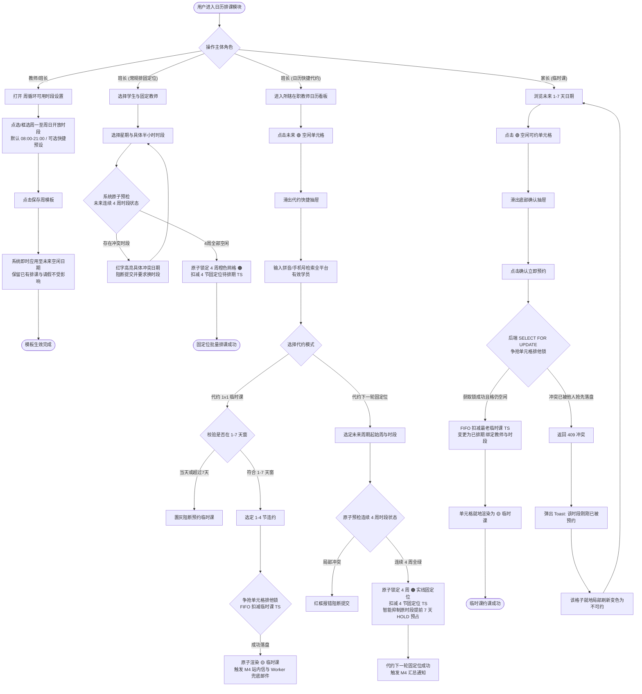
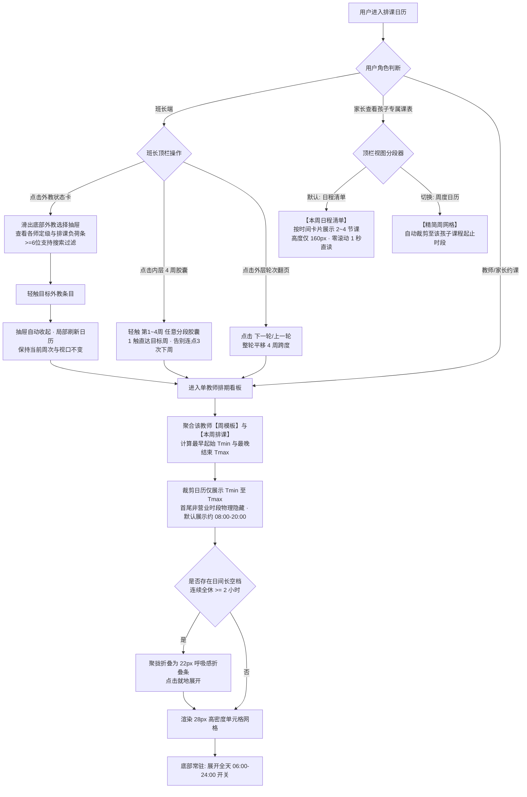

/** (c) 2024-2026 Topee (https://topee.top). All rights reserved. Proprietary and confidential. */

# 产品需求文档 (PRD) — 子模块 3A：7色日历网格与排班抢位引擎 (Calendar & Scheduling Engine)

| 元数据项 | 说明 / 内容 |
|---|---|
| **模块代号** | `m3a` |
| **所属模块** | 模块三：7色智能日历、排班、考勤与课程转让 (Calendar & Scheduling) |
| **文档状态** | 待评审 (Draft) |
| **关联顶层 PRD** | [Prd-v5.md](../Prd-v5.md) |
| **关联规范文档** | [DESIGN.md](../DESIGN.md) ｜ [BUSINESS_RULES.md](../BUSINESS_RULES.md) |
| **关联模块划分** | [system_modules_overview.md](../system_modules_overview.md) |
| **创建与更新日期** | 2026-11-05 |

---

## 1. 概述与执行摘要 (Executive Summary)

7色日历网格与排班抢位引擎（`m3a`）是 Dream 系统的教学时间资产调度与排课中枢。针对少儿教务中“外教常规作息集中于 08:00-20:00、全量 36 行死板网格导致首尾大片无意义休息格与手机端搓屏疲劳”的现实痛点，本子模块确立了以 30 分钟为标准颗粒度的时间资产调度底盘，并创新引入**“智能外接时间窗（Dynamic Bounding Box）”与“长空档自动折叠（Gap Folding）”**，日历网格告别生硬全量渲染 06:00-24:00，自动根据教师周模板与实际排课动态裁切首尾非营业时段，将纵向页面高度大幅压缩 35%~50%，并在移动端将单元格行高紧凑优化至 28px 高密度 Excel 网格以实现单屏尽览。

针对“班长日常管辖 3 个以上外教”的管理统筹诉求，系统打造了**“带负荷透视的多教师状态卡 + 移动端底部切换抽屉 (Bottom Sheet)”**，单触即查各外教排课与空闲负荷；针对 1v1 固定位“买4排4”的核心周期特征，日历顶栏首创**“4周一轮”极速分段导航条 (4-Week Cycle Fast Nav)**，彻底终结跨周查课连点 3 次“下一周”的繁琐操作，支持 1 键盲点直达轮内任意一周，并支持按 4 周整轮快进平移。

面向出资家长端，系统针对“孩子一周仅 2-4 节课”的查课特征，打造了**“本周日程清单（Agenda View，零滚动 1 秒直读）+ 精简周网格（Grid View）”双视图**；面向教师与班长端，周度可授课时段模板面板默认收敛至 08:00-21:00 核心营业窗并提供作息一键预设。引擎全面支持 **1v1 四周一轮固定位批量排课与提前 7 天（最后一周周一 08:30）HOLD 预占**、**1v1 临时课 1-7 天自主抢位预约（支持 1-4 节连约）** 及 **班长管辖教师快捷代约**。系统通过强一致性并发排他锁保障零超卖与零撞课，推动 TS 资产由 `待排期` 稳态流转至 `已排期`。当前阶段：MVP 正式功能迭代。

---

## 2. 问题定义与背景 (Problem Statement)

- **痛点 1：教师授课时段碎片化，缺少周期性模板**：教师工作时间不固定（如仅周一至周四下午开放），若依靠逐日手动设置，维护成本极高；若默认全天开放，极易导致教师休息时段被误预约。
- **痛点 2：固定位四周连排冲突频发**：固定位要求四周一轮连续锁位，人工逐周确认排期极易忽略中间某一周的休假或已有排课，导致排课中途卡死或产生数据不一致。
- **痛点 3：临时课抢位并发撞课与超卖风险**：多位家长在选课高峰期同时抢占名师热门时段时，若缺乏可靠的排他并发锁，极易产生“一格多排”引发家校纠纷。
- **痛点 4：班型时长不一与网格对齐困难**：1v1 为 25 分钟授课（占 1 格含 5 分钟课间），小班课为 50 分钟授课（连续占用 2 格共 1 小时），若无系统级网格约束，排期容易出现跨网格错位。
- **痛点 5：多端状态判断逻辑冗余割裂**：PC 管理端与移动移动端若各自编写日历染色逻辑，极易导致视觉状态呈现不一致。
- **痛点 6：全量 36 行死板网格导致上下休息格子过多与视口过度拉长**：原方案固定展示全天 06:00-24:00 共 36 行（高度超 1200px），而 90% 以上教师授课集中在 08:00-20:00，早晨与深夜充斥大量无意义的 ⚪ 灰色“休”废格，用户在移动端必须频繁上下滑动 2 整屏；且家长查看孩子个人周课表时，在 36 行大表中查找 2-3 节课犹如大海捞针，查阅效率低下。
- **痛点 7：班长管理 3 个以上外教时横向排版溢出与负荷盲切**：班长通常管辖 3~10 位在职外教，原有简易横排药丸按钮在手机端无法容纳多师，且切换时看不到各外教当前周的排课负荷（不知谁满谁空），导致调度效率低下。
- **痛点 8：4 周一轮固定位排课查课时逐周翻页繁琐疲劳**：固定位排课以“4 周一轮（买4排4）”为核心业务单元，用户查阅或对比第 4 周排期时，必须连点 3 次“下一周”等待 3 次刷新，回看第 1 周又需连点 3 次“上一周”，操作链路长且极易迷失当前所处轮次位置。

---

## 3. 目标用户与角色画像 (Users & Personas)

### 3.1 角色一：一线授课教师（David）
- **角色定位**：教学产能供给方。
- **核心诉求**：在教师端便捷设置周度常规可授课时间模板（模板面板默认聚焦 08:00-21:00 常用营业窗，支持一键套用晚间高峰预设）；在个人日历上仅看到自己设定的可授课区间与排课，早晚无课休息时段自动隐去，页面紧凑清爽无需上下滚屏。
- **预期成果**：非开放时段绝对不会被外部排课打扰，个人排班一屏看清。

### 3.2 角色二：负责班长（Leo）
- **角色定位**：教学服务调度人与固定位排班执行人。
- **核心诉求**：
  1. **多师统筹**：管辖 $\ge 3$ 位外教时，通过顶部外教负荷状态卡与底部抽屉 1 触切换外教，并在切换时一眼透视各外教的本周排课量与剩余空额；
  2. **4 周极速切换**：通过“4 周一轮”分段胶囊按钮 1 键直达第 1~4 周，或通过轮次按钮一键跨 4 周平移预排下一轮；
  3. **四周固定位排期**：为新购固定位学生批量锁定未来 4 周橙色时段，排期零冲突，特殊早晚时段可一键展开全天。
- **预期成果**：四周固定位一键排定，多师调度得心应手，跨周查课零延迟。

### 3.3 角色三：出资家长（Amy）
- **角色定位**：临时课自主约课人与孩子上课监督人。
- **核心诉求**：
  1. **约课场景**：提前 1-7 天浏览名师日历时，界面仅展示该外教开放的有效时段，绿色 🟢“约”集中饱满，无需在大量灰色“休”中翻找；
  2. **看孩课表场景**：查看孩子周课表时，默认以【本周日程清单】卡片流 1 秒直读上课时间、外教与教室号，零滚动即可全览，亦可切换为紧凑周日历网格。
- **预期成果**：课时资产秒级核销，选课与查课体验流畅极简。

### 3.4 角色四：平台管理员（Sarah）
- **角色定位**：全域教学产能监控人。
- **核心诉求**：全局巡视各教师的排课网格与负荷，首尾无效时段自动紧凑裁剪，确保并发排课底层数据绝对严谨，零超卖发生。

---

## 4. 核心业务流程 (Main Flows)

### 4.1 教师常规可用时段模板设置 (Weekly Availability Template)
1. 教师登录教师工作台（或班长登录班长工作台代办），进入【可授课时段设置】。
2. **核心时段默认聚焦与早晚非常规折叠**：
   - 界面网格默认收敛展示 **08:00 至 21:00** 核心营业区间（共 26 行 × 7 天），**系统默认全网格置灰为 ⚪【不可约/休息】状态**；
   - 清晨（06:00-08:00，4行）与深夜（21:00-24:00，6行）默认收纳至网格顶底的 `[+ 展开早晚非常规时段]` 折叠栏中，点击即可按需展开，避免初次加载视觉冗长。
3. **极速作息预设 (Shift Presets)**：
   - 顶部提供一键预设快捷按钮：
     - `[ 晚间高峰 (周一至周五 17:00-21:00) ]`：一键点亮平时晚间课段；
     - `[ 白天高峰 (周一至周五 08:00-18:00) ]`：一键点亮全职外教全天段；
     - `[ 周末全天 (周六日 09:00-20:00) ]`：一键点亮周末授课段；
     - `[ 全部清空 (重置为休) ]` ｜ `[ 全时段开启 ]`。
4. 用户根据真实作息，拖拽或点选需要开放的时段（如：勾选周一至周四 14:00 - 18:00 各半小时单元格），将其激活为 🟢【空闲可约】状态。
5. 点击【保存周模板】。
6. 系统立即将该模板规则应用至未来未被占用的所有自然日历网格中；
   - *保护规则*：未来日期中若已有已排期课程（🟠/🟡）或教师单日请假（🔴），原状态严格保留，周模板变更不覆盖已有排课与请假。

### 4.2 1v1 固定位四周一轮批量排课 (Fixed Slot Batch Scheduling)
1. 班长在班长工作台选择学生档案（名下需具备至少 4 节固定位 `待排期` TS 资产）与指定固定授课教师。
2. 班长在排课面板选择起始周、周几与具体时段（如：2026-11-10 起 每周二 19:00-19:30）。
3. 班长点击【批量排满 4 周】。
4. 系统在数据库事务内一次性校验未来连续 4 周（第 1 周、第 2 周、第 3 周、第 4 周）该时段的网格状态：
   - **分支 A（全时段空闲 - 成功）**：4 周网格全部为 🟢【空闲可约】。系统原子将未来 4 周网格锁定为 🟠【固定位】，并在原购课单下扣减 4 节固定位待排期 TS，将其状态原子更新为 `已排期` 并绑定具体的日期与时段。
   - **分支 B（局部周存在冲突 - 阻断）**：若其中任意一周该时段已被占用（如第 3 周已被临时课预约或教师标记休假），事务全部回滚，阻断提交并弹出明确冲突提示（如：“第 3 周 2026-11-24 19:00 该时段已被预约，请更换时段或协调挪位”）。

### 4.2a 固定位到期自动续费预排与“续费预占位（HOLD）”机制
1. **触发时点与排期继承**：
   - 每轮固定位最后一周周一上午 08:30（提前 7 天），联动子模块 M2A 自动生成续费待付款单（`AUTO_RENEWAL`）；系统同步向家长派发首封账单提醒通知；
   - 系统自动以该学生本轮常规有效排期为基准（还原最后一周课表，**排除单次偶发请假干扰**），提取未来 4 周目标上课时段。
2. **网格状态流转为“续费预占（HOLD）”**：
   - 对应目标未来 4 周网格自动从 🟢【空闲可约】流转为 **“🟠 续费预占（HOLD）”** 状态；
   - 视觉上呈现为橙色微虚线卡片，格内显示学员名缩写（如 `Alic`）并标注【预】字角标；
   - **排他互斥保护**：预占期间，其他家长不可预约临时课，班长不可将其排给他人。
3. **班长确认到账转正**：
   - 班长在 M2A 核实收款并点击确认收款后，系统在单一事务内原子将这 4 周预占网格转为正式 🟠【固定位】（实线橙色卡片），TS 资产扣减核销。
4. **班长调课联动移位**：
   - 若班长在 M2A 中修改了预排上课时段，系统联动释放旧的预占网格为 🟢【空闲可约】，并将新调整的时段原子标记为预占（HOLD）。
5. **逾期未付与取消固定自动释放**：
   - 截至开课前 24 小时，若家长仍未付款且班长未确认，M2A 自动将续费单置为 `CANCELLED`（逾期作废），系统自动解除未来 4 周日历预占锁定，网格全额释放为 🟢【空闲可约】；
   - 若班长在 M2A 中主动点击【取消固定（作废）】，日历预占网格亦立即全额释放为 🟢【空闲可约】。

### 4.3 1v1 临时课提前 1-7 天自主抢位与连约预约 (Temporary Lesson Booking & Multi-Slot Reservation)
1. 家长在家长工作台选择孩子档案（名下需具备临时课 `待排期` TS 资产），进入教师周度排期日历。
2. 家长查看未来 **1 - 7 天** 预约窗口内的日历网格（当天不可约当天，超过 7 天置灰不可选）。
3. 家长点击某个 🟢【空闲可约】单元格（格内显示“约”字），底部滑出预约抽屉。
4. **连约选择与连续时段校验**：
   - 抽屉提供排课节数选项：【单约 1 节】（30分钟，授课25分+课间5分）、【连约 2 次课】（连续1小时）、【连约 3 次课】（连续1.5小时）、【连约 4 次课】（连续2小时）；
   - 系统动态实时预检：检查当前时段后续连续的第 2、3、4 个 30 分钟单元格是否同样全为 🟢 空闲，并校验家长名下临时课 TS 资产余额是否充足；
   - 若后续某节已被其他学员预约、处于教师休息或 TS 余额不足，系统将对应连约选项自动置灰禁用，并醒目标注“后段已占”或“资产不足”。
5. 家长选定节数并点击【确认预约】：
   - 系统采用排他并发锁执行原子事务；
   - 检查目标连续 $N$ 个单元格是否仍处于 🟢 空闲；
   - 自动按购课单创建时间 FIFO（先进先出）原则批量匹配并锁定该学员名下最老的最先到期的 $N$ 节临时课 `待排期` TS；
   - 批量扣减这 $N$ 节 TS 并原子更新为 `已排期`，写入授课教师与时段；
   - 将日历上网格原子更新为 🟡【临时课】，格内显示上课学生昵称（前 3-4 个字符，如 `Alic`）。
6. 前端展示预约成功轻量 Toast，对应连续网格即时局部刷新为黄色卡片。

### 4.3a 管理员全域代约课（1v1 临时课与跨周期固定位） (Admin Proxy Booking)
1. **低频支撑与操作入口**：本功能为低频教务支撑通道，管理员无需复杂专属调度大看板，直接通过查看目标教师周排期表或目标学员排期表唤起代约面板。
2. **学员与教师适用范围**：管理员支持为全平台处于 `ACTIVE` 状态的任意学生档案及 `UNBOUND` 待认领试课学员，在全平台任意在职外教日历中执行代约。**跨班长借用外教排课需求，统一由平台管理员在此通道统筹代约**。
3. **1v1 临时课代约**：遵循 1-7 天时间窗与连续半小时网格空闲校验，按 FIFO 扣减学生名下临时课 `待排期` TS，启用行级排他锁落盘为 🟡【临时课】。
4. **1v1 跨周期固定位代约**：以连续 4 周为单元，原子扣减 4 节固定位 `待排期` TS，直接渲染为实线 🟠【固定位】。
5. **严禁挤占提前 7 天续费专属保护期（HOLD）铁律**：若目标时段处于其他老学员提前 7 天（最后一周周一 08:30 自动生成）续费专属保护期（微虚线预占），**系统强行置灰锁定并阻断提交，严禁任何管理员或代约人挤占老学员续费专属时段**，坚决保障老学员与负责班长的既有权益。
6. **多角色协同与 M4 通知**：代约成功后，系统在 10 秒内向家长及授课外教发送通知，并**同步抄送该外教的负责班长**（标明具体经办管理员账号，如 `Sarah`），确保负责班长对名下外教排期完全知情。若学员为 `UNBOUND` 试课学员，管理员通过线下渠道（微信）向家长交付 ClassIn 进门信息。
7. **历史记录继承**：试课完结后生成的 `已结课` TS 永远与该 `student_profile_id` 强绑定；家长后续认领该学生档案后，在移动端日历回溯历史周，该节试听课的完课卡片与详情 100% 完整可见。

### 4.3b 班长代约课（1v1 临时课与下一轮固定位） (Monitor Class Booking)

1. **教师单向归属管辖模型**：
   - **管辖边界**：班长仅能在其当前管辖的在职授课教师（`teacher.monitor_id == current_monitor_id` 且 `teacher.status == 'ACTIVE'`）的周度排班日历中触发代约操作；严禁跨班长代约其他班长旗下的教师时段。
   - **学员池穿透检索**：代约学员检索面向全平台处于 `ACTIVE` 激活状态的学生档案开放（支持通过拼音、昵称、手机号模糊检索），不限制学员原始购课单的出资收款班长。这保障了教务资源的灵活统筹与跨班跨师流动。
2. **场景一：班长代约 1v1 临时课**：
   - **1-7 天时间窗准入**：目标起始单元格必须处于距当前时间 **1 - 7 天** 的空闲时段（当天时段与超过 7 天的时段置灰阻断），严禁代约当天课次。
   - **单约与连约支持**：支持【单约 1 节 (30m)】或【连约 2~4 节 (1~2h)】。系统原子校验目标单元格及后续相邻时段连续空闲状态。
   - **FIFO 资产自动扣减**：按创建时间先进先出原则，自动拣选并锁定该学生名下最老有效“临时课”购课单生成的待排期 TS 资产。若临时课可用 TS 余额不足，提交按钮置灰禁用，系统弹出资产不足告警。
   - **原子排他落盘**：依赖数据库行级排他锁（`SELECT ... FOR UPDATE`），在单一事务内原子将单元格更新为 🟡【临时课】，生成对应 TS 排课记录，记录经办班长标识（`booked_by_monitor_id`）与代约时间戳。
   - **即时生效与通知**：代约成功后日历就地实时刷新为黄色卡片；联动 M4 触发二级必达双语站内信通知家长与任课教师，若家长 30 分钟内未读，由 `dream-worker` 后台批处理兜底补发邮件。
3. **场景二：班长代约下一轮固定位（提前换师 / 换时段预排）**：
   - **业务场景适用性**：学员当前 4 周固定位周期仍在执行（如已上完第 2 节），家长已续费并持有新的 4 节固定位待排期 TS，但由于家长作息调整或教学需要，诉求在下一轮周期“更换固定时段”或“更换授课教师”。
   - **跨周期目标时段选择**：班长进入目标教师周日历，选定未来下一周期的起始周（支持无缝承接当前周期结束后的第一周），指定每周具体上课时段。
   - **连续 4 周原子空闲校验**：系统在单一数据库事务内原子校验未来连续 4 周目标时段是否全部处于 🟢【空闲可约】状态；若任意 1 周发生冲突，整体阻断并指出具体冲突日期。
   - **资产扣减与实线落盘**：校验通过后，原子扣减学员名下 4 节固定位待排期 TS，未来连续 4 周目标单元格即时渲染为正式 🟠【固定位】（实线橙色卡片，状态为 `SCHEDULED`），完成下一轮周期提前锁定。
4. **提前 7 天续费预占（HOLD）智能抑制与解离联动**：
   - **智能跳过旧时段预占**：当学员当前轮次行将到期时，后台 Worker 跑批在周一 08:30 检测到该学生已通过代约锁定了下一轮固定位（无论是同师换时段还是更换教师），系统**自动跳过**对原时段的微虚线 HOLD 预占，不再锁定原时段，直接将原时段向平台其他学员完全开放。
   - **已预占旧时段原子释放**：若周一 08:30 原时段已先行生成了微虚线 HOLD 预占，而班长随后为该学生办理了换时段/换教师代约，系统在新时段代约成功落盘的同时，在同一事务内原子解除原时段的微虚线预占，将原单元格 100% 释放为 🟢【空闲可约】。
5. **资产专款专用与代约安全红线**：
   - **严禁无资产赊账代约**：代约必须以学员名下持有足额、有效的待排期 TS 为绝对前置条件，严禁赊账代约或负资产代约；
   - **严禁跨资产挪用**：固定位代约严格扣减固定位 TS，临时课代约严格扣减临时课 TS，两者物理隔离严禁跨类互充；
   - **开课前 3 小时授课保障期**：距离开课时间不足 3 小时的时段已进入老师授课准备期，严禁代约新增或变更。

### 4.3c 班长管辖多教师（≥3 位）调度与负荷透视规约 (Multi-Teacher Scheduling & Load Visibility)
1. **多教师管理痛点与业务特征**：
   - 班长通常管辖 3 ~ 10 位在职授课教师，单一日历界面需支持在不同外教间高频切换查课与代约；
   - 移动端严禁使用无限换行的药丸按钮，必须采用符合 iOS/Android 原生规范的轻量化选择器。
2. **移动端交互规范（顶部状态卡 + 底部抽屉选择器）**：
   - **吸顶状态卡**：日历顶部常驻当前教师状态卡：`[ 👨‍🏫 David Miller (管辖) · 本周已排 18/24 节 ▾ ]`（透出外教名、定级及当前周已排/总可用节数）；
   - **唤起底部抽屉 (Bottom Sheet / t-popup)**：点击状态卡，平滑滑出半屏教师选择抽屉；
   - **列表高密度呈现**：
     - 每位教师条目占高 56px（触控热区 $\ge 44\text{pt}$，符合移动端人机交互规范）；
     - 包含外教头像、中英文名、定级徽标（Senior/Standard）及**本周负荷统计条**（如：已排 18 节 / 空闲 6 节，以进度条或轻量标签直观呈现）；
     - 当前选中的教师右侧高亮勾选；
     - 若管辖教师 $\ge 6$ 位，抽屉顶部吸顶搜索栏支持拼音/英文实时模糊过滤；
   - **单触直达与无感刷新**：轻触目标教师条目，抽屉自动收起，日历网格在 100ms 内局部刷新为目标教师排期，**当前浏览的周次与视口位置保持不变**。
3. **宽屏端（平板/PC）交互规范（横向负荷标签栏）**：
   - 工具栏左侧平铺高密度 Tabs：`[ David (18) ] [ Linda (12) ] [ Mike (0·空闲) ] [ Sarah (6) ]`，一目了然看清各师负荷，1 击快速切换。

### 4.4 小班课连续双单元格整班排课 (Small Group Class Scheduling)
1. 小班课负责人（班长）在班级管理中选择目标班级（已配置课程类型、授课教师及班级规模 Max）。
2. 班长设定开班日期及周期性上课时段（如：每周六 10:00-11:00，必须为连续的 2 个 30 分钟单元格）。
3. 提交排课后，系统校验整个周期内每个上课日连续 1 小时的双网格空闲状态。
4. 校验通过后，系统原子锁定双网格，消耗该班级名下待排期 TS 资产，生成小班课已排期 TS 实体。
5. **单元格视觉渲染**：日历网格连续 2 个单元格渲染为小班课状态，居中显示 `[班] 班级名简称`（如 `[班]KET4`）。由于小班课学生不注册账号且不建档，小班课表对家长端全域屏蔽，仅在任课外教日历与班长/管理端透出。
6. 小班课为全班统一排期，学生端无个人挪位入口。

### 4.5 高并发抢位冲突与降级兜底 (Concurrency Fallback)
1. 当两位家长同时点击提交同一位教师同一空闲单元格时，服务端事务排他锁确保仅有一方成功落盘。
2. 后到达的事务被判定为冲突，接口返回 `409 TIME_SLOT_ALREADY_BOOKED`。
3. 前端捕获该错误码，弹出轻量 Toast 提示：“该时段刚刚已被其他学员预约，请选择其他时段”。
4. 当前日历单元格在端内就地无感刷新变更为已占用状态，避免页面整页刷新。

### 4.6 周度 Excel 网格多周切换与代课说明文本交互 (Weekly Excel Grid & Substitution Popover)
1. 用户进入日历界面，默认呈现标准周度 Excel 看板，单屏横向展示周一至周日共 7 天列。
2. 顶栏提供周导航组件：支持点击【上一周】、【下一周】及【回到本周】无缝翻页（支持查阅前后各 12 周）。
3. **高密度单元格微卡片与文本缩写 (28px 紧凑行高)**：
   - 移动端每个 30 分钟单元格物理高度收敛至 **28px**（高密度 Excel 感，适配 Tailwind `h-7`），确保单屏可视区容纳更多有效课时；
   - 格子摒弃刺眼纯色满铺，采用呼吸感浅底背景与精细边框；
   - 🟢 空闲格居中显示单字“约”；⚪ 休息格显示“休”；🔴 请假格显示“假”；
   - 已排课程格（🟠固定位 / 🟡临时课 / 🔵被代课 / 🟣代上课）居中展示学生昵称；超出宽度时自动截取前 3~4 个字符（如 `AliceZ12` 显示 `Alic`），兼顾单屏 7 列的可读性与美观度。
4. **代课格子点击文本提示**：
   - 针对产生代课的单元格（🔵被代课 / 🟣代上课，格内带微型指示点），用户点击后底部滑出详情弹窗，展示代课详细文本：
     - 原任课老师、实际代课老师、调课缘由（如急性咽喉炎请假）；
     - 学员当前课程进度与交接备忘（如 Lesson 12 已完课，本节进入 Lesson 13）；
     - 财务核算归属说明：课酬 100% 结算至代课老师周结单，原教师课酬为 0；班长与家长端明确提示教学进度不受影响。

### 4.7 多角色日历智能外接时间窗、长空档折叠与家长日程清单双视图规约 (Dynamic Time Window, Gap Folding & Agenda View)

1. **单教师日历智能外接时间窗裁剪算法 (Dynamic Time Bounding Box)**：
   - **适用场景**：教师个人课表看板、家长约该师临时课日历、班长所辖教师代约日历；
   - **算法逻辑**：系统聚合计算该教师在当前周内**【周模板开放时段】与【实际已排课程 (🟠/🟡/🔵/🟣)】的有效并集**，提取全周最早起始时间 $T_{\min}$ 与最晚结束时间 $T_{\max}$；
   - **首尾剔除呈现**：
     - 日历首行直接从 $T_{\min}$ 起跳，末行截至 $T_{\max}$；
     - 教师早晨未开放时段（如 06:00 至 $T_{\min}$）与深夜休息时段（如 $T_{\max}$ 至 24:00）**在首尾物理级不予渲染**，绝大多数教师默认仅展示约 08:00 - 20:00（高度直接缩短 35%~50%）；
   - **保底跨度与全天展开兜底**：
     - 为避免单日仅开 1 节课导致日历过于狭扁，系统设定**最小保底展示跨度为连续 6 小时**（如 $T_{\min}=14:00$ 时，日历自动延展呈现至 20:00）；
     - 网格最底部常驻轻量文字链接：`[ 展开完整全天时段 (06:00-24:00) ▾ ]`，点击后无感补全全天 36 格，满足极少数特殊时段排查与排课兜底。
2. **日间长空档智能折叠规约 (Gap Folding)**：
   - 若在 $[T_{\min}, T_{\max}]$ 营业窗内，全周周一至周日任意跨度出现**连续 $\ge 2$ 小时（连续 4 个及以上半小时单元格）全部处于不可约休息状态**（如 11:30 - 17:30 之间全校无排课且教师午休）：
     - 系统自动将这连续 $N$ 个空闲行聚拢折叠为一行高度仅 22px 的浅灰呼吸感折叠条：`┄┄ 11:30 - 17:30 休息时段 (共 6 小时已折叠) [点击展开] ┄┄`；
     - 用户轻触折叠条即可就地平滑展开具体格子；
     - 该机制使得早晨课次与晚间高峰课次能够**同屏并列呈现**，消灭无效搓屏。
3. **出资家长端【学生专属周课表】双视图架构 (Agenda vs Compact Grid)**：
   - **痛点对齐**：学员每周通常仅上 2~4 节课，看 36 行大表格属于典型的信息过载；
   - **默认视图【🗓 本周日程清单 (Agenda View)】**：
     - 家长登录家长工作台查看孩子课表时，默认以移动端高密度卡片流展示本周已排课程；
     - 每张卡片完整透出：日期与星期、精确授课时段、授课外教（含照片头像）、课程类型、ClassIn 教室号及课程状态；
     - 2~4 节课在手机屏纵向高度仅 160~240px，**1 秒看完全周上课日程，零滚动无负担**；
   - **切换视图【📊 精简周网格 (Compact Grid View)】**：
     - 顶栏右侧提供视图切换分段器：`[ 📋 日程清单 ]` ｜ `[ 📊 周度日历 ]`；
     - 切换为网格时，同样启用智能时间窗裁剪，仅展示该学生本周上课的最早至最晚时段区间，绝不展示清晨 06:00 废格。

### 4.8 “4周一轮”极速分段导航条与跨周期轮次平移规约 (4-Week Cycle Fast Nav & Segmented Pills)

1. **业务契约对齐**：
   - 1v1 固定位核心业务契约是**“四周一轮（买4排4，到期续费）”**；
   - 班长排固定位或家长查课时，最核心的认知单位是“本轮 4 周”，逐周翻页导致频繁连点与上下文丢失；
   - 采用移动端经典的**“外层轮次分页 + 内层 4 分段胶囊 (UISegmentedControl / Tabs)”**架构，100% 符合移动端 App 交互习惯。
2. **双层导航架构与交互细节**：
   - **外层：4 周轮次翻页器 (Cycle Paging)**：
     - 位于顶栏中央，展示当前 4 周轮次：`[ ◀ 上一轮 ]   第 46 ~ 49 周 (2026.11.09 - 12.06)   [ 下一轮 ▶ ]`；
     - 点击 `[下一轮 ▶]`：一次性向后平移 4 周（直接跳至第 50~53 周），用于提前预排下一轮固定位；
     - 点击 `[上一轮 ◀]`：一次性向前回溯 4 周；
   - **内层：4 周等宽分段胶囊按钮 (Segmented Pills)**：
     - 在轮次标题下方横向均分平铺 4 个胶囊按钮（手机 390px 视口下每个宽约 88px，触控热区高 36px，完全符合苹果 HIG 拇指单手操作规范 $\ge 44\text{pt}$）：
       `[ 第1周 11/09 ]` ｜ `[ 第2周 11/16 ]` ｜ `[ 第3周 11/23 ]` ｜ `[ 第4周 11/30 ]`；
     - **高亮当前周**：当前浏览周采用实体主题色深色高亮（`bg-indigo-600 text-white shadow-sm`）；
     - **胶囊状态微指示点**：
       - 🟠 橙点：该周内包含已排固定位；
       - 🟡 黄点：该周内包含临时课；
       - 🟢 绿点：该周内存在可约空闲；
       - 🔴 红点：该周内存在教师请假；
     - **1 键单触秒切**：当前在第 1 周想查看第 4 周排期，仅需轻触 `[第4周]`，日历瞬间切换，彻底消灭连续 3 次点击“下一周”的繁琐操作。
   - **常规微调**：分段器两端仍保留极简 `<` 和 `>` 单周步进按钮，并常驻 `[回到本周]` 快捷重置。

---

## 5. 用户故事 (User Stories)

- **US-3A-01**：作为一个授课教师，我想要在周模板中仅勾选周一至周四下午开放可约，以便于将上午和周五至周日保留为个人休息时间不被误排。
- **US-3A-02**：作为一个班长，我想要为固定位学生一次性批量排满四周课表，以便于落实买4排4并具备最高优先级橙色锁位。
- **US-3A-03**：作为一个班长，我想要在批量排四周遇到局部周冲突时获得精准的高亮拦截提示，以便于避免排入冲突课次。
- **US-3A-04**：作为一个家长，我想要提前 1-7 天自主为孩子预约临时课，以便于灵活安排周末与课后时间。
- **US-3A-05**：作为一个家长，我想要在抢位失败时获得即时友好的弹窗提示并看到该格自动变灰，以便于快速换选其他时段。
- **US-3A-06**：作为一个小班课班长，我想要一次性为整班排定连续 1 小时的双网格课表，以便于班级学员步调一致。
- **US-3A-07**：作为一个出资家长，我想要临时课约课时自动优先消耗最老购课单的待排课次，以便于避免老课次过期。
- **US-3A-08**：作为一个全端用户，我想要日历在手机端和电脑端均呈现严格统一的 7 色标签，以便于零误解识别课程状态。
- **US-3A-09**：作为一个出资家长，我想要在预约临时课时支持选择连约 2/3/4 次课，以便于一次性排定连续 1~2 小时的长期授课。
- **US-3A-10**：作为一个全端用户，我想要日历在移动端以 Excel 网格式单屏显示全周，格子显示学生姓名简写，点击代课格直读交接说明文本，以便于清晰高效审阅周课表。
- **US-3A-11**：作为一个平台管理员，我想要在后台为未注册的待认领试课学员代约 1-7 天内的临时课，以便于快速协助家长完成试听排期。
- **US-3A-11a**：作为一个负责班长，我想要在所辖教师日历上为任意有效学员代约 1-7 天临时课或提前排定下一轮连续 4 周固定位，以便于高效响应家长的排课换师诉求。
- **US-3A-12**：作为一个试课转正家长，我想要在绑定孩子档案后在移动端课表中回溯查阅历史试听课程的完课记录，以便于了解孩子的完整学习轨迹。
- **US-3A-13**：作为一个教师或约课家长，我想要查看教师日历时系统自动根据该老师实际设定的可授课区间与排课裁剪首尾时段（如仅展示 08:00-20:00），以便于减少日历高度、消除无效休息格并在移动端一屏看全。
- **US-3A-14**：作为一个出资家长，我想要查看孩子专属课表时默认以【日程清单】卡片流直读本周课程，以便于 1 秒看清本周哪天上课与教室号，无需在复杂的大表格中滚动找课。
- **US-3A-15**：作为一个配置作息的教师或班长，我想要在模板设置界面直接套用常见作息预设（如晚间高峰、全天高峰），且早晚非常规时段默认折叠收起，以便于极速完成每周开放时段配置。
- **US-3A-16**：作为一个负责班长，我想要在管辖 3 位以上外教时通过顶部状态卡与底部抽屉直观查看每位外教的排课负荷并 1 触切换，以便于高效调度外教排班。
- **US-3A-17**：作为一个排课班长或家长，我想要在日历顶栏通过“4周一轮”分段胶囊按钮 1 键直达第 1~4 周任意一周，或通过轮次按钮一键快进平移 4 周，以便于极速审阅四周固定位排期。

---

## 6. 验收标准清单 (Acceptance Criteria)

### 6.1 时间网格与教师可用模板 (Availability)
- **AC-3A-01**：每日营业时间窗严格固定为 06:00 - 00:00，划分为 36 个独立基础单元格，每单元格固定为 30 分钟。
- **AC-3A-02**：新教师档案创建后，周循环模板中全周 7 天共 252 个单元格默认全为 ⚪【不可约/休息】状态。
- **AC-3A-03**：教师或负责班长保存周模板后，未被学生排课（非 🟠/🟡）且未被请假（非 🔴）的未来日期网格即时同步更新为模板设定的状态。
- **AC-3A-04**：周模板的变更绝对不能覆盖或注销未来已排期的任何课程（🟠/🟡）；若周模板将已排课时段修改为不可约，系统保留原排课不变并弹出安全提示条。

### 6.2 1v1 固定位批量排课与续费预占位规约
- **AC-3A-05**：固定位排课必须以连续 4 周为最小执行单位，单次排课严格消耗 4 节固定位 `待排期` TS 资产；名下有效固定位待排期 TS 不足 4 节时提交按钮置灰阻断。
- **AC-3A-06**：系统必须在单一数据库事务内原子校验未来连续 4 周目标时段的空闲状态；若任意 1 周非 🟢 空闲，事务全额回滚，返回错误码 `409 SCHEDULE_SLOT_CONFLICT` 并标明冲突的具体日期与时段。
- **AC-3A-07**：固定位排课成功后，未来 4 周对应单元格在全端统一渲染为 🟠【固定位】（Tailwind 规范色值 `bg-amber-500`），关联 TS 状态更新为 `已排期`。
- **AC-3A-07a**：续费预占位（HOLD）生成规范（提前 7 天）：每轮固定位最后一周周一上午 08:30，系统联动 M2A 自动生成下一轮续费待付款单，并将对应的未来 4 周目标时段自动置为“续费预占（HOLD）”状态；视觉呈现为橙色微虚线卡片，标注学员名缩写及【预】字角标；预占期间对全平台排他，禁止其他学员预约临时课或班长分配其他排课。
- **AC-3A-07b**：预占位转正与移位联动：班长在 M2A 确认收款后，系统在单一事务内原子将这 4 周预占网格转为正式 🟠【固定位】；若班长在 M2A 中调整了排课时段，系统联动释放旧时段为 🟢【空闲可约】，将新时段原子置为预占（HOLD）。
- **AC-3A-07c**：开课前 24h 逾期释放规范：截至距离下一轮首节开课前 24 小时，若续费单仍未确认收款（触发逾期作废），或班长在 M2A 中主动点击【取消固定（作废）】，系统自动解除该学生名下的日历预占锁定，未来 4 周网格 100% 释放为 🟢【空闲可约】。

### 6.3 1v1 临时课自主预约与连约规约
- **AC-3A-08**：家长端仅允许预约距当前时间 **1 - 7 天** 内的单元格；当天时段与超过 7 天的时段必须置灰禁用。
- **AC-3A-09**：临时课仅允许消耗名下“临时课购课单”生成的 `待排期` TS；名下无可用临时课 TS 时，点击空闲单元格提示“暂无可用临时课课时，请先购课”。
- **AC-3A-10**：系统必须按购课单创建时间 FIFO（先进先出）原则自动拣选并扣减最老的一笔（或连约时前 $N$ 笔）临时课 `待排期` TS。
- **AC-3A-11**：临时课预约支持【单约 1 节】（30 分钟网格，授课 25 分钟 + 课间 5 分钟缓冲）以及【连约 2 次课】（连续 1 小时）、【连约 3 次课】（连续 1.5 小时）、【连约 4 次课】（连续 2 小时）。
- **AC-3A-11a**：连约连续性空闲校验：当用户选择连约 $N$ 节时，系统必须原子校验目标起始单元格及后续第 $2 \sim N$ 个相邻半小时网格是否全部为 🟢【空闲可约】状态；若任意一节非空闲，对应连约选项置灰禁用并标注“后段已占”。
- **AC-3A-11b**：连约 TS 资产校验：系统必须校验该学生名下有效临时课待排期 TS 余额是否 $\ge N$；若不足，对应连约选项置灰禁用并标注“资产不足”。
- **AC-3A-11c**：确认连约时，系统在单一数据库事务内原子将这连续 $N$ 个单元格批量更新为 🟡【临时课】，并原子扣减 $N$ 节 TS。
- **AC-3A-11d**：管理员全域代约规范：平台管理员具备在目标教师或学员排期表中为任意激活学员或 `UNBOUND` 试课学员代约 1v1 临时课（提前 1-7 天）及下一轮 4 周固定位的全域权限；所有跨班长借用外教排课需求统一由管理员代办；**严禁挤占提前 7 天续费专属保护期（HOLD）铁律**：若目标网格处于其他学员提前 7 天（最后一周周一 08:30 自动生成）专属保护期，系统严格阻断并报错 `409 TIME_SLOT_RESERVED_FOR_RENEWAL`，严禁挤占；代约成功后强制向家长、教师及该外教的负责班长发送 M4 二级必达协同通知。
- **AC-3A-11e**：课表历史资产继承规范：当 `UNBOUND` 试课档案被家长成功认领（状态转为 `ACTIVE`）后，该档案名下历史所有已排期与已完课（结课）TS 课表数据在家长端周日历中 100% 完整透出，支持家长向前翻页回溯查看，保障学习轨迹与教学记录的完整连贯性。
- **AC-3A-11f**：班长代约教师管辖边界与跨学员检索规范：遵循“教师单向归属管辖”原则，班长仅能在其当前管辖的在职授课教师（`teacher.monitor_id == current_monitor_id` 且 `teacher.status == 'ACTIVE'`）周排期日历中触发代约；代约学员检索面向全平台处于 `ACTIVE` 状态的有效学生档案开放，不受学生出资收款班长归属限制，系统支持拼音、昵称与手机号模糊检索。
- **AC-3A-11g**：班长代约 1v1 临时课规范：代约目标起始单元格严格限制在距当前时间 **1 - 7 天** 内（当天时段与超过 7 天时段置灰禁用）；支持【单约 1 节 (30m)】与【连约 2~4 节 (1~2h)】；按创建时间 FIFO 原则自动扣减学生最老临时课待排期 TS；启用数据库行级排他锁原子落盘为 🟡【临时课】，记录代约经办班长 ID（`booked_by_monitor_id`）与操作时间。
- **AC-3A-11h**：班长代约下一轮固定位规范：支持在学员当前固定位周期未完结时，提前为下一轮周期选定目标教师（支持换师）与目标时段（支持换时段）；在单一事务内原子校验未来连续 4 周目标时段均为 🟢 空闲；原子扣减 4 节固定位待排期 TS，日历直接渲染为正式实线 🟠【固定位】（状态为 `SCHEDULED`）。
- **AC-3A-11i**：代约与提前 7 天续费预占（HOLD）智能抑制联动规范：系统检测到学员已排定下一轮固定位，周一 08:30 自动跳过原时段微虚线 HOLD 预占，释放原时段供平台其他学员预约；若原时段已生成虚线 HOLD 预占，代约新时段成功后在同一事务内原子解除原时段预占并 100% 释放为 🟢【空闲可约】。
- **AC-3A-11j**：代约资产刚性校验与赊账阻断规范：代约前系统必须严格校验学员名下对应类型待排期 TS 资产余额（临时课 $\ge N$ 节，固定位 $\ge 4$ 节）；资产不足时代约提交按钮严格置灰禁用并弹出清晰提示，严禁无资产赊账代约或负资产透支。
- **AC-3A-11k**：班长代约即时生效与 M4 协同通知规范：代约成功后日历单元格实时局部刷新；系统自动向学员家长及任课教师发送 M4 二级必达双语站内通知（固定位连续 4 周合并为 1 条汇总消息透出每节具体时间），若家长 30 分钟内未读，由后台 Worker 补发邮件。

### 6.4 小班课连续双单元格排课
- **AC-3A-12**：小班课排课必须连续占用 2 个相邻的 30 分钟单元格（总计 1 小时，授课 50 分钟 + 10 分钟课间缓冲），严禁跨时段断裂排课。
- **AC-3A-13**：小班课排课成功后，连续 2 个单元格均锁定为该班级排课状态（显示 `[班] 班级名简称`）；小班课不开放家长注册与学生建档，排课数据在任课教师课表与班长/管理端实时透出，对家长端全域屏蔽。

### 6.5 高并发防超卖与排他锁
- **AC-3A-14**：排课接口必须在后端事务内对目标时间单元格启用行级排他锁（`FOR UPDATE`）；并发场景下确保同一教师同一时段仅允许成功排入 1 节 1v1 课程（或 1 节小班课）。
- **AC-3A-15**：并发抢位失败时，接口统一返回 `409 TIME_SLOT_ALREADY_BOOKED`，前端弹出轻量 Toast 提示并在 300ms 内就地局部刷新该单元格颜色。

### 6.6 7色日历 Excel 网格视觉、文字精简与代课弹窗规范
- **AC-3A-16**：日历接口返回的每个网格 DTO 必须携带后端统一预计算的 `colorCode` 枚举字段（`ORANGE | YELLOW | BLUE | PURPLE | GRAY | GREEN | RED`）与 `colorLabel` 文本；前端组件不得自行编写复杂的代课与权限反推逻辑。
- **AC-3A-17**：日历采用类似 Excel 网格结构，单屏呈现周一至周日全周 7 天排期：
  - **移动端 (390px)**：时间轴列固定为 40px 吸附左侧（Freeze Column），周一至周日 7 列均分剩余宽度（每列约 50px），**在 390px 手机屏上单屏完整容纳 7 天，无需横向滚动**；
  - **平板端 (768px)**：网格自适应铺满全宽，每列 90px+；
  - **周切换导航**：顶栏常驻【上一周】、【下一周】及【回到本周】快速切换控件，最多支持前后翻阅各 12 周。
- **AC-3A-18**：单元格轻量微卡片与字符显示规范（告别生硬纯色块满铺）：
  - 单元格内设柔和圆角卡片（`rounded-md` + 留白间距），采用浅底背景配合精致细边框；
  - 🟢【空闲可约】格内居中显示单字“约”（英文或 1-3 字符如“约”/“Avail”）；
  - ⚪【教师休息】格内显示“休”；🔴【教师请假】格内显示“假”；
  - 已排课程格（🟠固定位 / 🟡临时课 / 🔵被代课 / 🟣代上课）清晰居中显示学员昵称；若为小班课，居中显示 `[班] 班级名简称`（如 `[班]KET4`）；若超出单元格宽度，**自动截取显示前 3~4 个字符**（如 `AliceZ12` 显示 `Alic`，`BobZ10` 显示 `BobZ`，`CharlieC09` 显示 `Char`）；点击格子弹出完整全名或班级详情。
- **AC-3A-19**：代课说明文本弹窗规范：
  - 针对带有代课标记的网格（🔵被代课 / 🟣代上课，格内带微型指示点），用户点击后滑出详情弹窗，必须完整呈现代课文本说明：
    1. 原任课老师与实际代课老师姓名及定级；
    2. 调课缘由（如急性咽喉炎请假获批）；
    3. 学员当前上课进度与交接备忘（如 Lesson 12 已完课，本节进入 Lesson 13）；
    4. 财务课酬结算归属说明：课酬 100% 结算至代课老师周结单，原授课老师课酬为 0；班长与家长端明确提示教学服务与进度不受影响。

### 6.7 智能紧凑日历、时间窗裁剪与双视图验收标准
- **AC-3A-20**：智能外接时间窗裁剪规范：单教师日历看板（教师端查课、家长约该师临时课、班长代约）必须根据该教师周模板开放时段与周内实际排课的有效并集，动态计算当周最早起始时间 $T_{\min}$ 与最晚结束时间 $T_{\max}$；日历首行从 $T_{\min}$ 开始渲染，末行截至 $T_{\max}$；首尾非营业时段物理剔除，不得渲染灰色“休”废格。
- **AC-3A-21**：最小保底跨度与全天展开兜底规范：日历有效展示跨度不足 6 小时（12 格）时，系统自动延展补足至 6 小时保底跨度；日历网格最底部必须常驻轻量链接 `[ 展开完整全天时段 (06:00-24:00) ▾ ]`，点击后无感补全全天 36 格，且当前屏幕视口位置保持稳定不跳动。
- **AC-3A-22**：日间长空档智能折叠规范（Gap Folding）：若 $[T_{\min}, T_{\max}]$ 营业窗内存在连续 $\ge 2$ 小时（连续 4 个及以上半小时单元格）全为不可约/休息格，系统自动将其折叠为高度 22px 的浅灰折叠栏 `┄┄ HH:mm - HH:mm 休息时段 (已折叠) [点击展开] ┄┄`，用户点击后就地平滑展开。
- **AC-3A-23**：出资家长端专属课表双视图规范：家长端查看孩子个人周课表默认进入【本周日程清单 (Agenda View)】，按时间先后顺序展示本周已排课程卡片（完整展示外教头像、日期时段、课程类型、教室号及状态）；顶栏右侧提供切换控件，支持切换至【精简周网格 (Compact Grid)】，网格视图下同样自动裁剪至该学生课程起止时段，杜绝清晨 06:00 废格。
- **AC-3A-24**：教师周模板面板默认收敛与快捷预设规范：周模板配置面板默认收敛展示 `08:00 - 21:00`（26 行），`06:00 - 08:00` 与 `21:00 - 24:00` 默认收纳在折叠栏中；顶部提供 `晚间高峰 (17:00-21:00)`、`白天高峰 (08:00-18:00)`、`周末全天 (09:00-20:00)`、`全部清空`、`全时段开启` 快捷预设按钮，点击即时批量点亮对应单元格。
- **AC-3A-25**：移动端单元格高密度紧凑行高规范：移动端（390px 视口）网格单元格物理高度收敛至 28px (`h-7`)，配合智能外接时间窗，24 个半小时行累计高度控制在 672px 左右，实现移动端首屏无需纵向滑动或仅需微滑即可全览整天授课安排。
- **AC-3A-26**：班长管辖多教师（$\ge 3$ 位）状态卡与抽屉切换规范：
  - 班长日历顶部常驻当前教师状态卡（展示外教姓名、定级与当前周已排/空闲节数），点击唤起移动端半屏抽屉（Bottom Sheet）；
  - 抽屉内条目高度 $\ge 56\text{px}$（满足触控热区 $\ge 44\text{pt}$），展示外教头像、定级与实时排课负荷条；
  - 管辖外教数 $\ge 6$ 位时吸顶搜索栏支持拼音/英文检索；
  - 选中目标外教后抽屉平滑收起，日历就地局部无感刷新，当前周次及视口保持不变。
- **AC-3A-27**：“4周一轮”极速分段导航条与状态指示规范：
  - 日历顶栏采用双层时间导航：外层提供【上一轮 (4周)】与【下一轮 (4周)】控件，单次点击整体平移 4 周跨度；
  - 内层居中展示当前 4 周轮次等宽胶囊分段器（`UISegmentedControl` 模式，每个宽约 88px），单键轻触直接无感跳转至目标周，杜绝连续 3 次点击“下一周”；
  - 各分段胶囊右上角按业务状态展示语义指示点（🟠固定位 / 🟡临时课 / 🟢可约空闲 / 🔴请假）。

---

## 7. 本期范围外清单 (Out of Scope)

- **学生或教师请假与销假**：归属子模块 M3B，本模块仅承载请假结果网格的空闲/占用展示。
- **同师改期挪位与临时代课调度**：归属子模块 M3B，本模块不包含代课老师指派及双视角染色推导。
- **未上课 TS 跨学生/跨家长转让**：归属子模块 M3C，本模块仅生成基础排期。
- **班长无资产赊账代约与越权充值**：严禁在学员无足额有效待排期 TS 时赊账代约；资产生成严格归属 M2A 购课确认收款流，排课模块不包含资产生成逻辑。
- **班长代约小班课**：小班课严格走整班排课与名册绑定流程，本期不支持班长为散客学员单独代约插班。
- **开课前 <3h 授课保障时段代约**：距离开课时间不足 3 小时的时段严格进入授课准备保障期，系统严禁代约新增或变更。
- **班长代学员申请退课退款**：代约功能仅负责排课落盘，退课退费诉求严格走 M2B 退款退课审批流。
- **外部日历（Google Calendar / Apple iCal）双向同步**：本期不支持外部日历订阅与同步。
- **次日凌晨自动结课跑批**：归属模块五，本模块仅管理营业期内的排课态。

---

## 8. 约束条件 (Constraints)

### 8.1 业务与合规约束
- **营业时间窗红线**：全天营业时段严格限制为 06:00 - 00:00，营业窗外（00:00 - 06:00）严禁排课与约课。
- **固定位优先级原则**：固定位排课具备最高优先级，四周排满后不可随意被临时课插队。
- **资产专款专用原则**：临时课约课严格限制消耗临时课待排期 TS，禁止跨品类挪用固定位待排课次。

### 8.2 功能与规格限制
| 约束项 | 指标规格 / 限制值 |
|---|---|
| 日历时间粒度 | 30 分钟 / 单元格（全天理论上限 36 格，单师日历默认智能裁剪至约 24 格） |
| 网格单元格物理行高 | 28px (`h-7`) 高密度紧凑排版 |
| 智能外接时间窗保底跨度 | 连续 6 小时（12 格），不足时自动补齐 |
| 日间长空档折叠触发阈值 | 连续不可约/休息 $\ge 2$ 小时（4 格） |
| 家长端专属课表形态 | 默认【本周日程清单 (Agenda)】+ 可选【精简周网格 (Compact Grid)】双视图 |
| 班长多教师切换形态 | 顶部状态卡 + 底部抽屉 (Bottom Sheet)，触控条目 $\ge 56\text{px}$ ($\ge 44\text{pt}$)，$\ge 6$ 位支持搜索 |
| 4周轮次极速导航形态 | 4 等宽胶囊分段器（手机 390px 下约 88px/格），1 触直达，支持【上一轮/下一轮】整轮快进 |
| 模板设置面板默认视窗 | 08:00 - 21:00（26 格），早晚非常规时段折叠 |
| 1v1 授课与网格 | 授课 25 分钟 + 课间 5 分钟，占 1 格 |
| 小班课授课与网格 | 授课 50 分钟 + 课间 10 分钟，连续占 2 格 (1小时) |
| 临时课预约时间窗 | 未来 1 天 至 7 天（当天不可约当天） |
| 固定位排课跨度 | 未来 4 周 至 8 周 |
| 日历视窗最大滚动周期 | 前后各 12 周 |
| 单周循环模板格子数 | 7 天 × 36 格 = 252 个独立开关状态 |

### 8.3 外部文档与参照依据
| 文档名称 | 存放路径 / 链接 | 使用场景说明 |
|---|---|---|
| 教务排班与分账 PRD v5.1 | docs/Prd-v5.md | 营业时间、固定位、临时课规则基准 |
| UI 视觉与设计系统 | DESIGN.md | 7 色日历 Design Tokens、单屏 7 列网格规范 |
| 核心业务规则与财务分账规约 | docs/BUSINESS_RULES.md | 12.5% 请假配额与 3h 熔断时间窗红线与资产隔离 |

---

## 9. UI/UX 界面线框说明 (Wireframe Level)

### 9.1 教师/班长端 — 周循环可用时段设置面板 (Availability Setting)
- **界面结构与布局**：
  - **顶部操作栏**：
    - 标题：“教师常规可授课时段模板”；
    - 当前教师下拉选择（班长端专有，教师端默认自身）；
    - 快捷预设按钮组：`[ 晚间高峰 (17-21点) ]` `[ 白天高峰 (8-18点) ]` `[ 周末全天 (9-20点) ]` `[ 清空 ]` `[ 全开 ]`；
    - 主操作：【保存周模板并生效】。
  - **主体网格区 (默认 08:00 - 21:00 核心营业窗)**：
    - **顶部折叠抽屉**：`[ + 展开早间非常规时段 (06:00 - 08:00) ▾ ]`（点击滑开 4 个半小时行）；
    - **核心表格**：横向周一至周日 7 列，纵向 08:00 至 21:00 每半小时一行（共 26 行），每个格子为高密度开关方块；
    - **底部折叠抽屉**：`[ + 展开深夜非常规时段 (21:00 - 24:00) ▾ ]`（点击滑开 6 个半小时行）；
  - **状态区分**：默认未开启状态为 ⚪ 灰色浅底（标注“休”）；激活开启状态为 🟢 绿色高亮（标注“可”）。
- **交互元素与行为**：
  - 支持单格点击切换状态；
  - 支持按住鼠标纵向/横向框选拖拽批量激活或批量关闭；
  - 点击“保存周模板并生效”后，弹出轻量确认提示：“已应用周模板，未来所有未被排课的空闲日期将自动更新为该时间表”。

```text
+--------------------------------------------------------------------------+
| 教师常规可授课时段模板              [ 教师: David Miller ▾ ] [ 保存周模板 ]|
| 快捷预设: [晚间高峰 17-21] [白天高峰 8-18] [周末全天 9-20] [全清] [全开]   |
+--------------------------------------------------------------------------+
|  [ + 展开早间非常规时段 (06:00 - 08:00) ▾ ]                              |
|  时间   | 周一 | 周二 | 周三 | 周四 | 周五 | 周六 | 周日                   |
|  08:00  |  休  |  休  |  休  |  休  |  休  |  可  |  可                    |
|  08:30  |  休  |  休  |  休  |  休  |  休  |  可  |  可                    |
|  ...    |  ... |  ... |  ... |  ... |  ... |  ... |  ...                   |
|  17:00  |  可  |  可  |  可  |  可  |  可  |  休  |  休                    |
|  17:30  |  可  |  可  |  可  |  可  |  可  |  休  |  休                    |
|  ...    |  ... |  ... |  ... |  ... |  ... |  ... |  ...                   |
|  20:30  |  可  |  可  |  可  |  可  |  可  |  休  |  休                    |
|  [ + 展开深夜非常规时段 (21:00 - 24:00) ▾ ]                              |
+--------------------------------------------------------------------------+
```

### 9.2 班长工作台 — 1v1 固定位四周批量排课弹窗 (Batch Schedule Modal)
- **界面结构与布局**：
  - **头部**：学生档案名称、所选意向教师、课程类型、学生当前可用固定位 TS 余额（需 $\ge 4$）。
  - **时间选择器**：选择起始周（支持当前周或未来周）、周几（周一到周日）、授课时间段（下拉选择 30 分钟单元格）。
  - **4 周日历预检条 (Pre-check Grid)**：下方就地罗列未来连续 4 周具体日期与时间卡片（Week 1: 11-10, Week 2: 11-17, Week 3: 11-24, Week 4: 12-01）：
    - 全绿时展示：全部空闲可锁定；
    - 局部冲突时展示：冲突周卡片红框高亮，标注“冲突：已有排课 [学生名]”或“教师标记休息”，底部提交按钮禁用。
  - **操作按钮**：【取消】、【确认批量排满四周】。

### 9.2b 班长工作台 — 教师日历代约快捷抽屉 (Monitor Booking Drawer)
- **触发与入口**：班长在工作台进入所辖教师日历，点击未来日期任意 🟢【空闲可约】单元格，右侧（PC/平板）或底部（移动端）平滑滑出代约快捷抽屉。
- **界面结构与布局**：
  - **头部教师信息栏**：展示当前授课教师姓名、定级、当前管辖标识（仅限管辖教师）。
  - **学员穿透检索框**：支持全平台输入学员拼音、昵称或家长手机号模糊联想搜索；选中后展示学员卡片，并实时联动展示该学生名下有效课时资产：
    - 临时课可用 TS：`N` 节（绿色高亮或灰色置零）；
    - 固定位可用 TS：`M` 节（橙色高亮或灰色置零）。
  - **代约类型分段器 (Segmented Tabs)**：
    - **【代约 1v1 临时课】**：
      - 仅在所选单元格处于当前时间未来 1-7 天窗口内时开放；若在当天或超过 7 天，卡片提示“该时段不在临时课 1-7 天预约窗口内”；
      - 提供连约规格选择按钮：【单约 1 节 (30m)】、【连约 2 节 (1h)】、【连约 3 节 (1.5h)】、【连约 4 节 (2h)】；
      - 自动预检后段时段占用与资产，展示预计扣减 TS 节数及 FIFO 优先匹配的老资产提示。
    - **【代约下一轮固定位】**：
      - 起始周选择器：下拉展示未来周期起始周次（默认定位学员当前周期结束后的下一周）；
      - 周度时段确认：展示当前所选半小时时段；
      - 4 周日历预检条 (Pre-check Strip)：展示未来连续 4 周目标日期空闲状态（全绿 / 红框冲突）；
      - 提前 7 天 HOLD 联动提示：“排定后，系统将自动跳过原时段到期前周一 08:30 虚线预占，释放旧网格”。
  - **底部操作与二次确认**：
    - 主操作按钮：【确认代约 (扣减 N 节 TS)】（资产不足或时段冲突时置灰禁用）；
    - 点击后触发防呆二次确认弹窗，明确经办责任与 M4 二级必达协同通知派发说明。

### 9.2c 班长工作台 — 管辖多外教切换抽屉 (Multi-Teacher Switcher Drawer Wireframe)
- **触发与入口**：班长在日历看板顶栏点击教师状态卡 `[ 👨‍🏫 David Miller (管辖) · 18/24 节 ▾ ]`，底部滑出半屏选择抽屉；
- **抽屉布局与内容**：
  - 顶部标题栏：管辖外教列表（透出总人数，如“共 4 位”）；
  - 检索栏：当外教数 $\ge 6$ 时提供搜索框（支持英文名/拼音即时过滤）；
  - 教师条目卡片流：每行包含外教头像、姓名、定级徽标、本周排课与空闲负荷条，选中态显示高亮对勾。

```text
+--------------------------------------------------------------------------+
|                       选择管辖外教 (共 4 位)                        [ ✕ ]|
|  [ 🔍 搜索外教姓名 / 拼音...                                           ]  |
+--------------------------------------------------------------------------+
|  (头像)  David Miller               [ Senior 外教 ]                      |
|          本周已排 18 节 · 剩余空闲 6 节                     [ ✓ 当前查看 ]|
|          [██████████████████░░░░░░] 75% 满载                             |
+--------------------------------------------------------------------------+
|  (头像)  Linda Chen                 [ Standard 外教 ]                    |
|          本周已排 12 节 · 剩余空闲 8 节                     [ 切换查看 ]  |
|          [████████████░░░░░░░░░░░░] 60% 满载                             |
+--------------------------------------------------------------------------+
|  (头像)  Mike Ross                  [ Standard 外教 ]                    |
|          本周已排 0 节 · 剩余空闲 18 节 (全空)              [ 切换查看 ]  |
|          [░░░░░░░░░░░░░░░░░░░░░░░░] 0% 充裕                              |
+--------------------------------------------------------------------------+
|  (头像)  Sarah Connor               [ Senior 外教 ]                      |
|          本周已排 6 节 · 剩余空闲 14 节                     [ 切换查看 ]  |
|          [██████░░░░░░░░░░░░░░░░░░] 30% 空闲                             |
+--------------------------------------------------------------------------+
```

### 9.3 家长/教师工作台 — 周度 Excel 7色网格看板与 4周一轮极速导航 (Mobile/Tablet UX)
- **界面结构与布局**：
  - **顶部角色工具栏**：
    - 班长端：常驻教师状态卡 `[ 👨‍🏫 David Miller (管辖) · 18/24 节 ▾ ]` 与 【固定位批量排课】快捷入口；
    - 家长端：常驻名下学生档案选择器与【日程清单/网格】视图切换器；
  - **“4周一轮”双层极速导航条**：
    - **外层轮次控制**：`[ ◀ 上一轮 (4周) ]` ｜ `本轮：第 46 ~ 49 周` ｜ `[ 下一轮 (4周) ▶ ]`；
    - **内层 4 周等宽分段胶囊**：横向平分平铺 `[第1周 11/09]`、`[● 第2周 11/16]`、`[第3周 11/23]`、`[第4周 11/30]`（单键直接秒切目标周，胶囊右上角显示业务状态指示点）；
  - **7 色图例栏**：吸顶展示 7 色微卡片图例与含义，并实时显示当前名下临时课可用待排节数；
  - **主体 Excel 网格看板（单屏完整容纳 7 天，智能时间窗 08:00 - 20:00）**：
    - **智能首尾裁剪**：首尾非营业时段自动物理剔除，默认直接自 08:00 起渲染至 20:00（高度直接缩短 40%）；
    - **首列时间轴**：左侧冻结（Freeze Column）40px，纵向罗列半小时时段；
    - **周一至周日 7 列**：均分剩余宽度（手机 390px 下每列约 50px，平板 768px 下每列 90px+），**单屏无需横向滑动即可全览整周**；
    - **长空档折叠条**：日间若存在 $\ge 2$ 小时连续全休，自动收敛为 22px 浅灰折叠条；
    - **轻量微卡片与文本缩写 (28px 紧凑行高)**：
      - 摒弃生硬铺满色块，采用呼吸感浅底背景 + 细边框 + 圆角微卡片结构；
      - 🟢 空闲格居中显示单字“约”；⚪ 休息格显示“休”；🔴 请假格显示“假”；
      - 排班格（🟠/🟡/🔵/🟣）居中显示学员名缩写（前 3~4 个字符，如 `Alic`、`BobZ`），代课格带右上角微型指示点；
    - **底部兜底开关**：网格最下方常驻 `[ 展开完整全天时段 (06:00-24:00) ▾ ]`。

```text
+--------------------------------------------------------------------------+
|  [ 👨‍🏫 David Miller (管辖) · 本周已排 18/24 节 ▾ ]       [ 固定位批量排课 ]  |
+--------------------------------------------------------------------------+
|  < 上一轮 (4周)      【本轮: 第 46 ~ 49 周 (11.09-12.06)】       下一轮 >  |
|  +--------------------------------------------------------------------+  |
|  | [ 第1周 11/09 ]  [● 第2周 11/16]  [ 第3周 11/23 ]  [ 第4周 11/30 ] |  |
|  |   (已过·完课)       (当前浏览)        (已排固定)        (空闲待约)   |  |
|  +--------------------------------------------------------------------+  |
|  [🟠固定] [🟡临时] [🔵被代] [🟣代上] [🔴请假] [⚪休] [🟢约]  可用TS: 2节  |
+--------------------------------------------------------------------------+
| 时间  | 周一   | 周二   | 周三   | 周四   | 周五   | 周六   | 周日       |
| 08:00 |  休    |  休    |  休    |  休    |  休    | 🟢约   | 🟢约       |
| 08:30 |  休    |  休    |  休    |  休    |  休    | 🟢约   | 🟢约       |
| 09:00 |  休    |  休    |  休    |  休    |  休    | 🟠BobZ | 🟢约       |
| ┄┄┄┄┄┄┄┄┄┄┄┄┄┄ 11:30 - 17:00 日间休息 (已折叠) [点击展开] ┄┄┄┄┄┄┄┄┄┄┄┄┄┄ |
| 17:00 | 🟢约   | 🟢约   | 🟢约   | 🟢约   | 🟢约   |  休    |  休        |
| 17:30 | 🟢约   | 🟢约   | 🟢约   | 🟢约   | 🟢约   |  休    |  休        |
| 19:00 | 🟢约   | 🟠Alic | 🟢约   | 🟡Char | 🟢约   |  休    |  休        |
| 19:30 | 🟢约   | 🟢约   | 🟢约   | 🟢约   | 🟢约   |  休    |  休        |
+--------------------------------------------------------------------------+
|                 [ 展开完整全天时段 (06:00 - 24:00) ▾ ]                   |
+--------------------------------------------------------------------------+
```

- **交互与抽屉面板 (Bottom Sheet)**：
  - **点击代课格子（🔵/🟣）**：
    - 底部滑出代课文本详情卡片，完整呈现：原教师、代课老师、请假缘由、学员上课进度备忘、财务课酬归属 100% 结算代课老师说明。
  - **点击 🟢 空闲单元格（在 1-7 天窗口内）**：
    - 底部滑出连约配置抽屉：提供【单约 1 节】、【连约 2 节】、【连约 3 节】、【连约 4 节】选择按钮；
    - 自动检测后续连续时段空闲状态与临时课 TS 资产配额；后续时段被占用标注“后段已占”，配额不足标注“资产不足”；
    - 底部大按钮显示实时汇总：“确认预约 N 节课 (消耗 N 节TS)”，点击后连续 N 节就地原子刷新变更为黄色卡片。
  - **抢位失败反馈**：若被他人抢先，弹出 Toast“该时段刚刚已被其他学员预约”，对应格子在 300ms 内局部刷新为不可约。

### 9.3b 出资家长端 — 孩子专属周课表【日程清单视图】(Child Agenda View)
- **触发与入口**：家长在工作台通过学生档案切换器选中具体孩子档案（如 `AliceZ12`），点击进入【孩子周课表】；
- **双视图分段器**：顶栏常驻 `[ 📋 日程清单 (默认) ]` ｜ `[ 📊 周度网格 ]`；
- **高密度日程卡片流 (Agenda Cards)**：
  - 无需纵向滚动大表格，按时间先后顺序呈现卡片；
  - 每张卡片包含：上课日期与星期、精确授课时段、授课外教姓名与定级徽标、课程类型、ClassIn 教室号及调课/代课备忘；
  - 2~4 节课程纵向高度仅约 160px，首屏秒读零压力。

```text
+--------------------------------------------------------------------------+
| 档案: [ AliceZ12 (大宝 · 12岁) ▾ ]         视图: [ 📋 日程清单 | 📊 网格 ]|
| < 上一周               2026年第46周 (11.09 - 11.15)              下一周 > |
+--------------------------------------------------------------------------+
| 📅 周二 (11-10) · 19:00 - 19:25                            [ 🟠 1v1固定位 ]|
| 👨‍🏫 授课教师: David Miller (Senior 外教)                                 |
| 🚪 ClassIn 教室号: 982-123-456                         [ 复制教室号 ]   |
| 📝 教学备忘: Unit 4 Lesson 3 进阶阅读                                    |
+--------------------------------------------------------------------------+
| 📅 周六 (11-14) · 10:00 - 10:50                            [ 🟣 KET小班课 ]|
| 👩‍🏫 授课教师: Linda Chen (Standard 外教)                                 |
| 🚪 ClassIn 教室号: 883-456-789                         [ 复制教室号 ]   |
| 📝 教学备忘: 历年真题精讲与高频词汇冲刺                                  |
+--------------------------------------------------------------------------+
| (本周共 2 节课程 · 课表已全部排定)                                       |
+--------------------------------------------------------------------------+
```

### 9.4 PC 管理端 — 全景排班总日历看板 (Web Full Schedule Grid)
- **界面结构与布局**：
  - 顶部筛选器：按负责班长筛选、按教师筛选、按课程类型筛选、周视图 / 月视图切换按钮、上周/下周翻页导航。
  - 主排班表：标准 7 列列阵，直观显示每位教师、每个时段的当前状态色彩（7 色矩阵）。
  - 单元格悬浮 Tooltip：悬浮展示 TS 详情（学生昵称、原购课单号、授课时长、是否转让）。

---

## 10. 用户流程图 (User Flow Diagram)

### 10.1 核心排课与约课业务全链路流程


### 10.2 日历视图智能外接时间窗裁剪与家长日程清单流转


---

## 11. 智能体/系统决策行为规范 (System Decision Rules Engine)

- **系统允许自动执行 (Allowed Operations)**：
  - 单教师日历根据周模板与排课动态自动计算 $[T_{\min}, T_{\max}]$ 裁剪首尾非营业时段，并在日间出现连续 $\ge 2$ 小时全休时自动触发长空档折叠条渲染；
  - 班长在顶部抽屉切换不同管辖外教时，系统在端内保持当前选定周次与视口位置，局部刷新该外教对应周的排课数据；
  - 点击“4周一轮”分段胶囊按钮时，系统在当前轮次内 1 键就地直达目标周，不触发全页重载；
  - 家长端查看孩子专属课表时，系统默认自动路由至【本周日程清单】卡片流展示，支持一键切换精简周网格；
  - 教师周模板设置界面默认收敛聚焦于 08:00 - 21:00 常用营业窗，早晚非常规时段自动折叠收纳；
  - 每轮固定位最后一周周一上午 08:30（提前 7 天），联动 M2A 自动为固定位学员施加下一轮 4 周“续费预占（HOLD）”排他锁定（继承常规课表，排除偶发请假）；
  - 开课前 48 小时对未付款单据自动追加二次催办提醒；开课前 24 小时若续费单仍逾期未付款，自动解除预占并将未来 4 周日历网格全额释放为 🟢【空闲可约】；
  - 班长代约课时，系统自动面向全平台 `ACTIVE` 学员池检索，并在单一数据库事务内原子校验教师管辖权、可用时段及 TS 资产余额；
  - 学员提前代约下一轮固定位成功后，系统自动在到期前周一 08:30 抑制原时段的微虚线 HOLD 预占，或原子解离并释放已预占的旧网格为 🟢 空闲；
  - 教师保存周模板后，自动扫描并应用到未来所有未被排课的空闲日期网格；
  - 临时课约课与代约课时，系统自动按创建时间 FIFO 匹配最老有效临时课 `待排期` TS，无需人工手动选单；
  - 批量排固定位与代约固定位时，事务内自动对连续 4 周所有目标网格施加行级排他锁，零超卖零插队；
  - 接口下发 DTO 时，Service 层自动完成 7 色色值与文本标签的统一预计算。
- **系统绝对禁止 (Strictly Forbidden Operations)**：
  - **严禁**班长跨越管辖权为其非直接管辖的在职教师日历代约排课；
  - **严禁**在学员名下无足额有效待排期 TS 时进行赊账代约或透支代约；
  - **严禁**班长代约预约当天（距开课 $<24$ 小时且属当天）或超过 7 天外的临时课；
  - **严禁**为距开课时间不足 3 小时的熔断时段代约新增或变更排课；
  - **严禁**将周模板的不可约变更覆盖未来已经存在的排课实体（🟠/🟡）或续费预占位（HOLD）；
  - **严禁**允许临时课或新排课抢占处于“续费预占（HOLD）”保护期内的网格；
  - **严禁**消耗固定位待排期 TS 去预约临时课时段（专款专用，物理隔离）；
  - **严禁**小班课在非连续的 2 个单元格中跨时段拆解排课；
  - **严禁**在发生行锁并发冲突时跳过校验强行落盘双重排课。
- **无法判定/异常时的退避与人工兜底逻辑**：
  - 当固定位批量校验发现底层数据存在历史脏数据冲突时，事务全额回滚，阻断操作并提示经办人联系系统管理员排查；
  - 高并发抢位落锁超时（等待锁超过 3 秒）时，系统主动退避释放事务，返回轻量提示“当前预约人数较多，请稍后重试”，防止数据库连接池耗尽。

---

## 12. 待定事项与补充说明 (Further Notes)

- **本期已敲定并落盘决策**：
  1. 模板机制：周一至周日 7 天周循环基准模板，默认收敛聚焦 08:00-21:00 营业窗，提供快捷预设（晚间高峰/白天高峰/周末全天），早晚非常规时段折叠收纳。
  2. 固定位：4 周一轮整单原子校验，遇到任何一周冲突整体阻断并指出具体冲突日期。
  3. 临时课：严格限制未来 1-7 天内预约，底层自动按 FIFO 优先扣减最老临时课待排期 TS。
  4. 小班课：标准 50 分钟授课，连续占用 2 个 30 分钟单元格（共 1 小时），建班时班长一次性排定全期，全班同步生效。
  5. 高并发：数据库行级排他锁防超卖，冲突时轻量 Toast 提示并在 300ms 内局部刷新单元格，避免整页重载。
  6. 视窗限制：临时课预约 1-7 天，固定位排课 4-8 周，日历视图最多支持前后滚动查看 12 周。
  7. 周度单屏 Excel 网格与微卡片排版：全端采用 Excel 风格周看板，手机端（390px）左侧固定时间轴（40px），周一至周日 7 列单屏全铺开，无需横向滚动；摒弃生硬铺满色块，采用呼吸感浅底细边框微卡片。
  8. 格内文字精简与学员名截断：空闲格居中显示单字“约”；排班格居中显示学员昵称，超出列宽自动截取前 3~4 个字符（如 `Alic`、`BobZ`）；点击弹窗查看完整全名。
  9. 临时课连约 2/3/4 次课机制：支持单约与连约 2/3/4 节，原子校验后续时段空闲状态与 TS 配额余额，提供“后段已占”/“资产不足”阻断提示，一键批量锁定。
  10. 代课格子文本详情弹窗：代课格显示微型指示点，点击弹出包含原任课老师、代课老师、请假调课缘由、学员进度交接备忘及课酬 100% 结算至代课老师的完整说明卡片。
  11. 固定位到期自动续排与“续费预占（HOLD）”闭环：每轮固定位最后一周周一 08:30（提前 7 天）自动以本轮常规排期（排除偶发请假）预占下轮 4 周网格并联动 M2A 生成续费单与派发首封提醒；开课前 48 小时追加二次催办；班长核实到账点击确认后网格原子转为正式固定位 🟠；开课前 24 小时未付或班长作废单据时，网格自动全额释放为 🟢【空闲可约】。
  12. 班长代约课“教师单向管辖与跨学员穿透”闭环：班长代约严格遵循管辖在职教师红线（`teacher.monitor_id == current_monitor_id`），但学员池面向全平台激活学员开放；临时课严格遵循 1-7 天窗与 FIFO 扣减；固定位支持下一轮提前跨周期预排（换师换时段），并与提前 7 天续费预占（HOLD）智能抑制联动闭环，零超卖零赊账。
  13. 智能紧凑日历与家长日程清单双视图闭环：彻底告别 06:00-24:00 全天死板网格；单教师日历按周模板与排课动态外接裁剪 $[T_{\min}, T_{\max}]$（首尾非营业时段物理隐藏，默认仅展 08:00-20:00，保底 6h 并保留底部全天展开兜底开关）；日间连续 $\ge 2$ 小时全休智能折叠为 22px 条；移动端单元格物理行高收敛至 28px；家长端看孩子课表默认以【本周日程清单】卡片流展示（零滚动秒读），兼顾高信息密度与极简易读性。
  14. 班长管辖多师（$\ge 3$ 位）与“4周一轮”极速分段导航决策闭环：确立移动端顶部状态卡 + 底部抽屉（Bottom Sheet，触控热区 $\ge 44\text{pt}$，带排课负荷指标与 $\ge 6$ 位搜索）承载多外教切换；顶栏升级为双层时间导航（外层 4 周轮次翻页平移，内层 4 等宽胶囊分段器 1 键直达第 1~4 周，带排课状态语义指示点），100% 贴合移动端 App 交互习惯与固定位“买4排4”核心契约。
- **后续版本演进考量 (Future Backlog)**：
  - 节假日公共日历模板（如国庆、春节期间，一键将全校教师周模板批量标记为休假不可约）。
