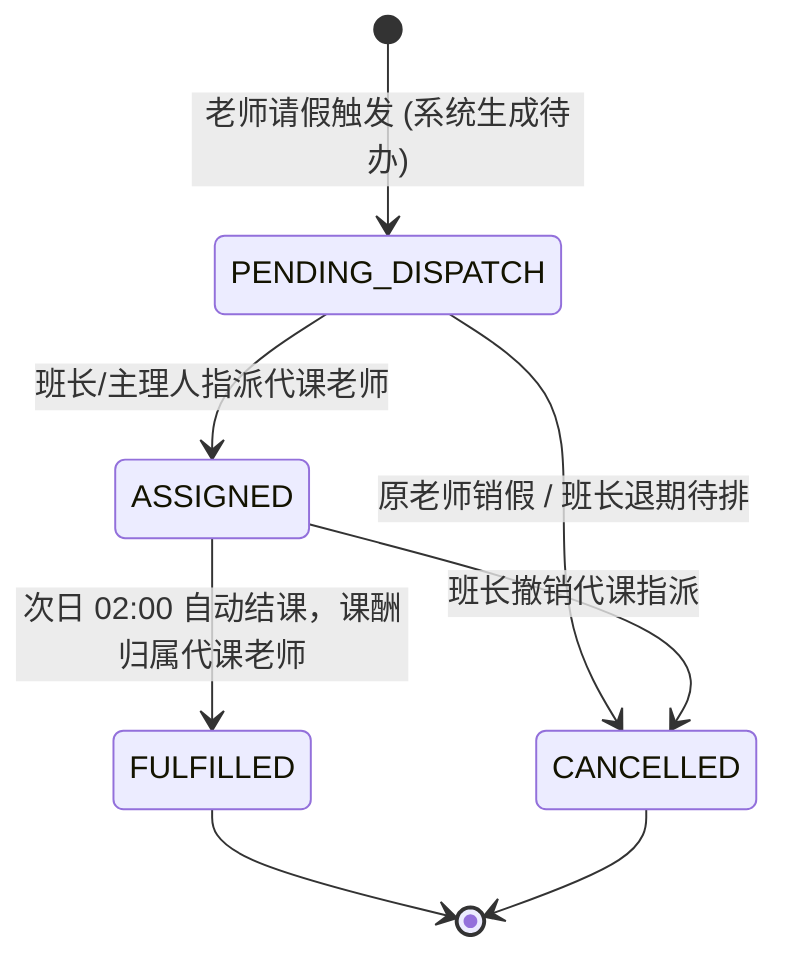
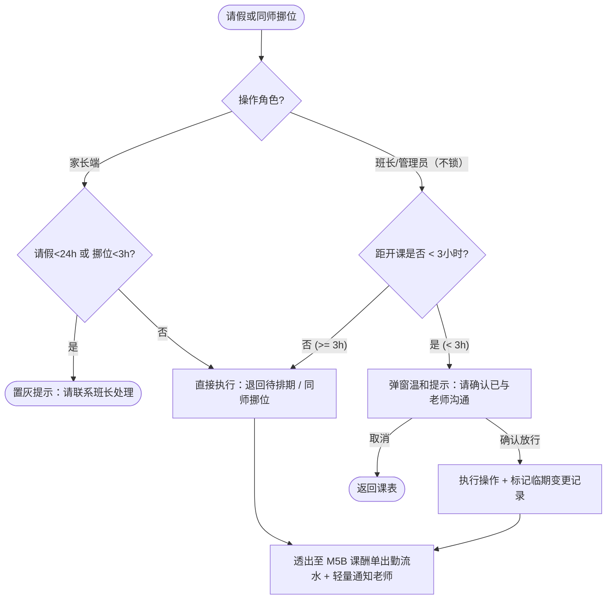

/** (c) 2024-2026 Topee (https://topee.top). All rights reserved. Proprietary and confidential. */

# 产品需求文档 (PRD) — 子模块 3B：考勤、弹性挪位与代课调度 (Attendance, Leave & Substitution)

| 文档属性 | 内容 |
| :--- | :--- |
| **文档版本** | v2.0（精简弹性版） |
| **所属模块** | 模块三：7色智能日历、排课与考勤调度 (Calendar & Scheduling) |
| **关联子模块** | `m3a_calendar_grid.md`（日历控制台）｜ `m4_notification.md`（轻量提醒）｜ `m5b_weekly_settlement.md`（课酬单与出勤异常透出） |
| **创建与更新日期** | 2026-11-05（创建） / 2026-11-13（按精简方案移除 12.5% 请假配额、3h/24h 硬熔断、急病特批通道 B、activities 动态字典与 M3C 转让引用；新增 `<3h` 温和确认提示、直接「更换实际上课学员」及出勤异常透出至 M5B） |

---

## 1. 概述与执行摘要 (Executive Summary)
考勤、弹性挪位与代课调度子模块（`m3b`）是 Dream 系统处理教学履约变动的中枢。遵循**「家长端守门槛（`<24h` 禁自助请假、`<3h` 禁自助挪位），班长端不锁（随时协助），后端账目分明」**的核心哲学，本模块取消 `12.5%` 请假配额与管理员特批通道 B，全面支持：
- **1v1 家长门槛 + 班长不锁弹性请假与同师挪位**：家长端距开课 `<24h` 不可自助请假、`<3h` 不可自助挪位；班长与管理员后台全程不锁，距开课不足 3 小时操作仅弹出温和确认提示后即可放行，并在 M5B 课酬单出勤流水中透明呈现；
- **直接更换实际上课学员**：替代原独立转让模块，支持班长在课格上直接切换上课学员，原购课单资金归属不变；
- **老师请假与双视角代课调度**：支持老师单节或 1~12 节批量请假，班长/小班主理人可在全平台在职老师中指派临时代课（原师呈蓝色被代课 `🔵`，代课师呈紫色代上课 `🟣`），小班课支持连续双网格代课或暂停待排；
- **单节课异常处理**：处理正常出勤、学员旷课、老师旷课及异常未上课回退补生。

当前阶段：MVP 正式功能迭代。

---

## 2. 问题定义与背景 (Problem Statement)
- **硬拦截带来现场摩擦**：传统的 12.5% 配额拦截与开课前 3 小时强锁死，在孩子突发感冒发烧时容易引发家长抱怨与管理员手动特批负担。
- **重耦合流转效率低**：独立的转让审批单与复杂的时间熔断矩阵增加了操作步骤；而“请假本质是把已排 TS 释放回待排期，转课本质是更换实际上课学员”，将决策权还给教务并把出勤异常透明挂载到周课酬单，才能真正让排课流畅、账目清晰。

---

## 3. 目标用户与角色画像 (Users & Personas)
- **出资家长（Amy）**：孩子临时生病或有事时，能快速把已排课程退回待排期或同师挪到其他时段，不被生硬的配额弹窗拒绝。
- **原授课老师（David，老师）**：突发停电或身体不适时可单节或批量勾选 1~12 节请假；被代课后课表清楚标记 `🔵 SUBBED_OUT`。
- **接时代课老师（Elena，老师）**：被指派代课后课表清晰显示 `🟣 SUBBED_IN` 及学员在学课件进度，结课后课酬 100% 归属本人。
- **班长 / 小班主理人（Leo）**：可在任何时间协助学员请假、挪位、更换实际上课学员或为全平台老师指派代课，无需找管理员解锁特批。

---

## 4. 核心业务流程 (Main Flows)

### 4.1 1v1 请假退回待排期（家长 `<24h` 限制 + 班长不锁）
1. **触发入口与角色门槛**：家长或班长/管理员在日历课格抽屉中点击 **【请假退期待排】**（支持连续多节勾选合并请假）。
   - **家长端**：距开课 **$\ge 24\text{h}$** 可直接自助请假；距开课 **$< 24\text{h}$** 时按钮置灰禁用并提示“距开课不足 24 小时，请联系班长处理”。
   - **班长 / 管理员端**：不受 24h 与 3h 硬锁限制（**班长不锁**）。
2. **班长临期 `< 3h` 温和确认提示**：
   - 若距开课时间 $\ge 3\text{h}$：班长直接放行；
   - 若距开课时间 $< 3\text{h}$：系统弹出温和提示：**“距开课不足 3 小时，老师可能已进入备课状态，请确认已与老师沟通”**，班长点击【确认放行】即可继续，不做硬性拦截。
3. **原子执行**：
   - 原已排课 TS 状态退回 `PENDING_SCHEDULE`（待排期），原日历单元格释放为 🟢 空闲；
   - 若存在关联的代课指派记录，同步自动解除；
   - 记录本次请假动作及是否为临期（`<3h`）变更标记，供 M5B 课酬单出勤统计透明展示；
   - 向原授课老师发送轻量变更提醒（关键变动邮件 + 站内小红点）。

### 4.2 1v1 同师同格平移挪位 (Reschedule with Same Teacher)
1. **触发入口与防撞课筛选**：家长或班长在日历课格抽屉点击 **【同师挪位】**，目标日历仅高亮原任课老师的 🟢 空闲绿格；**系统自动排除（置灰并提示“学员该时段已有其他课程”）该学员同一时间已在其他老师处有排课的时段**，防止挪位撞课。
2. **角色门槛与 `< 3h` 温和提示**：
   - **家长端**：距开课 **$< 3\text{h}$** 时按钮置灰禁用并提示“距开课不足 3 小时，请联系班长处理”。
   - **班长 / 管理员端（不锁）**：若距开课不足 3 小时，弹出同款温和确认弹窗，点击确认后直接放行。
3. **代课课次挪位规则**：若原课次为代课状态（🔵），同师挪位目标老师仍为**原任老师**；挪位成功后，系统自动取消原代课委任并同步通知原代课老师。
4. **原子落盘**：原时段单元格立即释放为 🟢 空闲，新时段单元格落盘为原课程类型（🟠 或 🟡），无需重新扣减课次。

### 4.3 直接更换实际上课学员（替代原独立转让模块）
1. **适用范围**：1v1 已排期课程（由班长或管理员在日历课格动作抽屉发起）。
2. **操作流程**：
   - 班长点击 **【更换实际上课学员】**，通过学员姓名或唯一规范昵称检索并选择新的实际上课学员（**无需校验是否同一家庭**）；
   - 若距开课不足 3 小时，弹出温和确认提示后放行；
   - 点击确认后，原购课单、付款出资方及资金持有人（`holder_id`）**保持绝对不变**，仅变更该 TS 课次的实际授课学员档案，双方课表即时更新。

### 4.4 老师主动请假与 1~12 节批量请假
1. **发起请假**：老师在课表任一单元格点击抽屉内的当天时段勾选列表，支持单选或批量勾选 **1 ~ 12 节（累计最长 6 小时）**，填写请假原因并提交（无 3h 入口锁死）。
2. **双路原子处理**：
   - **空闲绿格**：立即变为 🔴【已请假】状态，阻断后续新约；
   - **已排课格**：挂起并生成【班长应急调度待办包】（1v1 派发给对应班长，1vN 小班派发给小班主理人），同时向班长/主理人发送提醒。

### 4.5 班长多学员应急调度与代课智能筛师
1. **3 种调度流向**：班长在待办包中可对受影响学员逐一或批量选择：
   - **【指派代课（智能筛师）】**：点击指派代课次，系统根据该 TS 的日期、时段（含连课连续节数）与课程类型，**自动筛选出全平台在职、具备该课程资质且该时段全为空闲 🟢 的老师列表**（无需手动翻查每位老师课表）；支持按**“曾教过该学员（熟客优先） → 同定级/相近定级 → 当天总负荷”**排序；
   - **【退回待排期】**：释放 TS 回待排池；
   - **【同师平移】**：挪至其他空闲时段。
2. **代课双视角日历染色**：
   - 原任老师日历：变更为 **蓝色被代课（🔵 `SUBBED_OUT`）**；
   - 代课老师日历：变更为 **紫色代上课（🟣 `SUBBED_IN`）**；
   - 家长端课表：合并显示代课老师名称与 `[SUB]` 标识。
3. **小班课代课智能筛师与暂停待排**：
   - 小班主理人指派代课次，系统**自动过滤出全平台在职、具备该小班课程资质且在目标 1 小时窗口内连续 2 个 30min 单元格（56px）全为空闲 🟢 的老师**（仅空半小时的老师自动过滤），代课课酬按原小班既定单节课酬快照平移结算给代课老师；
   - 若无法安排代课，主理人可选择 **【暂停待排】**，TS 退回小班待排池并释放日历双格，由主理人在私域微信群通知家长。

### 4.6 代课撤销与老师销假
- **代课撤销**：班长可在课格抽屉点击【撤销代课指派】（`<3h` 弹出温和确认提示），撤销后恢复为待指派状态或归还原任老师（若原老师已销假）。
- **老师销假**：原老师点击 🔴【已请假】单元格并选择【恢复可约 / 销假】，空闲格立即恢复为 🟢 空闲。

### 4.7 单节课异常处理与处置 (Lesson Exception Handling)
班长或管理员在课格抽屉点击 **【异常处理】**，可按实际情况执行以下处置：
- **正常出勤**：TS 正常进入结课与课酬核算；
- **学员旷课**：TS 正常结课扣减课次，老师课酬正常计入，并在 M5B 出勤明细中标记“学员旷课”；
- **老师旷课**：TS 退回待排期或补生 1 节新待排 TS，剔除老师该节课酬，并在 M5B 出勤明细中标记“老师旷课”；
- **撤排退回待排期**：未上课课次直接释放网格并退回待排期；
- **异常未上课回退补生**：针对已结课但实际未上的 TS（关联周转账单尚未完成归集），作废原 TS、剔除课酬并原单补生 1 节全新待排 TS（1v1 补给学员，小班补给小班池）。

### 4.8 核心实体生命周期与状态机 (Entity Lifecycles)

#### 1. 代课调度工单 (`SubstitutionTask`)

#### 2. 老师请假申请单 (`TeacherLeaveRequest`)
- 状态流转：`[*] -> ACTIVE`（老师提交 1~12 节请假，空闲格转红、已排格生成代办）→ `REVOKED`（老师销假恢复空闲）或 `CLOSED`（受影响排课全部调度完毕且课程结束）。

#### 3. 单节课履约异常工单 (`LessonExceptionTicket`)
- 状态流转：`[*] -> REPORTED`（发起异常登记）→ `INVESTIGATING`（核查 ClassIn 进出记录）→ `COMPENSATED`（确认老师/系统原因，退回或补生 TS 并剔除课酬）或 `DISMISSED`（确认学员原因或正常履约，维持结课）。

---

## 5. 用户故事 (User Stories)
- **US-3B-01（无配额阻塞请假）**：作为一个家长，当孩子突然发烧时，我希望能随时将课程请假退回待排期，而不被系统弹出配额上限锁死，以便于灵活安排补课。
- **US-3B-02（临期温和确认）**：作为一个班长，当家长在开课前 1 小时临时请求挪位或请假时，我希望系统给予温和提示确认已与老师沟通后直接放行，以便于高效解决突发状况。
- **US-3B-03（极速换人上课）**：作为一个班长，当 A 家长在微信群把一节课让给 B 家长时，我希望直接在日历课格上点击【更换实际上课学员】完成替换，无需走繁琐的转让单与家庭校验。
- **US-3B-04（老师批量请假与代课双视角）**：作为一个老师，我希望能一次勾选当天最多 12 节课发起请假，并由班长指派代课后在双方课表上清晰区分蓝色被代课与紫色代上课。
- **US-3B-05（出勤异常透出课酬单）**：作为一个班长或管理员，我希望所有临期请假、旷课、代课记录都能自动挂载到 M5B 老师/班长课酬单出勤流水中，以便于后端算账和对账清清楚楚。

---

## 6. 验收标准清单 (Acceptance Criteria)

### 6.1 家长端 `<24h`/`<3h` 门槛、班长不锁与 `< 3h` 温和提示
- **AC-3B-01（家长端时间门槛 + 班长不锁 + 移除配额）**：系统不再计算或拦截 `12.5%` 请假配额；**家长端**距开课 `<24h` 禁用自助【请假退期待排】、距开课 `<3h` 禁用自助【同师挪位】并提示联系班长处理；**班长与管理员端全程不锁**，随时可代操作 1v1 课次（固定位与临时课）的请假退回待排期与同师挪位。
- **AC-3B-02（班长/管理员 `< 3h` 温和确认提示）**：当班长或管理员在距开课不足 3 小时执行请假、同师挪位、更换实际上课学员或指派代课时，必须弹出二次确认框提示：“距开课不足 3 小时，老师可能已进入备课状态，请确认已与老师沟通”；点击确认后操作立即生效，并在记录中标注 `is_last_minute = true` 同步透出到 M5B 出勤明细。
- **AC-3B-03（代课课次挪位自动解绑）**：对蓝色代课课次（🔵）执行同师挪位时，目标网格限定为原任课老师的空闲时段；挪位成功后，原代课委任自动解除并通知原代课老师。

### 6.2 更换实际上课学员
- **AC-3B-04（直接换人）**：班长与管理员在 1v1 课格动作抽屉点击【更换实际上课学员】时，可搜索任意在读/试课学员并确认替换，不校验是否同一家庭，不设二次更改锁；原购课单金额、出资人与资金持有人（`holder_id`）保持不变。

### 6.3 老师批量请假与代课调度
- **AC-3B-05（批量请假范围）**：老师单次请假支持勾选 1~12 节课，必须填写请假原因；提交后空闲格置红 🔴，已排格生成应急代办包并推送通知给负责班长或小班主理人。
- **AC-3B-06（代课双视角与课酬归属）**：指派代课成功后，原任老师日历呈现蓝色被代课（`🔵 SUBBED_OUT`），代课老师日历呈现紫色代上课（`🟣 SUBBED_IN`）；结课后课酬 100% 计入实际代课老师的 M5B 周课酬单。
- **AC-3B-07（小班双格代课与暂停待排）**：小班代课老师必须满足 1 小时时段内连续 2 个单元格全空闲 🟢 且具备对应课程资质；代课课酬按该小班既定单节课酬快照平移结算；主理人选择【暂停待排】时，TS 原子退回小班待排池，不给小班家长端发送应用内通知。

### 6.4 异常处理与经办记录
- **AC-3B-08（单节异常处置）**：班长/管理员执行【学员旷课】【老师旷课】【撤排退回】或【异常未上课回退补生】后，必须记录操作日志与原因，并在 M5B 出勤统计中清晰透出。
- **AC-3B-09（我的经办记录）**：班长在教务中心【我的经办】仅可查看本人经办的操作流水；管理员可按班长筛选查看全部经办流水。

### 6.5 智能筛师与防撞课校验
- **AC-3B-10（1v1 TS 代课智能筛师）**：针对待指派代课的 1v1 TS，代课选人列表必须默认自动过滤为“在职 + 具备课程资质 + 该 TS 目标时段（含连课连续节数）全空闲 🟢”的老师，且曾教过该学员的熟客老师置顶排序。
- **AC-3B-11（1vN 小班代课连续双格筛师）**：针对 1vN 小班课指派代课次，选人列表仅展示目标 1 小时窗口内连续 2 个 30min 格均为空闲 🟢 且具备小班资质的老师；仅单格空闲的老师必须被过滤排除。
- **AC-3B-12（同师挪位学员自身防撞课）**：执行同师挪位时，若该学员在原老师的某个空闲绿格时间段内，已在其他老师名下有已排期课程，该单元格必须自动置灰禁用并悬浮/点击提示“学员该时段已有其他课程”。

---

## 7. 本期范围外清单 (Out of Scope)
- **不支持 12.5% 请假配额限制与超额阻断**。
- **不支持管理员急病特批通道 B 与班长端时间硬锁**（班长后台直接放行即可，无需额外特批工单）。
- **不支持独立的课次转让单与转让集市 (M3C)**。
- **不支持独立动态流表 (`dream.activities`) 写入与首页 14 类事件瀑布流**。

---

## 8. 约束条件 (Constraints)
- **小班单人缺席隔离**：小班课（🟩）不记录单个学员考勤，单人缺席由主理人线下协调。
- **已结课且已归集不可回退**：已被包含在已完成归集（`COMPLETED`）的周转账单中的课次，禁止执行异常未上课回退补生。

---

## 9. UI/UX 界面线框说明 (Wireframe Level)
- **课格底部抽屉动作区（1v1）**：展示课程基本信息、进教室按钮，以及 `[ 请假退期待排 ]`、`[ 同师挪位 ]`、`[ 更换实际上课学员 ]`（班长/管理员可见）、`[ 指派代课 ]`（班长/主理人可见）、`[ 异常处理 ]`。
- **`< 3h` 温和提示弹窗**：居中轻量确认框，标题“临期操作确认”，正文“距开课不足 3 小时，老师可能已进入备课状态，请确认已与老师沟通”，按钮 `[ 返回 ]` + `[ 确认放行 ]`。
- **班长应急代办包抽屉**：汇总受老师请假影响的课程列表，每行提供 `[ 指派代课 ]` / `[ 退回待排期 ]` / `[ 同师平移 ]` 一键调度按钮。

---

## 10. 用户流程图 (User Flow Diagram)

