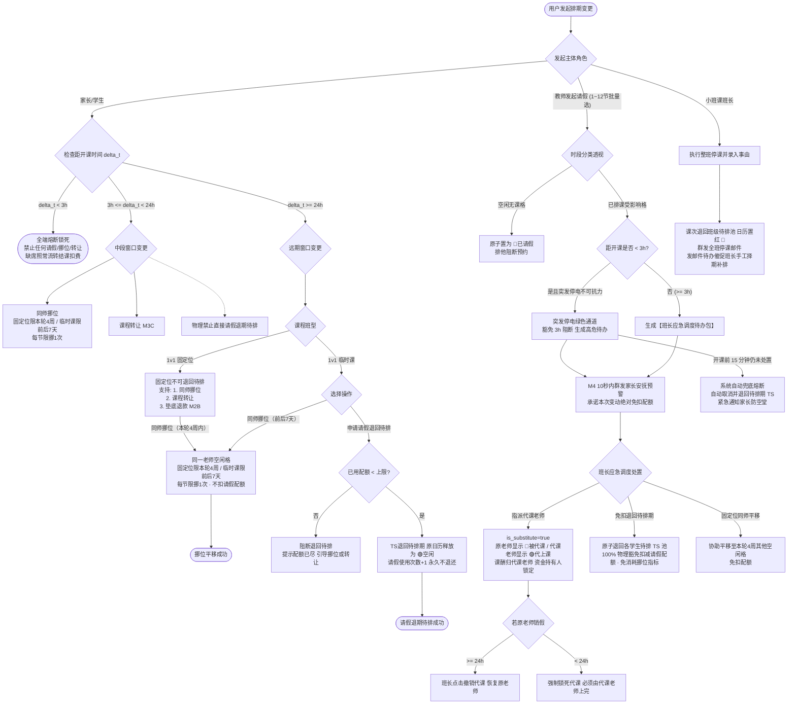

/** (c) 2024-2026 Topee (https://topee.top). All rights reserved. Proprietary and confidential. */

# 产品需求文档 (PRD) — 子模块 3B：考勤、请假挪位与代课调度 (Attendance, Leave & Substitution)

| 元数据项 | 说明 / 内容 |
|---|---|
| **模块代号** | `m3b` |
| **所属模块** | 模块三：7色智能日历、排班、考勤与课程转让 (Calendar & Scheduling) |
| **文档状态** | 待评审 (Draft) |
| **关联顶层 PRD** | [Prd-v5.md](../Prd-v5.md) |
| **关联规范文档** | [DESIGN.md](../DESIGN.md) ｜ [BUSINESS_RULES.md](../BUSINESS_RULES.md) |
| **关联模块划分** | [system_modules_overview.md](../system_modules_overview.md) |
| **创建与更新日期** | 2026-11-05 初稿；2026-11-08 调整同师挪位窗口（固定位本轮 4 周 / 临时课前后 7 天） |

---

## 1. 概述与执行摘要 (Executive Summary)

考勤、请假挪位与代课调度子模块（`m3b`）是 Dream 系统的排期履约与高频变更调度中枢。本子模块承载 **12.5% 请假配额精准核销**、**24h / 3h 阶梯式时限熔断**、**同师免配额平移挪位（固定位限本轮 4 周购课周期、临时课限原课次前后 7 天）**、**教师请假与临时代课双视角染色（🔵被代课 / 🟣代上课）** 及 **小班课整班停课退回待排** 全链路功能。通过严格的时限红线与权责隔离，本模块确保教学产能受控释放、代课老师课酬精准归集、原收款资金持有人锁定不变，维护家校双方的契约严谨性。当前阶段：MVP 正式功能迭代。

---

## 2. 问题定义与背景 (Problem Statement)

- **痛点 1：随性请假与教学产能空置损失**：低龄少儿教务中，若允许家长在临近开课时随意取消课程，外教将面临已备课但无课可上的收入损失，平台亦白白空耗时间网格。
- **痛点 2：代课课酬记账错乱与原师权益纠纷**：当原老师突发请假由代课老师接手时，若系统无法区分“代课”与“正课”，极易导致周末发薪时课酬被错发给原老师，代课老师劳而无功。
- **痛点 3：代课信息不透明引发家长与代课老师顾虑**：代课老师接手后若无法获知学生历史学情与代课原因，教学效果大打折扣；家长与原老师若在课表上看不到代课标记，易引发家校沟通误会。
- **痛点 4：请假额度人肉管理易起争端**：口头约定的请假次数缺乏客观统计，家长多次取消后反向主张课时未消，造成班长对账困难。
- **痛点 5：小班课整班停课缺乏标准化流程**：遇到公众假期或突发整班停课时，缺乏系统级批量退回与催办补排闭环，导致课时遗忘漏排。

---

## 3. 目标用户与角色画像 (Users & Personas)

### 3.1 角色一：出资家长（Amy）
- **角色定位**：日常排课请假人。
- **核心诉求**：孩子临时生病或冲突时，在 $\ge 24\text{h}$ 自助请假（临时课退回待排期，扣减配额）或同师挪位（不扣配额）；在 3h-24h 强制同师挪位；在课表上清晰了解当前所剩请假额度与时限倒计时。
- **预期成果**：请假规则清晰透明，合理平移排期不浪费课时。

### 3.2 角色二：原授课教师（David，外教）
- **角色定位**：原定授课人。
- **核心诉求**：提前发起常规休假；突发身体不适时在班长协助下紧急请假；因病被代课的时段在课表上直观显示 🔵【被代课】，提示该节课已由同事接手、不计入个人课酬。
- **预期成果**：合理休假有保障，代课交接无后顾之忧。

### 3.3 角色三：接时代课教师（Elena，外教）
- **角色定位**：临时代课执行人。
- **核心诉求**：在自己的日历上看到 🟣【代上课】醒目紫色标记，能一键点开该学生档案留言板查阅原老师留下的教学进度与性格特点；完课后课酬严格计入个人周课酬单。
- **预期成果**：代课付出有明确回报，交接信息完整。

### 3.4 角色四：负责班长（Leo）
- **角色定位**：变更调度与代课经纪人。
- **核心诉求**：教师请假后及时接收系统代办待办，快速筛选符合资质的空闲代课老师并一键调配；小班课整班停课后接收邮件提醒并择期手工补排。
- **预期成果**：紧急代课 10 分钟内闭环，全班课次不遗漏。

---

## 4. 核心业务流程 (Main Flows)

### 4.1 1v1 临时课提前 $\ge 24\text{h}$ 请假退回待排期 (Happy Path)
1. 家长在移动端进入孩子课表，点击某节距开课 $\ge 24\text{h}$ 的 🟡 临时课单元格。
2. 底部抽屉展示时段详情与当前购课单的请假额度（如：“已用 0 次 / 上限 2 次”）。
3. 家长点击【申请请假（退回待排期）】。
4. 系统校验：① 距开课时间 $\ge 24\text{h}$；② 已使用请假次数 $<$ 允许请假上限。
5. 校验通过，系统在数据库事务内原子执行：
   - 该 TS 状态由 `已排期` 退回到 `待排期`，清空已绑定的教师与具体上课时间，原购课单与资金持有方保持不变；
   - 原日历网格立即释放并恢复为 🟢【空闲可约】；
   - 原购课单的“已使用取消次数”累加 1 次；
   - 触发异步通知：给原授课教师发送站内信 + 邮件通知。
6. 前端提示请假成功，日历就地刷新。

### 4.2 1v1 固定位/临时课“同师同格平移挪位” (Reschedule with Same Teacher)

> **窗口差异**：固定位限该 TS 所属固定位订单的**本轮 4 周购课周期**内；临时课保持原规则，限原课次**前后 7 天**（$[-7\text{天}, +7\text{天}]$）。固定位不得跨轮次挪位；两类课程均保持同一教师、每节限挪 1 次、不扣请假配额。
>
> **“本轮”定义**：指该固定位 TS 所属固定位订单的当前 4 周购课周期（以订单生效周/首节课所在周为第 1 周，连续 4 个自然周）。若订单跨多个 4 周轮次，以**待挪课次所在轮次**为准。
>
> **分布口径**：固定位在本轮内挪位不强制保持“每周 1 节”的均匀分布；允许某一自然周出现 2 节、另一周留空，本轮对应的 4 节固定位 TS 总量不变，且不得跨轮次。

1. 家长点击某节已排课程（固定位 🟠 或 临时课 🟡），选择【同师挪位】。
2. 界面呼出**同师排期周度网格 Picker（方案 A 单屏 7 天 Excel 网格态 + 周次切换）**：
   - 严格展示当前原授课教师的周度课表网格，支持按周切换；
   - **原课次位置**以虚线框+角标 `[原]` 显式锁定留痕；
   - **固定位（本轮 4 周窗口）**：可选范围为该 TS 所属固定位订单的**当前 4 周购课周期（第 1~4 周全部日期）**；Picker 顶部提供第 1~4 周切换，仅本轮 4 周内的 🟢【空闲可约】单元格可点选；若订单跨多个 4 周轮次，以**待挪课次所在轮次**为准，不得跨轮次；
   - **临时课（前后 7 天窗口）**：可选范围保持原规则，即原课次时间点**前后 7 天**（$[-7\text{天}, +7\text{天}]$）内的 🟢【空闲可约】单元格；
   - **禁用锁定网格**：超出对应窗口的周次/日期列、已排其他学生的网格、非空闲网格、已过去时段，物理置灰禁用（透明度 30% 且不可点选）。

   > 示例：固定位本轮为 11-09 ~ 12-06，11-14 的课可挪至本轮内 12-05 的同师空闲格，不可挪至 12-07（下一轮）；临时课 11-14 的课仅可挪至 11-07 ~ 11-21 的同师空闲格。

3. 家长在网格中点选新的目标空闲网格（选定后出现高亮选中框，底部浮出【平移确认对比栏】），点击【确认挪位】。
4. 系统校验：
   - 距原课次开课时间 $\ge 3\text{h}$；
   - 该节 TS 历史未发生过挪位（`reschedule_count == 0`）；
   - 目标网格仍处于 🟢 空闲状态，且目标时段晚于当前时间；
   - **窗口校验**：固定位目标日期必须落在该 TS 所属 4 周轮次内；临时课目标日期必须在原课次前后 7 天内；
   - **同师校验**：目标教师必须为原授课教师（固定位/临时课均不跨教师）。
5. 校验通过，系统原子更新：
   - 原日历单元格释放恢复为 🟢【空闲可约】；
   - 目标日历单元格锁定为相应课程状态（固定位仍为 🟠，临时课仍为 🟡）；
   - TS 记录新的授课日期与时段，更新标记 `reschedule_count = 1`；
   - **不扣减 12.5% 请假配额**。
6. 自动发送邮件 + 站内信通知教师排期已平移。

### 4.3 教师主动请假与 1~12 节批量请假 (Teacher Single & Batch Leave Initiation)
1. **请假入口与选课规格**：
   - 教师进入个人周课表或日历看板，点击【申请请假】；
   - 支持**单节请假**或**批量勾选/时段框选 1 ~ 12 个半小时单元格**（累计最长 6 小时，涵盖单天半天或全天授课时段，如因家庭突发断电、断网、急病就医等）。
2. **不可抗力事由与智能影响透视**：
   - 教师必填请假事由，提供不可抗力分类标签：`家庭突发停电/断网 (Power/Internet Outage)`、`突发急病就医 (Medical Emergency)`、`自然灾害/设备故障 (Device/Weather)`、`常规个人事假 (Personal Leave)`；
   - 系统就地进行影响分类透视并在提交前给出明确明细反馈：
     - **🟢 空闲无课时段**（$X$ 节）：系统在事务内原子将对应网格置为 🔴【已请假】，即刻在家长端与平台选课大厅阻断预约；
     - **已排课受影响时段**（$Y$ 节）：涉及多位学员的 1v1 固定位、1v1 临时课或连续双单元格小班课。
3. **M4 即时家校安抚预警（10秒内触达）**：
   - 教师提交批量请假后 10 秒内，系统自动向所有受影响学员家长发送 M4 二级必达双语站内信与通知：
     - *“【突发停课协调中】您预约的 [David] 老师因家庭突发停电无法准时授课。负责班长正在紧急为您协调代课老师或办理课时原路退回，处理结果将第一时间同步您，本次变动绝不扣除您的任何请假配额。”*（有效平息家长焦虑并防范投诉）。
4. **班长应急调度待办包生成**：
   - 系统自动将这 $Y$ 节受影响课次聚合打包为一张**【突发请假应急调度待办包】**派发至负责班长工作台，标明不可抗力类型与受影响学员清单，按开课时间从近到远紧急度排列。

### 4.3b 班长多学员应急调度与 3 种处置流向 (Monitor Multi-Student Resolution Flows)
负责班长在工作台进入应急调度待办包，针对受影响的每一位学员课次，可执行以下 3 种处置流向：
1. **路径 A：指派代课老师 (Substitute)**：
   - 针对希望按原定时间照常上课的学员，班长点击【匹配代课】；
   - 系统根据该 TS 的课程类型自动筛选并推荐该时段 🟢 空闲、定级与技能匹配的候选在职外教；
   - 指派成功后，日历自动执行双视角染色（原老师 🔵 被代课 / 代课老师 🟣 代上课），代课老师 100% 获得当节课酬；向家长派发代课外教介绍与 ClassIn 建联卡片。
2. **路径 B：免扣退期待排 (Rollback to Pending TS)**：
   - 若处于晚间高峰期实在无空闲代课老师可调配，班长可选择【单笔退回】或【批量一键退期待排】；
   - **零配额扣减铁律**：课次原子退回各学员名下的“待排期 TS 池”，系统**100% 物理强制豁免扣减任何学生的 12.5% 请假配额**，且不计入学生的挪位次数指标（`reschedule_count` 保持为 0）；
   - 网格全额释放变更为 🔴【已请假】；系统向家长发送退还确认与致歉通知。
3. **路径 C：固定位同师平移顺延 (Reschedule)**：
   - 若外教停电仅为数小时或 1 天，次日已恢复正常电力，且原课次为 1v1 固定位，班长可与家长协商后协助将课次平移至该外教在**本轮 4 周购课周期内**的其他空闲格，免扣请假配额，保障本轮连续学习。
4. **小班课整班停课联动**：
   - 若批量请假时段覆盖了小班课（连续 2 个单元格，1 小时），系统自动触发小班课整班停课，课次退回班级待排池，向授课教师及负责班长发送提醒通知，催办小班班长线下协调后择期补排（家长由班长在线下微信群闭环通知）。

### 4.4 班长代课调配与代课双视角日历染色
1. 班长在班长工作台打开【待安排代课】待办列表，点击某笔待代课记录。
2. 班长点击【指派代课老师】，系统根据 TS 的课程类型（如少儿英语）自动列出当前时段空闲且具备对应技能标签的候选代课教师列表。
3. 班长选定代课老师 B（Elena），点击【确认代课】。
4. 系统在事务内原子更新 TS：
   - 状态更新为 `已排期`；
   - 写入标记：`is_substitute = true`；
   - 记录原教师：`original_teacher_id = David_ID`；
   - 记录当前授课教师：`current_teacher_id = Elena_ID`；
   - **资金持有方（`holder_id`）永久保持不变**。
5. **日历双视角即时染色呈现**：
   - **原老师 David 视角**：该时段显示为 **🔵【蓝色 - 被代课】**，标注“由 Elena 代上，不计入个人课酬”；
   - **代课老师 Elena 视角**：该时段显示为 **🟣【紫色 - 代上课】**，标注“替 David 代课，课酬计入周结单”，卡片提供直达该学生档案留言板入口；
   - **家长与班长视角**：显示为 🔵【蓝色 - 被代课】，卡片提示“本节由代课老师 Elena 上课”。
6. 系统并发派发站内信 + 邮件通知代课老师、原老师与家长。

### 4.5 代课撤销与销假规则
1. 若原老师在请假后情况好转申请销假：
   - **距开课 $\ge 24\text{h}$**：允许班长在后台点击【撤销代课】。系统将 TS 的 `current_teacher_id` 恢复为原老师，清空代课标记，日历恢复原状态，释放代课老师日程。
   - **距开课 $< 24\text{h}$**：**系统强行锁死撤销入口**，提示“距开课不足 24 小时，为保障代课教师备课权益，不可撤销代课，必须由代课老师履约授课”。

### 4.6 小班课整班停课与邮件催办手工补排
1. 小班课负责人（班长）因节假日或突发事件在小班管理页选择某节课，点击【整班请假停课】并输入停课事由。
2. 系统原子操作：
   - 将该节小班课 TS 退回班级 `待排期` 池中；
   - 当天日历网格变更为 🔴【已请假】；
   - 系统自动向授课教师及负责班长发送停课通知邮件（小班学生不注册账号，家长由班长在线下群通知）。
3. **邮件催办班长手工补排**：
   - 系统向小班课班长发送高优先级邮件与待办：“[班级名] 原定于 [日期时间] 的课程已停课，课次已退回待排期，请及时在日历上手工选择新时段补排”。

### 4.7 临近开课 $< 3\text{h}$ 授课准备期锁定与突发不可抗力绿色通道 (Emergency Break-Glass Protocol)
1. **常规授课准备期锁定**：
   - 家长与学生端严格执行距开课时间 $< 3\text{h}$ 全端锁定，关闭所有主动请假、挪位与转让入口，悬浮提示“开课前 3 小时内进入授课准备保障期，无法变更”。若学生个人原因缺席，次日凌晨正常结课扣费。
2. **教师突发停电不可抗力绿色通道 (Break-Glass Protocol)**：
   - 若外教在距首节开课 $< 3\text{h}$（如开课前 1 小时）突发家庭停电、断网等客观不可抗力无法上课，系统允许教师勾选“突发不可抗力”，**豁免 3h 锁定限制**，避免外教被迫空堂旷课；
   - 系统生成高优先级红标【紧急突发待办】，弹窗告警催促班长线上或电话紧急介入调配代课；
3. **开课前 15 分钟自动安全保护兜底 (Auto-Safety Cancellation)**：
   - 截至距离开课时间仅剩 **15 分钟**，若班长仍未完成代课老师指派，系统触发**安全保护兜底机制**：
     - 后台批处理自动将该节课变更为【已取消并退回待排期 TS】，原子释放网格；
     - 系统自动豁免学生请假配额；
     - 并发向家长发送紧急短信与邮件：“抱歉通知：您预约的 [时间] 课程因老师突发停电已自动取消并全额退还课次，免除您进教室空等，请随时重新约课”。彻底杜绝学员进入教室空等 25 分钟的恶劣体验。

### 4.8 平台管理员全域代挪位与代请假流转 (Admin Proxy Reschedule & Leave)
1. **低频定位与操作入口**：本功能为低频客服与异常兜底通道，管理员无需复杂的新大屏看板，直接通过查看目标教师排期表或目标学员排期表，点击目标课程单元格唤起代办面板。
2. **管理员代挪位（同师同周期平移）**：
   - 界面呼出单屏 7 天 Excel 网格 Picker，原课时段以虚线框+角标 `[原]` 显式锁定；
   - 严格遵循**同师铁律**（目标教师必须为原授课教师，不得跨老师挪位，保障教师月度课酬总盘不流失）；
   - 窗口严格受限：固定位限该订单本轮 4 周内，临时课限前后 7 天内；
   - 挪位成功后更新 `reschedule_count = 1`，**100% 豁免扣减学生 12.5% 请假配额**；M4 触发站内信通知家长与外教，并同步抄送负责班长。
3. **管理员代请假双通道（常规代办 vs 非常规特批）**：
   - **通道 A：【常规代请假（标准扣配额）】**：
     - 适用条件：距开课时间 $\ge 24\text{h}$，且学生名下有剩余请假配额（`已用次数 < 上限`）；
     - 执行结果：TS 状态退回 `待排期`，原购课单累加 1 次已用请假次数，网格恢复 🟢【空闲可约】。
   - **通道 B：【非常规特批请假（客服应急通道）】**：
     - 适用条件：学员突发急病就医、不可抗力、或配额已耗尽但确需客服特批挽回客诉；支持突破距开课 $<3\text{h}$ 的授课准备期锁定状态；
     - **课酬补偿选项**：弹窗中提供【是否给老师补偿课酬】单选/复选框，**系统默认选项为【不补偿】**；若管理员确认为突发不可抗力并勾选【补偿课酬】，系统在财务核算中将该课次课酬标记为平台贴补；
     - 执行结果：100% 豁免扣减 12.5% 请假配额，原 TS 补生为待排期返还学生；
     - 强制审计留痕：必填 $\ge 10$ 字审批原因，写入 `dream.audit_logs`（记录具体 `admin_account_id`、豁免原因、是否补偿课酬）。
4. **小班课严格防御线**：小班课整班停课仅限小班课班长在后台发起，管理员禁止越权随意代停小班课。

---

## 5. 用户故事 (User Stories)

- **US-3B-01**：作为一个家长，我想要在距开课 24 小时前自助请假并退回临时课时，以便于改天重新约课，并清楚了解消耗了 1 次请假配额。
- **US-3B-02**：作为一个家长，我想要将固定位课程在**本轮 4 周购课周期内**、临时课在**前后 7 天内**平移到同一位老师的其他空闲时间且不扣配额，以便于灵活调整日程且不浪费请假权利。
- **US-3B-03**：作为一个家长，我想要在临近开课 3 小时内看到明确的授课准备期锁定提示，以便于知晓契约红线。
- **US-3B-04**：作为一个原授课教师，我想要请假后在课表上看到蓝色【被代课】标记，以便于确认自己不用上课且不计入个人课酬。
- **US-3B-05**：作为一个代课教师，我想要接单时代课时段显示紫色【代上课】并能直接点开学生留言板看进度，以便于做好教学备课。
- **US-3B-06**：作为一个代课教师，我想要在距开课不足 24 小时时代课任务被系统刚性锁定，以便于防止原老师临时反悔导致我白备课。
- **US-3B-07**：作为一个负责班长，我想要在教师请假后收到待办卡片并一键筛选具备技能的空闲老师，以便于 10 分钟内解决代课缺口。
- **US-3B-07a（教师批量请假报备）**：作为一个外教，我想要在家里突发停电或断网时能一次性批量勾选请假 1~12 节课并选择不可抗力分类，以便于系统快速统筹后续所有受影响课程而无需逐节重复操作。
- **US-3B-07b（班长多学员应急待办包）**：作为一个负责班长，我想要在外教批量请假后收到聚合的应急调度待办包，能一键批量退回待排期或逐一匹配代课，以便于高效化解多学员停课危机。
- **US-3B-07c（受影响学员零扣减保护）**：作为一个受老师请假影响的学员家长，我想要在老师停电无法上课时第一时间收到安抚通知，并在改期或退课时不扣减我任何请假配额，以便于我的学习权益受到充分保护。
- **US-3B-08**：作为一个小班课班长，我想要在整班停课后收到提醒邮件与待办，以便于不遗忘后续给全班手工补排课。

---

## 6. 验收标准清单 (Acceptance Criteria)

### 6.1 请假配额与 24h 阶梯规则
- **AC-3B-01**：1v1 临时课仅在**距开课时间严格 $\ge 24\text{h}$** 且当前购课单 **`已使用取消次数 < 允许直接取消次数上限`** 时，允许发起请假退回待排期。
- **AC-3B-02**：临时课请假成功后，对应 TS 状态由 `已排期` 变更为 `待排期`，原日历网格立即变更为 🟢【空闲可约】；原购课单已使用请假次数立即加 1。
- **AC-3B-03**：已扣减的请假次数为永久性消费，后续该 TS 重新预约并正常完课，系统绝对不退还已扣减的请假次数。
- **AC-3B-04**：当已使用请假次数达到上限时（12.5% 配额已耗尽），家长端【申请请假】按钮严格置灰禁用，并悬浮/气泡提示文案：“请假配额已用完，仅支持同师挪位”。
- **AC-3B-04a（管理员全域代挪位规范）**：平台管理员支持在目标教师或学员排期表中为任意已排期学员协助发起同师挪位；系统严格校验目标教师必须为原任课教师，窗口严格限制在固定位本轮 4 周购课周期内或临时课前后 7 天内；挪位成功后 100% 免扣请假配额，并向负责班长发送 M4 协同通知。
- **AC-3B-04b（管理员代请假双通道与补偿选项规范）**：
  1. 常规代请假：距开课 $\ge 24\text{h}$ 且配额充足时，正常扣减该学生 12.5% 请假配额；
  2. 非常规特批请假：允许突破开课前 $<3\text{h}$ 锁定或配额耗尽限制，100% 豁免扣减请假配额；弹窗中提供【是否给老师补偿课酬】选项，**系统默认值为“不补偿”**；若勾选补偿则由平台承担课酬贴补；
  3. 审计与协同红线：特批请假必须输入原因并强制落盘至 `dream.audit_logs`（记录 `operator_id`、`is_teacher_compensated`、`reason`），并在 10 秒内将请假事实与结果同步抄送原授课老师及其负责班长。

### 6.2 同师挪位 (Reschedule with Same Teacher)
- **AC-3B-05**：距开课时间严格在 **$3\text{h} \le \Delta t$** 期间，允许固定位或临时课发起【同师挪位】；距开课 $< 3\text{h}$ 强制置灰禁用。
- **AC-3B-06a（固定位挪位窗口）**：1v1 固定位的同师挪位，目标时段必须落在该 TS 所属固定位订单的**当前 4 周购课周期（本轮第 1~4 周）**内；Picker 仅提供本轮 4 周切换，超出本轮的日期列（含下一轮或更早轮次）强制置灰且禁止点选。若订单跨多个 4 周轮次，以**待挪课次所在轮次**为准，严禁跨轮次挪位。本轮内挪位不强制保持“每周 1 节”，允许某周 2 节或留空，但本轮 4 节 TS 总量不变。
- **AC-3B-06b（临时课挪位窗口）**：1v1 临时课的同师挪位保持原规则，目标时段必须落在原上课时间**前后 7 天内（[-7天, +7天]）**；超出窗口、他人已占、非开放或已过去的网格强制置灰且禁止点选。
- **AC-3B-06c（共同约束）**：同师挪位选时段采用**单屏 7 天 Excel 风格排期网格 Picker 模式**（与 M3A 统一视觉与操作心智）。目标网格必须为**同一位授课教师**的 🟢【空闲可约】单元格，且目标时段必须晚于当前时间；原课次位置保持虚线框 `[原]` 锁定留痕对比。两类课程均须满足 AC-3B-05 的距原课次开课 $\ge 3\text{h}$ 红线。
- **AC-3B-07**：每节已排期 TS 限制最多挪位 **1 次**（记录 `reschedule_count = 1`），**固定位与临时课一致**；已挪位过的课次再次点击挪位按钮置灰禁用，提示“本节课已挪位过 1 次，不可二次挪位”。
- **AC-3B-08**：同师挪位成功后，原单元格恢复 🟢 空闲，新单元格继承原课程状态，原购课单**请假配额不扣减**。

### 6.3 教师考勤、批量请假与应急代办挂起
- **AC-3B-09**：教师在空闲未排期单元格（🟢）开课前 $> 5$ 分钟可直接请假置为 🔴【已请假】，随时销假恢复为 🟢，不占任何配额。
- **AC-3B-10（教师 1~12 节批量请假与不可抗力分类规范）**：教师在课表中发起请假时，支持单选或批量连选 **1 ~ 12 个半小时单元格（最多 6 小时连续时段）**；系统强制要求选择不可抗力分类（`家庭突发停电/断网`、`突发急病就医`、`自然灾害/设备故障`、`常规事假`）并录入事由说明；系统提交前实时透出影响明细（空闲格数、已排课格数及涉及的具体学员名单）。
- **AC-3B-10a（空闲格原子置红与受影响学员 M4 预警规范）**：批量请假提交后，系统在单一事务内执行：
  - 勾选时段内的 🟢 空闲单元格原子更新为 🔴【已请假】，即刻在前端选课大厅与约课日历中排他阻断新预约；
  - 勾选时段内的已排课 TS 挂起为 `PENDING_SUBSTITUTE`，并聚合成【突发请假应急调度待办包】派发给负责班长；
  - M4 系统在 10 秒内向所有受影响学员家长发送即时安抚通知，明确告知老师因突发停电协调中，并承诺本次变动绝对不扣减任何请假配额。
- **AC-3B-10b（班长多学员应急调度与零扣减保护铁律）**：
  - 负责班长可在待办包中针对每个受影响课次选择【指派代课】、【退回待排期】或【固定位同师同轮平移】；
  - **零扣减保护铁律**：因教师原因导致的任何课程退回或平移，系统**100% 物理强制豁免扣减学员的 12.5% 请假配额**，且不计入挪位限制指标（`reschedule_count` 保持为 0）；
  - 批量请假时段若包含小班课，系统自动将小班课 TS 退回班级待排期池并向全班家长发送停课通知。
- **AC-3B-10c（距开课 $<3\text{h}$ 突发停电绿色通道与 15min 自动安全保护兜底规范）**：
  - 教师勾选“家庭突发停电/断网”等客观不可抗力时，系统**豁免距开课 $<3\text{h}$ 的授课准备期锁定限制**，生成紧急突发待办包弹窗告警班长，避免教师被动旷课与学员进教室空等；
  - **开课前 15 分钟安全保护兜底**：若截至距开课时间仅剩 15 分钟，班长仍未完成代课老师指派，系统后台自动触发安全保护兜底：将该节课自动转为【已取消并退回待排期 TS】、免扣学生配额，并并发向家长推送紧急短信与邮件，100% 杜绝空堂。
- **AC-3B-11**：若班长协调后无法安排代课老师，经与家长协商后在后台将 TS 手动退回待排期时，系统**物理强制豁免扣减学生的请假配额**。

### 6.4 代课调配、双视角染色与财务锁定
- **AC-3B-12**：班长指派代课教师时，代课老师在该时段必须处于 🟢 空闲状态，且技能标签必须包含该 TS 的课程类型。
- **AC-3B-13**：代课指派成功后，TS 状态更新为 `已排期`，并固化记录 `is_substitute = true`、`original_teacher_id`、`current_teacher_id`。
- **AC-3B-14**：代课 TS 的资金持有方（`holder_id`）严格保持初始收款班长不变，排课/代课不转移资金持有责任。
- **AC-3B-15**：代课双视角渲染要求：
  - 原老师视图下，该网格的 `colorCode` 预计算输出为 `BLUE`（🔵【被代课】），`colorLabel` 输出为“由 [代课老师名] 代上”；
  - 代课老师视图下，该网格的 `colorCode` 预计算输出为 `PURPLE`（🟣【代上课】），`colorLabel` 输出为“替 [原老师名] 代课”；
  - 班长与家长视图下，`colorCode` 预计算输出为 `BLUE`。
- **AC-3B-16**：代课 TS 完课后，课酬节数 100% 统计入代课老师周课酬单，原老师课酬单该节计数为 0。

### 6.5 代课撤销与开课 3 小时锁死
- **AC-3B-17**：距开课时间 $\ge 24\text{h}$ 时，允许班长点击【撤销代课】并恢复由原老师授课；距开课 $< 24\text{h}$ 时，撤销代课按钮物理锁定禁用。
- **AC-3B-18**：所有 1v1 课程距开课时间严格 $< 3\text{h}$ 时，全端关闭所有请假、挪位入口；学生缺席照常流转已结课并扣减课时。

### 6.6 小班课整班停课与补排催办
- **AC-3B-19**：小班课仅允许由小班班长在后台执行【整班请假停课】；小班课不开放学生建档，单人缺席由班长在线下协调，系统不记录个人请假与配额核销。
- **AC-3B-20**：整班停课确认后，该节课原子退回该班级的 `待排期` TS 池，原网格变为 🔴【已请假】。
- **AC-3B-21**：整班停课确认后 5 秒内，系统向授课教师和负责班长发送停课通知邮件，并向小班班长派发提醒邮件与待办卡片，催促班长手工选择新时段补排（家长由班长在线下微信群闭环通知）。

---

## 7. 本期范围外清单 (Out of Scope)

- **正向排课与日历 Availability 设置**：归属子模块 M3A。
- **未上课 TS 跨学生/跨家长转让**：归属子模块 M3C。
- **退课与逆向退款核销**：归属子模块 M2B。
- **次日凌晨自动结课跑批与教师发薪**：归属模块五。
- **小班课学生个人补课机制**：小班课缺席不补课、不退款，由小班班长自负盈亏规则约束。

---

## 8. 约束条件 (Constraints)

### 8.1 业务与合规约束
- **财课分离与资金持有方锁定**：代课无论跨哪位班长名下的老师，TS 的资金持有方永远锁定原收款班长，直至周末周结单归集。
- **代课老师劳动权益保障**：开课前 24 小时内禁止撤销代课，保障代课教师备课投入与收入确定性。
- **挪位窗口锁定**：固定位同师挪位严格限制在该 TS 所属固定位订单的本轮 4 周购课周期内，不得跨轮次；临时课保持原课次前后 7 天窗口。两类的目标时段均须晚于当前时间且为同一教师空闲格。
- **专款专用与配额保护**：因教师原因导致停课退期待排的，严禁扣减学生任何请假配额。
- **教师批量请假与免扣铁律**：教师单次请假支持批量勾选 1~12 节课（累计最长 6 小时）；因教师原因导致的任何课程退回或平移，全平台 100% 物理强制豁免扣减学生请假配额与挪位次数指标。
- **开课前 15 分钟安全熔断兜底**：突发停电绿色通道下，若开课前 15 分钟仍未完成代课指派，系统强制自动取消并退回待排期 TS，彻底避免学员进教室空堂。

### 8.2 功能与规格限制
| 约束项 | 指标规格 / 限制值 |
|---|---|
| 请假时间红线 | 严格 $\ge 24\text{h}$（临时课退回待排期） |
| 教师批量请假跨度 | 单次 1 ~ 12 节单元格（半小时/节，累计最长 6 小时） |
| 突发停电 <3h 兜底熔断时限 | 距开课 15 分钟未指派代课自动取消并退期待排 |
| 同师挪位时间窗口（固定位） | 距原课次开课 $\ge 3\text{h}$；目标时段限本轮 4 周购课周期内，不得跨轮次 |
| 同师挪位时间窗口（临时课） | 距原课次开课 $\ge 3\text{h}$；目标时段限原课次前后 7 天内 |
| 单节课挪位上限 | 严格限挪 1 次（`reschedule_count <= 1`） |
| 临界锁死红线 | 距开课 $< 3\text{h}$ 全端锁定（教师突发停电不可抗力走绿色通道） |
| 撤销代课时限 | 距开课 $\ge 24\text{h}$ 允许撤销，$< 24\text{h}$ 锁死 |
| 请假配额计算基准 | 总课时 × 12.5%，向下取整 |

### 8.3 外部文档与参照依据
| 文档名称 | 存放路径 / 链接 | 使用场景说明 |
|---|---|---|
| 教务排班与分账 PRD v5.1 | docs/Prd-v5.md | 请假、代课与挪位矩阵原始规约 |
| UI 视觉与设计系统 | DESIGN.md | 代课双视角染色与 7 色日历 Design Tokens |
| 核心业务规则与财务分账规约 | docs/BUSINESS_RULES.md | 请假挪位熔断矩阵、代课课酬归集与紧急邮件触发规范 |

---

## 9. UI/UX 界面线框说明 (Wireframe Level)

### 9.1 家长移动端 — 请假与挪位分离双通道设计 (Separated Leave & Reschedule Flow)
- **界面结构与操作架构**：
  - **物理隔离与双动作入口**：课次卡片（或课表单元格）底部提供两个职责独立的动作按钮，彻底杜绝合并抽屉带来的嵌套层级与误扣配额风险：
    - **按钮一【同师挪位】（主色高亮推荐态）**：直接一步呼出**同师周度排期网格 Picker 抽屉（方案 A）**；
    - **按钮二【申请请假】（次级幽灵线框态）**：直接呼出**请假配额核销确认弹窗**；
    - **按钮三【课程转让】（辅助文字链）**：直达转让流（子模块 M3C 承载）。
  - **专职弹窗一：同师周度排期网格 Picker（方案 A，复用 M3A 单屏 7 天 Excel 网格规范）**：
    - 触发：点击【同师挪位】后 1 步直接打开，零多余抽屉嵌套；
    - 顶部对比：实时显示原课次时间（如 `11-14 周六 16:00`）与新选时段动态对比条；
    - 教师与范围锁定：严格展示当前原外教排期，原课次以虚线框 `[原]` 显式锁定留痕；
    - **窗口按班型区分**：
      - **固定位**：Picker 顶部提供**本轮 4 周购课周期**的第 1~4 周切换，仅本轮内日期可点选；本轮之外的周次不展示或整列置灰；
      - **临时课**：展示原课次所在自然周及前后相邻周（覆盖 `[-7天, +7天]`），保持原课次**前后 7 天**窗口，超出窗口的日期列置灰；
    - **自适应置灰**：超出对应窗口的日期、他人已占时段、非空闲或已过去时段物理置灰禁用；
    - 底部确认：选定绿色 🟢 空闲格后，底部浮出【确认平移至此处 (免扣配额)】，一键生效。
    - 防呆限制：若本节课已挪位过 1 次（`reschedule_count == 1`），卡片上按钮直接置灰并标注“本课已挪位过 1 次 (AC-3B-07)”。
  - **专职弹窗二：请假配额核销确认弹窗 (Leave Quota Deduction Dialog)**：
    - 触发：点击【申请请假】后直接弹出居中确认对话框；
    - 配额核销警示：
      - 显示当前购课单配额余额（如“当前剩余 2 次 / 请假后剩余 1 次”）；
      - 强调规则：`★ 请假扣除配额后永久消费，后续重新预约并正常完课不予退还`；
    - 业务挽留引导：设置橙色提示条——`“💡 温馨提示：若仅是本节课时间冲突，推荐使用【同师挪位】：临时课可在前后 7 天内、固定位可在本轮 4 周内改期平移，不消耗任何请假配额！”`，附【去同师挪位】快捷切换按钮；
    - 动作：提供【暂不请假】与【确认请假并退回待排期 (扣1次配额)】。
- **阶梯时限状态机矩阵 (Card Button State Machine)**：
  - $\ge 24\text{h}$（正常期）：【同师挪位】高亮可用（固定位限本轮 4 周内、临时课限前后 7 天内，均免扣配额）；【申请请假】线框可用（仅临时课，扣 1 次配额）；
  - $3\text{h} \sim 24\text{h}$（中段期）：【同师挪位】高亮可用（窗口同上）；【申请请假】置灰禁用并提示“距开课不足 24 小时，仅支持同师改期或转让”；
  - $< 3\text{h}$（授课准备期）：全端关闭，两按钮均置灰禁用，温和提示“距开课不足 3 小时，老师已在做授课准备，暂无法变更日程”；
  - 1v1 固定位：【同师挪位】高亮可用（目标限本轮 4 周购课周期内）；【申请请假】物理置灰禁用（固定位不可退回待排期）；
  - 请假配额已用尽（0次）：【同师挪位】高亮可用；【申请请假】置灰禁用（提示“请假配额已用完，仅支持同师挪位”）。

### 9.2 教师日历 — 请假与代课双视角卡片呈现 (Teacher View)
- **原老师视角 (David)**：
  - 被代课的时段在课表上渲染为 🔵【蓝色卡片】（Tailwind `bg-blue-500`）；
  - 卡片内文案：“🔵 本节由 Elena 代上（不计入个人课酬）”。
  - 点击卡片无多余操作入口，仅供对账查看。
- **代课老师视角 (Elena)**：
  - 替别人上的课在课表上渲染为 🟣【紫色卡片】（Tailwind `bg-purple-600`）；
  - 卡片内文案：“🟣 替 David 代课（计入个人周课酬）”；
  - 卡片下方附蓝色链接按钮：【查看学生教学留言】，点击直接滑出该学员档案的双权限留言板抽屉，就地查看原老师的历史教学进度与备考注意事项。

### 9.2b 教师端 — 1~12 节批量请假/不可抗力报备抽屉 (Teacher Batch Leave Drawer)
```
+------------------------------------------------------------------+
| 申请批量请假 / 突发状况报备                                  [x]  |
|------------------------------------------------------------------|
| 请假时段：2026-11-12 周四 (共选定 6 节 / 3 小时)                 |
| [x] 14:00-14:30 (已排: AliceZ12)    [x] 14:30-15:00 (已排: BobZ) |
| [x] 15:00-15:30 (空闲可约)          [x] 15:30-16:00 (空闲可约)   |
| [x] 16:00-16:30 (小班课 1/2)        [x] 16:30-17:00 (小班课 2/2) |
|------------------------------------------------------------------|
| 请假类型 *                                                       |
| (*) 家庭突发停电/断网 (Power/Internet Outage)                    |
| ( ) 突发急病就医 (Medical Emergency)                             |
| ( ) 自然灾害/不可抗力 (Weather/Disaster)                         |
| ( ) 常规个人事假 (Personal Leave)                                |
|                                                                  |
| 请假事由与说明 *                                                 |
| [小区突发高压电缆故障抢修，预计今晚 20:00 恢复通电...          ] |
|------------------------------------------------------------------|
| 影响评估汇总：                                                   |
| · 🟢 空闲时段 2 节：将直接置为 🔴【已请假】并阻断新约；          |
| · 🟡/🟠 已排课时段 4 节：涉及 2 名 1v1 学员与 1 堂小班课；      |
| · 系统将向受影响学员家长派发安抚通知，并派发班长应急调度包。    |
|------------------------------------------------------------------|
|                              [取消]  [确认提交批量请假]          |
+------------------------------------------------------------------+
```

### 9.3 班长工作台 — 待安排代课工单与指派弹窗 (Substitute Dispatch Modal)
- **界面结构与布局**：
  - 班长工作台顶部常驻待办红点标签【待协调代课 (N)】；
  - 点击弹出指派代课弹窗：
    - 展示缺课信息：原老师、学员昵称、课程类型、授课日期与时段、原老师请假事由；
    - 候选老师列表：表格展示该时段处于 🟢 空闲、且技能标签匹配的所有可用教师（显示姓名、定级、负责班长）；
    - 操作列：【指派该老师代课】；
    - 底部备用操作：【实在无代课老师，与家长协商后退回待排期】（点击后强制输入协商备注，且系统免扣学生配额）。
- **撤销代课入口**：已指派成功的代课记录，在 $\ge 24\text{h}$ 时操作列显示【撤销代课】按钮；在 $< 24\text{h}$ 时变为灰色提示“开课前24小时内锁定”。

### 9.3b 班长工作台 — 突发停电多学员应急调度待办包 (Monitor Emergency Batch Drawer)
```
+------------------------------------------------------------------+
| 应急调度待办包：David 老师突发停电 (共 4 节受影响课程)       [x]  |
| 事由：家庭突发高压电缆故障抢修 (提交时间: 13:10)                 |
|------------------------------------------------------------------|
| 快捷批量动作：[ 全部退回待排期 (免扣配额) ]                       |
|------------------------------------------------------------------|
| 待办 1 · 14:00 (距开课 50m - 紧迫)                               |
| 学员: AliceZ12 ｜ 1v1 固定位 ｜ 少儿英语                         |
| [一键匹配代课 (推荐 Elena/Chris)]  [退回待排期]  [同师本轮平移]  |
|                                                                  |
| 待办 2 · 14:30 (距开课 1h20m)                                    |
| 学员: BobZ10 ｜ 1v1 临时课 ｜ 生活口语                           |
| [一键匹配代课 (推荐 Sarah)]        [退回待排期]  [同师平移]      |
|                                                                  |
| 待办 3 · 16:00 (距开课 2h50m)                                    |
| 班级: KET 启蒙 1 班 ｜ 小班课 (连续双单元格 1h)                  |
| [整班停课退回待排期 (群发全班停课邮件并择期手工补排)]            |
|------------------------------------------------------------------|
| 处置承诺：因教师原因退课 100% 豁免扣减任何学生请假配额。         |
| 距开课 15 分钟若未处理，系统将自动触发安全熔断退期待排。         |
|------------------------------------------------------------------|
|                                                [关闭]            |
+------------------------------------------------------------------+
```

### 9.4 小班课管理 — 整班停课操作与邮件催办卡片
- **整班停课弹窗**：小班课班长在小班详情课表点击某节课 $\rightarrow$ 点击【整班停课】 $\rightarrow$ 填写停课事由（如“国庆假期停课”） $\rightarrow$ 确认后该格变为 🔴 红色，课次退回待排。
- **催办待办卡片**：小班课概览页顶部常驻橙色警告卡片：“【注意】[少儿英语启蒙班] 尚有 1 节已停课课次未补排，请及时与家长沟通并在日历上选定新时间补排”，附【立即补排】跳转按钮。

---

## 10. 用户流程图 (User Flow Diagram)



---

## 11. 智能体/系统决策行为规范 (System Decision Rules Engine)

- **系统允许自动执行 (Allowed Operations)**：
  - 严格依据系统绝对时钟判定 $24\text{h}$ 与 $3\text{h}$ 阶梯红线，毫秒级切换可用入口；
  - 按班型预计算同师挪位可选窗口：固定位锁定该 TS 所属固定位订单的本轮 4 周购课周期，临时课锁定原课次前后 7 天；窗口外网格一律置灰拒绝；
  - 临时课请假成功后，自动在事务内原子完成 TS 状态回退、日历释放、配额累计与邮件派发；
  - 班长指派代课后，自动在底层根据当前登录用户身份预计算并输出双视角 `colorCode`（`BLUE` 或 `PURPLE`）；
  - 小班课停课后，自动生成班长补排催办邮件与待办告警任务。
- **系统绝对禁止 (Strictly Forbidden Operations)**：
  - **严禁**在距开课 $< 3\text{h}$ 放行任何请假、同师挪位或转让操作；
  - **严禁**固定位跨轮次挪位（超出该 TS 所属 4 周购课周期），或临时课超出原课次前后 7 天窗口挪位；
  - **严禁**同一节已排期 TS 发生 2 次及以上同师挪位；
  - **严禁**在距开课 $< 24\text{h}$ 允许撤销代课老师任务；
  - **严禁**因教师请假导致排课退回时扣减学生的 12.5% 请假配额；
  - **严禁**代课行为变更 TS 的资金持有方（`holder_id`）。
- **无法判定/异常时的退避与人工兜底逻辑**：
  - 当教师请假但班长 2 小时内未指派代课老师且距离开课已不足 12 小时，系统自动将代办工单升级为【紧急催办】，同步抄送平台管理员协助兜底；
  - 邮件派发失败不阻断核心考勤落盘事务，压入重试队列进行指数退避派发。

---

## 12. 待定事项与补充说明 (Further Notes)

- **本期已敲定并落盘决策**：
  1. 配额扣减：临时课 $\ge 24\text{h}$ 请假即扣配额，重新约课不返还；超配额禁止退期待排。
  2. 同师挪位：不扣配额，**固定位限本轮 4 周购课周期内、临时课限原课次前后 7 天内**，同一老师空闲格平移；每节课严格限挪 1 次，固定位不得跨轮次。
  3. 教师请假：挂起为待代课工单，原日历置红，由班长指派代课；若无代课老师退回待排期时豁免扣减学生配额。
  4. 代课规则：代课老师技能需包含该课程类型；课酬节数单归代课老师，金额按原 TS 快照对平，资金持有人不动；双视角染色（🔵/🟣）。
  5. 撤销代课：$\ge 24\text{h}$ 允许班长撤销代课，$< 24\text{h}$ 锁定代课禁止撤销。
  6. 小班停课：退回待排期，日历置红，邮件群发全班，并发送高优先级邮件与待办催促班长线下协调后手工补排（决策 6B）。
  7. 熔断锁死：$< 3\text{h}$ 全端锁定，缺席照常结课扣费。
  8. 挪位选时段交互：放弃一维纯文本列表，统一采用方案 A（复用 M3A 单屏 7 天周度 Excel 排期网格 Picker 模式），具备原课虚线锁定、**固定位本轮 4 周 / 临时课前后 7 天**窗口自适应置灰与目标新时段对比确认机制。
  9. 交互架构革新：请假与挪位采用物理分离设计（独立按钮与独立专职弹窗），取代原有的合并大抽屉。同师挪位 1 步直达周度网格 Picker（固定位本轮 4 周 / 临时课前后 7 天）；申请请假专职二次核销确认弹窗并内置挪位反悔引导，大幅降低误扣配额客诉风险与弹窗嵌套层级。
- **变更记录**：
  - **2026-11-08**：同师挪位窗口按班型拆分——1v1 固定位改为**本轮 4 周购课周期内**可挪位，1v1 临时课保持原规则（原课次前后 7 天、每节限挪 1 次、免扣配额）；同步更新 4.2 流程、6.2 验收标准、8.1/8.2 约束、9.1 Picker 线框、10 流程图与 11 系统决策。
- **后续版本演进考量 (Future Backlog)**：
  - 长期病假/伤病凭证申诉通道（如学生提供三甲医院病历，支持班长特批退期待排且豁免扣除请假配额）；
  - 教师代课互助激励积分池（代课频次高的教师在年终或评级时给予优先加权）。
