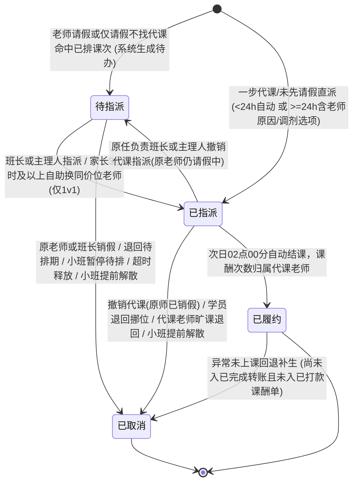
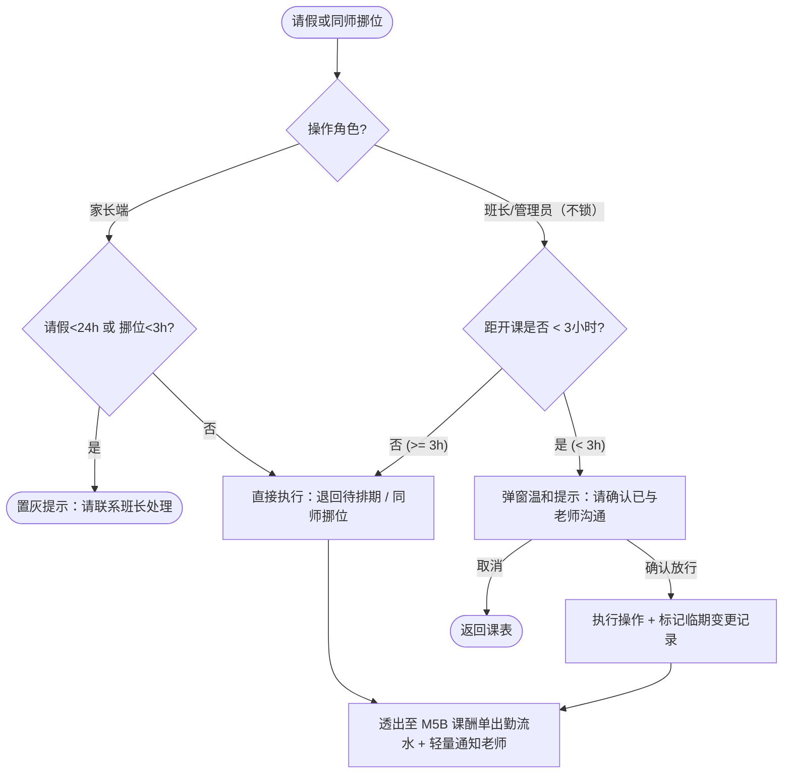

/** (c) 2024-2026 Topee (https://topee.top). All rights reserved. Proprietary and confidential. */

# 产品需求文档 (PRD) — 子模块 3B：考勤、弹性挪位与代课调度 (Attendance, Leave & Substitution)

| 文档属性 | 内容 |
| :--- | :--- |
| **文档版本** | v2.0（精简弹性版） |
| **所属模块** | 模块三：7色智能日历、排课与考勤调度 (Calendar & Scheduling) |
| **关联子模块** | `m3a_calendar_grid.md`（日历控制台）｜ `m4_notification.md`（轻量提醒）｜ `m5b_weekly_settlement.md`（课酬单与出勤异常透出） |
| **创建与更新日期** | 2026-11-05（创建） / 2026-11-13（移除 12.5% 请假配额硬拦截、急病特批通道 B、动态流写表与独立转让引用；新增 `<3h` 温和确认提示、直接「更换实际上课学员」及出勤异常透出至 M5B） / 2026-11-20（新增老师端【授课历史】流水列表页规范） / 2026-11-21（【经办记录】动作字典新增 `课次划转`；对齐按师归属班长授权隔离与按师路由规则；补充小班提前解散联动取消代课任务规则） / 2026-11-22（交接与授课历史备注统一为 2000 字符纯文本；红队审查收口与双层实体/日志 SSOT 治理：对齐 D1–D4 口径、补全销假不自动解绑已指派代课、重排 `AC-3B-01～22`、补齐四大载体 SSOT 4 支柱与跨实体同事务联动清单；补充模式 Z「`<3h` 跨班长紧急驰援豁免」、经办记录跨组驰援标记、原负责班长站内中性知会与并发防撞规范） / 2026-11-23（**通知场景下沉归口 M3B & 消解 `AC-3B-07` 小班冲突**：补全老师请假命中/空闲豁免、代课指派撤销、小班 `<3h` 暂停/代课与班长代请假/家长`≥3h`自助/超时释放不给原师发 Email 等唯一触发规则） / 2026-11-23（**协同 M3A 策略红队收口 `D4-B / D7 / L-3`**：跨家庭【更换实际上课学员】强制必填 `1–200 字` 协调备注写【经办记录】与状态日志并向原出资家长发 M4 站内中性卡；老师请假统一精准表述为 `1～12 个 30 分钟时段格〔跨度最长 6 小时网格区间〕`；明确同师挪位解除原代课委任后原代课老师在 M5B 计 `0 节 / 0 课酬`） / 2026-11-23（**M3B 策略红队全面收口 `D1-A / D2-A / D3-A / D4-A / D5-C / D6–D10 / L-1–L-8`**：① `D1-A/D6/L-5/L-6` 确立跨高档代课 `>= +2 档` 浅黄预警与 `[跨高档代课]` 审计标记、平台统筹盈余池兜底吸收差额严禁扣减代课老师课酬、严格按 TS `原价位档位` 筛师并定义 `相近价位 = ±1 档`；② `D2-A` 补齐代课调度工单 `已履约 → 已取消（异常未上课回退撤销）` 边与双单据未冻结守卫；③ `D3-A` 闭环老师请假申请单「部分销假/部分代课」混态收口至 `已关闭`；④ `D4-A` 跨家庭换人同步向接手新学员家长发送 M4 站内中性知会；⑤ `D5-C/L-7` 延续 M3A 留痕线下核处并穷举 `<3h` 跨班长驰援允许/禁止动作清单；⑥ `D7–D10 / L-1–L-3 / L-8` 明确固定位单周请假遵循 M2A 多数决续费、补全代课态 4 类考勤归属矩阵、确立代课指派「事前沟通即生效」+ 缺勤兜底、`>=24h` 直接代课责任单选、老师请假跨段跳格上限与 `已离职` 收回老师工作台边界） / 2026-11-24（**一步代课 + 仅请假双出口、连选 `1～4` 节（含 `[G]` 小班）、单条合并通知与 `>=24h` 异常口径统一**：① 将【指派代课】升级为【请假 / 指派代课】单面板双出口，支持 1v1 与 `[G]` 小班同日连续 `1～4` 节一步代课或切换「仅请假不找代课」；② 修复 `>=24h` 矛盾：一步代课选`老师原因`与两步请假完全对齐——`>=24h` 仅计请假频次不计非常规标红，`<24h` 计非常规异常，仅作用于所选已排课次不锁当日其余空闲格，并生成已收敛请假归档护航撤销代课退回 `🔴 待代`；③ 同事务按最终态向各相关方各发唯一 `1` 条汇总通知〔豁免操作班长本人，补齐 1v1 家长合并知会〕并在【经办记录】合并写 `1` 条汇总流水；**补齐开课考勤门禁与文档去冲突**：① 明确全端仅在 `当前时间 >= 开课时间`（且未冻结）开放【考勤 / 旷课 / 迟到早退】标记（未开课禁标，同步更新 `AC-3B-08`）；② 清理 `§9` 残留“班长应急代办包抽屉”表述，全链路统一收口直达 [M3A](./m3a_calendar_grid.md) 对应抽屉二级面板；**协同 M3A 红队闭环 D1-A / D2-A / D6-B 修订**：③ 明确老师端考勤仅保留「正常出勤 / 学员旷课」（移除老师自标「老师旷课」，开课后老师旷课/迟到/早退统一由负责班长/主理人或管理员核实标记）；④ 对齐 `§4.7`/`AC-3B-08`「异常未上课回退补生」三方操作人（纳入原资金持有人班长）及未归集且未打款双重财务冻结守卫；**M3B 红队收口 `RED-M3B-01~07` (`D1 / D2-A / D3-A`)**：① `D1` 确立「异常未上课回退补生」`老师责任` 分支记入**实际授课老师**《出勤异常记录》（代课态记代课老师 B），`平台故障` 分支不记录老师或学员任何出勤异常、老师不发薪并将 TS 免费退还学员；② `D2-A` 将「跨高档代课平台统筹盈余池兜底差额」财务规则上收至 [BUSINESS_RULES §3.5](../BUSINESS_RULES.md#35-周度课酬结算单据-weekly-settlement-report)，M3B 改单向指针引用；③ `D3-A` 统一 `§4.8 #3` 摘要表及 `§8/§9` 为「未入已完成入账周转账单 且 未入已打款课酬单」双冻结守卫与标准 `已取消` 状态名；④ `§4.9` 补齐第 7 项「小班暂停待排（老师原因）」埋点、`§4.10` 补点名回退补生与跨家庭换人原因 `1–200 字` 约束，并清理 `§4.4` 残余“待办包”措辞） |

---

## 1. 概述与执行摘要 (Executive Summary)
考勤、弹性挪位与代课调度子模块（`m3b`）是 Dream 系统处理教学履约变动的中枢。遵循**「家长端守门槛（`<24h` 禁自助请假、`<3h` 禁自助挪位），班长端不锁（随时协助），后端账目分明」**的核心哲学，本模块**取消 `12.5%` 请假配额硬拦截**（不对学员请假次数做超额阻断；[m2a_course_orders.md](./m2a_course_orders.md) 购课单保留的 `0.125` 参考额度仅作非阻断软提示）与管理员特批通道 B，全面支持：
- **1v1 家长门槛 + 班长不锁弹性请假与同师挪位**：家长端距开课 `<24h` 不可自助请假、`<3h` 不可自助挪位；班长与管理员后台全程不锁，距开课不足 3 小时操作仅弹出温和确认提示后即可放行，并在 M5B 课酬单出勤流水中透明呈现；
- **直接更换实际上课学员**：替代原独立转让模块，支持班长在课格上直接切换上课学员，原购课单资金归属不变；
- **老师请假与双视角代课调度**：支持老师单节或 1~12 节批量请假，班长/小班主理人可在全平台在职空闲老师中指派临时代课（原师呈蓝色被代课 `🔵`，代课师呈紫色代上课 `🟣`，1v1 代课与小班代课均按节计入实际代课老师 M5B 课酬单并分别按其当期 1v1 / 小班内部单价试算），小班课支持连续双网格代课或暂停待排；
- **单节课异常处理与授课历史**：处理正常出勤、学员旷课、老师旷课（退回待排期）及异常未上课回退补生，并为老师提供跨周/跨月的【授课历史】只读流水与课后教学记录补录入口。

当前阶段：MVP 正式功能迭代。

---

## 2. 问题定义与背景 (Problem Statement)
- **硬拦截带来现场摩擦**：传统的 12.5% 配额硬拦截与开课前 3 小时强锁死，在孩子突发感冒发烧时容易引发家长抱怨与管理员手动特批负担。
- **重耦合流转效率低**：独立的转让审批单与复杂的时间熔断矩阵增加了操作步骤；而“请假本质是把已排 TS 释放回待排期，转课本质是更换实际上课学员”，将决策权还给教务并把出勤异常透明挂载到周课酬单，才能真正让排课流畅、账目清晰。

---

## 3. 目标用户与角色画像 (Users & Personas)
- **出资家长（Amy）**：孩子临时生病或有事时，能快速把已排课程退回待排期或同师挪到其他时段，不被生硬的配额弹窗拒绝。
- **原授课老师（David，老师）**：突发停电或身体不适时可单节或批量勾选 1~12 节请假；被代课后课表清楚标记 `🔵 被代课`。
- **接时代课老师（Elena，老师）**：被指派代课后课表清晰显示 `🟣 代上课` 及学员在学课件进度，结课后该节课酬次数 100% 归属本人。
- **班长 / 小班主理人（Leo）**：可在任何时间协助学员请假、挪位、更换实际上课学员或为全平台老师指派代课，无需找管理员解锁特批。

---

## 4. 核心业务流程 (Main Flows)

### 4.1 1v1 请假退回待排期（家长 `<24h` 限制 + 按师归属班长不锁）
1. **触发入口、角色门槛与固定位续费连续性**：家长或**原任授课老师所属负责班长**/管理员在日历课格抽屉中点击 **【请假退期待排】**。**固定位与临时课均开放合并请假，但严格限定为同日连续 2～4 节（若当日连续 $> 4$ 节则按 M3A 每 `4` 节自然切段）、同一原任老师且同一实际上课学员的未结课 1v1 课次**（禁止跨周、跨天/隔堂或跨老师/跨学员合并；若包含固定+临时混排或已指派代课课次，同事务退回并解除关联代课）。**固定位请假对自动续费的影响**：1v1 固定位单节/单周请假仅清空该节 TS 排课形态标记并退回待排期池（保留原`原价位档位`与`资金持有人`）以释放当周日历格，同轮其余周次固定位排课保持有效不变，下轮周一 `08:30` 自动续费仍严格遵循 [M2A `§4.1a #2`](./m2a_course_orders.md#41a-固定位与小班课到期自动续费生成与预排单核销流程-auto-renewal-flow) 4 周全轮次多数决（`>= 2` 周）与最近活跃周回退正常扫描锁定（仅当连续第 3～4 周均无固定排课时才自然停扫）。
   - **家长端**：距开课 **$\ge 24\text{h}$** 可直接自助请假；距开课 **$< 24\text{h}$** 时按钮置灰禁用并提示“距开课不足 24 小时，请联系班长处理”（附**原任老师所属负责班长**的微信二维码入口；连堂合并勾选横跨 `24h` 临界时，逐节校验并仅置灰不足 `24h` 的前序节次，其余 $\ge 24\text{h}$ 后序节次仍可合并提交）。
   - **按师归属班长 / 管理员端（与 `<3h` 跨班长紧急驰援豁免 · 穷举动作集）**：距开课 **$\ge 3\text{h}$** 的常规代请假严格仅限**原任授课老师所属负责班长**及平台管理员操作（非该老师负责班长禁止跨组）；当距开课 **`< 3\text{h}`** 时，适用 [BUSINESS_RULES.md §1.3](../BUSINESS_RULES.md)「`<3h` 跨班长紧急驰援豁免」与既定日志离线追责原则（**全量写入操作人【经办记录】含 `跨组紧急驰援` 标记并向原负责班长/主理人发 M4 中性知会，不设额外线上申诉流，争议凭日志核查并在 M5B/线下处置**），允许全平台在职班长代为执行**严格限定的当节 `<3h` 急救动作集**：`【指派代课】`、`【撤销代课指派】`、`【<3h 退回待排期（含通融退回与按学员旷课扣课）】`、`【小班暂停待排】`、`【代老师请假】`、`【同师挪位】`、`【老师旷课】`、`【老师迟到/早退】`、`【当节误标恢复为正常出勤】`（**跨组连堂合选必须逐节严格满足 `<3h`；全时段绝对禁止跨组执行【更换实际上课学员】、任何 `>= 3h` 课次操作以及已结课课次的【异常未上课回退补生】**），不受 24h 与 3h 硬锁限制（**班长不锁**）。
2. **班长临期 `< 3h` 温和确认提示与学员恶意临期整节处置**：
   - 若本次勾选节次中最早开课一节距开课时间 $\ge 3\text{h}$：班长直接放行；
   - 若最早开课一节距开课时间 $< 3\text{h}$：系统弹出 1 次温和提示：**“距开课不足 3 小时，老师可能已进入备课状态，请确认已与老师沟通”**，并在弹窗内透出该学员近 30 天请假与临期变动次数（如 `近 30 天临期变动 3 次`）；班长可选择 **【通融退回待排期】**（整组不扣课次、不发老师课酬），若属多次恶意临期取消也可直接选择 **【按勾选节数整节按学员旷课扣课】**（单节扣 1 节、连选 $K$ 节扣 $K$ 节，照常保障老师拿到对应节数课酬；坚持整节处置，不设半节或百分比违约金）。
3. **原子执行与记账口径**：
   - 原已排课 TS 状态退回「待排期」，原日历单元格释放为 🟢 空闲；
   - 若存在关联的代课指派记录，同步自动解除（对应代课调度工单流转为「已取消」）并通知原代课老师；
   - 班长合并代请假在 Tab 3【经办记录】记为 1 条汇总经办记录（写明连续时段与共 $K$ 节），并在《出勤异常记录》及 M5B 课酬单出勤统计按命中的 **`K` 节 TS 逐节记账**（同步标注是否为 `<3h` 临期变更）；
   - 向原授课老师（及被同步解除的原代课老师）按距开课时间（`<3h` 浅红 / `3~24h` 浅黄 / `>=24h` 中性）发送站内提醒 + **课表变动/撤销代课 Email**（英文在前、零积分金额）。

### 4.2 1v1 同师同格平移挪位 (Reschedule with Same Teacher)
1. **触发入口与防撞课筛选**：家长或**该节课原任老师所属负责班长**/管理员在日历课格抽屉点击 **【同师挪位】**，目标日历仅高亮原任课老师的 🟢 空闲绿格；**系统自动排除（置灰并提示“学员该时段已有其他课程”）该学员同一时间已在其他老师处有排课的时段**，防止挪位撞课。
2. **角色门槛与 `< 3h` 温和提示**：
   - **家长端**：距开课 **$< 3\text{h}$** 时按钮置灰禁用并提示“距开课不足 3 小时，请联系班长处理”（附**该节课授课老师所属负责班长**的微信二维码入口）。
   - **按师归属班长 / 管理员端（与 `<3h` 跨班长紧急驰援豁免）**：距开课 **$\ge 3\text{h}$** 时严格仅限原任老师所属负责班长与平台管理员执行（非该老师负责班长禁止操作）；距开课 **`< 3\text{h}`** 时开放全平台在职班长跨组紧急驰援（向原任老师其他空闲绿格挪位，连选时逐节校验 `<3h` 边界）；不受 3h 硬锁限制，若距开课不足 3 小时，弹出同款温和确认弹窗，点击确认后直接放行（跨组时同步写入操作人经办记录并知会原负责班长）。
3. **代课课次挪位规则**：若原课次为代课状态（🔵），同师挪位目标老师仍为**原任老师**；挪位成功后，系统自动取消原代课委任（代课调度工单流转为「已取消」）并向原任老师及被解除的原代课老师按时间窗发送站内提醒 + **变动/撤销代课 Email**（英文在前、零积分金额）。
4. **原子落盘**：原时段单元格立即释放为 🟢 空闲，新时段单元格落盘为原排课类别（🟠 固定课或 🟡 临时课），无需重新扣减课次。

### 4.3 直接更换实际上课学员（替代原独立转让模块）
1. **适用范围**：1v1 已排期课程（按师管辖边界强隔离，仅限**该课授课老师所属负责班长**或平台管理员在日历课格动作抽屉发起，**全时段严禁跨班长换人，不纳入 `<3h` 跨班长紧急驰援豁免**）。
2. **操作流程**：
   - 班长点击 **【更换实际上课学员】**，**仅按规范英文名检索**全校正式在读及本人创建的待认领试课学员并选择新的实际上课学员（**无需校验是否同一家庭**）；结果行展示**规范英文名、在读/试课状态、年龄及所属家长**（严禁露出中文小名；若该学员在当前时段已有其他排课则提示 `⚠️ 该时段已有课`；为保护资金隐私故意隐藏新学员课次余额与购课金额）；
   - 若距开课不足 3 小时，弹出温和确认提示后放行；**若目标新学员所属家长账号 $\ne$ 原出资家长账号（跨家庭换人），必须填写 `1–200 字`「跨家庭协调/结算备注」**（随 TS 状态流转历史与【经办记录】落盘）并勾选确认已沟通双方家长；
   - 点击确认后，原购课单、付款出资方及资金持有人**保持绝对不变**，仅变更该 TS 课次的实际授课学员档案，双方课表即时更新；提交后通过 [M4](./m4_notification.md) 向原任老师发送站内中性卡知会（**不发 Email**），**属跨家庭换人时同步向原出资家长及新学员所属家长（非「待认领试课」档案时）各发送 1 条 M4 站内中性卡知会（均不发 Email，向新学员家长通知严格隐藏原购课单实收积分与资金持有人等财务信息）**，线下家长如何结算由线下自闭环。

### 4.4 老师主动请假与 1～12 个时段格批量请假
1. **发起请假**：老师在课表任一单元格点击抽屉内的当天时段勾选列表，支持在**同一自然日内按需连续或跨时段跳格勾选 `1～12 个` 30 分钟时段格**（总勾选格数上限 `12` 格，每节含 25 分钟授课与 5 分钟课间；连续勾选时自然跨度最长 `6` 小时，同日跨段跳格勾选时总格数仍不超过 `12` 格），填写请假原因（无 3h 入口锁死）。
2. **交接信息顺带补录（选填，方便代课老师备课）**：
   - 当老师勾选的时段中**包含至少 1 节已排课次**时（仅请假空闲绿格不展示），请假原因下方自动呈现「交接信息（选填）」轻量面板，按**去重后的受影响 1v1 学员与 `[G]` 小班**逐一列出：
     - **更新进度备注 (`Process Note`)（置顶优先展示，1v1 与小班通用）**：直接列出当前在学课件、级别与最新进度备注摘要（默认折叠 **`2 行 / ≤64 字符`**，点击可展开原文）；编辑框为**多行纯文本框（上限 2000 字符，提示“请尽量填写英文，便于老师看懂”，`0/2000` 字数统计）**，支持切换级别并快速补充最新单元/页码；
     - **补充学生备注 (`Student Note`)（仅 1v1 学员展示，次要折叠选填；小班物理隐藏）**：折叠为 `+ 补充学生备注` 轻入口，展开为**多行纯文本框（上限 2000 字符，提示尽量填写英文）**，按需填写跨教材学情或注意事项，直接沉淀至该学员档案的学生备注中；
   - 提交请假时，若有填写或修改，在同一事务内同步更新目标学员或目标小班的在学课件进度备注/级别（1v1 含学生备注），并分别写入只读档案变动日志 / 小班操作与修改日志；新代课指派站内提醒未展开卡带前 40 字符摘要，展开态与邮件正文附完整交接内容。
3. **双路原子处理**：
   - **空闲绿格**：立即变为 🔴【已请假】状态，阻断后续新约；
   - **已排课格**：挂起进入 **【老师已请假·待重排】** 状态（严格退出自动结课队列），生成「老师请假待代课」待办（进入 Tab 3 全局待办流，点击直达 M3A 对应课格【请假 / 指派代课】二级面板；1v1 派发给对应班长，1vN 小班派发给小班主理人；待办卡片同步展示该小班的最新在学课件、级别与 2000 字 `Process Note` 折叠摘要，点击可展开全文，**不再显示额外的纯文本班级备注**），同时向班长/主理人及受影响 1v1 家长发送提醒；老师提交成功提示页同时附 **`[ 💬 联系负责班长 ]`** 入口（该班长已上传微信二维码时展示，点击唤起二维码灯箱方便紧急沟通）。

### 4.5 班长多学员应急调度、一步代课双出口与智能筛师
1. **单面板双出口与 3 种调度流向（含连选 `1～4` 节、`<3h` 跨班长驰援、跨高档预警、事前沟通生效与并发防撞）**：距开课 **$\ge 3\text{h}$** 时仅限**原任老师所属负责班长**（1v1 课次）或小班主理人（1vN 小班）及平台管理员操作；当处于**距开课 `< 3\text{h}`（含刚开课待应急处置）**浅红紧急窗口时，全平台任一在职班长均可在 Tab 3 浅红待办或 M3A 课表/日调度中按 `§4.1 #1` 穷举允许动作集跨组驰援执行（完成后写入操作人经办记录、自动向原负责班长/主理人发 M4 中性知会并同步消除全校待办；若多人并发提交，后提交者提示 **`该紧急事项刚刚已由 [班长姓名] 处理完毕`** 并刷新列表）。**1v1 与 `[G]` 小班均支持同日紧邻连续 `1～4` 节合并提交**（由 M3A 抽屉第 1 层快捷“连几次”与复选行传入）：
   - **【请假 / 指派代课（一步代课兼支持“只请假不找代课”双出口 · 1v1 与 `[G]` 小班对称）】**：点击抽屉第 2 层入口，顶部展示学员/小班在学课件与 `Student Note` / `Process Note` 折叠摘要（`1–2 行 / ≤40~64 字符`，点击可展开完整 2000 字符），按所选课次当前状态自动分流：
     - **已处于 `🔴 待代`**：直接选定在所选全部 $K$ 个连续时段（`1～4` 节）均全程空闲 🟢 的代课老师完成指派；
     - **未先请假（一步处理）**：班长/管理员先填原因与责任归属（`< 24h` 节次默认归属老师原因；只要连选节次中**存在至少 1 节 `>= 24h`**，强制单选 **`老师原因（代办请假）`** vs **`教务/学员主动调剂（不计原师异常）`**，不足 `24h` 的前序节次旁灰显提示`不足24h默认计非常规`），再选择处理方式：① **选定具体代课老师（「一步代课」）**——同一事务完成记请假/调剂、绑定代课老师、`【经办记录】` 记 `1` 条汇总流水、按节精确记入《出勤异常记录》并**按最终态向各相关人各发唯一 `1` 条合并结论通知**；② **勾选「仅老师请假（暂不指定代课，挂起 `🔴 待代`）」**（或从独立 `[ 代老师请假 ]` 进入；小班亦可选择 `【暂停待排】`）——仅将所选 $K$ 节挂起为 `🔴 待代`（退出 `02:00` 自动结课），生成 `1` 张包含这 $K$ 节的请假申请单、记 `1` 条汇总【经办记录】并向受影响方发 `1` 条汇总挂起通知。
   - **智能筛师规则（按所选 `1～4` 节全时段匹配）**：**允许全平台在职且在所选全部 $K$ 个连续时段（1v1 为 `K` 节单格，小班为 `K` 节连续双格）均为空闲 🟢 的老师进入可选列表（取消课程类型/资质过滤）**；列表严格按 **① 曾教过该学员/本班（熟客优先） → ② `同价位 → 低一档 → 高一档 → 其他档位`（1v1 严格以 TS `原价位档位`〔不受强提改价实付快照影响〕对比目标老师当日生效价位；`相近价位` 定义为 [M1B](./m1b_teacher_profile.md) 当期「启用中」价位字典升序相邻的 `±1 档`） → ③ 当周已排负荷较少** 排序，显性标注 `教过该学员`/`教过本班`、价位差异（`同价位`/`低一档`/`高一档`/`跨高档`）与 `本周已排 X 节`；支持**按老师姓名搜索**，不符合条件（所选时段部分或全部无空闲/已有课/休息）的老师置灰展示并明确提示具体原因（如 `19:30 已有课`）；若没有任何老师能覆盖全部连选时段，提示减少连选节数拆分指派或先选「仅请假挂起」；
   - **事前沟通生效机制、`>= +2 档` 跨高档预警确认、`>= 24h` 异常统一口径与局部锁格铁律**：① **确立「事前线下/微信沟通确认 + 线上指派即生效」设计意图**（指派前提示“请确认已与代课老师线下确认可接课”，落盘立即向代课老师发 M4 提醒与 Email 附负责班长微信）；② 连选 $K$ 节中**只要有任意 1 节**高于原 TS `原价位档位` $\ge 2$ 档，弹窗触发**浅黄成本预警确认**并在对应节次打标 **`[跨高档代课]`**（差额财务兜底与禁扣代课老师课酬原则详见 [BUSINESS_RULES §3.5](../BUSINESS_RULES.md#35-周度课酬结算单据-weekly-settlement-report)）；③ **统一 `>= 24h` 异常口径 & 仅作用于所选课次（不锁当日其余空闲格）**：距开课 **`< 24h`** 节次一律自动计原任老师非常规异常；距开课 **`>= 24h`** 选 **`老师原因（代办请假）`** 时，与两步请假完全对齐——**记入原任老师《出勤异常记录》（标明「一步代课/代办请假」）并计入请假频次，不计入非常规标红（`是否计入非常规 = 否`）**，且同步为所选课次建立已收敛的请假锁定归档（以护航后续撤销不直接还课，**绝不封锁原任老师同日其余空闲 🟢 格**；若需整天/半天屏蔽空闲格请走专门「代老师请假/锁时段」）；选 **`教务/学员主动调剂`** 时不记原师异常也不挂请假锁定；连选跨越 `24h` 临界时，按各节各自提前小时数**逐节精确记账**；
   - **【退回待排期】**（仅 1v1）：释放 TS 回待排池；
   - **【同师平移】**：挪至其他空闲时段。
2. **代课双视角日历染色与课酬试算/平台盈余兜底口径**：
   - 原任老师日历：变更为 **蓝色被代课（🔵）**；
   - 代课老师日历：变更为 **紫色代上课（🟣）**；
   - 家长端课表：合并显示代课老师名称与 `[代课]` 标识；
   - **课酬归属与跨高档财务兜底指针**：1v1 临时代课结课后，在 [m5b_weekly_settlement.md](./m5b_weekly_settlement.md) 老师周课酬单**按「代上课」全额计入实际代课老师本人名下 1 节**（原任老师计 0 节，老师端只出节数不出金额）；管理员后台发薪试算**直接沿用该代课老师本人的当期【内部课酬单价】核算**（**严禁**按原 TS 家长价位折算，亦严禁因跨档代课在 M5B 克扣代课老师课酬）；原 TS 的 [m5a_transfer_collection.md](./m5a_transfer_collection.md) 班长应上交积分仍严格锁定原购课`单节实付积分快照`不变，**跨档正负差额由平台统筹教务盈余池兜底吸收（财务归口详见 [BUSINESS_RULES §3.5](../BUSINESS_RULES.md#35-周度课酬结算单据-weekly-settlement-report)）**；若确属恶意高频跨高档指派，由管理员凭 `[跨高档代课]` 审计标记线下追责经办班长。
3. **小班课连选 `1～4` 节代课与暂停待排**：
   - 小班主理人（及 `<3h` 驰援班长）在周课表/日调度抽屉连选同日紧邻 `1～4` 节 `[G]` 小班课次后，同样适用上述 **【请假 / 代课 / 暂停待排】双出口面板**（`>=24h` 须单选`老师原因` vs `教务/学员主动调剂`；若属老师原因均纳入 `《出勤异常记录》` 并在跨 4 周累计时作为 [M1C](./m1c_classes.md) 请假/暂停统计依据）；系统按所选全部 $K$ 节**过滤出全平台在职且连续 `K × 1` 小时双格均全程空闲 🟢 的老师**（仅空半小时不入选），排序、搜索与跨高档规则对称复用第 1 点；结课后按节计入**实际代课老师** M5B 小班代课节数与当期小班内部单价；
   - 若无法安排代课，主理人可选择 **【仅请假挂起 `🔴 待代`】** 或 **【暂停待排】**（TS 退回小班待排池并释放日历双格，按 `§4.8 #4` 向已绑定正式学员家长汇总发送 `1` 条提醒 + `<3h` 等规则对应的 **Email**，严禁含费用/人数/同学名，并在私域微信群协调补排）。
4. **1v1 老师请假后家长自助分窗处置与课程结束自动释放（固定课与临时课通用）**：
   - **距开课 3 小时及以上（缓冲充足，开放家长自助二选一）**：老师请假后，家长在课表点击该【老师已请假·待重排】课格，可直接选择：① **【换同价位老师代上（原时段）】**（仅筛原时段空闲且当日生效价位严格等于该 TS 不可变 **`原价位档位`**〔不受强提改价实付快照干扰〕的在职老师——此限制旨在保障家长原购课档位零差价匹配、不触发补退差价，绝不假定 M5B 内部课酬单价等于家长付费价位；确认后流转为蓝色被代课/紫色代上课，按时间窗向代课老师发送站内提醒 + **高优代课指派 Email**；对已请假原任老师**不发 Email**，仅端内同步状态）；② **【退回待排期 / 改期】**（固定课、临时课均释放回「待排期」，家长可随即在未来 1～7 天内自助重约同价位空闲时段；对已请假原任老师**不发 Email**）。
   - **距开课不足 3 小时（防代课老师未在线导致空堂，禁用家长自助换老师）**：此时禁止家长直接自助指派陌生代课老师；抽屉仅保留 **【退回待排期（后续再约）】** 与 **`[ 💬 联系班长微信 ]`**（展示**原授课老师所属负责班长**微信二维码，由其确认代课老师确实在线后在后台不限时指派代课）。
   - **课程结束超时未处理自动释放**：若直到原定**课程结束时间**，班长与家长均未完成代课指派、退回或改期，系统定时任务自动将该挂起 TS 释放退回为 **「待排期」** 退还家长（保留原资金持有人与价位），向受影响 1v1 家长推送站内**中性卡**提醒可后续再约（**不发 Email**；对原任老师亦**不发 Email**），绝不自动结课扣费或发薪。

### 4.6 代课撤销（含一步代课防空堂分流）、跨班长代课主责归属与老师销假
- **代课撤销与防空堂分流（覆盖先请后代与一步代课）**：$\ge 3\text{h}$ 时仅**原任老师所属负责班长**（1v1 课次）、小班主理人（1vN 小班）与平台管理员可在课格抽屉点击【撤销代课指派】；**`< 3\text{h}` 紧急窗口同步适用跨班长紧急驰援豁免**，支持驰援班长撤销并重派代课（均弹出 `<3h` 温和确认提示）。撤销后去向按原课次请假/调剂归因严格分流：① **若原课次存在生效/已关联的老师请假锁定（含两步请假尚未销假、及“一步代课”选「老师原因」或 `<24h` 记入原师请假锁定的课次）**，撤销代课后自动退回 **`🔴 待代（待指派）`** 等待重派，严禁直接把课还给原本不能上课的原老师（若原老师此刻已恢复可授课，须在撤销抽屉或原师请假格先确认【销假恢复】再归还原老师）；② **若原老师已销假，或原一步代课本身归因为「教务/学员主动调剂」**，撤销代课后直接解除代课绑定并安全归还原任老师。发生跨班长代课（如 A 班长指派 B 班长负责老师乙代课）时，该节 TS 的常规调度控制权仍归**原任老师所属负责班长 A**；若原任老师所属班长 A 或管理员记录代课老师乙迟到/早退/旷课，系统同步向代课老师所属负责班长 B 发送 1 条中性卡端内知会。
- **老师销假与已指派代课联动防线**：原老师或**其所属负责班长**/管理员点击 🔴【已请假】**空闲格**并选择【恢复可约 / 销假】时，对应未排空闲时段立即恢复为 🟢 空闲。**已指派代课的课次不会被原老师销假自动取消代课**（避免代课老师已接单备课却被无声解绑）；若原老师已销假并可恢复授课，须由原任老师所属负责班长（或小班主理人/管理员）先在课格抽屉点击【撤销代课指派】（确认原师已可授课），再由系统将课次归还已销假的原任老师。

### 4.7 单节课考勤标记、代课态归属矩阵与缺勤兜底 (Lesson Exception Handling)
严格按老师所属负责班长授权（1v1 课次限该课原任/实际老师所属负责班长与管理员；1vN 小班限主理人与管理员；**$\ge 3\text{h}$ 常规考勤与已结课【异常未上课回退补生】全时段禁止非本人负责班长与 `<3h` 驰援跨组操作——其中已结课【异常未上课回退补生】遵循 [BUSINESS_RULES.md §1.3](../BUSINESS_RULES.md) 与 [M5A](./m5a_transfer_collection.md) 同步开放给该 TS「原资金持有人班长」，当资金持有人 ≠ 师负责班长时提交后向对方发 M4 中性知会；仅在 `<3h`/临开课未结课急救场景下，允许按 `§4.1 #1` 穷举允许动作集执行跨班长驰援处置并知会原负责班长**），**且全端统一实行「`当前时间 >= 开课时间`」前置门禁（未到开课时间的未来课次禁用/置灰全部考勤打卡与旷课/迟到/早退标记，提示“尚未到开课时间，如需取消请走请假、代课或撤排”）；其中老师端仅开放「正常出勤」与「学员旷课」，严禁老师自标「老师旷课 / 老师迟到 / 老师早退」（老师课前无法上课须发起请假报备，开课后老师缺勤/迟到早退统一由负责班长、小班主理人或平台管理员核实标记）**，在课格抽屉通过 **【考勤 / 旷课标记】** 及底部低频危险区执行以下处置（**抽屉内不再单独设置重复的“异常处理”跳转入口**）：
- **默认正常（次日 02:00 自动结课）**：系统于次日凌晨 02:00 自动将未请假、未撤排且未标旷课的已排期 TS 结课（正常扣减课次、计入实际授课老师课酬）；因此日常无需手动点击“正常出勤”；**若已指派代课老师突发缺席且未能在课前联系班长【撤销代课指派】，负责班长/主理人/管理员须于开课后至次日 `02:00 (UTC+8)` 自动结课前在课格标为【老师旷课】，若已错过 `02:00` 结课则通过互斥入口【异常未上课回退补生】撤销工单归集并补生**；
- **恢复为正常出勤（仅误标纠偏）**：仅当课次已被标为学员旷课、老师旷课、老师迟到或老师早退、且尚未完成周结算归集时，面板内才显示【恢复为正常出勤】用于纠偏；
- **学员旷课**：TS 正常结课扣减课次，实际授课老师课酬正常计入，并在 M5B 出勤明细中标记“学员旷课”；
- **老师旷课**：未结课的原 TS **直接退回待排期**（保留原`原价位档位`、`单节实付积分快照`与`资金持有人`、学员课次不扣，M5A 暂不上交直至重新约课结课），同步剔除该节课酬，并在 M5B 出勤明细中标记“老师旷课”（不再另外“补生 1 节”；若错过未结课窗口且已自动结课，统一使用下方互斥操作【异常未上课回退补生】）；
- **老师迟到 / 老师早退（家长投诉与履约瑕疵留痕）**：针对课程已正常上完但存在迟到或早退（如迟到 3 分钟、早退 3 分钟）引发家长投诉的场景，班长/管理员可标记【老师迟到】或【老师早退】并**强制填写情况说明**；TS 保持正常结课（照常扣减学员课次，默认计入实际授课老师课酬节数），同时在《出勤异常记录》与 M5B 课酬单出勤明细中透明标记“老师迟到 / 早退”及原因说明，供管理员发薪核查留痕；
- **撤排退回课次（仅未结课显示）**：未上课课次直接释放网格变回 🟢 空闲并退回待排期；
- **异常未上课回退补生（仅已结课且未归集显示）**：针对已结课但实际未上的 TS（尚未入「已完成入账」周转账单且尚未入「已打款」周课酬单），作废原 TS、剔除课酬并原单补生 1 节全新待排 TS（1v1 补给学员，小班补给小班池），**若关联已履约代课调度工单则同事务将其状态置为「已取消（异常未上课回退撤销）」**。

- **代课态（原任老师 A 🔵 → 实际代课老师 B 🟣）考勤归属与结算矩阵**：

  | 代课态标记动作 | 责任归属（《出勤异常记录》） | M5B 周课酬单计薪归属 | 原 TS 与 M5A 周转账归集处理 | 跨组协同知会（若跨班长代课） |
  | :--- | :--- | :--- | :--- | :--- |
  | **标为【老师旷课】** | **实际代课老师 B** | 剔除 **B** 本节课酬（`0 节`）；原任老师 A 保持 `0 节` | 取消代课工单，原 TS 退回「待排期」（保留原`原价位档位`/`单节实付积分快照`/`资金持有人`），M5A 暂不归集 | 向 **B 所属负责班长**（及 A 所属负责班长，若不同）发 M4 中性知会 |
  | **标为【老师迟到 / 早退】** | **实际代课老师 B** | **B** 照常计 `1 节`（带迟到/早退说明供发薪核查）；A 为 `0 节` | 正常结课，M5A 按原 TS 快照归集原资金持有人 | 向 **B 所属负责班长** 发 M4 中性知会 |
  | **标为【学员旷课】** | 学员侧记录（不记任何老师异常） | **B** 照常计 `1 节`；A 为 `0 节` | 学员扣 1 节，M5A 按原 TS 快照归集原资金持有人 | 无需跨组惩罚知会（仅常规经办留痕） |
  | **【恢复为正常出勤】** | 撤销 B 名下对应异常记录（置为`已销假撤销`） | 恢复 **B** 计 `1 节`（A 仍为 `0 节`） | 保持正常结课，M5A 按原 TS 快照归集原资金持有人 | 原跨组通知 B 负责班长且现纠偏时同步知会 B 负责班长 |

### 4.8 核心实体生命周期、修改规则与留痕策略 (Entity Lifecycles & SSOT)

> **唯一归口声明**：本节与 §4.9–§4.10 为**【代课调度工单】【老师请假申请单】【《出勤异常记录》】【【经办记录】】**的全系统唯一生命周期、字段修改规则、流转日志与留存策略归口（SSOT）；TS 全局状态机主定义在 [BUSINESS_RULES.md §3.2](../BUSINESS_RULES.md)，本节仅附 M3B 驱动 TS 跃迁的入边摘要。

#### 1. 代课调度工单 (SubstitutionTask)
- **状态机流程图**：

- **状态转移矩阵与前置守卫**：
  | 状态跃迁 | 触发角色 | 前置条件与防线守卫 | 同事务副作用 |
  | :--- | :--- | :--- | :--- |
  | `[*] -> 待指派` | 原授课老师 / 所属负责班长 / 管理员 | 请假时段命中至少 1 节已排课次 | 生成【班长/主理人应急代办】；挂载至老师请假申请单；生成「老师请假」异常记录；推送通知。 |
  | `[*] -> 已指派` | 所属负责班长 / 主理人 / 管理员（含 `<3h` 跨班长驰援） | 【请假 / 指派代课】一步到位（或未先请假直派）选定在所选 `1～4` 节全时段均空闲的在职老师（不足 3 小时需弹窗确认且跨组严验逐节 `<3h`；`>=3h` 禁跨班长；`>=24h` 须单选「老师原因（代办请假）」或「教务/学员主动调剂」；任一节 `>= +2 档` 过浅黄成本预警） | 双视角日历染色（🔵 被代课 / 🟣 代上课）；`<24h` 节次按原任老师记「非常规直接代课」异常（计入非常规），**`>=24h` 勾选`老师原因`时记「老师请假（一步代课）」（仅计请假频次不标红）并仅对所选课次生成已收敛请假归档锁定（不锁当日其余空闲格），勾选`调剂`不记原师异常**；写入 `1` 条汇总【经办记录】（跨组标 `跨组紧急驰援`，跨高档标 `[跨高档代课]`）；**按最终态向各相关人各发唯一 `1` 条合并通知（豁免操作人本人）**。 |
  | `待指派 -> 已指派` | 所属负责班长 / 主理人 / 管理员（含 `<3h` 跨班长驰援） / 家长 | 1v1 家长自助须距开课 `≥ 3h` 且仅可选`原价位档位`严格匹配的空闲老师；后台不限时（`>=3h` 禁跨班长；`>= +2 档` 过浅黄成本预警）；小班代课须连续 2 个半小时格空闲（无资质限制） | 双视角染色；关闭该节在全校 Tab 3 的应急待办（并发抢单提示已由先提交者处理完毕；若为请假单最后一节脱离挂起同步收敛请假申请单）；后台操作写入【经办记录】（跨组/跨高档分别标记）；家长自助不重复记原老师非常规异常、不写【经办记录】；发通知给代课老师（跨组时同步向原负责班长/主理人发 M4 中性知会）。 |
  | `待指派 -> 已取消` | 原老师 / 班长（含 `<3h` 跨班长驰援） / 主理人 / 家长 / 系统 | 销假恢复、退回待排期、小班暂停待排、课程结束超时自动释放或 [M1C](./m1c_classes.md) 小班提前解散（`>=3h` 退回/暂停禁跨班长） | 释放原课次或暂停回池；关闭全校 Tab 3 对应应急待办；跨组处置时写【经办记录】并向原负责班长/主理人发 M4 中性知会；若由小班解散触发，保留原老师当日其他空闲请假红格不变；若为请假单最后一节脱离挂起，按混态规则收敛请假单（全量销假→`已销假撤销`；含他处已处置→`已关闭`）。 |
  | `已指派 -> 待指派 / 已取消` | 所属负责班长 / 主理人 / 管理员（含 `<3h` 跨班长驰援） | 执行【撤销代课指派】或学员退回挪位/撤排/代课老师旷课/小班解散（`>=3h` 禁跨班长；**原老师点击空闲红格销假不自动取消已指派代课**） | **撤销且原课次存在生效/关联老师请假锁定时（含先请假尚未销假及“一步代课”选`老师原因`/`<24h` 记入原师请假锁定的课次）退回 `待指派` 重派**；已确认原师销假、原一步代课属`教务/学员主动调剂`或退回/老师旷课/解散时置 `已取消` 解除代课绑定；同步通知原代课老师并写入【经办记录】（跨组时标 `跨组紧急驰援` 并向原负责班长/主理人及代课老师旷课时的代课班长发 M4 中性知会）。 |
  | `已指派 -> 已履约` | 系统批处理 | 次日凌晨 02:00 正常结课（或学员旷课/迟到/早退结课） | 课酬次数 100% 归属实际代课老师并进入 [M5B](./m5b_weekly_settlement.md) 周课酬单（跨档差额由平台统筹兜底，严禁扣减代课老师课酬）；发薪标记已打款后关联 TS 物理冻结。 |
  | **`已履约 -> 已取消`** | **原任/实际授课老师所属负责班长 / 小班主理人 / 管理员**（**严禁跨组**） | 对已结课 TS 执行【异常未上课回退补生】；关联 TS **尚未入「已完成入账」周转账单且尚未入「已打款」老师周课酬单**；必填 `1–200 字` 异常原因 | 同事务撤销代课工单归集置为 **`已取消（异常未上课回退撤销）`**，作废原 TS 并于原单补生 1 节新「待排期」TS；从尚未打款的 M5B 课酬单及 M5A 草稿中同步剔除该节并写入《出勤异常记录》与【经办记录】。 |

- **关键字段修改规则与锁定边界**：
  - **`待指派`**：允许切换处置去向（指派代课 / 退回待排期 / 同师平移），但不可直接更改原任老师、原课次时间段与原购课`原价位档位`快照。
  - **`已指派`**：代课老师一经指派即锁定，不可原位直接替换成另一位代课老师（须先执行【撤销代课指派】解绑后再重新指派）；临近 3 小时内的改动须弹窗二次确认并打上临期标记。
  - **`已取消`**：全字段永久只读终态，严禁反改状态；**`已履约`**：核心接课与时间字段只读冻结，仅当关联 TS 尚未入「已完成入账」周转账单且尚未入「已打款」老师周课酬单时，允许通过【异常未上课回退补生】跃迁至终态 `已取消`（同步作废原 TS、补生新待排 TS 并撤销对应代课工单归集）。
- **流转日志与数据留存策略**：每次状态跃迁必须在同一事务内追加只读状态流转日志（含原状态、目标状态、操作人/系统、流转时间、操作原因与临期/跨高档标识）；所有工单（含 `已履约` 与 `已取消`）**长期只读审计留存，严禁物理删除**，与 M5B 老师周课酬单历史对账链条永久对齐。

#### 2. 老师请假申请单 (TeacherLeaveRequest)
- **生成条件**：① 当老师本人请假或班长「仅请假不找代课」勾选的时段中**包含至少 1 节已排课次**时生成 `1` 张本申请单（连续 `1～4` 节合并仅请假时归并入同 `1` 张申请单，承载班长/主理人应急调度待办包）；**仅请假空闲绿格不生成老师请假申请单**（仅通过 [M3A §4.10](./m3a_calendar_grid.md#410-实体生命周期与状态机-entity-lifecycles--state-machines) 时段覆盖记录置红为「已请假」）。② **一步代课关联归档**：当班长/管理员通过【请假 / 指派代课】执行「一步代课」且触发原师请假归因（`<24h` 或 `>=24h` 选`老师原因`）时，系统同事务为所勾选的这 `1～4` 节已排课次生成**直接收敛为 `已关闭`** 的请假归档记录（**不生成应急待办包，也不封锁原任老师当日其余空闲 🟢 格**），用于准确支撑撤销代课回退 `🔴 待代` 防空堂校验与【销假恢复】衔接。
- **状态机与完整收敛转移矩阵（含部分销假 / 部分代课混态闭环）**：
  - `[*] -> 生效中`：老师本人提交或班长/管理员代提交含已排课次的请假（空闲格同步置红、已排格生成代办并可顺带填写交接进度/学生备注）。
  - `生效中 -> 已销假撤销`（全量撤回）：仅当该申请单名下**全部（100%）**受影响已排课次均尚未完成任何代课指派或退排/平移/暂停/超时释放，且全部通过老师/负责班长销假恢复原老师正常排期时自动流转（同步将其全部《出勤异常记录》置为「已销假撤销」）。
  - `生效中 -> 已关闭`（完整收敛，覆盖混态）：当该申请单名下**最后一节**仍处于 `待指派` 挂起态的受影响课次脱离挂起态——即**全部受影响课次均已完成处置**（每节各自完成了`代课指派〔含家长 ≥3h 自助换师〕`、`退回待排期`、`同师平移`、`小班暂停待排`、`课程结束超时释放`或**`单节销假恢复`**，且**其中至少 1 节发生过非销假处置**，未满足全量销假）——申请单在同一事务内自动收口为 **`已关闭`**（注：单节通过`销假恢复`取消挂起的课次，其对应《出勤异常记录》仍**按节独立**置为「已销假撤销」且不计入非常规频次，防止部分销假/部分代课混态下申请单永久卡死）。
- **关键字段修改规则与留存策略**：请假申请单提交后，请假时段集合、原请假原因及操作人信息只读不可修改（如需补充请假时段请另起新请假申请，如需退回空闲时段请走销假恢复）；若提交时顺带更新了学员备注或课件进度，在请假提交同一事务内写入 [M1A](./m1a_student_profile.md) / [M1E](./m1e_courseware.md) 并落盘档案日志，请假单留存当时交接快照不回改。已撤销与已关闭的申请单**长期只读审计留存、严禁物理删除**。

#### 3. TS 全局状态联动入边摘要表（单向指针）
> TS 完整状态机与全局字段冻结规则以 [BUSINESS_RULES.md §3.2](../BUSINESS_RULES.md) 为唯一权威，本表仅索引 M3B 驱动 TS 跃迁的跨实体入边：
| M3B 触发动作 | TS 原状态 | TS 目标状态 / 属性变更 | 原子联动与宿主锚点 |
| :--- | :--- | :--- | :--- |
| 学员请假退回 / 撤排退回 / 老师旷课 / 超时释放 | 已排期 / 老师请假挂起 | 退回「待排期」（恢复空闲绿格） | 若原已指派代课同步取消工单；记录异常或经办日志 |
| 1v1 同师挪位 | 已排期（含🔵被代课） | 保持「已排期」（迁至原师新时段） | 若原已指派代课自动解除工单并通知原代课老师 |
| 直接更换实际上课学员 | 已排期 | 保持「已排期」（变更上课学员档案） | 原购课单、出资方及资金持有人绝对不变 |
| 指派代课 / 家长 3 小时及以上自助换师 | 老师请假挂起 / 已排期 | 变更为代课态（🔵 被代课 / 🟣 代上课） | 实际授课老师绑定为代课老师；M5A 上交价位不变 |
| 异常未上课回退补生 | 已结课（未入已完成入账周转账单 **且** 未入已打款老师周课酬单） | 原 TS 流转为 **`已取消`**（描述为异常未上课回退作废，非独立状态枚举） | 原单原子补生 1 节全新「待排期」TS 退还学员/小班池；「老师责任」记实际授课老师异常并剔除课酬（代课态取消工单）；「平台故障」不记异常、老师不发薪（代课态同步取消工单） |

#### 4. M3B 跨实体同事务联动清单
1. **M3B 老师空闲格请假/销假 ➔ [M3A 时段覆盖记录](./m3a_calendar_grid.md#410-实体生命周期与状态机-entity-lifecycles--state-machines)**：同事务新增或清除「已请假」覆盖记录（已排课格同步挂起并生成老师请假申请单）。
2. **M3B 请假交接 ➔ [M1A 学员档案](./m1a_student_profile.md) & [M1E 课件进度](./m1e_courseware.md)**：同事务更新受影响学员的学生备注与在学课件进度/级别，并分别写入只读档案改动日志。
3. **M3B 调度与考勤处置 ➔ [全局 TS 枢纽](../BUSINESS_RULES.md)**：同事务驱动 TS 释放待排、同师重排、换人、绑定代课老师或异常作废补生。
4. **M3B 应急代办 / 一步代课合并通知 / 代课指派与撤销 / 超时释放 / 跨班长知会 ➔ [M4 通知能力底座](./m4_notification.md)**：因 M4 不做跨事件延迟队列合并，凡通过本模块单次提交（含连选 `1～4` 节 `1v1` 或 `[G]` 小班合并提交），**必须在同一事务按最终态对每类受影响人严格只发 `1` 条汇总通知**（文案合并连续时段与总节数，如 `10:00–11:50 连上 2 节`），具体发送通道、卡面分级与收件人唯一规则如下：
   - **老师请假（仅请假不找代课，含老师本人请假 & 班长代请假挂起 `🔴 待代`）**：仅请假空闲绿格**绝不**生成待办、不发站内提醒也不发 Email；命中 `>= 1` 节已排课次时，按最临近受影响课次距开课时间（`<3h` 浅红 / `3~24h` 浅黄 / `>=24h` 中性）向对应**负责班长 / 小班主理人**（平台直管老师向管理员；**若由负责班长/主理人本人代操作“仅请假”，豁免不给自己发送应急待办提醒与 Email**）发送 `1` 条汇总站内提醒 + **Email**；受影响 **1v1 家长**同步收 `1` 条对应时间窗汇总站内提醒（**不发 Email**，即使 `<3h` 亦维持靠端内浅红卡 + 微信触达）；**班长代老师请假时不给原任老师发 Email（仅发 `1` 条站内中性卡提示），老师本人请假亦不给自己发 Email**；
   - **一步代课（【请假 / 指派代课】同事务完成请假/调剂并指派代课，含 `1v1` 与 `1vN` 小班、单节及连续 `1～4` 节）**：**严禁先发“老师请假待重排”再发“已换代课”两次轰炸**，同事务按最终态直接向各受影响方各发 **`1` 条合并结论通知**：① **代课老师**收 `1` 条站内提醒（按最临近受影响节次 `<3h` 浅红 / `3~24h` 浅黄 / `>=24h` 中性）+ **`1` 封合并代课指派 Email**（英文在前、零积分金额、附完整 `Process Note` 与负责班长微信）；② **受影响家长（1v1 家长及 1vN 小班已绑定正式学员家长）**收 `1` 条合并结论通知（明确告知本节/连上几节已由代课老师接替；**1v1 仅发站内提醒不发 Email**，**1vN 小班发站内提醒且距开课 `<3h` 同步发 Email**，同家庭同班去重、严禁费用/人数/同学名）；③ **原任老师**（他人/班长代办时）收 `1` 条站内中性结果卡（写明已代为请假/调剂并由 XX 代课，**不发 Email**）；④ **原负责班长 / 小班主理人**：**操作人本人直接豁免不发通知**，仅在 `<3h` 跨组驰援等非本人操作时向原负责班长/主理人发 `1` 条站内中性知会（不发 Email）；
   - **两步代课指派（`待指派 -> 已指派`）与撤销代课**（含家长 `>=3h` 自助换师及同师挪位/小班解散/连续请假连带解除）：按距开课时间（`<3h` 浅红 / `3~24h` 浅黄 / `>=24h` 中性）向**代课老师 / 被解除的原代课老师**发送 `1` 条站内提醒 + **代课指派/撤销 Email**（英文在前、零积分金额、指派正文附完整 `Process Note` 与交接内容）；若为 **1vN 小班**临时代课指派或撤销，同时向已绑定正式学员家长按时间窗分级发送站内提醒（同家庭去重、严禁费用/人数/同学名），且**距开课 `<3h` 时同步发送 Email**；**1v1 家长 `>=3h` 自助换代课或自助退回、以及课程结束超时系统自动释放时，不对原授课老师发 Email（超时释放仅向 1v1 家长发站内中性卡、不发 Email）**；
   - **跨班长协作知会**：`<3h` 跨班长紧急驰援处置完成知会、及跨组代课被记录迟到/早退/旷课知会，向原负责班长/主理人或代课老师负责班长发送站内**中性卡**协同知会（**不发 Email**）。
5. **M3B 异常埋点与考勤标记 ➔ [M5B 老师周课酬单](./m5b_weekly_settlement.md)**：固化挂载《出勤异常记录》至周度课酬单草稿及管理员发薪看板，作为非常规标红、差额调整与发薪对账依据。

### 4.9 《出勤异常记录》产品规范（字段、埋点、修改锁定与留存边界）
在不限制老师请假次数与临近时间的前提下，系统统一通过**《出勤异常记录》**对非常规出勤变动进行标准化记账，供 M5B 课酬单汇总透出：

1. **核心业务字段**：
   - **归属与上下文**：唯一记录编号、**归属老师**（责任归属方：老师请假/非常规直接代课始终记在**原任老师**名下；**处于代课态〔🟣〕下的老师旷课、迟到、早退一律记在实际代课老师名下；「异常未上课回退」（仅限「老师责任」分支）一律记在**实际授课老师**名下——常规课记原任老师，🟣 代课态记实际代课老师；「平台故障」分支不生成老师或学员任何出勤异常**）、**归属学员**（1v1 课次自动关联学员档案，用于统计学员侧异常频次）、异常大类（老师责任类：`老师请假` / `非常规直接代课` / `老师旷课` / `老师迟到` / `老师早退` / `异常未上课回退`；学员侧记录：`学员临期(<3h)变动` / `学员当日(3~24h)代请假` / `学员旷课`，**严格与老师责任类隔离统计**）、关联课次（含班型、学员/小班、原上课时间）与**归属自然周**（按原课次所属自然周归集）。
   - **来源与时间窗口**：操作来源角色（`老师本人` / `班长代操作` / `管理员` / `家长`）、操作人、提交时间、距开课提前小时数与三档分类（**`<3h` 临近开课** / **`3h~24h` 当日临时** / **`>=24h` 常规提前**）、**是否计入非常规统计（`<24h` 老师请假/非常规直接代课、老师旷课/迟到/早退/异常未上课回退为 `是`；`>=24h` 老师请假〔含“一步代课”勾选老师原因〕仅计请假频次、不计非常规标红为 `否`；学员侧及教务/学员主动调剂换师备查为 `否`）**。
   - **原因、处置与状态**：异常原因、最终处置结果（已指派代课 / 退回待排期 / 小班暂停待排 / 已扣酬补生）与记录状态（`有效` / `已销假撤销`）。

2. **7 处埋点触发规则**：
   - **老师本人请假** & **班长/管理员代老师请假（含仅请假不找代课）**：仅对**命中已排期课次**按所选 `1～K` 节逐节生成 `老师请假` 记录（仅关闭空闲绿格不埋点），按提交时刻计算各节距开课提前小时数并标注操作来源（`<24h` 计非常规，`>=24h` 仅计频次不标红）；
   - **【请假 / 指派代课】一步代课（或未先请假直接指派代课 · 1v1 与 `[G]` 小班通用）**：按连选命中的各节分别计算提前小时数并精准逐节落盘——① 若某节距开课 **`< 24h`**，系统自动为**原任老师**生成 `非常规直接代课` 记录并**计入非常规统计（是）**；② 若某节距开课 **`>= 24h`**，抽屉强制单选责任归属——选 **`老师原因（代办请假）`** 时，与两步请假完全一致，为**原任老师**按节生成 `老师请假（一步代课）` 记录（**`是否计入非常规 = 否`，仅计入请假频次，不触发非常规标红**）；选 **`教务/学员主动调剂`** 时仅记【经办记录】而不生成老师异常记录；跨越 `24h` 临界连选时逐节按上述规则分开记账；
   - **老师销假恢复**：若原课次尚未被代课或退回待排（恢复原老师正常排期），对应记录自动置为「已销假撤销」，不计入异常次数；
   - **单节课异常处理**：标记【老师旷课】、【老师迟到】、【老师早退】或【学员旷课】时分别生成对应大类记录（误标后执行【恢复为正常出勤】时对应异常记录置为「已销假撤销」）；
   - **学员 `<3h` 变动**：仅作学员侧备查记录，不计入老师非常规频次；
   - **小班【暂停待排】（老师原因）**：主理人或管理员在 `[G]` 小班选择「暂停待排 — 老师原因（如停电/突发请假）」时，按所选 `1～K` 节距开课提前时间窗逐节为**原主讲老师**生成 `老师请假` 记录（`<24h` 计非常规、`>=24h` 仅计请假频次不标红），并作为 M1C 当轮累计缺席/暂停统计依据；若选择「节假日/全班调休」则仅退回小班待排池并释放绿格，不生成老师异常记录；
   - **M5A 异常未上课回退补生**：**仅当责任类型为「老师责任」时**，自动为**实际授课老师**（常规课记原任老师；🟣 代课态严格记在实际代课老师 B 名下并同事务取消代课工单）生成 `异常未上课回退` 记录；管理员选择 **「平台故障」** 时，**严禁生成老师或学员任何《出勤异常记录》**（同时老师该节不发薪，TS 退还给学员/小班待排池）。

3. **四端查询边界**：
   - **管理员后台**：可在 M5B 课酬结算看板按周查看、筛选与处分，也可在教务流水按老师/班长/异常大类/时间窗口跨周检索；
   - **老师工作台**：在 M5B【我的课酬对账】底部折叠备查区透明查看本人记录与调整说明；
   - **班长工作台**：在【经办记录】查看本人经办的代请假/代课/异常流水；
   - **家长端**：**物理不可见**任何老师的请假窗口、非常规统计及发薪警告/惩罚信息。

4. **字段修改锁定与数据留存策略**：
   - 《出勤异常记录》一经生成全字段只读，**严禁任何角色手工篡改内容或物理删除**；
   - 仅当触发销假恢复（且未发生代课/退排）或误标考勤后执行【恢复为正常出勤】时，系统在同一事务内将记录状态从「有效」流转为「已销假撤销」（保留原始发生轨迹备查，但不再计入非常规异常频次）；
   - 所有有效与已撤销异常记录均**长期只读审计留存**，支持跨周及 M5B 历史发薪核查。

### 4.10 【经办记录】列表页产品规范
0. **入口与页面形态**：由 Tab 3【教务中心】`[ 📜 经办记录 ]` 金刚位直接嵌入/进入本完整列表页（保持底栏锁定 Tab 3，左上角提供 `< 返回教务中心`），**禁止使用简版底部抽屉弹窗替代**。
1. **只读不可篡改与长期留存原则**：
   - 所有经办记录由系统在操作提交成功时自动生成，**严格只追加、不修改、不删除，并长期只读审计留存**；页面与记录卡片固定展示只读留痕状态，不提供编辑、删除或撤回入口。
   - 若发生反向或纠偏操作（如老师销假、误标旷课后执行【恢复为正常出勤】），系统**追加写入一条新记录**，保留完整历史操作链。
2. **记录纳入范围（聚焦班长/管理员人工排课与考勤经办）**：
   - **排课与约课类**：
     - `批量排课`（每轮 4 周固定位首排/续费确认排入、小班 4 周批量排课：**按单次批量操作记 1 条汇总记录**，不按课节数拆分成多条刷屏）；
     - `新增排课`（班长/管理员代约单节 1v1 临时课、试听课、小班补排）。
   - **代课、请假、挪位与异常处置类**：
     - `指派代课`、`一步代课（代请假并指派代课）`、`撤销代课指派`、`代学员请假`、`同师代挪位`、`代老师请假`、`更换实际上课学员`、`课次划转`、`学员旷课`、`老师旷课`、`老师迟到`、`老师早退`、`恢复为正常出勤`、`撤排退回课次`、`异常未上课回退补生`、`课次清退/扣减`（其中同日连选 `1～4` 节合并提交的`一步代课` / `代老师请假` / `代学员请假` / `同师代挪位`均按**单次操作合并记为 `1` 条汇总流水**，写明连续时段与共 `K` 节）。
   - **明确不纳入本列表**：
     - **非班长/管理员人工操作**：家长自助约临时课/请假/挪位、系统自动续费预占、系统次日 02:00 自动正常结课，均不写入【经办记录】；
     - **财务单据**：购课单、退款单、周转账单、教师课酬单由各自单据列表与状态流承载；
     - **低频主数据与风控审计**：试课建档认领/归档、教师调级、课件增删升阶、小班创建/解散、管理员删留言等，归属系统通用审计日志，不与排课/考勤经办记录混写。
3. **单条记录展示字段与必填原因约束**：
   - **头部信息**：操作时间（倒序）、操作类型徽章、临期标记（距开课 `<3h` 操作标注）、**跨组驰援标记**（若为其他班长执行 `<3h` 紧急驰援，显性标注 `跨组紧急驰援 · 原负责: [班长/主理人姓名]`）；管理员视角同时展示经办人姓名（班长视角默认均为本人）。
   - **核心上下文**：涉及对象与课次时间（如 1v1 学员唯一昵称或小班名称 · 原上课日期与时段；批量排课展示周期与总节数，如 `11-10 ~ 12-05 · 共 8 节`；`课次划转` 展示划出学员 → 接收学员及各价位划转节数汇总）、变更前后详情（如原任老师 → 代课老师、原时段 → 新时段、原学员 → 新学员）、归属老师（责任归属方，仅涉及未排期 `课次划转` 时留空）。
   - **原因/备注**：记录操作时填写的原因说明；执行**异常处置、资产调整与纠偏类操作**（`课次划转`、`学员旷课`、`老师旷课`、`老师迟到`、`老师早退`、`恢复为正常出勤`、`异常未上课回退补生`、`课次清退/扣减`）时，原因输入框强制必填（**至少填写 1 个非空字符**方可提交；其中 `课次划转`、`课次清退/扣减`、`异常未上课回退补生` 及跨家庭 `更换实际上课学员` 按对应规约约束为 1–200 字）。
4. **筛选条件、分页加载与链接穿透**：
   - **权限与按班长筛选**：班长端仅展示本人经办记录；管理员端支持按经办班长筛选全平台记录，顶部默认展示**有数据的前 3 位班长**筛选标签，超出 3 位时默认折叠，点击 `[ 展开更多班长 ]` 展开其余有数据的班长。
   - **时间范围筛选**：默认选中 **`近 7 天`**，支持切换 `近 30 天` / `全部`。
   - **操作类型筛选**：默认选中 **`全部`**，支持按 4 大业务类别筛选（`全部` / `排课与约课` / `代课调度` / `代请假与挪位` / `异常与退回`）。
   - **排序与分页**：按操作时间倒序排列，**默认展示 20 条**；超出时底部常驻 `[ 查看更多 ]` 按钮，**每次点击追加加载 20 条**。
   - **双向链接穿透**：每条记录支持点击关联的 **学员名称** 直达该学员档案（小班批量排课无单一学员时支持点击 **小班名称** 直达小班详情）；支持点击关联的 **课次/时段** 直达该课次所在自然周的周课表视图（跨多周的批量排课默认定位至**该轮次首节课所在自然周**的周课表；即使原课次已被撤排或取消，仍定位至原课次所在周的周课表）。

### 4.11 【授课历史】老师端流水列表页产品规范 (Teaching History)
1. **定位与入口分流（严守“财课分离”）**：
   - 老师通过老师首页金刚位 **`📜 授课历史`** 进入，承接超过首页近 7 天窗口的跨周/跨月已发生课次流水检索与课后教学补录；
   - 与 M5B【周课酬单】清晰分流：M5B 负责每周一跑批出单后的周度汇总与打款状态对账；本页展示按开课时间倒序排列的单节课次流水（含本周刚结课尚未出周单的课次），仅只读挂载结算状态标签并支持点击穿透至对应周的 M5B 周课酬单。
2. **数据可见范围与权限隔离**：
   - 严格按当前登录且处于 **「在职」** 状态的老师本人视角隔离，仅展示**开课时间已过**且本人作为实际授课老师（含正常授课、🟣 代上课、学员旷课计薪）或原任老师（含 🔵 被代课、老师请假、异常取消回退）的课次；**未来待上课次严禁进入授课历史**；
   - **「已离职」老师访问隔离（对齐 [M1B `§4.7.1`](./m1b_teacher_profile.md#471-生命周期状态机与转移矩阵)）**：老师进入「已离职」状态后系统自动收回其老师工作台与本页登录查看视图；但其过往全部授课历史、考勤异常与 M5B 结算归属在平台管理端/财务端**永久只读审计留存、严禁篡改**，若后续由管理员在 M1B 通过 `已离职 -> 在职` 复用恢复入职，原有全部授课历史流水即刻恢复本人只读查阅。
3. **顶部轻量汇总条（严守“只出节数不出金额”）**：
   - 随当前筛选条件实时计算并展示 3 项核心节数统计，严禁出现任何单价或金额字段：
     - **计薪授课**：本人正常结课 + `🟣 代上课` + 学员临期/旷课计薪节数；
     - **被代课**：`🔵 被代课` 课次节数（仅作透明留痕，不计入本人课酬）；
     - **异常/未计薪**：老师请假退回、异常取消回退等未计薪节数。
4. **3 维轻量筛选栏与分月抽屉**：
   - **时间范围（默认选中 `本月`，不提供“全部”时间选项）**：顶部提供快捷胶囊 **`本周 / 上周 / 本月 / 上月`**，右侧提供 **`更多月份 ▾`** 按钮；点击 `更多月份` 弹出底部抽屉，列出**最近 12 个自然月**（含当前月，倒序展示如 `2026年11月` ~ `2025年12月`），单选后立即刷新汇总条与流水列表；不设跨全量历史的“全部”时间选项；
   - **学员筛选（弹窗抽屉 · 仅列当前时段有关学员 · 无搜索框）**：点击筛选胶囊（如 `[ 全部学员 ▾ ]`）弹出底部抽屉，**仅列出当前所选时间范围内有授课记录的相关学员**（首项为 `全部学员`，**不设搜索框**），单选后立即刷新列表；切换时间范围若原选中学员在新时段无课则自动重置为 `全部学员`；
   - **履约类型筛选**：默认 `全部`，支持筛选 `正常结课` / `🟣 代上课` / `🔵 被代课` / `异常与取消`。
5. **流水卡片要素、连堂合并与课后补录**：
   - **连堂合并**：同日同学员相邻连续多节课自动合并展示为单张卡片并标注连上节数（与 [m0_workspace_and_home.md](./m0_workspace_and_home.md) 首页 `6+6` 规则一致）；
   - **卡片内容**：开课日期与时段（如 `11-18 周二 19:00-19:25`）、班型（`1v1` 或 `[G] 小班`）、履约状态徽章、学员规范英文名/小班名称（**老师端严禁露出中文小名**）与当时/最新在学课件进度摘要（1v1 同步展示学生备注摘要；单卡默认折叠为 **`1 行 / ≤36~40 字符`**，点击可展开完整 2000 字符）；
   - **结算归属徽标（只读联动 M5B）**：`待出周单`（本周刚结课尚未到周一跑批）/ `第 W 周课酬单 · 待发薪` / `第 W 周课酬单 · 已打款`（点击已出单徽标可直达对应周的 M5B 周课酬单详情）/ `不计入课酬`（被代课或异常取消）；
   - **课后教学补录、归档只读回看与财务冻结红线**：对于本人实际授课（**含本人正常正课与 🟣 代上课**，不含被代课与异常取消课次）且**正常结课**的历史课次卡片，1v1 卡片保留 `[ 📝 学生备注 ]`（`Student Note`）与 `[ 📚 进度备注 ]`（`Process Note`）入口，`[G]` 小班卡片保留 `[ 📚 进度备注 ]` 入口支持跨周补记小班或学员进度（均为 **2000 字符多行框**，提示尽量填写英文；若所属小班进入「已归档 / 已提前解散」或 1v1 学员进入「已归档 / 已删除」，按钮仍开放只读回看历史课件与 **`Process Note`** 并禁用编辑保存，其中小班在营期保存必过 M1E 他生隐私检测与强确认）；补录教学记录**严禁改动该课次的考勤结果、上课节数与结算归属**。
6. **排序与无限追加分页（不设“全部”展开）**：
   - 同日同学员相邻连续多节课先完成合并，按开课时间倒序排列，**首次仅展示最新 20 条（合并后卡片条数）**；
   - 超出时底部常驻 **`[ 查看更多 ]`** 按钮，**每次点击再追加显示 20 条，不设点击次数上限，可一直点击加载直至当前筛选范围底端**（不提供“查看全部”或“全部时间”选项）。
7. **界面去噪与规则图标弹窗（严禁在页面正文平铺技术/开发说明）**：
   - 页面顶栏、汇总条与列表区**严禁直接展示**“只读 · 本人视角”、“仅展示开课时间已过的本人课次……不改动考勤结果、上课节数与结算归属”、“授课历史与 M5B 周课酬单分流……不提供课表穿透”等技术类、架构术语或开发过程类文案；
   - 顶栏右侧提供轻量规则图标 **`ⓘ`**，点击后弹出**【授课历史规则说明】弹窗**，以面向老师的通俗业务语言说明（例如：仅记录已上完的课程；同天连续上课合并为一条显示；补录学生备注或进度备注不影响课次节数与周课酬结算）。

---

## 5. 用户故事 (User Stories)
- **US-3B-01（无配额阻塞请假）**：作为一个家长，当孩子突然发烧时，我希望能随时将课程请假退回待排期，而不被系统弹出配额上限锁死，以便于灵活安排补课。
- **US-3B-02（临期温和确认）**：作为一个班长，当家长在开课前 1 小时临时请求挪位或请假时，我希望系统给予温和提示确认已与老师沟通后直接放行，以便于高效解决突发状况。
- **US-3B-03（极速换人上课）**：作为一个班长，当 A 家长在微信群把一节课让给 B 家长时，我希望直接在日历课格上点击【更换实际上课学员】完成替换，无需走繁琐的转让单与家庭校验。
- **US-3B-04（老师批量请假与代课双视角）**：作为一个老师，我希望能一次勾选当天最多 12 节课发起请假，并由班长指派代课后在双方课表上清晰区分蓝色被代课与紫色代上课。
- **US-3B-05（出勤异常透出课酬单）**：作为一个班长或管理员，我希望所有临期请假、旷课、代课记录都能自动挂载到 M5B 老师周课酬单出勤流水中，以便于后端算账和对账清清楚楚。
- **US-3B-06（跨周授课历史检索与补录）**：作为一个老师，我希望能按周、按月（含最近 12 个月）和按学员检索自己上过的全部课程记录，核对代课与课酬单归属，并在漏记时随时补录学生备注（`Student Note`）与进度备注（`Process Note`）。

---

## 6. 验收标准清单 (Acceptance Criteria)

### 6.1 家长端 `<24h`/`<3h` 门槛、按师归属班长不锁与 `< 3h` 温和提示
- **AC-3B-01（家长端时间门槛、按师归属隔离、`<3h` 穷举动作集与固定位请假连续性）**：系统取消 `12.5%` 请假配额超额拦截（不对学员请假次数做拦截阻断；[m2a_course_orders.md](./m2a_course_orders.md) 购课单保留的 `0.125` 参考额度仅作非阻断提示）；1v1 固定位请假退回待排后仅清空该节排课形态，同轮其余周次固定位与下轮周一 08:30 自动续费仍按 M2A `§4.1a #2` 规则正常维持；**家长端**距开课 `<24h` 禁用自助【请假退期待排】、距开课 `<3h` 禁用自助【同师挪位】并提示联系**该课授课老师所属负责班长**处理（附该班长微信二维码）；**该授课老师所属负责班长与平台管理员全程不锁**，随时可代操作 1v1 课次的请假退回待排期与同师挪位；**非该授课老师负责的其他班长对 `>=3h` 课次及已结课课次禁止跨组操作，仅在距开课 `<3h` 时适用「跨班长紧急驰援豁免」（沿用 M3A 留痕与线下追责口径）解锁 `§4.1 #1` 所列当节急救动作集（允许：指派/撤销代课、`<3h` 退回待排/暂停待排、代老师请假、同师挪位、老师旷课、老师迟到/早退、当节误标恢复正常出勤；绝对禁止：跨组换上课学员、任何 `>=3h` 操作与异常未上课回退补生；连堂严格逐节校验 `<3h`）**。
- **AC-3B-02（班长/管理员 `< 3h` 温和确认提示、协同知会与并发防撞）**：当负责班长、跨组驰援班长或管理员在距开课不足 3 小时执行请假、同师挪位、更换实际上课学员（仅原负责班长/管理员）或指派/撤销代课时，必须弹出二次确认框提示：“距开课不足 3 小时，老师可能已进入备课状态，请确认已与老师沟通”；点击确认后操作立即生效，并在记录中标注为「临期变动（不足 3 小时）」同步透出到 M5B 出勤明细；若属于跨班长 `<3h` 紧急驰援，【经办记录】追加 `跨组紧急驰援` 标识，同时向原负责班长/主理人派发 1 条 [M4](./m4_notification.md) 站内中性卡知会且全校同步消卡，并发提交者提示“该紧急事项刚刚已由 [班长姓名] 处理完毕”。
- **AC-3B-03（代课课次挪位自动解绑）**：对蓝色代课课次（🔵）执行同师挪位时，目标网格限定为原任课老师的空闲时段；挪位成功后，原代课委任自动解除（工单流转取消），按 M3B 向原代课老师发送 M4 站内提醒与撤销代课 Email，且原代课老师在 M5B 课酬单计 **`0 节 / 0 课酬`**。

### 6.2 更换实际上课学员
- **AC-3B-04（直接换人 · 跨家庭强制备注与双向家长知会）**：该课授课老师所属负责班长与平台管理员（非该老师负责班长禁止操作）在 1v1 课格动作抽屉点击【更换实际上课学员】时，**仅按规范英文名**检索全校正式在读及本人创建的待认领试课学员并展示其**规范英文名**、在读/试课状态、年龄、所属家长及同时段撞课提示（不展示中文小名、新学员课次余额与金额），确认替换不校验是否同一家庭且不设二次更改锁；原购课单金额、出资人与资金持有人保持不变；**当目标新学员所属家长 $\ne$ 原出资家长（跨家庭换人）时，强制必填 `1–200 字`「跨家庭协调/结算备注」记入【经办记录】与 TS 日志并确认已沟通双方家长，同步向原出资家长、新学员所属家长（非待认领试课档案时，严格隐藏财务信息）及原任老师各发 1 条 M4 站内中性卡知会（均不发 Email）**。

### 6.3 老师批量请假与代课调度
- **AC-3B-05（批量请假范围与跳格口径）**：老师单次请假支持同日连续或跨时段跳格勾选 **`1～12 个` 30 分钟时段格**（总格数 $\le 12$ 格，每节含 25 分钟授课与 5 分钟课间；连续勾选时跨度最长 `6` 小时），必须填写请假原因；提交后空闲格置红 🔴，已排格生成「老师请假待代课」待办（进入 Tab 3 全局待办流）并推送通知给负责班长或小班主理人。
- **AC-3B-06（一步代课与仅请假双出口、连选 `1～4` 节、跨高档预警、平台统筹兜底与禁扣代课老师课酬）**：遵循「事前线下沟通 + 线上指派即生效」，班长/管理员可在【请假 / 指派代课】同一面板完成责任归因（`<24h` 默认老师原因、`>=24h` 必填单选 `老师原因（代办请假）` vs `教务/学员主动调剂`）并支持**选定全时段空闲代课老师一步提交**或**切换「仅请假不找代课」挂起 `🔴 待代`**（支持 1v1 与 `[G]` 小班同日连选 `1～4` 节）。一步代课指派成功后原任老师呈 🔵、代课老师呈 🟣，同事务只写 `1` 条汇总【经办记录】，且仅向各受影响方（代课老师、1v1/小班家长、原任老师、非本人操作时的原负责方）各自发送 **`1` 条合并汇总结论通知**（绝不先发请假待办再发指派两条；**豁免操作人本人**）；选 `老师原因` 时仅对所选课次生成已收敛请假归档锁定（不锁当日其余空闲格），后续撤销代课自动退回 `🔴 待代`；任意连选节次高于原 TS `原价位档位` $\ge 2$ 档时弹出浅黄成本预警确认并对对应节次打标 `[跨高档代课]`；结课后 1v1 代课按「代上课」计 1 节全额归入实际代课老师的 M5B 周课酬单（原任老师计 0 节），管理员后台试算沿用实际代课老师本人的内部课酬单价（原 TS 的 M5A 班长应上交快照不变，**跨档差额财务兜底与禁扣代课老师课酬规则详见 [BUSINESS_RULES §3.5](../BUSINESS_RULES.md#35-周度课酬结算单据-weekly-settlement-report)**）。
- **AC-3B-07（小班连续 `1～4` 节双格一步代课、仅请假与暂停待排）**：小班代课老师必须满足在职且所选全部 `1～4` 节连续 `1 小时` 双格（`2` 个半小时格/节）全程空闲 🟢（取消课程资质限制）；`>=24h` 同样强制单选 `老师原因` vs `教务/学员主动调剂`；代课结课后按节计入实际代课老师本人 M5B 周课酬单小班代课节数与当期小班内部单价试算，指派/一步代课或撤销时向代课/原代课老师按时间窗汇总发送 `1` 条站内提醒 + **Email**，并向已绑定正式学员家长按时间窗汇总发 `1` 条站内提醒（`<3h` 同步发 **Email**，操作人本人豁免）；主理人选择【仅请假不找代课】时挂起 `🔴 待代`，选择【暂停待排】时 TS 原子退回小班待排池并向已绑定正式学员家长发站内提醒 + **Email**（未绑学员及收费/续费账单仍 100% 物理隔离不发通知）。

### 6.4 单节异常处置与经办记录
- **AC-3B-08（单节异常处置、开课考勤门禁、代课态归属与代课工单回退边）**：常规与 `>= 3h` 场景严格限该课授课老师所属负责班长与平台管理员执行（`<3h` 跨班长驰援严格限定于 `AC-3B-01` 所列当节急救动作集；已结课【异常未上课回退补生】同步开放给该 TS 原资金持有人班长并双侧互发 M4 中性知会，严禁无关第三方或 `<3h` 跨组操作）；**全端【考勤 / 旷课标记】与老师端考勤打卡均强制校验 `当前时间 >= 开课时间`**（未到开课时间的未来课次置灰禁用；老师端仅开放「正常出勤 / 学员旷课」，移除老师自标「老师旷课」，开课后老师缺勤由负责班长/主理人或管理员核实标记）；**代课态（🟣）**下标记【老师旷课】或【老师迟到/早退】均记入**实际代课老师 B** 名下并同步知会 B 所属负责班长（其中代课态【老师旷课】剔除 B 课酬、取消工单、原 TS 保留原`原价位档位`/`单节实付快照`/`资金持有人`退回待排池且 M5A 暂不归集；代课态【学员旷课】B 计 1 节且 M5A 照常归集）；若代课老师突发缺勤且未在课前撤销指派，可在次日 02:00 前标为【老师旷课】，错过 02:00（且尚未入 `已完成入账` M5A 与 `已打款` M5B）时通过【异常未上课回退补生】作废原 TS、补生待排 TS 并同步将已履约代课工单置为 **`已取消`**。非误标纠偏操作须填写原因，系统自动追加只读经办记录，并在 M5B 清晰透出。
- **AC-3B-09（经办记录列表与筛选穿透）**：班长与管理员通过教务中心 Tab 3 顶部 `[ 📜 经办记录 ]` 金刚位进入；覆盖班长/管理员人工执行的排课约课（含每轮批量排课，按单次操作记 1 条汇总记录）、代课调度、代请假挪位与异常退回，不混入家长自助/系统自动行为与财务单据；记录严格只追加不修改不删除并长期留存；默认按操作时间倒序展示最近 7 天全部分类的前 20 条记录，点击 `[ 查看更多 ]` 每次追加 20 条；班长仅可查看本人经办记录，管理员顶部默认展示有数据的前 3 位班长筛选标签（超出折叠可展开）；每条记录支持点击学员名称跳转学员档案（小班批量排课可跳转小班详情）、点击课次/时段跳转该课次（或该轮次首节课）所在自然周的周课表。

### 6.5 智能筛师与防撞课校验
- **AC-3B-10（1v1 TS 代课按 `原价位档位` 智能筛师与 `±1 档` 排序）**：针对待指派代课的 1 ~ N 个具体 TS，代课选人列表仅允许“在职 + 所选全部 N 个 TS 目标时段均空闲 🟢”的老师可选（取消课程资质过滤），并按“曾教过该学员 → `同价位 → 低一档 → 高一档 → 其他档位`（严格以 TS 永久固化的 `原价位档位` 对比目标老师当日生效价位；`相近价位` 定义为 M1B 当期启用字典升序相邻 `±1 档`） → 当周已排负荷较少”排序，显性标注 `教过该学员`、价位差异与 `本周已排 X 节`；支持按老师姓名搜索，不符合条件的老师置灰并提示具体冲突时段；无全覆盖老师时提示减少连选节数拆单指派。
- **AC-3B-11（1vN 小班代课连续双格筛师）**：针对 1vN 小班课指派代课次，选人列表仅允许目标 1 小时窗口内连续 2 个半小时格均为空闲 🟢 的老师可选（取消课程资质过滤），并按“曾带过本班 → 同价位/相近价位（`±1 档`） → 当周已排负荷较少”排序；支持按老师姓名搜索，不符合条件的老师置灰并提示具体原因。
- **AC-3B-12（同师挪位学员自身防撞课）**：执行同师挪位时，若该学员在原老师的某个空闲绿格时间段内，已在其他老师名下有已排期课程，该单元格必须自动置灰禁用并悬浮/点击提示“学员该时段已有其他课程”。

### 6.6 出勤异常埋点、请假交接与家长分窗处置
- **AC-3B-13（非常规请假、班长代请假、部分销假混态收敛与一步代课统一异常口径）**：老师本人提交请假、班长代老师请假、或【请假 / 指派代课】一步代课（`<24h` 自动归老师原因，或 `>=24h` 勾选`老师原因（代办请假）`）时，只要命中已排期 TS，系统必须按各节提交时刻距开课提前小时数归档三档时间窗口（`<3h` / `3~24h` / `>=24h`）并逐节将《出勤异常记录》记在**原任老师**名下（标注操作来源；仅关闭空闲绿格不得生成异常记录）：**`<24h` 计入非常规异常统计（是），`>=24h`（含两步请假与一步代课勾选`老师原因`）仅计请假频次、不计入非常规标红（否）**；勾选`教务/学员主动调剂`不计原师异常；若多节请假申请单出现部分代课/处置与部分销假混合，最后一节挂起格离池后申请单自动收敛为 `已关闭`（全量 100% 销假才入 `已销假撤销`），已销假单节异常独立置为 `已销假撤销`。
- **AC-3B-14（销假撤销与家长端隔离）**：老师及时销假且原课次未产生代课或退期待排时，对应异常记录自动流转为「已销假撤销」且不计入异常频次；家长端严禁展示老师请假时间窗口、异常频次与警告信息。
- **AC-3B-15（学员临期代请假双选与整节保护老师收入）**：班长/管理员代学员执行 `<3h` 临期请假时，弹窗必须展示该学员近 30 天请假与临期变动次数，并提供【通融退回待排期】与【按学员旷课扣 1 节（照常扣减学员课次并发放老师课酬）】双选；学员侧异常记录严禁混入老师非常规次数。
- **AC-3B-16（老师请假交接优先更新进度备注与代课透传）**：老师发起请假且勾选时段含已排课次时，抽屉按去重后的受影响学员展示选填交接区，**优先置顶展示【更新进度备注 (`Process Note`)】**，与折叠次要项【补充学生备注 (`Student Note`)】均采用**多行纯文本框（上限 2000 字符，提示“请尽量填写英文，便于老师看懂”）**，不填亦可直接提交请假；若填写或修改，提交后必须同一事务更新学员进度备注/学生备注并记录变动日志；在班长指派代课抽屉、代课老师首页代课卡片与通知未展开卡上默认折叠展示摘要（卡片 **`1 行 / ≤36~40 字`**、抽屉 **`2 行 / ≤64 字`**），点击可展开完整 2000 字符，新代课指派邮件正文则完整附带最新进度备注与交接标注。
- **AC-3B-17（老师请假后家长 3h 分窗自助处置与课程结束自动释放）**：老师请假后，对应 1v1 TS 挂起为“老师已请假·待重排”并排除在凌晨 02:00 自动结课之外，同步向受影响 1v1 家长发送对应时间窗站内提醒（**不发 Email**）；距开课 **3 小时及以上** 时，家长端抽屉开放【换同价位老师代上】（仅可选原时段空闲且当日生效价位严格等于该 TS `原价位档位` 的在职老师以保障零购课差价、不假定内部单价等于家长价位；确认后向代课老师发站内提醒 + **Email**，对已请假原任老师**不发 Email**）与【退回待排期】（退回后不对原任老师发 Email）；距开课 **不足 3 小时** 时，禁用家长自助换代课老师，仅保留【退回待排期】与【💬 联系班长微信】（展示**原授课老师所属负责班长**的微信二维码，由其确认老师在线后后台指派）；若直到原定课程结束时间仍无人处理，定时任务自动将 TS 释放退回为「待排期」，向家长发送站内**中性卡**提醒（**不发 Email**，亦不对原任老师发 Email）。

### 6.7 老师端【授课历史】流水与补录
- **AC-3B-18（授课历史入口、在职访问与离职隔离）**：**仅在职老师**从首页金刚位 `📜 授课历史` 进入后，列表严格按开课时间倒序展示本人名下**开课时间已过**的课次（含正常授课、🟣 代上课、🔵 被代课及异常取消记录），严禁混入未来待上课次或他师数据；老师达离职日进入「已离职」后收回老师工作台与本页访问入口，历史流水永久只读留存于平台端审计并可在管理员复用恢复入职时重见；顶部汇总条随当前筛选实时展示 `计薪授课`、`被代课`、`异常/未计薪` 三项节数统计，全程严禁展示任何单价或金额。
- **AC-3B-19（时间胶囊、12 个月抽屉、时段联动学员抽屉与无限 20 条递增分页）**：时间筛选默认选中 `本月`，支持一键切换快捷胶囊 `本周 / 上周 / 本月 / 上月`，并支持点击 `更多月份 ▾` 弹出底部抽屉单选**最近 12 个自然月**（**不提供“全部”时间选项**）；点击学员筛选胶囊弹出底部抽屉，**仅列出当前所选时间段内有课的学员**（**不设搜索框**）；同时支持按履约类型（`全部 / 正常结课 / 🟣 代上课 / 🔵 被代课 / 异常与取消`）组合筛选；同日同学员连上多节合并后，首次仅展示最新 20 条卡片，点击底部 `[ 查看更多 ]` 每次再追加 20 条，**可一直点击加载直至无更多记录**（无次数上限，不提供“查看全部”）。
- **AC-3B-20（连堂合并与结算状态穿透）**：同日同学员相邻连续多节课自动合并展示为单张卡片；每张卡片只读展示结算归属徽标（`待出周单` / `第 W 周课酬单 · 待发薪` / `第 W 周课酬单 · 已打款` / `不计入课酬`），点击已出单徽标可直达对应自然周的 M5B 老师周课酬单详情。
- **AC-3B-21（课后教学补录、归档只读回看与财务只读红线）**：本人实际授课（**含正常正课与 🟣 代上课**，不含被代课与异常取消课次）且**正常结课**的历史课次卡片中，1v1 保留 `[ 📝 学生备注 ]`（`Student Note`）与 `[ 📚 进度备注 ]`（`Process Note`）入口、`[G]` 小班保留 `[ 📚 进度备注 ]` 入口（不设学生备注），支持跨周补录多行进度或学生备注（均为 **2000 字符上限**，提示尽量填写英文；卡片内摘要默认折叠为 `1 行 / ≤36~40 字` 并可点击展开；**若目标学员或小班已进入「已归档 / 已提前解散」，仍允许老师点击只读回看历史 `Process Note` 但锁定不可保存修改**；在营小班保存须过他生隐私扫描拦截与强确认）；任何教学补录操作均不得修改该课次的考勤结果、上课节数或 M5B 结算归属。
- **AC-3B-22（授课历史界面去噪与规则图标弹窗）**：页面正文严禁平铺任何技术类、架构分流或开发过程说明文字（如“只读 · 本人视角”、“M5B 分流”、“课表穿透”等）；具体统计与使用规则统一收口于顶栏右侧规则图标 `ⓘ`，点击弹出通俗易懂的规则说明弹窗。

---

## 7. 本期范围外清单 (Out of Scope)
- **不支持 12.5% 请假配额限制与超额阻断**（[m2a_course_orders.md](./m2a_course_orders.md) 购课单参考额度仅作非阻断提示）。
- **不支持管理员急病特批通道 B 与班长端时间硬锁**（班长后台直接放行即可，无需额外特批工单）。
- **不支持独立的课次转让单与转让集市 (M3C)**。
- **不支持独立动态流写表与首页 14 类事件瀑布流**。
- **不支持独立的【应急调度】列表页、【异常处理】Tab 及老师【我的课表】/【请假记录】独立页**：`老师请假待代课` 待办统一收口至 Tab 3【教务中心】全局待办，点击卡片 **`[ 指派代课 ]`** 主路径直达 [M3A](./m3a_calendar_grid.md) 原任老师周课表对应课格的【请假 / 指派代课】二级面板（直达对应老师、自然周与课次并锁定底栏 Tab 3；严禁跳转 M3D 空闲大盘），也可在日调度或课表抽屉内完成处置；单节考勤标记、撤排与异常回退补生统一从 M3A 日历课格抽屉就地发起；老师课表与批量请假 100% 复用 M3A 老师周课表与抽屉。
- **不支持【经办记录】导出与记录页内一键撤回**：本期不提供 Excel/CSV 导出功能，也不允许在经办记录列表页直接删除、修改或一键回滚历史记录（如需纠偏，必须回到对应课格或业务对象发起新的纠偏操作并追加新记录）。

---

## 8. 约束条件 (Constraints)
- **小班单人缺席隔离**：小班课（🟩）不记录单个学员考勤，单人缺席由主理人线下协调。
- **已结课且已归集或已发薪不可回退**：已被包含在「已完成入账」周转账单 **或**「已打款」老师周课酬单中的课次，禁止执行异常未上课回退补生。

---

## 9. UI/UX 界面线框说明 (Wireframe Level)
- **课格底部抽屉动作区（班长 / 管理员 · 3 层结构）**：
  - **第 1 层**：课程基本信息、授课老师 ClassIn 二维码入口、学员档案/资产入口；若存在同日连续 2～4 节（1v1 同原任老师且同学员，或 `[G]` 小班紧邻连排同班同师），底部按时间顺序列出**快捷“连几次”胶囊 + 轻量复选行**（双向同步，默认全选，支持一键切换连选节数或取消个别节次，取消顶部堆叠的合并大按钮）；
  - **第 2 层（2×2 宫格）**：`[ 请假 / 同师挪位 ]`（点入二级面板：1v1 支持代学员请假退排、仅代老师请假挂起 `🔴 待代` 与同师挪位；小班物理隐藏代学员请假）、`[ 请假 / 指派代课 ]`（小班课为 `[ 请假 / 代课 / 暂停待排 ]`，点入二级面板：**同一面板支持「一步代课（归因+选师同时完成，仅发 1 条合并通知）」与「仅请假不找代课（挂起 `🔴 待代`）」双出口**；已代课状态顶部含 `[ 撤销代课指派 ]`）、`[ 考勤 / 旷课标记 ]`（默认正常，点入可选【学员旷课】【老师旷课】【老师迟到】【老师早退】及误标纠偏【恢复为正常出勤】）、`[ 换上课学员 ]`（仅 1v1 可见）；
  - **第 3 层（状态互斥）**：未结课仅展示 `[ 撤排退回课次 ]`；已结课且未入已完成入账周转账单与已打款课酬单仅展示 `[ 异常未上课回退补生 ]`（不再设置重复的“异常处理”外链入口）。
- **`< 3h` 温和提示弹窗**：居中轻量确认框，标题“临期操作确认”，正文“距开课不足 3 小时，老师可能已进入备课状态，请确认已与老师沟通”，按钮 `[ 返回 ]` + `[ 确认放行 ]`。
- **【请假 / 指派代课】二级面板 / 弹窗（严格去重极简规范 · 兼容一步代课与仅请假）**：
  - **头部上下文（零重复）**：标题行仅展示 `学员/小班 · 时段 (N 节)`；未先请假时顶部展示责任归因单选（`>=24h` 可选 `老师原因（代办请假）` vs `教务/学员主动调剂`）与 **`[ 仅请假不找代课（挂起 🔴 待代） ]`** 切换项（已处于 `🔴 待代` 则仅列原任老师与请假原因/状态，**严禁重复展示“本次范围”，严禁堆砌大段筛师规则说明条**）；
  - **搜索框**：顶部常驻 `[ 🔍 按老师姓名搜索 ]`；
  - **候选老师卡片（严格 2 行零重复）**：第 1 行仅放 `老师姓名` + `价位差异徽标`（如 `同价位` / `高一档` / `低一档`）+（若教过）`教过该学员` 徽标；第 2 行仅放 1 句核心状态 `✅ 所选时段全空闲 · 本周已排 X 节`；**严禁在副标题和徽标区重复输出“熟客优先”“同价位”“当天 N 节”等相同字段**；不符合条件时置灰并仅展示 1 行具体原因（如 `19:30 已有课`）。
- **M3B 独立页面结构**：仅保留 **【经办记录（班长/管理员只读操作流水）】** 与 **【授课历史（老师端专属只读课次流水与教学补录）】** 两个列表页；不再保留独立的【应急调度】页面、【异常处理】全量课次 Tab，以及老师【我的课表】与【请假记录】独立页面。
- **【经办记录】列表页结构**：顶部筛选区（管理员端含“有数据的前 3 位班长 + 展开更多”筛选栏、全角色含时间范围 `近 7 天 / 近 30 天 / 全部` 与操作类型筛选）+ 只读卡片流（倒序默认 20 条，含操作时间、类型、临期标记、涉及对象与可点击课次周课表/学员档案入口、变更前后详情、操作原因与归属老师）+ 底部 `[ 查看更多 ]`（每次追加 20 条）。
- **【授课历史】列表页结构（老师端）**：顶栏右侧置规则图标 `ⓘ`（点击弹出通俗规则说明弹窗，页面正文严禁平铺技术或开发过程提示）+ 顶部 3 项节数汇总条（计薪授课 / 被代课 / 异常未计薪）+ 3 维筛选栏（时间快捷胶囊 `本周 / 上周 / 本月 / 上月` + `更多月份 ▾` 最近 12 个月抽屉，不设“全部”时间选项；学员弹窗抽屉仅列当前时段内有课学员且无搜索框；履约类型筛选）+ 倒序课次流水卡片流（连堂合并后首次展示 20 条，含结算状态穿透徽标、`[ 📝 学生备注 ]`（`Student Note`）与 `[ 📚 进度备注 ]`（`Process Note`）补录入口）+ 底部 `[ 查看更多 ]`（每次追加 20 条，可一直点至底端）。
- **Tab 3 待办卡与通知跳转（无独立应急代办包抽屉）**：`老师请假待代课` 等待办统一收口于通知中心与 Tab 3【教务中心】全局待办流；点击待办卡 **`[ 指派代课 ]`** / **`[ 立即处理 ]`** 后直接携带老师、自然周与课次定位进入 [M3A](./m3a_calendar_grid.md) 老师周课表并自动打开对应课格【请假 / 指派代课】二级面板就地处置（或于【今日调度】页抽屉内处理）。

---

## 10. 用户流程图 (User Flow Diagram)

