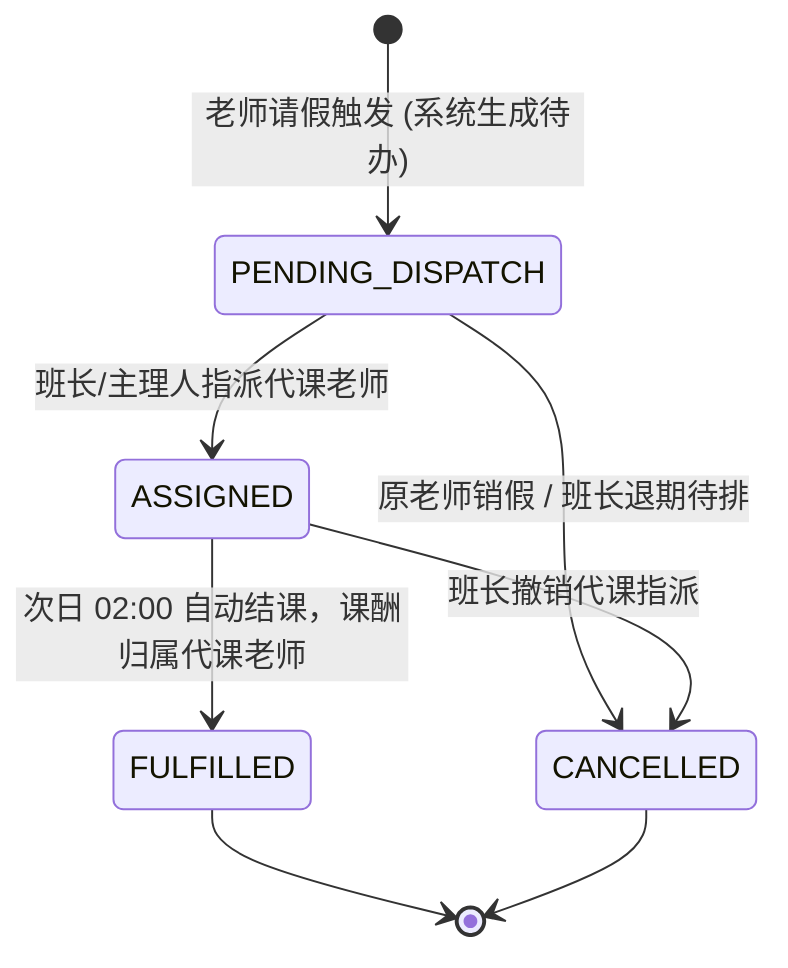

/** (c) 2024-2026 Topee (https://topee.top). All rights reserved. Proprietary and confidential. */

# 产品需求文档 (PRD) — 子模块 3B：考勤、弹性挪位与代课调度 (Attendance, Leave & Substitution)

| 文档属性 | 内容 |
| :--- | :--- |
| **文档版本** | v2.0（精简弹性版） |
| **所属模块** | 模块三：7色智能日历、排课与考勤调度 (Calendar & Scheduling) |
| **关联子模块** | `m3a_calendar_grid.md`（日历控制台）｜ `m4_notification.md`（轻量提醒）｜ `m5b_weekly_settlement.md`（课酬单与出勤异常透出） |
| **创建与更新日期** | 2026-11-05（创建） / 2026-11-13（按精简方案移除 12.5% 请假配额、3h/24h 硬熔断、急病特批通道 B、activities 动态字典与 M3C 转让引用；新增 `<3h` 温和确认提示、直接「更换实际上课学员」及出勤异常透出至 M5B） |

---

## 1. 概述与执行摘要 (Executive Summary)
考勤、弹性挪位与代课调度子模块（`m3b`）是 Dream 系统处理教学履约变动的中枢。遵循**「家长端守门槛（`<24h` 禁自助请假、`<3h` 禁自助挪位），班长端不锁（随时协助），后端账目分明」**的核心哲学，本模块取消 `12.5%` 请假配额与管理员特批通道 B，全面支持：
- **1v1 家长门槛 + 班长不锁弹性请假与同师挪位**：家长端距开课 `<24h` 不可自助请假、`<3h` 不可自助挪位；班长与管理员后台全程不锁，距开课不足 3 小时操作仅弹出温和确认提示后即可放行，并在 M5B 课酬单出勤流水中透明呈现；
- **直接更换实际上课学员**：替代原独立转让模块，支持班长在课格上直接切换上课学员，原购课单资金归属不变；
- **老师请假与双视角代课调度**：支持老师单节或 1~12 节批量请假，班长/小班主理人可在全平台在职老师中指派临时代课（原师呈蓝色被代课 `🔵`，代课师呈紫色代上课 `🟣`），小班课支持连续双网格代课或暂停待排；
- **单节课异常处理**：处理正常出勤、学员旷课、老师旷课及异常未上课回退补生。

当前阶段：MVP 正式功能迭代。

---

## 2. 问题定义与背景 (Problem Statement)
- **硬拦截带来现场摩擦**：传统的 12.5% 配额拦截与开课前 3 小时强锁死，在孩子突发感冒发烧时容易引发家长抱怨与管理员手动特批负担。
- **重耦合流转效率低**：独立的转让审批单与复杂的时间熔断矩阵增加了操作步骤；而“请假本质是把已排 TS 释放回待排期，转课本质是更换实际上课学员”，将决策权还给教务并把出勤异常透明挂载到周课酬单，才能真正让排课流畅、账目清晰。

---

## 3. 目标用户与角色画像 (Users & Personas)
- **出资家长（Amy）**：孩子临时生病或有事时，能快速把已排课程退回待排期或同师挪到其他时段，不被生硬的配额弹窗拒绝。
- **原授课老师（David，老师）**：突发停电或身体不适时可单节或批量勾选 1~12 节请假；被代课后课表清楚标记 `🔵 SUBBED_OUT`。
- **接时代课老师（Elena，老师）**：被指派代课后课表清晰显示 `🟣 SUBBED_IN` 及学员在学课件进度，结课后课酬 100% 归属本人。
- **班长 / 小班主理人（Leo）**：可在任何时间协助学员请假、挪位、更换实际上课学员或为全平台老师指派代课，无需找管理员解锁特批。

---

## 4. 核心业务流程 (Main Flows)

### 4.1 1v1 请假退回待排期（家长 `<24h` 限制 + 班长不锁）
1. **触发入口与角色门槛**：家长或班长/管理员在日历课格抽屉中点击 **【请假退期待排】**（支持连续多节勾选合并请假）。
   - **家长端**：距开课 **$\ge 24\text{h}$** 可直接自助请假；距开课 **$< 24\text{h}$** 时按钮置灰禁用并提示“距开课不足 24 小时，请联系班长处理”。
   - **班长 / 管理员端**：不受 24h 与 3h 硬锁限制（**班长不锁**）。
2. **班长临期 `< 3h` 温和确认提示与学员恶意临期整节处置**：
   - 若距开课时间 $\ge 3\text{h}$：班长直接放行；
   - 若距开课时间 $< 3\text{h}$：系统弹出温和提示：**“距开课不足 3 小时，老师可能已进入备课状态，请确认已与老师沟通”**，并在弹窗内透出该学员近 30 天请假与临期变动次数（如 `近 30 天临期变动 3 次`）；班长可选择 **【通融退回待排期】**（不扣课次、不发老师课酬），若属多次恶意临期取消也可直接选择 **【按学员旷课扣 1 节】**（照常扣减学员 1 节课次并保障老师正常拿到该节课酬；坚持整节处置，不设半节或百分比违约金）。
3. **原子执行**：
   - 原已排课 TS 状态退回 `PENDING_SCHEDULE`（待排期），原日历单元格释放为 🟢 空闲；
   - 若存在关联的代课指派记录，同步自动解除；
   - 记录本次请假动作及是否为临期（`<3h`）变更标记，供 M5B 课酬单出勤统计透明展示；
   - 向原授课老师发送轻量变更提醒（关键变动邮件 + 站内小红点）。

### 4.2 1v1 同师同格平移挪位 (Reschedule with Same Teacher)
1. **触发入口与防撞课筛选**：家长或班长在日历课格抽屉点击 **【同师挪位】**，目标日历仅高亮原任课老师的 🟢 空闲绿格；**系统自动排除（置灰并提示“学员该时段已有其他课程”）该学员同一时间已在其他老师处有排课的时段**，防止挪位撞课。
2. **角色门槛与 `< 3h` 温和提示**：
   - **家长端**：距开课 **$< 3\text{h}$** 时按钮置灰禁用并提示“距开课不足 3 小时，请联系班长处理”。
   - **班长 / 管理员端（不锁）**：若距开课不足 3 小时，弹出同款温和确认弹窗，点击确认后直接放行。
3. **代课课次挪位规则**：若原课次为代课状态（🔵），同师挪位目标老师仍为**原任老师**；挪位成功后，系统自动取消原代课委任并同步通知原代课老师。
4. **原子落盘**：原时段单元格立即释放为 🟢 空闲，新时段单元格落盘为原课程类型（🟠 或 🟡），无需重新扣减课次。

### 4.3 直接更换实际上课学员（替代原独立转让模块）
1. **适用范围**：1v1 已排期课程（由班长或管理员在日历课格动作抽屉发起）。
2. **操作流程**：
   - 班长点击 **【更换实际上课学员】**，**按唯一昵称检索**并选择新的实际上课学员（**无需校验是否同一家庭**）；结果行展示**唯一昵称、在读/试课状态、姓名、年龄及所属家长**，若该学员在当前时段已有其他排课则提示 `⚠️ 该时段已有课`（不展示新学员课次余额与金额，避免误解）；
   - 若距开课不足 3 小时，弹出温和确认提示后放行；
   - 点击确认后，原购课单、付款出资方及资金持有人（`holder_id`）**保持绝对不变**，仅变更该 TS 课次的实际授课学员档案，双方课表即时更新。

### 4.4 老师主动请假与 1~12 节批量请假
1. **发起请假**：老师在课表任一单元格点击抽屉内的当天时段勾选列表，支持单选或批量勾选 **1 ~ 12 节（累计最长 6 小时）**，填写请假原因并提交（无 3h 入口锁死）。
2. **双路原子处理**：
   - **空闲绿格**：立即变为 🔴【已请假】状态，阻断后续新约；
   - **已排课格**：挂起并生成【班长应急调度待办包】（1v1 派发给对应班长，1vN 小班派发给小班主理人），同时向班长/主理人发送提醒。

### 4.5 班长多学员应急调度与代课智能筛师
1. **3 种调度流向**：班长在待办包中可对受影响学员逐一或批量选择：
   - **【指派代课（智能筛师）】**：点击指派代课次，系统根据当前待代课的 **1 ~ N 个具体 TS 日期与时间段（含连续或同日多节）** 及课程类型，**仅允许全平台在职、具备该课程资质且在所选全部 N 个时段均为空闲 🟢 的老师进入可选列表**；列表严格按 **① 曾教过该学员（熟客优先） → ② 同定级 / 相近定级 → ③ 当周已排负荷较少** 排序，显性标注 `教过该学员` 与定级差异（如 `同级` / `高一级` / `低一级`）及 `本周已排 X 节`（不展示模糊的本周总空闲大数字）；支持**按老师姓名搜索**，不符合条件（所选时段部分或全部无空闲/已有课/休息）的老师在搜索结果或底部不可选区置灰展示并明确提示具体原因（如 `19:30 已有课`）；若没有任何老师能覆盖全部连选时段，提示班长减少连选节数拆单指派；
   - **【退回待排期】**：释放 TS 回待排池；
   - **【同师平移】**：挪至其他空闲时段。
2. **代课双视角日历染色**：
   - 原任老师日历：变更为 **蓝色被代课（🔵 `SUBBED_OUT`）**；
   - 代课老师日历：变更为 **紫色代上课（🟣 `SUBBED_IN`）**；
   - 家长端课表：合并显示代课老师名称与 `[SUB]` 标识。
3. **小班课代课智能筛师与暂停待排**：
   - 小班主理人指派代课次，系统**自动过滤出全平台在职、具备该小班课程资质且在目标 1 小时窗口内连续 2 个 30min 单元格（56px）全为空闲 🟢 的老师**（仅空半小时的老师自动过滤），按 **① 曾带过本班/同类小班 → ② 同定级 / 相近定级 → ③ 当周已排负荷较少** 排序，显性标注 `教过本班`、定级差异与 `本周已排 X 节`；支持按老师姓名搜索，不符合条件时置灰提示具体原因（如 `10:30 已有课` 或 `无小班资质`）；代课课酬按原小班既定单节课酬快照平移结算给代课老师；
   - 若无法安排代课，主理人可选择 **【暂停待排】**，TS 退回小班待排池并释放日历双格，由主理人在私域微信群通知家长。

### 4.6 代课撤销与老师销假
- **代课撤销**：班长可在课格抽屉点击【撤销代课指派】（`<3h` 弹出温和确认提示），撤销后恢复为待指派状态或归还原任老师（若原老师已销假）。
- **老师销假**：原老师点击 🔴【已请假】单元格并选择【恢复可约 / 销假】，空闲格立即恢复为 🟢 空闲。

### 4.7 单节课考勤标记与异常处置 (Lesson Exception Handling)
班长或管理员在课格抽屉通过 **【考勤 / 旷课标记】** 及底部低频危险区执行以下处置（**抽屉内不再单独设置重复的“异常处理”跳转入口**）：
- **默认正常（次日 02:00 自动结课）**：系统于次日凌晨 02:00 自动将未请假、未撤排且未标旷课的已排期 TS 结课（正常扣减课次、计入老师课酬）；因此日常无需手动点击“正常出勤”；
- **恢复为正常出勤（仅误标纠偏）**：仅当课次已被标为学员旷课或老师旷课、且尚未完成周结算归集时，面板内才显示【恢复为正常出勤】用于纠偏；
- **学员旷课**：TS 正常结课扣减课次，老师课酬正常计入，并在 M5B 出勤明细中标记“学员旷课”；
- **老师旷课**：TS 退回待排期或补生 1 节新待排 TS，剔除老师该节课酬，并在 M5B 出勤明细中标记“老师旷课”；
- **撤排退回课次（仅未结课显示）**：未上课课次直接释放网格变回 🟢 空闲并退回待排期；
- **异常未上课回退补生（仅已结课且未归集显示）**：针对已结课但实际未上的 TS（关联周转账单尚未完成归集），作废原 TS、剔除课酬并原单补生 1 节全新待排 TS（1v1 补给学员，小班补给小班池）。

### 4.8 核心实体生命周期与状态机 (Entity Lifecycles)

#### 1. 代课调度工单 (`SubstitutionTask`)

#### 2. 老师请假申请单 (`TeacherLeaveRequest`)
- 状态流转：`[*] -> ACTIVE`（老师提交 1~12 节请假，空闲格转红、已排格生成代办）→ `REVOKED`（老师销假恢复空闲）或 `CLOSED`（受影响排课全部调度完毕且课程结束）。

#### 3. 单节课履约异常工单 (`LessonExceptionTicket`)
- 状态流转：`[*] -> REPORTED`（发起异常登记）→ `INVESTIGATING`（核查 ClassIn 进出记录）→ `COMPENSATED`（确认老师/系统原因，退回或补生 TS 并剔除课酬）或 `DISMISSED`（确认学员原因或正常履约，维持结课）。
- **状态流转留痕**：上述代课调度工单（`SubstitutionTask`）、老师请假申请单（`TeacherLeaveRequest`）及异常工单每次发生状态跃迁时，必须在同一事务内追加只读状态流转记录（原状态、目标状态、操作人/系统、流转时间与原因），供后续工单详情与排查追溯。

### 4.9 《出勤异常记录》产品规范（字段、埋点与查询边界）
在不限制老师请假次数与临近时间的前提下，系统统一通过**《出勤异常记录》**对非常规出勤变动进行标准化记账，供 M5B 课酬单汇总透出：

1. **核心业务字段**：
   - **归属与上下文**：记录编号（12 位短 ID）、**归属老师**（责任归属方，代请假/非常规直接代课时始终记在**原任老师**名下）、**归属学员**（1v1 课次自动关联学员档案，用于统计学员侧异常频次）、异常大类（老师责任类：`老师请假` / `非常规直接代课` / `老师旷课` / `异常未上课回退`；学员侧记录：`学员临期(<3h)变动` / `学员当日(3~24h)代请假` / `学员旷课`，**严格与老师责任类隔离统计**）、关联课次 `TS`（含班型、学员/小班、原上课时间）与**归属自然周**（按原课次所属自然周归集）。
   - **来源与时间窗口**：操作来源角色（`老师本人` / `班长代操作` / `管理员` / `家长`）、操作人、提交时间、提前时间窗口 `lead_hours` 与三档分类（**`<3h` 临近开课** / **`3h~24h` 当日临时** / **`>=24h` 常规提前**）、是否计入非常规统计（`<24h` 老师请假/直接代课、老师旷课/回退为 `是`；`>=24h` 请假仅计频次；学员侧备查为 `否`）。
   - **原因、处置与状态**：异常原因、最终处置结果（已指派代课 / 退回待排期 / 小班暂停待排 / 已扣酬补生）与记录状态（`EFFECTIVE 有效` / `REVOKED 已销假撤销`）。

2. **7 处埋点触发规则**：
   - **老师本人请假** & **班长/管理员代老师请假**：仅对**命中已排期课次**逐节生成 `老师请假` 记录（仅关闭空闲绿格不埋点），按提交时刻计算 `lead_hours` 并标注操作来源；
   - **未先请假直接指派代课**：当距开课 `<24h` 或原因为老师原因时，自动为**原任老师**生成 `非常规直接代课` 记录，防止“口头请假直接代课”绕过统计；
   - **老师销假恢复**：若原课次尚未被代课或退回待排（恢复原老师正常排期），对应记录自动置为 `REVOKED`，不计入异常次数；
   - **单节课异常处理**：标记【老师旷课】或【学员旷课】时分别生成对应大类记录；
   - **学员 `<3h` 变动**：仅作学员侧备查记录，不计入老师非常规频次；
   - **M5A 异常未上课回退补生**：自动为原授课老师生成 `异常未上课回退` 记录。

3. **四端查询边界**：
   - **管理员后台**：可在 M5B 课酬结算看板按周查看、筛选与处分，也可在教务流水按老师/班长/异常大类/时间窗口跨周检索；
   - **老师工作台**：在 M5B【我的课酬对账】底部折叠备查区透明查看本人记录与调整说明；
   - **班长工作台**：在【经办记录】查看本人经办的代请假/代课/异常流水；
   - **家长端**：**物理不可见**任何老师的请假窗口、非常规统计及发薪警告/惩罚信息。

### 4.10 【经办记录】列表页产品规范
1. **只读不可篡改原则（Append-Only）**：
   - 所有经办记录由系统在操作提交成功时自动生成，**严格只新建、不修改、不删除**；页面与记录卡片固定展示只读留痕状态，不提供编辑或删除入口。
   - 若发生反向或纠偏操作（如老师销假、误标旷课后执行【恢复为正常出勤】），系统**追加写入一条新记录**，保留完整历史操作链。
2. **记录纳入范围（聚焦班长/管理员人工排课与考勤经办）**：
   - **排课与约课类**：
     - `批量排课`（每轮 4 周固定位首排/续费确认排入、小班 4 周批量排课：**按单次批量操作记 1 条汇总记录**，不按课节数拆分成多条刷屏）；
     - `新增排课`（班长/管理员代约单节 1v1 临时课、试听课、小班补排）。
   - **代课、请假、挪位与异常处置类**：
     - `指派代课`、`撤销代课指派`、`代学员请假`、`同师代挪位`、`代老师请假`、`更换实际上课学员`、`学员旷课`、`老师旷课`、`恢复为正常出勤`、`撤排退回课次`、`异常未上课回退补生`、`课次清退/扣减`。
   - **明确不纳入本列表**：
     - **非班长/管理员人工操作**：家长自助约临时课/请假/挪位、系统自动续费预占 `HOLD`、系统次日 02:00 自动正常结课，均不写入【经办记录】；
     - **财务单据**：购课单、退款单、周转账单、教师课酬单由各自单据列表与状态流承载；
     - **低频主数据与风控审计**：试课建档认领/归档、教师调级、课件增删升阶、小班创建/解散、管理员删留言等，归属系统通用审计日志，不与排课/考勤经办记录混写。
3. **单条记录展示字段与必填原因约束**：
   - **头部信息**：操作时间（倒序）、操作类型徽章、临期标记（距开课 `<3h` 操作标注）；管理员视角同时展示经办人姓名（班长视角默认均为本人）。
   - **核心上下文**：涉及对象与课次时间（如 1v1 学员唯一昵称或小班名称 · 原上课日期与时段；批量排课展示周期与总节数，如 `11-10 ~ 12-05 · 共 8 节`）、变更前后详情（如原任老师 → 代课老师、原时段 → 新时段、原学员 → 新学员）、归属老师（责任归属方）。
   - **原因/备注**：记录操作时填写的原因说明；执行**异常处置与纠偏类操作**（`学员旷课`、`老师旷课`、`恢复为正常出勤`、`异常未上课回退补生`、`课次清退/扣减`）时，原因输入框强制必填（**至少填写 1 个非空字符**方可提交）。
4. **筛选条件、分页加载与链接穿透**：
   - **权限与按班长筛选**：班长端仅展示本人经办记录；管理员端支持按经办班长筛选全平台记录，顶部默认展示**有数据的前 3 位班长**筛选标签，超出 3 位时默认折叠，点击 `[ 展开更多班长 ]` 展开其余有数据的班长。
   - **时间范围筛选**：默认选中 **`近 7 天`**，支持切换 `近 30 天` / `全部`。
   - **操作类型筛选**：默认选中 **`全部`**，支持按 4 大业务类别筛选（`全部` / `排课与约课` / `代课调度` / `代请假与挪位` / `异常与退回`）。
   - **排序与分页**：按操作时间倒序排列，**默认展示 20 条**；超出时底部常驻 `[ 查看更多 ]` 按钮，**每次点击追加加载 20 条**。
   - **双向链接穿透**：每条记录支持点击关联的 **学员名称** 直达该学员档案（小班批量排课无单一学员时支持点击 **小班名称** 直达小班详情）；支持点击关联的 **课次/时段** 直达该课次所在自然周的周课表视图（跨多周的批量排课默认定位至**该轮次首节课所在自然周**的周课表；即使原课次已被撤排或取消，仍定位至原课次所在周的周课表）。

---

## 5. 用户故事 (User Stories)
- **US-3B-01（无配额阻塞请假）**：作为一个家长，当孩子突然发烧时，我希望能随时将课程请假退回待排期，而不被系统弹出配额上限锁死，以便于灵活安排补课。
- **US-3B-02（临期温和确认）**：作为一个班长，当家长在开课前 1 小时临时请求挪位或请假时，我希望系统给予温和提示确认已与老师沟通后直接放行，以便于高效解决突发状况。
- **US-3B-03（极速换人上课）**：作为一个班长，当 A 家长在微信群把一节课让给 B 家长时，我希望直接在日历课格上点击【更换实际上课学员】完成替换，无需走繁琐的转让单与家庭校验。
- **US-3B-04（老师批量请假与代课双视角）**：作为一个老师，我希望能一次勾选当天最多 12 节课发起请假，并由班长指派代课后在双方课表上清晰区分蓝色被代课与紫色代上课。
- **US-3B-05（出勤异常透出课酬单）**：作为一个班长或管理员，我希望所有临期请假、旷课、代课记录都能自动挂载到 M5B 老师/班长课酬单出勤流水中，以便于后端算账和对账清清楚楚。

---

## 6. 验收标准清单 (Acceptance Criteria)

### 6.1 家长端 `<24h`/`<3h` 门槛、班长不锁与 `< 3h` 温和提示
- **AC-3B-01（家长端时间门槛 + 班长不锁 + 移除配额）**：系统不再计算或拦截 `12.5%` 请假配额；**家长端**距开课 `<24h` 禁用自助【请假退期待排】、距开课 `<3h` 禁用自助【同师挪位】并提示联系班长处理；**班长与管理员端全程不锁**，随时可代操作 1v1 课次（固定位与临时课）的请假退回待排期与同师挪位。
- **AC-3B-02（班长/管理员 `< 3h` 温和确认提示）**：当班长或管理员在距开课不足 3 小时执行请假、同师挪位、更换实际上课学员或指派代课时，必须弹出二次确认框提示：“距开课不足 3 小时，老师可能已进入备课状态，请确认已与老师沟通”；点击确认后操作立即生效，并在记录中标注 `is_last_minute = true` 同步透出到 M5B 出勤明细。
- **AC-3B-03（代课课次挪位自动解绑）**：对蓝色代课课次（🔵）执行同师挪位时，目标网格限定为原任课老师的空闲时段；挪位成功后，原代课委任自动解除并通知原代课老师。

### 6.2 更换实际上课学员
- **AC-3B-04（直接换人）**：班长与管理员在 1v1 课格动作抽屉点击【更换实际上课学员】时，可按唯一昵称搜索任意在读/试课学员并展示其唯一昵称、在读/试课状态、姓名、年龄、所属家长及同时段撞课提示（不展示新学员课次余额与金额），确认替换不校验是否同一家庭且不设二次更改锁；原购课单金额、出资人与资金持有人（`holder_id`）保持不变。

### 6.3 老师批量请假与代课调度
- **AC-3B-05（批量请假范围）**：老师单次请假支持勾选 1~12 节课，必须填写请假原因；提交后空闲格置红 🔴，已排格生成应急代办包并推送通知给负责班长或小班主理人。
- **AC-3B-06（代课双视角与课酬归属）**：指派代课成功后，原任老师日历呈现蓝色被代课（`🔵 SUBBED_OUT`），代课老师日历呈现紫色代上课（`🟣 SUBBED_IN`）；结课后课酬 100% 计入实际代课老师的 M5B 周课酬单。
- **AC-3B-07（小班双格代课与暂停待排）**：小班代课老师必须满足 1 小时时段内连续 2 个单元格全空闲 🟢 且具备对应课程资质；代课课酬按该小班既定单节课酬快照平移结算；主理人选择【暂停待排】时，TS 原子退回小班待排池，不给小班家长端发送应用内通知。

### 6.4 异常处理与经办记录
- **AC-3B-08（单节异常处置与必填原因）**：班长/管理员执行【学员旷课】【老师旷课】【恢复为正常出勤】【撤排退回】或【异常未上课回退补生】后，必须填写操作原因（异常处置与纠偏类操作至少填写 1 个非空字符方可提交），系统自动追加只读经办记录，并在 M5B 出勤统计中清晰透出。
- **AC-3B-09（经办记录列表与筛选穿透）**：班长与管理员通过教务中心 Tab 3 顶部 `[ 📜 经办记录 ]` 金刚位进入；覆盖班长/管理员人工执行的排课约课（含每轮批量排课，按单次操作记 1 条汇总记录）、代课调度、代请假挪位与异常退回，不混入家长自助/系统自动行为与财务单据；记录严格只新建不修改不删除；默认按操作时间倒序展示最近 7 天全部分类的前 20 条记录，点击 `[ 查看更多 ]` 每次追加 20 条；班长仅可查看本人经办记录，管理员顶部默认展示有数据的前 3 位班长筛选标签（超出折叠可展开）；每条记录支持点击学员名称跳转学员档案（小班批量排课可跳转小班详情）、点击课次/时段跳转该课次（或该轮次首节课）所在自然周的周课表。
- **AC-3B-13（非常规请假、班长代请假与直接代课异常埋点）**：老师本人提交请假、班长代老师请假、或未先请假而直接指派 `<24h`（或老师原因）代课时，只要命中已排期 TS，系统必须自动计算 `lead_hours` 并归档三档时间窗口（`<3h` / `3~24h` / `>=24h`），将《出勤异常记录》记在**原任老师**名下并标记操作来源；仅关闭空闲绿格不得生成异常记录。
- **AC-3B-14（销假撤销与家长端隔离）**：老师及时销假且原课次未产生代课或退期待排时，对应异常记录自动流转为 `REVOKED` 且不计入异常频次；家长端严禁展示老师请假时间窗口、异常频次与警告信息。
- **AC-3B-15（学员临期代请假双选与整节保护老师收入）**：班长/管理员代学员执行 `<3h` 临期请假时，弹窗必须展示该学员近 30 天请假与临期变动次数，并提供【通融退回待排期】与【按学员旷课扣 1 节（照常扣减学员课次并发放老师课酬）】双选；学员侧异常记录严禁混入老师非常规次数。

### 6.5 智能筛师与防撞课校验
- **AC-3B-10（1v1 TS 代课智能筛师与排序提示）**：针对待指派代课的 1 ~ N 个具体 TS，代课选人列表仅允许“在职 + 具备课程资质 + 所选全部 N 个 TS 目标时段均空闲 🟢”的老师可选，并按“曾教过该学员 → 同定级/相近定级 → 当周已排负荷较少”排序，显性标注 `教过该学员`、定级差异与 `本周已排 X 节`；支持按老师姓名搜索，不符合条件的老师置灰并提示具体冲突时段或无资质原因；无全覆盖老师时提示减少连选节数拆单指派。
- **AC-3B-11（1vN 小班代课连续双格筛师）**：针对 1vN 小班课指派代课次，选人列表仅允许目标 1 小时窗口内连续 2 个 30min 格均为空闲 🟢 且具备小班资质的老师可选，并按“曾带过本班 → 同定级/相近定级 → 当周已排负荷较少”排序；支持按老师姓名搜索，仅单格空闲或无资质的老师置灰并提示具体原因。
- **AC-3B-12（同师挪位学员自身防撞课）**：执行同师挪位时，若该学员在原老师的某个空闲绿格时间段内，已在其他老师名下有已排期课程，该单元格必须自动置灰禁用并悬浮/点击提示“学员该时段已有其他课程”。

---

## 7. 本期范围外清单 (Out of Scope)
- **不支持 12.5% 请假配额限制与超额阻断**。
- **不支持管理员急病特批通道 B 与班长端时间硬锁**（班长后台直接放行即可，无需额外特批工单）。
- **不支持独立的课次转让单与转让集市 (M3C)**。
- **不支持独立动态流表 (`dream.activities`) 写入与首页 14 类事件瀑布流**。
- **不支持独立的【应急调度】列表页、【异常处理】Tab 及老师【我的课表】/【请假记录】独立页**：`老师请假待代课` 待办统一收口至 Tab 3【教务中心】全局待办，点击卡片直接唤起【应急代办包抽屉】或前往 M3A 课表指派代课；单节考勤标记、撤排与异常回退补生统一从 M3A 日历课格抽屉就地发起；老师课表与批量请假 100% 复用 M3A 老师周课表与抽屉。
- **不支持【经办记录】导出与记录页内一键撤回**：本期不提供 Excel/CSV 导出功能，也不允许在经办记录列表页直接删除、修改或一键回滚历史记录（如需纠偏，必须回到对应课格或业务对象发起新的纠偏操作并追加新记录）。

---

## 8. 约束条件 (Constraints)
- **小班单人缺席隔离**：小班课（🟩）不记录单个学员考勤，单人缺席由主理人线下协调。
- **已结课且已归集不可回退**：已被包含在已完成归集（`COMPLETED`）的周转账单中的课次，禁止执行异常未上课回退补生。

---

## 9. UI/UX 界面线框说明 (Wireframe Level)
- **课格底部抽屉动作区（班长 / 管理员 · 3 层结构）**：
  - **第 1 层**：课程基本信息、可复制 ClassIn 教室号、学员档案/资产入口；若存在连堂 2 节，底部附带一行轻量连选开关（取消顶部堆叠的合并大按钮）；
  - **第 2 层（2×2 宫格）**：`[ 请假 / 同师挪位 ]`（点入二级面板二选一）、`[ 指派代课 ]`（小班课为 `[ 代课 / 暂停待排 ]`，点入二级面板；已代课状态顶部含 `[ 撤销代课指派 ]`）、`[ 考勤 / 旷课标记 ]`（默认正常，仅异常标记或误标纠偏）、`[ 换上课学员 ]`（仅 1v1 可见）；
  - **第 3 层（状态互斥）**：未结课仅展示 `[ 撤排退回课次 ]`；已结课且未归集仅展示 `[ 异常未上课回退补生 ]`（不再设置重复的“异常处理”外链入口）。
- **`< 3h` 温和提示弹窗**：居中轻量确认框，标题“临期操作确认”，正文“距开课不足 3 小时，老师可能已进入备课状态，请确认已与老师沟通”，按钮 `[ 返回 ]` + `[ 确认放行 ]`。
- **指派代课二级面板 / 弹窗（严格去重极简规范）**：
  - **头部上下文（零重复）**：标题行仅展示 `学员 · 时段 (N 节)`；下方信息行仅列原任老师与请假原因/状态（**严禁重复展示“本次范围”，严禁堆砌大段筛师规则说明条**）；
  - **搜索框**：顶部常驻 `[ 🔍 按老师姓名搜索 ]`；
  - **候选老师卡片（严格 2 行零重复）**：第 1 行仅放 `老师姓名` + `定级差异徽标`（如 `同级` / `高一级` / `低一级`）+（若教过）`教过该学员` 徽标；第 2 行仅放 1 句核心状态 `✅ 所选时段全空闲 · 本周已排 X 节`；**严禁在副标题和徽标区重复输出“熟客优先”“同定级”“当天 N 节”等相同字段**；不符合条件时置灰并仅展示 1 行具体原因（如 `19:30 已有课` / `无课程资质`）。
- **M3B 独立页面结构**：仅保留 **【经办记录（只读操作流水）】** 列表页；不再保留独立的【应急调度】页面、【异常处理】全量课次 Tab，以及老师【我的课表】与【请假记录】独立页面。
- **【经办记录】列表页结构**：顶部筛选区（管理员端含“有数据的前 3 位班长 + 展开更多”筛选栏、全角色含时间范围 `近 7 天 / 近 30 天 / 全部` 与操作类型筛选）+ 只读卡片流（倒序默认 20 条，含操作时间、类型、临期标记、涉及对象与可点击课次周课表/学员档案入口、变更前后详情、操作原因与归属老师）+ 底部 `[ 查看更多 ]`（每次追加 20 条）。
- **班长应急代办包抽屉（由 Tab 3 全局待办卡或通知点击唤起）**：汇总受老师请假影响的课程列表，每行提供 `[ 指派代课 ]` / `[ 退回待排期 ]` / `[ 同师平移 ]` 一键调度按钮。

---

## 10. 用户流程图 (User Flow Diagram)

