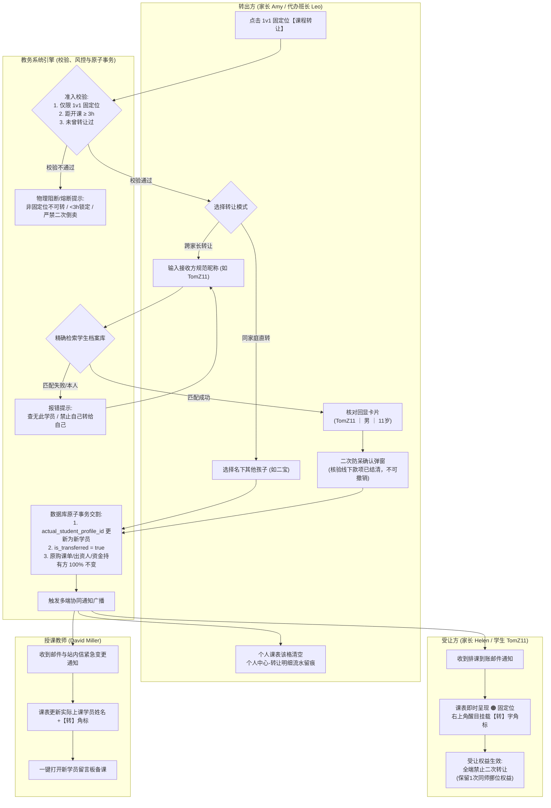

/** (c) 2024-2026 Topee (https://topee.top). All rights reserved. Proprietary and confidential. */

# 产品需求文档 (PRD) — 子模块 3C：课程转让与权益交割引擎 (Course Transfer Engine)

| 元数据项 | 说明 / 内容 |
|---|---|
| **模块代号** | `m3c` |
| **所属模块** | 模块三：7色智能日历、排班、考勤与课程转让 (Calendar & Scheduling) |
| **文档状态** | 待评审 (Draft) |
| **关联顶层 PRD** | [Prd-v5.md](../Prd-v5.md) |
| **关联规范文档** | [BUSINESS_RULES.md](../BUSINESS_RULES.md) ｜ [DESIGN.md](../DESIGN.md) |
| **关联模块划分** | [system_modules_overview.md](../system_modules_overview.md) |
| **创建与更新日期** | 2026-11-05 |

---

## 1. 概述与执行摘要 (Executive Summary)

课程转让与权益交割引擎（`m3c`）是 Dream 系统的排期资产二级流转中心。针对四周一轮 1v1 固定位（🟠橙色）排课“不可退回待排期”的业务特性，本子模块为突发时间冲突且无法同师挪位的固定位学员提供唯一的救济流转通道。系统覆盖 **同家庭多孩直转（大宝转二宝）** 与 **跨家长转让（精确规范昵称回显校验）** 双重路径，严格贯彻 **“财课分离”底层铁律**（出资归属与资金持有方 100% 保持不变，仅更新实际上课实体），并在课表上加注醒目的 **【转】字角标** 与协同通知。当前阶段：MVP 正式功能迭代。

> **页面职责边界（2026-11-11 收敛）**：M3A 课格/资产卡只保留 `[转让此课]`、`[课时转让]` 带参入口；M3C 是唯一发起、资格校验、昵称回显、二次确认、交割、通知、审计与历史页面。M3A 不展示单价、公开/私密、发布大池，也不本地扣减课时。本模块只做**直接指定学员**转让，不做公开大池/集市/挂单/线上支付/担保交易。

---

## 2. 问题定义与背景 (Problem Statement)

- **痛点 1：固定位强契约与突发时间冲突的矛盾**：固定位一次性排满四周且不可退期待排，若学生在开课前 1-2 天突发冲突且该老师其他时段已满，学生将面临白白旷课被扣费的损失。
- **痛点 2：跨家长线下私交缺乏系统级防转错防线**：家长在微信群线下谈妥转让并转钱后，若系统中缺乏唯一的学员身份校验，转出方极易选错接收人，引发资金纠纷。
- **痛点 3：转让行为导致财务账目与发薪混乱**：传统系统常将转让与退费重购混为一谈，导致原收款班长与周结算对账脱节；若转账频繁，周课酬统计极易错乱。
- **痛点 4：二道倒卖与多次流转导致学情溯源断裂**：若不限制转让次数，可能产生低价收课高价转让的倒卖行为，授课教师无法掌握真实的授课对象。
- **痛点 5：教师未及时获知学员变更引发备课脱节**：转让后若教师不知情，上课时面对完全不同的孩子（甚至不同年龄与水平），教学体验严重受损。

---

## 3. 目标用户与角色画像 (Users & Personas)

### 3.1 角色一：转出方家长（Amy）
- **角色定位**：固定位排课出资人与转让发起人。
- **核心诉求**：大宝周二晚上的固定位因学校活动无法参加时，在距开课 $\ge 3\text{h}$ 前，一键直接划转给二宝 Bob；或在线下找到群友后输入精确昵称 `TomZ11` 完成交割。
- **预期成果**：课时得到充分利用，操作安全不转错。

### 3.2 角色二：受让方家长（Helen）
- **角色定位**：课次接收人。
- **核心诉求**：线下付款后将自家孩子规范昵称提供给对方，对方操作后自己孩子课表上立即出现该节固定位课程，右上角带【转】字角标。
- **预期成果**：课次即时到账，孩子可按时进入 ClassIn 教室上课。

### 3.3 角色三：负责班长（Leo）
- **角色定位**：代办经办人与家校纠纷协调人。
- **核心诉求**：家长不熟悉操作时，班长可在后台选择接收方学生档案协助代办转让；转让不影响最初收款的资金持有责任。
- **预期成果**：线下家校矛盾就地化解，财务底账不受干扰。

### 3.4 角色四：授课教师（David）
- **角色定位**：教学履约执行人。
- **核心诉求**：转让发生后第一时间收到邮件与站内信，提示“本节课学生已变更为 [二宝昵称]”，并在课表上看到【转】字角标，可就地查看受让学生的留言板学情。
- **预期成果**：提前了解真实上课学生，针对性备课。

---

## 4. 核心业务流程 (Main Flows)

### 4.1 场景 A：同家庭多孩直转 (大宝转二宝 - Happy Path)
1. 家长 Amy 在家长工作台进入大宝的课表，点击某节距开课 $\ge 3\text{h}$ 的固定位（🟠橙色）排课单元格。
2. 底部抽屉展示排课详情，家长点击【课程转让】按钮。
3. 转让弹窗默认选中模式“同账号名下孩子互转”。
4. 下拉框列出当前家长账号名下绑定的其他学生档案（如二宝 `BobZ10`），家长选中二宝。
5. 家长点击【确认划转】。
6. 系统在数据库事务内原子执行：
   - 将该节 TS 的 `actual_student_profile_id` 由大宝更新为二宝；
   - 写入转让标记：`is_transferred = true`；
   - 记录转让审计快照（转出时间、操作人账号、原学生、新学生）；
   - 财务底层保持不变：原购课单、原购课家长、资金持有方（`holder_id`）完全不改动。
7. **日历与课表即时呈现**：
   - 大宝课表上该单元格原位清空，恢复为空闲网格；
   - 二宝课表对应时段即时渲染为 🟠【固定位】并带有 **【转】字角标**；
   - 触发异步通知：给授课教师发送站内信 + 邮件通知。

### 4.2 场景 B：跨不同家长转让 (精确规范昵称回显校验 - Happy Path)
1. 家长甲与家长乙在线下微信沟通达成转让意向，家长乙告知其孩子的系统规范昵称（如 `TomZ11`），并在线下微信转账付款。
2. 家长甲在端内点击该节固定位，选择【课程转让】，切换至模式“转给其他家长”。
3. 家长甲在输入框输入接收方昵称 `TomZ11`，点击【检索学员】。
4. **防呆回显机制**：系统检索学生档案表，若匹配成功，弹窗明确回显接收学员卡片：“接收学员：TomZ11 ｜ 性别：男 ｜ 年龄：11岁”，并展示授课老师与偏好比对提示。
5. 家长甲核对信息无误，点击【确认转让给该学员】。
6. 系统执行原子交割：
   - TS 的 `actual_student_profile_id` 更新为 Tom 的学生档案 ID；
   - 标记 `is_transferred = true`；
   - 原购课单、原购课家长（家长甲）、资金持有方完全不变；
   - 家长甲课表该格清空，并在【个人中心 - 转让明细】新增一条转出记录；
   - 家长乙的 Tom 课表即时出现带有【转】字角标的 🟠 橙色排课。
7. 系统同时向授课教师发送邮件与站内信，并向家长乙发送“转让排课已到账”邮件通知。

### 4.3 班长后台代办转让流程
1. 若家长不熟悉线上操作，可联系负责班长。
2. 班长在班长工作台打开该节固定位 TS 详情，点击【后台协助转让】。
3. 班长通过学生列表或输入接收学生昵称直接选定接收方档案，填写代办交割备注。
4. 确认提交后，系统原子执行交割，其底层数据逻辑与 4.2 完全一致，操作人记录为班长账号 ID。

### 4.4 受让方后续履约与异常分支
- **同师挪位分支**：受让方学生若上课时间略有不便，在距开课 $\ge 3\text{h}$ 且原课次未曾挪位过（`reschedule_count == 0`）的前提下，严格遵循 M3B 固定位规则，**仅可在原课次所属的 4 周轮次内为原授课老师空闲格发起 1 次同师挪位**（严禁跨轮次平移，保障外教月度课酬总盘不流失）。
- **严禁二次转让拦截**：受让方学生或家长点击转让按钮时，系统检测到 `is_transferred == true`，强行置灰禁用，提示“本节课为受让课次，严禁二次转让”。
- **开课前 3 小时锁死拦截**：距开课 $< 3\text{h}$ 时，前端转让入口彻底关闭，不可转让。

---

## 5. 用户故事 (User Stories)

- **US-3C-01**：作为一个二胎家长，我想要将大宝无法参加的固定位一键划转给二宝，以便于课时在家庭内部充分利用且不繁琐。
- **US-3C-02**：作为一个转出方家长，我想要在输入接收方孩子昵称后看到孩子的年龄和性别回显，以便于核对无误后再转让，绝不转错人。
- **US-3C-03**：作为一个受让方家长，我想要对方转让后我孩子的课表立即生效并看到【转】字角标，以便于确认课次已稳妥到账。
- **US-3C-04**：作为一个授课教师，我想要在学生更换后即时收到邮件提示并能一键打开新学生的留言板，以便于提前了解学生背景并针对性备课。
- **US-3C-05**：作为一个负责班长，我想要能够为年长或不便操作的家长在后台代办转让，以便于快速协助家校交割。
- **US-3C-06**：作为一个出资家长，我想要在转出后能在转让明细中查阅历史转出记录，以便于核对账目。
- **US-3C-07**：作为一个系统风控规则，我想要坚决杜绝已被转让过的课次再次转给第三人，以便于防止恶意倒卖。
- **US-3C-08**：作为一个平台财务管理员，我想要转让发生时底层资金持有方与购课费用归属严格保持不变，以便于周结算单账实对平。

---

## 6. 验收标准清单 (Acceptance Criteria)

### 6.1 转让适用范围与时间红线
- **AC-3C-01**：转让功能**仅允许对 1v1 固定位（🟠橙色）排课发起**；临时课（🟡黄色）及小班课严禁发起转让（临时课入口隐藏或提示“临时课仅支持请假退期待排”）。
- **AC-3C-02**：转让发起必须严格满足**距开课时间 $\ge 3\text{h}$**；距开课时间 $< 3\text{h}$ 时，全端物理关闭转让入口，弹出提示“开课前 3 小时内锁定，禁止转让”。
- **AC-3C-03**：处于 `已结课`、`已结算`、`已取消` 或已被退款锁定的 TS 严禁进入转让流程。

### 6.2 跨家长精准防转错校验
- **AC-3C-04**：跨家长转让时，转出方输入的接收方昵称必须 100% 精确匹配学生档案库中未注销的规范昵称（格式：`英文名+姓首字母+年龄`，大小写不敏感）；匹配失败提示“未找到该学员，请核对昵称格式”。
- **AC-3C-05**：接收学员档案不得为转出学员本人（禁止自己转给自己）；同家长直转必须选择名下其他不同的孩子档案。
- **AC-3C-06**：输入匹配成功后，系统前端必须强制弹出带有接收学员画像卡片的防呆确认弹窗（展示：昵称、性别、年龄），点击确认后方可提交。
- **AC-3C-07**：转让提交采取单向即时生效制，提交成功后排课权益原子划转，无需接收方家长二次确认。

### 6.3 财课分离与数据状态原子落盘
- **AC-3C-08**：转让生效后，TS 实体在数据库事务内原子执行：
  - 更新 `actual_student_profile_id` 为接收方学生档案 ID；
  - 更新布尔标记 `is_transferred = true`；
  - 原购课单 ID（`course_order_id`）、原出资家长账号 ID（`parent_account_id`）及初始资金持有方 ID（`holder_id`）**绝对保持原值不变**。
- **AC-3C-09**：系统严禁跨账号发生任何形式的虚拟积分划扣、退充或拆借记账。

### 6.4 受让后权益与防倒卖防线
- **AC-3C-10**：已被转让过的课次（`is_transferred == true`），全端绝对禁止再次发起转让；点击转让直接置灰禁用，提示“该课次为受让课程，不可二次转让”。
- **AC-3C-11**：受让方学生在距开课 $\ge 3\text{h}$ 前，若原 TS 的 `reschedule_count == 0`，允许发起 **1 次** 前后 7 天内的同师挪位；若原 TS 已经挪位过（`reschedule_count >= 1`），禁止再次挪位。

### 6.5 课表视觉角标与历史审计
- **AC-3C-12**：转让成功后，转出方学生日历该时段单元格原位清空，恢复为空白网格；转出家长个人中心【转让明细】新增该笔转让流水（记录转让时间、接收人昵称、授课时段）。
- **AC-3C-13**：转让成功后，受让方学生日历对应单元格严格遵照 [DESIGN.md Section 2.3](../DESIGN.md#23-7-色课表日历高可读性规范-calendar-exception) 规范，即时渲染为 🟠【固定位】浅底橙边微卡片（`bg-amber-50 border-amber-300 text-amber-900`），并在右上角加注低饱和语义微徽标 **`[转]`**（`bg-amber-200/80 text-amber-900 text-[10px]`），点击卡片显示“由学员 [原学生昵称] 转让”。
- **AC-3C-13a（转让历史明细列表设计系统合规标准）**：转让明细流水卡片 100% 遵照 [DESIGN.md Section 2.2.1](../DESIGN.md#221-卡片视觉层级与状态聚焦规范-card-hierarchy--visual-states) 之 **Standard 1 (单据/记录卡片规范)**，首行首字段展示核心时段与任课教师，右侧挂载紧凑中性状态胶囊 `[已交割]`；内容区排版满足 WCAG AA 4.5:1，严禁使用低对比度浅灰字。
- **AC-3C-14**：转让成功后 5 秒内，系统自动向原授课教师发送站内信 + 邮件通知：“您的课程 [日期时间] 上课学员已变更为 [受让学员昵称]，请点击查看该学员学习留言备课”；同时向受让方家长绑定的通知邮箱发送排课到账邮件。

### 6.6 转让后退款防线（与 M2B 闭环）
- **AC-3C-15**：若发生同家庭直转（大宝转二宝），原出资家长后续仍有权在垫底退款单中对该 TS 发起退款。
- **AC-3C-16**：若发生跨家长转让（转出给非同账号的外部学生），子模块 M2B 垫底退款列表必须物理置灰禁用该 TS，严禁原出资家长对该 TS 申请退款（提示“已跨家庭转让课次不可退款”）。
- **AC-3C-17（入口与页面唯一性）**：M3A 只提供 `[转让此课]` / `[课时转让]` 带参入口；M3A 页面不得出现单价、公开/私密、发布大池或本地课时扣减；转让的资格校验、昵称回显、二次确认、交割、通知与审计全部在 M3C 完成。

---

## 7. 本期范围外清单 (Out of Scope)

- **临时课（🟡黄色）与小班课转让**：本期明确仅支持 1v1 固定位转让，临时课与小班课不开放转让。
- **公开转让大池 / 集市 / 挂单 / 线上支付 / 担保交易**：本期不做公开集市；两位家长线下自行匹配受让方，转让价格与微信私下交易完全由家长自行约定；系统不介入资金划扣、不提供线上收银台，只做直接指定学员的转让交割。
- **转让退回与撤销机制**：转让一旦确认即时生效，不可逆向撤销；若接收方无法上课，仅可尝试同师挪位。
- **跨教师/跨机构转让**：课程转让仅变更实际上课学生，授课教师、上课时段与日历网格位置原封不动。

---

## 8. 约束条件 (Constraints)

### 8.1 业务与合规约束
- **财课分离不可动摇**：资金流与排课流解耦，无论转让几次，出资家长与资金持有人终身锁定最初出资方。
- **单向交割与不可逆性**：转让一旦提交即时完成资产交割，无法反悔撤回。
- **防黄牛二次倒卖原则**：单节课终身限转 1 次，严禁击鼓传花式二次转手。

### 8.2 功能与规格限制
| 约束项 | 指标规格 / 限制值 |
|---|---|
| 适用班型范围 | 严格仅限 1v1 固定位（🟠橙色） |
| 转让时间红线 | 严格限制在距开课 $\ge 3\text{h}$ |
| 跨家长昵称格式 | 严格匹配 `^[A-Za-z]+[A-Za-z][0-9]{1,2}$`（如 `AliceZ12`） |
| 单节课转让次数上限 | 严格限转 1 次（`is_transferred == false` 方可发起） |
| 受让后挪位限制 | 前提未挪位过，限前后 7 天内同一老师空闲格 |
| 协同通知时限 | 转让确认后 5 秒内触发邮件与站内信 |

### 8.3 外部文档与参照依据
| 文档名称 | 存放路径 / 链接 | 使用场景说明 |
|---|---|---|
| 教务排班与分账 PRD v5.1 | docs/Prd-v5.md | 课程转让场景与财课分离规约 |
| 核心业务规则与财务分账规约 | docs/BUSINESS_RULES.md | 资金持有人锁定与财课分离铁律 |
| UI 视觉与设计系统 | DESIGN.md | 橙色固定位与【转】字角标规范 |
| 退款单与课时冲退 PRD | docs/prd/m2b_refund_orders.md | 跨家长已转让课次防退款规则 |

---

## 9. UI/UX 界面线框说明 (Wireframe Level)

### 9.1 家长端 — 转让入口与操作弹窗 (Transfer Entry & Modal)
> **页面归属**：M3A 课格/资产卡只保留入口；本页是唯一转让页面，周次勾选、接收方核验、二次确认、交割与审计均在本页完成。M3A 不展示单价、公开/私密、发布大池，也不本地扣减课时。

- **触发入口（对齐 M3A 课表动作中枢）**：
  1. **日历课次转让（含非连续多课次）**：家长在 [m3a_calendar_grid.md](./m3a_calendar_grid.md) 孩子专属课表中轻触目标固定位课格，在底部动作抽屉点击【转让此课】后**带参进入 M3C 转让页**（`tsId`、`studentId`、`from=calendar`）；未来课次勾选（如跳选第 1 周与第 3 周）在本页完成；
  2. **纯自由 TS 课时转让**：在 M3A 课表顶栏资产卡 `[ 👧 Alice · 剩余: 5 TS ▾ ]` 点击【课时转让】后**带参进入 M3C 纯课时转让页**（`studentId`、`from=calendar`）；转让节数（如 3 节）在本页输入；
- **界面结构与布局**：
  - 在 M3C 转让页/弹窗中操作，M3A 只负责带参跳转与返回。
  - **头部**：转让课次信息卡片（授课老师、日期时间、课程类型）。
  - **模式切换器 (Segmented Control)**：
    - Tab 1：【同家庭直转（转给自家其他宝贝）】；
    - Tab 2：【转给其他家长】。
  - **Tab 1 面板（同家庭直转）**：
    - 下拉选择器：选择接收孩子（列出当前账号绑定的其他学生档案，如 `二宝 BobZ10`）；
    - 提示文案：“转让后，该课次将直接呈现在 [二宝] 的课表上”。
  - **Tab 2 面板（转给其他家长）**：
    - 输入框：带有搜索图标的“输入接收学员规范昵称（如 AliceZ12）”；
    - 检索按钮：【验证学员】。
  - **底部按钮**：【取消】、【确认划转】（未验证学员前置灰禁用）。

### 9.2 跨家长检索回显卡片与防转错二次确认框
- **学员检索回显卡片**：
  - 输入有效昵称点击验证后，在输入框下方立即展示一个浅蓝色背景的**接收学员信息卡片**：
    - 头像占位符；
    - 关键画像：`学员昵称：TomZ11` ｜ `性别：男` ｜ `年龄：11岁`；
    - 选课偏好比对条：若与授课教师技能一致显示绿标“技能匹配”；若不一致显示黄标“偏好不一致（不阻断）”。
- **二次防呆确认弹窗 (Confirm Alert)**：
  - 点击【确认划转】后，弹出警示对话框：
    - 标题：“⚠️ 确认转让给该学员吗？”；
    - 内容：“即将把 [2026-11-10 19:00] 课程权益划转给学员 **TomZ11**（男，11岁）。**转让提交后立即生效，此操作不可撤销**。请确认线下资金已交割完毕。”；
    - 按钮：【再核对一下】、【我已核实，确认交割】。

### 9.3 家长端 — 接收方课表【转】字角标卡片
- **日历网格呈现**：
  - 受让学生的日历网格对应时段严格遵照 [DESIGN.md Section 2.3](../DESIGN.md#23-7-色课表日历高可读性规范-calendar-exception) 规范，渲染为 🟠【固定位】浅底橙边微卡片（`bg-amber-50 border-amber-300 text-amber-900`）；
  - 单元格右上角挂载低饱和语义微徽标：`[转]`（`bg-amber-200/80 text-amber-900 text-[10px]`）；
  - 点击弹出课次详情，卡片顶部带有一行专属信息：“📌 本节课由学员 [大宝 AliceZ12] 转让而来”；
  - 底部操作栏：不显示【课程转让】按钮（置灰并提示“受让课程不可二次转让”）；若未挪位过且距开课 $\ge 3\text{h}$，仍展示【同师挪位】按钮。

### 9.4 家长中心 — 历史转让明细列表 (Transfer Audit Log)
- **设计系统锚定**：转让明细列表卡片 100% 遵照 [DESIGN.md Section 2.2.1](../DESIGN.md#221-卡片视觉层级与状态聚焦规范-card-hierarchy--visual-states) 之 **Standard 1 (单据/记录卡片规范)**：
  - 纯白底色中性卡片 (`bg-white border-slate-200/80 rounded-xl`)，首行展示原排课时段与授课教师，右侧挂载紧凑中性胶囊 `[已交割]`；
  - 内容区清晰透出操作时间、对方学员规范昵称、流水号；
  - 文本对比度严格满足 WCAG AA 4.5:1，消灭弱对比度浅色字。
- **界面结构与布局**：
  - 位于家长工作台“个人中心”下的二级菜单【课程转让明细】；
  - 包含【转出记录】与【转入记录】两个子标签页；
  - 空状态：“暂无课程转让记录”。

### 9.5 班长工作台 — 后台代办转让操作面板
- **界面入口**：班长在 M3A 课格抽屉、日历详情或学生档案排课明细中点击【代办转让】，带参进入 M3C 转让页；接收方检索、备注与交割确认在 M3C 完成。
- **操作面板**：
  - 具备直接从全平台学生档案下拉搜索框模糊检索接收学生的功能；
  - 必填字段：`代办转让原因及交割备注`（1-200字，如“家长微信群已结清打款，电话委托班长代办”）；
  - 确认后直接落盘，审计日志记录操作者为该班长账号。

---

## 10. 用户流程图 (User Flow Diagram)

---

## 11. 智能体/系统决策行为规范 (System Decision Rules Engine)

- **系统允许自动执行 (Allowed Operations)**：
  - 自动依据开课时差（3 小时红线）与课程班型（仅固定位）切换转让入口的可用状态；
  - 跨家长输入时，自动执行大小写不敏感匹配，并抽取接收学员脱敏画像数据（性别、年龄）回显于前端；
  - 转让落盘时，自动在事务内原子更新实际排课主体并锁定 `is_transferred = true`，财务出资实体绝对不发生变更；
  - 自动触发邮件分发网络向授课老师派发学情变更提醒，向受让家长派发排课到账邮件。
- **系统绝对禁止 (Strictly Forbidden Operations)**：
  - **严禁**允许临时课或小班课进入转让流程；
  - **严禁**已被转让过的课次（`is_transferred == true`）发生二次转让；
  - **严禁**在距开课 $< 3\text{h}$ 放行任何转让操作；
  - **严禁**转让操作改动底层购课单的 `parent_account_id` 或 TS 的 `holder_id`；
  - **严禁**在发生跨家长转让后，允许原出资家长在子模块 M2B 中对该 TS 申请退款。
- **无法判定/异常时的退避与人工兜底逻辑**：
  - 若接收方学生由于历史归档数据异常无法写入实际排课人，事务整体回滚，转出方课表恢复原样，系统弹出明确报错并引导联系负责班长协助排查；
  - 教师通知邮件发送失败时不回滚核心转让交割事务，系统将邮件任务压入异步重试队列重试 3 次。

---

## 12. 待定事项与补充说明 (Further Notes)

- **本期已敲定并落盘决策**：
  1. 班型限制：严格仅限 1v1 固定位（🟠橙色）排课允许转让，临时课与小班课绝对禁止转让（决策 1B）。
  2. 确认机制：单向回显校验确认即时生效，无需接收方家长二次确认（决策 2A）。
  3. 受让权益：允许未挪位过的课次享受 1 次同师挪位（$\ge 3\text{h}$，前后 7 天），但绝对禁止二次转让给第三人（决策 3A）。
  4. 技能校验：授课老师技能与接收方档案偏好不一致时弱提示不阻断（决策 4A）。
  5. 视觉角标：接收方课表右上角加注【转】字角标，转出方课表原格清空并在转让明细留痕（决策 5A）。
  6. 退款闭环：同家庭直转后续仍支持退款；跨家长转让后系统物理拦截原家长退款（决策 6A）。
  7. 熔断时限：开课前 $< 3\text{h}$ 全端锁定，禁止转让。
- **后续版本演进考量 (Future Backlog)**：
  - 班级微信群转让接龙自动化机器人（外部微信群指令转让联动，二期评估）。
