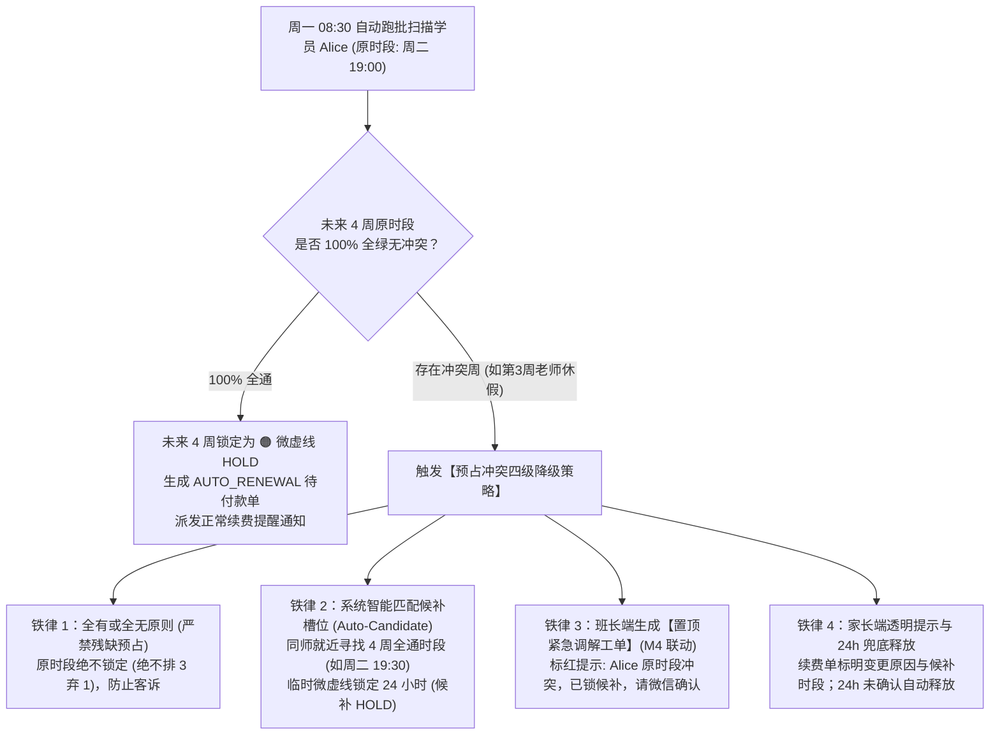

# 模块 3D 产品需求文档 (PRD) — 全场景排课与约课调度引擎 (Course Scheduling & Booking Engine)

> **文档状态**：PROPOSED (已封板评审) ｜ **版本**：v1.0 ｜ **管辖领域**：全场景排课、抢位约课、续费预占 (HOLD) 与小班整班调度
> **关联子模块**：[m3a_calendar_grid.md](./m3a_calendar_grid.md) (周日历看板), [m2a_course_orders.md](./m2a_course_orders.md) (购课单与TS资产), [m4_notification.md](./m4_notification.md) (协同通知)
> **【实体生命周期归口说明】**：本模块专职承接批量排课调度事务与冲突降级算法，驱动 TS 课次资产由 `待排期` 流转至 `已排期`。其中续费预占（`SlotOverride` 的 `HOLD` 态）规则由 [m3a_calendar_grid.md Section 4.10](./m3a_calendar_grid.md) 统领管辖，TS 课次全局状态机由 [docs/BUSINESS_RULES.md Section 3.2](../BUSINESS_RULES.md) 统领管辖。

---

## 1. 模块定位与业务全景 (Executive Summary)

全场景排课与约课调度引擎（`m3d`）是 Dream 系统的教学时间资产调度与长周期批量排课中枢。针对传统教务中“逐个点进老师日历碰运气找空档效率低、长周期批量排课与日常查课割裂、续费冲突缺乏自动调解机制”的核心痛点，本子模块确立了**“教师空闲大盘极速挑师 + 复用 M3A 老师当周课表页复选打通 4 周”**的两步式轻量化排课范式：

1. **两步式轻量化排课闭环**：
   - **Step 1 · 教师空闲大盘（选老师、看空档）**：支持携带学员 ID、小班 ID 或无参进入（如从教务大厅待办卡片或首页金刚位进入）；按价位（默认 `16积分`）与时段（默认 `中 10-15`）紧凑展示当周/下周有空闲格的老师（半小时横向长方形格矩阵，每 2 行标注一次整点时段，一屏 5 位，最多加载至 20 位），点 `[ 选取 ]` 进入 Step 2；
   - **Step 2 · 复用 M3A 老师当周课表页（排课复选态）**：直接复用 [m3a_calendar_grid.md](./m3a_calendar_grid.md) 老师周课表页，支持复选多个空闲绿格并实时打通 4 周（1v1 固定位或 1vN 小班双格）校验，单事务锁定落盘；
   - **日常轻量临时约课（1~2 节）**：仍可在 M3A 周历单元格动作抽屉内原地完成，底层可用时段校验与 FIFO 资产扣减由本模块 4.2 节统一提供。
2. **核心调度算法闭环**：
   - 针对固定位核心生命周期，确立**提前 7 天（最后一周周一 08:30）续费预占（HOLD）机制与“全有或全无”四级冲突降级调解铁律**，全面保障老学员优先续约权与资金持有人排他权益；
   - 针对 1vN 小班课，建立**连续双格磁吸排课、未来 4 周连贯度穿透评分与单节补排兜底算法**。

本模块全面保障零超卖、零撞课与资产专款专用，推动 TS 资产由 `待排期` 稳态流转至 `已排期`。

---

## 2. 角色与权限矩阵 (Roles & Permissions)

系统实施工作台物理隔离，共有 4 类排课操作主体，严禁跨权限越权操作：

| 身份角色 | 1v1 临时课 (🟡) | 1v1 固定位 (🟠 4周) | 1vN 小班课 (🟩 4周双格) | 权限红线与防呆约束 |
| :--- | :---: | :---: | :---: | :--- |
| **出资家长** | **自主抢位预约**<br>(可单约 1 节或连约 2~4 节) | ❌ **禁止自排**<br>(由系统预占或班长代排) | ❌ **全域屏蔽**<br>(不建档、不自排) | 仅能查看自家孩子档案名下的课程，不能查看老师其他学员排期。 |
| **教务班长** | **全域代约临时课**<br>(面向全校在读/试课学员，可选全平台在职老师) | **全域批量代排固定位**<br>(4 周一轮连续锁定，可选全平台在职老师) | **整班统一排课**<br>(小班主理人角色) | **全域约课放开**：班长可为学员预约全平台任意在职老师空闲时段（移除班长-老师排课隔离）；严禁无资产赊账代约。 |
| **小班主理人** | — | — | **整班 4 周排课**<br>(56px 连续双格) | **单任老师强绑定**：排课前必须已委任老师，未委任直接阻断；学期中严禁中途换老师。 |
| **平台管理员** | **全局代约与借师**<br>(跨班长统筹调度) | **跨周期固定位代排**<br>(试课/异常调解) | **全局监管与注销** | **续费保护铁律**：严禁管理员或任何人挤占老学员提前 7 天续费保护期（HOLD）。 |

---

## 3. 核心交互范式：教师空闲大盘 + 复用老师周课表 (Availability Board & Calendar Reuse)

为兼顾“跨师快速找空档”与“单师课表复选打通 4 周”的极简体验，排课工作流收敛为**“Step 1 教师空闲大盘挑老师 ➔ Step 2 复用 M3A 老师当周课表页复选格子”**两步闭环。

### 3.1 Step 1 · 教师空闲大盘页 (Teacher Availability Board)
1. **顶部上下文与周切换**：
   - **对象上下文条**：展示当前待排学员卡片（头像、昵称、可用课次余额）或小班卡片；若无参进入（如纯查空档），显示 **`[ 选择学员 / 小班 (可选) ]`**，允许随时补选，不选也可直接浏览全校老师空闲分布；
   - **单周切换器**：提供 **`[ 本周 ]`** 与 **`[ 下周 ]`** 快速切换（固定位与小班常从下周开排），大盘仅按所选单周的空闲分布展示，**不在大盘提前做 4 周穿透计算或小班双格校验**（统一留待 Step 2 老师课表页校验）。
2. **筛选条件与显示铁律**：
   - **老师价位**：提供 `[ 全部 ]` 及价位字典胶囊（`16积分`、`18积分`、`21积分` 等），**默认选中 `16积分`**；
   - **时段筛选**：提供 4 个固定时段单选切换：**`早 06-11`**（06:00-11:00）、**`中 10-15`**（10:00-15:00）、**`下 14-19`**（14:00-19:00）、**`晚 18-24`**（18:00-24:00）；**默认选中 `中 10-15`**；本页仅用于展示对应时段空闲分布，不在此页点选具体小格子；
   - **零空闲过滤**：在当前选定周与所选时段内，**只要至少有 1 个半小时可排格的老师才显示**；没有任何可排格子的老师直接隐藏，不占列表名额。
3. **老师列表排序、紧凑微格矩阵与分页加载**：
   - **排序与归属/教过标注**：若已选定学员，按 **① 曾教过该学员（熟客优先） → ② 同价位/相近价位 → ③ 当周已排负荷较少** 排序，并在曾教过该学员的老师卡片上**显式标注 `教过该学员`**（未选学员时不展示该标注）；未选对象时按当周可排空余量与负荷排序；**班长视角下，凡由当前班长本人负责管辖的老师，必须在老师卡片上显式标注 `我负责` 徽标**（与 `教过该学员` 可并存，便于班长在全域排课时快速区分自己负责的老师与跨组老师）；
   - **半小时横向长方形格矩阵与列/行聚焦高亮**：
     - **矩阵结构与顶部星期行**：在老师卡片列表上方（所有老师矩阵的绿色长方形上方）增设一行与右侧 7 列严格对齐的星期表头（**`一  二  三  四  五  六  日`**），表示周一至周日；每张老师卡片左侧展示老师姓名、价位（如 `16积分`）、本周排课负荷（如 `18/28节`）及正下方的 **`[ 选取 ]`** 按钮；右侧以周一至周日 7 列 × 所选时段半小时行（如 `10:00`~`14:30` 共 10 行）的**横向长方形格**呈现（`🟩` 空闲可排、`▫` 已占/休息），列宽不变、行高压缩；矩阵左侧增加窄时间轴，**每 2 行（即每小时）标注一次整点时段**（如 `10:00`、`11:00`、`12:00`），不逐行标注；零文字堆砌，一屏紧凑展示 **5 位老师**；
     - **点击周几高亮整列**：点击星期表头中的任意周几（如 `三`），页面所有老师卡片对应星期列保持高亮显示，其余未选中列自动淡化，便于纵向对比多位老师同一天的空档；再次点击同一周几取消高亮；
     - **点击整点时段高亮全页对应行**：点击任意老师矩阵左侧的整点时段（如 `10:00`），页面**所有老师**卡片中该整点对应的连续 2 行半小时格（`10:00` 与 `10:30`）同步高亮显示，其余时段行淡化，便于横向聚焦找到空闲格子；支持星期列与整点时段叠加高亮（交集格强化聚焦）及一键清除。
   - **分页加载**：首屏展示 5 位符合条件的老师；底部提供 **`[ 再加载 5 位老师 ]`**，每次追加加载 5 位，**单次最多加载至 20 位**。
4. **跳转动作**：点击任意老师名字下方的 **`[ 选取 ]`** 按钮，携带当前上下文（`teacherId`、可选 `studentId` / `classId`、所选周次及默认排课复选态）平滑进入 Step 2 老师当周课表页。

```text
+-------------------------------------------------------+
| < 返回   教师空闲大盘              [ 本周 | 下周* ]    |
| ----------------------------------------------------- |
| 对象: [ 👧 Alice (固定位余8节) ▾ ]  (或: 仅查空 · 选人) |
| 价位: [全部] [16积分*] [18积分] [21积分]               |
| 时段: [早 06-11] [中 10-15*] [下 14-19] [晚 18-24]      |
| ----------------------------------------------------- |
| 仅展示当前周所选时段至少有 1 个空闲格的老师 (共 12 位)   |
| 点列/时段聚焦                     一  二  三  四  五  六  日 |
+-------------------------------------------------------+
| 1. David · 16积分 [我负责] [教过该学员]                  |
|    本周 18/28节      10:00 ▭  🟩  ▭  🟩  ▭  🟩  🟩   |
|    [  选 取  ]       10:30 ▭  🟩  ▭  🟩  ▭  🟩  ▭    |
|                      11:00 🟩  🟩  ▭  🟩  ▭  🟩  ▭    |
|                      ... (10行半小时横向长方形格 · 每2行标整点) |
+-------------------------------------------------------+
| 2~5. Elena / Leo / Mia / Sam ...                      |
|        [ 再加载 5 位老师 (已显示 5 / 上限 20) ]          |
+-------------------------------------------------------+
```

### 3.2 Step 2 · 复用 M3A 老师当周课表页（排课复选态 · 打通 4 周）
1. **复用同一课表页**：从大盘点 `[ 选取 ]` 进入后，直接复用 **[m3a_calendar_grid.md](./m3a_calendar_grid.md)** 的老师当周课表网格与“4 周一轮”导航条，保持视觉与格内信息 100% 一致，并自动开启**「排课复选态」**。
2. **对象补选与模式切换**：
   - 顶部保留对象卡（已带 `studentId`/`classId` 时直接显示可用课次余额；无参进入时可在此点击补选学员或小班，未选对象仅可查看课表空档，确认按钮置灰提示“请先选择学员或小班”）；
   - 支持切换 **`连续 4 周批量`**（默认，用于 1v1 固定位或 1vN 小班整班）与 **`仅排单周 / 临时课 / 单节补排`**。
3. **复选格子与打通 4 周校验**：
   - 在老师当周网格中，点击空闲绿格（`🟢 约`）即可**复选**多个每周时段（再次点击取消）；
   - **打通 4 周实时校验**：在连续 4 周批量模式下，每勾选一个时段即刻透视未来连续 4 周可用性（1v1 校验单格，小班课自动按连续双格磁吸并校验 4 周全通）；若某周存在冲突，直接标记冲突周次并阻断该时段入单；
   - **意向作息高亮**：已选学员且其档案维护了常态作息偏好时，对应空闲时段给予轻量推荐标识。
4. **吸底确认栏与单事务闭环**：
   - 底部常驻已选时段清单（如 `周二 19:00 ×`、`周四 18:00 ×`）、扣减课次汇总与剩余课次预览；
   - 若学员持有续费预占 HOLD，明确展示“原预占位将自动释放”或“原预占位转为正式固定位（不重复扣减）”；
   - 点击确认按钮后单事务锁定落盘，退出排课复选态并在原老师课表网格上对刚排定的单元格执行 1 秒柔和成功闪烁反馈。

```text
+-------------------------------------------------------+
| < 返回大盘   David 的课表         [ 排课复选态 ON ]    |
| 对象: [ 👧 Alice · 固定位余 8 节 ▾ ] (无参时点此补选)   |
| 模式: (● 连续4周批量)  (○ 仅排单周/临时课)             |
| ◀ 上一轮 | [第1周] [第2周] [第3周] [第4周] | 下一轮 ▶   |
+-------------------------------------------------------+
| 时间 | 周一 | 周二 | 周三 | 周四 | 周五 | 周六 | 周日  |
| 18:00| 休   | 🟠Bob| 休   | [☑]  | 休   | 🟢约 | 🟢约  |
| 18:30| 休   | 🟠Bob| 休   | 🟢约 | 休   | 🟩G1 | 🟢约  |
| 19:00| 🟢约 | [☑]  | 🟡Tim| 🟢约 | 🟠Amy| 🟩G1 | 🟢约  |
| 19:30| 🟢约 | 🟢约 | 🟡Tim| ⚠️3周| 🟠Amy| 🟢约 | 🟢约  |
+-------------------------------------------------------+
| 已选: 周二 19:00 ×  周四 18:00 ×   (4周全通 ✓)         |
| 共需 8 节固定位 (2时段×4周) · Alice 剩余 8 节 ➔ 0 节   |
| [        确认批量锁定 4 周 (共扣 8 节)        ]        |
+-------------------------------------------------------+
```

### 3.3 全场景入口矩阵与退出回跳
- **带参入口（携带 `studentId` 或 `classId`）**：
  1. **Tab 3【教务中心】（教务大厅）待办卡片**：新购待排固定位、1v1 续费冲突调解、小班待排/待补排待办卡点击进入，自动锁定对应学员或小班；
  2. **学员档案 / 小班概览**：点击 `[ 📅 立即排课 ]` 或 `[ 立即补排 ]` 带参进入教师空闲大盘。
- **无参入口（支持纯查空档 & 随时补选对象）**：
  1. **首页金刚位**：班长端与管理员端首页 **`🗓️ 教务排课`** 金刚位；
  2. **Tab 3【教务中心】**：管理员第 3 行 **`🗓️ 空闲大盘`** 金刚位；班长 `负责老师` 列表顶部 **`[ 🔍 空闲大盘 ]`**；
  3. **M3A 老师课表顶栏**：点击 **`[ 🔍 找其他老师空档 ]`** 跳回大盘比较其他老师。
- **退出通道**：大盘左上角 `< 返回` 回到来源页；课表排课复选态左上角 `< 返回大盘`（或关闭复选态开关）无损返回。

---

## 4. 业务规则与调度算法规约 (Scheduling Algorithms)

### 4.1 学员意向作息交集推荐 (Smart Slot Highlight)
1. **意向时段提取**：若已选定学员，系统自动读取学员档案中的常态作息标签（`Student_Preference`）；
2. **交集高亮计算**：
   $$\text{Recommended\_Slots} = \text{Teacher\_4Week\_Free\_Slots} \ \cap \ \text{Student\_Preference}$$
3. **课表网格轻量标注**：在 Step 2 老师当周课表页中，符合学员意向且 4 周全通的空闲格给予轻量推荐标记，非意向时段正常保持可选。

---

### 4.2 1v1 临时课提前 1-7 天抢约与连约机制 (Temporary Lesson Booking)
1. **时间窗准入限制**：目标时段必须处于距当前时间 **1 - 7 天** 的空闲时段（当天时段与超过 7 天的时段统一置灰阻断），严禁预约当天课次；
2. **单约与连约规格**：支持【单约 1 节 (30m)】、【连约 2 节 (1h)】、【连约 3 节 (1.5h)】与【连约 4 节 (2h)】；
3. **连续空闲原子预检**：系统实时校验目标起始单元格及后续相邻的连续 $N$ 个单元格是否处于 🟢【空闲可约】状态；若后续某节被占用或处于休息，对应连约选项自动禁用；
4. **FIFO 资产自动扣减**：按创建时间先进先出原则，自动拣选并扣减学员名下最老有效的临时课待排期 TS；
5. **原子落盘**：依赖数据库行级排他锁，将单元格更新为 🟡【临时课】，记录经办身份与时间戳。

---

### 4.3 1v1 固定位 4 周一轮多时段批量排课 (Fixed Slot Batch Scheduling)
1. **单时段 4 周原子单元**：固定位排课以“同一星期几、同一时间段 × 连续 4 周”为最小原子单元；系统对未来连续 4 周启用行级排他锁校验，严禁只锁部分周；
2. **多时段批量选择**：一次排课可勾选 1~N 个不同的每周时段（允许跨天，如周二 19:00 + 周四 19:30）；每个时段独立执行 4 周全通校验；点击已选格再次点击即取消选择，推荐卡与网格选择状态双向同步；
3. **资产上限与整批扣减**：N 个时段共需 4×N 节固定位待排期 TS；可选取上限 = $\lfloor 当前可用固定位待排期 TS \div 4 \rfloor$。达到上限后继续点击其他格不进入已选，提示“固定位课次不足，最多选 N 个时段”；取消任一已选后可继续选择；
4. **整批单事务确认**：点击确认时，系统对全部已选时段统一执行行级排他锁与 4 周全通复核；全部通过后，在单一事务内将 N×4 个目标单元格原子锁定为 🟠【固定位】，并按先进先出扣减 4×N 节固定位待排期 TS；
5. **失败处理**：任一已选时段在确认时出现新冲突，整批不落盘、不产生部分锁定；冲突行标红并保留其他已选时段，用户取消冲突项或采用候补时段后重新确认。

---

### 4.4 固定位到期自动续费预排与预占 (HOLD) 机制
1. **触发时点与排期继承**：每轮固定位最后一周周一上午 08:30（提前 7 天），联动 M2A 自动生成续费待付款单（`AUTO_RENEWAL`）；系统以该学员本轮常规有效排期为基准（排除偶发请假干扰），提取未来 4 周目标时段；
2. **网格状态流转为续费预占 (HOLD)**：目标时段自动更新为 **“🟠 续费预占 (HOLD)”**（橙色微虚线卡片，标注【预】字徽标），全域排他锁定，阻断他人抢约；
3. **班长确认到账转正**：班长在 M2A 核实收款后，单一事务内原子将这 4 周预占网格转为正式实线 🟠【固定位】，TS 资产扣减核销；
4. **续费 HOLD 智能平移与多时段单事务穿透释锁换位**：
   - 若学员在提前 7 天保护期内持有 HOLD 预占位（如周一 19:00），家长诉求新一轮调整至周二 19:30，或同时增加周四 19:30；
   - 班长在专用排课工作台勾选全部新时段后，底部卡片明确提示平移；
   - **HOLD 时段不在已选清单中**：系统在单一事务内原子解除原 4 周时段的微虚线 HOLD 锁定（100% 释放为 🟢 空闲），同时将全部已选新时段原子更新为正式固定位，绝不跨时段双占；
   - **HOLD 时段本身在已选清单中**：该时段直接转为正式固定位，不释放，且**不重复扣减固定位 TS**（该 4 节已由 M2A 续费单核销）；其余新增时段按每时段 4 节扣减，底部提示“原预占位将转为正式固定位”，并单列“预占转正 1 个 · 新排 M 个”；
5. **家长端意向联动与原单跨师换位**：
   - **【暂不续费】立即释放**：家长在 1v1 自动续费单点击【暂不续费】并二次确认后，M2A 立即作废单据（`PARENT_DECLINED`），系统同步在单一事务内原子释放未来 4 周 `HOLD` 预占为 🟢【空闲可约】；
   - **【申请调整】期间保底锁位**：家长提交【申请调整】后（`PENDING_HANDLE`），原有 4 周 `HOLD` 预占保持锁定不释放（防止协商期间原时段被他人抢约）；班长在 M2A 修改抽屉更换同师时段或更换新授课老师并保存时，单事务释放旧老师/旧时段 `HOLD` 并锁定新老师/新时段 `HOLD`；
6. **逾期未付与自动释放**：截至下一轮首节开课前 24 小时，只要家长未确认或班长未确认收款（含已传凭证或协商待处理但未闭环场景），M2A 仍严格自动作废单据，日历预占锁定全额释放为 🟢【空闲可约】。

---

### 4.5 自动续费预占 (HOLD) 冲突四级降级裁决铁律 (HOLD Conflict Fallback)

周一 08:30 自动跑批若遇老师休假、周模板收缩或小班课整班占用导致目标时段冲突，系统强制执行以下四级降级铁律：



1. **铁律 1：全有或全无原则（严禁残缺预占）**：固定位是连续 4 周的完整周期。只要 4 周中有 1 周冲突，系统**绝不在原时段打残缺预占（绝不排 3 弃 1）**，原时段不予锁定，防止家长付款后中间某周无课引发客诉；
2. **铁律 2：系统智能匹配候补槽位（Auto-Candidate）**：系统自动在同一位老师名下，根据该学员意向时段匹配未来 4 周连续全通的候补时段（如后移半小时：周二 19:30-20:00），并**临时微虚线锁定 24 小时（候补 HOLD）**，防止在协商期间被他人抢走；
3. **铁律 3：班长工作台生成【置顶紧急调解工单】**：班长工作台待办栏立即标红生成紧急代办任务：`🚨【续费时段冲突】学员 Alice (原周二 19:00) 因外教休假无法继承原时段。系统已为您临时锁定候补时段 [周二 19:30]，请尽快与家长微信确认并一键换位！`；
4. **铁律 4：家长端透明提示与 24h 兜底释放**：家长续费单上标明：`“因授课老师作息微调，班长已为您预留备选时段 [周二 19:30]，请联系班长确认”`；截至开课前 24 小时若未完成确认，候补时段自动释放回大池，续费单逾期作废；
5. **多时段冲突处理**：多时段批量中，每个冲突时段独立生成候补与紧急工单；冲突时段不进入已选，或在确认复核时标红并阻断整批；其他无冲突时段保持已选，用户取消冲突项/采用候补后可重新确认。

---

### 4.6 1vN 小班课 56px 连续双格整班排课与单节补排规约 (Small Group Class Scheduling)

#### 4.6.1 4 周轮次整班批量排课 (4-Week Cycle Batch Mode)
1. **前置老师委任与小班资产校验**：排课前系统严格校验小班是否已完成老师委任。未委任状态下排课按钮置灰阻断，提示“请先在小班管理中委任授课老师后再排课”；小班卡同时透出 `小班课时 X 节可用`，作为多时段选择上限依据；
2. **56px 连续双格磁吸附**：小班课标准时长 50 分钟，日历网格光标自动吸附锁定为**连续 2 个半小时单元格（高 56px 贯穿双格）**，严禁单格误触；
3. **未来 4 周连贯度穿透评分**：
   - 系统穿透计算未来 4 周所有整点双格可用性；
   - **满贯连续时段（100 分）**：4 周全部双格全通无冲突，单元格呈现 `🟩 推荐`，优先置顶推荐；
   - **局部周冲突时段（< 100 分）**：标注可用周数与连贯率（如 `⚠️ 3/4周 (第2周冲突)`），点击后透出冲突周次与具体原因，不进入已选；
4. **多时段整班排课**：一次可勾选 1~N 个每周 1 小时时段（如周六 10:00 + 周日 09:00，允许一周多次课）；每个时段独立执行 4 周连贯度校验；点击已选格再次点击即取消选择；
5. **资产上限与整批扣减**：N 个时段共需 4×N 节小班待排期小班 TS；可选取上限 = $\lfloor 小班当前可用小班 TS \div 4 \rfloor$。达到上限后继续点击不进入已选，提示“小班课次不足，最多选 N 个时段”；取消任一已选后可继续选择；
6. **落盘与资产核销**：点击确认排课后，在单一事务内原子锁定全部已选时段对应的未来 4 周双格单元格，扣减 4×N 节小班待排期 TS 资产，网格渲染为带有 `[G]` 徽标的 Teal 双格微卡片。

#### 4.6.2 小班课单节补排模式 (Single-Lesson Makeup Mode · 暂停待排兜底)
1. **触发入口与模式自动判定**：
   - **入口 A（待办直达）**：主理人工作台 / 小班概览页点击【立即补排】待办卡片跳转排课工作台；
   - **入口 B（排课工作台自适应切换）**：进入排课工作台时，系统根据当前小班待排 TS 资产智能判定：若可用待排 TS $< 4$ 节（如暂停待排退回的 1 节散 TS），或 URL 携带 `?mode=makeup&classId=...`，工作台自动切换为【小班单节补排模式】；若可用待排 TS $\ge 4$ 节，默认支持 4 周批量排课，亦支持下拉手动切换为单节补排；
2. **56px 连续双格单次选位**：
   - 保持 50 分钟（56px 连续双单元格）磁吸附标准；
   - 主理人可在当前委任主讲老师（或持有小班资质的代课老师）的未来日历中点选任一处于 🟢【空闲可约】状态的连续双单元格；
   - 仅对所选单周该时段执行行级排他锁与冲突复核，**不执行 4 周跨周连贯度穿透评分**；
3. **单事务扣减与闭环核销**：
   - 单节补排模式下，已选时段上限固定为当前待补排的散 TS 节数（默认 1 节）；
   - 点击确认排课后，在单一事务内将目标连续双格原子锁定为 🟩【小班课】（Teal 双格微卡片，带 `[G]` 徽标与小班简称）；
   - 原子扣减小班待排池（`Class_Pending_TS`）中 1 节 TS 资产；
   - **待办闭环**：联动消解小班主理人工作台与小班概览页的 `[小班课待补排]` 置顶告警待办卡片，并在小班修改日志写入变更记录。

---

---

## 5. 验收标准 (Acceptance Criteria, AC)

| 编号 | 验收项 | 验收操作与输入 | 预期输出与量化断言 |
| :--- | :--- | :--- | :--- |
| **AC-3D-01** | **教师空闲大盘筛选与零空闲过滤** | 从首页金刚位或教务大厅待办进入教师空闲大盘 | 默认选中价位 `16积分`、时段 `中 10-15`（可切 `早 06-11 / 下 14-19 / 晚 18-24`）及 `本周 / 下周`；仅展示当前周与所选时段内至少有 1 个半小时空闲格的老师，无空闲老师自动隐藏；每位老师以半小时横向长方形格矩阵紧凑呈现，矩阵左侧每 2 行标注一次整点时段；已选学员时，曾教过该学员的老师卡片必须显式标注 `教过该学员`；**班长角色浏览时，本人负责管辖的老师卡片必须显式标注 `我负责`**。 |
| **AC-3D-01a** | **大盘星期表头与列/时段聚焦高亮** | 在大盘表格上方点击星期表头 `三`，再点击任意老师矩阵左侧的 `10:00` | 1. 大盘老师列表上方绿色长方形矩阵正上方展示对齐的 `一 二 三 四 五 六 日` 星期行；<br>2. 点击 `三` 后，页面所有老师卡片的周三列保持高亮，其余列淡化；再次点击 `三` 取消列高亮；<br>3. 点击 `10:00` 后，页面所有老师卡片的 `10:00` 与 `10:30` 两行同步高亮，其余时段行淡化；再次点击 `10:00` 或点击清除按钮可恢复全显。 |
| **AC-3D-02** | **大盘分页加载与上限** | 符合条件老师共 25 位，进入大盘并连续点击【再加载 5 位老师】 | 首屏展示 5 位；每次点击追加 5 位；累计展示达到 20 位后不再继续加载。 |
| **AC-3D-03** | **无参进入查空与补选阻断** | 无参进入大盘并点击某老师 `[ 选取 ]` 进 Step 2 老师课表，未选学员/小班时尝试提交 | 允许正常浏览大盘与老师课表空闲分布；未选学员或小班时，底部确认排课按钮强制置灰禁用并提示“请先选择学员或小班”；在顶部补选可用课次充足的学员后解锁提交。 |
| **AC-3D-04** | **资产不足提交阻断** | 选择学员 Charlie (固定位课次剩 2 节) 进入老师课表复选态 | 底部卡片立即标红提示“固定位课次不足 4 节 (仅剩 2 节)”，确认排课按钮强制置灰禁用，阻止提交。 |
| **AC-3D-05** | **1v1 临时课时间窗校验** | 切换为单周/临时课模式，选择当前时间当天或第 8 天的时段 | 单元格置灰不可约；仅在距当前时间 1-7 天内的空闲格支持单约或 1~4 节连约。 |
| **AC-3D-06** | **复用老师课表复选与 4 周原子锁定** | 在大盘点击 David 下方 `[ 选取 ]` 进入老师课表复选态，勾选周二 19:00 与周四 18:00，点击【确认批量锁定 4 周】 | 底部显示已选 2 个时段、共扣 8 节；单事务锁定 2×4 个目标单元格；扣减 8 节固定位 TS；退出复选态并在原老师课表对刚排定的单元格执行 1 秒柔和闪烁。 |
| **AC-3D-07** | **HOLD 智能平移换位** | 为持有周一 19:00 HOLD 的学员勾选周二 19:30 与周四 19:30；或勾选周一 19:00 本身 + 1 个新时段 | 不在已选时：提示原 HOLD 将自动释放，确认后释放并锁定两个新时段，共扣 8 节；HOLD 本身在已选时：提示“转为正式固定位”，不释放且不重复扣减，底部显示“预占转正 1 个 + 新排 1 个 · 共扣 4 节”。 |
| **AC-3D-08** | **HOLD 冲突全有或全无** | 跑批检测未来 4 周第 3 周存在老师休假冲突 | 原时段未来 4 周 100% 保持 🟢 空闲（绝不预占 3 节）；系统就近锁定 24h 候补 HOLD，并在班长端生成标红紧急调解工单。 |
| **AC-3D-09** | **小班双格校验时机与未委任阻断** | 携带 `classId` 进入大盘，点击 `[ 选取 ]` 进入老师课表后勾选周六 10:00 与周日 09:00 | 大盘不提前拦截双格；进入 Step 2 老师课表后，未委任老师的小班阻断提交，已委任时按连续双格磁吸与 4 周全通校验；已选 2 个时段共扣 8 节小班课次。 |
| **AC-3D-10** | **多时段选择上限与取消** | Alice 固定位 8 节，依次点击 3 个可排时段 | 前 2 个进入已选；第 3 个不进入已选并提示“固定位课次不足，最多选 2 个时段”；再次点击任一已选格可取消并恢复可排。 |
| **AC-3D-11** | **多时段冲突整批阻断** | 勾选周二 19:00（第 3 周冲突）与周四 19:30 | 第 3 周冲突时段标示冲突周次并阻断入单（或在确认复核时整批不落盘）；周四保持已选；取消冲突项后可重新确认。 |
| **AC-3D-12** | **小班单节补排与待排资产核销** | 小班因暂停待排退回 1 节 TS，主理人点击待办【立即补排】经大盘或直达老师课表进入单节补排模式，勾选周日 15:00-16:00 连续双格并点击确认 | 1. 自动进入单节补排模式，上限为 1 节，不强制 4 周；<br>2. 单事务内将该连续双格锁定为 🟩 小班课 (`[G]` 标)；<br>3. 扣减待排池 1 节 TS 资产；<br>4. 主理人工作台置顶待办即时核销。 |

---

## 6. 架构决策与设计系统对齐 (Architecture Decisions)

- **决策 1：两步式轻量化排课（大盘挑师 + 复用 M3A 课表）**：彻底淘汰独立重型工作台与先填点再反选模式，大盘聚焦跨师空档对比，选位复选直接复用 M3A 老师当周课表，交互零学习成本；
- **决策 2：半小时横向长方形格高密度大盘**：大盘以半小时横向长方形格紧凑呈现所选时段空闲分布，矩阵左侧每 2 行标注整点时段；一屏展示 5 位老师、按 5 位递增至 20 位上限，满足微信问询秒级查空与排课挑师双诉求；
- **决策 3：HOLD 冲突四级调解闭环**：坚决贯彻“全有或全无”铁律，严禁残缺预占，引入系统就近临时锁定 24h 候补槽位与班长标红工单机制，保障客诉归零；
- **决策 4：视觉规范统一收敛**：卡片类型与日历 7 色格严格遵循 DESIGN.md 语义色板与三种卡面规范，严禁刺眼满铺深色块；
- **决策 5：多时段批量与单时段原子校验并存**：一次排课允许选择多个每周时段，但每个时段仍以“连续 4 周”为不可拆分的原子单元；整批确认采用单事务，避免部分锁定与资产错扣。

---

## 7. 范围外 (Out of Scope)

- 教师空闲大盘**不**在页面内直接点选具体格发起约课或排课（统一点击 `[ 选取 ]` 进入 M3A 老师当周课表页完成）；
- 教师空闲大盘**不**做跨 4 周穿透计算与小班连续双格前置校验（统一收口至 Step 2 老师当周课表页校验）；
- 不支持在大盘单次加载超过 20 位老师。
