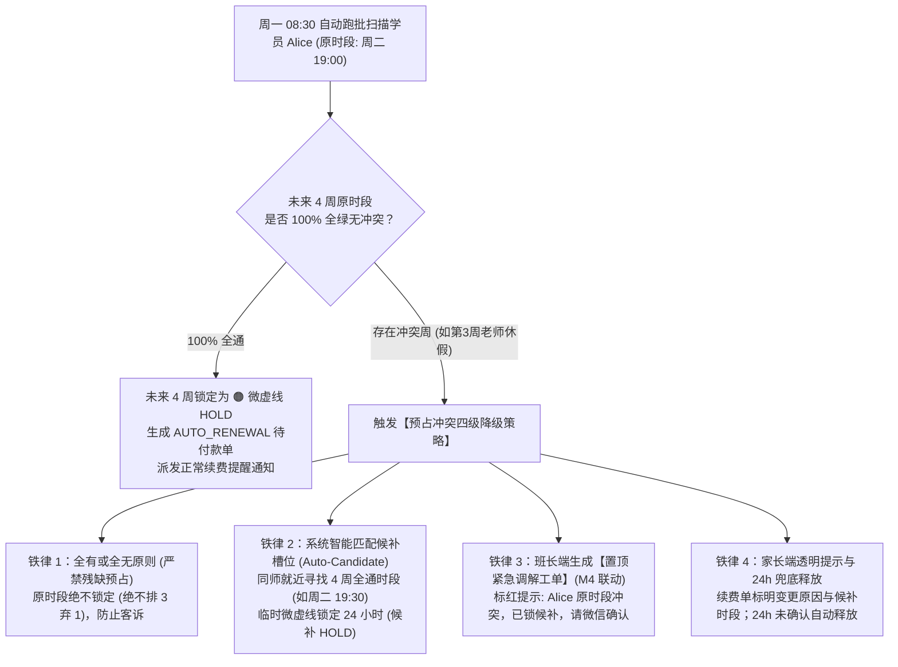

# 模块 3D 产品需求文档 (PRD) — 全场景排课与约课调度引擎 (Course Scheduling & Booking Engine)

> **文档状态**：PROPOSED (已封板评审) ｜ **版本**：v1.0 ｜ **管辖领域**：全场景排课、抢位约课、续费预占 (HOLD) 与小班整班调度
> **关联子模块**：[m3a_calendar_grid.md](./m3a_calendar_grid.md) (周日历看板), [m2a_course_orders.md](./m2a_course_orders.md) (购课单与TS资产), [m4_notification.md](./m4_notification.md) (协同通知)
> **【实体生命周期归口说明】**：本模块专职承接批量排课调度事务与冲突降级算法，驱动 TS 课次资产由 `待排期` 流转至 `已排期`。其中 72h 续费预占锁（`RenewalHoldLease`）的核心状态机由 [m3a_calendar_grid.md Section 4.10](./m3a_calendar_grid.md) 统领管辖，TS 课次全局状态机由 [docs/BUSINESS_RULES.md Section 3.2](../BUSINESS_RULES.md) 统领管辖。

---

## 1. 模块定位与业务全景 (Executive Summary)

全场景排课与约课调度引擎（`m3d`）是 Dream 系统的教学时间资产调度与长周期批量排课中枢。针对传统教务中“表单盲选下拉框导致反复试错、日历小格塞满文字导致视觉躁杂、排课逻辑倒置找不到选学员入口、续费冲突缺乏系统级自动调解机制”的核心痛点，本子模块确立了以**“沉浸式专用批量排课工作台”与“纯净周网格选时段”**为核心的人机交互范式：

1. **分层分流原则**：
   - **日常轻量临时约课（1~2节）**：日常 90% 的单节或连续 60min 临时课预约，已全面下沉至 [m3a_calendar_grid.md](./m3a_calendar_grid.md) 周历单元格动作抽屉内原地完成，无需进入 M3D 工作台；本模块 4.2 节专职提供其底层的可用时段校验与 FIFO TS 资产扣减算法；
   - **长周期重度批量排课**：M3D 专用全屏工作台专职承接 **1v1 固定位 4 周原子批量排课** 与 **1vN 小班课 4 周整班批量排课**；
2. **核心调度算法闭环**：
   - 引入**“学员意向作息交集推荐算法”**，彻底终结在老师 140 个格子里大海捞针的低效操作；
   - 针对固定位核心生命周期，确立**提前 7 天（最后一周周一 08:30）续费预占（HOLD）机制与“全有或全无”四级冲突降级调解铁律**，全面保障老学员优先续约权与资金持有人排他权益；
   - 针对 1vN 小班课，建立**连续双单元格（56px）磁吸排课与未来 4 周连贯度穿透打分算法**。

本模块全面保障零超卖、零撞课与资产专款专用，推动 TS 资产由 `待排期` 稳态流转至 `已排期`。

---

## 2. 角色与权限矩阵 (Roles & Permissions)

系统实施工作台物理隔离，共有 4 类排课操作主体，严禁跨权限越权操作：

| 身份角色 | 1v1 临时课 (🟡) | 1v1 固定位 (🟠 4周) | 1vN 小班课 (🟩 4周双格) | 权限红线与防呆约束 |
| :--- | :---: | :---: | :---: | :--- |
| **出资家长** | **自主抢位预约** (可单约 1 节或连约 2~4 节) | ❌ **禁止自排** (由系统预占或班长代排) | ❌ **全域屏蔽** (不建档、不自排) | 仅能查看自家孩子档案名下的课程，不能查看老师其他学员排期。 |
| **教务班长** | **全域代约临时课** (面向全校在读/试课学员，可选全平台在职老师) | **全域批量代排固定位** (4 周一轮连续锁定，可选全平台在职老师) | **整班统一排课** (小班主理人角色) | **全域约课放开**：班长可为学员预约全平台任意在职老师空闲时段（移除班长-老师排课隔离）；严禁无资产赊账代约。 |
| **小班主理人** | — | — | **整班 4 周排课** (56px 连续双格) | **单任老师强绑定**：排课前必须已委任老师，未委任直接阻断；学期中严禁中途换老师。 |
| **平台管理员** | **全局代约与借师** (跨班长统筹调度) | **跨周期固定位代排** (试课/异常调解) | **全局监管与注销** | **续费保护铁律**：严禁管理员或任何人挤占老学员提前 7 天续费保护期（HOLD）。 |

---

## 3. 核心交互范式：沉浸式专用排课工作台 (Dedicated Scheduling Flow)

为解决旧版日历直接变色导致“找不到选学员入口、文字拥挤乱码”的致命硬伤，排课操作统一采用**“全屏专用排课工作台 + 纯净周网格选时段”**的标准交互范式。

### 3.1 页面三段式黄金结构
1. **顶部：排课上下文与三要素聚焦**：
   - **学员选择大卡片**：常驻首行，包含学员头像、真实昵称/英文名、年级、有效课次余额（如 `固定位课时: 8 节可用`），支持点击切换学员；
   - **授课老师选择卡片**：展示当前授课老师姓名、定级（Senior/Standard）及管辖状态；
   - **学员意向作息标签**：提取该学员档案中的作息偏好（如 `🌙 平时晚间 (18:30-20:30)` 或 `☀️ 周末上午 (09:00-11:30)`）。
2. **中部：该老师专属纯净周网格（时间空间感选择）**：
   - 采用标准周一至周日 7 列网格，时间轴智能外接裁剪；
   - **视觉纯净原则**：42px 宽的单元格内**严禁塞入长文本或闪烁动画**；
   - **高亮推荐**：符合学员意向且 4 周全通的时段，以轻柔微底色标注 `🟢 推荐` 或 `🟢 可排`；
   - **智能淡化**：非意向时段或不可约时段统一以半透明中性灰底展示，降低视觉噪音。
3. **底部：吸底反馈与多时段单事务确认栏**：
   - **已选时段清单（1~N 个）**：以 chip 形式展示全部已选每周时段（如 `周二 19:00 ×`、`周四 19:30 ×`），支持逐项取消与一键清空；实时汇总 `已选 N 个时段 · 共扣 4×N 节固定位 · 剩余 X 节`；
   - **智能平移提醒卡**：若该学员持有原预占位 HOLD，明确展示平移提示（如 `💡 原预占位 [周一 19:00] 将自动释放`）；若 HOLD 时段本身在已选清单中，提示“原预占位将转为正式固定位”，不重复释放；
   - **一键确认大按钮**：如 `[ 确认批量锁定 4 周 (2 个时段 · 扣减 Alice 8 节固定位) ]`；课次不足、任一已选时段存在冲突或候补未确认时强制置灰禁用。

### 3.2 进出与双向衔接规范
- **进场入口**：在 [m3a_calendar_grid.md](./m3a_calendar_grid.md) 顶栏点击 `[ + 批量固定位排课 ]`，或在教务中心学员卡片点击 `[ 📅 立即排课 ]`，系统无缝带参跳转进入专用排课工作台；
- **退出通道**：工作台左上角常驻 **`< 取消`** 按钮，点击一键无损返回原日历看板；
- **交付闭环**：点击确认排课后，弹出轻量成功反馈，自动回跳日历看板，刚排好的**全部时段单元格同时轻柔淡色闪烁 1 秒（Success Flash）**，实线微卡片即时呈现。

---

## 4. 业务规则与调度算法规约 (Scheduling Algorithms)

### 4.1 学员意向作息交集推荐算法 (Smart Slot Recommendation)
1. **意向时段提取**：系统自动读取选中学员档案中的常态作息标签（`Student_Preference`）；
2. **交集过滤计算**：
   $$\text{Recommended\_Slots} = \text{Teacher\_4Week\_Free\_Slots} \ \cap \ \text{Student\_Preference}$$
3. **直出 Top 2 黄金推荐**：系统优先在周网格顶部以卡片形式推荐出 1~2 个最佳无冲突时段；推荐卡支持点击选中、再次点击取消，与下方周网格的选择状态双向同步；选满两个推荐时段时，一并进入底部已选清单，作为多时段批量排课的一部分。

---

### 4.2 1v1 临时课提前 1-7 天抢约与连约机制 (Temporary Lesson Booking)
1. **时间窗准入限制**：目标时段必须处于距当前时间 **1 - 7 天** 的空闲时段（当天时段与超过 7 天的时段统一置灰阻断），严禁预约当天课次；
2. **单约与连约规格**：支持【单约 1 节 (30m)】、【连约 2 节 (1h)】、【连约 3 节 (1.5h)】与【连约 4 节 (2h)】；
3. **连续空闲原子预检**：系统实时校验目标起始单元格及后续相邻的连续 $N$ 个单元格是否处于 🟢【空闲可约】状态；若后续某节被占用或处于休息，对应连约选项自动禁用；
4. **FIFO 资产自动扣减**：按创建时间先进先出原则，自动拣选并扣减学员名下最老有效的临时课待排期 TS；
5. **原子落盘**：依赖数据库行级排他锁，将单元格更新为 🟡【临时课】，记录经办身份与时间戳。

---

### 4.3 1v1 固定位 4 周一轮多时段批量排课 (Fixed Slot Batch Scheduling)
1. **单时段 4 周原子单元**：固定位排课以“同一星期几、同一时间段 × 连续 4 周”为最小原子单元；系统对未来连续 4 周启用行级排他锁校验，严禁只锁部分周；
2. **多时段批量选择**：一次排课可勾选 1~N 个不同的每周时段（允许跨天，如周二 19:00 + 周四 19:30）；每个时段独立执行 4 周全通校验；点击已选格再次点击即取消选择，推荐卡与网格选择状态双向同步；
3. **资产上限与整批扣减**：N 个时段共需 4×N 节固定位待排期 TS；可选取上限 = $\lfloor 当前可用固定位待排期 TS \div 4 \rfloor$。达到上限后继续点击其他格不进入已选，提示“固定位课次不足，最多选 N 个时段”；取消任一已选后可继续选择；
4. **整批单事务确认**：点击确认时，系统对全部已选时段统一执行行级排他锁与 4 周全通复核；全部通过后，在单一事务内将 N×4 个目标单元格原子锁定为 🟠【固定位】，并按先进先出扣减 4×N 节固定位待排期 TS；
5. **失败处理**：任一已选时段在确认时出现新冲突，整批不落盘、不产生部分锁定；冲突行标红并保留其他已选时段，用户取消冲突项或采用候补时段后重新确认。

---

### 4.4 固定位到期自动续费预排与预占 (HOLD) 机制
1. **触发时点与排期继承**：每轮固定位最后一周周一上午 08:30（提前 7 天），联动 M2A 自动生成续费待付款单（`AUTO_RENEWAL`）；系统以该学员本轮常规有效排期为基准（排除偶发请假干扰），提取未来 4 周目标时段；
2. **网格状态流转为续费预占 (HOLD)**：目标时段自动更新为 **“🟠 续费预占 (HOLD)”**（橙色微虚线卡片，标注【预】字徽标），全域排他锁定，阻断他人抢约；
3. **班长确认到账转正**：班长在 M2A 核实收款后，单一事务内原子将这 4 周预占网格转为正式实线 🟠【固定位】，TS 资产扣减核销；
4. **续费 HOLD 智能平移与多时段单事务穿透释锁换位**：
   - 若学员在提前 7 天保护期内持有 HOLD 预占位（如周一 19:00），家长诉求新一轮调整至周二 19:30，或同时增加周四 19:30；
   - 班长在专用排课工作台勾选全部新时段后，底部卡片明确提示平移；
   - **HOLD 时段不在已选清单中**：系统在单一事务内原子解除原 4 周时段的微虚线 HOLD 锁定（100% 释放为 🟢 空闲），同时将全部已选新时段原子更新为正式固定位，绝不跨时段双占；
   - **HOLD 时段本身在已选清单中**：该时段直接转为正式固定位，不释放，且**不重复扣减固定位 TS**（该 4 节已由 M2A 续费单核销）；其余新增时段按每时段 4 节扣减，底部提示“原预占位将转为正式固定位”，并单列“预占转正 1 个 · 新排 M 个”；
5. **逾期未付与自动释放**：截至下一轮首节开课前 24 小时，若家长未付款且班长未确认，M2A 自动作废单据，日历预占锁定全额释放为 🟢【空闲可约】。

---

### 4.5 自动续费预占 (HOLD) 冲突四级降级裁决铁律 (HOLD Conflict Fallback)

周一 08:30 自动跑批若遇老师休假、周模板收缩或小班课整班占用导致目标时段冲突，系统强制执行以下四级降级铁律：

1. **铁律 1：全有或全无原则（严禁残缺预占）**：固定位是连续 4 周的完整周期。只要 4 周中有 1 周冲突，系统**绝不在原时段打残缺预占（绝不排 3 弃 1）**，原时段不予锁定，防止家长付款后中间某周无课引发客诉；
2. **铁律 2：系统智能匹配候补槽位（Auto-Candidate）**：系统自动在同一位老师名下，根据该学员意向时段匹配未来 4 周连续全通的候补时段（如后移半小时：周二 19:30-20:00），并**临时微虚线锁定 24 小时（候补 HOLD）**，防止在协商期间被他人抢走；
3. **铁律 3：班长工作台生成【置顶紧急调解工单】**：班长工作台待办栏立即标红生成紧急代办任务：`🚨【续费时段冲突】学员 Alice (原周二 19:00) 因外教休假无法继承原时段。系统已为您临时锁定候补时段 [周二 19:30]，请尽快与家长微信确认并一键换位！`；
4. **铁律 4：家长端透明提示与 24h 兜底释放**：家长续费单上标明：`“因授课老师作息微调，班长已为您预留备选时段 [周二 19:30]，请联系班长确认”`；截至开课前 24 小时若未完成确认，候补时段自动释放回大池，续费单逾期作废；
5. **多时段冲突处理**：多时段批量中，每个冲突时段独立生成候补与紧急工单；冲突时段不进入已选，或在确认复核时标红并阻断整批；其他无冲突时段保持已选，用户取消冲突项/采用候补后可重新确认。

---

### 4.6 1vN 小班课 56px 连续双格整班排课与单节补排规约 (Small Group Class Scheduling)

#### 4.6.1 4 周轮次整班批量排课 (4-Week Cycle Batch Mode)
1. **前置老师委任与小班资产校验**：排课前系统严格校验小班是否已完成老师委任。未委任状态下排课按钮置灰阻断，提示“请先在小班管理中委任授课老师后再排课”；小班卡同时透出 `小班课时 X 节可用`，作为多时段选择上限依据；
2. **56px 连续双格磁吸附**：小班课标准时长 50 分钟，日历网格光标自动吸附锁定为**连续 2 个半小时单元格（高 56px 贯穿双格）**，严禁单格误触；
3. **未来 4 周连贯度穿透评分**：
   - 系统穿透计算未来 4 周所有整点双格可用性；
   - **满贯连续时段（100 分）**：4 周全部双格全通无冲突，单元格呈现 `🟩 推荐`，优先置顶推荐；
   - **局部周冲突时段（< 100 分）**：标注可用周数与连贯率（如 `⚠️ 3/4周 (第2周冲突)`），点击后透出冲突周次与具体原因，不进入已选；
4. **多时段整班排课**：一次可勾选 1~N 个每周 1 小时时段（如周六 10:00 + 周日 09:00，允许一周多次课）；每个时段独立执行 4 周连贯度校验；点击已选格再次点击即取消选择；
5. **资产上限与整批扣减**：N 个时段共需 4×N 节小班待排期小班 TS；可选取上限 = $\lfloor 小班当前可用小班 TS \div 4 \rfloor$。达到上限后继续点击不进入已选，提示“小班课次不足，最多选 N 个时段”；取消任一已选后可继续选择；
6. **落盘与资产核销**：点击确认排课后，在单一事务内原子锁定全部已选时段对应的未来 4 周双格单元格，扣减 4×N 节小班待排期 TS 资产，网格渲染为带有 `[G]` 徽标的 Teal 双格微卡片。

#### 4.6.2 小班课单节补排模式 (Single-Lesson Makeup Mode · 暂停待排兜底)
1. **触发入口与模式自动判定**：
   - **入口 A（待办直达）**：主理人工作台 / 小班概览页点击【立即补排】待办卡片跳转排课工作台；
   - **入口 B（排课工作台自适应切换）**：进入排课工作台时，系统根据当前小班待排 TS 资产智能判定：若可用待排 TS $< 4$ 节（如暂停待排退回的 1 节散 TS），或 URL 携带 `?mode=makeup&classId=...`，工作台自动切换为【小班单节补排模式】；若可用待排 TS $\ge 4$ 节，默认支持 4 周批量排课，亦支持下拉手动切换为单节补排；
2. **56px 连续双格单次选位**：
   - 保持 50 分钟（56px 连续双单元格）磁吸附标准；
   - 主理人可在当前委任主讲老师（或持有小班资质的代课老师）的未来日历中点选任一处于 🟢【空闲可约】状态的连续双单元格；
   - 仅对所选单周该时段执行行级排他锁与冲突复核，**不执行 4 周跨周连贯度穿透评分**；
3. **单事务扣减与闭环核销**：
   - 单节补排模式下，已选时段上限固定为当前待补排的散 TS 节数（默认 1 节）；
   - 点击确认排课后，在单一事务内将目标连续双格原子锁定为 🟩【小班课】（Teal 双格微卡片，带 `[G]` 徽标与小班简称）；
   - 原子扣减小班待排池（`Class_Pending_TS`）中 1 节 TS 资产；
   - **待办闭环**：联动消解小班主理人工作台与小班概览页的 `[小班课待补排]` 置顶告警待办卡片，并在小班修改日志写入变更记录。

---

### 4.5 按条件反选老师（智能筛师引擎 · Smart Teacher Filtering）
为彻底终结“先逐个点进老师日历、再碰运气找空档”的低效排课方式，排课工作台与约课入口提供以下两类智能反选筛选：

1. **1v1 固定位「未来 4 周全通」智能筛师**：
   - **筛选条件输入**：选定课程类型 + 1~N 个目标每周时段（如 `周二 19:00`、`周四 19:30`）；
   - **全通判定**：系统实时检索全平台在职且具备该课程资质的老师，**仅返回在全部所选时段上、未来连续 4 周均处于 🟢【空闲可约】状态**的老师列表（任一周存在排课、请假或 HOLD 冲突的老师自动过滤）；
   - **排序规则**：默认按“曾教过该学员（熟客优先） → 当前定级匹配度 → 本周剩余空闲率”排序，点击老师卡片直接带入所选时段进入确认锁定。
2. **1v1 临时约课「时间窗 + 时长」智能筛师**：
   - **筛选条件输入**：目标日期（距今 1~7 天内）、起止时段、预约时长（单节 30min / 连约 60min / 90min / 120min）及课程类型；
   - **连续空闲过滤**：系统仅返回在目标日期与时段内**连续 $N$ 个单元格全部处于 🟢 空闲**且具备资质的全平台老师；
   - **排序与一键约课**：优先置顶展示曾教过该学员的老师，点击【立即预约】直接弹出确认框扣减 TS 落盘。

---

## 5. 验收标准 (Acceptance Criteria, AC)

| 编号 | 验收项 | 验收操作与输入 | 预期输出与量化断言 |
| :--- | :--- | :--- | :--- |
| **AC-3D-01** | **专用排课工作台结构** | 班长点击【快捷排课】进入工作台 | 页面顶栏展示学员大卡片（透出可用课次与意向标签）、老师卡片；中部展示纯净周网格；底部常驻确认栏；左上角常驻 `< 取消`。 |
| **AC-3D-02** | **意向作息交集推荐** | 选择学员 Alice (意向: 平时晚间) | 周网格仅在平时晚间时段高亮 `🟢 推荐`，非意向时段自动半透明置灰淡化；格内零冗余长文本堆砌。 |
| **AC-3D-03** | **资产不足提交阻断** | 切换学员为 Charlie (固定位课次剩 2 节) | 底部卡片立即标红提示“固定位课次不足 4 节 (仅剩 2 节)”，确认排课按钮强制置灰禁用，阻止提交。 |
| **AC-3D-04** | **1v1 临时课次间窗校验** | 选择当前时间当天或第 8 天的时段 | 单元格置灰不可约；仅在距当前时间 1-7 天内的空闲格滑出预约抽屉并提供 1~4 节连约规格。 |
| **AC-3D-05** | **固定位多时段 4 周原子锁定** | 勾选周二 19:00 与周四 19:30 两个时段，点击【确认批量锁定 4 周】 | 底部显示已选 2 个时段、共扣 8 节；单事务锁定 2×4 个目标单元格；扣减 8 节固定位 TS；回跳日历后两个时段的全部单元格同时高亮闪烁 1 秒。 |
| **AC-3D-06** | **HOLD 智能平移换位** | 为持有周一 19:00 HOLD 的学员勾选周二 19:30 与周四 19:30；或勾选周一 19:00 本身 + 1 个新时段 | 不在已选时：提示原 HOLD 将自动释放，确认后释放并锁定两个新时段，共扣 8 节；HOLD 本身在已选时：提示“转为正式固定位”，不释放且不重复扣减，底部显示“预占转正 1 个 + 新排 1 个 · 共扣 4 节”。 |
| **AC-3D-07** | **HOLD 冲突全有或全无** | 跑批检测未来 4 周第 3 周存在老师休假冲突 | 原时段未来 4 周 100% 保持 🟢 空闲（绝不预占 3 节）；系统就近锁定 24h 候补 HOLD，并在班长端生成标红紧急调解工单。 |
| **AC-3D-08** | **小班双格、多时段与未委任阻断** | 选择未委任老师的小班尝试排课；委任后勾选周六 10:00 与周日 09:00 | 未委任时强制阻断提交；委任后两个时段均按 56px 连续双格与 4 周全通校验；已选 2 个时段共扣 8 节小班课次；再次点击任一已选格可取消。 |
| **AC-3D-09** | **多时段选择上限与取消** | Alice 固定位 8 节，依次点击 3 个可排时段 | 前 2 个进入已选；第 3 个不进入已选并提示“固定位课次不足，最多选 2 个时段”；再次点击任一已选格可取消并恢复可排。 |
| **AC-3D-10** | **多时段冲突整批阻断** | 已选周二 19:00（第 3 周冲突）与周四 19:30，点击确认 | 整批不落盘；周二行标红并提示第 3 周冲突；周四保持已选；取消周二或采用候补后可重新确认。 |
| **AC-3D-11** | **小班单节补排与待排资产核销** | 小班因暂停待排退回 1 节 TS，主理人点击待办【立即补排】进入单节补排模式，勾选周日 15:00-16:00 连续双格并点击确认 | 1. 自动进入单节补排模式，上限为 1 节，不强制 4 周； 2. 单事务内将该连续双格锁定为 🟩 小班课 (`[G]` 标)； 3. 扣减待排池 1 节 TS 资产； 4. 主理人工作台置顶待办即时核销。 |
| **AC-3D-12** | **固定位 4 周全通智能筛师** | 选择课程类型，勾选“周二 19:00 + 周四 19:30”执行筛师 | 仅返回未来连续 4 周在这两个时段均全空闲且具备该课型资质的老师；若某老师仅第 3 周周四有课，不得出现在结果中；曾教过该学员的老师置顶排前。 |
| **AC-3D-13** | **临时约课时间窗反查老师** | 选择“本周六 10:00”、时长“60分钟（连续 2 节）”及课型 | 仅返回周六 10:00-11:00 连续 2 格均空闲 🟢 且具备资质的老师；仅 10:00-10:30 空闲的老师自动过滤。 |

---

## 6. 架构决策与设计系统对齐 (Architecture Decisions)

- **决策 1：排课工作台物理独立（Dedicated Page Flow）**：彻底推翻在通用日历上直接切变色透视的混淆模式，采用沉浸式专用工作台，三要素清晰前置，彻底解决“找不到选学员入口”的体验断裂；
- **决策 2：网格视觉纯净化（Visual De-noising）**：42px 宽的手机单元格内严禁塞入复杂文字，统一采用浅底色 + 单徽标（`🟢 推荐` / `🟢 可排`），彻底消除文字挤压变形与动画闪烁；
- **决策 3：HOLD 冲突四级调解闭环**：坚决贯彻“全有或全无”铁律，严禁残缺预占，引入系统就近临时锁定 24h 候补槽位与班长标红工单机制，保障客诉归零；
- **决策 4：100% Tailwind CSS 与设计系统合规**：工作台卡片严格遵循 DESIGN.md 2.2.1 的三种卡面（中性卡 / 浅黄提醒卡 / 浅红紧急卡）与归档卡变体，所有色彩收敛至 DESIGN.md 语义色板；
- **决策 5：多时段批量与单时段原子校验并存**：一次排课允许选择多个每周时段，但每个时段仍以“连续 4 周”为不可拆分的原子单元；整批确认采用单事务，避免部分锁定与资产错扣。
