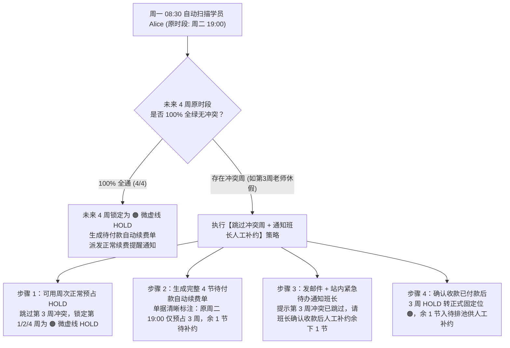

# 模块 3D 产品需求文档 (PRD) — 全场景排课与约课调度引擎 (Course Scheduling & Booking Engine)

> **文档状态**：PROPOSED (已封板评审) ｜ **版本**：v1.1 ｜ **管辖领域**：全场景排课、抢位约课、续费预占 (HOLD) 与小班整班调度
> **本次更新**：2026-11-20 · 新增 4 周批量排课「第 1 周模板穿透 + 后 3 周逐周手工调整」规则与验收标准；新增从 M2A 修改自动续费购课单穿透进入的「续费预排调课模式」与验收标准 AC-3D-19；2026-11-21 · 对齐模式 Z 与 2-1 动态关联：明确全域 1v1 约课仅限于空闲格新增排课（已排格请假/挪位/考勤严格归该老师负责班长），以及空闲大盘选人抽屉按“动态关联学员默认列表 + 全校在读精准补搜”加载；2026-11-22 · 红队审查收口与 SSOT 补齐：统一 1v1 课时长为每节 25 分钟含 5 分钟课间（占 30 分钟格）；对齐 Step 2 课表 `06:00–24:00`（36 格）底盘；小班单节补排仅限当前委任主讲老师（移除资质表述，代课统归 M3B）；对齐 M1A「常态作息偏好」并补 AC-3D-21；收敛 §4.4 HOLD 联动与统一入口；新增 §4.7 排课调度批实体 SSOT 四支柱与跨实体同事务联动清单；全篇按 write-prd 规范清洗技术实现与代码词汇；正式收紧班长「1v1 4 周固定位」排课权属为**仅限本人负责老师或平台管理员**（保留 1v1 临时课全域开放与本人主理小班整班排课）并增补 `AC-3D-22`。
> **关联子模块**：[m3a_calendar_grid.md](./m3a_calendar_grid.md) (周日历看板), [m2a_course_orders.md](./m2a_course_orders.md) (购课单与TS资产), [m3b_attendance_substitution.md](./m3b_attendance_substitution.md) (考勤与代课), [m1a_student_profile.md](./m1a_student_profile.md) (学员档案), [m1c_classes.md](./m1c_classes.md) (小班管理), [m4_notification.md](./m4_notification.md) (协同通知)
> **【实体生命周期归口说明】**：本模块为全站唯一归口承接 **排课调度批记录** 生命周期与跨实体联动规则的子模块（详见 §4.7），专职驱动待排 TS 课次资产由 `待排期` 流转至 `已排期`。其中续费预占（统一时段覆盖记录的 `HOLD` / `G-HOLD` 预占态）核心规则由 [m3a_calendar_grid.md §4.10](./m3a_calendar_grid.md) 统领管辖，TS 课次全局状态机由 [BUSINESS_RULES.md §3.2](../BUSINESS_RULES.md) 统领管辖。

---

## 1. 模块定位与业务全景 (Executive Summary)

全场景排课与约课调度引擎（`m3d`）是 Dream 系统的教学时间资产调度与长周期批量排课中枢。针对传统教务中“逐个点进老师日历碰运气找空档效率低、长周期批量排课与日常查课割裂、续费冲突缺乏自动调解机制”的核心痛点，本子模块确立了**“教师空闲大盘极速挑师 + 复用 M3A 老师当周课表页复选打通 4 周”**的两步式轻量化排课范式：

1. **两步式轻量化排课闭环**：
   - **Step 1 · 教师空闲大盘（选老师、看空档）**：支持携带指定学员、指定小班或无对象进入（如从教务大厅待办卡片或首页金刚位进入）；按价位（默认 `16积分`）与时段（默认 `中 10-15`）紧凑展示当周/下周有空闲格的老师（半小时横向长方形格矩阵，每 2 行标注一次整点时段，一屏 5 位，最多加载至 20 位），点 `[ 选取 ]` 进入 Step 2；
   - **Step 2 · 复用 M3A 老师当周课表页（排课复选态）**：直接复用 [m3a_calendar_grid.md](./m3a_calendar_grid.md) 老师周课表页，**1v1 或无对象进入默认选中 `[ 🗓️ 仅排单周 / 临时课 ]`**（携带指定小班且小班待排 $\ge 4$ 节时保持默认 **`[ 🔁 连续 4 周批量 ]`**），模式切换与 `[ 👁️ 仅看可约 ✓ ]` 等按钮统一配备前缀图标并采用高对比加高胶囊显眼展示；支持第 1 周模板选格后默认穿透后 3 周，并在后 3 周逐周手工调整；冲突周留空待补，单事务按各周实际选中格锁定落盘；
   - **日常轻量临时约课（1~2 节）**：仍可在 M3A 周历单元格动作抽屉内原地完成，底层可用时段校验与 FIFO 资产扣减由本模块 4.2 节统一提供。
   - **4 周批量逐周可调**：1v1 固定位与小班整班在模板周（第 1 周）选好时段后，系统默认把同星期/时段穿透到第 2~4 周；切换至后 3 周可逐周手工增删格子，手工调整只作用于当前周并标记 `已调整`，未调整周继续跟随模板。
2. **核心调度算法闭环**：
   - 针对固定位核心生命周期，确立**提前 7 天（最后一周周一 08:30）续费预占（HOLD）机制与“跳过冲突周 + 邮件通知班长人工补约”调解规则**，保障老学员优先续约权与资金持有人排他权益；
   - 针对 1vN 小班课，建立**连续双格磁吸排课、第 1 周模板穿透 + 后 3 周逐周调整与单节补排兜底算法**。

本模块全面保障零超卖、零撞课与资产专款专用，推动 TS 资产由 `待排期` 稳态流转至 `已排期`。

---

## 2. 角色与权限矩阵 (Roles & Permissions)

系统实施工作台物理隔离，共有 4 类排课操作主体，严禁跨权限越权操作：

| 身份角色 | 1v1 临时课 (🟡) | 1v1 固定位 (🟠 4周) | 1vN 小班课 (🟩 4周双格) | 权限红线与防呆约束 |
| :--- | :---: | :---: | :---: | :--- |
| **出资家长** | **自主抢位预约**<br>(可单约 1 节或连约 2~4 节) | ❌ **禁止自排**<br>(由系统预占或班长代排) | ❌ **全域屏蔽**<br>(不建档、不自排) | 仅能查看自家孩子档案名下的课程，不能查看老师其他学员排期。 |
| **教务班长** | **全域代约临时课**<br>(全校正式在读 + 本人待认领试课学员，可选全平台在职老师) | **限本人负责老师批量排固定位**<br>(4 周一轮连续锁定，**仅限本人负责的在职老师**；跨组及平台直管老师不可排 1v1 固定位) | **整班统一排课**<br>(本人主理小班 + 当前委任主讲老师) | **临时约课放开 · 固定位与履约归师（模式 Z）**：班长可在全平台任意在职老师空闲时段代约 **1v1 临时课**（严禁无资产赊账）；**1v1 4 周固定位**及课次排定后的请假/挪位/考勤等动作**严格仅限该授课老师所属负责班长（及管理员）执行**；Step 2 打开非本人负责老师课表时，1v1 场景 `[ 🔁 连续 4 周批量 ]` 置灰禁用，他师已排课格仅只读防撞课。 |
| **小班主理人** | — | — | **整班 4 周排课**<br>(连续双格 50 分钟) | **单任老师强绑定**：排课前必须已委任老师，未委任直接阻断；学期中严禁中途换老师。 |
| **平台管理员** | **全局代约与借师**<br>(跨班长统筹调度) | **跨周期固定位代排**<br>(试课/异常调解) | **全局监管与注销** | **续费保护铁律**：严禁管理员或任何人挤占老学员提前 7 天续费保护期（HOLD）。 |

---

## 3. 核心交互范式：教师空闲大盘 + 复用老师周课表 (Availability Board & Calendar Reuse)

为兼顾“跨师快速找空档”与“单师课表复选打通 4 周”的极简体验，排课工作流收敛为**“Step 1 教师空闲大盘挑老师 ➔ Step 2 复用 M3A 老师当周课表页复选格子”**两步闭环。

### 3.1 Step 1 · 教师空闲大盘页 (Teacher Availability Board)
1. **顶部上下文与周切换**：
   - **对象上下文条与选人抽屉（含超 10 人默认折叠 A–Z 索引）**：展示当前待排学员卡片（头像、昵称、可用待排课次按价位汇总，如 `16积分×4 · 18积分×4`）或小班卡片；若未选对象进入（如纯查空档），显示 **`[ 选择学员 / 小班 (可选) ]`**，点击弹出底部选择抽屉，支持随时补选，不选也可直接浏览全校老师空闲分布。抽屉切至学员列表时：班长端**默认列表**加载本人动态关联学员（按 `M1A AC-1A-19` 口径，优先置顶名下有可用待排 TS 的学员），管理员加载全校学员；搜索栏支持按规范昵称前 1–2 个字母/英文名/小名实时检索（搜索框在精确检索全校正式在读学员与本人待认领试课学员时支持补选尚未与本人建联的新购/首约家长孩子，搜索态自动按 `A → Z` 排序）；当默认可选学员总数 **`> 10` 人** 时（`≤ 10` 人隐藏），搜索栏下方显示轻量折叠条 **`[ 🔤 首字母索引 ▾ ]`**（**默认收起**），点击展开后按 `A → Z` 列出当前名单中实际存在的规范昵称首字母（附 `[ 全部 ]`），点选任一字母即筛选该首字母开头的学员并按 `A → Z` 排序，再次点击或点 `[ 全部 ]` 恢复；
   - **单周切换器**：提供 **`[ 本周 ]`** 与 **`[ 下周 ]`** 快速切换（固定位与小班常从下周开排），大盘仅按所选单周的空闲分布展示，**不在大盘提前做 4 周穿透计算或小班双格校验**（统一留待 Step 2 老师课表页校验）。
2. **筛选条件与显示铁律**：
   - **老师价位**：提供 `[ 全部 ]` 及价位字典胶囊（`16积分`、`18积分`、`21积分` 等）；若已选定待排学员且其名下仅有单一价位待排 TS，**自动默认选中该对应价位胶囊**；若名下存在多价位待排 TS，默认选中节数满足排课条件的首个价位；无参进入时默认选中 `16积分`；
   - **时段筛选**：提供 4 个固定时段单选切换：**`早 06-11`**（06:00-11:00）、**`中 10-15`**（10:00-15:00）、**`下 14-19`**（14:00-19:00）、**`晚 18-24`**（18:00-24:00）；**默认选中 `中 10-15`**；本页仅用于展示对应时段空闲分布，不在此页点选具体小格子；
   - **零空闲过滤**：在当前选定周与所选时段内，**只要至少有 1 个半小时可排格的老师才显示**；没有任何可排格子的老师直接隐藏，不占列表名额。
3. **老师列表排序、紧凑微格矩阵与分页加载**：
   - **排序与归属/教过标注**：若已选定学员，按 **① 曾教过该学员（熟客优先） → ② 同价位/相近价位 → ③ 当周已排负荷较少** 排序，并在曾教过该学员的老师卡片上**显式标注 `教过该学员`**（未选学员时不展示该标注）；未选对象时按当周可排空余量与负荷排序；**班长视角下，凡由当前班长本人负责管辖的老师，必须在老师卡片上显式标注 `我负责` 徽标**（与 `教过该学员` 可并存，便于班长快速识别——**仅标注 `我负责` 的老师才支持由该班长排入 1v1 4 周固定位**，其余跨组及平台直管老师仅支持代约 1v1 临时课或本人主理小班已委任后的整班排课）；
   - **半小时横向长方形格矩阵与列/行聚焦高亮**：
     - **矩阵结构与顶部星期行**：在老师卡片列表上方（所有老师矩阵的绿色长方形上方）增设一行与右侧 7 列严格对齐的星期表头（**`一  二  三  四  五  六  日`**），表示周一至周日；每张老师卡片左侧展示老师姓名、价位（如 `16积分`）、本周排课负荷（如 `18/28节`）及正下方的 **`[ 选取 ]`** 按钮；右侧以周一至周日 7 列 × 所选时段半小时行（如 `10:00`~`14:30` 共 10 行）的**横向长方形格**呈现（`🟩` 空闲可排、`▫` 已占/休息），列宽不变、行高压缩；矩阵左侧增加窄时间轴，**每 2 行（即每小时）标注一次整点时段**（如 `10:00`、`11:00`、`12:00`），不逐行标注；零文字堆砌，一屏紧凑展示 **5 位老师**；
     - **点击周几高亮整列**：点击星期表头中的任意周几（如 `三`），页面所有老师卡片对应星期列保持高亮显示，其余未选中列自动淡化，便于纵向对比多位老师同一天的空档；再次点击同一周几取消高亮；
     - **点击整点时段高亮全页对应行**：点击任意老师矩阵左侧的整点时段（如 `10:00`），页面**所有老师**卡片中该整点对应的连续 2 行半小时格（`10:00` 与 `10:30`）同步高亮显示，其余时段行淡化，便于横向聚焦找到空闲格子；支持星期列与整点时段叠加高亮（交集格强化聚焦）及一键清除。
   - **分页加载**：首屏展示 5 位符合条件的老师；底部提供 **`[ 再加载 5 位老师 ]`**，每次追加加载 5 位，**单次最多加载至 20 位**。
4. **跳转动作**：点击任意老师名字下方的 **`[ 选取 ]`** 按钮，携带当前排课上下文（所选老师、可选学员或小班、所选周次及默认排课复选态）平滑进入 Step 2 老师当周课表页。

```text
+-------------------------------------------------------+
| < 返回   教师空闲大盘              [ 本周 | 下周* ]    |
| ----------------------------------------------------- |
| 对象: [ 👧 Alice (固定位余8节) ▾ ]  (或: 仅查空 · 选人) |
| 价位: [全部] [16积分*] [18积分] [21积分]               |
| 时段: [早 06-11] [中 10-15*] [下 14-19] [晚 18-24]      |
| ----------------------------------------------------- |
| 仅展示当前周所选时段至少有 1 个空闲格的老师 (共 12 位)   |
| 点列/时段聚焦                     一  二  三  四  五  六  日 |
+-------------------------------------------------------+
| 1. David · 16积分 [我负责] [教过该学员]                  |
|    本周 18/28节      10:00 ▭  🟩  ▭  🟩  ▭  🟩  🟩   |
|    [  选 取  ]       10:30 ▭  🟩  ▭  🟩  ▭  🟩  ▭    |
|                      11:00 🟩  🟩  ▭  🟩  ▭  🟩  ▭    |
|                      ... (10行半小时横向长方形格 · 每2行标整点) |
+-------------------------------------------------------+
| 2~5. Elena / Leo / Mia / Sam ...                      |
|        [ 再加载 5 位老师 (已显示 5 / 上限 20) ]          |
+-------------------------------------------------------+
```

### 3.2 Step 2 · 复用 M3A 老师当周课表页（排课复选态 · 打通 4 周）
1. **复用同一课表页与智能折叠（默认隐藏不可约时段）**：从大盘点 `[ 选取 ]` 进入后，直接复用 **[m3a_calendar_grid.md](./m3a_calendar_grid.md)** 的老师当周课表网格与“4 周一轮”导航条，保持视觉与格内信息 100% 一致，并自动开启**「排课复选态」**与**「智能折叠 · 仅看可约」**：
   - **全量底盘 `06:00–24:00`（36 格）与动态外接裁剪**：课表底层全量时间范围为 **`06:00 ~ 24:00`（每 30 分钟 1 格，共 36 行，最晚一格为 `23:30–24:00`）**，严禁硬编码截断早晚时段（如写死 `08:00–21:30`）。开启 `[ 仅看可约 ✓ ]` 时，系统在全量 36 行基础上自动裁剪早晚连续不可约边缘行——**若老师在 `06:00`、`23:30` 等早晚边缘时段存在可约格，动态时间窗必须自动包含该时段，严禁误裁**；中间连续整行 7 天均不可约的时段默认合并为紧凑浅灰折叠条（如 `┄┄ 12:00 - 15:00 无可约时段 (已折叠) [点击展开] ┄┄`），确保首屏绝大多数格子为可约状态（`🟢 约`）；
   - **按模式动态判定可约性**：`[ 🗓️ 仅排单周 / 临时课 ]` 模式下，某行在当前周至少存在 1 个可约绿格即默认展开；`[ 🔁 连续 4 周批量 ]` 模式下，某行在未来 4 周至少存在 1 个 `1/4 ~ 4/4` 可排时段即默认展开；
   - **按需展开（含全量 36 行）**：点击任意折叠条可就地展开/收起对应时段；顶部同时提供带图标的高对比轻量开关 **`[ 👁️ 仅看可约 ✓ ]`**（默认开启），**关闭该开关时必须展开 `06:00 ~ 24:00` 完整 36 行全部时段**，便于排查早晚休息/被占细节。
2. **对象补选与模式切换（高对比图标分段按钮）**：
   - 顶部保留对象卡（已带定学员或小班时直接显示可用课次余额；未选对象进入时可在此点击补选学员或小班，未选对象仅可查看课表空档，确认按钮置灰提示“请先选择学员或小班”）；
   - 支持切换 **`[ 🗓️ 仅排单周 / 临时课 ]`**（1v1 或未选对象进入**默认选中**）与 **`[ 🔁 连续 4 周批量 ]`**（携带指定小班且小班待排 $\ge 4$ 节时**默认选中**，用于 1v1 固定位或 1vN 小班整班；若小班待排 $< 4$ 节则自动进入单节补排模式）。**按师归属硬边界**：当普通班长针对 **1v1 学员（或未选定小班）** 进入**非本人负责老师**（含平台直管老师）课表时，**`[ 🔁 连续 4 周批量 ]` 按钮必须物理置灰禁用并附提示“仅该老师负责班长或管理员可排 1v1 固定位”**，仅允许使用 `[ 🗓️ 仅排单周 / 临时课 ]`；仅该老师所属负责班长、平台管理员，或操作本人主理已委任该老师的小班时允许使用 `[ 🔁 连续 4 周批量 ]`。**模式切换控件必须采用独立加高分段按钮条、前置清晰图标与高对比度选中态高亮背景填充**，避免小字弱对比隐藏在顶栏角落导致误排。
3. **第 1 周模板穿透与后 3 周逐周手工调整**：
   - **模板周选格**：在 `[ 🔁 连续 4 周批量 ]` 模式下，以本轮第 1 周为模板周；若切换模式时当前不在第 1 周，系统自动定位到第 1 周。在模板周点击空闲绿格（1v1 单格 / 小班连续双格磁吸）即可**复选**多个每周时段，再次点击取消；
   - **默认穿透**：每次在模板周选定或取消一个时段，系统立即把同一星期与时段复制到第 2~4 周，并逐周校验可用性：
     - 第 2~4 周中的可用周：自动选中，周次胶囊标注 `跟随模板`；
     - 第 2~4 周中的冲突周（老师已排课、请假、休息、超出约课窗口、跨调价轮次、离职日熔断）：**不选中**，周次胶囊标注 `冲突待补`，该节课次留存学员/小班待排池；不阻断整单；
     - 同格 HOLD 预占：视为 **`预占转正`**，自动选中且不重复扣减（按 4.4 节）；
   - **切周查看与手工调整**：点击第 2~4 周胶囊切换周次，网格展示该周的已选/未选状态；在后 3 周内可逐周增删格子：
     - 新增格子只加当前周，取消格子只减当前周；
     - 该周一旦手工增删，即标记 `已调整`，不再跟随模板；
     - 小班后 3 周手工调整仍必须整双格磁吸；1v1 仍为单格；
   - **模板级联**：模板周后续变动只同步仍为 `跟随模板` 的周，不覆盖 `已调整` 周；每个 `已调整` 周提供 `[ 恢复跟随第 1 周 ]`，恢复后重新复制模板并重新校验冲突；
   - **实时汇总**：底部按周展示已选时段、实扣节数与留存待排节数；模板周本身必须可排，后 3 周冲突不阻断整单；若整单最终没有任何已选格子，确认按钮置灰；
   - **意向作息高亮**：已选学员且其档案在 [m1a_student_profile.md](./m1a_student_profile.md) 维护了「常态作息偏好」时，对应空闲时段给予轻量推荐标识（详见 §4.1，对老师端隐藏）。
4. **吸底确认栏与单事务闭环**：
   - 底部常驻按周分组的已选清单（如 `第1周 周二19:00 / 周四18:00`、`第2周 跟随模板`、`第3周 冲突待补`）、实扣课次汇总与留存待排池课次预览；
   - 若学员持有续费预占 HOLD，明确展示“原预占位将自动释放”或“原预占位转为正式固定位（不重复扣减）”；
   - 点击确认按钮后单事务锁定落盘，退出排课复选态并在原老师课表网格上对刚排定的单元格执行 1 秒柔和成功闪烁反馈。
5. **续费预排调课模式（从 M2A 修改自动续费购课单穿透进入）**：
   - **模式锁定与原预占高亮**：从 [m2a_course_orders.md](./m2a_course_orders.md) 修改抽屉点击调整时段或换师进入时，自动锁定为 `连续 4 周批量`（禁止切换为单周临时课）；若未更换老师，原订单已占用的续费预占（`HOLD`）或小班预占（`G-HOLD`）网格在日历上高亮标记为 **`📌 本单原预占`**（视为本单可编辑自由格，点击可取消释放，不触发自身撞课拦截）；
   - **完整复用 4 周选格能力**：同样支持 `[ 仅看可约 ✓ ]` 智能折叠、第 1 周模板穿透 + 后 3 周逐周手工微调、学员自身防撞课校验及小班双格磁吸；
   - **草稿回传（不直接写库）**：底部常驻节数对比（`已选 X 节 / 订单共 N 节 · 剩余 Y 节待排`），按钮收敛为 **`[ 返回购课单(不保存) ]`** 与 **`[ ✓ 确认排期并返回 ]`**；点击确认后仅把新老师与 4 周排期草稿回传给 M2A 修改抽屉，原订单正式 `HOLD` 须待 M2A 点击 `[ 保存并更正账单 ]` 时再单事务切换。

```text
+-------------------------------------------------------+
| < 返回大盘   David 的课表         [ 排课复选态 ON ]    |
| 对象: [ 👧 Alice · 16积分待排余 8 节 ▾ ] (无参时点此补选)   |
| 模式: [ 🔁 连续4周批量 ]  [● 🗓️ 仅排单周/临时课 ]  [ 👁️ 仅看可约✓ ] |
| ◀ 上一轮 | [第1周] [第2周] [第3周] [第4周] | 下一轮 ▶   |
+-------------------------------------------------------+
| 时间 | 周一 | 周二 | 周三 | 周四 | 周五 | 周六 | 周日  |
| 10:00| 🟢约 | 🟢约 | 🟢约 | 🟠Bob| 🟢约 | 🟢约 | 🟢约  |
| 10:30| 🟢约 | 🟢约 | 🟢约 | 🟢约 | 🟢约 | 🟢约 | 🟢约  |
| ┄┄┄┄ 11:00 - 17:30 无可约时段 (已折叠 13 行) [展开] ┄┄ |
| 18:00| 🟢约 | 🟠Bob| 🟢约 | [☑]  | 🟢约 | 🟢约 | 🟢约  |
| 18:30| 🟢约 | 🟠Bob| 🟢约 | 🟢约 | 🟢约 | 🟩G1 | 🟢约  |
| 19:00| 🟢约 | [☑]  | 🟡Tim| 🟢约 | 🟠Amy| 🟩G1 | 🟢约  |
| 19:30| 🟢约 | 🟢约 | 🟡Tim| 🟢约 | 🟠Amy| 🟢约 | 🟢约  |
+-------------------------------------------------------+
| 已选: 第1周 周二19:00 + 周四18:00 (模板)               |
| 第2周 跟随模板 · 第3周 冲突待补 · 第4周 跟随模板         |
| 第3周可切周手工补格；本次实扣 7 节 · 1 节留存待排池       |
| [        确认批量锁定可用周 (共扣 7 节)        ]        |
+-------------------------------------------------------+
```

> **后 3 周为可编辑副本**：切换至第 2~4 周后可逐周增删格子；手工调整只影响当前周，并标记为 `已调整`。模板周后续变动只同步仍为 `跟随模板` 的周。

### 3.3 全场景入口矩阵与退出回跳
- **带指定对象入口（锁定具体学员或小班）**：
  1. **Tab 3【教务中心】（教务大厅）待办卡片**：新购待排 1v1、1v1 续费冲突调解、小班待排/待补排待办卡点击进入，自动锁定对应学员或小班；
  2. **学员档案 / 小班概览**：点击 `[ 📅 立即排课 ]` 或 `[ 立即补排 ]` 自动带入对应学员或小班进入教师空闲大盘。
- **自由查空入口（支持纯查空档 & 随时补选对象）**：
  1. **首页金刚位**：班长端与管理员端首页 **`🗓️ 教务排课`** 金刚位；
  2. **Tab 3【教务中心】**：管理员第 3 行 **`🗓️ 空闲大盘`** 金刚位；班长 `负责老师` 列表顶部 **`[ 🔍 空闲大盘 ]`**；
  3. **M3A 老师课表顶栏**：点击 **`[ 🔍 找其他老师空档 ]`** 跳回大盘比较其他老师。
- **退出通道**：大盘左上角 `< 返回` 回到来源页；课表排课复选态左上角 `< 返回大盘`（或关闭复选态开关）无损返回。

---

## 4. 业务规则与调度算法规约 (Scheduling Algorithms)

### 4.1 学员意向作息交集推荐 (Smart Slot Highlight)
1. **意向时段提取**：若已选定学员，系统自动读取该学员在 [m1a_student_profile.md](./m1a_student_profile.md) 中维护的选填字段 **「常态作息偏好」**（星期几 × 早/中/下/晚常用时段标签组合）；若学员未维护作息偏好，则跳过推荐高亮，不影响正常选格；
2. **交集高亮计算**：系统自动计算 **「该老师未来 4 周空闲可约时段」与「该学员常态作息偏好」的交集时段**；
3. **课表网格轻量标注**：在 Step 2 老师当周课表页中，命中交集的空闲格给予轻量推荐角标，未命中时段仍正常保持可选且不阻断提交（该作息偏好标签对老师端严格隐藏）。

---

### 4.2 1v1 临时课提前 1-7 天抢约与连约机制 (Temporary Lesson Booking)
1. **时间窗准入限制**：目标时段必须处于距当前时间 **1 - 7 天** 的空闲时段（当天时段与超过 7 天的时段统一置灰阻断），严禁预约当天课次；
2. **单约与连约规格**：每节课 **25 分钟 + 5 分钟课间**（占用 1 个 30 分钟格子），支持【单约 1 节 (25 分钟)】、【连约 2 节 (50 分钟)】、【连约 3 节 (75 分钟)】与【连约 4 节 (100 分钟)】，依次占用 1~4 个连续 30 分钟格子（与 [m3a_calendar_grid.md §4.8.1](./m3a_calendar_grid.md) 口径完全一致）；
3. **连续空闲原子预检**：系统实时校验目标起始单元格及后续相邻的连续 $N$ 个单元格是否处于 🟢【空闲可约】状态；若后续某节被占用或处于休息，对应连约选项自动禁用；
4. **先进先出资产自动扣减**：从学员统一的 1v1 `待排期` 课次池中，按同价位及购买时间先进先出原则，自动拣选并扣减最早有效的待排期课次；
5. **原子落盘**：通过并发独占校验后，单一事务将单元格更新为 🟡【临时课】（排课形态标记为 `临时课`），记录经办身份与操作时间。

---

### 4.3 1v1 固定位 4 周一轮多时段批量排课 (Fixed Slot Batch Scheduling · 模板穿透与逐周调整)
1. **第 1 周模板穿透与 4 周实排实扣**：固定位排课以未来连续 4 周为窗口，以第 1 周（模板周）的已选时段为基准，系统默认把同一星期/时段穿透复制到第 2~4 周。复制时逐周校验：第 2~4 周中的可用周自动选中并标记 `跟随模板`；冲突周不选中并标记 `冲突待补`，该节课次留存学员 `待排期` 课次池；不再因单周冲突阻断整单。未排出的节数原样留存待排池供后续补约；
2. **逐周可编辑副本**：一次排课可在模板周勾选 1~N 个不同的每周时段（允许跨天，如周二 19:00 + 周四 19:30）；第 2~4 周默认自动复制为可编辑副本。切换至后 3 周后，可逐周新增/取消格子：
   - 新增/取消只作用于当前周，不改变其他周；该周标记 `已调整`，脱离模板；
   - 点击已选格再次点击即取消当前周选择；推荐卡与当前周网格状态双向同步；
   - 每个 `已调整` 周提供 `[ 恢复跟随第 1 周 ]`，恢复后重新按模板复制并校验冲突；
   - 模板周后续变动只同步仍为 `跟随模板` 的周，不覆盖 `已调整` 周；
3. **严格单价位匹配、实扣上限与禁止跨调价轮次排班（2-B）**：
   - 固定位批量排课**只能选用单一价位**（严格要求老师在排课日期的生效价位与待排课次所属价位完全一致，禁止跨价位混扣或向下折算）；
   - **禁止跨调价轮次排班（2-B）**：若该老师已设置待生效调价（生效日为未来某全局轮次第一天），且当前排课选中的 4 周窗口横跨该调价生效日时，**系统不允许使用旧价位跨调价生效日连续排班**：仅允许使用旧价位待排课次锁定生效日之前的可用周次（如第 1～2 周），调价生效日及之后的周次网格自动置灰并标注“MM-DD 起调为 XX 积分，不可跨调价轮次排班”；未排完的剩余节数继续留存在学员待排池；
   - **老师预约离职日不可约熔断**：若该老师已配置预约离职生效日期 $D$，自 **$D$ 起（含 $D$ 所在 4 周轮次的剩余全部日期及后续轮次）** 课表全部强制不可约并置灰阻断（仅可排 $D$ 之前的可用日期，且系统在固定位自动续费扫描时自动跳过跨离职日续费并提醒班长协调换师）；
   - **逐周手工调整不得改变单一价位约束**：任意一周的手工补格/取消格仍必须使用同一价位；因调价生效日、离职日熔断而被阻断的周，不得用旧价位手工补入；
   - 已选格子合计需扣减节数等于第 1 至第 4 周实际选中格子数之和（每周选中格子数可不同）。每次逐周增删都实时重算；当剩余同价位 1v1 待排期课次不足以覆盖当前已选格子数时，阻止继续勾选并提示“该价位待排课次不足（需 X 节，仅剩 Y 节）”；取消任一已选格后可继续选择；
4. **整批单事务确认**：点击确认时，系统对**各周实际选中的全部单元格**（而非仅模板周）统一执行并发独占复核；全部通过后，在单一事务内按周将对应单元格原子锁定为 🟠【固定位】（排课形态标记为 `固定位`），并按先进先出实扣**各周实际选中格子总数**的同价位 1v1 待排期课次；未选中/冲突周的剩余节数保留在学员账号待排池，并按 §4.7 写入排课调度批流水；
5. **并发新冲突处理**：若确认瞬间某一周某格被他人抢占，事务回滚并高亮该周的最新可用状态（如第 2 周从 `跟随模板` 变为 `冲突待补`）；其他周的已选与 `已调整` 状态不受影响，由操作人补格或取消后重新提交。

---

#### 4.3.6 逐周状态与模板级联规则 (Per-Week State & Template Cascade)

| 周状态 | 含义 | 模板周变动时 | 允许操作 |
| :--- | :--- | :--- | :--- |
| **`模板周`** | 第 1 周，作为后 3 周的复制基准 | 用户直接编辑，按级联规则同步 | 选格 / 取消格 |
| **`跟随模板`** | 由模板周自动复制，尚未手工改动 | 同步更新该周选格 | 点击格子编辑后转为 `已调整` |
| **`已调整`** | 用户在该周手工增删过格子 | **保持不变**，不被模板覆盖 | 继续增删 / `[ 恢复跟随第 1 周 ]` |
| **`冲突待补`** | 模板同格在该周被占用或不可排，系统留空 | 重新校验；冲突解除则自动选中，仍冲突则留空 | 在该周另选空闲格 / 恢复跟随 |

1. **原子单位**：手工调整的最小单位是“某一周的某一个格子”，不是跨周时段模式；第 2 周换成周四，不得影响第 1/3/4 周；
2. **级联边界**：模板周变动只作用于仍为 `跟随模板` 的周；`已调整` 周保留人工结果；`冲突待补` 周在模板变动、切换周次与确认前重新校验，冲突解除则自动转为 `跟随模板`；
3. **恢复跟随**：每个 `已调整` 周提供 `[ 恢复跟随第 1 周 ]`，点击后丢弃该周手工结果，按模板重新复制并重新校验冲突；
4. **硬阻断优先**：调价跨轮次、离职日、请假/休息、超出约课窗口等硬约束优先于模板复制与手工补格；被阻断的周只能留空或等待冲突解除，不得绕过；
5. **实时重算**：任一周状态或选格变化，立即重算各周实扣数与留存待排池，且不得超过同价位待排 TS 总数。

### 4.4 M3D 排课与续费预占 (HOLD) 联动与换位调度规则
> **归口边界**：续费预占（`HOLD` / `G-HOLD`）的触发时机、网格表现、确认收款转正、家长【暂不续费】释放、家长【申请调整】期间保底锁位及开课前 24 小时逾期释放规则，均由 [m3a_calendar_grid.md §4.10](./m3a_calendar_grid.md) 与 [m2a_course_orders.md §4.1](./m2a_course_orders.md) 统领管辖；本节仅规范 M3D 排课操作遇预占时的调度联动：

1. **入口统一（续费预排调课模式，见 §3.2.5）**：班长或小班主理人需要调整待付款自动续费单的未来 4 周预占时段（或为 1v1 更换授课老师）时，统一从 `M2A` 修改抽屉穿透进入本模块 Step 2 课表复选态（淘汰独立专用排课工作台），并只将新排期草稿带回 `M2A` 修改抽屉：
   - 选中格数少于原续费单购买节数 $N$ 时，草稿标注剩余 $(N - X)$ 节将于收款确认后入待排池；
   - **选中格数超过 $N$ 时**，课表端即时拦截并提示返回 `M2A` 修改抽屉同步上调购买节数或取消多余格子（遵循 [m2a_course_orders.md §4.1](./m2a_course_orders.md) 规则，M3D 不自行定义额外扣减口径）；
   - 原日历预占仅在返回 `M2A` 并点击 `[ 保存并更正账单 ]` 时在同一事务内原子释放旧预占、锁定新预占，中途退出零损保留。
2. **已购待排池新排 4 周固定位与原有预占并存时的平移规则**：若班长在 Step 2 使用学员账户中**已付款的待排期课次**新排未来 4 周固定位，且该学员同时在提前 7 天保护期内持有某周待付款续费单的 `HOLD` 预占网格：
   - **原 `HOLD` 时段不在本次已选清单中**：系统在单一事务内原子解除原 4 周时段的 `HOLD` 预占锁定（100% 释放为 🟢 空闲），同时将全部已选新时段原子锁定为正式 🟠【固定位】，绝不跨时段双占；
   - **原 `HOLD` 时段本身在本次已选清单中**：该预占时段直接视同 **`预占转正`**，保留原预占周次且**不从学员待排池重复扣减该时段节数**，底部明确提示“原预占位将转为正式固定位”；其余多出的新增时段均从学员同价位待排期课次池中按实选中格数扣减，并按“预占转正 1 个 · 新排 M 个”清晰分组展示明细。

---

### 4.5 自动续费预占 (HOLD) 冲突跳过与班长补约通知机制 (HOLD Skip-Conflict & Manual Makeup Notice)

周一 08:30 自动续费扫描若遇老师休假、周模板收缩或小班课整班占用导致未来 4 周中部分周次冲突，系统执行以下**跳过冲突周 + 邮件通知人工补约**策略：



1. **跳过冲突周，可用周正常预占 HOLD**：只要未来 4 周中有可用周次（如第 1、2、4 周空闲，第 3 周冲突），系统直接跳过冲突的第 3 周，对可用周次打上 **🟠 续费预占（HOLD）**（小班课为 🟩 小班预占 `G-HOLD`）；若 4 周全冲突，则不锁预占；
2. **生成续费单并明示差额**：系统仍按原固定周期节数（如 4 节）生成待付款自动续费单，并在单据摘要中明确透出“原时段本周仅预占 X/4 周（跳过第 Y 周冲突），确认收款后剩余 (4-X) 节将留存待排池”；
3. **发邮件与待办通知班长人工补约**：系统自动向负责班长（小班课向主理人）**发送提醒邮件**并生成端内待办工单：`【续费冲突跳过提醒】学员 Alice (原周二 19:00) 因第 3 周老师休假，系统已自动跳过冲突周并预占其余 3 周 HOLD。请与家长沟通并确认收款后，在工作台为余下 1 节人工补约！`；
4. **收款转正与余节补排闭环**：班长核实收款点击确认后，已预占的 3 周原子转为正式 🟠 固定位，未预占的 1 节自动留存在学员或小班的 `待排期` 课次池，由班长在 M3D 或 M3A 人工补约；若距首节开课前 24 小时仍未付款，单据自动作废并全额释放已锁预占（归口详见 [m2a_course_orders.md §4.1](./m2a_course_orders.md)）。

---

### 4.6 1vN 小班课连续双格整班排课与单节补排规约 (Small Group Class Scheduling)

#### 4.6.1 4 周轮次整班批量排课 (4-Week Cycle Batch Mode)
1. **前置老师委任与小班资产校验**：排课前系统严格校验小班是否已完成老师委任。未委任状态下排课按钮置灰阻断，提示“请先在小班管理中委任授课老师后再排课”；小班卡同时透出 `小班课时 X 节可用`，作为多时段选择上限依据；
2. **连续双格磁吸附**：小班课标准时长 **50 分钟**，日历网格光标自动吸附锁定为**连续 2 个半小时单元格（贯穿双格）**，严禁单格误触；
3. **第 1 周模板穿透与后 3 周逐周调整（小班双格）**：
   - 以本轮第 1 周为模板周；在模板周选中连续双格后，系统默认把同一星期/时段复制到第 2~4 周，并逐周校验双格可用性；
   - **跟随模板**：该周双格均空闲，自动选中；
   - **冲突待补**：该周双格任一被占/请假/休息/熔断，该周不选中并标 `冲突待补`，节数留存小班待排课次池；不阻断整单；
   - **逐周手工调整**：切至第 2~4 周可另选该周其他连续双格；手工调整只影响当前周并标 `已调整`，仍必须整双格磁吸；
   - **模板级联**：模板周变动只同步 `跟随模板` 的周；`已调整` 周保留；每个 `已调整` 周提供 `[ 恢复跟随第 1 周 ]`；
   - 仅模板周本身双格不可选时阻断该格；整单无任何已选双格时确认按钮置灰；
4. **多时段整班排课**：一次可在模板周勾选 1~N 个不同的每周 1 小时时段（如周六 10:00 + 周日 09:00，允许一周多次课）；第 2~4 周默认复制为可编辑副本，可逐周增删；点击已选格再次点击即取消当前周选择；
5. **资产上限与实扣**：已选双格合计需扣减节数等于第 1 至第 4 周实际选中双格数之和；当小班可用小班课次不足时阻止继续勾选并提示“小班课次不足”；取消任一已选后可继续选择；
6. **落盘与资产核销**：点击确认排课后，在单一事务内按周锁定各周实际选中的连续双格单元格，按实扣减小班待排期课次资产（未选中/冲突周对应的课次原样留存小班待排池），网格渲染为带有 `[G]` 徽标的青绿双格微卡片。

#### 4.6.2 小班课单节补排模式 (Single-Lesson Makeup Mode · 暂停待排兜底)
1. **触发入口与模式自动判定**：
   - **入口 A（待办直达）**：主理人工作台 / 小班概览页点击【立即补排】待办卡片跳转排课工作台；
   - **入口 B（自适应切换）**：进入 Step 2 排课复选态时，系统根据当前小班待排课次资产智能判定：若可用待排课次 $< 4$ 节（如暂停待排退回的 1 节散课次），或从上述【立即补排】待办入口直达，工作台自动切换为【小班单节补排模式】；若可用待排课次 $\ge 4$ 节，默认支持 4 周批量排课，亦支持下拉手动切换为单节补排；
2. **连续双格单次选位（仅限委任主讲老师）**：
   - 保持 **50 分钟（连续双单元格）** 磁吸附标准；
   - **仅限当前委任主讲老师**：主理人**仅可在本小班当前委任主讲老师**的未来日历中点选处于 🟢【空闲可约】状态的连续双单元格，严禁在此入口点选其他老师绕过“学期中严禁中途换师”铁律；若因主讲老师临时缺师需指派代课老师，统一在已排定课格上通过 [m3b_attendance_substitution.md](./m3b_attendance_substitution.md) 代课调度工单处理；
   - 仅对所选单周该时段执行并发独占校验与冲突复核，不执行 4 周穿透计算；
3. **单事务扣减与闭环核销**：
   - 单节补排模式下，已选时段上限固定为当前待补排的散课次节数（默认 1 节）；
   - 点击确认排课后，在单一事务内将目标连续双格原子锁定为 🟩【小班课】（青绿双格微卡片，带 `[G]` 徽标与小班简称）；
   - 原子扣减小班待排池中 1 节课次资产，并按 §4.7 写入排课调度批流水；
   - **待办闭环**：联动消解小班主理人工作台与小班概览页的 `[小班课待补排]` 置顶告警待办卡片，并在小班修改日志写入变更记录（详见 [m1c_classes.md](./m1c_classes.md)）。

---

### 4.7 核心实体生命周期、修改规则与跨实体联动规范 (Entity Lifecycles & SSOT)

本模块是全站唯一归口定义 **排课调度批记录** 生命周期、修改边界、流水留痕与跨实体联动触发的规范来源。

#### 1. 【排课调度批记录】生命周期状态流转
按是否直接驱动正式排期落盘，本模块维护两类运行态：
- **正式排课调度批（1v1 固定位批量 / 1v1 临时课 / 小班整班批量 / 小班单节补排）**：
  1. **`选格草稿中`**：在 Step 2 课表勾选时段、穿透第 2~4 周或逐周微调、实时试算实扣与留存待排池（纯界面暂存态，**不锁定老师日历，不扣减待排课次**）；
  2. **`已落盘`**：点击确认并通过并发独占校验、资产余额复核及同价位/离职日/跨调价硬约束后，单一事务原子写入正式排课调度批记录并锁定目标课格，状态立即进入不可逆终态 **`已落盘`**；
  3. **`并发冲突回滚`**：确认瞬间任一选中格被他人抢占或发生新请假阻塞时，整批事务完整回滚（不扣课、不占格），界面自动退回 **`选格草稿中`** 并高亮标出最新 `冲突待补` 周次，保留其余周已选与 `已调整` 状态供操作人继续修改。
- **续费预排调课草稿（仅 `M2A` 自动续费单改单入口穿透使用）**：
  - 全程停留在 **`草稿回传`** 态：点击 `[ ✓ 确认排期并返回 ]` 仅把所选老师与未来 4 周排期草案带回 `M2A` 修改抽屉，**M3D 本身不单独落盘正式调度批，也不修改原日历预占**；实际预占释放与重锁由 `M2A` 点击 `[ 保存并更正账单 ]` 时同事务完成。

#### 2. 字段可编与锁定规则矩阵

| 业务字段 | 创建/落盘后是否可编 | 变更角色与前置守卫 | 锁定与禁止修改场景 |
| :--- | :---: | :--- | :--- |
| **排课对象（学员 / 小班）与授课老师** | **不可修改** | 仅允许在 `选格草稿中` 退回上一步更换 | 一旦 `已落盘`，严禁原地修改调度批所属学员、小班或老师；若需换上课学员或改约其他时段，须到 [m3a_calendar_grid.md](./m3a_calendar_grid.md) / [m3b_attendance_substitution.md](./m3b_attendance_substitution.md) 按单节规则处理 |
| **各周选中时段、实扣节数与价位快照** | **不可修改** | 仅在 `选格草稿中` 可逐周增删或恢复跟随第 1 周 | `已落盘` 后永久只读锁定；退课、请假、同师挪位由单节 TS 生命周期承接，不改写原批次流水快照 |
| **预占转正标记（与原有 HOLD 联动明细）** | **不可修改** | 仅在提交确认时由系统按当前预占比对自动判定 | `已落盘` 后永久只读锁定，禁止人工补改预占抵扣标识 |

#### 3. 状态流转与日志触发规则
- **必须留痕场景**：每次正式排课调度批成功进入 **`已落盘`** 时，必须在同一事务内追加写入只读排课调度流水，包含：操作人（家长/班长/主理人/管理员）、排课对象、授课老师、匹配价位、排课类型（1v1 临时/1v1 固定位/小班整班/小班补排）、各周实际落盘日期与时段明细、实扣课次数与留存待排池课次数、操作时间。
- **免记有效账务流水场景**：`选格草稿中` 期间的反复勾选/取消/切周、`并发冲突回滚` 未成功落盘的尝试、以及未提交返回离开页面，均不产生有效调度流水与资产变动记录。

#### 4. 数据留存与清理策略
- **`已落盘` 调度批流水**：随对应授课记录、财务对账档案及审计要求**长期只读留存**，严禁物理删改；
- **`选格草稿中` 与 `续费预排调课草稿`**：用户退出排课复选态、返回大盘、关闭修改抽屉或取消改单后**立即从本地会话清理释放**，严禁跨会话残留过期草稿干扰后续排课。

#### 5. 跨实体同事务联动清单（动作归主 · 状态归宿 · 单向指针）

| 联动编号 | M3D 触发动作 | 驱动目标实体与结果方向 | 事务原子性与唯一归口 |
| :---: | :--- | :--- | :--- |
| **1** | 1v1 临时约课 / 4 周固定位批量 / 小班整班与单节补排确认落盘 | 驱动【最小课次 TS】按先进先出从 `待排期` 原子流转为 `已排期` 并占用老师日历格子 | 单事务原子执行；TS 状态机归口 [BUSINESS_RULES.md §3.2](../BUSINESS_RULES.md#32-ts-timeslot---最小课次流转枢纽) |
| **2** | 续费预排调课草稿回传并由 M2A 点击 `[ 保存并更正账单 ]` | 更新 [M2A 自动续费购课单](./m2a_course_orders.md) 老师/节数/应付积分，并同事务驱动 [M3A 统一时段覆盖（续费预占态）](./m3a_calendar_grid.md#410-实体生命周期与状态机-entity-lifecycles--state-machines) 旧释放+新锁定 | M2A 保存时单事务原子执行；M3D 仅回传草稿，不直接写库 |
| **3** | 1v1 待排池新排固定位与原预占不同格时的平移提交 | 原 4 周 `HOLD` 预占在 [M3A §4.10](./m3a_calendar_grid.md#410-实体生命周期与状态机-entity-lifecycles--state-machines) 单事务释放为空闲，同时新选格流转为正式固定位 | 单事务原子释旧锁新，严禁跨时段双占 |
| **4** | 周一 `08:30` 自动续费冲突跳过扫描 | 驱动 [M2A](./m2a_course_orders.md) 生成待付款自动续费单、驱动 [M3A §4.10](./m3a_calendar_grid.md#410-实体生命周期与状态机-entity-lifecycles--state-machines) 对可用周锁定预占，并向 [M4](./m4_notification.md) 派发提醒邮件与班长补约待办 | 扫批按学员单事务隔离执行；各自实体状态归宿各自主模块 |
| **5** | 小班单节补排确认落盘 | 同步核销 [M4 小班主理人工作台置顶补排待办](./m4_notification.md)，并追加写入 [M1C 小班操作修改日志](./m1c_classes.md) | 与小班课次落盘同一事务提交，保证待办零滞留 |

---

## 5. 验收标准 (Acceptance Criteria, AC)

| 编号 | 验收项 | 验收操作与输入 | 预期输出与量化断言 |
| :--- | :--- | :--- | :--- |
| **AC-3D-01** | **教师空闲大盘筛选与零空闲过滤** | 从首页金刚位或教务大厅待办进入教师空闲大盘 | 默认选中价位 `16积分`、时段 `中 10-15`（可切 `早 06-11 / 下 14-19 / 晚 18-24`）及 `本周 / 下周`；仅展示当前周与所选时段内至少有 1 个半小时空闲格的老师，无空闲老师自动隐藏；每位老师以半小时横向长方形格矩阵紧凑呈现，矩阵左侧每 2 行标注一次整点时段；已选学员时，曾教过该学员的老师卡片必须显式标注 `教过该学员`；**班长角色浏览时，本人负责管辖的老师卡片必须显式标注 `我负责`**。 |
| **AC-3D-01a** | **大盘星期表头与列/时段聚焦高亮** | 在大盘表格上方点击星期表头 `三`，再点击任意老师矩阵左侧的 `10:00` | 1. 大盘老师列表上方绿色长方形矩阵正上方展示对齐的 `一 二 三 四 五 六 日` 星期行；<br>2. 点击 `三` 后，页面所有老师卡片的周三列保持高亮，其余列淡化；再次点击 `三` 取消列高亮；<br>3. 点击 `10:00` 后，页面所有老师卡片的 `10:00` 与 `10:30` 两行同步高亮，其余时段行淡化；再次点击 `10:00` 或点击清除按钮可恢复全显。 |
| **AC-3D-02** | **大盘分页加载与上限** | 符合条件老师共 25 位，进入大盘并连续点击【再加载 5 位老师】 | 首屏展示 5 位；每次点击追加 5 位；累计展示达到 20 位后不再继续加载。 |
| **AC-3D-03** | **无参进入查空与补选阻断** | 无参进入大盘并点击某老师 `[ 选取 ]` 进 Step 2 老师课表，未选学员/小班时尝试提交 | 允许正常浏览大盘与老师课表空闲分布；未选学员或小班时，底部确认排课按钮强制置灰禁用并提示“请先选择学员或小班”；在顶部补选可用课次充足的学员后解锁提交。 |
| **AC-3D-04** | **同价位资产不足提交阻断** | 选择学员 Charlie (当前老师对应价位待排 TS 仅剩 2 节)，切至 `连续 4 周批量` 并点击一个 4/4 周空闲时段 | 底部卡片立即标红提示“该价位待排课次不足（需 4 节，仅剩 2 节）”，禁止跨价位混扣提交；默认进入 `仅排单周/临时课` 时支持正常单约 1~2 节。 |
| **AC-3D-05** | **1v1 默认单周模式与临时课时间窗校验** | 携带 1v1 学员（或未选对象）进入 Step 2 老师课表，检查默认选中模式及当天/第 8 天时段 | 1. Step 2 模式默认选中 `仅排单周 / 临时课`；<br>2. 仅在距当前时间 1-7 天内的空闲格支持单约或 1~4 节连约（每节 25 分钟含 5 分钟课间、占 1~4 个连续 30 分钟格，消耗同价位 1v1 待排课次并打标 `临时课`），当天与超过 7 天置灰。 |
| **AC-3D-06** | **4 周批量默认穿透、冲突周手工补格与余节留存** | Alice 同价位待排 TS 有 4 节；切至 `连续 4 周批量` 在模板周勾选周二 19:00（第 3 周老师已占，第 1/2/4 周空闲），随后切到第 3 周补选周四 18:30，点击【确认批量锁定】 | 1. 勾选后第 2/4 周自动选中并标 `跟随模板`（第 1 周为模板周），第 3 周同格标 `冲突待补`，不阻断整单；<br>2. 切到第 3 周补选周四 18:30 后，该周标 `已调整`；<br>3. 确认后单事务锁定 4 个格子（第 1/2/4 周周二 + 第 3 周周四），实扣 4 节，无剩余；<br>4. 若不做第 3 周补格，则锁定 3 格、实扣 3 节、1 节留存 Alice 待排池；原老师课表新排格执行 1 秒柔和闪烁。 |
| **AC-3D-07** | **HOLD 智能平移换位** | 为持有周一 19:00 HOLD 的学员勾选周二 19:30 与周四 19:30；或勾选周一 19:00 本身 + 1 个新时段 | 不在已选时：提示原 HOLD 将自动释放，确认后释放并锁定新时段可用周次；HOLD 本身在已选时：提示“转为正式固定位”，不释放且不重复扣减，底部显示“预占转正 + 新排”实扣明细。 |
| **AC-3D-08** | **HOLD 冲突跳过与邮件通知班长补约** | 周一 08:30 自动扫描检测未来 4 周第 3 周存在老师休假冲突 | 1. 跳过冲突的第 3 周，仅对第 1、2、4 周锁定 🟠 微虚线 `HOLD`；<br>2. 生成完整待付款自动续费单并标注“跳过第 3 周，余 1 节待补约”；<br>3. 向负责班长发送提醒邮件与端内待办工单；收款确认后 3 周转正，余 1 节进入待排池由班长人工补约。 |
| **AC-3D-09** | **小班默认 4 周模式、双格校验与逐周补格** | 小班待排 8 节；携带指定小班进入大盘并选师进 Step 2，在模板周勾选周六 10:00（4/4 周通）与周日 09:00（第 2 周被占，第 1/3/4 周可用） | 1. 小班进入 Step 2 默认保持 `连续 4 周批量`；未委任老师阻断，已委任按连续双格磁吸校验；<br>2. 周六 10:00 第 1 周选中、第 2~4 周自动跟随；周日 09:00 第 1 周选中、第 3/4 周跟随，第 2 周标 `冲突待补`；默认实扣 7 节、1 节留存小班待排池；<br>3. 切到第 2 周另选周日 15:00 连续双格后，该周标 `已调整`，实扣 8 节、无剩余。 |
| **AC-3D-10** | **多时段选择上限与取消** | Alice 同价位待排 TS 共 8 节，在 `连续 4 周批量` 依次点击两个 4/4 周时段后，再点击第 3 个时段 | 前 2 个合计消耗 8 节进入已选；点击第 3 个时段时提示“该价位待排课次不足（剩余 0 节）”，不进入已选；再次点击任一已选格可取消并恢复可排。 |
| **AC-3D-11** | **确认前并发新冲突复核** | 模板周勾选周二 19:00，系统默认选中第 1/2/4 周、第 3 周标 `冲突待补`；确认瞬间第 2 周恰好被他人抢占 | 事务回滚不落盘，界面高亮提示“第 2 周已被占用，已从 `跟随模板` 变为 `冲突待补`”；第 1/4 周已选状态保留，由操作人补格或取消后重新提交。 |
| **AC-3D-12** | **小班单节补排与待排资产核销** | 小班因暂停待排或跳周留存 1 节待排 TS，主理人点击待办【立即补排】进入单节补排模式，勾选周日 15:00-16:00 连续双格并点击确认 | 1. 自动进入单节补排模式（仅限当前委任主讲老师，严禁在此选他师或校验资质），上限为 1 节，不强制 4 周；<br>2. 单事务内将该连续双格锁定为 🟩 小班课 (`[G]` 标)；<br>3. 扣减待排池 1 节 TS 资产并写入调度流水；<br>4. 主理人工作台置顶待办即时核销。 |
| **AC-3D-13** | **Step 2 全量 `06:00–24:00` 底盘与智能折叠** | 从空闲大盘进入 Step 2 老师课表页（老师开放 `06:00` 与 `23:30` 时段，且 `11:00–17:30` 整段 7 天均不可约） | 1. 默认开启 `[ 仅看可约 ✓ ]`：系统基于 `06:00–24:00`（共 36 个半小时格，最晚一格 `23:30–24:00`）全量底盘动态裁剪首尾不可约边缘行，**因 `06:00` 与 `23:30` 存在可约格，必须正常渲染且可点击预约，严禁截断**；日间连续整行不可约时段自动合并为紧凑浅灰折叠条；<br>2. 切换 `仅排单周 / 临时课` 与 `连续 4 周批量` 时，折叠行与首尾范围按当前模式可约性实时重算；<br>3. 点击折叠条可就地展开；关闭 `[ 仅看可约 ]` 开关时，必须展开 **`06:00–24:00` 完整 36 格**全部时段。 |
| **AC-3D-14** | **禁止跨老师调价轮次批量排班（2-B）** | 老师当前 `16积分`，已设置下轮首日（如 `12-07`）调价为 `18积分`；学员持有 `16积分` 待排 TS，班长在 `11-25`（跨越 `12-07`）尝试为该老师排未来 4 周固定位 | 1. 系统不允许用 `16积分` 跨 `12-07` 连续排满 4 周；<br>2. 仅允许锁定 `12-07` 之前的周次（第 1～2 周），`12-07` 及之后的周次置灰阻断并提示“12-07 起调为 18 积分，不支持跨调价轮次排班”；<br>3. 未排完的剩余 `16积分` TS 留存学员待排池（方案 A）。 |
| **AC-3D-15** | **第 1 周模板默认穿透后 3 周** | 第 1 周选周二 19:00、周四 18:00；后 3 周同格均空闲，不做任何手工调整 | 1. 第 2~4 周自动复制同星期/时段并标 `跟随模板`（第 1 周为模板周），4 周共 8 格选中；<br>2. 实扣 8 节；<br>3. 切换周次查看时各周已选状态不丢失。 |
| **AC-3D-16** | **后 3 周手工调整只影响当前周** | 承接 AC-3D-15，切到第 2 周取消周二 19:00、改选周一 18:30 | 1. 仅第 2 周由周二改为周一，标 `已调整`；<br>2. 第 1/3/4 周仍为周二 19:00，不被连带修改；<br>3. 实扣仍为 8 节（第 2 周仍 2 格），切换周次后状态保持。 |
| **AC-3D-17** | **模板级联与恢复跟随** | 第 2 周已手工调整；回第 1 周取消周二、改选周三；随后在第 2 周点 `[ 恢复跟随第 1 周 ]` | 1. 第 1/3/4 周自动从周二改为周三（仍 `跟随模板`），第 2 周保持手工调整不被覆盖；<br>2. 第 2 周恢复跟随后按模板复制周三 19:00 与周四 18:00，冲突则留空标 `冲突待补`；<br>3. 实扣与留存待排数实时重算。 |
| **AC-3D-18** | **后 3 周 HOLD 转正与硬阻断优先** | 第 3 周同格存在 HOLD；第 2 周同格老师已请假；在模板周勾选该格 | 1. 第 3 周 HOLD 自动视为 `预占转正`，选中且不重复扣减；<br>2. 第 2 周标 `冲突待补`，不选中、不扣课；<br>3. 切到第 2 周手工补格时只能选该周其他空闲格，不得绕过请假阻断。 |
| **AC-3D-19** | **续费预排调课模式与草稿回传 M2A** | 班长在 M2A 修改待付款自动续费单（共 8 节）时点击 `[ 📅 在课表上调整时段 ]` 或 `[ 🔍 更换老师并选时段 ]`，在 M3A 课表勾选 7 格并点 `[ ✓ 确认排期并返回 ]` | 1. 进入后锁定 `连续 4 周批量`，未换师时原订单 `HOLD` 标为 `📌 本单原预占` 且可点击取消/改选；<br>2. 支持第 1 周模板穿透与后 3 周逐周手工微调，选中超过 8 格时提示返回 M2A 上调购买节数或取消多余格子；<br>3. 点击 `[ ✓ 确认排期并返回 ]` 仅回传草稿至 M2A 抽屉（标注 `剩余 1 节待排`），未点 `[ 保存并更正账单 ]` 前原正式 `HOLD` 不发生变更。 |
| **AC-3D-20** | **空闲大盘选学员抽屉 A–Z 首字母索引（默认收起）** | 在教师空闲大盘点击 `[ 选择学员 / 小班 ]` 弹出底部选择抽屉（可选学员数 `> 10` 人） | 1. 抽屉默认收起 **`[ 🔤 首字母索引 ▾ ]`** 折叠条（`≤ 10` 人时不展示该折叠条），不挤占首屏列表；<br>2. 点击展开后按 `A → Z` 仅列出当前学员中实际存在的规范昵称首字母（附 `[ 全部 ]`）；<br>3. 点选任一字母即筛选对应首字母开头的学员并按 `A → Z` 排序展示；支持与搜索框联动且单选学员后自动关闭抽屉并刷新大盘。 |
| **AC-3D-21** | **学员常态作息偏好交集推荐高亮** | 选定在 M1A 维护了「周二/周四 晚 18-24」常态作息偏好的学员进入 Step 2 老师课表；另选定未填写作息偏好的学员对照查看 | 1. 前者在老师未来 4 周处于周二/周四 `18:00–24:00` 范围内的可约空闲格呈现轻量推荐标识；非偏好空闲格仍正常可选且不阻断提交；<br>2. 后者正常展示全部空闲格，不显示推荐角标也不阻断选格；<br>3. 老师端视图中严禁展示任何学员作息偏好标签。 |
| **AC-3D-22** | **班长 1v1 4 周固定位按师归属硬阻断** | 普通班长 M1 携带 1v1 学员（或未选对象）进入非本人负责老师（含其他班长所辖或平台直管老师）的 M3D Step 2 / M3A 周课表排课复选态；另携带本人主理且已委任该老师的小班对照测试 | 1. 1v1 场景进入后默认且仅允许使用 `[ 🗓️ 仅排单周 / 临时课 ]`，**`[ 🔁 连续 4 周批量 ]` 按钮物理置灰禁用并提示“仅该老师负责班长或管理员可排 1v1 固定位”**；<br>2. 服务端同步拦截非本人负责班长提交的 1v1 4 周固定位排课与 M2A 自动续费非本人老师调时段/跨组换师保存请求（返回无权限阻断）；<br>3. 若 M1 为**本人主理小班**已委任该老师排课，则正常放行小班 `连续 4 周批量`（不拦截小班）；平台管理员不受限。 |

---

## 6. 架构决策与设计系统对齐 (Architecture Decisions)

- **决策 1：两步式轻量化排课与默认单周模式**：彻底淘汰独立重型工作台，大盘聚焦跨师空档对比，Step 2 复用 M3A 老师当周课表；1v1 与未选对象进入默认选中 `仅排单周 / 临时课`，仅在携带小班（待排 $\ge 4$ 节）时默认选中 `连续 4 周批量`；
- **决策 2：半小时横向长方形格高密度大盘**：大盘以半小时横向长方形格紧凑呈现所选时段空闲分布，矩阵左侧每 2 行标注整点时段；一屏展示 5 位老师、按 5 位递增至 20 位上限，满足微信问询秒级查空与排课挑师双诉求；
- **决策 3：4 周排课采用「模板穿透 + 逐周可调」，自动续费保留「跳过被占周 + 邮件通知补约」**：人工 4 周批量排课以第 1 周为模板，后 3 周默认复制且可逐周手工增删；冲突周留空标 `冲突待补`，不阻断整单，未排出的余节原样留存待排池。周一 08:30 自动续费扫描仍按可用周跳过冲突并邮件提醒班长人工补约；
- **决策 4：视觉规范统一收敛**：卡片类型与日历 7 色格严格遵循 DESIGN.md 语义色板与三种卡面规范，严禁刺眼满铺深色块；
- **决策 5：单事务并发复核与实扣**：多时段批量允许跨周跳过冲突，但确认落盘仍采用单事务对可用周次执行并发独占校验复核，实排几周扣几节并写入只读调度流水，避免超扣或静默少排。

---

## 7. 范围外 (Out of Scope)

- 教师空闲大盘**不**在页面内直接点选具体格发起约课或排课（统一点击 `[ 选取 ]` 进入 M3A 老师当周课表页完成）；
- 教师空闲大盘**不**做跨 4 周穿透计算与小班连续双格前置校验（统一收口至 Step 2 老师当周课表页校验）；
- 不支持在大盘单次加载超过 20 位老师。
