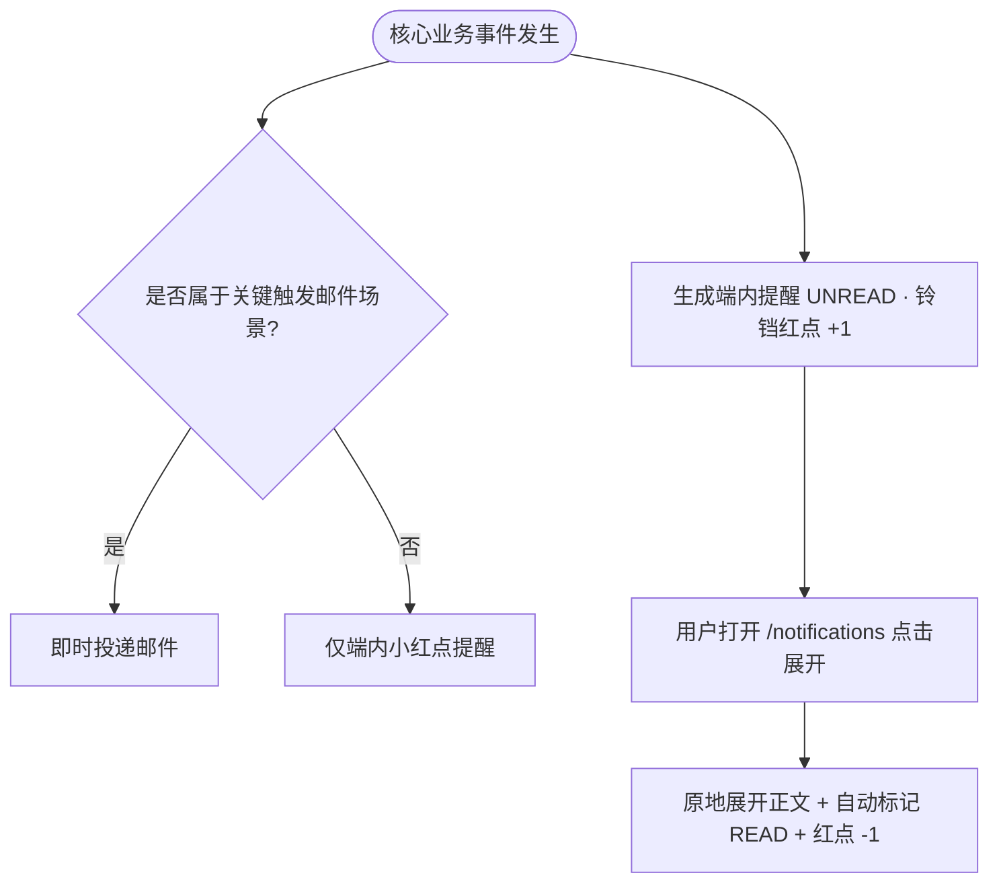

/** (c) 2024-2026 Topee (https://topee.top). All rights reserved. Proprietary and confidential. */

# 产品需求文档 (PRD) — 模块四：极简消息提醒与关键邮件通知 (Notification & Key Emails)

| 文档属性 | 内容 |
| :--- | :--- |
| **文档版本** | v2.0（精简轻量版） |
| **所属模块** | 模块四：消息提醒与邮件通知 (Notifications) |
| **关联子模块** | `m0_workspace_and_home.md`（顶栏小红点与通知卡）｜ `m3a/m3b/m3d`（排课与变动触发源）｜ `m5a/m5b`（周结催办） |
| **创建与更新日期** | 2026-11-05（创建） / 2026-11-13（按精简方案移除三级通知分级矩阵、30 分钟未读扫描补发邮件、防刷合并队列与 M1D 留言屏蔽逻辑；收敛为「关键触发邮件 + 极简端内小红点列表」） |

---

## 1. 概述与执行摘要 (Executive Summary)
消息提醒与关键邮件通知模块（`m4`）采用**“关键触发邮件 + 极简端内小红点列表”**的轻量通知体系。遵循少儿教务“老师看日历与邮件、家长看微信与核心续费账单”的真实习惯，本模块彻底砍掉复杂的一二三级分发矩阵与 30 分钟未读定时扫描兜底机制，仅保留最关键业务节点的即时邮件触达与单页面就地展开的端内消息中心（`/notifications`）。当前阶段：MVP 正式功能迭代。

---

## 2. 问题定义与背景 (Problem Statement)
- **过度设计带来的维护成本**：多级通知路由、30 分钟未读扫描定时轮询与防刷合并队列带来了极高的状态机与调度复杂度。
- **聚焦真实高频触点**：家长日常主要通过微信与班长沟通，仅需在“1v1 固定位自动续费账单与临期提醒”时收到正式邮件；而老师依赖邮件与日历确认排课、被代课及课次时间变动。

---

## 3. 目标用户与角色画像 (Users & Personas)
- **出资家长（Amy）**：在端内铃铛列表看到排课/挪位/续费提醒，并在 1v1 固定位到期续费时收到清晰的中英双语账单邮件。
- **老师（David）**：当收到新排课、请假挪位或被代课指派时即时收到英文/双语邮件提示，并在端内小红点查看详情。
- **班长（Leo）**：在周一上午收到周转账单待确认催办邮件，以及名下老师发起请假时的应急调度提醒。

---

## 4. 核心业务流程 (Main Flows)

### 4.1 关键触发邮件发送 (Key Triggered Emails)
仅针对以下核心业务事件即时发送邮件（单封即时触发，无需复杂合并队列）：
1. **家长侧**：1v1 固定位到期提前 7 天自动生成续费账单（首封提醒）及开课前 48h 临期二次提醒。
2. **老师侧**：新排课通知、课次请假退回/同师挪位变动通知、临时代课指派/撤销通知。
3. **班长侧**：每周一 08:00 待确认周转账单催办邮件、老师发起请假时的应急调度提醒邮件。

### 4.2 极简端内提醒列表（单页面就地展开架构）
- **唯一入口**：全站顶栏右侧铃铛图标常驻未读小红点角标（`1~99`，`>99` 显示 `99+`）；点击进入 `/notifications` 消息中心。
- **单页面就地折叠展开**：废除独立消息详情页与双列表结构；所有提醒以扁平卡片列表呈现，点击卡片原地手风琴展开完整中英双语正文与快捷跳转文字链（如 `[ 查看课表 → ]`、`[ 去续费 → ]`），展开瞬间自动标记已读并递减红点计数。
- **顶栏一键已读**：提供 `[ 全部标为已读 ]` 按钮，一键清除当前账号所有未读红点。

### 4.3 中英双语对照呈现
- 面向老师的邮件与端内提醒默认展示英文（或中英双语对照）；面向家长/班长默认展示简体中文。

### 4.4 实体生命周期与状态机 (`Notification` / `EmailDispatch`)
- **站内提醒 (`Notification`)**：`[*] -> UNREAD`（业务事件生成即推送，铃铛红点 +1）→ `READ`（用户点击卡片展开或点击全部标为已读）。
- **关键邮件任务 (`EmailDispatch`)**：`[*] -> PENDING`（关键触发事件创建）→ `SENT`（邮件网关投递成功）或 `FAILED`（投递失败记录日志，支持有限重试）。

---

## 5. 用户故事 (User Stories)
- **US-4-01（核心续费邮件）**：作为一个家长，我希望在固定位即将到期生成续费单时收到邮件账单提醒，以便于及时付款保住老师的黄金时段。
- **US-4-02（老师排课变动直达）**：作为一个老师，我希望当学员请假、挪位或班长指派我代课次收到邮件与端内提醒，以便于第一时间知晓课表变化。
- **US-4-03（极简小红点与就地展开）**：作为一个用户，我希望点击顶栏铃铛进入单页面消息列表，点开某条消息就能直接看到详情和已读消点，无需反复跳转页面。
- **US-4-04（班长周一转账催办）**：作为一个班长，我希望每周一早上收到待转账草稿单邮件提醒，以便于按时核对结课并完成打款上传凭证。

---

## 6. 验收标准清单 (Acceptance Criteria)
- **AC-4-01（关键触发邮件范围）**：1v1 固定位自动续费账单与 48h 临期提醒、老师新排课/挪位/代课变动、周一班长转账催办与老师请假应急调度，必须在事件触发后 1 分钟内投递邮件。
- **AC-4-02（取消冗余扫描与等级编号）**：系统**不得**运行“30 分钟未读扫描补发邮件”定时任务；端内与邮件界面**严禁**出现“一级/二级/三级”或“Level 1/2/3”等等级数字标识。
- **AC-4-03（单页面就地展开与自动消点）**：在 `/notifications` 页面点击任意未读消息卡片，卡片在原位平滑展开完整正文，并在 200ms 内同步将该消息置为已读、顶栏铃铛红点数减 1。
- **AC-4-04（全部标为已读）**：点击顶栏 `[ 全部标为已读 ]` 后，所有未读消息置为已读，顶栏红点角标立即隐藏。
- **AC-4-05（小班课隔离）**：小班课无家长账号，小班暂停待排或代课变动不触发家长端通知或邮件，仅通知主理人/授课老师。

---

## 7. 本期范围外清单 (Out of Scope)
- **不支持一二三级通知分级矩阵**。
- **不支持 30 分钟未读扫描自动补发邮件兜底机制**。
- **不支持短信 (SMS) 或微信公众号模板消息推送**。
- **不支持独立消息详情二级页面**。

---

## 8. 约束条件 (Constraints)
- **历史保留**：站内提醒保留最近 90 天记录，分页每页 20 条，按生成时间倒序排列。
- **文案去技术化**：界面禁止出现“消息”、“邮件补发”、“SSE”、“TaskRelay”等工程词汇。

---

## 9. UI/UX 界面线框说明 (Wireframe Level)
- **消息中心页 (`/notifications`)**：
  - 顶栏：`< 返回` + `消息中心` + 右侧 `[ 全部标为已读 ]`；
  - 筛选胶囊：`[ 全部 ]`、`[ 未读 (N) ]`；
  - 消息列表卡：未读左侧带蓝点标记，显示业务标签（如 `[课程变动]`、`[续费提醒]`）、标题、相对时间；点击原地向下展开正文详情与 `[ 前往查看 → ]` 文字链。

---

## 10. 用户流程图 (User Flow Diagram)

