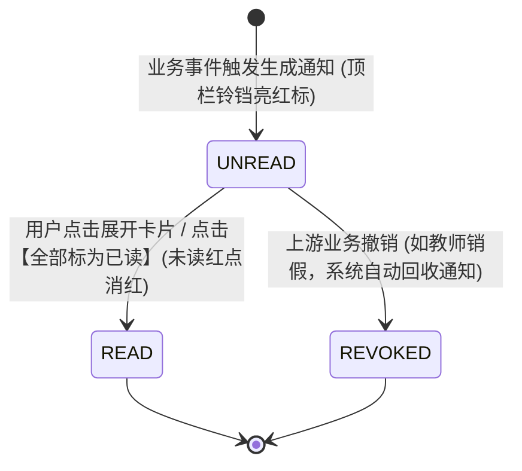
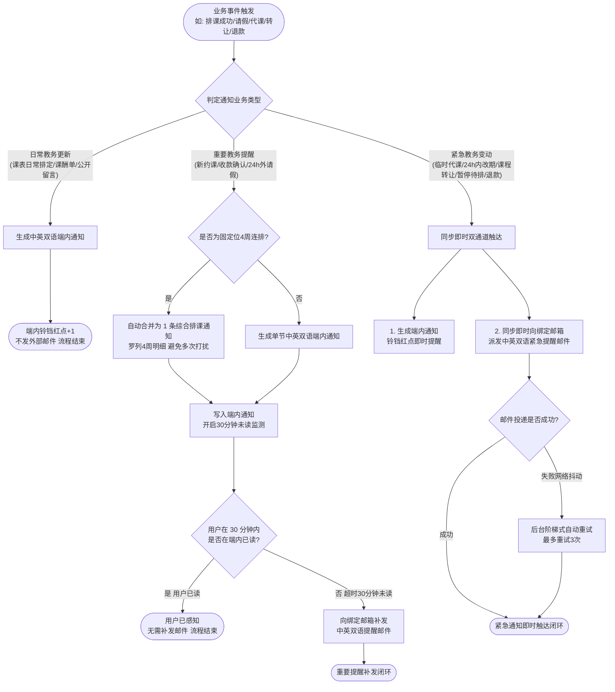
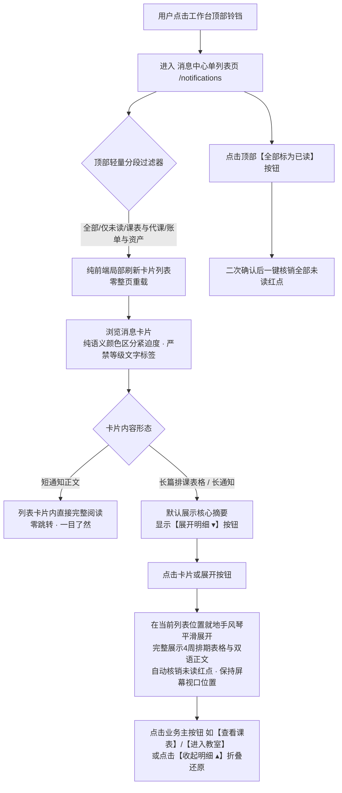

/** (c) 2024-2026 Topee (https://topee.top). All rights reserved. Proprietary and confidential. */

# 产品需求文档 (PRD) — 模块四：消息通知中心 (Notification Center)

| 元数据项 | 说明 / 内容 |
|---|---|
| **模块代号** | `module4_notification` |
| **所属模块** | 模块四：消息通知中心 (Notification Center) |
| **文档状态** | 待评审 (Draft) |
| **关联顶层 PRD** | [Prd-v5.md](../Prd-v5.md) |
| **关联规范文档** | [BUSINESS_RULES.md](../BUSINESS_RULES.md) ｜ [CODING_STANDARDS.md](../CODING_STANDARDS.md) |
| **关联模块划分** | [system_modules_overview.md](../system_modules_overview.md) |
| **创建与更新日期** | 2026-11-05 初稿；2026-11-10 升级：全面消除技术与分级词汇、取消独立详情页改为单列表过滤就地展开、去除卡片内等级文本标签纯以语义颜色区分；2026-11-11 架构锁死：明确单一列表页架构，严禁拆分双列表页与独立详情页；2026-11-12 卡片视觉改为只声明卡片类型，色值统一引用 DESIGN.md 2.2.1 |

---

## 1. 概述与执行摘要 (Executive Summary)

消息通知中心（`module4_notification`）是 Dream 系统的全链路家校沟通中枢与信息触达保障底盘。针对少儿教务中“外教英文母语、国内家长中文阅读、排课高频变动易被遗忘”的跨国运营特征，本模块提供**中英双语信息传达**，并依据业务重要程度提供**日常教务通知（端内呈现）**、**重要提醒（端内呈现 + 未读邮件提醒）** 与 **紧急通知（端内与邮件即时同步提醒）**。

在前端表现层，系统彻底摒弃繁琐的弹窗与独立二级跳转页面，采用**带过滤条件的单页面消息列表页**。用户可通过顶部标签按“全部/未读”及“课表与代课/账单与资产”一键过滤，长篇排课或通知内容**直接在卡片内就地展开查看**。卡片内部**严禁标注任何“一级/二级/三级/紧急”等机械式等级文本标签**，纯粹通过 Design Tokens 语义边框与状态颜色（红色高警示、橙色待办、中性常规）直观传达信息优先级，实现界面极简、阅读无负担。当前阶段：MVP 正式功能迭代。

---

## 2. 问题定义与背景 (Problem Statement)

- **痛点 1：跨国师生语言隔阂引发理解成本与漏看**：外教不通中文，国内低龄家长看长篇英文邮件吃力。若按离线用户偏好单语发送，极易因设置不准导致外教看乱码中文或家长漏看关键英文提示。
- **痛点 2：信息过载与垃圾邮件轰炸风险**：日常常规变动若封封发邮件，极易被 QQ/网易等国内邮箱判定为垃圾邮件遭拦截；特别是固定位一次性排满 4 周时，瞬间连发 4 封独立邮件体验极差。
- **痛点 3：关键排期变更因仅有端内消息滞后导致旷课**：若仅依赖端内通知，家长离线时无法及时感知排课成功或紧急代课调整，容易导致开课时缺席引发纠纷。
- **痛点 4：敏感教学备忘泄露引发家校信任危机**：教师在学生档案留言板记录的“仅内部教学可见”信息（如孩子注意力差、性格敏感等交接提示），若通知系统过滤不严误推送给家长，将引发严重客诉。
- **痛点 5：网络波动导致重要通知遗漏**：小班暂停待排或多孩批量排课时，若遭遇网络抖动且缺乏自动重试保障，容易导致邮件未送达且无从排查。

---

## 3. 目标用户与角色画像 (Users & Personas)

### 3.1 角色一：出资家长（Amy）
- **角色定位**：日常通知接收人。
- **核心诉求**：在移动端顶部铃铛清晰查看未读红点，点击进入消息列表；通过顶部过滤条一键筛选“仅看未读”或“课表与代课”；长篇课程通知直接在列表卡片内就地展开通览，无需反复跳进跳出；重要排课 30 分钟未在端内查看时，能从个人 QQ/163 邮箱收到中英双语提醒邮件。
- **预期成果**：不错过任何上课与转账重要变动，信息获取零跳转零阻碍。

### 3.2 角色二：母语外教（David）
- **角色定位**：跨国教学履约方。
- **核心诉求**：课表生成或紧急代课调整时，第一时间从 Gmail 收到邮件，邮件包含标准英文对照（顶部可一键直达英文区），ClassIn 上课时间与学生昵称准确呈现。
- **预期成果**：无障碍获知代课任务，精准备课。

### 3.3 角色三：负责班长（Leo）
- **角色定位**：突发教务调度人。
- **核心诉求**：发生临时代课或暂停待排时，系统即时向涉及的所有外教和家长派发双语邮件，无需人工在微信群逐一核实。
- **预期成果**：紧急调度 100% 自动触达，省心闭环。

### 3.4 角色四：平台管理员（Sarah）
- **角色定位**：系统通信风控人。
- **核心诉求**：通知底层解耦稳定运行，全域邮件派发具备清晰审计日志与自动重试机制。
- **预期成果**：通信基建高可用，投递状态透明。

---

## 4. 核心业务流程 (Main Flows)

### 4.1 中英双语对照传达 (Bilingual Content Presentation)
1. **邮件双语版式**：
   - 邮件主题：采用自然双语格式，如 `【Dream】固定位排课成功 / Fixed Slot Schedule Confirmed`；
   - 邮件正文：统一采用“中文在上、英文在下”的双语对照形式；
   - 顶部快捷锚点：正文最上方提供高亮链接 `[English Version Below]`，点击就地平滑滚动至英文区域；
   - 底部双语落款：提供官方双语致谢与 ClassIn 教室快速指引。
2. **端内通知双语版式**：
   - 卡片标题：第一行为中文主标题，第二行为英文副标题（小号浅色）；
   - 卡片正文：第一段为中文业务陈述，第二段为对应英文对照描述。

### 4.2 日常教务通知流程 (Routine Updates - 仅端内提醒)
1. **触发场景**：课表日常排定、每周教师课酬节数单生成、学生档案留言板新公开回复。
2. **触达方式**：系统仅在端内生成消息通知，顶部铃铛未读数加 1；**不派发外部邮件**，避免高频日常更新打扰用户邮箱。

### 4.3 重要教务提醒流程 (Important Reminders - 端内提醒 + 未读邮件提醒)
1. **触发场景**：购课单收款确认生成课次资产、新预约临时课成功、距开课 $\ge 24\text{h}$ 常规请假或同师挪位、小班跨班长协同通知。
2. **端内即时提醒与批量聚合**：
   - 系统即时在端内生成通知消息；
   - 若属于 1v1 固定位 4 周批量排课，系统自动将 4 节排期**合并聚合成 1 条综合排课通知**，罗列 4 周明细，避免多次刷屏打扰。
3. **未读超时邮件提醒**：
   - 若用户在消息生成后 30 分钟内未在端内阅读，系统自动向用户绑定邮箱发送双语提醒邮件（固定位连排聚合为 1 封综合邮件），确保重要教务进展不被遗漏。

### 4.4 紧急教务变动即时提醒流程 (Urgent Alerts - 即时邮件与端内同步送达)
1. **触发场景**：距开课 $< 24\text{h}$ 紧急挪位、课程转让成功、小班课暂停待排、小班课提前结课解散、教师突发请假与指派临时代课、外教离职交接催办、退款单生成确认。
2. **即时双通道触达**：
   - 系统即时向涉及的外教与家长同步派发端内消息与双语紧急邮件，确保突发变动第一时间送达当事人，避免空等或旷课纠纷。

### 4.5 敏感教学备忘隐私物理屏蔽 (Privacy Firewall)
1. 教师或班长在学生档案留言板发布留言时，若勾选了 **【仅内部教学可见】**：
2. 系统物理拦截对该学生绑定的家长账号的通知派发路径：
   - **绝对禁止**向家长端发送该留言的任何端内通知；
   - **绝对禁止**向家长绑定的通知邮箱发送任何邮件提醒；
3. 仅向正课教师、代课教师与负责班长派发工作台内部提醒。

### 4.6 表现层：单页面消息中心架构（拒绝双列表与独立详情页）
1. **单一列表页路由流转（拒绝拆分 2 个独立列表页）**：
   - 用户点击工作台顶部铃铛直接进入【消息中心】列表页（唯一路由 `/notifications`），系统**物理拒绝将“课表通知”与“账单资产”拆分成 2 个孤立的列表页面**；
   - **单列表聚合与分段过滤器 (Segmented Filter)**：
     - 状态过滤：`[ 全部 ]` ｜ `[ 仅看未读 (N) ]`；
     - 业务分类：`[ 全部类型 ]` ｜ `[ 📅 课表与代课 ]` ｜ `[ 💳 账单与资产 ]`；
   - 切换过滤条件时，纯前端毫秒级局部响应式刷新列表，零整页重载，保障全域时间线的完整性与宏观把控感。
2. **纯语义颜色呈现与去等级化**：
   - 卡片内部**严禁标注任何“一级/二级/三级/紧急/重要”等机械式等级文本标签**；
   - 纯粹通过 Design Tokens 语义边框与状态颜色（红色高警示边框与状态圆点、中性常规边框）直观区分紧迫度，视觉干净无干扰。
3. **就地手风琴折叠展开与自动核销（彻底废除独立二级详情页）**：
   - **痛点与动因**：移动端跳转二级详情页 `/notifications/:id` 会导致视口跳动、加载白屏及返回重载，体验极度割裂；
   - **85% 短通知列表直读**：日常代课、请假、收款提醒等短正文直接在卡片内完整呈现，无需二次点击；
   - **15% 长篇排课就地展开**：4 周固定位连排等复杂长通知，卡片默认呈现核心摘要，点击卡片即可在当前位置**就地手风琴向下平滑展开 4 周完整表格**，再次点击 `[收起明细 ▴]` 收起；
   - **核销闭环**：点击展开卡片时即刻自动核销该条消息的未读红点；卡片右下方透出业务主入口（如【进入系统查看课表】、【进入教室】）；顶部保留【全部标为已读】纯文本按钮，一键批量清零。

---

### 4.4 实体生命周期与状态机 (Entity Lifecycles & State Machines)

M4 负责全系统通知分发与通信合规，闭环管理以下 2 大核心通信实体的生命周期：

#### 1. 站内通知消息实体 (InAppNotification)
- **生命周期状态机**：



- **状态转移规则与自动核销防线**：
  | 状态跃迁 | 触发角色 | 前置条件与防线守卫 | 伴随副作用与系统行为 |
  | :--- | :--- | :--- | :--- |
  | `[*] -> UNREAD` | 系统业务事件 | 排课、代课、退款、停电等业务事件触发生成 | 站内信落盘；顶栏 Banner 消息铃铛右上角增加未读计数红点 (`1~99`)。 |
  | `UNREAD -> READ` | 用户本人 (出资家长/外教/班长/管理员) | 列表内点击手风琴展开正文 或 点击顶栏 `[全部标为已读]` | 状态原子置为 `READ`；铃铛未读计数即时扣减或归零。 |
  | `UNREAD -> REVOKED` | 系统业务引擎 | 上游业务状态被冲正撤销（如教师请假后在窗口期内撤回销假） | 系统自动回收并隐藏原待办通知，防止用户基于失效信息产生误解。 |

#### 2. 外部邮件投递任务 (EmailDispatchTask)
- **生命周期流转**：
  - `QUEUED`（已入队）：高优先级事件（突发代课、退款到账、超时催续）触发邮件任务进入调度队列；
  - `SENT`（已送达）：SMTP 服务投递成功，记录邮件 MessageId 与时间戳；
  - `FAILED_RETRYING`（失败重试中）：网络抖动或服务超限，系统自动按指数退避算法（1m, 5m, 15m）重试，最多 3 次；
  - `DEAD_LETTER`（死信兜底）：超过 3 次重试仍未成功，归入后台告警日志并派发运维通知，不阻塞前台业务。

---

## 5. 用户故事 (User Stories)

- **US-M4-01**：作为一个母语外教，我想要收到的每封通知邮件都有清晰的英文对照，以便于我完全看懂上课与代课变更。
- **US-M4-02**：作为一个国内低龄家长，我想要在邮件上半部分看到简洁中文，以便于无需翻译软件即可知晓孩子的排课进展。
- **US-M4-03**：作为一个家长，我想要在排课成功但 30 分钟未登录系统查看时，自动从邮箱收到提醒，以便于及时知晓排课到账。
- **US-M4-04**：作为一个家长，我想要在发生临时代课或课程转让时，立即从邮箱收到紧急提醒邮件，以便于第一时间掌握变更。
- **US-M4-05**：作为一个家长，我想要在班长批量排好 4 周固定位时收到 1 封汇总邮件而不是 4 封独立邮件，以便于邮箱干净不被轰炸。
- **US-M4-06**：作为一个出资家长，我想要在通知列表中直接看完整篇幅短通知，以便于无需频繁点击即可一秒通览。
- **US-M4-06a**：作为一个出资家长，我想要在收到 4 周固定位连排等长篇综合通知时，能直接在卡片内就地展开完整表格与 ClassIn 进门信息，无需跳转独立页面。
- **US-M4-06b**：作为一个多通知用户，我想要按“仅看未读”或“课表与代课”、“账单与资产”一键过滤通知列表，以便于快速找到重要消息。
- **US-M4-07**：作为一个授课教师，我想要在内部留言板记录敏感学情备忘时系统绝对不向家长发通知，以便于交接真实学情且不引起家校矛盾。
- **US-M4-08**：作为一个平台系统，我想要邮件派发具备可靠的自动重试与异常保护机制，以便于通信高可用且不阻塞业务事务。

---

## 6. 验收标准清单 (Acceptance Criteria)

### 6.1 中英双语对照呈现规范
- **AC-M4-01**：所有系统派发的通知邮件，正文必须统一包含完整的中文版块与英文版块；中文位于上半部分，英文位于下半部分，顶部必须包含快捷定位锚点 `[English Version Below]`。
- **AC-M4-02**：所有端内通知，标题必须为双语格式（中文标题 + 英文副标题），正文必须同时包含中文描述段落与英文翻译段落。
- **AC-M4-02a（通知等级彻底隐蔽与纯语义颜色规范 · 铁律）**：
  - **严禁显示任何等级文字标签**：全端所有面向用户的界面（包含通知列表、工作台卡片、邮件正文与弹窗），**100% 物理禁止展示“一级”、“二级”、“三级”或“紧急”、“重要”、“日常”等机械式等级文本标签**；
  - **纯语义颜色呈现**：系统依托 Design Tokens 语义边框与状态圆点直观传达紧迫度（如红色高警示边框表示突发变动/代课/退款，橙色边框表示待续费/待处理，中性浅灰边框表示常规排课/课酬），颜色已足够传递优先级，无需额外文字标签；
  - **业务语义标题**：卡片标题直接反映业务事件（如 `【排课成功】`、`【代课提醒】`、`【退款已生成】`），副标题使用自然语言描述业务上下文（如“外教已接受代课安排”），杜绝技术代号。
- **AC-M4-02b（去底层技术词汇化）**：严禁在面向用户的任何界面出现“站内信”、“SSE 推送”、“TaskRelay 异步队列”、“通信风控”等底层架构词汇；统一使用用户友好的“系统通知”、“通知中心”、“消息提醒”。

### 6.2 业务分发策略与场景映射
- **AC-M4-03**：日常教务通知（课表日常排定、周课酬单生成、师生公开留言回复）仅生成端内通知，严禁向外部派发邮件，避免打扰用户日常邮箱。
- **AC-M4-04**：重要教务提醒（购课单收款确认、新约临时课、$\ge 24\text{h}$ 常规请假/挪位、**小班课跨班长常规协同通知**）首次触发时生成端内通知；若 30 分钟内用户未在端内阅读，系统自动向用户绑定邮箱补发中英双语提醒邮件。
  - **小班跨班长常规协同**：当小班课主理人与委任外教绑定班长非同一人时，新建班级委任、编辑班级信息、改期补排、异常未上课回退等事件，系统必须向委任外教的绑定班长派发提醒通知。
- **AC-M4-05**：紧急教务变动（$< 24\text{h}$ 紧急改期、课程转让到账、小班暂停待排、临时代课调配、小班课提前结课解散、外教离职小班交接催办、退款单生成）触发时，系统同步即时向涉及当事人派发端内通知与双语提醒邮件。
- **AC-M4-05a（小班课跨班长多方协同通知规范 · 决策 4A / 5A）**：
  - **跨班长班级解散**：主理人执行【提前结课解散】时，若授课外教绑定班长与主理人非同一人，系统向该外教绑定班长即时派发通知（端内消息 + 邮件提醒），告知班级提前解散原因及外教日历排期已释放；
  - **跨班长指派代课**：主理人指派代课时，若代课外教绑定班长或原主讲绑定班长与主理人非同一人，系统即时向涉事外教绑定班长派发通知，告知代课外教被委派代课的时段与班级信息；
  - **外教离职交接催办**：外教绑定班长为外教办理离职时，若触发小班交接阻断，点击【一键催办主理人提前结课解散】向小班课主理人派发加急通知与待办工单。

### 6.3 批量排课邮件聚合与防垃圾拦截
- **AC-M4-06**：当班长单次完成 1v1 固定位 4 周批量排课时，系统严禁逐节派发 4 封独立邮件；必须自动聚合为 1 封综合排课邮件（邮件标题标明“固定位排课确认（共4节）/ Fixed Slot Schedule Confirmed (4 Lessons)”，正文以中英双语表格罗列 4 周的日期、星期与时段）。

### 6.4 重要提醒未读超时邮件补发规约
- **AC-M4-07**：针对重要教务提醒，系统以 30 分钟为未读监控窗口；若用户在消息生成后 30 分钟内未登录系统查阅，系统自动触发向其绑定邮箱补发中英双语提醒邮件。
- **AC-M4-08**：若用户在 30 分钟窗口内已在端内查阅并核销未读，系统自动取消邮件补发，避免冗余打扰。
- **AC-M4-09**：邮件补发机制具备防重保障，同一事件对同一接收人严格限制补发 1 次，严禁向同一用户重复补发邮件。

### 6.5 表现层单页面消息列表与就地展开规范
- **AC-M4-10（单列表页路由与物理防拆分铁律）**：全端消息通知唯一收敛于【消息中心】单列表页（路由 `/notifications`），物理禁止自建第二个独立列表页（如将“课表”与“资产”拆页）或独立二级详情页（`/notifications/:id`）；各工作台顶栏常驻通知铃铛图标；未读数 $> 0$ 时显示醒目红色角标（超 99 显示 `99+`），点击直通本单列表页。
- **AC-M4-11（未读与分类多维轻量过滤条）**：通知列表页顶部常驻轻量分段过滤器（Segmented Filter）：
  - 状态维度：`[ 全部 ]` ｜ `[ 仅看未读 (N) ]`；
  - 业务分类维度：`[ 全部类型 ]` ｜ `[ 📅 课表与代课 ]`（排课、请假、代课、暂停待排） ｜ `[ 💳 账单与资产 ]`（购课单、转账、转让、退款）；
  - 过滤操作为纯前端本地毫秒级过滤，支持配合时间倒序排列与分页加载。
- **AC-M4-12（纯语义颜色呈现与等级标签隐蔽）**：卡片上严禁出现任何“一级/二级/三级/紧急/重要”等机械文字标签；紧迫程度纯粹由 Design Tokens 语义边框（如变动使用红色警戒边框、常规使用中性边框）与未读圆点传达，“颜色已经足够，无需画蛇添足”。
- **AC-M4-13（长文就地折叠展开与自动已读核销）**：
  - 短通知在列表卡片内直接完整呈现，一目了然；
  - 长篇排课清单或复杂通知，卡片默认呈现核心摘要，点击卡片即可在列表内**就地平滑展开完整内容与排课表格**（手风琴动效），再次点击折叠收起；
  - 点击卡片展开或查看时，自动核销该条消息的未读红点，无需跳转二级页面；
  - 卡片右下角根据业务场景透出直接行动按钮（如【查看课表】、【进入 ClassIn】、【去约课】）。
- **AC-M4-14（全部标为已读与批量清理）**：通知列表页顶部常驻【全部标为已读】纯文本按钮，点击后弹出二次确认对话框；确认后一键将当前用户所有未读消息置为已读，顶部铃铛红点清零。

### 6.6 隐私安全屏障与生命周期
- **AC-M4-15**：当学生档案简易留言板产生类型为 `internal_teaching_only`（仅内部教学可见）的留言时，系统强制拦截家长接收人，严禁向家长端产生端内通知或邮件。
- **AC-M4-16**：已读通知在系统中保留 90 天，未读通知保留 180 天；超期数据由后台定时归档清理。

### 6.7 投递可靠性与异常保障
- **AC-M4-17**：邮件发送任务必须具备网络故障自动重试机制（支持多次阶梯式重试），确保邮件可靠送达。
- **AC-M4-18**：邮件发送属于辅助触达通道，其网络异常或投递失败严禁阻塞排课、代课、转让及财务退款等核心教务业务的正常执行。

---

## 7. 本期范围外清单 (Out of Scope)

- **营销推广短信与业务短信通知**：本期短信通道仅保留于账号体系登录/找回密码验证码，业务提醒严禁使用短信大水漫灌。
- **第三方即时通讯（微信服务号/企微应用消息）直推**：本期不接入微信开放平台模板消息，统一由 Email 与站内信承载。
- **用户自定义免打扰时间段配置**：本期暂不开放用户自定义夜间免打扰静音时段，由邮件客户端自带的免打扰机制承载。
- **富媒体音视频附件直接邮件挂载**：邮件正文仅支持图文与跳转链接，试讲视频等大文件严禁作为附件直挂，仅提供平台直达链接。

---

## 8. 约束条件 (Constraints)

### 8.1 业务与合规约束
- **中英双语强制规范**：所有面向用户触达的模板必须经过严格的中英双语校对，禁止出现纯中文或纯英文的单语邮件。
- **隐私保护底线**：严禁在邮件主题或通知内容中泄露未脱敏的账号密码、Token、财务结算底单原件等敏感信息。

### 8.2 功能与规格限制
| 约束项 | 指标规格 / 限制值 |
|---|---|
| 邮件与端内通知语言 | 统一中英双语上下对照排版 |
| 重要提醒未读超时阈值 | 严格为 30 分钟（1800 秒） |
| 邮件发送故障自动重试 | 阶梯式自动重试（上限 3 次） |
| 通知记录保留期 | 已读保留 90 天 / 未读保留 180 天 |
| 顶部铃铛未读数展示 | 1 - 99，超额显示 `99+` |
| 固定位邮件聚合上限 | 单封邮件最多聚合连续 4 周排期 |

### 8.3 外部文档与参照依据
| 文档名称 | 存放路径 / 链接 | 使用场景说明 |
|---|---|---|
| 核心业务规则与财务分账规约 | docs/BUSINESS_RULES.md | 业务提醒分发与双权限隔离规约 |
| 工程与编码规范 | docs/CODING_STANDARDS.md | 状态码与遥测标准 |
| 简易留言板 PRD | docs/prd/m1d_profile_messages.md | 内部教学可见隐私屏蔽联动 |

---

## 9. UI/UX 界面线框说明 (Wireframe Level)

### 9.0 表现层页面清单与架构设计决策 (Page Inventory & Architecture Decisions)

| 页面 / 载体名称 | 路由 / 承载形态 | 服务角色 | 核心功能与目的 |
|---|---|---|---|
| **消息中心单列表页** | `/notifications` (端内唯一独立页面) | 全角色 (家长/外教/班长/管理员) | 全端通用的消息集散地；提供未读/业务分类轻量过滤；短通知直读，长篇排课就地手风琴平滑展开；一键全部已读。 |
| **响应式双语邮件模板** | Email (端外离线触达载体) | 家长 / 外教 / 班长 | 离线信息必达保障底盘；上半中文下半英文对照（含快捷锚点）；承担 30 分钟未读自动补发与紧急变动即时直达。 |
| **工作台消息铃铛与最近通知** | 全端工作台顶栏 & 首页组件 (非独立页面) | 全角色 | M0 顶栏常驻铃铛（未读红点角标 1~99+）直通 `/notifications`；首页卡片流聚合最近 3 条摘要，无需独立页面。 |

#### 针对页面架构的两大核心决策深度解析：
1. **为什么坚决不设“2 个列表页”？**
   - **杜绝信息割裂与跳页疲劳**：曾有方案设想将“课表与代课”与“账单与资产”物理拆分为两个独立的列表页面（甚至有人将工作台首页的“最近通知”或管理员投递监控误认为是第二个列表页）。若按业务类型拆成双列表页，用户为了解孩子近期动态必须在两个页面来回跳进跳出，认知负担极重；
   - **单页面 + 分段过滤器 (Segmented Filter)**：统一收敛在 `/notifications` 单一路由中。顶部常驻两行轻量切换按钮（状态：全部 / 仅看未读；分类：全部 / 课表与代课 / 账单与资产），纯前端毫秒级过滤，保持全域时间序的完整感知。
2. **为什么彻底废除“独立通知详情页”？**
   - **痛点根源**：移动端（手机微信/PWA）跳入 `/notifications/:id` 详情页、看完再点左上角返回时，极易发生白屏重载与滚动视口跳动，体验高度割裂；
   - **85/15 场景精准解耦**：教务消息中 85% 属于 1~2 句话的短通知（如代课指派、退款确认），卡片本身即可完整展示；仅 15% 属于 4 周连排长表格；
   - **就地手风琴折叠展开 (In-place Accordion)**：长篇排课默认展示核心摘要与 `[展开明细 ▾]`，点击在当前列表原位向下平滑展开 4 周完整表格，再次点击 `[收起明细 ▴]` 收起，并同步自动核销未读红点。在列表内 1 秒完成“通览-展开-核销-直达进班”，彻底消灭独立详情页。

### 9.1 前端通用 — 消息中心列表页 (Notification List Page, 路由 `/notifications`)
- **界面结构与布局**：
  - 各工作台顶栏常驻铃铛图标，带未读角标（`1` 到 `99`，`>99` 呈现 `99+`）；点击直接进入本列表页。
  - **顶部操作栏**：
    - 左侧标题“消息中心 / Notifications”；
    - 右侧提供【全部标为已读】操作文字链。
  - **顶部轻量分段过滤条 (Segmented Filter Bar)**：
    - 第一行状态切换：`[ 全部 ]`  `[ 仅看未读 (3) ]`
    - 第二行分类切换：`[ 全部类型 ]`  `[ 📅 课表与代课 ]`  `[ 💳 账单与资产 ]`
  - **卡片列表区（纯语义颜色 + 就地手风琴折叠展开）**：
    - **去等级化标签铁律**：严禁出现任何 `[紧急]`、`[重要]`、`[二级必达]` 等文字标签；变动消息使用【浅红紧急卡】，紧迫度只由卡片类型与圆点传达（具体样式见 DESIGN.md §2.2.1）；
    - **就地手风琴展开**：长篇通知默认展示核心摘要与 `[展开明细 ▾]` 按钮，点击在当前列表就地平滑展开完整表格与正文，无需跳转二级独立详情页。
```
+--------------------------------------------------------------------------+
|  消息中心 / Notifications                        [✓ 全部标为已读]        |
|--------------------------------------------------------------------------|
|  [全部]  [*] 仅看未读 (3)                                                |
|  [*] 全部类型   [ ] 📅 课表与代课   [ ] 💳 账单与资产                    |
|--------------------------------------------------------------------------|
|  ▌ ● 【代课提醒】外教已调配代课安排                      10分钟前 ｜ 课表 |
|  ▌   Substitute Teacher Assigned                                         |
|  ▌   ------------------------------------------------------------------  |
|  ▌   学员 [AliceZ12] 今天的少儿英语课因教师突发请假，已指派外教             |
|  ▌   Sarah 老师代课，时间保持 19:00-19:25 不变。ClassIn 教室号：982-101。  |
|  ▌   Substitute teacher assigned. Time remains unchanged.                |
|  ▌   (变动类消息：玫瑰红重点竖条，纯颜色传达，无文字等级标签) [进入教室] |
|--------------------------------------------------------------------------|
|    ● 【固定位排课确认】您的4周排课已生成                 1小时前 ｜ 课表  |
|      Fixed Slot Lessons Scheduled (4 Lessons)                            |
|      ------------------------------------------------------------------  |
|      学员 [AliceZ12] 的下轮 4 周固定位课程已全部锁定，每周二 19:00，     |
|      首节课将于 11-17 开课，授课教师为 David 老师。                      |
|      (长篇排课卡片默认折叠摘要)                             [展开明细 ▾] |
|--------------------------------------------------------------------------|
|    ● 【固定位排课确认】您的4周排课已生成 (就地展开态)    1小时前 ｜ 课表  |
|      Fixed Slot Lessons Scheduled (4 Lessons)                            |
|      ------------------------------------------------------------------  |
|      尊敬的家长您好：                                                    |
|      学员 [AliceZ12] 的下一轮 4 周固定位课程已由负责班长排定成功，排期： |
|      +--------+------------+---------------+----------+----------------+ |
|      | 周次   | 上课日期   | 授课时段      | 授课教师 | ClassIn 教室号 | |
|      +--------+------------+---------------+----------+----------------+ |
|      | Week 1 | 2026-11-17 | 19:00 - 19:25 | David    | 982-123-456    | |
|      | Week 2 | 2026-11-24 | 19:00 - 19:25 | David    | 982-123-456    | |
|      | Week 3 | 2026-12-01 | 19:00 - 19:25 | David    | 982-123-456    | |
|      | Week 4 | 2026-12-08 | 19:00 - 19:25 | David    | 982-123-456    | |
|      +--------+------------+---------------+----------+----------------+ |
|      Dear Parent: Fixed slot schedule is confirmed. Enjoy your class!    |
|      (点击卡片在当前列表就地平滑展开，再次点击收起)         [收起明细 ▴] |
|                                                    [进入系统查看课表]    |
|--------------------------------------------------------------------------|
|      【购课单已收款】您已成功开具临时课购课单            昨天 ｜ 账单    |
|      Course Purchase Order Confirmed                                     |
|      ------------------------------------------------------------------  |
|      购课单 ORD-20261107-001 已确认收款 1,000 积分，已为您生成 5 节待排期|
|      临时课资产，随时可自主预约外教。                                    |
|      Order confirmed, 5 temporary lesson slots ready.    [去约课]        |
|--------------------------------------------------------------------------|
|                              没有更多消息了                              |
+--------------------------------------------------------------------------+
```

### 9.2 卡片就地手风琴折叠展开交互对比 (In-place Accordion State Comparison)
- **设计目标**：杜绝传统“列表跳详情、详情再返回”的碎片化体验，让用户在同一个消息列表页内完成“筛选-通览-展开查阅-核销”全流程。
- **状态 1：默认摘要折叠态 (Collapsed State)**：
  - 显示双语标题、时间戳、业务分类徽章（如 `课表` / `账单`）；
  - 显示前两行摘要正文，末尾附带轻量操作链接 `[展开明细 ▾]`；
  - 卡片高度紧凑，用户单屏可快速扫过 5-6 条消息。
- **状态 2：就地手风琴展开态 (Expanded State)**：
  - 点击卡片任意区域或 `[展开明细 ▾]` 按钮，卡片向下平滑展开完整内容；
  - 完整呈现结构化表格（如 4 周固定位连排周次、日期、外教、教室号）及英文对照；
  - 展开的同时即刻触发未读红点核销（红点 `●` 消失），卡片保持当前屏幕滚动位置不跳动；
  - 底部右侧切换为 `[收起明细 ▴]` 按钮，并透出对应业务的主行动按钮（如【进入系统查看课表】）。

### 9.3 响应式中英双语邮件排版标准 (Responsive Bilingual Email Template)
- **邮件外观排版规范**：
  - 宽度严格限制为 600px 居中卡片，浅灰底色（`#F5F7FA`），主体白色内容框，适配手机竖屏与电脑宽屏；
  - **邮件头部 (Header)**：Dream 品牌标识，右上方常驻高亮链接：`[English Version Below ↓]`；
  - **中文版块 (Chinese Section)**：
    - 醒目大标题，如：`您的固定位课程排课成功（共 4 节）`；
    - 中文称谓与正文说明；
    - 核心业务数据表格（日期、星期、时段、学员、教师、ClassIn教室号）；
    - 快捷按钮：【进入系统查看课表】；
  - **中英分割线 (Divider)**：一条浅灰渐变分割线，标注 `--- English Version Below ---`；
  - **英文版块 (English Section)**：
    - 英文标题，如：`Fixed Slot Lessons Scheduled Successfully (4 Lessons)`；
    - 英文称谓与说明文本；
    - 对应的英文版数据表格；
    - 英文快捷按钮：【Open System & View Schedule】；
  - **邮件尾部 (Footer)**：官方版权声明，ClassIn 技术支持指引，退订/免责双语声明。

---

## 10. 用户流程图 (User Flow Diagram)

### 10.1 业务通知分发与提醒流程


### 10.2 表现层单页面消息列表与就地展开交互流


---

## 11. 智能体/系统决策行为规范 (System Decision Rules Engine)

- **系统允许自动执行 (Allowed Operations)**：
  - 自动依据业务事件类型路由到正确的触达方式（日常仅端内、重要提醒超时发信、紧急变动即时发信）；
  - 批量排固定位时，自动聚合为单一综合通知实体，抑制多发；
  - 针对重要教务提醒，系统在 30 分钟未读后自动向用户绑定邮箱补发中英双语提醒邮件；
  - 邮件发送发生网络故障时，系统自动执行阶梯式重试（最多 3 次）；
  - 后台自动根据保留周期清理 90 天前已读与 180 天前未读的通知数据。
- **系统绝对禁止 (Strictly Forbidden Operations)**：
  - **严禁**针对 `internal_teaching_only`（仅内部教学可见）留言向家长账号触发任何端内通知或邮件；
  - **严禁**将 4 周固定位连排拆散为 4 封独立邮件瞬间轰炸用户邮箱；
  - **严禁**在端内卡片或任何用户界面展示机械式等级文本标签（如“一级/二级/三级/紧急/重要”），界面纯依靠语义边框与圆点颜色呈现；
  - **严禁**将消息中心拆分为多个独立的列表页面或创建独立二级详情页（`/notifications/:id`），全端消息通知统一收敛于单一列表页 `/notifications` 并通过手风琴就地折叠展开；
  - **严禁**对同一超时的重要提醒重复补发多封相同邮件；
  - **严禁**邮件发送异常阻断核心教务排课、代课、转让或资金退款等业务事务的正常执行。
- **无法判定/异常时的退避与人工兜底逻辑**：
  - 若接收人邮箱格式非法或邮箱域不存在，系统在日志中标记 `INVALID_EMAIL` 并丢弃，不持续无效重试；
  - 若邮件通道暂时不可用，系统自动转入后台重试队列等待网络恢复，绝对不阻塞排课与财务核心业务的正常落盘。

---

## 12. 待定事项与补充说明 (Further Notes)

- **本期已敲定并落盘决策**：
  1. 双语排版：邮件中英上下对照（中文在上、英文在下，带一键直达英文锚点），端内通知采用双语标题与对照描述。
  2. 场景化提醒：日常通知仅端内生成；重要提醒在端内生成且 30 分钟未读时自动补发邮件；紧急变动（代课、暂停待排、改期、退款）即时双通道同步触达。
  3. 固定位聚合：4 周连排自动合并为 1 条综合排课通知/邮件（双语表格罗列 4 周明细），杜绝邮件轰炸。
  4. 表现层单页面设计（保留单一列表页铁律）：彻底废除拆分 2 个独立列表页方案与独立二级详情页，全系统 100% 物理收敛于【消息中心】单一列表页（路由 `/notifications`）。通过顶部轻量分段过滤器（Segmented Filter）实现纯前端毫秒级过滤；长篇排课明细直接在卡片内就地手风琴平滑展开查阅，视口平滑不跳动；展开即自动静默核销未读红点；卡片内部纯靠语义颜色区分紧迫度，严禁标注任何等级文字标签。
  5. 异步保障：邮件发送异步解耦，网络抖动具备阶梯式自动重试，不阻断核心教务主业务。
  6. 生命周期：已读通知保留 90 天，未读通知保留 180 天。
- **后续版本演进考量 (Future Backlog)**：
  - 针对外教工作习惯，二期可评估增加“外教每日日程晨报汇总邮件”（每日早晨 07:00 汇总当天所有课程与代课）。
